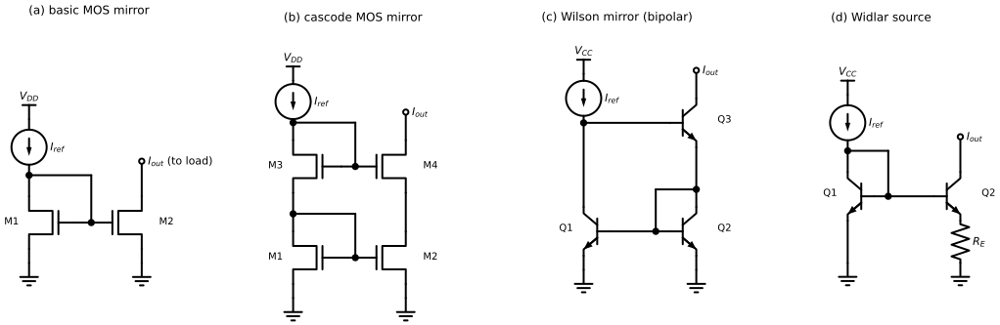
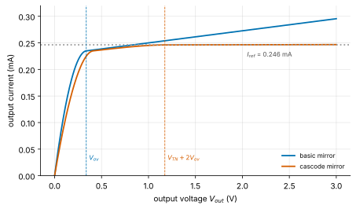
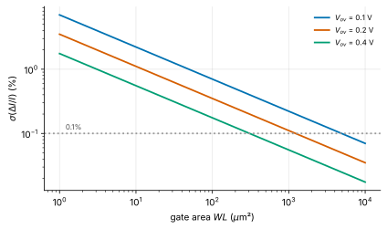

<!-- status: reviewed -->
# 10-08 · Current Sources and Current Mirrors

| | |
|---|---|
| **Course** | [10 · Electronics I (Microelectronic Circuits)](../README.md) |
| **University equivalent** | Current sources and mirrors in Electronics I/II: the basic MOS and bipolar mirrors and their errors, output resistance and compliance, degenerated, cascode and Wilson mirrors, device mismatch, and bias distribution in integrated circuits (Sedra & Smith, *Microelectronic Circuits*, ch. 8; Razavi, *Design of Analog CMOS Integrated Circuits*, ch. 5) |
| **Prerequisites** | [10-02 MOSFET DC Operation and Biasing](10-02-mosfet-dc-operation-and-biasing.md), [10-03 BJT DC Operation and Biasing](10-03-bjt-dc-operation-and-biasing.md), [10-06 MOS Single-Stage Amplifiers](10-06-mos-single-stage-amplifiers.md), [10-07 BJT Single-Stage Amplifiers](10-07-bjt-single-stage-amplifiers.md) |
| **Estimated study hours** | 8 |
| **Last verified** | 2026-11-19 |

**Learning objectives.** After this chapter you can:

1. Describe a real current source by its current, output resistance and compliance voltage, and explain why each matters.
2. Derive the output current, ratio errors (channel-length modulation, Early effect, base current) and output resistance of the basic MOS and bipolar mirrors.
3. Derive how degeneration, cascoding and the Wilson topology raise output resistance and reduce error, and what headroom each costs.
4. Relate random threshold mismatch to current mismatch, $\sigma(\Delta I/I) = (g_m/I)\,\sigma(\Delta V_{TH})$, and use area scaling to size a mirror for a matching target.
5. Design a simple bias-distribution network and estimate its supply sensitivity.

---

## 1. Big picture

An integrated circuit cannot use large resistors or capacitors to set its operating points; it uses currents. One reference current, made once, is copied by **current mirrors** into every amplifier, comparator and oscillator on the chip, and mirrors also serve as the high-resistance **active loads** that give CMOS stages their gain (10-06 §3.2). 10-02 and 10-03 introduced the basic mirror as a bias element. This chapter treats it as a circuit in its own right: how accurately it copies, how good a current source its output is, how much voltage it needs, and how mismatch between nominally identical transistors limits all of it.

- **Every analog block starts with a mirror.** Op-amp tail currents, LNA bias, ADC comparators and PLL charge pumps are mirror outputs.
- **Output resistance is gain.** A mirror used as an active load sets the stage's gain through its output resistance.
- **Compliance is headroom.** Each technique that improves a mirror costs voltage, the scarce resource of low-supply chips.
- **Mismatch is yield.** Random variation between "identical" transistors sets offsets and ratio errors, and the area spent to control it is a direct cost.

## 2. Intuition first

**Copying a current through a voltage.** A diode-connected transistor converts a current into the gate (or base) voltage that would make it carry exactly that current. Any identical transistor given the same voltage carries the same current. The mirror is a translation into a shared language ($V_{GS}$ or $V_{BE}$) and back.

**What can go wrong.** The translation is perfect only if the two transistors are truly identical and see identical conditions. Three things break it:

- **The output transistor's drain (collector) voltage differs** from the reference's, and channel-length modulation or the Early effect makes current depend on it.
- **The control terminal draws current** (bipolar only): the base currents come out of the reference.
- **The transistors are not identical**: random variation in threshold or saturation current.

**A finance analogy: a fund that tracks an index.** A mirror is an index fund: it replicates a reference (the index) by holding the same "position" ($V_{GS}$). Its **tracking error** has a systematic part (fees, here the base current; and exposure to a factor the index does not have, here the output voltage through $r_o$) and a random part (sampling error, here device mismatch, which shrinks as the fund holds more of the index, here as the device area grows). *Where it breaks:* a fund's tracking error does not depend on what the investor does with the shares; a mirror's error depends on the voltage its load forces on its output, which is why a mirror's quality is specified by its output resistance, not just its ratio.

## 3. Theory

> **Conventions.** Square-law MOSFETs with channel-length modulation $(1 + \lambda V_{DS})$ in saturation and $r_o \approx 1/(\lambda I_D)$; bipolar transistors with β, $V_A$ and $V_{BE}$ = 0.7 V for bias; matched devices unless stated. The examples continue Example 10-02.5: $k_n$ = 4 mA/V², $V_{TN}$ = 0.5 V, λ = 0.1 V⁻¹ and a 10 kΩ resistor from 3.3 V, giving $I_{ref}$ = 0.2463 mA at $V_{GS}$ = 0.8371 V.

### 3.1 What makes a good current source

An ideal current source delivers its current at any voltage. A real one is a Norton source: a current $I_o$ in parallel with an **output resistance** $R_{out}$, valid only above a **compliance voltage** $V_{min}$ below which the transistor leaves saturation. Three numbers specify it:

- **Accuracy** of $I_o$ against the intended value or ratio.
- **Output resistance** $R_{out}$: a change $\Delta V$ in output voltage changes the current by $\Delta V/R_{out}$. Used as an active load, $R_{out}$ sets the gain.
- **Compliance** $V_{min}$: the lowest output voltage at which the source still works. Every volt of compliance is a volt of signal swing lost.

The three trade against each other, and the rest of the chapter is about how.

### 3.2 The basic MOS mirror

*Figure 3. The current sources of this chapter: (a) the basic MOS mirror, (b) the cascode MOS mirror, (c) the bipolar Wilson mirror and (d) the Widlar current source. In each, a reference current flows into a diode-connected device (gate or base tied to drain or collector), which sets the control voltage that the output device shares.*

M1 is diode-connected and carries $I_{ref}$; M2 shares its $V_{GS}$ (10-02 §3.5). With both saturated,

$$
I_{out} = I_{ref}\,\frac{(W/L)_2}{(W/L)_1}\cdot\frac{1 + \lambda V_{DS2}}{1 + \lambda V_{DS1}}, \qquad V_{DS1} = V_{GS} .
$$

- **Ratio:** the size ratio sets the current ratio, and the threshold cancels. Layout realizes ratios with multiple identical unit transistors in parallel, so that edge effects scale too.
- **Systematic error:** $\lambda(V_{DS2} - V_{GS})$ to first order. It vanishes only when the output sits at $V_{GS}$.
- **Output resistance:** the slope of $I_{out}$ against $V_{DS2}$, $R_{out} = (1 + \lambda V_{GS})/(\lambda I_{ref}) \approx r_{o2}$.
- **Compliance:** M2 must stay saturated, $V_{DS2} \ge V_{ov}$: a few hundred millivolts.

### 3.3 The basic bipolar mirror and the β helper

For matched bipolar transistors (10-03 §3.5), the reference must supply both base currents, and the Early effect adds the drain-voltage error:

$$
I_{out} = I_{ref}\,\frac{1 + V_{CE2}/V_A}{1 + V_{CE1}/V_A + 2/\beta}, \qquad V_{CE1} = V_{BE} ,
$$

with each base current taken as $I_Se^{V_{BE}/V_T}/\beta$. For small errors this is the product of the base-current factor $1/(1 + 2/\beta)$ and the Early factor $(1 + V_{CE2}/V_A)/(1 + V_{CE1}/V_A)$ of 10-03 §3.5.

Output resistance $r_{o2} = V_A/I_{out}$; compliance $V_{CE,sat}$, about 0.2–0.3 V.

**The β helper.** A third transistor Q3, with its base on Q1's collector and its emitter driving the two bases, supplies the base currents from the supply rather than from the reference. The reference now loses only Q3's base current, $2I_C/[\beta(\beta + 1)]$:

$$
I_{out} = I_{ref}\,\frac{1 + V_{CE2}/V_A}{1 + V_{CE1}/V_A + 2/[\beta(\beta + 1)]} ,
$$

a reduction of the β error by a factor of about β. The cost is one more $V_{BE}$ at the reference ($V_{CE1} = 2V_{BE}$), which slightly changes the Early-effect term (Example 10-08.2).

### 3.4 Raising the output resistance

**Degeneration.** Add equal resistors $R_S$ in both sources. The output looks into a degenerated drain (10-06 §3.3):

$$
R_{out} = r_o + R_S + g_mr_oR_S \approx r_o(1 + g_mR_S) .
$$

Cost: the compliance rises by $I_{out}R_S$. Benefit beyond $R_{out}$: the current now depends partly on the resistors, which match better than thresholds, so mismatch falls too.

**The cascode mirror.** Stack a second diode-connected transistor M3 on M1 and a second output transistor M4 on M2, with M4's gate on M3's. M4 holds M2's drain at nearly the same voltage as M1's, which removes the systematic λ error, and M4 degenerates M2 with a "resistor" equal to $r_{o2}$:

$$
R_{out} = r_{o4} + r_{o2} + g_{m4}r_{o4}r_{o2} \approx g_mr_o^2 ,
$$

the cascode result of 10-06 Example 10-06.7. The output resistance rises by a factor of about $g_mr_o$, typically tens. The cost is compliance: the output must stay above $V_{GS3} + V_{GS1} - V_{TN} = V_{TN} + 2V_{ov}$, about one threshold more than two overdrives. A **low-voltage cascode** biases M4's gate separately so that the output needs only $2V_{ov}$; that bias circuit is a Course 20 topic.

*Figure 1. Output characteristics of a basic and a cascode NMOS mirror sharing the 0.246 mA reference of Example 10-02.5, from the large-signal square law. The basic mirror works from $V_{ov}$ = 0.34 V but its current rises 20% over 2 V; the cascode is flat but needs $V_{TN} + 2V_{ov}$ = 1.17 V.*

**The Wilson mirror (bipolar).** Q3 (output) sits on top of Q2; Q1 and Q2 form a mirror whose output (Q1's collector) drives Q3's base, and Q2 is diode-connected through Q3's emitter current. The feedback loop forces Q3's emitter current to match the reference. A careful count of base currents (Problem 10-08.10 works it) gives

$$
\frac{I_{out}}{I_{ref}} = 1 - \frac{2}{\beta^2 + 2\beta + 2} ,
$$

so the β error falls from about $2/\beta$ to $2/\beta^2$.

*Output resistance, by a test source.* Hold the reference current constant (an AC open circuit at Q1's collector) and push a small current $i_x$ into Q3's collector. Q3's emitter current $i_{e3}$ flows into the diode-connected Q2, and Q1 copies Q2's current, so Q1's collector current rises by about $i_{e3}$ (neglecting base currents). Because the reference current is fixed, that extra current can only come out of Q3's base: $i_{b3} = -i_{e3}$. KCL at Q3, $i_x = i_{c3} = i_{e3} - i_{b3}$, then gives $i_{e3} = i_x/2$: half the test current returns through the base. Q3's controlled source carries $\beta i_{b3} = -\beta i_x/2$, so the current through $r_{o3}$ is $i_x - (-\beta i_x/2) \approx \beta i_x/2$, while the emitter node, held by the diode, barely moves. Hence

$$
R_{out} \approx \frac{\beta r_o}{2} ,
$$

half of the bipolar ceiling $(\beta + 1)r_o$ of 10-07 §3.2, because half of the test current escapes through the feedback path. Solving the full small-signal circuit (Example 10-08.5) gives a value about 1.5% below this estimate.

*The Early error, and the improved Wilson.* Q2 sits at $V_{CE} = V_{BE}$ but Q1's collector is two junction drops up ($V_{CE1} = 2V_{BE}$), so Q1 carries about $V_{BE}/V_A$ more current than Q2 for the same base voltage, a ratio error of about **1.4**% at $V_A$ = 50 V that the β correction does nothing about. The **improved (four-transistor) Wilson** adds a diode-connected Q4 in series with Q2's collector, so Q1 and Q2 both sit at $2V_{BE}$ and the Early terms cancel. The same topologies work with MOSFETs: the MOS Wilson has no base current, so its output resistance is not capped by β and approaches $g_mr_o^2/2$, and its improved version equalizes the two drain voltages in the same way.

**The bipolar cascode mirror.** Stacking a diode on each side, as in the MOS cascode, gives about the same result as the Wilson, $R_{out} \approx \beta r_o/2$, and for the same reason: the cascode transistor's base current is supplied from the reference side, so half of any change in output current returns through the base path rather than through the lower transistor (Problem 10-08.13 checks it numerically). In bipolar circuits both topologies reach about half the β ceiling; only MOS cascodes keep climbing.

**The Widlar current source.** To make a small current from a large reference without a huge resistor, put a resistor $R_E$ in the output transistor's emitter only. The two base–emitter voltages then differ by $I_{out}R_E$ (base currents neglected):

$$
V_{BE1} - V_{BE2} = V_T\ln\frac{I_{ref}}{I_{out}} = I_{out}R_E .
$$

Given $I_{ref}$ and the desired $I_{out}$, this gives $R_E$ directly; given $R_E$, it is a transcendental equation for $I_{out}$, solved by iteration or a root finder. Copying 1 mA down to 10 µA needs $R_E = V_T\ln(100)/10\ \mu\text{A}$ = **11.91** kΩ (Example 10-08.8), whereas a basic mirror would need a reference resistor near a megohm. The emitter resistor also degenerates the output: $R_{out} \approx r_o[1 + g_m(R_E \parallel r_\pi)]$, about **5.4** times $r_o$ here.

### 3.5 Mismatch

Two transistors drawn identically differ randomly: dopant atoms in the channel, edge roughness and oxide variations shift their thresholds and current factors. Their difference has a standard deviation that falls with area; Pelgrom and coworkers showed that for closely spaced devices

$$
\sigma(\Delta V_{TH}) = \frac{A_{VT}}{\sqrt{WL}} ,
$$

where $A_{VT}$ is a process constant in mV·µm [1] **[Established]**. Each foundry characterizes its own $A_{VT}$; the examples use an illustrative 3.5 mV·µm.

**From voltage mismatch to current mismatch.** In a mirror, both transistors see the same $V_{GS}$, so a threshold difference $\Delta V_{TH}$ acts as a gate-voltage error and shifts the current by $g_m\Delta V_{TH}$:

$$
\frac{\Delta I}{I} = \frac{g_m}{I_D}\Delta V_{TH} = \frac{2}{V_{ov}}\Delta V_{TH}
\quad\Rightarrow\quad
\sigma\!\left(\frac{\Delta I}{I}\right) = \frac{2}{V_{ov}}\cdot\frac{A_{VT}}{\sqrt{WL}} .
$$

Two design rules follow, and they are the opposite of an amplifier's:

- **Mirrors want large overdrive.** A large $V_{ov}$ (low $g_m/I_D$) makes the current less sensitive to threshold error. An input pair wants the reverse, high $g_m/I_D$, to minimize its offset voltage (12-01).
- **Matching costs area quadratically.** Halving the mismatch needs four times the area, and with it capacitance and slower bias nodes (Figure 2).

> **Math refresher — independent errors add in variance.** If two random errors are independent, the variance of their sum is the sum of their variances (03-04): $\sigma^2(X + Y) = \sigma^2(X) + \sigma^2(Y)$. Standard deviations therefore combine as the square root of the sum of squares, so the larger error dominates quickly: an error half the size of another adds only about 12% to the total.

**The current-factor term.** The threshold is not the only parameter that varies: the current factor $\beta_n = \mu_nC_{ox}W/L$ (written $\beta_n$ here to avoid confusion with the bipolar β) also differs between neighbors, with $\sigma(\Delta\beta_n/\beta_n) = A_\beta/\sqrt{WL}$ [1]. The two errors are independent, so their variances add:

$$
\sigma^2\!\left(\frac{\Delta I}{I}\right) = \left(\frac{2}{V_{ov}}\right)^2\frac{A_{VT}^2}{WL} + \frac{A_\beta^2}{WL} .
$$

The threshold term falls as $V_{ov}$ rises; the current-factor term does not. Raising the overdrive therefore helps only until the two are comparable, at $V_{ov} \approx 2A_{VT}/A_\beta$: with the illustrative $A_{VT}$ = 3.5 mV·µm and $A_\beta$ = 1%·µm, about **0.7** V, beyond which the β term sets a floor. The examples in this chapter neglect it except where stated; at 10 µm² it adds about 8% to the variance at $V_{ov}$ = 0.2 V but a third at 0.4 V (Example 10-08.6).

**Layout.** Pelgrom's law covers random variation between closely spaced devices. Systematic gradients across the die (oxide thickness, doping, temperature, stress) add an error that grows with separation; designers cancel their linear part with **common-centroid** layouts, splitting each transistor into fingers arranged symmetrically (for example ABBA) so that both devices share the same center of gravity, and add dummy devices at the ends so every finger sees the same surroundings. Course 20 treats matched layout in detail.

For bipolar mirrors the analogous result is $\sigma(\Delta I/I) = \sigma(\Delta V_{BE})/V_T$, where $\Delta V_{BE}$ is the difference in base–emitter voltage needed for equal currents (set by the mismatch of the saturation currents); mismatch of β adds a separate term through the base currents.

*Figure 2. Standard deviation of a mirror's current ratio against gate area for three overdrives, with the illustrative $A_{VT}$ = 3.5 mV·µm. At $V_{ov}$ = 0.2 V, 0.1% matching needs about 1200 µm².*

### 3.6 Bias distribution

A chip's bias network has three layers:

1. **A reference** generates one current. The simplest is a resistor into a diode-connected transistor, $I_{ref} = (V_{DD} - V_{GS})/R$ (10-02). Its current follows the supply and the resistor's tolerance and temperature coefficient: with $\partial I_{ref}/\partial V_{DD} = 1/(R + 1/g_m)$, a 0.1 V supply change moves it by several percent (Example 10-08.7). Supply-independent references (the β-multiplier, the bandgap) are Course 20 topics.
2. **Mirrors** copy the reference to each block, scaled by size ratios. NMOS mirrors sink current and PMOS mirrors source it; a chain of one into the other turns a sink into a source.
3. **Distribution** across the die, where long routes carry currents rather than voltages, because a current does not drop along a wire's resistance the way a gate voltage would shift with ground drops.

## 4. Worked examples

### Example 10-08.1 · The basic MOS mirror as a current source (tier A)

**Setup.** Use Example 10-02.5's reference ($V_{GS}$ = 0.8371 V, $I_{ref}$ = 0.2463 mA, λ = 0.1 V⁻¹). (a) Find $V_{ov}$ and the compliance voltage. (b) Find the output current at $V_{out}$ = 0.5 V, 2.0 V and 3.0 V, and the errors at 0.5 V and 3.0 V. (c) Find the exact output resistance and compare with $1/(\lambda I_{ref})$. (d) What does a 1:4 mirror deliver at $V_{out} = V_{GS}$?

**Solution.**

(a) $V_{ov}$ = **0.3371** V, which is the compliance voltage.

(b) $I_{ref}(1 + 0.1V_{out})/(1 + 0.08371)$: at 2.0 V, **0.2727** mA (10-02's 10.7%); errors **−3.11**% at 0.5 V and **+19.96**% at 3.0 V.

(c) $R_{out} = (1 + \lambda V_{GS})/(\lambda I_{ref})$ = **44.0** kΩ, against $1/(\lambda I_{ref})$ = **40.6** kΩ: the familiar approximation is 8% low here because $\lambda V_{GS}$ is not negligible.

(d) **0.9852** mA, exactly 4 × 0.2463 mA.

**Sanity check.** Over 2.5 V of output swing the current moves by 23%: a basic mirror is a fine bias source for a node that stays put, and a poor one for a node that swings.

### Example 10-08.2 · Bipolar mirror errors (tier A)

**Setup.** A matched bipolar mirror with β = 100 and $V_A$ = 50 V copies $I_{ref}$ = 1 mA to an output at $V_{CE2}$ = 5 V. (a) Find $I_{out}$ and its error with the basic mirror ($V_{CE1}$ = 0.7 V). (b) Find the output with a β helper ($V_{CE1}$ = 1.4 V). (c) Separate the base-current part of each. (d) Find the output resistance.

**Solution.**

(a) $1.1/(1.014 + 0.02)$ mA = **1.0638** mA, **+6.38**%.

(b) $1.1/(1.028 + 2/10100)$ mA = **1.0698** mA, **+6.98**%.

(c) Base-current factor alone: **0.9804** mA (basic) and **0.9998** mA (helper).

(d) $V_A/I \approx$ **50** kΩ.

**Sanity check.** The helper cut the β error from −2% to −0.02%, and its higher $V_{CE1}$ even trimmed the Early mismatch, yet the total error grew: the −2% had been partly canceling the Early error. Errors that cancel by coincidence do not survive a design change; the cure for the Early term itself is a cascode or a Wilson mirror.

### Example 10-08.3 · Degenerating the MOS mirror (tier B)

**Setup.** Add $R_S$ = 1 kΩ to both sources of Example 10-08.1's mirror (adjusting the reference to keep $I_{ref}$ = 0.2463 mA). Using $g_m = \sqrt{2k_nI_{ref}}$ and $r_o = 1/(\lambda I_{ref})$, find $g_m$, $r_o$, the output resistance and the extra compliance.

**Solution.** $g_m$ = **1.404** mS, $r_o$ = **40.6** kΩ; $R_{out} = 40.6 \times (1 + 1.404) + 1$ = **98.60** kΩ; extra compliance $I_{ref}R_S$ = **0.2463** V.

**Sanity check.** About 0.25 V of headroom bought a factor of 2.4 in output resistance. Degeneration is cheap in voltage only when $g_mR_S$ is moderate; to gain a factor of tens it would need volts, which is why the cascode exists.

### Example 10-08.4 · The cascode mirror (tier B)

**Setup.** Cascode Example 10-08.1's mirror with identical transistors (ignore the body effect; $g_m$ and $r_o$ as in Example 10-08.3). (a) Find the output resistance and its approximation $g_mr_o^2$. (b) Find the compliance for the simple cascode and for a low-voltage cascode. (c) Find the change in output current, absolute and relative, for a 2 V change in output voltage, and compare with the basic mirror.

**Solution.**

(a) $2r_o + g_mr_o^2$ = **2395** kΩ; $g_mr_o^2$ = **2314** kΩ.

(b) $V_{TN} + 2V_{ov}$ = **1.174** V; $2V_{ov}$ = **0.6742** V.

(c) $2\text{ V}/2.395\text{ MΩ}$ = **0.835** µA, or **0.339**% of $I_{ref}$, against **20.0**% for the basic mirror (using $r_o$ = 40.6 kΩ).

**Sanity check.** Sixty times better regulation for about 0.84 V more compliance. Figure 1 shows the same with the full square law.

### Example 10-08.5 · The Wilson mirror (tier B)

**Setup.** A bipolar Wilson mirror has β = 100 and $V_A$ = 50 V at 1 mA. Find its ratio error and output resistance, and compare with the basic mirror's base-current error.

**Solution.** Error $2/(\beta^2 + 2\beta + 2)$ = **0.0196**%; $R_{out} \approx \beta r_o/2$ = **2.5** MΩ, and solving the three-transistor small-signal circuit exactly gives **2.462** MΩ; the basic mirror's base-current error is $2/\beta$ = **2.0**%. Separately, the Early error from Q1's higher collector voltage is about $V_{BE}/V_A$ = **1.4**%, which only the improved Wilson removes.

**Sanity check.** A hundredfold reduction in the β error and a fiftyfold increase in output resistance, for one transistor and one $V_{BE}$ of compliance.

### Example 10-08.6 · Sizing for matching (tier B)

**Setup.** With an illustrative $A_{VT}$ = 3.5 mV·µm: (a) find $\sigma(\Delta V_{TH})$ and $\sigma(\Delta I/I)$ for $WL$ = 10 µm² at $V_{ov}$ = 0.2 V and 0.4 V; (b) find the area that gives 0.1% current matching at $V_{ov}$ = 0.2 V. (c) A bipolar mirror with $\sigma(\Delta V_{BE})$ = 0.2 mV (illustrative): find $\sigma(\Delta I/I)$.

**Solution.**

(a) $3.5/\sqrt{10}$ = **1.107** mV; $\sigma(\Delta I/I) = (2/V_{ov})\sigma(\Delta V_{TH})$ = **1.107**% at 0.2 V and **0.553**% at 0.4 V.

(b) Need $\sigma(\Delta V_{TH}) = 0.001 \times 0.2/2$ = **0.1** mV, so $WL = (3.5/0.1)^2$ = **1225** µm².

(c) $0.2/25.852$ = **0.774**%.

**Sanity check.** Doubling the overdrive halved the threshold part of the mismatch at no area cost, but it costs headroom (compliance $V_{ov}$ doubles, and in a cascode twice that), and it cannot reduce the current-factor term, which with the illustrative $A_\beta$ = 1%·µm is already **0.316**% at 10 µm²: the total at 0.4 V is **0.637**%, not 0.553%.

### Example 10-08.7 · A bias network (tier C)

**Setup.** A 3.3 V chip makes $I_{ref}$ = 100 µA with a resistor into a diode-connected NMOS ($k_n$ = 4 mA/V², $V_{TN}$ = 0.5 V, λ = 0) and mirrors it into branches of 1×, 2×, 4× and 0.5×. (a) Find $V_{GS}$ and $R$. (b) Find the total branch current and the bias network's total power. (c) Find the change in $I_{ref}$ for a 0.1 V rise in supply, exactly and from $\Delta V_{DD}/(V_{DD} - V_{GS})$.

**Solution.**

(a) $V_{GS} = 0.5 + \sqrt{2 \times 100\ \mu\text{A}/4\text{ mA/V}^2}$ = **0.7236** V and $R = (3.3 - 0.7236)/100\ \mu\text{A}$ = **25.76** kΩ.

(b) $7.5 \times 100$ µA = **750** µA in the branches; with the reference, $850\ \mu\text{A} \times 3.3$ V = **2.805** mW.

(c) Exactly (re-solving with 3.4 V): **+3.72**%. The approximation gives **+3.88**%; the difference is the diode's own small rise in $V_{GS}$, $\partial I/\partial V_{DD} = 1/(R + 1/g_m)$.

**Sanity check.** A supply that moves 3% moves every bias current on the chip by 3.7%: tolerable for logic-level comparators, not for a precision amplifier's bias. That is the case for supply-independent references (Course 20).

### Example 10-08.8 · A Widlar current source (tier B)

**Setup.** A 1 mA reference flows into a diode-connected Q1 (β = 100, $V_A$ = 50 V); Q2 has $R_E$ in its emitter. (a) Find $R_E$ for $I_{out}$ = 10 µA. (b) With the standard 12 kΩ, find $I_{out}$ by solving $V_T\ln(I_{ref}/I_{out}) = I_{out}R_E$. (c) Find the output resistance, exactly from the small-signal circuit and from $r_o[1 + g_m(R_E \parallel r_\pi)]$, with $R_E$ = 11.91 kΩ. (d) What reference resistance would a basic 1:1 mirror need from a 5 V supply for 10 µA?

**Solution.**

(a) $R_E = V_T\ln(100)/10\ \mu\text{A} = 25.852\text{ mV} \times 4.605/10\ \mu\text{A}$ = **11.91** kΩ.

(b) Iterating $I_{out} = V_T\ln(I_{ref}/I_{out})/R_E$ from 10 µA converges in a few steps to **9.94** µA: the logarithm makes the current insensitive to $R_E$ (a **0.80**% change in $R_E$ moved it **0.65**%).

(c) At 10 µA, $g_m$ = 0.3868 mS, $r_\pi$ = 258.5 kΩ, $r_o$ = 5 MΩ, and $g_m(R_E \parallel r_\pi)$ = **4.40**, so the estimate is **27.0** MΩ; the exact small-signal solution (Q1's diode impedance at the base included) gives **27.02** MΩ, **5.4** times $r_o$.

(d) $(5 - 0.7)/10\ \mu\text{A}$ = **430** kΩ, a resistor costing far more die area than 11.9 kΩ.

**Units check.** $V_T\ln(\cdot)$ is in volts, divided by amperes gives ohms; $g_m(R_E \parallel r_\pi)$ is dimensionless.

**Sanity check.** The Widlar source trades a 100:1 current ratio for a resistor of about 12 kΩ, and gets degeneration for free. Its weakness is that the ratio depends on $V_T$, and so on temperature, which bias designers exploit deliberately in PTAT references (Course 20).

### Answer key

<!-- answer-key -->
| ID | Quantity | Value | Unit |
|---|---|---|---|
| T 10-08.a | 1:4 mirror ratio | 4 | — |
| Ex 10-08.1a | V_ov and compliance | 0.3371 | V |
| Ex 10-08.1b | I_out at 2.0 V | 0.2727 | mA |
| Ex 10-08.1c | error at 0.5 V | -3.11 | % |
| Ex 10-08.1d | error at 3.0 V | 19.96 | % |
| Ex 10-08.1e | exact R_out | 44.0 | kΩ |
| Ex 10-08.1f | 1/(λ I_ref) | 40.6 | kΩ |
| Ex 10-08.1g | 1:4 mirror output | 0.9852 | mA |
| Ex 10-08.2a | basic mirror output | 1.0638 | mA |
| Ex 10-08.2b | basic mirror error | 6.38 | % |
| Ex 10-08.2c | helper output | 1.0698 | mA |
| Ex 10-08.2d | helper error | 6.98 | % |
| Ex 10-08.2e | base-current factor, basic | 0.9804 | mA |
| Ex 10-08.2f | base-current factor, helper | 0.9998 | mA |
| Ex 10-08.2g | output resistance | 50 | kΩ |
| Ex 10-08.3a | g_m | 1.404 | mS |
| Ex 10-08.3b | r_o | 40.6 | kΩ |
| Ex 10-08.3c | R_out with R_S | 98.60 | kΩ |
| Ex 10-08.3d | extra compliance | 0.2463 | V |
| Ex 10-08.4a | cascode R_out | 2395 | kΩ |
| Ex 10-08.4b | g_m r_o^2 | 2314 | kΩ |
| Ex 10-08.4c | simple cascode compliance | 1.174 | V |
| Ex 10-08.4d | low-voltage cascode compliance | 0.6742 | V |
| Ex 10-08.4e | current change for 2 V | 0.835 | µA |
| Ex 10-08.4f | relative change | 0.339 | % |
| Ex 10-08.4g | basic mirror, 2 V | 20.0 | % |
| Ex 10-08.5a | Wilson error | 0.0196 | % |
| Ex 10-08.5b | Wilson R_out | 2.5 | MΩ |
| Ex 10-08.5c | basic base-current error | 2.0 | % |
| Ex 10-08.5d | Wilson R_out, exact small-signal | 2.462 | MΩ |
| Ex 10-08.5e | Wilson Early error | 1.4 | % |
| Ex 10-08.6a | σ(ΔV_TH), 10 µm² | 1.107 | mV |
| Ex 10-08.6b | σ(ΔI/I) at 0.2 V | 1.107 | % |
| Ex 10-08.6c | σ(ΔI/I) at 0.4 V | 0.553 | % |
| Ex 10-08.6d | σ(ΔV_TH) needed | 0.1 | mV |
| Ex 10-08.6e | area for 0.1% | 1225 | µm² |
| Ex 10-08.6f | bipolar σ(ΔI/I) | 0.774 | % |
| Ex 10-08.6g | current-factor term at 10 µm² | 0.316 | % |
| Ex 10-08.6h | total at 0.4 V with that term | 0.637 | % |
| T 10-08.b | overdrive where the two mismatch terms are equal | 0.7 | V |
| T 10-08.c | Widlar R_E for 1 mA to 10 µA | 11.91 | kΩ |
| T 10-08.d | Widlar R_out over r_o | 5.4 | — |
| T 10-08.e | Wilson Early error at V_A = 50 V | 1.4 | % |
| Ex 10-08.7a | V_GS | 0.7236 | V |
| Ex 10-08.7b | R | 25.76 | kΩ |
| Ex 10-08.7c | branch current | 750 | µA |
| Ex 10-08.7d | bias power | 2.805 | mW |
| Ex 10-08.7e | exact supply sensitivity | 3.72 | % |
| Ex 10-08.7f | approximate supply sensitivity | 3.88 | % |
| Ex 10-08.8a | R_E | 11.91 | kΩ |
| Ex 10-08.8b | I_out with 12 kΩ | 9.94 | µA |
| Ex 10-08.8c | g_m (R_E ∥ r_pi) | 4.40 | — |
| Ex 10-08.8d | R_out estimate | 27.0 | MΩ |
| Ex 10-08.8e | R_out exact | 27.02 | MΩ |
| Ex 10-08.8f | R_out over r_o | 5.4 | — |
| Ex 10-08.8g | basic-mirror reference resistor | 430 | kΩ |
| Ex 10-08.8h | change in R_E | 0.80 | % |
| Ex 10-08.8i | change in I_out | 0.65 | % |

*Every value is recomputed by [verify_10_08.py](../verify/verify_10_08.py): MOS mirror currents from the large-signal square law and bipolar mirror currents from Kirchhoff's laws with matched transistors sharing $V_{BE}$ (including the β helper's and Wilson's base-current bookkeeping), output resistances by test-source simulation of the small-signal circuits, and mismatch by Monte Carlo sampling of threshold differences as well as by the formula. Some values are restatements of the stated formulas rather than independent routes: Examples 10-08.2(g), 10-08.5(b, c) and 10-08.6(a–d), and Problems 10-08.2, 10-08.4(d), 10-08.9, 10-08.11 and 10-08.12. The lab's ngspice netlists confirm Examples 10-08.1 and 10-08.7 (`mirrors.cir`), and the degenerated and cascode MOS mirrors, the basic and β-helper bipolar mirrors, the Wilson mirror's output resistance and the Widlar current (`mirrors_more.cir`), with level-1 MOSFETs (whose saturation law is the chapter's) and Gummel–Poon transistors whose Early and β parameters are set to the examples' values at their operating points.*

## 5. Simulate it

The lab, [labs/10-08-lab](../labs/10-08-lab/README.md), has a notebook and two ngspice netlists:

1. Sweeps the output voltage of basic, degenerated and cascode MOS mirrors with the large-signal model and extracts compliance and output resistance (Figure 1).
2. Runs a Monte Carlo of threshold mismatch for mirrors of different areas and overdrives and compares the spread with §3.5.
3. Counts base currents in the basic, β-helper and Wilson bipolar mirrors over β from 20 to 500.
4. Sweeps the supply of Example 10-08.7's bias network.

The netlist `mirrors.cir` runs Example 10-08.1's basic mirror (output current and output resistance) and Example 10-08.7's reference on two supplies; `mirrors_more.cir` runs Examples 10-08.2 to 10-08.5 and 10-08.8.

**Guided exercise (predict, then run).** **Before running Part 2**, predict: in a Monte Carlo of 10,000 mirror pairs with $WL$ = 10 µm² at $V_{ov}$ = 0.2 V, what fraction of pairs will have a current ratio error larger than 2%? Then run it. (About 7%: 2% is 1.8σ for σ = 1.107%, and a normal variable exceeds 1.8σ in magnitude about 7% of the time, 03-02.)

## 6. Engineering tradeoffs

| Knob | Improves | Costs | Typical decision owner |
|---|---|---|---|
| Larger $V_{ov}$ in mirrors | Current matching ($\propto 1/V_{ov}$) | Compliance, headroom | Analog designer |
| Larger area | Matching ($\propto 1/\sqrt{WL}$) | Area, capacitance, slower bias settling | Analog designer, layout |
| Longer channel | Output resistance ($r_o \propto L$), lower λ error | Area or higher $V_{ov}$ for the same current | Analog designer |
| Degeneration | $R_{out}$ (×(1 + $g_mR_S$)), matching | Compliance $I R_S$ | Analog designer |
| Cascode | $R_{out}$ (× about $g_mr_o$), systematic accuracy | Compliance ($V_{TN} + 2V_{ov}$, or $2V_{ov}$ with a separate bias) | Analog designer |
| β helper or Wilson (bipolar) | β error (÷β) and, for Wilson, $R_{out}$ | One $V_{BE}$ of headroom | Analog designer |

## 7. Numbers to know

| Quantity | Typical value | Note |
|---|---|---|
| Basic MOS mirror error | $\lambda\Delta V_{DS}$: several percent per volt at short L | |
| Basic mirror $R_{out}$ | $r_o$ | |
| Cascode mirror $R_{out}$ | about $g_mr_o^2$, tens of times $r_o$ | |
| Compliance | $V_{ov}$ (basic), $V_{TN} + 2V_{ov}$ (cascode), $2V_{ov}$ (low-voltage cascode) | |
| Bipolar base-current error | $2/\beta$ (basic), $2/\beta^2$ (helper, Wilson) | |
| Mismatch | $\sigma(\Delta I/I) = (2/V_{ov})A_{VT}/\sqrt{WL}$ | Pelgrom [1] |
| Resistor-referenced bias | supply sensitivity about $1/(V_{DD} - V_{GS})$ per volt | |

## 8. Common mistakes

1. **Using a basic mirror where its output swings.** Its current then varies by λ times the swing.
2. **Forgetting compliance.** A cascode mirror with a 1.2 V compliance leaves no room on a 1.2 V supply.
3. **Applying amplifier intuition to mirror matching.** Mirrors want low $g_m/I_D$ (large $V_{ov}$); input pairs want high $g_m/I_D$.
4. **Expecting the β helper to fix everything.** It removes the base-current error, not the Early error.
5. **Quoting mismatch for one transistor.** Pelgrom's law describes the difference between two closely matched devices; a single device's absolute threshold varies more (process corners).
6. **Ignoring the reference.** A perfect mirror faithfully copies a reference that moves with supply and temperature.

## 9. Practitioner lens

### State of the art (as of Nov 2026)

- **Area scaling of mismatch is the design rule of analog layout.** The $1/\sqrt{WL}$ law for closely spaced devices is the basis of transistor sizing for matching [1] **[Established]**; that foundries characterize mismatch coefficients for each process in their design kits is standard practice **[Industry estimate]** (design kits are not public).
- **Cascode and gain-boosted current sources are standard in CMOS.** Low-supply processes push designers toward low-voltage cascodes and calibration because stacked devices consume headroom (Course 20) **[Established]** (textbook practice [2]).
- **Bias generation is a block of its own.** Production chips derive bias currents from bandgap or β-multiplier references, not from a resistor across the supply, because of the supply sensitivity shown in Example 10-08.7 **[Established]**.

### Why it matters commercially

- **Matching area is silicon cost** **[Industry estimate]**. Analog blocks do not shrink like logic partly because matching needs area: a mirror sized for 0.1% at $V_{ov}$ = 0.2 V needs over 1000 µm² per device with the example's illustrative $A_{VT}$, orders of magnitude more than a logic gate at an advanced node.
- **Calibration trades area for logic** **[Industry estimate]**. Modern data converters and transceivers often use small, mismatched devices plus digital calibration, which shifts cost from analog area to digital gates and test time.
- **Bias accuracy is a spec on the data sheet** **[Established]**. Quiescent current, offset and their spreads trace back to mirrors and references.

### Marketing vs Reality

- **"Precision current reference."** *Reality:* precision depends on the reference's temperature coefficient, supply rejection and the mirror ratios' matching. *Sanity check:* ask for the distribution across units, temperature and supply.
- **"High output impedance current source."** *Reality:* it holds only above the compliance voltage. *Sanity check:* ask for the minimum output voltage at which the stated impedance applies.
- **"Matched to 0.1%."** *Reality:* random mismatch is statistical. *Sanity check:* ask whether 0.1% is 1σ or 3σ, at what device area, and whether gradients across the die were included.

### Questions for engineering leaders

1. **"How much of this block's area is set by matching rather than by function?"**
   *Strong:* a number, and the calibration alternative considered. *Evasive:* "it's analog, it doesn't scale."
2. **"Where does your bias current come from, and how does it move with supply and temperature?"**
   *Strong:* the reference topology and its measured sensitivities. *Evasive:* "a current mirror."
3. **"What compliance do your current sources need, and what does that leave for signal swing at the lowest supply?"**
   *Strong:* a headroom budget by device. *Evasive:* "it fits."

## 10. Concept check

**Q1.** Why does a diode-connected MOSFET always operate in saturation?

Answer

Its $V_{DS}$ equals its $V_{GS}$, which always exceeds $V_{ov} = V_{GS} - V_{TN}$ by $V_{TN}$.

**Q2.** A basic mirror's output moves from 1 V to 3 V with λ = 0.05 V⁻¹. Roughly how much does its current change?

Answer

About $\lambda\Delta V$ = 10%.

**Q3.** Why does the cascode mirror nearly eliminate the systematic λ error?

Answer

M4 holds M2's drain at nearly M1's drain voltage ($V_{GS}$), so M1 and M2 see the same $V_{DS}$; and the output's voltage changes reach M2 only divided by about $g_mr_o$.

**Q4.** Should a current mirror be biased at high or low $g_m/I_D$ for good matching? An input differential pair?

Answer

Mirror: low $g_m/I_D$ (large $V_{ov}$), so threshold errors cause small current errors. Input pair: high $g_m/I_D$, so a given current mismatch corresponds to a small input-referred voltage offset (12-01).

**Q5.** By how much must the area grow to cut mismatch by a factor of 3?

Answer

Nine times: $\sigma \propto 1/\sqrt{WL}$.

**Q6.** Why does a β helper reduce the base-current error by a factor of about β?

Answer

The reference now supplies only the helper's base current, which is the sum of the mirror's base currents divided by $\beta + 1$.

[Problem set for this chapter](../problems/10-08-problems.md)

## 11. Key terms

[Current mirror](../../../reference/glossary.md#current-mirror) · [Diode-connected transistor](../../../reference/glossary.md#diode-connected-transistor) · [Compliance voltage](../../../reference/glossary.md#compliance-voltage) · [Cascode current mirror](../../../reference/glossary.md#cascode-current-mirror) · [Wilson current mirror](../../../reference/glossary.md#wilson-current-mirror) · [Beta helper](../../../reference/glossary.md#beta-helper) · [Pelgrom's law](../../../reference/glossary.md#pelgroms-law) · [Active load](../../../reference/glossary.md#active-load) · [Cascode](../../../reference/glossary.md#cascode)

## 12. Connections

- **Builds on:** the mirror and reference of [10-02](10-02-mosfet-dc-operation-and-biasing.md) and [10-03](10-03-bjt-dc-operation-and-biasing.md); degenerated and cascode output resistance from [10-06](10-06-mos-single-stage-amplifiers.md) and [10-07](10-07-bjt-single-stage-amplifiers.md); normal distributions from [03-02](../../03-probability-statistics-and-random-variables/chapters/03-02-random-variables-and-distributions.md).
- **Next:** [10-09 Real Op-Amps](10-09-real-op-amps-nonidealities.md) shows how mirror errors and mismatch appear as op-amp offset and bias specifications.
- **Used later:** active loads and differential pairs in [12-01](../../12-electronics-2/chapters/12-01-differential-pairs.md) and [12-02](../../12-electronics-2/chapters/12-02-active-loads-cascodes-multistage.md); references and matching-driven design in Course [20](../../20-analog-and-mixed-signal-ic-design/README.md).

## 13. Further study

- A. S. Sedra and K. C. Smith, *Microelectronic Circuits*, ch. 8 (current sources, mirrors, cascode and Wilson mirrors).
- B. Razavi, *Design of Analog CMOS Integrated Circuits*, ch. 5 (current mirrors, cascodes and low-voltage cascodes).
- M. J. M. Pelgrom, A. C. J. Duinmaijer and A. P. G. Welbers, "Matching properties of MOS transistors" [1].
- MIT OpenCourseWare, 6.012 *Microelectronic Devices and Circuits* (Fall 2009), lecture notes on current sources and mirrors.

## 14. Sources

1. M. J. M. Pelgrom, A. C. J. Duinmaijer and A. P. G. Welbers, "Matching properties of MOS transistors," *IEEE Journal of Solid-State Circuits*, vol. 24, no. 5, pp. 1433–1439, Oct. 1989, doi:10.1109/JSSC.1989.572629. [R-181](../../../reference/research-log.md#r-181--transistor-matching).
2. B. Razavi, *Design of Analog CMOS Integrated Circuits*, 2nd ed., McGraw-Hill, 2017, ch. 5.
