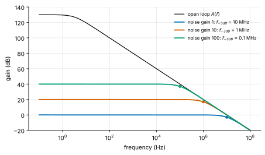
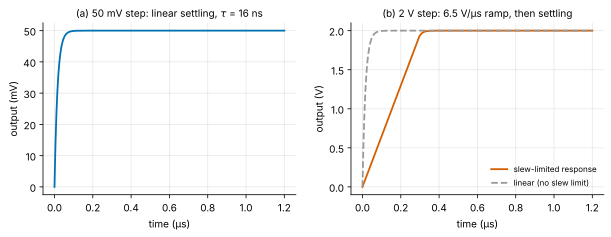

<!-- status: reviewed -->
# 10-09 · Real Op-Amps: Non-Idealities

| | |
|---|---|
| **Course** | [10 · Electronics I (Microelectronic Circuits)](../README.md) |
| **University equivalent** | Op-amp non-idealities in Electronics I: finite open-loop gain, the single-pole model and gain–bandwidth product, slew rate and full-power bandwidth, offset voltage and drift, bias and offset currents, CMRR, PSRR, input and output ranges, and reading a data sheet (Sedra & Smith, *Microelectronic Circuits*, ch. 2; Franco, *Design with Operational Amplifiers and Analog Integrated Circuits*, ch. 5–6) |
| **Prerequisites** | [06-10 The Ideal Op-Amp](../../06-circuit-analysis-1-dc/chapters/06-10-ideal-op-amp.md), [07-07 Frequency Response and Bode Plots](../../07-circuit-analysis-2-transient-and-ac/chapters/07-07-frequency-response-and-bode-plots.md), [10-05 Amplifier Fundamentals](10-05-amplifier-fundamentals.md), [10-08 Current Sources and Current Mirrors](10-08-current-sources-and-mirrors.md) |
| **Estimated study hours** | 10 |
| **Last verified** | 2026-11-19 |

**Learning objectives.** After this chapter you can:

1. Derive the closed-loop gain error from finite open-loop gain and express it through the loop gain $A\beta$ and the noise gain $1/\beta$.
2. Use the single-pole model to derive closed-loop bandwidth as GBW divided by the noise gain, and compute magnitude and phase errors in band.
3. Distinguish small-signal bandwidth from slew-rate limits, and compute full-power bandwidth.
4. Build a DC error budget from offset voltage, drift, bias currents, CMRR and PSRR over temperature.
5. Check a design against input common-mode range, output swing and output current, including rail-to-rail behavior.
6. Read an op-amp data sheet critically (typical against maximum, test conditions) and choose a part for a specification.

---

## 1. Big picture

06-10 analyzed op-amp circuits with an ideal amplifier and took a first look at offset and bias current. A real op-amp is a multistage transistor amplifier (12-08) with finite gain that falls with frequency, a finite rate of change, small DC errors that drift with temperature, limited input and output ranges, and a supply current that sets battery life. Every one of these is a line on the data sheet, and every one can decide whether a design works. This chapter derives the effect of each on a feedback circuit and then reads three current data sheets side by side.

- **Precision is a DC budget.** Sensor front ends (weigh scales, medical patches, battery monitors) live or die by offset, drift and bias current.
- **Speed is two numbers.** Gain–bandwidth product limits small signals; slew rate limits large ones. Confusing them is a classic error.
- **Ranges are where low-voltage designs fail.** At 1.8 V or 3.3 V, input common-mode range and output swing take a large share of the supply.
- **The data sheet is a contract with conditions.** Typical values are not guarantees, and every number has test conditions that may not match your circuit.

## 2. Intuition first

**Feedback spends gain to buy accuracy.** An op-amp circuit is accurate because the op-amp has far more gain than the circuit needs; the excess, the **loop gain** $A\beta$, is what feedback uses to suppress errors (06-10). Everything that reduces the excess (lower open-loop gain at DC, the gain's fall with frequency) shows up directly as error. A useful rule: the circuit is as accurate as its loop gain is large.

**A finance analogy: a hedge with finite capital.** Feedback is a hedging desk that offsets every deviation of the output from its target. With unlimited capital (infinite gain), the hedge is perfect. With finite capital, a residual error remains, proportional to the size of the position (the noise gain) divided by the capital (the open-loop gain). And the desk can only trade so fast: when the market moves faster than its maximum trading rate (the slew rate), the hedge lags no matter how much capital it has. *Where it breaks:* a desk's capital does not shrink with the speed of the market; an op-amp's gain does fall with frequency, so at high frequency the "capital" itself runs out (§3.3).

**DC errors are small sources.** Offset voltage, bias currents and supply or common-mode sensitivity behave like tiny voltage and current sources attached to an ideal op-amp. By superposition (06-07), each produces an output error you can compute with the circuit's gains, and the budget is their sum.

## 3. Theory

> **Notation.** $A$ open-loop gain ($A_0$ at DC), β feedback factor (the fraction of the output fed back to the inverting input), $1/\beta$ the **noise gain** ($1 + R_2/R_1$ for both inverting and non-inverting stages), $L = A\beta$ the loop gain (notation.md; some texts write $T$). Data-sheet values are quoted with their test conditions and tagged by source; "typ" and "max" are the data sheet's typical and maximum columns.

### 3.1 Finite open-loop gain

For a non-inverting amplifier, $v_o = A(v_+ - v_-)$ with $v_- = \beta v_o$. Solving:

$$
\frac{v_o}{v_{in}} = \frac{A}{1 + A\beta} = \frac{1}{\beta}\cdot\frac{L}{1 + L} = \frac{1}{\beta}\left(1 - \frac{1}{1 + L}\right) .
$$

The ideal gain $1/\beta$ is reduced by the fraction $1/(1 + L) \approx 1/L$:

$$
\text{gain error} \approx \frac{1}{A\beta} = \frac{\text{noise gain}}{A} .
$$

The error depends on the **noise gain**, not on the signal gain: an inverting amplifier with gain −1 has noise gain 2. High-gain stages consume loop gain fastest. With $A_0$ = 106 dB (2 × 10⁵) and a gain of 1000, the error is already 0.5% (Example 10-09.1).

### 3.2 The single-pole model and gain–bandwidth product

Most general-purpose op-amps are **internally compensated** (12-06) so that their gain falls like a single-pole low-pass filter (07-07):

$$
A(s) = \frac{A_0}{1 + s/\omega_p} ,
$$

with a very low pole $f_p$ (a few hertz). Well above $f_p$, $|A| \approx A_0f_p/f$: the product of gain and frequency is constant, the **gain–bandwidth product** GBW = $A_0f_p$. It is also the **unity-gain frequency**, where $|A|$ = 1.

A circuit with exactly this behavior is a transconductance $G_m$ driving a resistor $R_p$ in parallel with a capacitor $C_p$, followed by a unity-gain buffer (Figure 3a). At DC the current $G_mv_d$ flows through $R_p$, so $A_0 = G_mR_p$ (siemens times ohms: dimensionless). The node's time constant sets $f_p = 1/(2\pi R_pC_p)$, so GBW = $A_0f_p = G_m/(2\pi C_p)$, in siemens per farad, which is per second. The lab's ngspice netlists use this macromodel (the slew netlist with the current limit of §3.3 and $R_p$ omitted, since the slew is over long before $R_p$ matters). Real op-amps realize it with an input transconductance stage and a compensation capacitor (12-08).

**Closed-loop bandwidth.** Substituting $A(s)$ into $A/(1 + A\beta)$:

$$
\frac{v_o}{v_{in}}(s) = \frac{A_0}{1 + A_0\beta + s/\omega_p} = \frac{1}{\beta}\cdot\frac{A_0\beta/(1 + A_0\beta)}{1 + s/[\omega_p(1 + A_0\beta)]} .
$$

The closed loop is again single-pole, with its corner raised by $1 + A_0\beta$:

$$
f_{-3dB} = f_p(1 + A_0\beta) \approx A_0f_p\beta = \frac{\text{GBW}}{\text{noise gain}} .
$$

Feedback trades gain for bandwidth one for one (Figure 1). A 10 MHz op-amp at a noise gain of 10 gives 1 MHz; at 100, 100 kHz.

**In-band error.** Below the corner the response is not flat to the last digit. At frequency $f$ the magnitude is $1/\sqrt{1 + (f/f_{-3dB})^2}$ of the DC value and the phase lags by $\arctan(f/f_{-3dB})$. A 1% magnitude error needs $f < 0.14f_{-3dB}$; a 0.1% error needs $f < 0.045f_{-3dB}$ (Example 10-09.7). This is why a precision design asks for far more bandwidth than the signal seems to need.

*Figure 1. A single-pole op-amp ($A_0$ = 130 dB, GBW = 10 MHz) and its closed-loop responses at noise gains of 1, 10 and 100. Each closed-loop curve follows the open-loop curve down once it meets it; the dots mark the −3 dB points at GBW / noise gain.*

> **Going deeper — when the model is not single-pole.** The single-pole model fails near the unity-gain frequency, where higher poles add phase lag; the data sheet's **phase margin** measures how close the loop is to instability (Course 12). Some parts are **decompensated**: stable only above a minimum gain, with a higher GBW in exchange. Even a unity-gain-stable part need not have one GBW: the OPA1611, which its data sheet describes as unity-gain stable, lists 40 MHz at a gain of 1 and 80 MHz at a gain of 100 [3]: its gain does not fall at exactly 20 dB/decade over that range.

### 3.3 Slew rate and full-power bandwidth

The internal compensation capacitor $C_c$ is charged by a finite current $I$ (the input stage's tail current, 12-08), so the output cannot change faster than the **slew rate**

$$
\text{SR} = \left|\frac{dv_o}{dt}\right|_{max} \approx \frac{I}{C_c} .
$$

**Small or large signal?** For a step input, a single-pole closed loop responds exponentially with time constant $\tau = 1/(2\pi f_{-3dB})$, whose initial slope is $V_{step}/\tau$. The response is linear (bandwidth-limited) as long as that slope is below SR, so steps larger than $\text{SR}\cdot\tau$ become **slew-limited**: a straight ramp at SR, then exponential settling (Figure 2). For a 10 MHz follower with SR = 6.5 V/µs, the boundary is about 0.1 V (Example 10-09.3).

**Full-power bandwidth.** A sine $V_p\sin\omega t$ has maximum slope $\omega V_p$. Requiring $\omega V_p \le \text{SR}$:

$$
f_{FP} = \frac{\text{SR}}{2\pi V_p} .
$$

Above $f_{FP}$ a full-amplitude sine turns into a triangle wave, whatever the small-signal bandwidth. Data sheets often state the formula; check the conditions, because the tabulated value may not match it (Example 10-09.3).

*Figure 2. A unity-gain follower with a 10 MHz bandwidth and 6.5 V/µs slew rate. (a) A 50 mV step settles exponentially with τ = 16 ns. (b) A 2 V step ramps at the slew rate for about 0.3 µs before settling: the linear model (dashed) is wrong by a factor of several in time.*

### 3.4 DC errors: offset, drift and bias currents

06-10 §3.7 introduced the **input offset voltage** $V_{OS}$, amplified by the noise gain, and the **input bias currents** $I_B$ (Figure 3b), which develop voltages across the resistances seen by each input; a resistor equal to $R_1 \parallel R_2$ in the + input cancels the bias-current errors to within the **offset current** $I_{OS}$. Two refinements matter in practice:

- **Drift.** $V_{OS}$ changes with temperature, specified as $dV_{OS}/dT$ in µV/°C. Over the extended (automotive-grade) range of −40 to 125 °C (the industrial range is usually −40 to 85 °C), a drift of a few µV/°C adds hundreds of microvolts: often more than the 25 °C offset itself. Offset at 25 °C can be calibrated out; drift is harder to remove.
- **Input technology sets $I_B$.** Bipolar inputs draw nanoamperes (OPA1611: ±60 nA typ, ±250 nA max [3]); CMOS inputs draw picoamperes at room temperature (TLV9062: ±0.5 pA typ [1]), but that current is mostly junction leakage in the input protection, which grows exponentially with temperature (09-06), and zero-drift CMOS parts show larger, switching-related currents (OPA333: ±70 pA typ, ±200 pA max [2]).

*Figure 3. Two models of a real op-amp. (a) The single-pole macromodel of §3.2 and the lab netlists: a transconductance into $R_p \parallel C_p$, then a unity buffer. A limit $I$ on the source current gives the slew rate $I/C_p$ of §3.3. (b) The DC error model: an ideal op-amp with the offset voltage in series with one input (either polarity occurs) and a bias-current source at each input. The bias current $I_B$ is the average of the two, and the offset current $I_{OS}$ is their difference.*

**Zero-drift amplifiers** (06-10's Going deeper) correct their own offset continuously, giving microvolt offsets and nanovolt-per-kelvin drift (OPA333: 10 µV max, 0.05 µV/°C max [2]) at the cost of bandwidth, switching artifacts and higher current noise.

### 3.5 CMRR and PSRR

A real op-amp responds slightly to the *average* of its inputs and to its supply voltage. Both are specified as equivalent input offset changes:

$$
\Delta V_{OS} = \frac{\Delta V_{CM}}{\text{CMRR}}, \qquad \Delta V_{OS} = \frac{\Delta V_S}{\text{PSRR}} ,
$$

with CMRR usually in dB ($20\log_{10}$ of the ratio) and PSRR in dB or µV/V. In a non-inverting amplifier the common-mode voltage *is* the input signal, so finite CMRR is a gain error; in an inverting amplifier the inputs sit at a fixed voltage and CMRR barely matters. Both ratios fall with frequency, so supply ripple and high-frequency common-mode signals leak through far more than the DC figures suggest.

### 3.6 Input and output ranges

- **Input common-mode range.** The input stage works only for common-mode voltages within its range: OPA1611, $(V-) + 2$ V to $(V+) - 2$ V [3]. A follower on a ±15 V supply can therefore handle only ±13 V of signal, although its output could swing further.
- **Rail-to-rail input.** Parts such as the TLV9062 combine an NMOS and a PMOS input pair to cover the whole supply [1]. Near the transition between pairs, offset and CMRR change: the TLV9062's CMRR is 103 dB typical within $(V-) - 0.1$ V to $(V+) - 1.4$ V, but 87 dB typical (57 dB minimum) over the full range [1].
- **Output swing.** A common-source (rail-to-rail) output stage (12-07) can approach the rails within tens of millivolts at light load (TLV9062: 20 mV max at 10 kΩ, 60 mV at 2 kΩ [1]); outputs that are not specified as rail-to-rail stop further short, as the OPA1611 does (within 0.6 V of the rails at 2 kΩ [3]; its data sheet does not describe the output stage's topology). The swing shrinks as the load current rises.
- **Output current and short circuit.** The output current is limited (TLV9062: ±50 mA short-circuit; OPA333: ±5 mA [1, 2]), which caps the load and the speed of driving capacitance.

### 3.7 The rest of the data sheet

- **Noise.** Input voltage noise density $e_n$ (nV/√Hz) and current noise $i_n$; the OPA1611's 1.1 nV/√Hz at 1 kHz is about **15** times lower than the TLV9062's 16 nV/√Hz [1, 3]. Course 12 (12-10) turns these into signal-to-noise ratios.
- **Quiescent current.** Power and battery life: 17 µA for the OPA333, 538 µA for the TLV9062, 3.6 mA for the OPA1611 per channel [1–3]. Speed, noise and output drive cost current.
- **Output impedance and capacitive loads.** A capacitive load adds a pole inside the feedback loop and erodes phase margin; data sheets give a stable capacitance or a curve (Course 12).

**Reading the table.** Every entry has test conditions (supply, load, common-mode voltage, temperature) and up to three columns. *Typical* is the manufacturer's statement of expected performance, often described as a characterization mean or median but defined differently by different vendors, and never a guarantee; *minimum* and *maximum* are guaranteed, often only at 25 °C unless a temperature range is stated. Design to the guaranteed values at your conditions.

## 4. Worked examples

### Example 10-09.1 · Finite gain at high closed-loop gain (tier A)

**Setup.** A non-inverting amplifier with a gain of 1000 uses an OPA333 ($A_{OL}$ = 106 dB minimum, 130 dB typical [2]). Find the closed-loop gain and gain error for each, exactly and by the $1/(A\beta)$ approximation.

**Solution.** 106 dB is $A$ = **199526**: $A/(1 + A/1000)$ = **995.0**, an error of **0.499**% (approximation **0.501**%). 130 dB is $A$ = 3.162 × 10⁶: **999.68**, error **0.0316**%.

**Sanity check.** The guaranteed figure is 24 dB worse than the typical one, and the error is correspondingly 16 times larger. A gain-of-1000 stage needs either a calibration or a part with a higher minimum $A_{OL}$.

### Example 10-09.2 · Closed-loop bandwidth (tier A)

**Setup.** (a) A TLV9062 (GBW 10 MHz [1]) is used as a non-inverting amplifier with gain +10 and as an inverting amplifier with gain −10. Find each bandwidth. (b) An OPA333 (GBW 350 kHz [2]) has a gain of 100. Find its bandwidth, and its magnitude error and phase lag at 1 kHz.

**Solution.**

(a) Non-inverting: noise gain 10, $f_{-3dB}$ = **1.0** MHz. Inverting: noise gain 11, **0.909** MHz.

(b) **3.5** kHz. At 1 kHz the magnitude error is **−3.85**% and the phase lags by **15.9**°.

**Sanity check.** A "350 kHz" amplifier misses a 1 kHz signal by almost 4% at a gain of 100: GBW is shared between gain and bandwidth.

### Example 10-09.3 · Slew rate (tier B)

**Setup.** (a) Find the full-power bandwidth of an OPA1611 (SR = 27 V/µs [3]) for a 10 V peak output. (b) The data sheet lists a full-power bandwidth of 4 MHz for 1 Vpp and gives the formula $\text{SR}/(2\pi V_p)$ in a footnote [3]. Evaluate the formula for 1 Vpp. (c) Find the full-power bandwidth for 2.5 V peak for a TLV9062 (6.5 V/µs) and an OPA333 (0.16 V/µs). (d) For a TLV9062 follower (10 MHz), what step size starts to slew?

**Solution.**

(a) $27 \times 10^6/(2\pi \times 10)$ = **429.7** kHz.

(b) $V_p$ = 0.5 V gives **8.59** MHz, about twice the tabulated 4 MHz. The formula with $V_p$ = 1 V instead gives **4.30** MHz, close to the table, which suggests the table entry used 1 V as the peak rather than the peak-to-peak value. Whatever the cause, the table and its own footnote disagree; a designer should treat the lower number as the safer one, or measure.

(c) TLV9062: **413.8** kHz. OPA333: **10.19** kHz.

(d) $\text{SR}\cdot\tau$ with $\tau = 1/(2\pi \times 10\text{ MHz})$: **103** mV.

**Sanity check.** The OPA333 cannot deliver a full-scale 20 kHz sine on 5 V at any gain: its slew rate, not its bandwidth, rules it out for audio.

### Example 10-09.4 · CMRR and PSRR in numbers (tier B)

**Setup.** (a) A follower's input moves by 2 V. Find the input-referred error for an OPA1611 (CMRR 110 dB minimum [3]) and a TLV9062 within its high-CMRR range (80 dB minimum) and across its full range (57 dB minimum) [1]. (b) The supply carries 100 mV of slow ripple. Find the input-referred error for an OPA333 (PSRR 5 µV/V max [2]) and a TLV9062 (80 µV/V max [1]).

**Solution.**

(a) OPA1611: $2 \times 10^{-110/20}$ = **6.32** µV. TLV9062: **200** µV within range; **2.83** mV across the crossover.

(b) OPA333: **0.5** µV. TLV9062: **8** µV.

**Sanity check.** A rail-to-rail input's crossover can cost more accuracy than its offset voltage; precision designs keep the common-mode voltage on one side of it.

### Example 10-09.5 · An offset budget over temperature (tier B)

**Setup.** A load-cell bridge gives 2 mV/V at full scale with 5 V excitation. It is amplified by 100 in a circuit used from 25 to 125 °C. Compare the worst-case offset at 125 °C, input-referred and at the output, and as a fraction of full scale, for an OPA333 (10 µV max, 0.05 µV/°C max [2]) and a TLV9062 (±2 mV max over temperature [1]).

**Solution.** Full scale is 2 mV/V × 5 V = **10** mV at the input. OPA333: $10 + 0.05 \times 100$ = **15** µV, **1.5** mV at the output, **0.15**% of full scale. TLV9062: **2** mV, **200** mV at the output, **20**% of full scale.

**Sanity check.** The two parts' worst-case budgets differ by a factor of **133**; for millivolt bridges the zero-drift part is the only one of the two that works without calibration.

### Example 10-09.6 · Ranges (tier B)

**Setup.** (a) An OPA1611 on ±15 V drives 2 kΩ: find its guaranteed output range and its input common-mode range [3]. (b) A TLV9062 on 3.3 V drives 2 kΩ: find its output range and the input voltage above which it leaves its high-CMRR region [1]. (The data sheet specifies swing and the CMRR boundary at a 5.5 V supply; assume they carry over to 3.3 V, which a careful design would confirm from the characteristic curves.)

**Solution.**

(a) Output **±14.4** V; input **±13** V. A unity-gain follower is limited by the input to ±13 V.

(b) Output **0.06** V to **3.24** V; the high-CMRR region ends at $(V+) - 1.4$ V = **1.9** V.

**Sanity check.** "Rail-to-rail" on a 3.3 V part still leaves 60 mV at each end with a 2 kΩ load, and the input's best accuracy covers only the part of the supply below 1.9 V.

### Example 10-09.7 · Choosing a part for a specification (tier C)

**Setup.** A 1 kHz, 2 V peak signal must be amplified by 100 with less than 0.1% magnitude error from bandwidth. (a) Find the minimum closed-loop bandwidth and GBW. (b) Find the minimum slew rate. (c) Check the TLV9062 and the OPA333.

**Solution.**

(a) $1/\sqrt{1 + x^2} \ge 0.999$ gives $x = f/f_{-3dB} \le$ **0.0448**, so $f_{-3dB} \ge$ **22.34** kHz and GBW ≥ **2.234** MHz.

(b) $2\pi \times 1\text{ kHz} \times 2\text{ V}$ = **0.0126** V/µs.

(c) TLV9062: $f_{-3dB}$ = **100** kHz, error **−0.0050**%: passes (slew rate 6.5 V/µs is ample). OPA333: error **−3.85**%: fails on bandwidth, although its slew rate (0.16 V/µs) would suffice.

**Sanity check.** A 0.1% specification at 1 kHz needed a 2 MHz part: precision at frequency is expensive in bandwidth, which is why audio and instrumentation designs often use op-amps far faster than the signal.

### Answer key

<!-- answer-key -->
| ID | Quantity | Value | Unit |
|---|---|---|---|
| T 10-09.a | f for 1% magnitude error | 0.14 | — |
| T 10-09.b | f for 0.1% magnitude error | 0.045 | — |
| T 10-09.c | slew boundary, 10 MHz, 6.5 V/µs | 0.1 | V |
| T 10-09.d | OPA1611 GBW at G = 1 | 40 | MHz |
| T 10-09.e | OPA1611 GBW at G = 100 | 80 | MHz |
| Ex 10-09.1a | A_OL at 106 dB | 199526 | — |
| Ex 10-09.1b | closed-loop gain, minimum A_OL | 995.0 | — |
| Ex 10-09.1c | gain error, minimum A_OL | 0.499 | % |
| Ex 10-09.1d | approximate error | 0.501 | % |
| Ex 10-09.1e | closed-loop gain, typical A_OL | 999.68 | — |
| Ex 10-09.1f | gain error, typical A_OL | 0.0316 | % |
| Ex 10-09.2a | bandwidth, gain +10 | 1.0 | MHz |
| Ex 10-09.2b | bandwidth, gain −10 | 0.909 | MHz |
| Ex 10-09.2c | OPA333 bandwidth at gain 100 | 3.5 | kHz |
| Ex 10-09.2d | magnitude error at 1 kHz | -3.85 | % |
| Ex 10-09.2e | phase lag at 1 kHz | 15.9 | ° |
| Ex 10-09.3a | OPA1611 full-power bandwidth, 10 V peak | 429.7 | kHz |
| Ex 10-09.3b | formula for 1 Vpp | 8.59 | MHz |
| Ex 10-09.3c | TLV9062 full-power bandwidth, 2.5 V peak | 413.8 | kHz |
| Ex 10-09.3d | OPA333 full-power bandwidth, 2.5 V peak | 10.19 | kHz |
| Ex 10-09.3e | step size where slewing begins | 103 | mV |
| Ex 10-09.4a | OPA1611 CMRR error | 6.32 | µV |
| Ex 10-09.4b | TLV9062 CMRR error, in range | 200 | µV |
| Ex 10-09.4c | TLV9062 CMRR error, full range | 2.83 | mV |
| Ex 10-09.4d | OPA333 PSRR error | 0.5 | µV |
| Ex 10-09.4e | TLV9062 PSRR error | 8 | µV |
| Ex 10-09.5a | full scale at the input | 10 | mV |
| Ex 10-09.5b | OPA333 offset at 125 °C | 15 | µV |
| Ex 10-09.5c | OPA333 output error | 1.5 | mV |
| Ex 10-09.5d | OPA333 fraction of full scale | 0.15 | % |
| Ex 10-09.5e | TLV9062 offset | 2 | mV |
| Ex 10-09.5f | TLV9062 output error | 200 | mV |
| Ex 10-09.5g | TLV9062 fraction of full scale | 20 | % |
| Ex 10-09.6a | OPA1611 output swing | 14.4 | V |
| Ex 10-09.6b | OPA1611 input range | 13 | V |
| Ex 10-09.6c | TLV9062 lowest output | 0.06 | V |
| Ex 10-09.6d | TLV9062 highest output | 3.24 | V |
| Ex 10-09.6e | top of the high-CMRR input region | 1.9 | V |
| Ex 10-09.7a | maximum f/f_-3dB | 0.0448 | — |
| Ex 10-09.7b | minimum closed-loop bandwidth | 22.34 | kHz |
| Ex 10-09.7c | minimum GBW | 2.234 | MHz |
| Ex 10-09.7d | minimum slew rate | 0.0126 | V/µs |
| Ex 10-09.7e | TLV9062 closed-loop bandwidth | 100 | kHz |
| Ex 10-09.7f | TLV9062 error at 1 kHz | -0.0050 | % |
| Ex 10-09.7g | OPA333 error at 1 kHz | -3.85 | % |
| T 10-09.n | OPA1611 over TLV9062 voltage noise | 15 | — |
| Ex 10-09.3h | formula with V_p = 1 V | 4.30 | MHz |
| Ex 10-09.5h | ratio of worst-case budgets | 133 | — |

*Every value is recomputed by [verify_10_09.py](../verify/verify_10_09.py): closed-loop gains and bandwidths from the complex single-pole loop equation solved numerically (the −3 dB point by root finding), slew boundaries and full-power bandwidths from the condition that a sine's maximum slope equals the slew rate (a restatement of $\text{SR}/(2\pi V_p)$, checked against a simulated slew-limited response only in the lab), and DC errors from data-sheet values with the conversions written out. Data-sheet values are read from the documents in R-182. The lab's ngspice netlists confirm Examples 10-09.1 and 10-09.2 with a single-pole op-amp macromodel (`opamp_model.cir`) and the slew-limited response of lab Part 2 with a current-clipped integrator (`slew.cir`).*

## 5. Simulate it

The lab, [labs/10-09-lab](../labs/10-09-lab/README.md), has a notebook and two ngspice netlists:

1. Plots closed-loop magnitude and phase error against frequency for several noise gains and finds where each meets a 0.1% specification.
2. Simulates slew-limited step and sine responses and measures the distortion of a sine above its full-power bandwidth.
3. Runs a Monte Carlo DC error budget (offset, drift, bias currents) using each part's typical and maximum values.
4. Tabulates the three data sheets side by side and computes figures of merit (GBW per milliampere, offset per drift).

The netlist `opamp_model.cir` builds a single-pole op-amp from controlled sources and confirms the closed-loop gain and bandwidth of Examples 10-09.1 and 10-09.2; `slew.cir` adds a slew limit (a clipped input current into the integrating capacitor) and reproduces Part 2's slew-limited output.

**Guided exercise (predict, then run).** **Before running Part 2**, predict: a TLV9062 follower is driven by a 2.5 V peak sine at 800 kHz, about twice its full-power bandwidth. What will the output look like, and roughly what amplitude will it reach? Then run it. (A triangle-like wave whose slopes are ±6.5 V/µs; in each half period of 0.625 µs it can travel about 4 V, so the peak falls to roughly 2 V.)

## 6. Engineering tradeoffs

| Knob | Improves | Costs | Typical decision owner |
|---|---|---|---|
| Higher GBW | Bandwidth, in-band accuracy | Supply current; stability with capacitive loads | Analog designer |
| Higher slew rate | Large-signal speed | Supply current (tail current) | Analog designer |
| Bipolar input | Low voltage noise, good matching | Bias current (nA); limited input range | Product architect |
| CMOS input | Picoampere bias current, rail-to-rail input | Higher voltage noise; crossover distortion | Product architect |
| Zero-drift | Microvolt offset, near-zero drift | Bandwidth, switching artifacts, current noise | Analog designer |
| Rail-to-rail output | Swing on low supplies | Output impedance, swing shrinks with load | Analog designer |
| Lower quiescent current | Battery life | GBW, slew rate, noise | Product architect |

## 7. Numbers to know

| Quantity | Typical value | Note |
|---|---|---|
| Gain error | noise gain / $A_{OL}$ | |
| Closed-loop bandwidth | GBW / noise gain | single pole |
| Full-power bandwidth | SR / (2π $V_p$) | |
| 1% and 0.1% in-band | below 0.14 and 0.045 of $f_{-3dB}$ | |
| General-purpose CMOS RRIO (TLV9062) | 10 MHz, 6.5 V/µs, 1.6 mV max, 0.5 pA, 538 µA [1] | data sheet, Rev. N 2026 |
| Zero-drift CMOS (OPA333) | 350 kHz, 0.16 V/µs, 10 µV max, 0.05 µV/°C max, 17 µA [2] | data sheet, Rev. E 2015 |
| Low-noise bipolar (OPA1611) | 40 MHz (G = 1), 27 V/µs, 500 µV max, 1.1 nV/√Hz, 3.6 mA [3] | data sheet, Rev. C 2014 |

## 8. Common mistakes

1. **Using the signal gain instead of the noise gain** for bandwidth and gain error (an inverting gain of −1 has noise gain 2).
2. **Confusing GBW with slew rate.** A small step can be fast while a large one slews.
3. **Designing to typical values.** Use the guaranteed column at your temperature range.
4. **Ignoring drift.** A trimmed offset at 25 °C returns at 85 °C.
5. **Assuming rail-to-rail means rail to rail.** Output swing shrinks with load; input accuracy changes at the crossover.
6. **Ignoring the common-mode input range of a follower.** The input range, not the output, often limits it.
7. **Taking a data-sheet line at face value.** Check test conditions and internal consistency (Example 10-09.3).

## 9. Practitioner lens

### State of the art (as of Nov 2026)

- **General-purpose CMOS op-amps are cheap, fast and rail-to-rail.** The TLV9062 family (revised July 2026) offers 10 MHz GBW, 6.5 V/µs, rail-to-rail input and output from 1.8 to 5.5 V and 0.5 pA typical bias current at 538 µA per channel [1] **[Established]** (data sheet).
- **Zero-drift CMOS reaches microvolt accuracy at microamps.** The OPA333 guarantees 10 µV offset and 0.05 µV/°C drift at 17 µA typical quiescent current, with 350 kHz of GBW [2] **[Established]**.
- **Bipolar inputs still win on noise.** The OPA1611's 1.1 nV/√Hz at 1 kHz and 0.000015% THD+N at 1 kHz come with nanoampere bias currents and 3.6 mA per channel [3] **[Established]**.

### Why it matters commercially

- **Op-amps are a large, fragmented catalog business** **[Industry estimate]**. Broad catalogs of parts trade off speed, precision, noise, power and price; each design-in is a socket that lasts for the life of the customer's product. Data-sheet fluency is how engineers and acquirers evaluate an analog portfolio.
- **Sensor-rich products are precision-amplifier products** **[Industry estimate]**. Wearables, industrial IoT and automotive systems multiply the number of low-power, low-drift amplifier sockets per product.
- **Specification is competition** **[Industry estimate]**. Vendors compete on guaranteed numbers over temperature; the gap between typical and guaranteed values reflects how tightly a process and its test flow are controlled.

### Marketing vs Reality

- **"10 MHz op-amp."** *Reality:* 10 MHz at unity noise gain; at a gain of 100 it is 100 kHz, and 0.1% accuracy holds only to 4.5 kHz. *Sanity check:* ask for bandwidth and error at your noise gain and frequency.
- **"Rail-to-rail."** *Reality:* output swing depends on load; input CMRR and offset change near the crossover (TLV9062: 103 dB typical within range, 87 dB typical across the rail [1]). *Sanity check:* ask for swing at your load current and CMRR over your common-mode range.
- **"Ultra-low noise."** *Reality:* voltage noise density at 1 kHz says nothing about 1/f noise, current noise with high source impedance, or noise per milliampere. *Sanity check:* ask for total input-referred noise in your bandwidth with your source impedance.

### Questions for engineering leaders

1. **"What is the loop gain at your highest signal frequency, and what accuracy does that buy?"**
   *Strong:* a number with the noise gain and the resulting error. *Evasive:* "the op-amp is fast."
2. **"Which data-sheet values does your error budget use: typical or guaranteed, at what temperature?"**
   *Strong:* guaranteed values over the operating range, with the budget table. *Evasive:* typical values at 25 °C.
3. **"What happens at full-scale signal and the highest frequency?"**
   *Strong:* slew rate and output-swing margins checked, ideally measured. *Evasive:* small-signal AC simulation only.

## 10. Concept check

**Q1.** An inverting amplifier has gain −1 with an op-amp of GBW 1 MHz. What is its bandwidth?

Answer

500 kHz: the noise gain is $1 + R_2/R_1$ = 2, and bandwidth is GBW divided by the noise gain.

**Q2.** Why does finite open-loop gain matter more for a gain-of-1000 stage than for a follower?

Answer

The gain error is about (noise gain)/$A_{OL}$: 1000 times larger for the gain-of-1000 stage.

**Q3.** A 10 mV step and a 5 V step are applied to the same follower. Why can their rise times differ by a large factor?

Answer

The small step is bandwidth-limited and settles with the closed-loop time constant; the large step exceeds $\text{SR}\cdot\tau$ and ramps at the slew rate, taking $5\text{ V}/\text{SR}$.

**Q4.** In which configuration does CMRR matter: inverting or non-inverting?

Answer

Non-inverting: its inputs follow the signal, so the common-mode voltage changes with it. An inverting stage holds both inputs at a fixed voltage.

**Q5.** Why might a CMOS op-amp with 0.5 pA bias current at 25 °C be a poor choice for a high-impedance sensor at 125 °C?

Answer

Input bias current in CMOS parts is mostly junction leakage of the input protection, which grows exponentially with temperature (09-06); at 125 °C it can be orders of magnitude larger. Check the over-temperature specification.

**Q6.** What does the "typical" column of a data sheet promise?

Answer

Nothing contractually: it describes expected performance (vendors define it differently, often as a characterization mean or median). Only minimum and maximum values are guaranteed, under the stated conditions.

[Problem set for this chapter](../problems/10-09-problems.md)

## 11. Key terms

[Loop gain](../../../reference/glossary.md#loop-gain) · [Noise gain](../../../reference/glossary.md#noise-gain) · [Gain-bandwidth product](../../../reference/glossary.md#gain-bandwidth-product) · [Slew rate](../../../reference/glossary.md#slew-rate) · [Full-power bandwidth](../../../reference/glossary.md#full-power-bandwidth) · [Input offset voltage](../../../reference/glossary.md#input-offset-voltage) · [Offset drift](../../../reference/glossary.md#offset-drift) · [Input bias current](../../../reference/glossary.md#input-bias-current) · [Common-mode rejection ratio (CMRR)](../../../reference/glossary.md#common-mode-rejection-ratio-cmrr) · [Power-supply rejection ratio (PSRR)](../../../reference/glossary.md#power-supply-rejection-ratio-psrr) · [Rail-to-rail](../../../reference/glossary.md#rail-to-rail) · [Zero-drift amplifier](../../../reference/glossary.md#zero-drift-amplifier)

## 12. Connections

- **Builds on:** the ideal op-amp and first non-idealities in [06-10](../../06-circuit-analysis-1-dc/chapters/06-10-ideal-op-amp.md); Bode plots in [07-07](../../07-circuit-analysis-2-transient-and-ac/chapters/07-07-frequency-response-and-bode-plots.md); loading and amplifier models in [10-05](10-05-amplifier-fundamentals.md); mirrors and mismatch (the origin of offset) in [10-08](10-08-current-sources-and-mirrors.md).
- **Next:** [10-10 Op-Amp Application Circuits](10-10-op-amp-application-circuits.md) applies these limits to instrumentation amplifiers, active filters, comparators and transimpedance amplifiers.
- **Used later:** stability, compensation and phase margin in [12-06](../../12-electronics-2/chapters/12-06-stability-and-compensation.md); op-amp internals (where GBW and SR come from) in [12-08](../../12-electronics-2/chapters/12-08-op-amp-internals.md); noise in [12-10](../../12-electronics-2/chapters/12-10-noise-in-circuits.md).

## 13. Further study

- A. S. Sedra and K. C. Smith, *Microelectronic Circuits*, ch. 2 (op-amp non-idealities: finite gain, bandwidth, slew rate, DC errors).
- S. Franco, *Design with Operational Amplifiers and Analog Integrated Circuits*, ch. 5–6 (static and dynamic limitations, with data-sheet examples).
- Any of the data sheets [1–3], sections 6 (specifications) and 7–8 (application notes): reading one end to end is the best exercise in this chapter.

## 14. Sources

1. Texas Instruments, *TLV906xS 10MHz, RRIO, CMOS Operational Amplifiers for Cost-Sensitive Systems*, SBOS839N, revised July 2026, §6.10 Electrical Characteristics: [data sheet](https://www.ti.com/lit/ds/symlink/tlv9062.pdf). [R-182](../../../reference/research-log.md#r-182--op-amp-data-sheets).
2. Texas Instruments, *OPAx333 1.8-V, microPower, CMOS Operational Amplifiers, Zero-Drift Series*, SBOS351E, revised December 2015, §6.6: [data sheet](https://www.ti.com/lit/ds/symlink/opa333.pdf). [R-182](../../../reference/research-log.md#r-182--op-amp-data-sheets).
3. Texas Instruments, *OPA161x SoundPlus High-Performance, Bipolar-Input Audio Operational Amplifiers*, SBOS450C, revised August 2014, §6.4: [data sheet](https://www.ti.com/lit/ds/symlink/opa1611.pdf). [R-182](../../../reference/research-log.md#r-182--op-amp-data-sheets).
