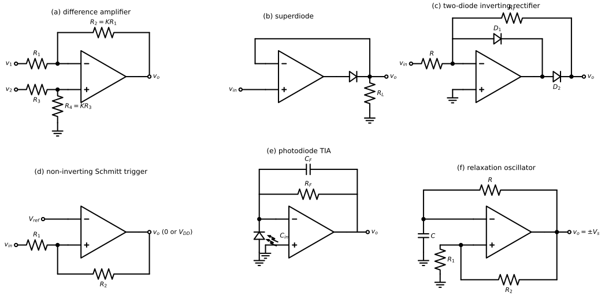
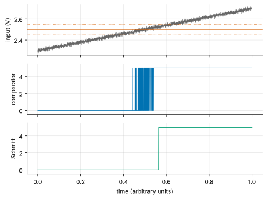
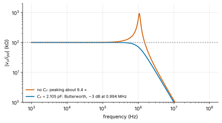

<!-- status: verified -->
# 10-10 · Op-Amp Application Circuits

| | |
|---|---|
| **Course** | [10 · Electronics I (Microelectronic Circuits)](../README.md) |
| **University equivalent** | Op-amp applications in Electronics I: instrumentation amplifiers and common-mode rejection with real resistors, integrators with finite gain and offset, precision rectifiers, comparators and Schmitt triggers, and the photodiode transimpedance amplifier with its stability (Sedra & Smith, *Microelectronic Circuits*, ch. 2 and 18; Franco, *Design with Operational Amplifiers and Analog Integrated Circuits*, ch. 2, 9) |
| **Prerequisites** | [06-10 The Ideal Op-Amp](../../06-circuit-analysis-1-dc/chapters/06-10-ideal-op-amp.md), [07-08 Filters and Resonance](../../07-circuit-analysis-2-transient-and-ac/chapters/07-08-filters-and-resonance.md), [10-09 Real Op-Amps](10-09-real-op-amps-nonidealities.md), [10-01 Diodes and Diode Circuits](10-01-diodes-and-diode-circuits.md) |
| **Estimated study hours** | 8 |
| **Last verified** | 2026-11-19 |

**Learning objectives.** After this chapter you can:

1. Derive the common-mode rejection of a difference amplifier from resistor mismatch, and explain why an instrumentation amplifier's input gain and laser trimming raise it.
2. Analyze an integrator with finite open-loop gain and offset, and choose a leak resistor.
3. Explain how a precision rectifier removes the diode drop, and compute the error that slew rate introduces at each zero crossing.
4. Design a Schmitt trigger for a given threshold and hysteresis, and choose between an op-amp and a comparator.
5. Analyze a photodiode transimpedance amplifier as a second-order loop, and choose its feedback capacitor for a maximally flat response.

---

## 1. Big picture

06-10 introduced the classic op-amp circuits with an ideal op-amp, and 07-08 designed active filters. This chapter returns to the circuits that sit at the boundary between an analog signal and a system (the sensor interface, the threshold detector, the light receiver) and analyzes them with the real limits of 10-09. In each, one non-ideality dominates: resistor mismatch in the instrumentation amplifier, offset in the integrator, slew rate in the precision rectifier, noise and delay in the comparator, and stability in the transimpedance amplifier.

- **Instrumentation amplifiers** read bridges and biopotential electrodes in the presence of large common-mode voltages.
- **Comparators and Schmitt triggers** turn analog quantities into decisions: battery-low flags, zero-crossing detectors, wake-up circuits.
- **Precision rectifiers** measure amplitudes too small for a diode.
- **Transimpedance amplifiers** convert photocurrent to voltage in optical links, LiDAR receivers and the optical heart-rate sensors of wearables.

## 2. Intuition first

**Each circuit has one weak link.** A practical design starts by asking which non-ideality limits it. A difference amplifier subtracts two large voltages to find a small one, so tiny resistor errors convert common-mode voltage into differential error. A comparator decides on a noisy signal, so the question is how not to decide twice. A transimpedance amplifier puts a capacitor (the photodiode) at the op-amp's input, so the feedback loop gains phase lag and can ring.

**A finance analogy: netting.** A difference amplifier is a netting engine: it subtracts two large positions to report a small net exposure. If the two legs are marked with slightly different prices (mismatched resistors), the error appears in the net and scales with the gross positions (the common-mode voltage), not with the net. Laser trimming is reconciliation: it makes the two legs' marks agree. *Where it breaks:* a netting error in finance is a fixed mismatch; an amplifier's mismatch also changes with frequency through stray capacitances, so common-mode rejection falls as frequency rises.

## 3. Theory

> **Conventions.** Op-amps are ideal unless a 10-09 limit is under study. Resistor tolerances ε are fractional (0.1% = 0.001). Data-sheet values are from the chapter's sources [1, 2] and 10-09's [R-182](../../../reference/research-log.md#r-182--op-amp-data-sheets).

*Figure 1. The six circuits of this chapter: (a) difference amplifier (§3.1); (b) superdiode and (c) improved two-diode inverting rectifier (§3.3); (d) non-inverting Schmitt trigger and (f) relaxation oscillator (§3.4); (e) photodiode transimpedance amplifier with its feedback capacitor (§3.5). Supplies are omitted.*

### 3.1 Common-mode rejection of a difference amplifier

The difference amplifier of 06-10 §3.4 has resistors $R_1$, $R_2$ on the inverting side and $R_3$, $R_4$ on the non-inverting side, ideally with $R_2/R_1 = R_4/R_3 = K$. In general, superposition gives

$$
v_o = v_2\,\frac{R_4}{R_3 + R_4}\left(1 + \frac{R_2}{R_1}\right) - v_1\frac{R_2}{R_1} .
$$

Write $R_2/R_1 = K(1 + \delta_1)$ and $R_4/R_3 = K(1 + \delta_2)$ with small δ's. For a common-mode input $v_1 = v_2 = v_{CM}$, to first order in the δ's,

$$
A_{cm} = \frac{v_o}{v_{CM}} = \frac{K(1 + \delta_2)}{1 + K(1 + \delta_2)}\bigl(1 + K(1 + \delta_1)\bigr) - K(1 + \delta_1) \approx \frac{K(\delta_2 - \delta_1)}{1 + K} ,
$$

while the differential gain stays about $K$. The common-mode rejection ratio of the circuit is therefore

$$
\text{CMRR} = \frac{A_d}{A_{cm}} \approx \frac{1 + K}{\delta_2 - \delta_1} \ \ge\ \frac{1 + K}{4\varepsilon} ,
$$

because each ratio can be off by up to $2\varepsilon$ when every resistor has tolerance ε, in opposite directions on the two sides. With 0.1% resistors and $K$ = 1, the worst case is only 500, or 54 dB (Example 10-10.1): the op-amp's own CMRR (often over 100 dB) is irrelevant next to the resistors'.

**Why instrumentation amplifiers do better.** The three-op-amp instrumentation amplifier (06-10 §3.5) puts a gain stage with gain $G_1 = 1 + 2R/R_G$ in front of the difference amplifier. That stage amplifies the differential signal by $G_1$ but passes the common-mode voltage with gain 1, so the overall CMRR is multiplied by about $G_1$:

$$
\text{CMRR}_{INA} \approx G_1\cdot\frac{1 + K}{\delta_2 - \delta_1} .
$$

Integrated instrumentation amplifiers also trim the difference stage's resistors on the die. The INA333, for example, sets its gain with one external resistor, $G = 1 + 100\text{ kΩ}/R_G$, and guarantees a CMRR of at least 100 dB for gains of 10 and above (90 dB typical, 80 dB minimum at a gain of 1) [1].

### 3.2 The integrator with a real op-amp

The ideal inverting integrator (07-01) has $V_o/V_i = -1/(sRC)$: infinite gain at DC. A real op-amp with DC gain $A_0$ replaces the pole at zero frequency with one at

$$
f_{p} = \frac{1}{2\pi RC(1 + A_0)} \approx \frac{1}{2\pi RCA_0} ,
$$

a "lossy" integrator, accurate only well above $f_p$. More important in practice is the offset: the op-amp's $V_{OS}$ (and bias current) is integrated, so the output ramps at about $V_{OS}/(RC)$ until it saturates. Two cures:

- **A reset switch** across $C$ for integrators that run for a defined time (charge amplifiers, sample integrators).
- **A leak resistor** $R_F$ across $C$, which sets the DC gain to $-R_F/R$ (the offset now appears at the output multiplied by $1 + R_F/R$, not integrated) at the cost of turning the integrator into a low-pass with corner $1/(2\pi R_FC)$ (Example 10-10.3).

### 3.3 Precision rectifiers

A diode rectifier loses its forward drop (10-01), about 0.6 V: useless for millivolt signals. Placing the diode inside an op-amp's feedback loop divides the drop by the loop gain. In the **superdiode** (a follower with the diode between op-amp output and feedback node, Figure 1b), the output follows positive inputs with an error of $V_D/A_0$, microvolts, and the diode disconnects the output for negative inputs. The **improved (two-diode) inverting rectifier** (Figure 1c) adds a second diode that closes the loop on the other half-cycle, so the op-amp never leaves its linear range.

**The dead zone depends on the topology.** At each zero crossing the op-amp's output must move before the output can follow the input again, and how far it must move is set by the circuit.

- *Two-diode inverting rectifier.* The op-amp output only swings between about $-V_D$ and $+V_D$ (one diode or the other conducts), so the jump is two diode drops:

$$
\Delta t = \frac{2V_D}{\text{SR}} .
$$

- *Superdiode.* On the negative half-cycle the diode is off, the loop is open, and the op-amp output saturates at its negative rail. At the next positive crossing it must first recover from saturation (the data sheet's overload-recovery time $t_{OR}$) and then slew from the rail up to $+V_D$:

$$
\Delta t \approx t_{OR} + \frac{V_{rail} + V_D}{\text{SR}} ,
$$

several times longer (Example 10-10.4).

During $\Delta t$ the output does not follow the input, so the rectifier misses roughly the input's change in that time, $2\pi fV_p\Delta t$ for a sine near its crossing. The error grows in proportion to frequency, which is why precision rectifiers need fast op-amps even for audio-band signals, and why the two-diode circuit is preferred above a few kilohertz.

**Full-wave rectification and peak detection.** Adding a summing stage that combines the input with twice the improved half-wave rectifier's output gives $v_o = \lvert v_{in}\rvert$, a precision full-wave (absolute-value) circuit used in AC measurement and envelope detection. A **peak detector** is a superdiode charging a capacitor $C$, followed by a buffer: the capacitor holds the largest input seen, and between peaks it droops at $I_{leak}/C$, where $I_{leak}$ is the sum of the buffer's bias current and the diode's and capacitor's leakage; a reset switch empties it (Problem 10-10.14).

### 3.4 Comparators and Schmitt triggers

**Op-amp or comparator?** An op-amp without feedback switches, but it is designed to stay linear: its slew rate is limited by compensation, it recovers slowly from saturation, and its output stage is not specified for logic levels. A **comparator** is uncompensated, recovers quickly and drives logic directly, either push-pull or open-drain (which needs a pull-up resistor and allows wired-OR connections). The TLV3201, for example, specifies a propagation delay of 47 ns typical (50 ns maximum) for 20 mV of input overdrive at 5 V, with 40 µA quiescent current [2].

**Chatter.** A slowly moving, noisy input crosses a single threshold many times, and the comparator output toggles each time (Figure 2a). **Hysteresis**, two thresholds separated by more than the noise, makes the output switch once.

**The non-inverting Schmitt trigger.** The input drives the + input through $R_1$, and $R_2$ feeds back from the output to the + input; the − input sits at $V_{ref}$. With output levels $0$ and $V_{DD}$, the + node is $v_{in}R_2/(R_1 + R_2) + v_oR_1/(R_1 + R_2)$, and the comparator switches when it crosses $V_{ref}$. Call the two switching points $V_U$ (upper, crossed by a rising input) and $V_L$ (lower, crossed by a falling input); $V_{TH}$ is reserved for transistor thresholds:

$$
V_U = V_{ref}\left(1 + \frac{R_1}{R_2}\right) \quad (v_o = 0), \qquad
V_L = V_{ref}\left(1 + \frac{R_1}{R_2}\right) - V_{DD}\frac{R_1}{R_2} \quad (v_o = V_{DD}) ,
$$

so the hysteresis is

$$
\Delta V_H = V_U - V_L = V_{DD}\,\frac{R_1}{R_2} .
$$

Choose $\Delta V_H$ larger than the noise's peak-to-peak value (a few times its rms), and center the thresholds where the application needs them (Example 10-10.5).

*Figure 2. A noisy ramp (10 mV rms) crossing 2.5 V. A plain comparator chatters through the crossing; the Schmitt trigger of Example 10-10.5, with thresholds at 2.45 and 2.55 V, switches once.*

**The relaxation oscillator.** Turn the Schmitt trigger into a clock by feeding its own output back through an RC. Use the inverting form on symmetric supplies: the output, at $\pm V_s$, drives a divider that puts $\beta v_o$ on the + input, with $\beta = R_1/(R_1 + R_2)$, and charges a capacitor $C$ through $R$; the capacitor voltage drives the − input. With the output at $+V_s$, $v_C$ rises from $-\beta V_s$ toward $+V_s$,

$$
v_C(t) = V_s - (1 + \beta)V_se^{-t/RC} ,
$$

and the output flips when $v_C$ reaches $+\beta V_s$, at $e^{-t/RC} = (1 - \beta)/(1 + \beta)$. The second half-cycle is the mirror image, so the period is

$$
T = 2RC\ln\frac{1 + \beta}{1 - \beta} .
$$

The supply voltage cancels: the frequency depends only on $R$, $C$ and a resistor ratio. With $R_1 = R_2$ ($\beta$ = 1/2), $T = 2RC\ln3 \approx 2.197RC$ (Example 10-10.8). Such oscillators clock low-power timers and sensor interfaces where a crystal's accuracy is not needed.

> **Math refresher — when does an exponential approach cross a level?** A first-order RC heading from $v(0)$ toward a final value $V_\infty$ follows $v(t) = V_\infty + \bigl(v(0) - V_\infty\bigr)e^{-t/\tau}$ ([07-02](../../07-circuit-analysis-2-transient-and-ac/chapters/07-02-first-order-rc-rl-transients.md)). To find when it reaches a level $V_x$, isolate the exponential and take the natural logarithm of both sides: $e^{-t/\tau} = (V_x - V_\infty)/(v(0) - V_\infty)$, so $t = \tau\ln\bigl[(v(0) - V_\infty)/(V_x - V_\infty)\bigr]$. Only the ratio of the distance to the target at the start to the distance at the crossing matters. Here $v(0) = -\beta V_s$, $V_\infty = V_s$ and $V_x = \beta V_s$, so the ratio is $(1 + \beta)V_s/[(1 - \beta)V_s]$ and the supply cancels: scaling every voltage scales both distances alike. Units: the logarithm is of a ratio of volts, so it is dimensionless, and $t$ has the units of τ, seconds.

### 3.5 The photodiode transimpedance amplifier

A photodiode is a current source $i_{pd}$ in parallel with its junction capacitance $C_D$ (09-14). A **transimpedance amplifier** (TIA) holds the diode at the virtual ground and converts the current to $v_o = -i_{pd}R_F$ (06-10 §3.6). The capacitance at the input, $C_{in}$ (the diode plus the op-amp's input capacitance), is the problem.

**The loop.** The feedback factor is the divider between $R_F$ (with any feedback capacitor $C_F$) and $C_{in}$: with $Z_F = R_F \parallel (1/sC_F)$,

$$
\beta(s) = \frac{1/(sC_{in})}{1/(sC_{in}) + Z_F} = \frac{1 + sR_FC_F}{1 + sR_F(C_{in} + C_F)} .
$$

With a single-pole op-amp, $A(s) = \omega_t/s$ (ω_t = 2π·GBW), the closed-loop poles satisfy $1 + A\beta = 0$:

$$
R_F(C_{in} + C_F)\,s^2 + (1 + \omega_tR_FC_F)\,s + \omega_t = 0 .
$$

This is a second-order system (02-03) with

$$
\omega_0 = \sqrt{\frac{\omega_t}{R_F(C_{in} + C_F)}}, \qquad \frac{1}{Q} = \frac{1 + \omega_tR_FC_F}{\omega_0R_F(C_{in} + C_F)} .
$$

**Without $C_F$**, $Q = \sqrt{\omega_tR_FC_{in}}$, usually far above 1: the response peaks sharply near $\omega_0$ and the circuit may oscillate once higher op-amp poles add phase (Figure 3). **With $C_F$**, the zero it adds to β damps the loop; setting $Q = 1/\sqrt2$ gives a maximally flat closed loop. Setting $1/Q^2 = 2$ and substituting $\omega_0^2 = \omega_t/[R_F(C_{in} + C_F)]$ gives $(1 + \omega_tR_FC_F)^2 = 2\omega_tR_F(C_{in} + C_F)$. With $x = \omega_tR_FC_F$ and $a = \omega_tR_FC_{in}$ this is $(1 + x)^2 = 2a + 2x$, so $x^2 = 2a - 1$, an exact closed form:

$$
C_F = \frac{\sqrt{2\omega_tR_FC_{in} - 1}}{\omega_tR_F} \approx \sqrt{\frac{2C_{in}}{\omega_tR_F}} ,
$$

where the familiar approximation on the right drops the 1, valid when $\omega_tR_FC_{in} \gg 1$ (Example 10-10.7). With $C_F$ chosen this way, the bandwidth is of order $\omega_0/2\pi = \sqrt{\text{GBW}/(2\pi R_F C_{in})}$: the geometric mean of the op-amp's GBW and the input RC corner.

**The whole transimpedance.** Multiplying $Z_F$ by $A\beta/(1 + A\beta)$, the $1 + sR_FC_F$ factors cancel and

$$
\frac{v_o}{i_{pd}} = -\frac{R_F\,\omega_t}{R_F(C_{in} + C_F)\,s^2 + (1 + \omega_tR_FC_F)\,s + \omega_t} :
$$

a pure second-order low-pass with exactly the loop's poles. With $Q = 1/\sqrt2$ it is a Butterworth response, flat to its −3 dB frequency $f_0$. Larger $R_F$ gives more gain (and less noise, 12-10) but less bandwidth; larger photodiodes collect more light but add capacitance.

> **Going deeper — the same result read off a Bode plot.** Designers often judge this loop by drawing the op-amp's open-loop gain $\lvert A\rvert$ and the **noise gain** $1/\lvert\beta\rvert$ on one log–log plot. The loop gain $\lvert A\beta\rvert$ is the vertical distance between the two curves, so it crosses 1 where they meet ([12-06](../../12-electronics-2/chapters/12-06-stability-and-compensation.md) develops this). Here $1/\beta = [1 + sR_F(C_{in} + C_F)]/(1 + sR_FC_F)$ is flat at 1 at low frequency and rises at +20 dB/decade above $1/[2\pi R_F(C_{in} + C_F)]$. Meanwhile $\lvert A\rvert$ falls at −20 dB/decade. **Without $C_F$** the curves meet with slopes that differ by 40 dB/decade. There the loop's phase lag approaches 180°: 90° from the op-amp's integrator and nearly 90° more from the pole of β. Almost no phase margin is left, which is the high $Q$ found above. **With $C_F$**, $1/\beta$ levels off at $(C_{in} + C_F)/C_F$ above $1/(2\pi R_FC_F)$, so the curves meet with a closure of only about 20 dB/decade, and the zero that $C_F$ adds to β returns most of the lost phase. "Make the noise gain flat where it meets the open-loop gain" is the graphical form of the algebra above. It extends to op-amps with more poles, where the closed-form $Q$ no longer exists.

*Figure 3. Transimpedance of Example 10-10.7 ($R_F$ = 100 kΩ, $C_{in}$ = 14 pF, GBW = 10 MHz). Without $C_F$ the response peaks by a factor of 9.4 near 1 MHz; with $C_F$ = 2.105 pF it is a Butterworth response with its −3 dB point at 0.994 MHz.*

## 4. Worked examples

### Example 10-10.1 · CMRR from resistor tolerance (tier B)

**Setup.** (a) A unity-gain difference amplifier ($K$ = 1) is built from 0.1% resistors. Find the worst-case CMRR as a ratio and in dB. (b) Repeat for $K$ = 10. (c) Put a first stage with $G_1$ = 100 in front of the $K$ = 1 stage (a three-op-amp instrumentation amplifier). (d) Use 0.01% resistors in (a).

**Solution.** (a) $(1 + 1)/(4 \times 0.001)$ = **500**, **54.0** dB. (b) $11/0.004$ = **2750**, **68.8** dB. (c) $100 \times 500$ = **50000**, **94.0** dB. (d) **5000**, **74.0** dB.

**Sanity check.** A 1 V common-mode step on the 54 dB stage produces 2 mV of output error: as large as a full-scale bridge signal. Gain in front of the subtraction is worth more than tighter resistors.

### Example 10-10.2 · An integrated instrumentation amplifier (tier B)

**Setup.** An INA333 ($G = 1 + 100\text{ kΩ}/R_G$; offset referred to input ±25 ± 75/G µV max; offset drift ±0.1 ± 0.5/G µV/°C maximum [1]) amplifies a bridge with 2 mV/V sensitivity excited by 3.3 V. (a) Find the exact $R_G$ for $G$ = 100, the gain and its error with the nearest E192 (0.1% series) value, 1.01 kΩ, and with the neighboring E96 (1%) values, 1.00 kΩ and 1.02 kΩ. (b) Find the maximum input-referred offset and its value at the output. (c) Find the maximum offset drift. (d) Find the full-scale input and output.

**Solution.**

(a) $R_G = 100\text{ kΩ}/99$ = **1.0101** kΩ; with 1.01 kΩ, $G$ = **100.0099**, an error of **0.0099**%, negligible, although the resistor's own 0.1% tolerance and the part's ±0.25% maximum gain error remain. With E96 values, 1.00 kΩ gives $G$ = **101** (**+1.00**%) and 1.02 kΩ gives **99.04** (**−0.96**%), each about four times the part's gain-error specification: at this gain, the 1% series is too coarse.

(b) $25 + 75/100$ = **25.75** µV, or **2.575** mV at the output.

(c) $0.1 + 0.5/100$ = **0.105** µV/°C, a guaranteed maximum.

(d) $2\text{ mV/V} \times 3.3\text{ V}$ = **6.6** mV in, **660** mV out.

**Sanity check.** The worst-case offset is 0.4% of full scale; a two-point calibration removes it, and the drift adds at most 0.16% over 100 °C.

### Example 10-10.3 · An integrator that drifts (tier B)

**Setup.** An inverting integrator has $R$ = 10 kΩ and $C$ = 10 nF; the op-amp has $A_0$ = 100 dB and $V_{OS}$ = 1 mV. (a) Find the frequency below which it stops integrating. (b) With the input grounded, how fast does the offset ramp the output, and how long until it reaches a 2.5 V rail? (c) A 1 MΩ leak resistor is placed across $C$. Find the DC gain, the output offset and the new low-frequency corner.

**Solution.**

(a) $1/(2\pi RCA_0)$ = **0.0159** Hz.

(b) $V_{OS}/(RC)$ = **10** V/s; the output reaches 2.5 V in **0.25** s.

(c) DC gain $-R_F/R$ = **−100**; output offset $V_{OS}(1 + R_F/R)$ = **101** mV; corner $1/(2\pi R_FC)$ = **15.9** Hz.

**Sanity check.** Without a leak or reset, a millivolt of offset saturates the integrator in a fraction of a second; with the leak, the circuit integrates only above 16 Hz.

### Example 10-10.4 · The precision rectifier's dead zone (tier B)

**Setup.** A precision half-wave rectifier uses a TLV9062 on ±2.5 V (SR = 6.5 V/µs, $A_{OL}$ = 130 dB typical and 104 dB minimum, overload recovery 0.2 µs [R-182]) with diodes dropping 0.6 V. (a) Find the DC error of the superdiode with the typical and the guaranteed gain. (b) Find the dead time at each zero crossing for the two-diode inverting rectifier and for the superdiode. (c) For a 1 V peak sine, estimate the missed voltage at 10 kHz and 100 kHz for the two-diode circuit, and at 10 kHz for the superdiode.

**Solution.**

(a) $0.6\text{ V}/10^{130/20}$ = **0.190** µV typical; with the guaranteed 104 dB, **3.79** µV.

(b) Two-diode rectifier: $2 \times 0.6/6.5$ = **0.185** µs. Superdiode: $0.2 + (2.5 + 0.6)/6.5$ = **0.677** µs, 3.7 times longer, because the op-amp starts from its negative rail and must first recover from saturation.

(c) $2\pi fV_p\Delta t$: **11.6** mV at 10 kHz and **116** mV at 100 kHz for the two-diode circuit; **42.5** mV at 10 kHz for the superdiode.

**Sanity check.** The diode drop is gone (0.19 µV instead of 600 mV), but the slew rate reintroduces an error that rises with frequency; at 100 kHz the rectifier misses more than a tenth of a 1 V signal's peak near every crossing.

### Example 10-10.5 · Designing a Schmitt trigger (tier B)

**Setup.** A TLV3201 comparator (push-pull, 0 to 5 V output) must detect a slowly rising signal crossing 2.5 V that carries up to 30 mV peak-to-peak of noise. Design a non-inverting Schmitt trigger with $V_{ref}$ = 2.5 V and 100 mV of hysteresis, using $R_2$ = 100 kΩ. (a) Find $R_1$. (b) Find the two thresholds. (c) The comparator itself has 1.2 mV of internal hysteresis and a 3 mV maximum offset [2]. Do they matter?

**Solution.**

(a) $\Delta V_H = V_{DD}R_1/R_2$ = 0.1 V gives $R_1$ = **2** kΩ.

(b) $V_U = 2.5(1 + 0.02)$ = **2.55** V; $V_L$ = 2.55 − 0.1 = **2.45** V, centered on 2.5 V because $V_{ref} = V_{DD}/2$.

(c) The internal 1.2 mV hysteresis is far below the noise; it prevents oscillation during the transition but cannot stop chatter. The 3 mV offset shifts both thresholds by up to 3 mV, small against the 100 mV window.

**Sanity check.** 100 mV of hysteresis is more than three times the 30 mV of noise, so the output switches once (Figure 2).

### Example 10-10.6 · Op-amp against comparator (tier A)

**Setup.** A TLV9062 op-amp (SR 6.5 V/µs, overload recovery 0.2 µs [R-182]) and a TLV3201 comparator (50 ns maximum delay [2]) each switch a 5 V output. Estimate the op-amp's response time and compare.

**Solution.** Slewing 5 V takes **0.769** µs; with recovery, about **0.969** µs, about **19.4** times the comparator's 50 ns.

**Sanity check.** An op-amp is a perfectly good slow comparator (for a battery monitor, say), but not for zero-crossing detection or timing.

### Example 10-10.7 · A photodiode receiver (tier C)

**Setup.** A photodiode and op-amp present $C_{in}$ = 14 pF; $R_F$ = 100 kΩ; the op-amp's GBW is 10 MHz. (a) Without $C_F$, find $f_0$ and $Q$ of the closed-loop poles and the peak of the transimpedance. (b) Find $C_F$ for $Q = 1/\sqrt2$, the resulting $f_0$, and the approximation's value. (c) Find the −3 dB bandwidth of the transimpedance with that $C_F$. (d) What output does 1 µA of photocurrent produce at low frequency?

**Solution.**

(a) $f_0 = \sqrt{\text{GBW}/(2\pi R_FC_{in})}$ = **1.066** MHz; $Q = \sqrt{\omega_tR_FC_{in}}$ = **9.38**; a second-order low-pass peaks at $Q/\sqrt{1 - 1/(4Q^2)}$ times its DC value, so the transimpedance peaks at **9.39** times $R_F$ (about 19.5 dB).

(b) With $a = \omega_tR_FC_{in}$ = **87.96**, the closed form of §3.5 gives $C_F = \sqrt{2a - 1}/(\omega_tR_F)$ = **2.105** pF, with $f_0$ = **0.994** MHz. The approximation $\sqrt{2C_{in}/(\omega_tR_F)}$ gives **2.111** pF, only **0.3**% high, because $2a$ = 176 is large against 1.

(c) The transimpedance is the Butterworth low-pass of §3.5, so its −3 dB bandwidth is $f_0$ = **0.994** MHz (confirmed numerically from $Z_F\,A\beta/(1 + A\beta)$).

(d) $1\ \mu\text{A} \times 100\text{ kΩ}$ = **0.1** V.

**Sanity check.** A 10 MHz op-amp gives under 1 MHz of flat bandwidth at 100 kΩ: the input capacitance, not the op-amp alone, sets the speed. A faster receiver needs a smaller $R_F$, a smaller photodiode or a faster op-amp, and its bandwidth grows only as the square root of GBW.

### Example 10-10.8 · A relaxation oscillator (tier B)

**Setup.** A comparator on ±5 V with $R_1 = R_2$ and $C$ = 10 nF forms the relaxation oscillator of §3.4. (a) Find $R$ for 1 kHz. (b) With the nearest E12 value, 47 kΩ, find the frequency and its error. (c) Find the capacitor's voltage swing. (d) What happens to the frequency if the supply falls to ±4.5 V?

**Solution.**

(a) $T = 2RC\ln 3$ = 1 ms gives $R = 10^{-3}/(2 \times 10\text{ nF} \times 1.0986)$ = **45.51** kΩ.

(b) With 47 kΩ, $f = 1/(2 \times 47\text{ kΩ} \times 10\text{ nF} \times \ln 3)$ = **968.3** Hz, **−3.17**%.

(c) $v_C$ swings between $\pm\beta V_s$ = **±2.5** V.

(d) Nothing, to first order: both the thresholds and the charging target scale with the supply, so it cancels from $T$. (Real comparators add a propagation delay per transition, 47 ns for the TLV3201 [2], which shortens or lengthens each half-period slightly.)

**Units check.** $RC$ is Ω·F = s; the logarithm is dimensionless.

**Sanity check.** About 2.2 time constants per period: each half-cycle the capacitor covers the middle third of its charging curve's way from $-2.5$ V toward +5 V.

### Answer key

<!-- answer-key -->
| ID | Quantity | Value | Unit |
|---|---|---|---|
| T 10-10.a | INA333 CMRR at G ≥ 10, minimum | 100 | dB |
| T 10-10.b | INA333 CMRR at G = 1, typical | 90 | dB |
| T 10-10.c | INA333 CMRR at G = 1, minimum | 80 | dB |
| T 10-10.d | TLV3201 delay, typical | 47 | ns |
| T 10-10.e | TLV3201 quiescent current | 40 | µA |
| Ex 10-10.1a | CMRR, K = 1 | 500 | — |
| Ex 10-10.1b | CMRR, K = 1 | 54.0 | dB |
| Ex 10-10.1c | CMRR, K = 10 | 2750 | — |
| Ex 10-10.1d | CMRR, K = 10 | 68.8 | dB |
| Ex 10-10.1e | INA CMRR | 50000 | — |
| Ex 10-10.1f | INA CMRR | 94.0 | dB |
| Ex 10-10.1g | CMRR with 0.01% | 5000 | — |
| Ex 10-10.1h | CMRR with 0.01% | 74.0 | dB |
| Ex 10-10.2a | exact R_G | 1.0101 | kΩ |
| Ex 10-10.2b | gain with 1.01 kΩ | 100.0099 | — |
| Ex 10-10.2c | gain error | 0.0099 | % |
| Ex 10-10.2d | maximum offset, input-referred | 25.75 | µV |
| Ex 10-10.2e | at the output | 2.575 | mV |
| Ex 10-10.2f | maximum drift | 0.105 | µV/°C |
| Ex 10-10.2i | gain with 1.00 kΩ | 101 | — |
| Ex 10-10.2j | error with 1.00 kΩ | 1.00 | % |
| Ex 10-10.2k | gain with 1.02 kΩ | 99.04 | — |
| Ex 10-10.2l | error with 1.02 kΩ | -0.96 | % |
| Ex 10-10.2g | full-scale input | 6.6 | mV |
| Ex 10-10.2h | full-scale output | 660 | mV |
| Ex 10-10.3a | lowest integrating frequency | 0.0159 | Hz |
| Ex 10-10.3b | offset ramp rate | 10 | V/s |
| Ex 10-10.3c | time to 2.5 V | 0.25 | s |
| Ex 10-10.3d | DC gain with leak | -100 | — |
| Ex 10-10.3e | output offset with leak | 101 | mV |
| Ex 10-10.3f | corner with leak | 15.9 | Hz |
| Ex 10-10.4a | DC error | 0.190 | µV |
| Ex 10-10.4b | two-diode dead time | 0.185 | µs |
| Ex 10-10.4c | missed voltage at 10 kHz | 11.6 | mV |
| Ex 10-10.4d | missed voltage at 100 kHz | 116 | mV |
| Ex 10-10.4e | DC error with the guaranteed gain | 3.79 | µV |
| Ex 10-10.4f | superdiode dead time | 0.677 | µs |
| Ex 10-10.4g | superdiode missed voltage at 10 kHz | 42.5 | mV |
| Ex 10-10.5a | R_1 | 2 | kΩ |
| Ex 10-10.5b | upper threshold | 2.55 | V |
| Ex 10-10.5c | lower threshold | 2.45 | V |
| Ex 10-10.6a | op-amp slewing time | 0.769 | µs |
| Ex 10-10.6b | with recovery | 0.969 | µs |
| Ex 10-10.6c | ratio to the comparator | 19.4 | — |
| Ex 10-10.7a | f_0 without C_F | 1.066 | MHz |
| Ex 10-10.7b | Q without C_F | 9.38 | — |
| Ex 10-10.7c | peak transimpedance / R_F | 9.39 | — |
| Ex 10-10.7d | C_F | 2.105 | pF |
| Ex 10-10.7e | f_0 with C_F | 0.994 | MHz |
| Ex 10-10.7f | approximate C_F | 2.111 | pF |
| Ex 10-10.7i | ω_t R_F C_in | 87.96 | — |
| Ex 10-10.7j | approximation error | 0.3 | % |
| Ex 10-10.7g | -3 dB bandwidth | 0.994 | MHz |
| Ex 10-10.7h | output for 1 µA | 0.1 | V |
| T 10-10.f | TLV3201 power at 2.7 V | 108 | µW |
| T 10-10.g | TLV3201 power at 5.5 V | 220 | µW |
| Ex 10-10.8a | R for 1 kHz | 45.51 | kΩ |
| Ex 10-10.8b | frequency with 47 kΩ | 968.3 | Hz |
| Ex 10-10.8c | frequency error | -3.17 | % |
| Ex 10-10.8d | capacitor swing | 2.5 | V |

*Every value is recomputed by [verify_10_10.py](../verify/verify_10_10.py): the difference amplifier's common-mode gain by solving its nodal equations with worst-case resistor sets, the integrator and transimpedance amplifier from their complex loop equations (peaks, corners and $C_F$ by root finding), the Schmitt thresholds by sweeping the comparator's input in both directions, and the oscillator's period by simulating its capacitor from switching point to switching point. The data-sheet arithmetic of Example 10-10.2 and the rectifier's dead times (swing divided by slew rate, plus overload recovery) are restatements of the formulas above, checked for arithmetic only. The lab's two ngspice netlists confirm Examples 10-10.1, 10-10.3, 10-10.5, 10-10.7 and 10-10.8 with behavioral op-amps and comparators.*

## 5. Simulate it

The lab, [labs/10-10-lab](../labs/10-10-lab/README.md), has a notebook and two ngspice netlists:

1. Runs a Monte Carlo of difference-amplifier CMRR with 0.1% resistors and compares the distribution with the worst case.
2. Simulates a precision rectifier with a slew-limited op-amp at 1 kHz, 10 kHz and 100 kHz and measures the average-value error.
3. Sweeps the hysteresis of a Schmitt trigger against noise and counts output transitions.
4. Plots the TIA's response against $C_F$ and finds the value that minimizes settling time.

The first netlist (`applications.cir`) checks the worst-case difference-amplifier CMRR and the TIA's peaking and bandwidth with a single-pole op-amp model. The second (`applications_more.cir`) builds the drifting and leaky integrators of Example 10-10.3, the Schmitt trigger of Example 10-10.5 (a slow triangle finds both switching points) and the relaxation oscillator of Example 10-10.8 from behavioral comparators.

**Guided exercise (predict, then run).** **Before running Part 1**, predict: for a unity-gain difference amplifier with 0.1% resistors whose errors are uniformly distributed, what fraction of units reach only the 54 dB worst case, and what is the median CMRR? Then run it. (Almost none come near the worst case, which needs all four resistors at opposite extremes; the median is near 68 dB, about five times better.)

## 6. Engineering tradeoffs

| Knob | Improves | Costs | Typical decision owner |
|---|---|---|---|
| Discrete vs integrated INA | Integrated: trimmed CMRR, fewer parts | Fixed internal resistors, gain-set by one resistor; cost | Board designer |
| Leak resistor on an integrator | Bounded offset | Low-frequency accuracy (integrates only above $1/2\pi R_FC$) | Analog designer |
| Faster op-amp in a rectifier | Smaller slew dead zone | Power, cost | Analog designer |
| More hysteresis | Noise immunity | Threshold accuracy (two thresholds), delay on slow inputs | System designer |
| Comparator vs op-amp | Speed, clean logic output | One more part type; no linear mode | Board designer |
| Larger $R_F$ in a TIA | Gain, lower noise | Bandwidth ($\propto 1/\sqrt{R_F}$), stability | Analog designer |
| Larger photodiode | More signal | Capacitance, so bandwidth | Optical system designer |

## 7. Numbers to know

| Quantity | Value | Note |
|---|---|---|
| Difference-amp CMRR | $(1 + K)/(4\varepsilon)$ worst case: 54 dB for $K$ = 1, 0.1% | |
| INA CMRR | multiplied by the first-stage gain; integrated parts trimmed to 100 dB class [1] | |
| Lossy integrator corner | $1/(2\pi RCA_0)$ | |
| Rectifier dead time | $2V_D/\text{SR}$ | |
| Schmitt hysteresis | $V_{DD}R_1/R_2$ | non-inverting form |
| TIA natural frequency | $\sqrt{\text{GBW}/(2\pi R_FC_{in})}$ | |
| TIA Q without $C_F$ | $\sqrt{2\pi\,\text{GBW}\,R_FC_{in}}$ | |
| Fast low-power comparator | about 50 ns at 40 µA (TLV3201) [2] | data sheet, May 2024 |

## 8. Common mistakes

1. **Relying on the op-amp's CMRR in a difference amplifier.** The resistors limit it.
2. **Leaving an integrator without a DC path.** Offset and bias current saturate it.
3. **Expecting a superdiode to work at any frequency.** The slew dead zone grows with frequency.
4. **Using a comparator without hysteresis on a slow, noisy signal.** It chatters.
5. **Forgetting an open-drain comparator's pull-up.** The output never rises.
6. **Leaving out a TIA's feedback capacitor.** The input capacitance makes the loop ring or oscillate.
7. **Ignoring input capacitance in a TIA's bandwidth estimate.** GBW alone does not set the speed.

## 9. Practitioner lens

### State of the art (as of Nov 2026)

- **Integrated, trimmed instrumentation amplifiers are standard for bridges and biopotentials.** The INA333, a zero-drift, 50 µA (typical) part operating from 1.8 V, guarantees 100 dB CMRR at gains of 10 and above and sets its gain with one resistor [1] **[Established]** (data sheet).
- **Fast comparators run on a few hundred microwatts.** The TLV3201 specifies 47 ns typical propagation delay at 40 µA quiescent current [2], about **108**–**220** µW over its 2.7–5.5 V supply range **[Established]**.
- **TIA design is an optics-plus-electronics trade.** Receivers for optical links and sensing choose photodiode size, $R_F$ and op-amp (or a dedicated TIA chip) together, because input capacitance couples them (§3.5) **[Established]** (textbook design practice).

### Why it matters commercially

- **Sensor interfaces are where analog content meets volume** **[Industry estimate]**. Wearables (optical heart-rate sensing uses photodiode TIAs; biopotential sensing uses instrumentation amplifiers), industrial weigh scales and automotive current sensing all sit on these circuits.
- **Integration absorbs these functions** **[Established]** (vendors' analog-front-end product lines, such as the ECG front end of 11-01 §9). Many "analog front-end" chips integrate the INA, filters, comparators and ADC; the evaluation of such a product starts with the circuit-level limits in this chapter.
- **Mismatch is money** **[Industry estimate]**. Laser trimming and calibration cost test time; designs that need less of them (by architecture, as in the INA's first-stage gain) cost less to produce.

### Marketing vs Reality

- **"120 dB CMRR."** *Reality:* at DC and at a stated gain; CMRR falls with frequency and with external resistance in series with the inputs or the reference pin (the INA333 data sheet warns that tens of ohms on REF degrade it [1]). *Sanity check:* ask for CMRR at the interference frequency (50/60 Hz and harmonics) and with the actual source impedances.
- **"Nanosecond comparator."** *Reality:* delay depends on input overdrive and load capacitance (the TLV3201's 47 ns is at 20 mV overdrive and 15 pF [2]). *Sanity check:* ask for delay at your smallest overdrive.
- **"Gigahertz photoreceiver."** *Reality:* bandwidth depends on the photodiode capacitance and gain resistor chosen. *Sanity check:* ask for bandwidth and noise at your photodiode's capacitance and your required transimpedance.

### Questions for engineering leaders

1. **"What common-mode voltages and frequencies does your front end see, and what CMRR does it achieve there?"**
   *Strong:* the interference spectrum and measured CMRR at those frequencies. *Evasive:* a DC data-sheet number.
2. **"How did you set the comparator hysteresis?"**
   *Strong:* from measured noise and the threshold accuracy budget. *Evasive:* "a standard value."
3. **"What limits your receiver's bandwidth: the photodiode, the gain resistor or the amplifier?"**
   *Strong:* the capacitance budget and the $\sqrt{\text{GBW}/R_FC_{in}}$ trade, with the noise consequence. *Evasive:* "the amplifier is fast enough."

## 10. Concept check

**Q1.** Why does a three-op-amp instrumentation amplifier have higher CMRR than its output difference stage alone?

Answer

Its first stage amplifies the differential signal by $G_1$ but passes the common-mode voltage with gain 1, so the difference stage sees a $G_1$-times better ratio of signal to common mode.

**Q2.** An integrator has no leak resistor. With its input grounded, what happens over time?

Answer

The op-amp's offset (and bias current) is integrated, ramping the output until it saturates at a rail.

**Q3.** Why does a superdiode rectifier lose accuracy at high frequency even though its DC error is microvolts?

Answer

At each zero crossing the op-amp output must slew through about two diode drops before the output follows the input again; the missed input grows in proportion to frequency.

**Q4.** A comparator chatters on a slow signal with 20 mV peak-to-peak noise. What hysteresis would you choose?

Answer

Comfortably more than 20 mV, say 50–100 mV, so that noise cannot carry the input back across the other threshold after a switch.

**Q5.** Why does a TIA without a feedback capacitor tend to ring?

Answer

The input capacitance and $R_F$ create a pole in the feedback factor, adding phase lag to the loop; with the op-amp's own pole, the closed loop is a high-Q second-order system.

**Q6.** Doubling a TIA's op-amp GBW raises its bandwidth by how much, roughly?

Answer

By about √2: the natural frequency is $\sqrt{\text{GBW}/(2\pi R_FC_{in})}$.

[Problem set for this chapter](../problems/10-10-problems.md)

## 11. Key terms

[Instrumentation amplifier](../../../reference/glossary.md#instrumentation-amplifier) · [Common-mode rejection ratio (CMRR)](../../../reference/glossary.md#common-mode-rejection-ratio-cmrr) · [Integrator](../../../reference/glossary.md#integrator-op-amp) · [Precision rectifier](../../../reference/glossary.md#precision-rectifier) · [Comparator](../../../reference/glossary.md#comparator) · [Schmitt trigger](../../../reference/glossary.md#schmitt-trigger) · [Hysteresis](../../../reference/glossary.md#hysteresis-switching) · [Transimpedance amplifier](../../../reference/glossary.md#transimpedance-amplifier) · [Open-drain output](../../../reference/glossary.md#open-drain-output)

## 12. Connections

- **Builds on:** ideal op-amp circuits in [06-10](../../06-circuit-analysis-1-dc/chapters/06-10-ideal-op-amp.md); active filters in [07-08](../../07-circuit-analysis-2-transient-and-ac/chapters/07-08-filters-and-resonance.md); real op-amp limits in [10-09](10-09-real-op-amps-nonidealities.md); diodes in [10-01](10-01-diodes-and-diode-circuits.md); photodiodes in [09-14](../../09-semiconductor-devices/chapters/09-14-optoelectronic-devices.md); second-order systems in [02-03](../../02-complex-numbers-des-and-linear-algebra/chapters/02-03-second-order-linear-odes.md).
- **Next:** Course 10 ends here; Course [12](../../12-electronics-2/README.md) opens the op-amp (differential pairs, feedback, stability and noise).
- **Used later:** feedback and stability in [12-05](../../12-electronics-2/chapters/12-05-feedback-topologies.md) and [12-06](../../12-electronics-2/chapters/12-06-stability-and-compensation.md); noise in TIAs and INAs in [12-10](../../12-electronics-2/chapters/12-10-noise-in-circuits.md); sensor front ends and data converters in Course [20](../../20-analog-and-mixed-signal-ic-design/README.md).

## 13. Further study

- A. S. Sedra and K. C. Smith, *Microelectronic Circuits*, ch. 2 (instrumentation amplifier, integrator) and ch. 18 (precision rectifiers, Schmitt triggers).
- S. Franco, *Design with Operational Amplifiers and Analog Integrated Circuits*, ch. 2 (instrumentation amplifiers), ch. 9 (comparators and Schmitt triggers).
- The INA333 [1] and TLV3201 [2] data sheets, application sections.
- *Video:* MIT OpenCourseWare 6.002, *Circuits and Electronics* (Spring 2007, A. Agarwal), the closing operational-amplifier lectures: op-amp circuits (integrators, differentiators) and op-amps with positive feedback (comparators with hysteresis and oscillators).

## 14. Sources

1. Texas Instruments, *INA333 Micro-Power (50 µA), Zerø-Drift, Rail-to-Rail Out Instrumentation Amplifier*, SBOS445C, revised December 2015, §6.5 and §8: [data sheet](https://www.ti.com/lit/ds/symlink/ina333.pdf). [R-183](../../../reference/research-log.md#r-183--instrumentation-amplifier-and-comparator-data-sheets).
2. Texas Instruments, *TLV320x 40ns, microPOWER, Push-Pull Output Comparators*, SBOS561C, revised May 2024, §6.5–6.6: [data sheet](https://www.ti.com/lit/ds/symlink/tlv3201.pdf). [R-183](../../../reference/research-log.md#r-183--instrumentation-amplifier-and-comparator-data-sheets).
