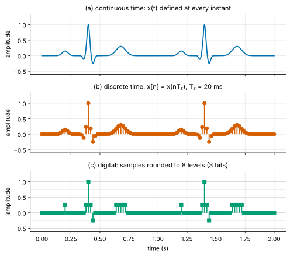
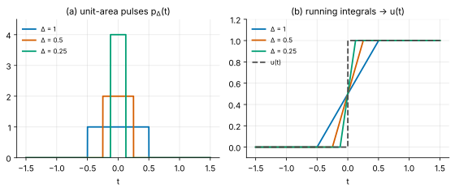
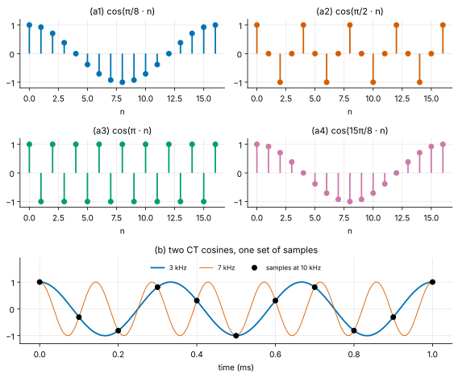

<!-- status: verified -->
# 11-01 · Signals: Classification and Operations

| | |
|---|---|
| **Course** | [11 · Signals and Systems](../README.md) |
| **University equivalent** | The opening weeks of a junior Signals and Systems course: continuous- and discrete-time signals, energy and power, periodicity, even and odd parts, transformations of the time axis, the unit step and impulse, and complex exponentials (Oppenheim & Willsky, *Signals and Systems*, ch. 1.1–1.4; Lathi, *Linear Systems and Signals*, ch. 1.1–1.4; MIT 6.003) |
| **Prerequisites** | [02-01 Complex Numbers, Euler and Phasors](../../02-complex-numbers-des-and-linear-algebra/chapters/02-01-complex-numbers-euler-and-phasors.md) (Euler's formula, $e^{st}$), [01-07 Applications of Integration](../../01-calculus-for-engineers/chapters/01-07-applications-of-integration.md) (average and RMS values), [01-08 Sequences, Series and Taylor](../../01-calculus-for-engineers/chapters/01-08-sequences-series-and-taylor.md) (geometric series), [02-05 The Laplace Transform for ODEs](../../02-complex-numbers-des-and-linear-algebra/chapters/02-05-laplace-transform-for-odes.md) (the unit impulse), [07-04 Laplace-Domain Circuit Analysis](../../07-circuit-analysis-2-transient-and-ac/chapters/07-04-laplace-domain-circuit-analysis.md) (impulsive currents) |
| **Estimated study hours** | 8 |
| **Last verified** | 2026-11-20 |

**Learning objectives.** After this chapter you can:

1. Classify a signal as continuous- or discrete-time, analog or digital, periodic or aperiodic, even or odd, and as an energy signal, a power signal or neither.
2. Compute the energy and average power of continuous- and discrete-time signals, including sums of sinusoids, and connect them to RMS values and to the power a resistor dissipates.
3. Find the fundamental period of a sum of continuous-time sinusoids, and decide whether a discrete-time sinusoid is periodic and with what period.
4. Apply shifts, reversals and scalings of the time axis, in either order, to continuous- and discrete-time signals, including decimation and zero-insertion interpolation, and predict what each does to energy.
5. Build piecewise signals from steps and ramps, and use the unit impulse's sifting and scaling properties to evaluate integrals, sums and derivatives of signals with jumps.
6. Describe continuous- and discrete-time complex exponentials, and explain why discrete-time frequency is only defined modulo 2π and what that implies for sampled signals.

---

## 1. Big picture

Courses 06, 07 and 10 analyzed particular circuits driven by particular inputs: a step, a sinusoid, a small signal riding on a bias point. Signals and Systems steps back and asks what is common to all of them. A **signal** is any quantity that varies with an independent variable, usually time, and carries information: a voltage on a wire, the current through an LED, the samples an ADC hands to a processor. A **system** turns an input signal into an output signal. This course builds one language for both, so that the same few tools (convolution in 11-03, the Fourier transform in 11-05 to 11-07, the Laplace and z-transforms in 11-08 and 11-09) describe an RC filter, a digital equalizer, a control loop and a radio receiver. This first chapter is the vocabulary: what kinds of signals there are, how to measure their size, and the handful of operations and elementary signals from which everything later is built.

- **Every chip boundary converts between kinds of signal.** An ECG front end (10-10) turns a continuous voltage into a stream of 24-bit numbers; a codec turns numbers back into sound. Knowing which kind of signal lives where tells you which mathematics applies.
- **Energy and power are the currency of battery life and thermal design.** A wearable's budget is in joules and its LED drive is a pulse train whose average, RMS and peak matter for different reasons.
- **Time scaling is the bandwidth tradeoff in disguise.** Compressing a pulse in time to send data faster spreads it in frequency (11-06); every serial link (Course 24) lives on that trade.
- **The impulse is how engineers characterize systems.** A system's response to one idealized kick, the impulse response, determines its response to everything (11-03).
- **Discrete-time frequency wraps around.** Two different analog tones can produce identical samples. That single fact, met here in its simplest form, becomes aliasing (11-10) and governs every ADC's anti-aliasing filter.

## 2. Intuition first

**A signal is a function; the kind of function is the classification.** Picture three views of one heartbeat. The electrode voltage is defined at every instant: a **continuous-time** (CT) signal $x(t)$. The front end's ADC reads it 500 times a second, keeping only the values at $t = nT_s$: a **discrete-time** (DT) signal $x[n]$, a sequence indexed by the integer $n$. Each kept value is rounded to one of $2^{24}$ codes before it is stored: a **digital** signal, discrete in both time and amplitude. Figure 1 shows all three. Most of this course works with the first two; the rounding (quantization) is a small, separately modeled error, met in 01-07 and returning in Courses 16 and 20.

*Figure 1. The same signal as (a) a continuous-time signal, (b) a discrete-time signal sampled every 20 ms, and (c) a digital signal whose samples are rounded to eight levels (3 bits, exaggerated so the steps are visible). The time axis is continuous in (a) only; the amplitude axis is continuous in (a) and (b).*

**An analogy from finance, and where it breaks.** A stock's price as it trades through the day behaves like a CT signal. The daily closing prices are a DT signal: one number per integer day. Prices quoted to the cent are digital: discrete in time and value. The analogy captures the three classes well, and it also shows why the order of operations matters: an average of closing prices is not the average price over the year. It breaks in one important way. An electrical signal sampled by an ADC usually comes from a smooth, band-limited waveform, so its samples can determine it completely (the sampling theorem, 11-10). A traded price is event-driven, jumping at each trade, and no sampling rate recovers it from daily closes.

**Measuring size: energy versus power.** Some signals are transient: a pulse, a decaying ring. Integrate the square of such a signal over all time and you get a finite number, its **energy**, the natural measure of its size. Other signals go on forever, such as a mains hum or a carrier. Their energy is infinite, but the energy per unit time settles to a finite average **power**. Which measure applies is the first classification of size, and it matters later: the Fourier transform of an energy signal is an ordinary function (11-06), while that of a periodic power signal is a set of lines (11-05).

**Operations on the time axis are function composition.** Delaying a recording, playing it backward or playing it at double speed all change the argument of the function, not its values: $x(t - 2)$, $x(-t)$, $x(2t)$. They are easy one at a time and easy to get wrong in combination, so §3.5 gives a rule that always works.

**The impulse is the limit of a short, strong kick.** Hit a bell with a hammer: the contact lasts microseconds, and the bell's ring depends only on the total impulse (force times time, 04-01), not on the contact's exact shape. The **unit impulse** $\delta(t)$ idealizes that: zero width, unit area. Its one essential property, that integrating it against a smooth function picks out the function's value at one instant, is what makes it the probe that characterizes systems.

## 3. Theory

### 3.1 Signals and their kinds

A **continuous-time signal** $x(t)$ assigns a value to every real $t$. A **discrete-time signal** $x[n]$ assigns a value to every integer $n$ and is undefined between integers: $x[1.5]$ is not small or zero, it does not exist. Square brackets always mark a DT signal. A DT signal often comes from sampling a CT one every $T_s$ seconds,

$$
x[n] = x(nT_s), \qquad f_s = \frac{1}{T_s},
$$

with $f_s$ the **sampling rate** in samples per second (SPS, or hertz). The index $n$ is dimensionless; time is recovered as $t = nT_s$. DT signals also arise natively: a bank balance by month, the contents of a shift register by clock cycle.

Along the amplitude axis, an **analog** signal takes a continuum of values and a **digital** signal takes values from a finite set. A DT signal whose values are rounded to $2^N$ levels is a digital signal with $N$ bits per sample. The rounding error is **quantization noise**, of RMS $\Delta/\sqrt{12}$ for a step size $\Delta$ (01-07). A digital signal need not be binary: PCIe 6.0 sends four-level symbols, two bits each (§9).

Further distinctions used throughout the course:

- **Real or complex.** Physical voltages are real. Complex signals such as $e^{j\omega t}$ are bookkeeping devices (02-01) that make the algebra of sinusoids simple, and in communications (Course 17) a complex signal represents two real signals, in phase and in quadrature, at once.
- **Deterministic or random.** A deterministic signal is a known function. A random signal, such as thermal noise, is described only statistically (03-06). This course treats deterministic signals; Course 17 and the noise chapters extend the tools.
- **Causal, anticausal, two-sided.** A **causal** signal is zero for $t < 0$ (or $n < 0$); an anticausal one is zero for $t > 0$; a two-sided signal is nonzero on both sides. "Causal signal" names a property of the signal's support. Causal *systems*, a different idea, come in 11-02.
- **Finite or infinite duration.** A signal is time-limited if it is zero outside a finite interval.

Units travel with signals. If $x(t)$ is a voltage, $x^2$ is in V², its time integral in V²·s, and so on. Keep them: they catch errors in every calculation below.

### 3.2 Energy and power

**Definitions.** For a CT signal, the **energy** and the **average power** are

$$
E_x = \int_{-\infty}^{\infty} \lvert x(t)\rvert^2\,dt, \qquad P_x = \lim_{T\to\infty}\frac{1}{2T}\int_{-T}^{T} \lvert x(t)\rvert^2\,dt .
$$

For a DT signal,

$$
E_x = \sum_{n=-\infty}^{\infty} \lvert x[n]\rvert^2, \qquad P_x = \lim_{N\to\infty}\frac{1}{2N + 1}\sum_{n=-N}^{N} \lvert x[n]\rvert^2 .
$$

The magnitude bars make the definitions work for complex signals; for real signals $\lvert x\rvert^2 = x^2$. These are **normalized** quantities: they are the energy and power the signal would deliver to a 1 Ω resistor. If $x$ is a voltage $v(t)$ across a resistor $R$, the actual energy dissipated is $\int v^2/R\,dt = E_x/R$ joules; if $x$ is a current through $R$, it is $E_xR$. Units: for a voltage, $E_x$ is in V²·s and $P_x$ in V²; dividing by ohms gives joules and watts. In DT, $E_x$ has the units of $x^2$ because $n$ is dimensionless; multiply by $T_s$ to estimate the energy of the underlying CT signal.

**Three classes.** If $0 < E_x < \infty$, then $P_x = 0$, because the finite energy is divided by a window that grows without bound: an **energy signal**. If $0 < P_x < \infty$, then $E_x = \infty$, because a finite, nonzero average over an infinite time integrates to infinity: a **power signal**. Some signals are neither: the ramp $t\,u(t)$ has infinite energy and infinite power, as do growing exponentials. Every bounded, time-limited signal is an energy signal. Every periodic signal that is not zero everywhere is a power signal.

> **Math refresher — improper integrals and geometric series.** An integral over an infinite range is the limit of integrals over growing finite ranges: $\int_0^\infty e^{-at}\,dt = \lim_{T\to\infty}(1 - e^{-aT})/a = 1/a$ for $a > 0$ (01-05). The DT counterpart is the geometric series: for $\lvert r\rvert < 1$, $\sum_{n=0}^{\infty} r^n = 1/(1 - r)$, and the finite sum is $\sum_{n=0}^{N-1} r^n = (1 - r^N)/(1 - r)$ for $r \ne 1$ (01-08). Both appear in nearly every energy calculation, and the geometric sum returns in the z-transform (11-09).

**A decaying exponential.** For $x(t) = Ae^{-at}u(t)$ with $a > 0$,

$$
E_x = \int_0^\infty A^2e^{-2at}\,dt = \frac{A^2}{2a} .
$$

Units: $A^2$ in V² divided by $a$ in s⁻¹ gives V²·s. The DT counterpart $x[n] = Ar^nu[n]$ with $\lvert r\rvert < 1$ has $E_x = A^2\sum_{n\ge0}r^{2n} = A^2/(1 - r^2)$.

**Periodic signals.** If $x$ has period $T_0$, every interval of length $T_0$ contributes the same energy, so the limit in the power definition reduces to one period:

$$
P_x = \frac{1}{T_0}\int_{T_0} \lvert x(t)\rvert^2\,dt ,
$$

where $\int_{T_0}$ means over any interval of length $T_0$. The square root of the power is the **RMS value**, $X_{rms} = \sqrt{P_x}$, the DC value that would dissipate the same power in a resistor (01-07 derives the RMS values of common waveforms). For $x(t) = A\cos(\omega_0t + \phi)$, using $\cos^2\theta = \tfrac12(1 + \cos 2\theta)$ and the fact that $\cos(2\omega_0t + 2\phi)$ averages to zero over a period,

$$
P_x = \frac{A^2}{2}, \qquad X_{rms} = \frac{A}{\sqrt2} \approx 0.7071A .
$$

A complex exponential $x(t) = Ce^{j\omega_0t}$ has $\lvert x\rvert^2 = \lvert C\rvert^2$ at every instant, so $P_x = \lvert C\rvert^2$: its power is constant in time, which is one reason complex exponentials are so convenient.

**Powers of sums: when they add.** Let $x(t) = x_1(t) + x_2(t)$ with both real. Then

$$
P_x = P_1 + P_2 + 2\,\overline{x_1x_2}, \qquad \overline{x_1x_2} = \lim_{T\to\infty}\frac{1}{2T}\int_{-T}^{T}x_1x_2\,dt .
$$

The **cross term** decides everything. Take two sinusoids at different frequencies, $x_1 = A_1\cos(\omega_1t + \phi_1)$ and $x_2 = A_2\cos(\omega_2t + \phi_2)$ with $\omega_1 \ne \omega_2$, both positive. The product-to-sum identity gives

$$
x_1x_2 = \frac{A_1A_2}{2}\Big[\cos\big((\omega_1 - \omega_2)t + \phi_1 - \phi_2\big) + \cos\big((\omega_1 + \omega_2)t + \phi_1 + \phi_2\big)\Big] .
$$

Both terms are sinusoids of nonzero frequency, and the time average of a sinusoid of nonzero frequency is zero (its integral is bounded while the window grows). So $\overline{x_1x_2} = 0$: sinusoids at different frequencies are **orthogonal**, and their powers add. A DC term is a sinusoid at zero frequency and is orthogonal to the rest too. For a signal of the form $x(t) = A_0 + \sum_k A_k\cos(\omega_kt + \phi_k)$ with distinct positive $\omega_k$,

$$
P_x = A_0^2 + \sum_k \frac{A_k^2}{2} .
$$

This is the first appearance of Parseval's relation (11-05): power splits cleanly over frequency. It is why a spectrum analyzer can report the power in each band separately, and why noise powers in different bands add.

At the *same* frequency the cross term does not vanish. Two sinusoids at $\omega_0$ add as phasors (02-01) to a single sinusoid of amplitude $\lvert\mathbf{A}_1 + \mathbf{A}_2\rvert$, so $P = \lvert\mathbf{A}_1 + \mathbf{A}_2\rvert^2/2$, which equals $(A_1^2 + A_2^2)/2$ only when the phasors are perpendicular. The cross term is $A_1A_2\cos(\phi_1 - \phi_2)$: positive when the two are nearly in phase, negative when they oppose. Example 11-01.3 does both cases.

**DT has one twist.** A DT sinusoid $A\cos(\omega n + \phi)$ has power $A^2/2$ for every frequency except $\omega = 0$ and $\omega = \pi$ (and their equivalents modulo 2π, §3.7). At $\omega = \pi$, $\cos(\pi n + \phi) = (-1)^n\cos\phi$, a sequence of constant magnitude $\lvert A\cos\phi\rvert$, with power $A^2\cos^2\phi$. The double-frequency term $\cos(2\pi n + 2\phi) = \cos2\phi$ is then a constant that no longer averages away. Example 11-01.3(c) shows it.

### 3.3 Periodic signals

**Definition.** A CT signal is **periodic** with period $T > 0$ if $x(t + T) = x(t)$ for every $t$. If $T$ is a period, so are $2T$, $3T$, and so on. The smallest positive period is the **fundamental period** $T_0$, and $f_0 = 1/T_0$, $\omega_0 = 2\pi/T_0$ are the fundamental frequency in hertz and rad/s. A constant is periodic with every $T$ and has no fundamental period; that degenerate case is excluded from "fundamental period" statements.

The sinusoid $\cos(\omega t + \phi)$ and the complex exponential $e^{j\omega t}$ with $\omega \ne 0$ have $T_0 = 2\pi/\lvert\omega\rvert$.

**Sums of periodic signals.** Let $x_1$ and $x_2$ have fundamental periods $T_1$ and $T_2$. Their sum repeats when both have completed whole numbers of cycles: when $T = kT_1 = mT_2$ for positive integers $k$ and $m$. That requires

$$
\frac{T_1}{T_2} = \frac{m}{k}, \quad \text{a rational number.}
$$

If the ratio is rational, written in lowest terms as $m/k$, the sum is periodic with period $T = kT_1 = mT_2$, the **least common multiple** of $T_1$ and $T_2$. In frequency terms, $f_0$ is the greatest common divisor of $f_1$ and $f_2$: the components are harmonics (integer multiples) of $f_0$. If the ratio is irrational, no such $T$ exists, and the sum is not periodic even though each part is. The sum still has finite average power ($P_1 + P_2$ when the frequencies differ), so it is a power signal that is not periodic.

A caution on the LCM: the period of a sum can be *shorter* than the LCM if parts cancel or combine. For example $\cos^2(\omega t)$ is $\tfrac12 + \tfrac12\cos2\omega t$ and has period $\pi/\omega$, half the period of $\cos\omega t$. Simplify first, then apply the rule. Taking the LCM of the components' fundamental periods is otherwise reliable for sums of sinusoids at distinct frequencies, because such a sum is identically zero only if every component is.

**DT periodicity.** A DT signal is periodic with period $N$, a positive *integer*, if $x[n + N] = x[n]$ for all $n$. The smallest such $N$ is the fundamental period $N_0$. The integer requirement changes everything for sinusoids. For $x[n] = \cos(\omega n + \phi)$ to be periodic we need $\omega N = 2\pi m$ for some integer $m$, that is,

$$
\frac{\omega}{2\pi} = \frac{m}{N}, \quad \text{a rational number.}
$$

If $\omega/2\pi$ is rational, written in lowest terms as $m/N$, then $N_0 = N$, and one period of the sequence spans $m$ cycles of the underlying cosine. If $\omega/2\pi$ is irrational, the sequence never repeats exactly. So $\cos(0.3\pi n)$, with $\omega/2\pi = 3/20$, has $N_0 = 20$ and spans 3 cosine cycles per period, while $\cos(0.5n)$, with $\omega/2\pi = 1/(4\pi)$, is not periodic at all, although it consists of samples of the periodic CT signal $\cos(0.5t)$. Sampling a periodic CT signal gives a periodic DT signal only if the period $T_0$ and the sampling interval $T_s$ are commensurate, $T_0/T_s$ rational. Sums of periodic DT signals are always periodic, with $N_0$ dividing the LCM of the integer periods, because integers always have a common multiple.

### 3.4 Even and odd signals

A signal is **even** if $x(-t) = x(t)$ (mirror symmetric about $t = 0$, like $\cos t$ or $t^2$) and **odd** if $x(-t) = -x(t)$ (antisymmetric, like $\sin t$ or $t^3$). An odd signal must be zero at $t = 0$, since $x(0) = -x(0)$. The same definitions hold in DT with $n$ in place of $t$.

**Every signal splits uniquely into an even part and an odd part.** Suppose $x = x_e + x_o$ with $x_e$ even and $x_o$ odd. Replacing $t$ by $-t$ gives $x(-t) = x_e(t) - x_o(t)$. Adding and subtracting the two equations,

$$
x_e(t) = \frac{x(t) + x(-t)}{2}, \qquad x_o(t) = \frac{x(t) - x(-t)}{2} .
$$

These are forced, so the split is unique, and conversely these two formulas always produce an even and an odd function that sum to $x$.

**Properties.** Products follow the sign rules of multiplication: even × even and odd × odd are even, even × odd is odd. The integral of an odd signal over a symmetric interval $[-T, T]$ is zero, and that of an even signal is twice the integral over $[0, T]$. These two facts halve the work of many Fourier integrals (11-05), where cosines are even and sines odd.

**Energy splits too.** Since $x_ex_o$ is odd, it integrates to zero over the whole line, so for a real energy signal

$$
E_x = \int (x_e + x_o)^2\,dt = E_e + E_o + 2\int x_ex_o\,dt = E_e + E_o .
$$

The even and odd parts are orthogonal, like the sinusoids of §3.2. A useful special case: for a causal CT signal, $x(t)$ and $x(-t)$ never overlap (except at the single point $t = 0$, which carries no area), so $x_e = x_o = x/2$ for $t > 0$, and $E_e = E_o = E_x/2$. In DT the point $n = 0$ is a full sample, $x_o[0] = 0$ and $x_e[0] = x[0]$, so for a causal DT signal $E_e = (E_x + x[0]^2)/2$ and $E_o = (E_x - x[0]^2)/2$. Example 11-01.5 checks both.

For complex signals the useful symmetry is **conjugate symmetry**, $x(-t) = x^*(t)$; it reappears in 11-06 as the property that makes the spectrum of every real signal conjugate symmetric.

### 3.5 Operations on the time axis

Three operations change the argument of a signal.

- **Time shift.** $y(t) = x(t - t_0)$. Whatever $x$ did at time $\tau$, $y$ does at $t = \tau + t_0$. So $t_0 > 0$ is a **delay** (the graph moves right) and $t_0 < 0$ an advance (left). The minus sign is the whole trap: $x(t - 2)$ is $x$ delayed by 2.
- **Time reversal.** $y(t) = x(-t)$ mirrors the graph about $t = 0$.
- **Time scaling.** $y(t) = x(at)$ with $a > 0$. What $x$ did at $\tau$, $y$ does at $t = \tau/a$. So $a > 1$ compresses the graph toward $t = 0$ (a recording played faster) and $0 < a < 1$ stretches it. A negative $a$ is a scaling combined with a reversal.

**Combinations: the substitution rule.** For $y(t) = x(at - b)$, ask *when* $y$ does what $x$ does at $\tau$. Setting the argument equal to $\tau$,

$$
at - b = \tau \quad\Longrightarrow\quad t = \frac{\tau + b}{a} .
$$

Every feature of $x$ at $\tau$ (a corner, a jump, the edge of its support) appears in $y$ at $(\tau + b)/a$. This mapping is the one rule to trust. It also tells you how to perform the operations graphically, in either of two orders:

1. **Shift first, then scale:** form $w(t) = x(t - b)$, then $y(t) = w(at)$. Check: $w(at) = x(at - b)$.
2. **Scale first, then shift by $b/a$:** form $v(t) = x(at)$, then $y(t) = v(t - b/a)$. Check: $v(t - b/a) = x(a(t - b/a)) = x(at - b)$.

The classic mistake is to scale first and then shift by $b$: that produces $x(a(t - b)) = x(at - ab)$, a different signal. The scaling acts on everything inside the argument, including the shift. Example 11-01.4 works a case, with the wrong order shown for contrast.

**Amplitude operations** act on values, not on time: $y(t) = Ax(t) + B$ scales by $A$ (a negative $A$ flips the graph vertically) and adds an offset $B$. They commute with the time operations.

**Effect on energy and power.** A shift changes neither, since the integral over all time does not care where the signal sits. A reversal changes neither. A scaling $y(t) = x(at)$ changes the energy: substituting $\tau = at$, $d\tau = \lvert a\rvert\,dt$,

$$
E_y = \int \lvert x(at)\rvert^2\,dt = \frac{1}{\lvert a\rvert}\int \lvert x(\tau)\rvert^2\,d\tau = \frac{E_x}{\lvert a\rvert} .
$$

Compressing a pulse by 2 halves its energy, because the same values last half as long. The power of a periodic signal is unchanged by scaling (the period scales too, and the average over one period is the same). To keep a compressed pulse's energy, its amplitude must rise by $\sqrt{\lvert a\rvert}$; §6 returns to this when a serial link shortens its symbols.

**Discrete time.** Shifts $x[n - n_0]$ (integer $n_0$) and reversal $x[-n]$ work exactly as in CT. Scaling does not, because the argument must stay an integer.

- **Decimation (downsampling)** by an integer $M$, $y[n] = x[Mn]$, keeps every $M$-th sample and discards the rest. Information can be lost: unlike CT compression, it cannot always be undone, and the energy changes by however much the discarded samples carried, not by a fixed factor $1/M$.
- **Interpolation (upsampling)** by $L$ with zero insertion: $y[n] = x[n/L]$ when $n$ is a multiple of $L$ and 0 otherwise. Nothing is lost and the energy is unchanged; the zeros are later filled in by a filter (Course 16).

### 3.6 Elementary signals: steps, ramps and the impulse

**Steps and ramps.** The **unit step** $u(t)$ is 0 for $t < 0$ and 1 for $t > 0$ (notation.md; its value at $t = 0$ is a convention that never affects an integral, and this course does not need it). The **unit ramp** is $r(t) = t\,u(t)$, with $dr/dt = u(t)$. The **rectangular pulse** of width $W$ starting at 0 is $u(t) - u(t - W)$, and the **sign function** is $\operatorname{sgn}(t) = 2u(t) - 1$.

Steps and ramps are building blocks. Any piecewise-linear signal is a sum of shifted ramps (one per change of slope, weighted by the change) plus shifted steps (one per jump, weighted by the jump). Reading a signal from left to right: at each breakpoint, add a ramp whose weight is the slope after minus the slope before, and a step whose weight is the value after minus the value before. For example, the signal that rises with slope 1 from $t = 0$ to $t = 1$, holds at 1 until $t = 2$, then drops to 0 is

$$
x(t) = r(t) - r(t - 1) - u(t - 2) .
$$

**The unit impulse.** Define a pulse of width $\Delta$ and height $1/\Delta$, centered at 0:

$$
p_\Delta(t) = \frac{1}{\Delta}\Big[u\big(t + \tfrac{\Delta}{2}\big) - u\big(t - \tfrac{\Delta}{2}\big)\Big] .
$$

Its area is 1 for every $\Delta$. As $\Delta \to 0$ it becomes infinitely tall and narrow while keeping unit area. No ordinary function has that limit, but its effect inside an integral has a perfectly good limit. For any function $f$ continuous at 0, the integral $\int f(t)p_\Delta(t)\,dt$ is the average of $f$ over $[-\Delta/2, \Delta/2]$, which tends to $f(0)$. The **unit impulse** (Dirac delta) $\delta(t)$ is defined by that limiting behavior:

$$
\int_{-\infty}^{\infty} f(t)\,\delta(t - t_0)\,dt = f(t_0) \qquad\text{(sifting property)},
$$

for any $f$ continuous at $t_0$, with $\delta(t) = 0$ for $t \ne 0$ and $\int\delta\,dt = 1$. Figure 3 shows the pulses closing in on the impulse and their running integrals closing in on the step. Its consequences:

- **Sampling.** $f(t)\delta(t - t_0) = f(t_0)\delta(t - t_0)$: multiplying by an impulse keeps only one value of $f$. The sifting property is this, integrated.
- **The integral's limits matter.** $\int_a^b f(t)\delta(t - t_0)\,dt = f(t_0)$ if $a < t_0 < b$ and 0 if $t_0$ is outside $[a, b]$. (An impulse exactly at a limit is a case this course avoids, except at $0^-$, where 02-05 and 07-04 include the whole impulse by integrating from $0^-$.)
- **Running integral and derivative.** $\int_{-\infty}^{t}\delta(\lambda)\,d\lambda = u(t)$, so $\delta(t) = du/dt$ in this generalized sense. A signal with a jump of size $J$ at $t_1$ has a derivative containing $J\,\delta(t - t_1)$. For the example above, $x'(t) = u(t) - u(t - 1) - \delta(t - 2)$.
- **Units.** Since $\int\delta(t)\,dt = 1$ is dimensionless and $dt$ is in seconds, $\delta(t)$ has units of 1/s. A current $i(t) = Q\,\delta(t)$ with $Q$ in coulombs is in amperes: an impulse of current delivers the charge $Q$ instantly. 07-04 met exactly this when an ideal source charges a capacitor in zero time.

**The scaling property.** For a nonzero constant $a$,

$$
\delta(at) = \frac{1}{\lvert a\rvert}\,\delta(t) .
$$

*Derivation.* Test it in an integral against a smooth $f$, substituting $\tau = at$. For $a > 0$, $\int f(t)\delta(at)\,dt = \int f(\tau/a)\delta(\tau)\,d\tau/a = f(0)/a$. For $a < 0$ the limits swap, and swapping them back gives a minus sign that cancels the negative $a$: the result is $f(0)/\lvert a\rvert$. Both cases are what $\delta(t)/\lvert a\rvert$ gives. Physically, compressing the narrow pulse $p_\Delta$ in time by $a$ narrows it to $\Delta/\lvert a\rvert$ without raising it, so its area falls by $\lvert a\rvert$. For a shifted argument, factor first: $\delta(2t - 4) = \delta\big(2(t - 2)\big) = \tfrac12\delta(t - 2)$.

> **Going deeper — the impulse as a distribution.** Mathematicians make δ rigorous as a *distribution*, or generalized function: an object defined only by what it does to smooth "test functions" inside an integral, $\langle\delta, f\rangle = f(0)$. Derivatives of distributions are defined through integration by parts, $\langle\delta', f\rangle = -f'(0)$, which gives a meaning to the derivative of an impulse (a doublet) and shows that $\delta(g(t)) = \sum_i\delta(t - t_i)/\lvert g'(t_i)\rvert$ for the simple roots $t_i$ of $g$. Laurent Schwartz's theory of distributions, the work for which he received the 1950 Fields Medal, put on a firm footing what physicists and engineers, Dirac and Heaviside among them, had been using successfully for decades. Engineering never needs more than the sifting property, the scaling rule and the step–impulse relation.

**DT counterparts, with no subtleties.** The **unit sample** $\delta[n]$ is 1 at $n = 0$ and 0 elsewhere: an ordinary sequence, with no limits needed. The DT unit step $u[n]$ is 1 for $n \ge 0$ (including $n = 0$, unambiguously) and 0 for $n < 0$. They are related by a running sum and a first difference,

$$
u[n] = \sum_{k=-\infty}^{n}\delta[k] = \sum_{k=0}^{\infty}\delta[n - k], \qquad \delta[n] = u[n] - u[n - 1] .
$$

*Figure 3. (a) Pulses $p_\Delta(t)$ of width Δ = 1, 0.5 and 0.25 and height 1/Δ: the area stays 1 while the width shrinks. (b) Their running integrals rise from 0 to 1 across the pulse and approach the unit step $u(t)$ as Δ → 0, which is the sense in which $\delta = du/dt$.*

The DT sifting property, $\sum_n f[n]\,\delta[n - n_0] = f[n_0]$, is a single term of a sum. Its most important form expresses any sequence as a weighted sum of shifted unit samples,

$$
x[n] = \sum_{k=-\infty}^{\infty} x[k]\,\delta[n - k] ,
$$

which looks trivial and is the starting point of convolution (11-03). There is no DT scaling property, because $\delta[an]$ for integer $a \ne 0$ is just $\delta[n]$.

### 3.7 Complex exponentials and sinusoids

**Continuous time.** The signal $x(t) = Ce^{st}$ with complex $C = \lvert C\rvert e^{j\theta}$ and $s = \sigma + j\omega$ (02-01 §3.7) is

$$
x(t) = \lvert C\rvert e^{\sigma t}e^{j(\omega t + \theta)} = \lvert C\rvert e^{\sigma t}\big[\cos(\omega t + \theta) + j\sin(\omega t + \theta)\big] .
$$

It covers every case in one formula: $\omega = 0$ gives real exponentials (decaying for $\sigma < 0$, growing for $\sigma > 0$); $\sigma = 0$ gives the periodic complex exponential $e^{j\omega t}$ with period $2\pi/\lvert\omega\rvert$; both nonzero give a sinusoid inside an exponential envelope, the natural response of every underdamped second-order circuit (07-03). Real sinusoids are sums of two conjugate exponentials, $\cos(\omega t + \theta) = \tfrac12\big(e^{j(\omega t + \theta)} + e^{-j(\omega t + \theta)}\big)$.

The **harmonically related** set $e^{jk\omega_0t}$, $k = 0, \pm1, \pm2, \dots$, all share the period $2\pi/\omega_0$ and are all different signals: each higher $k$ rotates faster. Sums of them build every periodic signal (Fourier series, 11-05). In CT, a higher frequency always means a faster oscillation, without limit.

**Discrete time.** The DT exponential is $x[n] = Cz^n$ with complex $z = re^{j\omega}$:

$$
x[n] = \lvert C\rvert r^ne^{j(\omega n + \theta)} .
$$

With real $z$ (so $\omega = 0$ or $\pi$), the magnitude decays for $\lvert z\rvert < 1$ and grows for $\lvert z\rvert > 1$, and a negative $z$ alternates sign every sample, a behavior with no CT counterpart among real exponentials. With $\lvert z\rvert = 1$ the sequence is the DT complex exponential $e^{j\omega n}$, with $\omega$ in rad/sample. It differs from its CT cousin in two ways, and both matter for the rest of the course.

1. **DT frequency is only defined modulo 2π.** Because $n$ is an integer, $e^{j2\pi n} = 1$, so

   $$
   e^{j(\omega + 2\pi k)n} = e^{j\omega n}e^{j2\pi kn} = e^{j\omega n} \quad\text{for every integer } k .
   $$

   The frequencies $\omega$ and $\omega + 2\pi$ give the *same sequence*. All distinct DT complex exponentials have $\omega$ in one interval of length $2\pi$, conventionally $-\pi < \omega \le \pi$. For a real cosine, $\cos(-\omega n) = \cos(\omega n)$ as well, so distinct real sinusoids need only $0 \le \omega \le \pi$.
2. **Low and high frequencies.** The slowest oscillation is at $\omega = 0$ (a constant) and the fastest at $\omega = \pi$, where $e^{j\pi n} = (-1)^n$ alternates every sample: nothing can change faster than once per sample. As $\omega$ rises past $\pi$ toward $2\pi$, the sequence oscillates *more slowly* again, because $\omega = 2\pi - \epsilon$ is the same as $-\epsilon$. Figure 4(a) shows it: $\cos(15\pi n/8)$ is identical to $\cos(\pi n/8)$.

The periodicity condition of §3.3 also differs: $e^{j\omega n}$ is periodic only if $\omega/2\pi$ is rational, and the harmonically related set $e^{jk(2\pi/N)n}$ contains only $N$ distinct signals ($k = 0, \dots, N - 1$), because $k$ and $k + N$ give the same sequence. That finite set is the basis of the discrete Fourier transform (Course 16).

| Property | CT: $e^{j\omega t}$ | DT: $e^{j\omega n}$ |
|---|---|---|
| Distinct for distinct ω? | Yes, for every ω | Only within one 2π interval |
| Periodic? | Always, $T_0 = 2\pi/\lvert\omega\rvert$ | Only if $\omega/2\pi = m/N$ is rational; then $N_0 = N$ in lowest terms |
| Fastest oscillation | None (no limit) | $\omega = \pi$: $(-1)^n$ |
| Harmonics of a period | Infinitely many distinct | $N$ distinct for period $N$ |

**Sampling makes the wrap-around physical.** Sample $x(t) = \cos(2\pi ft)$ at rate $f_s$. The samples are

$$
x[n] = \cos\Big(2\pi\frac{f}{f_s}n\Big), \qquad \omega = 2\pi\frac{f}{f_s}\ \text{rad/sample}.
$$

(To keep the two frequencies apart, this chapter writes the CT frequency in hertz, $f$, whenever a DT frequency $\omega$ in rad/sample is in play.) Two CT frequencies $f$ and $f + kf_s$ give DT frequencies differing by $2\pi k$, hence *identical samples*. For cosines, $kf_s - f$ does too, because cosine is even. After sampling at 10 kHz, a 3 kHz tone, a 7 kHz tone and a 13 kHz tone produce exactly the same sequence (Example 11-01.7, Figure 4(b)). The sampler cannot tell them apart, and nothing done afterward can. The only defense is to remove the unwanted frequencies *before* sampling, with an analog anti-aliasing filter. That is the subject of 11-10; here the point is that it follows directly from $e^{j2\pi n} = 1$.

*Figure 4. (a) DT cosines at ω = π/8, π/2, π and 15π/8 rad/sample: oscillation is fastest at π, and 15π/8 gives exactly the samples of π/8. (b) A 3 kHz and a 7 kHz cosine sampled at 10 kHz: two different CT signals, one DT signal.*

## 4. Worked examples

### Example 11-01.1 · Fundamental periods (tier A)

**Setup.** Find the fundamental period, if any, of (a) $x_1(t) = 3\cos(4\pi t) + 2\sin(6\pi t + \pi/4)$; (b) $x_2(t) = \cos(2t) + \cos(\pi t)$; (c) $x_3[n] = \cos(0.3\pi n)$; (d) $x_4[n] = \cos(0.5n)$; (e) $x_5[n] = \cos(\pi n/4) + \sin(\pi n/6)$.

**Solution.** (a) The parts have $T_1 = 2\pi/4\pi$ = **0.5** s and $T_2 = 2\pi/6\pi$ = **0.3333** s. Their ratio is $3/2$, rational, so the sum is periodic with $T_0 = 2T_1 = 3T_2$ = **1** s, a fundamental frequency of **1** Hz: the 2 Hz and 3 Hz parts are its second and third harmonics. The phase $\pi/4$ and the sine do not affect the period.

(b) $T_1 = \pi$ s and $T_2 = 2$ s; their ratio $\pi/2$ is irrational, so $x_2$ is **not periodic**. It is still a power signal, with $P = \tfrac12 + \tfrac12$ = **1**.

(c) $\omega/2\pi = 0.15 = 3/20$ in lowest terms, so $N_0$ = **20** samples, spanning 3 cycles of the cosine.

(d) $\omega/2\pi = 0.5/2\pi = 1/(4\pi)$ is irrational: **not periodic**, although $\cos(0.5t)$ is.

(e) $\pi/4$ gives $\omega/2\pi = 1/8$, so $N_1 = 8$; $\pi/6$ gives $1/12$, so $N_2 = 12$. The sum repeats at the LCM, $N_0$ = **24**. (Check: 24 is a multiple of both, and no smaller positive integer is.)

**Units check.** Periods in seconds for CT, a dimensionless sample count for DT.

**Sanity check.** In (a) the sum's period must be a multiple of each part's period, and 1 s = 2 × 0.5 s = 3 × (1/3) s. In (c), 20 samples × 0.3π rad/sample = 6π rad = 3 full cycles.

### Example 11-01.2 · The energy of a decaying pulse (tier A)

**Setup.** A voltage $v(t) = 5e^{-2t}u(t)$ V ($t$ in seconds) appears across a 1 kΩ resistor. (a) Find its normalized energy and the energy the resistor dissipates. (b) What fraction of the energy arrives in the first 0.5 s, and when has 99% arrived? (c) Find the energy of the DT signal $x[n] = (0.8)^nu[n]$.

**Solution.** (a) By §3.2 with $A$ = 5 V and $a$ = 2 s⁻¹, $E_v = A^2/2a = 25/4$ = **6.25** V²·s. The resistor dissipates $E_v/R = 6.25/1000$ J = **6.25** mJ. The power is zero: an energy signal.

(b) The energy up to time $t_1$ is $\int_0^{t_1}25e^{-4t}\,dt = 6.25(1 - e^{-4t_1})$, so the fraction is $1 - e^{-4t_1}$. At $t_1$ = 0.5 s it is $1 - e^{-2}$ = **86.5**%. For 99%, $e^{-4t_1} = 0.01$, so $t_1 = \ln(100)/4$ = **1.151** s. The energy decays at twice the rate of the voltage, because it goes as the square.

(c) $E_x = \sum_{n\ge0}0.64^n = 1/(1 - 0.64)$ = **2.778**.

**Units check.** V² × s gives V²·s; dividing by Ω gives V²·s/Ω = W·s = J.

**Sanity check.** The voltage's time constant is 0.5 s, so the energy's is 0.25 s; 0.5 s is two energy time constants, leaving $e^{-2}$ = **13.5**%, consistent with (b). In (c) the first sample alone contributes 1 of the 2.778.

### Example 11-01.3 · Power of sums of sinusoids (tier B)

**Setup.** (a) Find the power and RMS value of $v(t) = 3 + 4\cos(100\pi t) + 2\cos(300\pi t + 1)$ V, and the power it delivers to 50 Ω. (b) Find the power and RMS value of $w(t) = 4\cos(100\pi t) + 3\cos(100\pi t + \pi/3)$ V, and compare with adding the two powers. (c) Find the power of the DT signals $\cos(\pi n/2)$ and $\cos(\pi n)$.

**Solution.** (a) The components are at 0, 50 Hz and 150 Hz, all distinct, so their powers add (§3.2): $P = 3^2 + 4^2/2 + 2^2/2 = 9 + 8 + 2$ = **19** V². The RMS value is $\sqrt{19}$ = **4.359** V, and into 50 Ω the power is $19/50$ = **0.38** W. The phase of 1 rad on the third harmonic does not matter: orthogonality does not depend on phase.

(b) Both terms are at 50 Hz, so they combine as phasors: $4\angle0° + 3\angle60° = (4 + 1.5) + j2.598$ V, which is $6.083\angle25.3°$ V. The sum is a single sinusoid of amplitude 6.083 V, so $P = 6.083^2/2$ = **18.5** V² and the RMS value is **4.301** V. Adding the separate powers would give $8 + 4.5$ = **12.5** V²; the difference is the cross term $A_1A_2\cos(\phi_1 - \phi_2) = 12\cos60°$ = **6** V², positive because the two are within 90° of each other.

(c) $\cos(\pi n/2)$ takes the values $1, 0, -1, 0$ repeating, so $P = (1 + 0 + 1 + 0)/4$ = **0.5**, the usual $A^2/2$. But $\cos(\pi n) = (-1)^n$ has magnitude 1 at every sample, so $P$ = **1**: at $\omega = \pi$ the DT sinusoid's power is $A^2\cos^2\phi$, here with $\phi = 0$ (§3.2).

**Units check.** V² for power of a voltage; V²/Ω = W.

**Sanity check.** In (a) the RMS value exceeds the 3 V DC value, as it must (RMS is never below the magnitude of the average, 01-07). In (b), 18.5 V² lies between the in-phase extreme $(4 + 3)^2/2$ = **24.5** V² and the opposed extreme $(4 - 3)^2/2$ = **0.5** V².

### Example 11-01.4 · Shift, scale and reverse (tier B)

**Setup.** Let $x(t) = r(t) - r(t - 1) - u(t - 2)$: it rises from 0 to 1 over $0 \le t \le 1$, holds at 1 until $t = 2$, then drops to 0. Find $y(t) = x(4 - 2t)$: its support, its breakpoints, its values at $t$ = 1.25 s and 1.75 s, its energy, and an expression in steps and ramps. Show what the wrong order of operations gives.

**Solution.** *By substitution.* A feature of $x$ at $\tau$ appears in $y$ where $4 - 2t = \tau$, at $t = (4 - \tau)/2$. The support edges $\tau = 0$ and $\tau = 2$ map to $t = 2$ and $t = 1$, so $y$ is nonzero on **1** s < $t$ < **2** s, and the corner at $\tau = 1$ maps to $t$ = **1.5** s. Because $a = -2$ is negative, the order reverses: the ramp, which came first in $x$, now comes last. On $1.5 \le t \le 2$, $y = 4 - 2t$, falling from 1 to 0; on $1 < t < 1.5$, $y = 1$. So $y(1.25) = x(1.5)$ = **1** and $y(1.75) = x(0.5)$ = **0.5**.

*Graphically, shift first.* $w(t) = x(t + 4)$ moves $x$ left by 4, onto $[-4, -2]$. Then $w(-2t)$ compresses by 2 and reverses: $[-4, -2]$ becomes $[1, 2]$. Check: $w(-2t) = x(-2t + 4)$. Figure 2 shows the steps.

*Energy.* $E_x = \int_0^1t^2\,dt + \int_1^21\,dt = 1/3 + 1$ = **1.333**. By §3.5, $E_y = E_x/\lvert a\rvert = E_x/2$ = **0.6667**. Directly: $\int_1^{1.5}1\,dt + \int_{1.5}^2(4 - 2t)^2\,dt = 0.5 + 1/6 = 0.6667$.

*In steps and ramps.* Reading $y$ from left to right: a jump of +1 at $t = 1$, a change of slope from 0 to −2 at $t = 1.5$, and a change of slope from −2 back to 0 at $t = 2$ (no jump there, since $y$ reaches 0 continuously):

$$
y(t) = u(t - 1) - 2r(t - 1.5) + 2r(t - 2) .
$$

*The wrong order.* Scaling first, $v(t) = x(-2t)$, then shifting by 4 instead of $4/2$, gives $v(t - 4) = x(-2t + 8)$, which lives on [3, 4] s. The correct shift after scaling is $b/a$: writing $x(4 - 2t) = x\big(-2(t - 2)\big)$ shows it is $v$ delayed by 2.

**Units check.** Times in seconds; $x$ is dimensionless here, so energies are in seconds, and halving under compression by 2 is consistent.

**Sanity check.** $y$ lasts 1 s where $x$ lasted 2 s, as compression by 2 requires, and the step-and-ramp expression gives $y(1.25) = 1$ and $y(1.75) = 1 - 2(0.25) = 0.5$, matching.

![Four panels: x(t); x(t+4) shifted left by 4; x(-2t+4) as the final result on [1, 2]; and the wrong-order result on [3, 4]](../../../assets/figures/11-01/time-ops.svg)

*Figure 2. Example 11-01.4: (a) $x(t)$; (b) shifted, $x(t + 4)$; (c) then compressed and reversed, $y(t) = x(4 - 2t)$; (d) the wrong order, $x(8 - 2t)$, which lands 2 s too late.*

### Example 11-01.5 · Even and odd parts (tier B)

**Setup.** (a) Find the even and odd parts of $x(t) = e^{-t}u(t)$ V and the energy of each. (b) Do the same for $x[n] = \delta[n] + 2\delta[n - 1] + 3\delta[n - 2]$.

**Solution.** (a) For $t > 0$, $x(-t) = 0$, so $x_e = x_o = \tfrac12e^{-t}$; for $t < 0$, $x(t) = 0$ and $x(-t) = e^{t}$, so $x_e = \tfrac12e^{t}$ and $x_o = -\tfrac12e^{t}$. Compactly, $x_e(t) = \tfrac12e^{-\lvert t\rvert}$ and $x_o(t) = \tfrac12\operatorname{sgn}(t)e^{-\lvert t\rvert}$. The energies: $E_x = 1/2$ = **0.5** V²·s by §3.2, and $E_e = 2\int_0^\infty\tfrac14e^{-2t}\,dt = 1/4$ = **0.25** V²·s, and likewise $E_o$ = **0.25** V²·s. They sum to $E_x$, and each is half, as §3.4 predicts for a causal signal.

(b) $x[-n]$ has the values 3, 2, 1 at $n = -2, -1, 0$. So over $n = -2, \dots, 2$,

$$
x_e[n] = \{1.5,\ 1,\ 1,\ 1,\ 1.5\}, \qquad x_o[n] = \{-1.5,\ -1,\ 0,\ 1,\ 1.5\} .
$$

In particular $x_e[-2]$ = **1.5** and $x_o[-2]$ = **−1.5**. Energies: $E_x = 1 + 4 + 9$ = **14**; $E_e = 2.25 + 1 + 1 + 1 + 2.25$ = **7.5**; $E_o = 2.25 + 1 + 0 + 1 + 2.25$ = **6.5**. They sum to 14, but the split is not equal: the sample at $n = 0$ belongs wholly to the even part, and §3.4's formula gives $E_e = (14 + 1)/2 = 7.5$.

**Units check.** In (a), V² × s; in (b), the units of $x^2$.

**Sanity check.** $x_e + x_o$ recovers $x$: at $n = 2$, $1.5 + 1.5 = 3$; at $n = -2$, $1.5 - 1.5 = 0$. And $x_o[0] = 0$, as every odd signal requires.

### Example 11-01.6 · Working with impulses (tier B)

**Setup.** Evaluate (a) $\int_{-\infty}^{\infty}(t^2 + 1)\,\delta(t - 2)\,dt$; (b) $\int_{-\infty}^{\infty}e^{-t}\,\delta(2t - 4)\,dt$; (c) $\int_{-1}^{1}\cos(\pi t)\,\delta(t - 3)\,dt$. (d) Find the derivative of Example 11-01.4's $x(t)$ and the weight of its impulse. (e) An ideal 5 V source is connected at $t = 0$ across an uncharged 2 µF capacitor with no resistance. Find the current, the charge delivered, the energy stored and the energy the source supplies.

**Solution.** (a) Sifting at $t_0 = 2$: $2^2 + 1$ = **5**.

(b) Factor the argument: $\delta(2t - 4) = \delta\big(2(t - 2)\big) = \tfrac12\delta(t - 2)$. So the integral is $\tfrac12e^{-2}$ = **0.06767**. Forgetting the factor $\tfrac12$ is the standard error; the narrower pulse has half the area.

(c) The impulse sits at $t = 3$, outside $[-1, 1]$, so the integral is **0**.

(d) From $x(t) = r(t) - r(t - 1) - u(t - 2)$, term by term: $x'(t) = u(t) - u(t - 1) - \delta(t - 2)$. The impulse has weight **−1**, the size of the drop at $t = 2$. Between breakpoints the derivative is the ordinary slope: 1 on (0, 1) and 0 elsewhere.

(e) The capacitor voltage jumps from 0 to 5 V, $v_C(t) = 5u(t)$ V, so $i = C\,dv_C/dt = 2\ \mu\text{F} \times 5\ \text{V}\times\delta(t) = (10\ \mu\text{C})\,\delta(t)$. The charge delivered is the impulse's weight, **10** µC. The capacitor stores $\tfrac12CV^2 = \tfrac12(2\ \mu\text{F})(25\ \text{V}^2)$ = **25** µJ. The source supplies $\int 5i\,dt = 5\ \text{V} \times 10\ \mu\text{C}$ = **50** µJ. Half the energy is unaccounted for in the ideal circuit; any resistance at all, however small, dissipates exactly that half (07-01, 07-04). The impulse model gets the charge right and says nothing about where the energy goes.

**Units check.** In (e), F × V = C, multiplied by δ in 1/s gives A; C × V = J.

**Sanity check.** In (b), approximating $\delta(2t - 4)$ by a pulse of width 0.01 s in the variable $2t - 4$ gives a pulse of width 0.005 s in $t$, height 100 s⁻¹, area 0.5: the factor ½ is visible.

### Example 11-01.7 · Sampled sinusoids that cannot be told apart (tier C)

**Setup.** (a) A 3 kHz cosine is sampled at $f_s$ = 10 kHz. Find its DT frequency, the fundamental period of the samples in samples and in milliseconds, and how many cycles of the CT cosine one DT period contains. (b) Which other CT frequencies below 25 kHz give exactly the same samples from a cosine of the same amplitude and zero phase? What happens with sines? (c) An ECG front end samples at 500 SPS. Find the DT frequency and period of 60 Hz mains interference, and the frequencies below 1 kHz, other than 60 Hz itself, that land on the same samples.

**Solution.** (a) $\omega = 2\pi f/f_s = 2\pi(0.3)$ = **1.885** rad/sample ($0.6\pi$). Since $0.3 = 3/10$ in lowest terms, $N_0$ = **10** samples, which at 0.1 ms per sample is **1** ms, containing **3** cycles of the 3 kHz cosine (whose own period is **0.333** ms).

(b) Frequencies $f + kf_s$ and $kf_s - f$ give DT frequencies $0.6\pi + 2\pi k$ and $2\pi k - 0.6\pi$, the same cosine samples. Below 25 kHz: **7** kHz ($10 - 3$), **13** kHz ($10 + 3$), **17** kHz ($20 - 3$) and **23** kHz ($20 + 3$). For sines, $f + kf_s$ still gives identical samples, but $kf_s - f$ gives the samples with the sign flipped: $\sin(2\pi\cdot0.7n) = \sin(2\pi n - 0.6\pi n) = -\sin(0.6\pi n)$. The phase is reversed; the frequency is still indistinguishable.

(c) $\omega = 2\pi(60/500) = 0.24\pi$ = **0.754** rad/sample. Since $60/500 = 3/25$, $N_0$ = **25** samples, which is **50** ms, three mains cycles. A tone at $500 - 60$ = **440** Hz, $500 + 60$ = **560** Hz or $1000 - 60$ = **940** Hz produces exactly the same samples. The ADS1292R's own noise specification uses a 150 Hz band [1], far below all three, but these frequencies are where the anti-aliasing filter must have attenuation (11-10): a 440 Hz interferer would otherwise appear in the record looking exactly like mains hum.

**Units check.** rad/sample for $\omega$; $f/f_s$ is Hz/(samples/s), dimensionless per sample.

**Sanity check.** At 10 kHz, the highest frequency the samples can represent unambiguously is $f_s/2$ = **5** kHz (where $\omega = \pi$). 3 kHz is below it; 7 kHz is its mirror image about 5 kHz. Figure 4(b) shows the two cosines passing through the same points.

### Answer key

<!-- answer-key -->
| ID | Quantity | Value | Unit |
|---|---|---|---|
| T 11-01.a | sinusoid RMS / amplitude | 0.7071 | — |
| T 11-01.b | ADS1292R full-scale sine RMS at G = 6 | 0.2852 | V |
| T 11-01.c | ADS1292R dynamic range from 0.9 µV rms | 110.0 | dB |
| T 11-01.d | ADS1292R noise-free bits from 5.6 µVpp | 17.14 | bit |
| T 11-01.e | 24-bit codes | 16777216 | — |
| T 11-01.f | raw ECG data rate, 24 bit at 500 SPS | 12 | kbit/s |
| T 11-01.g | PAM4 bits per symbol | 2 | bit |
| T 11-01.h | ADS1292R noise ratio, 8 kSPS to 500 SPS | 47 | — |
| T 11-01.i | ADS1292R full-scale input at G = 6 | 0.403 | V |
| T 11-01.j | ADS1292R full-scale range at G = 6 | 0.8067 | V |
| T 11-01.k | PAM4 eye-height loss | 9.54 | dB |
| Ex 11-01.1a | T_1 | 0.5 | s |
| Ex 11-01.1b | T_2 | 0.3333 | s |
| Ex 11-01.1c | T_0 of x_1 | 1 | s |
| Ex 11-01.1d | f_0 of x_1 | 1 | Hz |
| Ex 11-01.1e | N_0 of x_3 | 20 | — |
| Ex 11-01.1f | N_0 of x_5 | 24 | — |
| Ex 11-01.1g | power of x_2 | 1 | — |
| Ex 11-01.2a | normalized energy | 6.25 | V²·s |
| Ex 11-01.2b | energy dissipated in 1 kΩ | 6.25 | mJ |
| Ex 11-01.2c | fraction in first 0.5 s | 86.5 | % |
| Ex 11-01.2d | time for 99% | 1.151 | s |
| Ex 11-01.2e | DT energy | 2.778 | — |
| Ex 11-01.2f | fraction remaining after 0.5 s | 13.5 | % |
| Ex 11-01.3a | power of v | 19 | V² |
| Ex 11-01.3b | RMS of v | 4.359 | V |
| Ex 11-01.3c | power into 50 Ω | 0.38 | W |
| Ex 11-01.3d | power of w | 18.5 | V² |
| Ex 11-01.3e | RMS of w | 4.301 | V |
| Ex 11-01.3f | power of cos(πn/2) | 0.5 | — |
| Ex 11-01.3g | power of cos(πn) | 1 | — |
| Ex 11-01.3h | imaginary part of phasor sum | 2.598 | V |
| Ex 11-01.3i | amplitude of w | 6.083 | V |
| Ex 11-01.3j | phase of w | 25.3 | ° |
| Ex 11-01.3k | sum of separate powers | 12.5 | V² |
| Ex 11-01.3l | cross term | 6 | V² |
| Ex 11-01.3m | in-phase extreme power | 24.5 | V² |
| Ex 11-01.3n | opposed extreme power | 0.5 | V² |
| Ex 11-01.4a | support start | 1 | s |
| Ex 11-01.4b | support end | 2 | s |
| Ex 11-01.4c | breakpoint | 1.5 | s |
| Ex 11-01.4d | y(1.25) | 1 | — |
| Ex 11-01.4e | y(1.75) | 0.5 | — |
| Ex 11-01.4f | E_x | 1.333 | s |
| Ex 11-01.4g | E_y | 0.6667 | s |
| Ex 11-01.5a | E_x (CT) | 0.5 | V²·s |
| Ex 11-01.5b | E_e (CT) | 0.25 | V²·s |
| Ex 11-01.5c | E_o (CT) | 0.25 | V²·s |
| Ex 11-01.5d | x_e[−2] | 1.5 | — |
| Ex 11-01.5e | x_o[−2] | −1.5 | — |
| Ex 11-01.5f | E_x (DT) | 14 | — |
| Ex 11-01.5g | E_e (DT) | 7.5 | — |
| Ex 11-01.5h | E_o (DT) | 6.5 | — |
| Ex 11-01.6a | integral (a) | 5 | — |
| Ex 11-01.6b | integral (b) | 0.06767 | — |
| Ex 11-01.6c | integral (c) | 0 | — |
| Ex 11-01.6d | impulse weight in x′ | −1 | — |
| Ex 11-01.6e | charge delivered | 10 | µC |
| Ex 11-01.6f | energy stored | 25 | µJ |
| Ex 11-01.6g | energy supplied | 50 | µJ |
| Ex 11-01.7a | DT frequency of 3 kHz at 10 kHz | 1.885 | rad/sample |
| Ex 11-01.7b | N_0 | 10 | — |
| Ex 11-01.7c | DT period in time | 1 | ms |
| Ex 11-01.7d | CT cycles per DT period | 3 | — |
| Ex 11-01.7e | alias 1 | 7 | kHz |
| Ex 11-01.7f | alias 2 | 13 | kHz |
| Ex 11-01.7g | alias 3 | 17 | kHz |
| Ex 11-01.7h | alias 4 | 23 | kHz |
| Ex 11-01.7i | DT frequency of 60 Hz at 500 SPS | 0.754 | rad/sample |
| Ex 11-01.7j | N_0 of 60 Hz | 25 | — |
| Ex 11-01.7k | lower alias of 60 Hz | 440 | Hz |
| Ex 11-01.7l | upper alias of 60 Hz | 560 | Hz |
| Ex 11-01.7p | third alias of 60 Hz | 940 | Hz |
| Ex 11-01.7m | period of the 3 kHz cosine | 0.333 | ms |
| Ex 11-01.7n | DT period of 60 Hz in time | 50 | ms |
| Ex 11-01.7o | f_s/2 at 10 kHz | 5 | kHz |

## 5. Simulate it

The lab, [labs/11-01-lab](../labs/11-01-lab/README.md), is a notebook in five parts:

1. Finds fundamental periods by brute-force search, confirming Example 11-01.1, and shows how $x_2(t) = \cos 2t + \cos\pi t$ nearly repeats but never exactly.
2. Computes energy and power numerically, including how the windowed power estimate of a sinusoid converges as the window grows.
3. Implements the time operations as function composition and reproduces Figure 2, including the wrong order.
4. Replaces the impulse by pulses of shrinking width and measures how the sifting integral converges.
5. Samples 3, 7 and 13 kHz cosines at 10 kHz and shows the sequences agree to rounding error.

**Guided exercise (predict, then run).** **Before running Part 4**, predict: if $\delta(t - 2)$ in Example 11-01.6(a) is replaced by a rectangular pulse of width 0.1 s and unit area centered on $t = 2$, what does $\int(t^2 + 1)p(t - 2)\,dt$ give, and how does the error change when the width is halved? Then run it. (The pulse averages $t^2 + 1$ over [1.95, 2.05], which gives $5 + \Delta^2/12 = 5.000833$: the error is set by the curvature of $f$ and falls by a factor of 4 each time Δ halves. A narrow pulse is a good impulse when $f$ hardly changes across it.)

## 6. Engineering tradeoffs

| Knob | Improves | Costs | Typical decision owner |
|---|---|---|---|
| Sampling rate $f_s$ | Higher unambiguous frequency range ($f_s/2$); easier anti-aliasing filter | Data rate, ADC and processor power, memory; in the ADS1292R, noise (§9) | System architect with the AFE designer |
| Bits per sample | Smaller quantization noise (about 6 dB per bit) | Data rate and storage; useless beyond the analog noise floor | AFE designer |
| Measurement window for power | Lower variance in a power or RMS estimate | Latency; blind to changes faster than the window | Firmware or test engineer |
| Pulse width (time scaling) | Shorter pulses carry symbols faster | Each pulse's energy falls in proportion to its width unless the amplitude rises; the spectrum widens (11-06) | Link architect (Course 24) |
| Treating a short event as an impulse | Simple analysis: only the area matters | Wrong when the system responds within the event's duration | Analyst; checked by simulation |
| Levels per symbol (binary versus PAM4) | More bits per symbol at the same symbol rate | Smaller spacing between levels, so less noise margin | SerDes architect |

## 7. Numbers to know

| Quantity | Value | Note |
|---|---|---|
| Sinusoid RMS | $A/\sqrt2 \approx 0.7071A$; power $A^2/2$ | DT exception at $\omega = 0, \pi$ |
| Complex exponential power | $\lvert C\rvert^2$ | Constant magnitude |
| Energy of $Ae^{-at}u(t)$ | $A^2/2a$ | DT: $A^2/(1 - r^2)$ for $Ar^nu[n]$ |
| Energy under time scaling $x(at)$ | $E/\lvert a\rvert$ | Shifts and reversals preserve energy |
| $\delta(at)$ | $\delta(t)/\lvert a\rvert$ | δ(t) has units of 1/s |
| Highest DT frequency | $\omega = \pi$ rad/sample, i.e. $f_s/2$ | $(-1)^n$ |
| Mains frequencies | 50 Hz and 60 Hz | ECG and audio interferers |
| Audio sampling | 48 kHz (codec test condition [2]); 44.1 kHz for CD audio | As of Nov 2026 |
| ECG AFE data rates | 125 SPS to 8 kSPS, 24-bit (ADS1292R) [1] | As of Nov 2026 |
| PCIe 6.0 | 64 GT/s with PAM4, 2 bits per symbol [3, 4] | As of Nov 2026 |

## 8. Common mistakes

- **Reading $x(t - 2)$ as an advance.** The minus sign means a delay: the graph moves right by 2.
- **Scaling first and then shifting by the original constant.** $x(at - b)$ is $x(at)$ shifted by $b/a$, not $b$. Use the substitution rule of §3.5.
- **Forgetting the factor in $\delta(at)$.** $\delta(2t - 4) = \tfrac12\delta(t - 2)$. A sifting integral against a scaled impulse is off by exactly that factor.
- **Sifting an impulse that lies outside the integration limits.** The result is zero, not the function's value.
- **Assuming every DT sinusoid is periodic.** $\cos(\omega n)$ repeats only if $\omega/2\pi$ is rational; $\cos(0.5n)$ never does.
- **Taking the LCM of periods without simplifying.** $\cos^2\omega t$ has half the period of $\cos\omega t$.
- **Adding powers of components at the same frequency.** Powers add only for orthogonal components (different frequencies, or perpendicular phasors at one frequency).
- **Treating DT frequencies above π as higher.** $\omega = 1.9\pi$ is the same as $-0.1\pi$, a slow oscillation.
- **Quoting a sample's index as a time.** $x[n]$ is at $t = nT_s$; the index alone has no units.
- **Calling a sampled signal "digital" or a digital signal "binary".** Sampling discretizes time; quantization discretizes amplitude; the number of levels is a separate choice.

## 9. Practitioner lens

### State of the art (as of Nov 2026)

- **Biopotential front ends make ECG a DT signal at hundreds of samples per second.** TI's ADS1292R, a two-channel ECG front end, converts at data rates from 125 SPS to 8 kSPS with 24-bit output words, at 335 µW per channel, with 120 dB CMRR [1] **[Established]** (data-sheet specification). Its electrical characteristics are specified at 500 SPS, where the digital filter's −3 dB bandwidth is 131 Hz [1].
- **Resolution is set by noise, not by word length.** At 500 SPS and a gain of 6, the same data sheet measures 0.9 µV rms and 5.6 µV peak-to-peak of input-referred noise. Against a full-scale differential input of ±VREF/gain (±**0.403** V with its 2.42 V reference), the data sheet tabulates 109.9 dB of dynamic range and an effective resolution of 17.14 bits; at 8 kSPS the noise rises to 42.7 µV rms, **47** times more, and the effective resolution falls to 10.84 bits [1] **[Established]**. Both figures follow from this chapter's definitions. The dynamic range is the ratio of a full-scale sine's RMS value, $2.42/(6\sqrt2)$ = **0.2852** V, to the noise RMS: $20\log_{10}(0.2852/0.9\ \mu\text{V})$ = **110.0** dB with the rounded noise figure, matching the table. The tabulated effective resolution equals $\log_2$ of the full-scale range over the *peak-to-peak* noise (often called noise-free resolution), $\log_2(0.8067\ \text{V}/5.6\ \mu\text{V})$ = **17.14** bits, out of 24 coded bits, which number $2^{24}$ = **16777216** levels.
- **Audio is sampled at tens of kilohertz.** A low-power stereo codec such as TI's TLV320AIC3204 specifies its playback and record power at 48 kHz sampling (4.1 mW for stereo DAC playback, 6.1 mW for stereo ADC recording) [2] **[Established]**. The compact disc uses 44.1 kHz **[Established]** (IEC 60908; the standard's text was not read).
- **Digital signals in links need not be binary.** PCIe 6.0 doubled PCIe 5.0's 32.0 GT/s to 64.0 GT/s by moving from two-level (NRZ) to four-level (PAM4) signaling, which carries $\log_2 4$ = **2** bits per symbol in the same unit interval, so the Nyquist frequency stays at that of 32.0 GT/s, 16 GHz [3, 4] **[Established]** (PCI-SIG presentations; the specification itself is members-only). The four transmit levels are $\pm V_{tx}$ and $\pm V_{tx}/3$, so each of the three stacked eyes is a third as tall as a two-level eye of the same swing, a $20\log_{10}3$ = **9.54** dB loss of vertical margin; the presentation lists the reduced eye height as raising susceptibility to errors, and PCIe 6.0 adopted forward error correction with a first-bit-error-rate target of $10^{-6}$ [3] **[Established]**.

### Why it matters commercially

- **Data rate is a power and cost line item.** A 24-bit ECG channel at 500 SPS produces $24 \times 500$ = **12** kbit/s before compression; a wearable's radio and memory budget, and therefore its battery life, scale with it. Choosing the sampling rate and word length is an architecture decision, not a detail.
- **Signal classification decides the toolchain and the team.** Continuous-time front ends are analog design (Courses 12, 20); everything after the ADC is DSP and firmware (Courses 16, 18). The boundary, the sampling rate and the anti-aliasing filter, is where integration and IP-licensing decisions are made.
- **Energy is the unit of a battery-powered product.** Average power sets battery life; peak power sets the regulator and the battery's internal-resistance drop; RMS current sets resistive losses. One pulse train has all three, and they answer different questions.

### Marketing vs Reality

- **"24-bit resolution."** *Reality:* the word is 24 bits; the resolution the noise allows is about 17 noise-free bits at 500 SPS and under 11 at 8 kSPS for the ADS1292R, by its own tables [1]. *Sanity check:* ask for the noise in µV rms at the data rate and gain you will use, and compute the dynamic range yourself as in §9.
- **"Samples at up to 8 kSPS."** *Reality:* the top rate exists, and its noise is 47 times higher than at 500 SPS for the same part and gain [1]. *Sanity check:* ask which rate the headline noise and power figures were measured at.
- **"Double the bandwidth."** *Reality:* PCIe 6.0 doubles the bit rate, not the analog bandwidth: the symbol rate and Nyquist frequency are unchanged, and the extra bits come from finer amplitude levels with less noise margin [3, 4]. *Sanity check:* ask for the symbol rate and the number of levels, not only the bit rate.
- **"Average power 1 mW."** *Reality:* a pulsed load with a small duty cycle can draw tens of times its average current at peak; batteries and regulators must handle the peaks. *Sanity check:* ask for average, RMS and peak, and the duty cycle.

### Questions for engineering leaders

1. **"Where in this product does the signal become discrete-time, and why at that rate?"**
   *Strong:* the sampling rate, the signal band it serves, the anti-aliasing filter's attenuation at the first alias frequency, and the margin. *Evasive:* "the ADC is fast enough."
2. **"How many bits are real?"**
   *Strong:* input-referred noise at the operating rate and gain, the resulting dynamic range or noise-free bits, and how that compares with the signal's smallest feature. *Evasive:* the ADC's word length.
3. **"What interferers can alias into the band?"**
   *Strong:* a list (mains and its harmonics, switching-regulator frequencies, radio), where each lands after sampling, and the filtering against each. *Evasive:* "we filter digitally."
4. **"What are the average, RMS and peak currents of your worst load?"**
   *Strong:* three numbers with duty cycle and duration, and which components each one sizes. *Evasive:* only the average.
5. **"Why this sampling rate rather than half or double?"**
   *Strong:* the tradeoff in data rate, power, filter order and noise, with numbers. *Evasive:* "it's the default."

## 10. Concept check

**Q1.** Is $x(t) = \cos(t) + \cos(\sqrt2\,t)$ a power signal? Is it periodic?

Answer

It is a power signal, with $P = \tfrac12 + \tfrac12 = 1$, because the two frequencies differ and their powers add. It is not periodic: the ratio of the periods, $\sqrt2$, is irrational, so the two components never complete whole numbers of cycles together.

**Q2.** A pulse is compressed in time by a factor of 4 and its amplitude doubled. What happens to its energy?

Answer

Compression divides the energy by 4 and doubling the amplitude multiplies it by 4, so the energy is unchanged. To keep the energy of a pulse compressed by $a$, the amplitude must rise by $\sqrt a$, here $\sqrt4 = 2$.

**Q3.** Why does $\delta(3t)$ equal $\delta(t)/3$ rather than $\delta(t)$?

Answer

Both are zero except at $t = 0$; what distinguishes impulses is their area. Compressing a narrow unit-area pulse in time by 3 makes it a third as wide at the same height, so its area becomes 1/3. In an integral, substituting $\tau = 3t$ produces the factor $1/3$.

**Q4.** Two DT cosines have frequencies 0.4π and 1.6π rad/sample. How do their samples compare?

Answer

They are identical. $1.6\pi = 2\pi - 0.4\pi$, so $\cos(1.6\pi n) = \cos(2\pi n - 0.4\pi n) = \cos(-0.4\pi n) = \cos(0.4\pi n)$. A DT frequency is only defined modulo 2π, and for real cosines $\omega$ and $-\omega$ also coincide.

**Q5.** Why are the even and odd parts of a causal CT signal equal in energy, while those of a causal DT signal generally are not?

Answer

For a causal CT signal, $x(t)$ and $x(-t)$ overlap only at the single point $t = 0$, which carries no area, so the even and odd parts are each $x/2$ on each side and have equal energy. In DT the sample at $n = 0$ is a full term of the sum, belongs entirely to the even part, and makes $E_e$ exceed $E_o$ by $x[0]^2$.

**Q6.** In $x(t) = r(t) - r(t-1) - u(t-2)$, what does the derivative contain at $t = 2$, and why?

Answer

An impulse of weight −1, $-\delta(t - 2)$, because the signal drops by 1 there. Every jump of size $J$ produces $J\delta(t - t_1)$ in the derivative, since $du/dt = \delta$.

**Q7.** An ADC samples at 1 kSPS. Name two input frequencies that produce the same samples as a 100 Hz cosine.

Answer

Any $k \times 1\ \text{kHz} \pm 100$ Hz: for example 900 Hz and 1.1 kHz. The anti-aliasing filter must attenuate them before the sampler, because afterward they are indistinguishable from 100 Hz.

[Problem set for this chapter](../problems/11-01-problems.md)

## 11. Key terms

[Continuous-time signal](../../../reference/glossary.md#continuous-time-signal) · [Discrete-time signal](../../../reference/glossary.md#discrete-time-signal) · [Digital signal](../../../reference/glossary.md#digital-signal) · [Sampling rate](../../../reference/glossary.md#sampling-rate) · [Energy signal](../../../reference/glossary.md#energy-signal) · [Power signal](../../../reference/glossary.md#power-signal) · [Fundamental period](../../../reference/glossary.md#fundamental-period) · [Even and odd signals](../../../reference/glossary.md#even-and-odd-signals) · [Time scaling](../../../reference/glossary.md#time-scaling) · [Decimation](../../../reference/glossary.md#decimation) · [Zero-insertion interpolation](../../../reference/glossary.md#zero-insertion-interpolation) · [Unit impulse](../../../reference/glossary.md#unit-impulse) · [Sifting property](../../../reference/glossary.md#sifting-property) · [Unit sample](../../../reference/glossary.md#unit-sample) · [Unit step function](../../../reference/glossary.md#unit-step-function) · [Complex exponential](../../../reference/glossary.md#complex-exponential) · [Discrete-time frequency](../../../reference/glossary.md#discrete-time-frequency) · [RMS value](../../../reference/glossary.md#rms-value) · [PAM4](../../../reference/glossary.md#pam4)

## 12. Connections

- **Builds on:** complex exponentials and Euler's formula from [02-01](../../02-complex-numbers-des-and-linear-algebra/chapters/02-01-complex-numbers-euler-and-phasors.md); average and RMS values from [01-07](../../01-calculus-for-engineers/chapters/01-07-applications-of-integration.md); geometric series from [01-08](../../01-calculus-for-engineers/chapters/01-08-sequences-series-and-taylor.md); the impulse in the Laplace domain from [02-05](../../02-complex-numbers-des-and-linear-algebra/chapters/02-05-laplace-transform-for-odes.md) and [07-04](../../07-circuit-analysis-2-transient-and-ac/chapters/07-04-laplace-domain-circuit-analysis.md); random signals from [03-06](../../03-probability-statistics-and-random-variables/chapters/03-06-random-processes-preview.md).
- **Next:** [11-02 Systems and Their Properties](11-02-system-properties.md) applies the time operations of §3.5 to define time invariance; [11-03 Convolution](11-03-convolution.md) builds every signal from impulses, starting from the DT sifting sum.
- **Used later:** orthogonality and Parseval in [11-05 Fourier Series](11-05-fourier-series.md); time scaling and its spectral twin in [11-06](11-06-continuous-time-fourier-transform.md); DT frequency in [11-07](11-07-discrete-time-fourier-transform.md); the wrap-around of DT frequency becomes aliasing in [11-10](11-10-sampling-aliasing-reconstruction.md).

## 13. Further study

- A. V. Oppenheim and A. S. Willsky with S. H. Nawab, *Signals and Systems*, 2nd ed., ch. 1.1–1.4 (signals, transformations of the independent variable, exponentials and sinusoids, the unit impulse and step).
- B. P. Lathi, *Linear Systems and Signals*, ch. 1.1–1.4 (size of a signal, signal operations and classification, useful signal models).
- MIT OpenCourseWare, 6.003 *Signals and Systems* (Fall 2011), the opening lectures on signals and their representations.
- The ADS1292R data sheet's noise tables [1]: a compact, real example of how sampling rate, gain and noise determine the useful resolution of a digital signal.

## 14. Sources

1. Texas Instruments, *ADS129x Low-Power, 2-Channel, 24-Bit Analog Front-End for Biopotential Measurements* (ADS1291, ADS1292, ADS1292R), SBAS502C, December 2011, revised April 2020: [data sheet](https://www.ti.com/lit/ds/symlink/ads1292r.pdf). [R-184](../../../reference/research-log.md#r-184--signal-acquisition-data-sheets).
2. Texas Instruments, *TLV320AIC3204 Ultra Low Power Stereo Audio Codec*, SLOS602E, September 2008, revised September 2019: [data sheet](https://www.ti.com/lit/ds/symlink/tlv320aic3204.pdf). [R-184](../../../reference/research-log.md#r-184--signal-acquisition-data-sheets).
3. D. Das Sharma (Intel; PCI-SIG), "PCIe 6.0" slides, IEEE San Diego CAS/SSCS, 27 Aug 2021: [slides](https://ewh.ieee.org/r6/san_diego/sscs/events/slides/2021_08_27_PCIe6.0_IEEE_CAS_iDLP_Debendra.pdf). [R-059](../../../reference/research-log.md#r-059--serial-link-bit-error-rate-targets-pcie-and-ethernet), [R-184](../../../reference/research-log.md#r-184--signal-acquisition-data-sheets).
4. M. Mazumder (PCI-SIG Electrical Work Group), SNIA SDC 2021 and 2024 presentations on PCIe channel loss and Nyquist frequency. [R-141](../../../reference/research-log.md#r-141--serdes-channel-loss-budgets).
