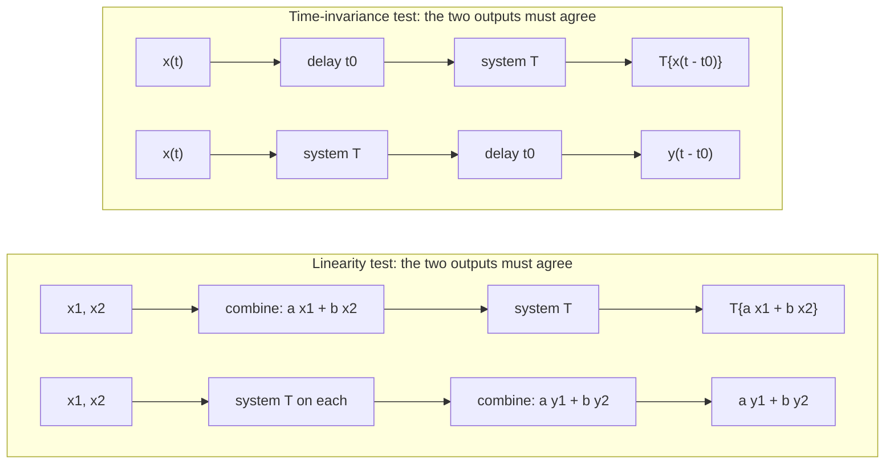
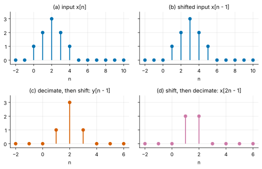
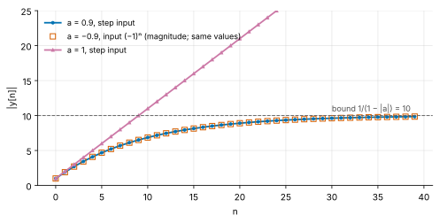
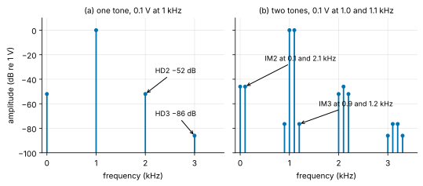
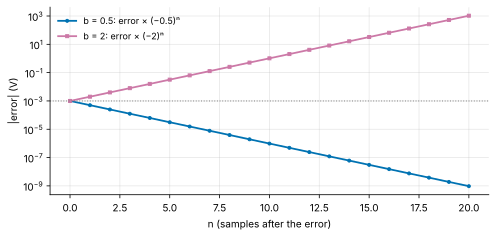

<!-- status: verified -->
# 11-02 · Systems and Their Properties

| | |
|---|---|
| **Course** | [11 · Signals and Systems](../README.md) |
| **University equivalent** | Systems and their basic properties in a junior Signals and Systems course: memory, linearity, time invariance, causality, BIBO stability and invertibility, and interconnections of systems (Oppenheim & Willsky, *Signals and Systems*, ch. 1.5–1.6; Lathi, *Linear Systems and Signals*, ch. 1.6–1.7; MIT 6.003) |
| **Prerequisites** | [11-01 Signals: Classification and Operations](11-01-signals-classification-and-operations.md) (time shifts, the impulse, DT signals), [06-07 Linearity and Superposition](../../06-circuit-analysis-1-dc/chapters/06-07-linearity-and-superposition.md) (homogeneity and additivity), [07-04 Laplace-Domain Circuit Analysis](../../07-circuit-analysis-2-transient-and-ac/chapters/07-04-laplace-domain-circuit-analysis.md) (zero-state and zero-input responses, a first look at BIBO stability), [01-08 Sequences, Series and Taylor](../../01-calculus-for-engineers/chapters/01-08-sequences-series-and-taylor.md) (geometric series, harmonic distortion from Taylor coefficients) |
| **Estimated study hours** | 7 |
| **Last verified** | 2026-11-20 |

**Learning objectives.** After this chapter you can:

1. Model a circuit, filter or algorithm as a system, and decide whether it is memoryless, causal, linear, time-invariant, BIBO-stable and invertible, proving each property or exhibiting a numerical counterexample.
2. Distinguish a linear system from an incrementally linear (affine) one, and split a response into its zero-input and zero-state parts.
3. Predict the harmonic and intermodulation products of a weakly nonlinear amplifier from its polynomial coefficients, and convert distortion specifications between percent and decibels.
4. Bound the output of a first-order recursion, and explain why an accumulator, an integrator and a lossless resonator are not BIBO-stable.
5. Find the inverse of simple systems, and recognize when the only causal inverse is unstable.
6. Quantify the latency that causality imposes on a filter that needs future samples.

---

## 1. Big picture

11-01 built a vocabulary for signals. This chapter does the same for the things that act on them. A **system** is any rule that turns an input signal into an output signal: an RC filter turning a noisy voltage into a smooth one, an amplifier, an ADC's digital decimation filter, a channel that smears a transmitted pulse, a block of firmware. Six yes-or-no questions, whether the system has memory, is linear, is time-invariant, is causal, is stable and is invertible, decide which mathematics applies to it. The most important combination, **linear and time-invariant (LTI)**, is the one for which the rest of this course works: an LTI system is completely described by its response to a single impulse (11-03) and by what it does to each frequency (11-05 to 11-09). Knowing exactly when a real system is *not* LTI is just as valuable, because that is where distortion, spurs, latency and instability come from.

- **"Linear" is a specification, not a fact.** Every amplifier is nonlinear at some level. Its data sheet states how nonlinear, as harmonic distortion in percent or dB, and that number limits what the product can measure or reproduce.
- **Switching circuits are time-varying on purpose.** Samplers, mixers, chopper-stabilized amplifiers and switched-capacitor filters all change their behavior periodically with a clock. They are linear but not time-invariant, and that is why they produce outputs at frequencies the input did not contain.
- **Causality costs latency.** A real-time filter cannot use future samples. A filter that needs them can only be run late, and the delay is a design parameter in audio, control loops and communication links.
- **Stability is a property you prove.** A digital recursion or a feedback loop either keeps every bounded input bounded or it does not. "It looked fine in the step test" is not a proof.
- **Undoing a system is not always possible.** Equalizers in serial links try to undo the channel. Sometimes the inverse exists but is unstable, which is why link designers use other structures (Course 24).

## 2. Intuition first

**A system maps whole signals to whole signals.** A function of a number takes 3 and returns 9. A system takes an entire waveform, the whole history of $x(t)$, and returns an entire waveform $y(t)$. Write $y = \mathcal{T}\{x\}$, and read $y(t) = \mathcal{T}\{x\}(t)$ as "the value at time $t$ of the output that the system produces from the whole input $x$". The value $y(t)$ may depend on $x$ at many times: that dependence is what the properties classify.

**Each property is a question about what the output is allowed to depend on, or how it reacts to changes.**

- *Memory:* does $y(t)$ depend on $x$ at times other than $t$?
- *Causality:* does $y(t)$ depend on $x$ at times later than $t$?
- *Linearity:* does scaling or adding inputs scale or add outputs?
- *Time invariance:* does delaying the input simply delay the output?
- *Stability:* does every bounded input give a bounded output?
- *Invertibility:* can the input always be recovered from the output?

**An analogy from finance, and where it breaks.** Think of a trading rule that turns a price history into a daily position. A rule that looks only at today's price is *memoryless*; a moving-average rule has *memory*. A rule that uses tomorrow's price is *noncausal*, and backtests that accidentally use future data suffer exactly this "look-ahead bias": they cannot be run live. A rule that behaves the same in every year is *time-invariant*; one with a scheduled change on a date is not. If doubling every price doubles the position, the rule is homogeneous; position limits and thresholds break that, as saturation breaks an amplifier's linearity. A rule is *stable* if no bounded price path can drive the position to infinity: a rule that keeps adding to a losing position (an accumulator) is not. The analogy breaks in one place. Market prices respond to the rule's own trades, so the "input" depends on the "output": that is feedback, a property of the interconnection rather than of the rule. Engineering systems in feedback loops (Course 15) have the same issue, and the loop as a whole must be analyzed as one system.

**Two tests, drawn as diagrams.** Most properties are tested by doing two things in either order and comparing. Linearity compares "combine the inputs, then apply the system" with "apply the system to each input, then combine the outputs". Time invariance compares "delay, then apply the system" with "apply the system, then delay". A property holds when the two paths agree **for every input** and every scale factor or delay. One agreement proves nothing; one disagreement is a complete counterexample.

## 3. Theory

> **Conventions.** $\mathcal{T}$ denotes a system: $y = \mathcal{T}\{x\}$. Inputs and outputs are real unless stated. "For all inputs" means all inputs in the class the system accepts (bounded signals, or signals that are zero in the far past, as stated). Systems are assumed to start **at rest** (no stored energy) unless an initial condition is given.

### 3.1 Systems, a library of examples, and interconnections

A **continuous-time system** maps CT signals to CT signals; a **discrete-time system** maps sequences to sequences. Systems that convert between the two (a sampler, a DAC) are hybrid and are treated in 11-10. The examples below recur throughout the chapter; each is a real circuit or algorithm.

| # | System | Equation | Where it appears |
|---|---|---|---|
| S1 | Amplifier with offset | $y(t) = 10x(t) + 0.05\ \text{V}$ | Any real amplifier (10-09) |
| S2 | Delay | $y(t) = x(t - t_0)$ | A wire, a shift register, a FIFO |
| S3 | RC low-pass | $\tau\,\dfrac{dy}{dt} + y = x$ | 07-02; anti-aliasing filters |
| S4 | Accumulator | $y[n] = \displaystyle\sum_{k=-\infty}^{n} x[k]$ | A counter, a bank balance, a digital integrator |
| S5 | Centered moving average | $y[n] = \tfrac15\displaystyle\sum_{k=-2}^{2}x[n - k]$ | Smoothing recorded data |
| S6 | Squarer | $y(t) = x^2(t)$ | Power detectors, the even-order part of a transistor |
| S7 | Modulator (mixer) | $y(t) = x(t)\cos\omega_ct$ | Radios (11-11, Course 17), chopper amplifiers |
| S8 | Decimator | $y[n] = x[2n]$ | Rate reduction in ADC filters (Course 16) |
| S9 | Time reversal | $y(t) = x(-t)$ | Playing a recording backward; offline filtering |
| S10 | First-order recursion | $y[n] = a\,y[n - 1] + x[n]$ | IIR filters, exponential averaging |

Systems combine in three ways. In a **cascade** (series) the output of one feeds the next: $y = \mathcal{T}_2\{\mathcal{T}_1\{x\}\}$. In **parallel** two systems see the same input and their outputs add. In **feedback** a system's output, processed, is subtracted from its input. A property of the parts does not automatically carry to the whole in feedback: two stable systems can form an unstable loop (12-06, Course 15). For cascades, linearity and time invariance do carry over (Problem 11-02.7).

### 3.2 Memory

A system is **memoryless** (static) if $y(t)$ depends only on $x(t)$ at the same instant, for every $t$; otherwise it has **memory** (it is dynamic). S1 and S6 are memoryless: the output now is a fixed function of the input now. S7 is memoryless too, even though its rule changes with time: $y(t)$ needs only $x(t)$ and the known value of $\cos\omega_ct$. Everything with a capacitor, an inductor, a delay or a sum over past samples has memory: S2, S3, S4, S5, S8, S9 and S10.

Memory means stored state: charge on a capacitor, current in an inductor, numbers in registers. Physically, a memoryless model is an approximation valid when the system responds much faster than the signal changes. A resistor divider is memoryless until the signal is fast enough that its parasitic capacitances matter.

### 3.3 Linearity

**Definition.** A system is **linear** if it obeys both

- **additivity:** $\mathcal{T}\{x_1 + x_2\} = \mathcal{T}\{x_1\} + \mathcal{T}\{x_2\}$, and
- **homogeneity:** $\mathcal{T}\{a\,x\} = a\,\mathcal{T}\{x\}$,

for every pair of inputs and every scalar $a$ (real, or complex when complex signals are allowed). These are 06-07's two properties of linear circuits, stated for whole signals. Together they give **superposition**: $\mathcal{T}\{\sum_k a_kx_k\} = \sum_k a_k\mathcal{T}\{x_k\}$ for any finite sum, by applying additivity repeatedly and homogeneity to each term.

**Zero in, zero out.** Setting $a = 0$ in homogeneity gives $\mathcal{T}\{0\} = 0\cdot\mathcal{T}\{x\} = 0$. A linear system produces zero output for zero input, at all times. This gives the fastest test: if a system's output for zero input is not zero, it is not linear. S1 fails at once, because $\mathcal{T}\{0\} = 0.05$ V.

**Which systems are linear.** Any operation that is a weighted sum or integral of input values, with weights that do not depend on the input, is linear: delays (S2), the RC filter at rest (S3), the accumulator (S4), averages (S5), multiplication by a *known* function of time (S7), sample selection (S8, S9) and the recursion at rest (S10). For S7, $\mathcal{T}\{ax_1 + bx_2\} = (ax_1 + bx_2)\cos\omega_ct = a\,\mathcal{T}\{x_1\} + b\,\mathcal{T}\{x_2\}$. Operations that involve the input nonlinearly are not linear: squaring (S6), absolute value, saturation and clipping, quantization, thresholds and comparators (10-10), and the exponential of a transistor (09-06). For S6, $\mathcal{T}\{2x\} = 4x^2 \ne 2x^2$.

**Incrementally linear systems.** S1 is linear "except for the offset". Write it as $y = \mathcal{L}\{x\} + y_0$, where $\mathcal{L}\{x\} = 10x$ is linear and $y_0 = 0.05$ V is the **zero-input response**, the output when $x = 0$. Such a system is **incrementally linear** (affine): differences of outputs obey linearity, $\mathcal{T}\{x_1\} - \mathcal{T}\{x_2\} = \mathcal{L}\{x_1 - x_2\}$, because the zero-input part cancels. Engineers use the word "linear" loosely for these, as in "the line $y = mx + b$", but in this course linear means $b = 0$.

The most important incrementally linear systems are linear circuits with initial stored energy. For the RC filter S3 with $y(0) = y_0$, the first-order solution of 02-02 is

$$
y(t) = \underbrace{y_0\,e^{-t/\tau}}_{\text{zero-input response}} + \underbrace{\frac{1}{\tau}\int_0^t e^{-(t - \lambda)/\tau}x(\lambda)\,d\lambda}_{\text{zero-state response}}, \qquad t \ge 0 .
$$

The second term is linear in $x$: the integral of a weighted input. The first term does not depend on $x$ at all. So doubling the input does not double the output unless $y_0 = 0$ (Example 11-02.6). This is the same split as 07-04's $Y(s) = H(s)X(s) + P_{ic}(s)/D(s)$. The usual convention in this course follows from it: "the system is linear" means "the system at rest is linear", and initial conditions are handled by adding the zero-input response.

**Linearization.** A nonlinear system can be approximately linear for *small changes* about an operating point. This is the small-signal model of 10-04: a transistor's exponential $i_C = I_Se^{v_{BE}/V_T}$ becomes $i_c = g_mv_{be}$ for $\lvert v_{be}\rvert \ll V_T$. The incremental system is linear; the large-signal system is not, and the difference is distortion.

**Weak nonlinearity and distortion.** Model a nearly linear amplifier by the first terms of a Taylor series about its operating point (01-08):

$$
y = a_1x + a_2x^2 + a_3x^3 ,
$$

with $a_1$ the small-signal gain (dimensionless for a voltage amplifier), $a_2$ in V⁻¹ and $a_3$ in V⁻². Drive it with one tone, $x = A\cos\theta$ with $\theta = \omega t$. Using $\cos^2\theta = \tfrac12(1 + \cos2\theta)$ and $\cos^3\theta = \tfrac14(3\cos\theta + \cos3\theta)$,

$$
y = \underbrace{\tfrac12a_2A^2}_{\text{DC shift}} + \underbrace{\left(a_1A + \tfrac34a_3A^3\right)}_{\text{fundamental}}\cos\theta + \underbrace{\tfrac12a_2A^2}_{\text{2nd harmonic}}\cos2\theta + \underbrace{\tfrac14a_3A^3}_{\text{3rd harmonic}}\cos3\theta .
$$

Units check: $a_2A^2$ is V⁻¹ · V² = V, and $a_3A^3$ is V⁻² · V³ = V. A linear system's output contains only the input's frequency; a nonlinear one creates new frequencies. Relative to the fundamental, for small $A$, the **harmonic distortion** ratios are

$$
\text{HD2} \approx \frac{a_2}{2a_1}A, \qquad \text{HD3} \approx \frac{a_3}{4a_1}A^2, \qquad \text{THD} = \sqrt{\text{HD2}^2 + \text{HD3}^2 + \cdots} ,
$$

usually quoted in percent or in dB, $20\log_{10}(\text{ratio})$: 1% is −40 dB and 0.1% is −60 dB. HD2 rises 20 dB per decade of amplitude and HD3 40 dB per decade, which is why distortion specifications always state the signal level.

**Two tones: intermodulation.** Now drive the amplifier with $x = A_1\cos\theta_1 + A_2\cos\theta_2$. The square contains a cross term:

$$
x^2 = \tfrac12A_1^2 + \tfrac12A_2^2 + \tfrac12A_1^2\cos2\theta_1 + \tfrac12A_2^2\cos2\theta_2 + A_1A_2\bigl[\cos(\theta_1 - \theta_2) + \cos(\theta_1 + \theta_2)\bigr] .
$$

So $a_2x^2$ produces **second-order intermodulation (IM2)** at $f_1 \pm f_2$, amplitude $a_2A_1A_2$. Expanding $x^3$ the same way gives, among other terms, $\tfrac34a_3A_1^2A_2$ at $2f_1 - f_2$ and $2f_1 + f_2$, and $\tfrac34a_3A_1A_2^2$ at $2f_2 - f_1$ and $2f_2 + f_1$: **third-order intermodulation (IM3)**. When $f_1$ and $f_2$ are close, $2f_1 - f_2$ and $2f_2 - f_1$ land right next to the signals, inside any filter that passes them. That is why IM3, not harmonics, limits a radio receiver's ability to handle strong neighboring channels (Course 21), and why the failure of superposition matters even for tiny nonlinearities (Example 11-02.5, Figure 3).

> **Going deeper — additivity alone is not quite enough.** Additivity implies homogeneity for every *rational* scalar: $\mathcal{T}\{2x\} = \mathcal{T}\{x + x\} = 2\mathcal{T}\{x\}$, and by induction for integers. From $q\,\mathcal{T}\{x/q\} = \mathcal{T}\{x\}$ it holds for $1/q$, so it holds for every ratio $p/q$. Extending to all real scalars needs continuity, which every physical system has. For complex scalars additivity really is not enough. Complex conjugation, $\mathcal{T}\{x\} = x^*$, is additive and homogeneous for real scalars, but $\mathcal{T}\{jx\} = -jx^* \ne j\,\mathcal{T}\{x\}$. It is not linear over the complex numbers. This matters in communications, where complex baseband signals (Course 17) pass through blocks that are linear for real signals but conjugate their complex representation, producing "image" terms.

### 3.4 Time invariance

**Definition.** A system is **time-invariant** if delaying the input by any $t_0$ delays the output by $t_0$ and changes nothing else: whenever $y = \mathcal{T}\{x\}$,

$$
\mathcal{T}\{x(t - t_0)\} = y(t - t_0) \quad \text{for every input and every } t_0 ,
$$

and in DT the same with integer shifts $n_0$. Physically, the system's rules do not depend on the clock on the wall: a circuit built from components whose values do not change in time is time-invariant.

**How to test it without errors.** The trap is the order of substitution. Define the delayed input as a new signal, $x_1(t) = x(t - t_0)$, and push *that* through the system's rule. Separately, take the original output and replace every $t$ by $t - t_0$. Compare.

- *Time scaling* $y(t) = x(2t)$: $\mathcal{T}\{x_1\}(t) = x_1(2t) = x(2t - t_0)$, but $y(t - t_0) = x(2(t - t_0)) = x(2t - 2t_0)$. These differ for $t_0 \ne 0$: time-varying. The compression halves every delay.
- *A gain that depends on time* $y[n] = n\,x[n]$: the input $\delta[n - 1]$ gives $\delta[n - 1]$; delayed by two more samples, $\delta[n - 3]$ gives $3\delta[n - 3]$, not $\delta[n - 3]$ (Example 11-02.2).
- *Time reversal* S9: $\mathcal{T}\{x_1\}(t) = x_1(-t) = x(-t - t_0)$, while $y(t - t_0) = x(-(t - t_0)) = x(-t + t_0)$. Delaying the input *advances* the output: time-varying.
- *The modulator* S7: $\mathcal{T}\{x_1\}(t) = x(t - t_0)\cos\omega_ct$, while $y(t - t_0) = x(t - t_0)\cos(\omega_c(t - t_0))$. They agree only when $\omega_ct_0$ is a multiple of $2\pi$.

The modulator is **linear but time-varying**: a time-varying gain applied to a signal. Its rule repeats with the carrier's period $2\pi/\omega_c$, so it is **periodically time-varying**: shifts by a whole number of periods commute with it, other shifts do not. A sampler, a chopper and a switched-capacitor circuit are of the same kind (linear periodically time-varying, LPTV). Their output contains frequencies shifted by multiples of the clock frequency, which is how a mixer moves a radio signal from one frequency to another (11-11) and how a chopper amplifier moves its own offset out of band (§9).

**The decimator S8 is time-varying.** Take the pulse $x[n] = 1, 2, 3, 2, 1$ at $n = 0, \dots, 4$ (Figure 1). Decimating keeps the even-indexed samples: $y[n] = 1, 3, 1$ at $n = 0, 1, 2$. Delay the input by one sample first, and decimation keeps what used to be the odd-indexed samples: $2, 2$ at $n = 1, 2$, a different sequence altogether, not $y[n - 1]$. A delay of *two* input samples does commute: $x[2n - 2] = y[n - 1]$, a one-sample delay of the output. The decimator is periodically time-varying with period 2. That is why decimating a signal without filtering it first depends on the alignment of the samples, the time-domain face of aliasing (11-10).

*Figure 1. The time-invariance test applied to the decimator $y[n] = x[2n]$. (a) A pulse. (b) The pulse delayed by one sample. (c) Decimate, then delay: the even-indexed samples 1, 3, 1, one sample later. (d) Delay, then decimate: the odd-indexed samples 2, 2. The two paths disagree, so the decimator is not time-invariant.*

**LTI systems.** A system that is both linear and time-invariant is **LTI**. S2, S3 (at rest), S4, S5 and S10 (at rest) are LTI; S1 is not linear; S6 is not linear; S7, S8 and S9 are not time-invariant. 07-04 already used the decisive consequence: an LTI system's response to any input is the convolution of the input with the system's **impulse response** $h$. 11-03 derives it from the two properties of this section alone. The other is that complex exponentials pass through LTI systems unchanged in shape, only scaled (11-04). Neither holds for a system that fails either test.

### 3.5 Causality

**Definition.** A system is **causal** if the output at every time depends only on the input at that time and earlier: whenever two inputs agree for all $t \le t_1$, their outputs agree for all $t \le t_1$. Physical systems running in real time are causal: no circuit responds to a voltage that has not arrived yet.

- S2 with $t_0 > 0$ is causal; with $t_0 < 0$ (an advance) it is not.
- S5 is not causal: $y[n]$ uses $x[n + 1]$ and $x[n + 2]$.
- S9 is not causal: $y(-1) = x(1)$, a future input at time $-1$.
- Time scaling $y(t) = x(2t)$ is not causal: $y(1) = x(2)$.
- Every memoryless system is causal, since it uses only the present.

"Causal *signal*" (zero for $t < 0$, 11-01) and "causal *system*" are different ideas that meet in one place: a causal LTI system's impulse response is a causal signal (11-03).

**Causality of linear systems: initial rest.** For a linear system, causality is equivalent to a simpler condition. *If the input is zero for all $t < t_1$, the output is zero for all $t < t_1$.* Proof in both directions. Suppose the system is causal and $x(t) = 0$ for $t < t_1$. The zero input agrees with $x$ before $t_1$, so by causality the two outputs agree before $t_1$, and the zero input's output is zero by linearity. Conversely, suppose the condition holds and $x_1$, $x_2$ agree before $t_1$. Then $x_1 - x_2$ is zero before $t_1$, so its output is zero there, and by linearity $\mathcal{T}\{x_1\} - \mathcal{T}\{x_2\} = 0$ there: the outputs agree. This condition, called **initial rest**, is the form usually checked in practice: a causal linear filter cannot start responding before its input starts.

**Noncausal systems are useful, offline.** When the whole record is stored, "future" samples are available: smoothing a recorded ECG, processing an image (where the variables are positions, and "future" means nothing physical), post-processing a measurement. A noncausal filter that looks $M$ samples ahead can be run in real time if its output is delayed by $M$ samples, $y_c[n] = y[n - M]$, which is causal. The price is **latency**: $M$ samples, or $M/f_s$ seconds. The centered moving average S5 looks two samples ahead, so its causal version is two samples late (Example 11-02.3). A symmetric (linear-phase) FIR filter with $N$ taps is centered on its middle tap and therefore always runs $(N - 1)/2$ samples late. That latency is fixed by the filter's length, which is set by how sharp its frequency response must be (Course 16): a sharper filter means more latency. Audio monitoring, motor control and serial-link equalization all have latency budgets that limit their filters.

### 3.6 BIBO stability

**Definition.** A system is **bounded-input, bounded-output (BIBO) stable** if every bounded input produces a bounded output: whenever $\lvert x(t)\rvert \le B$ for all $t$, there is a finite $C$ (which may depend on $B$) with $\lvert y(t)\rvert \le C$ for all $t$. To prove stability, find $C$. To disprove it, find *one* bounded input whose output grows without limit.

**Memoryless examples.** S1 is stable: $\lvert y\rvert \le 10B + 0.05$ V. The squarer is stable, $\lvert y\rvert \le B^2$, and so is $y = e^{x}$, $\lvert y\rvert \le e^B$. But $y(t) = t\,x(t)$ is unstable: the bounded input $x = 1$ gives $y = t$. Stability is about the system, not about the inputs you happened to try.

> **Math refresher — bounding a sum.** Two tools do most stability proofs. The **triangle inequality**, $\lvert\sum_k c_k\rvert \le \sum_k\lvert c_k\rvert$, bounds a sum of terms of either sign by the sum of their sizes (equality when all terms have the same sign). The **geometric series**, $\sum_{k=0}^{\infty}r^k = 1/(1 - r)$ for $0 \le r < 1$ (01-08), turns an infinite sum of decaying terms into a finite number. For integrals the same pair is $\lvert\int f\rvert \le \int\lvert f\rvert$ and $\int_0^\infty e^{-s/\tau}\,ds = \tau$.

**The first-order recursion S10.** Unroll $y[n] = a\,y[n - 1] + x[n]$ from rest, with $x[n] = 0$ for $n < 0$:

$$
y[n] = x[n] + a\,x[n - 1] + a^2x[n - 2] + \cdots + a^nx[0] = \sum_{k=0}^{n}a^k\,x[n - k] .
$$

Each output is a weighted sum of the present and past inputs, with weights $a^k$ that shrink if $\lvert a\rvert < 1$. With $\lvert x\rvert \le B$, the triangle inequality and the geometric series give

$$
\lvert y[n]\rvert \le \sum_{k=0}^{n}\lvert a\rvert^k\lvert x[n - k]\rvert \le B\sum_{k=0}^{\infty}\lvert a\rvert^k = \frac{B}{1 - \lvert a\rvert}, \qquad \lvert a\rvert < 1 .
$$

So the recursion is BIBO-stable when $\lvert a\rvert < 1$, and the bound is tight: the input that makes every term positive, $x[n - k] = B\cdot\text{sign}(a^k)$, drives $\lvert y[n]\rvert$ toward $B/(1 - \lvert a\rvert)$. For $a > 0$ that input is a step; for $a < 0$ it alternates in sign (Figure 2). When $\lvert a\rvert \ge 1$ the recursion is unstable. For $a = 1$ (the accumulator S4), the step gives $y[n] = (n + 1)B$. For $a = -1$, the alternating input $(-1)^nB$ gives $\lvert y[n]\rvert = (n + 1)B$. For $\lvert a\rvert > 1$, even a single impulse gives $\lvert y[n]\rvert = \lvert a\rvert^n$.

*Figure 2. The recursion $y[n] = a\,y[n - 1] + x[n]$ from rest with $\lvert x\rvert \le 1$ (Example 11-02.4). For $a = 0.9$ (step) and $a = -0.9$ (alternating input) the output approaches the bound $1/(1 - \lvert a\rvert) = 10$, with identical magnitudes. For $a = 1$ a step makes the output grow by 1 every sample.*

**Continuous time.** The RC filter at rest has $y(t) = \frac{1}{\tau}\int_{-\infty}^{t}e^{-(t - \lambda)/\tau}x(\lambda)\,d\lambda$, so with $s = t - \lambda$,

$$
\lvert y(t)\rvert \le \frac{B}{\tau}\int_0^\infty e^{-s/\tau}\,ds = B :
$$

stable, and the output never exceeds the input's bound. The ideal integrator $y(t) = \frac{1}{\tau}\int_{-\infty}^{t}x(\lambda)\,d\lambda$, the CT accumulator, is unstable: a step gives $y = t/\tau$. A lossless LC resonator is also unstable in the BIBO sense, although nothing in it grows on its own: driven exactly at its resonant frequency, its response grows in proportion to time (07-04, 02-04, Problem 11-02.10). Any loss, however small, bounds the response, at $Q$ times the drive.

**For LTI systems** 11-03 proves a single test: a DT LTI system is BIBO-stable exactly when its impulse response is absolutely summable, $\sum_n\lvert h[n]\rvert < \infty$, and a CT one when $\int\lvert h(t)\rvert\,dt < \infty$. The recursion's impulse response is $a^nu[n]$, summable exactly when $\lvert a\rvert < 1$, and the sum $1/(1 - \lvert a\rvert)$ is the bound found above. In pole language (07-04, 11-08, 11-09): poles strictly in the left half-plane for CT, strictly inside the unit circle for DT.

> **Going deeper — BIBO stability is not the whole story.** BIBO stability looks only at the input-to-output map. A system can be BIBO-stable while an internal quantity grows without bound, if the growing part is invisible at the output. Cascade an unstable recursion with a system that exactly cancels it: the overall map is the identity, perfectly stable on paper. In hardware, a little rounding noise enters between the two halves, and the internal signal grows until it overflows. **Internal stability**, which requires every internal state to stay bounded, is the property a designer actually needs. It is the subject of state-space analysis (02-09, 15-10), and the reason control engineers refuse to cancel an unstable pole with a zero. Example 11-02.7 shows the same effect from the other side.

### 3.7 Invertibility

**Definition.** A system is **invertible** if distinct inputs always produce distinct outputs, so that the input can be recovered from the output. The **inverse system** $\mathcal{T}^{-1}$ satisfies $\mathcal{T}^{-1}\{\mathcal{T}\{x\}\} = x$ for every input.

- S1 is invertible: $x = (y - 0.05\ \text{V})/10$.
- The squarer is not: $x$ and $-x$ give the same output. On inputs known to be positive, it is.
- The decimator is not: it discards the odd samples, and any two inputs that differ only there give the same output.
- A quantizer is not: every input within one step maps to the same code (11-01).
- A delay is invertible, and its inverse is an advance, which is noncausal. Running the inverse in real time is impossible, but running it *late* by the same delay is trivial.

**The accumulator and the first difference.** If $y[n] = \sum_{k\le n}x[k]$, then

$$
y[n] - y[n - 1] = \sum_{k\le n}x[k] - \sum_{k\le n-1}x[k] = x[n] ,
$$

so the **first difference** $w[n] = y[n] - y[n - 1]$ is the accumulator's inverse. The continuous-time pair is the integrator and the differentiator. The pairing works one way round without conditions, but differencing then accumulating returns $x[n] - x[-\infty]$: the differentiator and first difference lose any constant, so they are not invertible on signals that do not vanish in the far past.

**An inverse that exists but cannot be used.** A channel that adds an echo of relative size $b$ one sample late has $y[n] = x[n] + b\,x[n - 1]$. Solving for the input gives a causal inverse, a recursion,

$$
w[n] = y[n] - b\,w[n - 1] ,
$$

which reproduces $x$ exactly: substituting $w = x$ gives $x[n] = x[n] + b\,x[n - 1] - b\,x[n - 1]$. This is S10 with $a = -b$, so by §3.6 the inverse is stable only when $\lvert b\rvert < 1$. When the echo is stronger than the direct path, $\lvert b\rvert > 1$, the causal inverse is unstable: any error in its input, from noise or rounding, is multiplied by $-b$ every sample (Example 11-02.7, Figure 4). The system is invertible in principle, and its only causal inverse is useless. A stable inverse does exist for $\lvert b\rvert > 1$, but it is noncausal (11-09), so a practical equalizer approximates it with a delay. This is one reason high-speed links use equalizer structures that are not plain inverses (Course 24).

### 3.8 Summary of the library

| System | Memoryless | Linear | Time-invariant | Causal | BIBO-stable | Invertible |
|---|---|---|---|---|---|---|
| S1 amplifier with offset | yes | no (affine) | yes | yes | yes | yes |
| S2 delay, $t_0 > 0$ | no | yes | yes | yes | yes | yes (inverse noncausal) |
| S3 RC low-pass at rest | no | yes | yes | yes | yes | yes (inverse amplifies noise) |
| S4 accumulator | no | yes | yes | yes | **no** | yes (first difference) |
| S5 centered moving average | no | yes | yes | **no** | yes | no |
| S6 squarer | yes | no | yes | yes | yes | no |
| S7 modulator | yes | yes | **no** (periodic) | yes | yes | no (zeros of the cosine) |
| S8 decimator | no | yes | **no** (periodic) | no | yes | no |
| S9 time reversal | no | yes | no | no | yes | yes (itself) |
| S10 recursion at rest | no | yes | yes | yes | if $\lvert a\rvert < 1$ | yes (two-tap filter) |

Two entries deserve a comment. The decimator is noncausal by the strict definition, because $y[1] = x[2]$ is produced "at time 1" from a sample that arrives at time 2. In practice the output runs at half the rate and is produced when $x[2]$ arrives, so the issue is only one of labeling. The moving average is not invertible because inputs that alternate with a period of 5 samples, such as a sequence repeating 1, −1, 0, 0, 0, sum to zero over every window and produce zero output.

## 4. Worked examples

### Example 11-02.1 · An amplifier with an offset (tier A)

**Setup.** An amplifier is modeled as $y = 10x + 0.05$ V (S1). (a) Test additivity with constant inputs of 0.1 V and 0.2 V. (b) Test homogeneity with 0.1 V scaled by 3. (c) Show that differences obey linearity. (d) Find an output bound for inputs with $\lvert x\rvert \le 0.3$ V. (e) Recover the input that produced 2.55 V.

**Solution.** (a) $\mathcal{T}\{0.1\}$ = **1.05** V and $\mathcal{T}\{0.2\}$ = **2.05** V, which sum to **3.10** V; but $\mathcal{T}\{0.3\}$ = **3.05** V. Additivity fails by **0.05** V, the offset.

(b) $3\,\mathcal{T}\{0.1\}$ = **3.15** V, but $\mathcal{T}\{0.3\}$ = 3.05 V: homogeneity fails by **0.10** V, twice the offset (the offset appears once on one side and three times on the other).

(c) $\mathcal{T}\{0.2\} - \mathcal{T}\{0.1\}$ = **1.0** V $= 10 \times (0.2 - 0.1)$: the incremental system $\Delta y = 10\,\Delta x$ is linear. The amplifier is incrementally linear.

(d) $\lvert y\rvert \le 10 \times 0.3 + 0.05$ = **3.05** V: BIBO-stable.

(e) $x = (2.55 - 0.05)/10$ = **0.25** V: the system is invertible.

**Units check.** The gain 10 is V/V; the offset is in volts, so every output is in volts.

**Sanity check.** An offset is the simplest violation of linearity, and it is why 10-09 treats offsets as errors to be added after a linear analysis, exactly the zero-input-response split of §3.3.

### Example 11-02.2 · Testing time invariance (tier A)

**Setup.** Apply the shift test. (a) $y[n] = n\,x[n]$ with input $\delta[n - 1]$, then with the input delayed two more samples. (b) The decimator $y[n] = x[2n]$ with inputs $\delta[n]$, $\delta[n - 1]$ and $\delta[n - 2]$. (c) The modulator $y(t) = x(t)\cos(2\pi \cdot 1000t)$ with input $u(t)$ and with $u(t - 0.25\ \text{ms})$: compare $\mathcal{T}\{u(t - 0.25\ \text{ms})\}$ with $y(t - 0.25\ \text{ms})$ at $t$ = 1 ms.

**Solution.** (a) $\mathcal{T}\{\delta[n - 1]\} = 1\cdot\delta[n - 1]$. The delayed input $\delta[n - 3]$ gives $3\,\delta[n - 3]$, weight **3**, while the delayed output is $\delta[n - 3]$, weight **1**. Time-varying.

(b) $\delta[n]$ gives $\delta[2n] = \delta[n]$. The input $\delta[n - 1]$ gives $\delta[2n - 1]$, which is zero for every integer $n$: an output of energy **0**, where the delayed output $\delta[n - 1]$ would have energy 1. The input $\delta[n - 2]$ gives $\delta[2n - 2] = \delta[n - 1]$: a two-sample input delay delays the output by **1** sample. Periodically time-varying with period 2.

(c) At $t$ = 1 ms, $\mathcal{T}\{u(t - 0.25\ \text{ms})\} = u(0.75\ \text{ms})\cos(2\pi)$ = **1**, but $y(t - 0.25\ \text{ms}) = u(0.75\ \text{ms})\cos(2\pi \cdot 0.75)$ = **0**. Time-varying. (Had the input been the constant 1, both paths would give $\cos(2\pi \cdot 1000t)$: a single input can hide time variation.)

**Sanity check.** Each of these systems contains the time index explicitly ($n$, $2n$, $\cos\omega_ct$): a system whose rule mentions the time variable outside the input's argument is usually time-varying.

### Example 11-02.3 · The price of looking ahead (tier B)

**Setup.** (a) Find the step response $y[n]$ of the centered five-point moving average S5 for $n = -2, -1, 0$. (b) Make it causal; how many samples late is it, and what is that in time for an ECG sampled at 500 SPS? (c) A 101-tap symmetric FIR filter runs at 48 kHz. Find its latency in samples and in milliseconds. (d) The ADS1292R's sinc filter takes three data periods to settle after a step [3]. How long is that at 500 SPS?

**Solution.** (a) At $n$, the window covers $x[n - 2]$ to $x[n + 2]$. For the step $u[n]$, the window at $n = -2$ contains one sample of value 1 (at $n = 0$), so $y[-2]$ = **0.2**; then $y[-1]$ = **0.4** and $y[0]$ = **0.6**, reaching 1 at $n = 2$. The output starts rising two samples *before* the step arrives: the signature of a noncausal system.

(b) Delay the output by **2** samples, the look-ahead: $y_c[n] = y[n - 2]$. At 500 SPS each sample is 2 ms, so the latency is **4** ms.

(c) $(101 - 1)/2$ = **50** samples, $50/48\ \text{kHz}$ = **1.042** ms.

(d) $3 \times 2$ ms = **6** ms.

**Units check.** Samples divided by samples per second give seconds.

**Sanity check.** Doubling the window doubles the look-ahead and the latency; there is no free lunch in real-time smoothing.

### Example 11-02.4 · Stability of a first-order recursion (tier B)

**Setup.** $y[n] = a\,y[n - 1] + x[n]$ starts at rest, and the input satisfies $\lvert x\rvert \le 1$. (a) For $a = 0.9$, find the stability bound and $y[19]$ for a step input. (b) For $a = -0.9$, find the step response's final value, and the magnitude after 20 samples of the alternating input $(-1)^n$. (c) For $a = 1$, find $y[999]$ for a step. (d) A CT integrator with $\tau$ = 1 ms receives a 1 V step. What is its output after 1 s?

**Solution.** (a) $1/(1 - 0.9)$ = **10**. For the step, $y[n] = \sum_{k=0}^{n}0.9^k = (1 - 0.9^{n+1})/0.1$, so $y[19] = (1 - 0.9^{20})/0.1$ = **8.784**.

(b) For a step, the terms alternate in sign: $y[n] \to 1/(1 - (-0.9)) = 1/1.9$ = **0.5263**, far below the bound. The alternating input makes every term positive: $y[n] = (-1)^n\sum_{k=0}^{n}0.9^k$, so $\lvert y[19]\rvert$ = **8.784**, approaching **10**. A step test would have badly underestimated the worst case.

(c) $y[n] = n + 1$, so $y[999]$ = **1000**: unbounded growth from a bounded input.

(d) $y = t/\tau = 1\ \text{s}/1\ \text{ms}$ = **1000** V, in principle. In practice the op-amp saturates at its rail long before.

**Units check.** In (d), $\frac{1}{\tau}\int x\,dt$ has units of $\frac{1}{\text{s}} \times \text{V} \cdot \text{s}$ = V.

**Sanity check.** Figure 2 shows (a), (b) and (c): the two stable cases share the same magnitude curve, and $a = 1$ passes the bound and keeps going.

### Example 11-02.5 · Distortion from a weak nonlinearity (tier B)

**Setup.** An amplifier has $y = 10x + 0.5x^2 - 0.2x^3$ ($y$ and $x$ in volts). (a) For $x = 0.1\cos\omega t$ V, find the DC shift, the fundamental, the second and third harmonic amplitudes, HD2 and HD3 in dB, and the THD in percent. (b) For two 0.1 V tones at 1.0 kHz and 1.1 kHz, find the IM2 amplitude, its frequencies and its level relative to a 1 V fundamental, and the IM3 amplitude and the frequencies near the tones where it falls.

**Solution.** (a) With $a_1 = 10$, $a_2 = 0.5$ V⁻¹, $a_3 = -0.2$ V⁻² and $A$ = 0.1 V:

- DC shift: $\tfrac12a_2A^2 = \tfrac12(0.5)(0.01)$ = **2.5** mV.
- Fundamental: $a_1A + \tfrac34a_3A^3 = 1 - 0.00015$ = **0.99985** V (a slight compression, because $a_3 < 0$).
- Second harmonic: $\tfrac12a_2A^2$ = **2.5** mV. Third harmonic: $\tfrac14\lvert a_3\rvert A^3$ = **0.05** mV.
- HD2 = 2.5 mV / 0.99985 V, or **−52.04** dB; HD3 = 0.05 mV / 0.99985 V, or **−86.02** dB.
- THD = $\sqrt{\text{HD2}^2 + \text{HD3}^2}$ = **0.2501**%.

(b) IM2 has amplitude $a_2A_1A_2 = 0.5 \times 0.1 \times 0.1$ = **5** mV at $f_2 - f_1$ = **100** Hz and $f_1 + f_2$ = **2.1** kHz, **−46.02** dB relative to 1 V. IM3 has amplitude $\tfrac34\lvert a_3\rvert A_1^2A_2$ = **0.15** mV at $2f_1 - f_2$ = **0.9** kHz and $2f_2 - f_1$ = **1.2** kHz.

**Units check.** $a_2A^2$: V⁻¹ · V² = V. $a_3A^3$: V⁻² · V³ = V.

**Sanity check.** The FFT of the output (lab Part 3, Figure 3) shows exactly these lines. IM3 is **30.5** dB below IM2 here, but it sits 100 Hz from the signals, where no filter can remove it without removing the signals too. IM2's products fall at 100 Hz and 2.1 kHz, far from both tones.

*Figure 3. Output spectra of $y = 10x + 0.5x^2 - 0.2x^3$ (Example 11-02.5). (a) One 0.1 V tone at 1 kHz: DC, the fundamental, HD2 at −52 dB and HD3 at −86 dB. (b) Two 0.1 V tones: second-order products at DC, 0.1, 2.0, 2.1 and 2.2 kHz, and third-order products at 0.9, 1.2 and around 3 kHz. A linear system would show only the input lines.*

### Example 11-02.6 · A linear circuit that is not a linear system (tier B)

**Setup.** An RC low-pass with $\tau$ = 1 ms has its capacitor charged to 1 V at $t = 0$, when a step of $V_s$ is applied. (a) Find $y$(1 ms) for $V_s$ = 2 V and for $V_s$ = 4 V. (b) Does doubling the input double the output? (c) Separate the zero-input and zero-state responses at 1 ms.

**Solution.** From §3.3 with $x = V_s$ for $t \ge 0$: $y(t) = 1\cdot e^{-t/\tau} + V_s(1 - e^{-t/\tau}) = V_s + (1 - V_s)e^{-t/\tau}$.

(a) At $t = \tau$: $V_s$ = 2 V gives $2 - e^{-1}$ = **1.632** V; $V_s$ = 4 V gives $4 - 3e^{-1}$ = **2.896** V.

(b) No: twice the first output is **3.264** V. The difference between the two outputs, **1.264** V, equals $2(1 - e^{-1})$, the zero-state response to the 2 V *difference* in input: differences obey linearity.

(c) The zero-input response at 1 ms is $e^{-1}$ = **0.3679** V, the same in both cases; the zero-state responses are 1.264 V and 2.528 V, exactly proportional to the inputs.

**Units check.** $e^{-t/\tau}$ is dimensionless; every term is in volts.

**Sanity check.** As $t \to \infty$ the initial charge is forgotten, $y \to V_s$, and the system becomes "linear in the long run". Stored energy breaks linearity only while it lasts.

### Example 11-02.7 · An inverse that blows up (tier C)

**Setup.** A channel adds an echo, $y[n] = x[n] + b\,x[n - 1]$, and a receiver applies the causal inverse $w[n] = y[n] - b\,w[n - 1]$. A 1 mV error enters the inverse at $n = 0$ (noise or rounding). (a) For $b$ = 0.5, find the inverse's stability bound (the sum of its impulse response magnitudes) and the error's size after 10 samples. (b) For $b$ = 2, find the error after 10 and 20 samples. (c) For $b$ = 2, find the first two nonzero samples and the absolute sum of the noncausal inverse $g$, which satisfies $g[n] + 2g[n - 1] = \delta[n]$ with $g[n] = 0$ for $n \ge 0$.

**Solution.** The inverse is S10 with $a = -b$, so an error $\epsilon$ at $n = 0$ becomes $\epsilon(-b)^n$ at sample $n$.

(a) The impulse response is $(-0.5)^n u[n]$, with $\sum\lvert h\rvert = 1/(1 - 0.5)$ = **2**: any bounded input to the inverse at most doubles in size. After 10 samples the error is $1\ \text{mV} \times 0.5^{10}$ = **0.9766** µV: it dies away.

(b) $1\ \text{mV} \times 2^{10}$ = **1.024** V after 10 samples, and $1\ \text{mV} \times 2^{20}$ = **1049** V after 20 (Figure 4). In hardware, the arithmetic overflows within a few dozen samples. The inverse is exact, causal and useless.

(c) At $n = 0$: $g[0] + 2g[-1] = 1$ with $g[0] = 0$, so $g[-1]$ = **0.5**. At $n = -1$: $g[-1] + 2g[-2] = 0$, so $g[-2]$ = **−0.25**. In general $g[-k] = 0.5(-0.5)^{k-1}$, and $\sum\lvert g\rvert = 0.5/(1 - 0.5)$ = **1**: a stable inverse, but one that needs future samples of $y$. Truncated after a few terms and delayed, it becomes a practical equalizer with a latency of a few samples.

**Units check.** Errors carry the units of the signal; the factors $(-b)^n$ are dimensionless.

**Sanity check.** The same recursion is stable or unstable depending only on $\lvert b\rvert$ relative to 1. Physically, a causal inverse must "subtract the echo" using its own previous output; when the echo is stronger than the signal, each correction overshoots by more than the error it corrects.

*Figure 4. A 1 mV error in the causal inverse of $y[n] = x[n] + b\,x[n - 1]$ (Example 11-02.7). For $b$ = 0.5 it decays by half each sample; for $b$ = 2 it doubles each sample and passes 1 kV after 20 samples.*

### Answer key

<!-- answer-key -->
| ID | Quantity | Value | Unit |
|---|---|---|---|
| T 11-02.a | OPA1611 THD+N at 1 kHz | −136.5 | dB |
| T 11-02.b | TLV320AIC3204 ADC THD+N, typical | 0.0056 | % |
| T 11-02.c | TLV320AIC3204 ADC THD+N, maximum | 0.032 | % |
| T 11-02.d | TPA3116D2 THD+N at its rated power | −20 | dB |
| T 11-02.e | TPA3116D2 THD+N at 25 W | −60 | dB |
| T 11-02.f | OPA333 offset-correction rate | 125 | kHz |
| T 11-02.g | ADS1292R −3 dB bandwidth at 500 SPS | 131 | Hz |
| T 11-02.h | THD for 1% | −40 | dB |
| T 11-02.i | worst-case bound / step final value, a = −0.9 | 19 | — |
| T 11-02.j | HD2 increase for 3× amplitude | 9.54 | dB |
| T 11-02.k | HD2 at 0.3 V | −42.5 | dB |
| T 11-02.l | HD3 increase for 3× amplitude | 19 | dB |
| T 11-02.m | HD3 at 0.3 V | −67 | dB |
| Ex 11-02.1a | T{0.1 V} | 1.05 | V |
| Ex 11-02.1b | T{0.2 V} | 2.05 | V |
| Ex 11-02.1c | sum of outputs | 3.10 | V |
| Ex 11-02.1d | T{0.3 V} | 3.05 | V |
| Ex 11-02.1e | additivity error | 0.05 | V |
| Ex 11-02.1f | 3 T{0.1 V} | 3.15 | V |
| Ex 11-02.1g | homogeneity error | 0.10 | V |
| Ex 11-02.1h | output difference | 1.0 | V |
| Ex 11-02.1i | output bound | 3.05 | V |
| Ex 11-02.1j | recovered input | 0.25 | V |
| Ex 11-02.2a | weight of T{δ[n − 3]} | 3 | — |
| Ex 11-02.2b | weight of the delayed output | 1 | — |
| Ex 11-02.2c | energy of T{δ[n − 1]} | 0 | — |
| Ex 11-02.2d | output delay for a two-sample input delay | 1 | sample |
| Ex 11-02.2e | T{u(t − 0.25 ms)} at 1 ms | 1 | — |
| Ex 11-02.2f | y(t − 0.25 ms) at 1 ms | 0 | — |
| Ex 11-02.3a | y[−2] | 0.2 | — |
| Ex 11-02.3b | y[−1] | 0.4 | — |
| Ex 11-02.3c | y[0] | 0.6 | — |
| Ex 11-02.3d | delay for causality | 2 | samples |
| Ex 11-02.3e | latency at 500 SPS | 4 | ms |
| Ex 11-02.3f | 101-tap FIR latency | 50 | samples |
| Ex 11-02.3g | 101-tap FIR latency at 48 kHz | 1.042 | ms |
| Ex 11-02.3h | ADS1292R step settling at 500 SPS | 6 | ms |
| Ex 11-02.4a | bound for a = 0.9 | 10 | — |
| Ex 11-02.4b | y[19], a = 0.9, step | 8.784 | — |
| Ex 11-02.4c | final step value, a = −0.9 | 0.5263 | — |
| Ex 11-02.4d | magnitude of y[19], a = −0.9, alternating input | 8.784 | — |
| Ex 11-02.4e | limit, a = −0.9, alternating input | 10 | — |
| Ex 11-02.4f | y[999], a = 1, step | 1000 | — |
| Ex 11-02.4g | integrator output after 1 s | 1000 | V |
| Ex 11-02.5a | DC shift | 2.5 | mV |
| Ex 11-02.5b | fundamental | 0.99985 | V |
| Ex 11-02.5c | second harmonic | 2.5 | mV |
| Ex 11-02.5d | third harmonic | 0.05 | mV |
| Ex 11-02.5e | HD2 | −52.04 | dB |
| Ex 11-02.5f | HD3 | −86.02 | dB |
| Ex 11-02.5g | THD | 0.2501 | % |
| Ex 11-02.5h | IM2 amplitude | 5 | mV |
| Ex 11-02.5i | IM2 difference frequency | 100 | Hz |
| Ex 11-02.5j | IM2 sum frequency | 2.1 | kHz |
| Ex 11-02.5k | IM2 relative to 1 V | −46.02 | dB |
| Ex 11-02.5l | IM3 amplitude | 0.15 | mV |
| Ex 11-02.5m | lower IM3 frequency | 0.9 | kHz |
| Ex 11-02.5n | upper IM3 frequency | 1.2 | kHz |
| Ex 11-02.5o | IM3 below IM2 | 30.5 | dB |
| Ex 11-02.6a | y(1 ms), 2 V step | 1.632 | V |
| Ex 11-02.6b | y(1 ms), 4 V step | 2.896 | V |
| Ex 11-02.6c | twice the 2 V response | 3.264 | V |
| Ex 11-02.6d | difference of responses | 1.264 | V |
| Ex 11-02.6e | zero-input response at 1 ms | 0.3679 | V |
| Ex 11-02.6f | zero-state response to 4 V | 2.528 | V |
| Ex 11-02.7a | inverse's bound, b = 0.5 | 2 | — |
| Ex 11-02.7b | error after 10 samples, b = 0.5 | 0.9766 | µV |
| Ex 11-02.7c | error after 10 samples, b = 2 | 1.024 | V |
| Ex 11-02.7d | error after 20 samples, b = 2 | 1049 | V |
| Ex 11-02.7e | g[−1] | 0.5 | — |
| Ex 11-02.7f | g[−2] | −0.25 | — |
| Ex 11-02.7g | absolute sum of g | 1 | — |

*Every value is recomputed by [verify_11_02.py](../verify/verify_11_02.py). The examples are checked by running the systems themselves: each system is coded as a function of a whole input sequence or waveform, and the properties are tested by feeding it the stated inputs, shifting, scaling and comparing. The recursions are iterated sample by sample, the distortion products are read from an FFT of the amplifier's output, the RC response is integrated numerically, and the noncausal inverse is found by solving its defining equation backward in time. Data-sheet conversions (T 11-02.a–g) are arithmetic on the values in [R-185](../../../reference/research-log.md#r-185--system-property-specifications-in-data-sheets).*

## 5. Simulate it

The lab, [labs/11-02-lab](../labs/11-02-lab/README.md), is a notebook in four parts:

1. Builds a property tester that feeds random inputs, shifts and scale factors to a system written as a Python function and reports the first counterexample it finds, then runs it on the library of §3.1.
2. Explores the recursion of Example 11-02.4: it searches for the worst bounded input and compares it with the step.
3. Measures the distortion of Example 11-02.5 from an FFT, then raises the input level and checks the 20 and 40 dB per decade slopes.
4. Runs the echo channel and its causal inverse with and without rounding, for $b$ = 0.5 and $b$ = 2, and then tries a delayed, truncated noncausal inverse.

**Guided exercise (predict, then run).** **Before running Part 3**, predict: if the input of Example 11-02.5 rises from 0.1 V to 0.3 V, how much do HD2 and HD3 change in dB, and what happens to the fundamental? Then run it. (HD2 rises by $20\log_{10}3$ = **9.54** dB, to about **−42.5** dB; HD3 by twice that, about **19** dB, to about **−67** dB. The fundamental is compressed slightly more: $\tfrac34a_3A^3$ grows with the cube of the amplitude.)

## 6. Engineering tradeoffs

| Knob | Improves | Costs | Typical decision owner |
|---|---|---|---|
| Signal level in a "linear" stage | Signal-to-noise ratio | Distortion: HD2 grows with $A$, HD3 with $A^2$ | Analog designer |
| Negative feedback around a nonlinear stage | Linearity (distortion divided by the loop gain, 12-05) | Bandwidth, stability margin, power | Analog designer |
| Look-ahead in a filter (noncausal, then delayed) | Symmetric (linear-phase) smoothing and sharper filters | Latency of $(N - 1)/2$ samples | DSP or system architect |
| Recursive (IIR) instead of FIR filter | Far fewer operations per sample for the same selectivity | Stability must be proved; finite precision can destabilize it | DSP designer |
| Inverting a channel (zero-forcing equalization) | Removes intersymbol interference | Noise amplification; an unstable causal inverse when the echo dominates | SerDes or modem architect |
| Deliberate time variation (chopping, sampling, mixing) | Low offset and drift; frequency translation; data conversion | Spurs at the clock frequency and its multiples; aliasing | Analog or RF designer |

## 7. Numbers to know

| Quantity | Value | Note |
|---|---|---|
| Distortion in dB | 10% = −20 dB, 1% = −40 dB, 0.1% = −60 dB | $20\log_{10}$ of the amplitude ratio |
| HD2, HD3 from a polynomial | $a_2A/(2a_1)$, $a_3A^2/(4a_1)$ | +20 and +40 dB per decade of amplitude |
| IM2, IM3 amplitudes | $a_2A_1A_2$; $\tfrac34a_3A_1^2A_2$ | IM3 falls at $2f_1 - f_2$, next to the signals |
| Bound of $y[n] = a\,y[n-1] + x[n]$ | $B/(1 - \lvert a\rvert)$ | Stable only for $\lvert a\rvert < 1$ |
| Linear-phase FIR latency | $(N - 1)/2$ samples | 50 samples (1.042 ms) for 101 taps at 48 kHz |
| Bipolar HD2 | about $A/(4V_T)$: 1% at about 1 mV | Problem 11-02.6 |
| OPA1611 THD+N, 1 kHz | 0.000015% (−136.5 dB) [1] | As of Nov 2026 |
| Audio codec ADC THD+N | −85 dB typ, −70 dB max (TLV320AIC3204) [2] | As of Nov 2026 |

## 8. Common mistakes

- **Calling $y = mx + b$ linear.** It is affine (incrementally linear). The test $\mathcal{T}\{0\} = 0$ catches it in one line.
- **Testing a property with one input.** A constant input through a modulator passes the time-invariance test; a step through $y[n] = -y[n-1] + x[n]$ stays bounded. Properties are statements about *all* inputs; one success proves nothing.
- **Shifting in the wrong place in the time-invariance test.** For $y(t) = x(2t)$ the delayed input gives $x(2t - t_0)$, not $x(2(t - t_0))$. Define the delayed input as a new signal and apply the rule to it.
- **Confusing a causal signal with a causal system.** A system acting on causal signals can still be noncausal, and a causal system can be driven by any signal.
- **Assuming memory implies noncausality, or the reverse.** The RC filter has memory and is causal; the advance $y(t) = x(t + 1)$ has memory and is not causal; every memoryless system is causal.
- **Declaring stability from a step response.** The worst bounded input of a recursion with negative $a$ alternates in sign (Example 11-02.4).
- **Treating a lossless resonator as BIBO-stable.** It does not grow on its own, but a bounded input at its resonant frequency makes it grow without limit.
- **Assuming an invertible system has a usable inverse.** The inverse may be unstable (Example 11-02.7), noncausal (a delay's inverse) or noise-amplifying.
- **Forgetting initial conditions.** A linear circuit with stored energy is incrementally linear; superposition applies to the zero-state part only.

## 9. Practitioner lens

### State of the art (as of Nov 2026)

- **Linearity is a data-sheet number.** TI's OPA1611 audio op-amp specifies THD+N of 0.000015% at 1 kHz [1], about **−136.5** dB **[Established]** (data-sheet typical). The TLV320AIC3204 low-power audio codec's ADC specifies THD+N of −85 dB typical and −70 dB maximum for a −3 dB full-scale, 1 kHz input [2], that is **0.0056**% typical and **0.032**% maximum **[Established]**. THD+N lumps harmonics and noise together; the analyzer's bandwidth (20 kHz here) is part of the specification.
- **Power ratings are quoted where linearity has failed.** The TPA3116D2 class-D amplifier's 50 W rating into 4 Ω at 21 V is the power at 10% THD+N, **−20** dB: deep into clipping. The same data sheet gives 0.1% (**−60** dB) at 25 W [5] **[Established]**.
- **Precision amplifiers are deliberately time-varying inside.** The OPA333 zero-drift op-amp's data sheet shows chopping stages in its block diagram and states that its 350 kHz signal-path amplifier "is zero-corrected every 8 µs", a **125** kHz correction rate, and needs about 100 µs after power-up to reach its specified offset [4] **[Established]**. The same paragraph states that the design has no aliasing or flicker noise, a vendor claim that the data sheet does not support with a spectrum near the correction frequency.
- **Every digital filter has latency.** The ADS1292R ECG front end's sinc decimation filter has notches at the output data rate and its multiples and a −3 dB bandwidth of 0.262 times the data rate, **131** Hz at 500 SPS. Its text says a step change takes three data periods to settle, while its specification table lists full settling as 4 conversions [3] **[Established]** (both statements are the data sheet's own).

### Why it matters commercially

- **Distortion specifications sort products into markets.** An op-amp at −136 dB and an ultra-low-power codec at −85 dB both "work" for audio, but they are built for different products, from mains-powered studio equipment to battery-powered portables, at very different power levels. A diligence model that treats them as substitutes misreads the market.
- **Latency is a product feature.** Hearing aids, active noise cancellation, motor control and trading networks sell on microseconds to milliseconds of delay, and every filter tap and decimation stage spends some of that budget.
- **Time-varying circuits are where the spurs are.** Chopper amplifiers, switching regulators and sampling ADCs put energy at their clock frequencies. Integration decisions, which blocks to place on one die, are often decided by who interferes with whom.
- **Stability failures are field failures.** An IIR filter or control loop that is only marginally stable passes lab tests and fails with a particular input or temperature; the fix after launch is firmware at best and a recall at worst.

### Marketing vs Reality

- **"50 W amplifier."** *Reality:* measured at 10% THD+N, where the waveform is visibly clipped [5]. *Sanity check:* ask for the power at 0.1% or 1% THD+N, and at which supply voltage and load.
- **"−85 dB THD+N."** *Reality:* a typical value at one level (−3 dBFS) and one frequency (1 kHz); the guaranteed limit for the same part is −70 dB [2]. *Sanity check:* ask for the maximum, the level and frequency, and a plot of THD+N against amplitude.
- **"It's an LTI system, so one impulse response characterizes it."** *Reality:* true only if both tests pass. Automatic gain control, compression, clipping, chopping and sample-rate conversion all break LTI behavior. *Sanity check:* ask whether the response scales with input level (a two-amplitude test) and whether it is the same for inputs applied at different times or clock phases.
- **"No aliasing."** *Reality:* a sampled or chopped circuit is periodically time-varying, which is what creates aliasing and spurs. A design can suppress them well, but the claim needs evidence [4]. *Sanity check:* ask for the output spectrum around the clock frequency and its multiples, with an input placed near them.

### Questions for engineering leaders

1. **"Which blocks in this signal chain are not LTI, and how is each one characterized?"**
   *Strong:* a list (AGC, compressors, ADC decimation, choppers, clipping), with the measurement used for each (two-tone tests, swept level, spur search). *Evasive:* "we model it all as a transfer function."
2. **"What is the THD at the level the product actually runs at?"**
   *Strong:* a curve against level and frequency, and the margin to the requirement. *Evasive:* one typical number at one level.
3. **"What is the end-to-end latency, and where does it go?"**
   *Strong:* a budget per stage (filters, buffering, processing) in microseconds, and which stage would change if the budget shrank. *Evasive:* "it's real-time."
4. **"How do you know the digital filters and loops are stable in fixed point?"**
   *Strong:* pole locations with quantized coefficients, worst-case input tests, overflow handling. *Evasive:* "it passed the step test."
5. **"Your equalizer inverts the channel. What happens when the channel's echo is stronger than the main path?"**
   *Strong:* the equalizer structure that avoids an unstable inverse (decision feedback, a delayed FIR approximation) and its noise cost. *Evasive:* "the inverse is exact."

## 10. Concept check

**Q1.** A system computes $y(t) = x(t)\,x(t - 1)$. Which of the six properties does it have?

Answer

It has memory (it uses $x(t - 1)$) and is causal (no future values). It is time-invariant: delaying the input delays both factors equally. It is not linear: doubling the input quadruples the output. It is BIBO-stable, with $\lvert y\rvert \le B^2$. It is not invertible: $x$ and $-x$ give the same output.

**Q2.** Why does every linear system give zero output for zero input, and what does that say about a system whose output has a constant offset?

Answer

Homogeneity with the scale factor 0 gives $\mathcal{T}\{0\} = 0\cdot\mathcal{T}\{x\} = 0$. A constant offset means $\mathcal{T}\{0\} \ne 0$, so the system is not linear, though it may be incrementally linear: linear after the offset (the zero-input response) is subtracted.

**Q3.** A modulator $y(t) = x(t)\cos\omega_ct$ is linear. Why is it not time-invariant, and why does that matter?

Answer

Delaying the input does not delay the cosine, so the delayed input meets a different phase of the carrier than the original did: $x(t - t_0)\cos\omega_ct \ne x(t - t_0)\cos\omega_c(t - t_0)$ in general. That is why a modulator can create new frequencies (at $f_c \pm f$) while staying linear. An LTI system can only scale and phase-shift the frequencies already present (11-04).

**Q4.** The step response of $y[n] = -0.9\,y[n - 1] + x[n]$ settles at 0.53. Is $\lvert y\rvert \le 0.53$ guaranteed for every input with $\lvert x\rvert \le 1$?

Answer

No. The worst input alternates in sign, $x[n] = (-1)^n$, and makes every term of $\sum(-0.9)^kx[n - k]$ positive, so the output approaches $1/(1 - 0.9) = 10$, **19** times the step's final value.

**Q5.** Is a centered moving average useful in a real-time system?

Answer

Yes, if its output is delayed by its look-ahead. A $(2M + 1)$-point centered average delayed by $M$ samples is causal. The cost is a latency of $M$ samples, which must fit the application's budget.

**Q6.** A lossless LC tank never grows on its own. Why is it not BIBO-stable?

Answer

BIBO stability asks about *every* bounded input. A sinusoid at the tank's resonant frequency is bounded, and the tank's response to it grows in proportion to time, because each cycle adds energy that nothing removes. Any resistance, however small, limits the growth, to $Q$ times the drive.

**Q7.** An echo channel $y[n] = x[n] + 2x[n - 1]$ is invertible. Why can a receiver not simply apply the inverse?

Answer

The causal inverse $w[n] = y[n] - 2w[n - 1]$ is unstable: any error in $y$ doubles each sample. The stable inverse is noncausal: it needs future samples. A practical receiver approximates it with a delay, accepting latency and an imperfect inverse.

[Problem set for this chapter](../problems/11-02-problems.md)

## 11. Key terms

[System (signals and systems)](../../../reference/glossary.md#system-signals-and-systems) · [Memoryless system](../../../reference/glossary.md#memoryless-system) · [Linearity](../../../reference/glossary.md#linearity) · [Incrementally linear system](../../../reference/glossary.md#incrementally-linear-system) · [Time-invariant system](../../../reference/glossary.md#time-invariant-system) · [Periodically time-varying system](../../../reference/glossary.md#periodically-time-varying-system) · [LTI system](../../../reference/glossary.md#lti-system) · [Causal system](../../../reference/glossary.md#causal-system) · [Latency](../../../reference/glossary.md#latency) · [BIBO stability](../../../reference/glossary.md#bibo-stability) · [Invertible system](../../../reference/glossary.md#invertible-system) · [Harmonic distortion](../../../reference/glossary.md#harmonic-distortion) · [Total harmonic distortion (THD)](../../../reference/glossary.md#total-harmonic-distortion-thd) · [Intermodulation distortion](../../../reference/glossary.md#intermodulation-distortion) · [Zero-input response](../../../reference/glossary.md#zero-input-response) · [Zero-state response](../../../reference/glossary.md#zero-state-response) · [Chopper stabilization](../../../reference/glossary.md#chopper-stabilization)

## 12. Connections

- **Builds on:** time shifts and the unit impulse from [11-01](11-01-signals-classification-and-operations.md); homogeneity and additivity from [06-07](../../06-circuit-analysis-1-dc/chapters/06-07-linearity-and-superposition.md); zero-input and zero-state responses and the first look at BIBO stability from [07-04](../../07-circuit-analysis-2-transient-and-ac/chapters/07-04-laplace-domain-circuit-analysis.md); harmonic distortion from Taylor coefficients in [01-08](../../01-calculus-for-engineers/chapters/01-08-sequences-series-and-taylor.md); small-signal linearization in [10-04](../../10-electronics-1/chapters/10-04-small-signal-models.md); offsets and the chopper amplifier in [10-09](../../10-electronics-1/chapters/10-09-real-op-amps-nonidealities.md).
- **Next:** [11-03 Convolution](11-03-convolution.md) shows that linearity and time invariance together make the impulse response a complete description of a system, and proves the absolute-summability test for stability.
- **Used later:** eigenfunctions of LTI systems in [11-04](11-04-lti-systems-and-differential-equations.md); stability and causality from pole locations and regions of convergence in [11-08](11-08-laplace-transform-and-system-functions.md) and [11-09](11-09-z-transform.md); decimation and aliasing in [11-10](11-10-sampling-aliasing-reconstruction.md); modulation in [11-11](11-11-modulation-and-filtering-applications.md); feedback and distortion reduction in [12-05](../../12-electronics-2/chapters/12-05-feedback-topologies.md); BIBO and internal stability in [15-05](../../15-control-systems/chapters/15-05-stability-routh-hurwitz.md).

## 13. Further study

- A. V. Oppenheim and A. S. Willsky with S. H. Nawab, *Signals and Systems*, 2nd ed., ch. 1.5–1.6 (interconnections of systems and the basic system properties).
- B. P. Lathi, *Linear Systems and Signals*, ch. 1.6–1.7 (classification of systems, including incrementally linear systems).
- MIT OpenCourseWare, 6.003 *Signals and Systems* (Fall 2011), the early lectures on systems and their representations.
- The OPA333 data sheet's description of internal offset correction [4] and the ADS1292R's digital-filter section [3]: real examples of time-varying internals and filter latency.

## 14. Sources

1. Texas Instruments, *OPA161x SoundPlus High-Performance, Bipolar-Input Audio Operational Amplifiers*, SBOS450C, July 2009, revised August 2014, §6.4: [data sheet](https://www.ti.com/lit/ds/symlink/opa1611.pdf). [R-182](../../../reference/research-log.md#r-182--op-amp-data-sheets).
2. Texas Instruments, *TLV320AIC3204 Ultra Low Power Stereo Audio Codec*, SLOS602E, September 2008, revised September 2019, §7.5: [data sheet](https://www.ti.com/lit/ds/symlink/tlv320aic3204.pdf). [R-185](../../../reference/research-log.md#r-185--system-property-specifications-in-data-sheets).
3. Texas Instruments, *ADS129x Low-Power, 2-Channel, 24-Bit Analog Front-End for Biopotential Measurements*, SBAS502C, December 2011, revised April 2020, electrical characteristics and digital-filter section: [data sheet](https://www.ti.com/lit/ds/symlink/ads1292r.pdf). [R-185](../../../reference/research-log.md#r-185--system-property-specifications-in-data-sheets).
4. Texas Instruments, *OPAx333 1.8-V, microPower, CMOS Operational Amplifiers, Zero-Drift Series*, SBOS351E, March 2006, revised December 2015, §7.3.3: [data sheet](https://www.ti.com/lit/ds/symlink/opa333.pdf). [R-182](../../../reference/research-log.md#r-182--op-amp-data-sheets), [R-185](../../../reference/research-log.md#r-185--system-property-specifications-in-data-sheets).
5. Texas Instruments, *TPA3116D2, TPA3118D2, TPA3130D2 15-W, 30-W, 50-W Filter-Free Class-D Stereo Amplifier Family With AM Avoidance*, SLOS708G, April 2012, revised December 2017, §6.6: [data sheet](https://www.ti.com/lit/ds/symlink/tpa3116d2.pdf). [R-179](../../../reference/research-log.md#r-179--class-d-audio-amplifier-data-sheet).
