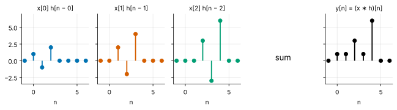
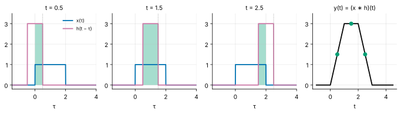
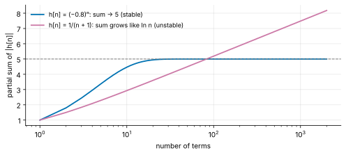
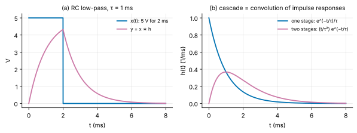

<!-- status: verified -->
# 11-03 · Convolution

| | |
|---|---|
| **Course** | [11 · Signals and Systems](../README.md) |
| **University equivalent** | Convolution in a junior Signals and Systems course: the impulse response, the convolution sum and integral, graphical evaluation, the properties of convolution and the stability of LTI systems (Oppenheim & Willsky, *Signals and Systems*, ch. 2.1–2.3; Lathi, *Linear Systems and Signals*, ch. 2.4 and 3.8; MIT 6.003) |
| **Prerequisites** | [11-02 Systems and Their Properties](11-02-system-properties.md) (linearity, time invariance, BIBO stability), [11-01 Signals: Classification and Operations](11-01-signals-classification-and-operations.md) (sifting, the unit sample, time shifts), [07-04 Laplace-Domain Circuit Analysis](../../07-circuit-analysis-2-transient-and-ac/chapters/07-04-laplace-domain-circuit-analysis.md) (the impulse response of a circuit), [01-08 Sequences, Series and Taylor](../../01-calculus-for-engineers/chapters/01-08-sequences-series-and-taylor.md) (geometric series) |
| **Estimated study hours** | 10 |
| **Last verified** | 2026-11-20 |

**Learning objectives.** After this chapter you can:

1. Derive the convolution sum and the convolution integral from linearity, time invariance and the sifting property, and explain why the impulse response completely describes an LTI system.
2. Compute discrete-time convolutions by superposition, flip-and-slide, tables and polynomial multiplication, and continuous-time convolutions graphically with correct piecewise limits.
3. Use the commutative, associative, distributive, shift, area and support properties to simplify cascades and parallel connections and to check answers.
4. Relate the impulse and step responses, and find a circuit's response to an arbitrary input by convolution.
5. Prove that an LTI system is BIBO-stable exactly when its impulse response is absolutely summable (or integrable), and use the test to size a filter's arithmetic.
6. Count the multiply–accumulate cost of direct convolution in FIR filters and neural-network layers, and distinguish convolution from cross-correlation.

---

## 1. Big picture

11-02 promised that a linear, time-invariant system is completely described by its response to a single impulse. This chapter keeps the promise. Write any input as a sum of shifted, scaled impulses; linearity says the output is the same sum of shifted, scaled impulse responses; time invariance says every one of them is the *same* impulse response, shifted. The result is **convolution**, $y = x * h$: one operation that gives the output of any LTI system for any input, from one measured or computed function $h$. It is the time-domain core of this course. The transforms that follow (11-05 to 11-09) are, in large part, ways of turning convolution into multiplication.

- **Every digital filter is a convolution.** A finite impulse response (FIR) filter computes $y[n] = \sum_k h[k]\,x[n - k]$ directly: one multiply–accumulate (MAC) per coefficient per sample. Audio codecs, ECG front ends and radio basebands all spend their arithmetic this way.
- **Channels convolve.** A cable or a radio path has an impulse response that smears each transmitted symbol into its neighbors (intersymbol interference). Equalizers in serial links (Course 24) are convolutions designed to undo it.
- **Neural networks are built on the same arithmetic.** A "convolutional" layer slides a small kernel across an image and takes weighted sums, and AI accelerators are, at heart, arrays of MAC units (§9).
- **Measurement instruments convolve.** An oscilloscope's finite bandwidth, a camera's blur and a thermometer's lag all convolve the true signal with the instrument's impulse response.
- **Probability uses it too.** The density of a sum of independent random variables is the convolution of their densities (03-04), which is why sums of many errors tend to Gaussian.

## 2. Intuition first

**One clap, then a sentence.** Clap once in a cathedral. The sound you hear afterward, the direct sound followed by a long, decaying tail of echoes, is the room's **impulse response** $h(t)$. Now speak a sentence. The room does to every instant of your voice exactly what it did to the clap: it launches a copy of the same echo pattern, scaled by how loud that instant was and starting when it occurred. What you hear is all those copies added together. That sum of scaled, shifted copies of one response is convolution. It works because the room is (very nearly) linear, so copies add without interacting, and time-invariant, so every copy has the same shape.

**Two ways to read the same sum.** The *input view* (Figure 1) follows each input sample forward: it launches its own scaled copy of $h$. The *output view* stands at one output time and looks back: $y[n] = h[0]x[n] + h[1]x[n - 1] + h[2]x[n - 2] + \cdots$, a weighted sum of the present and past inputs, with $h[k]$ saying how much the input from $k$ samples ago still matters. The output view is what hardware computes: one MAC per weight.

**An analogy from finance: cohort revenue, and where it breaks.** A subscription business acquires $x[k]$ new customers in month $k$. A customer brings in, on average, $h[m]$ dollars $m$ months after joining: high at first, then decaying as customers churn. Revenue in month $n$ is the sum over every past cohort of its size times its revenue at its current age:

$$
\text{revenue}[n] = \sum_k x[k]\,h[n - k] .
$$

That is the convolution sum exactly, and analysts who build cohort models are convolving whether they call it that or not. The analogy breaks where LTI breaks. If later cohorts churn faster than earlier ones, $h$ depends on the cohort's start date: the system is time-varying. If a price increase or a network effect makes revenue per customer depend on how many customers there are, it is nonlinear. Either way the single curve $h$ no longer describes the business, which is the general lesson: convolution is exactly as good as the LTI assumption behind it.

*Figure 1. Convolution as superposition (Example 11-03.1). The input $x = 1, 2, 3$ at $n = 0, 1, 2$ launches three copies of $h = 1, -1, 2$, each scaled by its input sample and starting at its time. Their sum is $y = 1, 1, 3, 1, 6$.*

## 3. Theory

> **Conventions.** Systems are LTI and start at rest. (Notation: following the standard signals texts, this chapter uses τ as the dummy variable of the convolution integral, where [notation.md](../../../reference/notation.md) would use λ; τ also denotes the RC time constant in Example 11-03.4, and context distinguishes the two.) $h[n]$ ($h(t)$) is the response to $\delta[n]$ ($\delta(t)$). Sums and integrals without limits run over all integers or all real numbers. "Support" means the interval on which a signal can be nonzero.

### 3.1 The convolution sum

**Step 1: every sequence is a sum of shifted unit samples.** From 11-01, $\delta[n - k]$ is 1 at $n = k$ and 0 elsewhere, so multiplying it by the number $x[k]$ produces a sequence that is $x[k]$ at $n = k$ and zero elsewhere. Adding these over all $k$ rebuilds $x$:

$$
x[n] = \sum_k x[k]\,\delta[n - k] .
$$

Read carefully: $k$ labels the pieces; for each $k$, $x[k]$ is a *number* and $\delta[n - k]$ is a *sequence* in $n$.

**Step 2: time invariance.** Define the impulse response $h[n] = \mathcal{T}\{\delta[n]\}$. A time-invariant system responds to the shifted unit sample $\delta[n - k]$ with the shifted response $h[n - k]$.

**Step 3: linearity.** The input is a weighted sum of the sequences $\delta[n - k]$ with weights $x[k]$, so the output is the same weighted sum of their responses:

$$
y[n] = \mathcal{T}\Big\{\sum_k x[k]\,\delta[n - k]\Big\} = \sum_k x[k]\,\mathcal{T}\{\delta[n - k]\} = \sum_k x[k]\,h[n - k] .
$$

This is the **convolution sum**, written $y = x * h$:

$$
y[n] = (x * h)\,[n] = \sum_{k=-\infty}^{\infty}x[k]\,h[n - k] .
$$

Nothing beyond the two properties of 11-02 was used. That is why $h$ is a complete description: two LTI systems with the same impulse response give the same output for every input. Measuring or computing $h$ once characterizes the system for good.

> **Going deeper — infinite sums.** Step 3 applies linearity to a sum with infinitely many terms, while 11-02 defined linearity for finite sums. The extension needs the system to be continuous in a suitable sense (small changes far in the past produce small changes now), which every physical system and every stable LTI system satisfies. For an input that starts at a finite time and an output observed at a finite time, a causal system's sum has only finitely many nonzero terms anyway, so nothing more is needed in practice. Oppenheim and Willsky take the same step without comment.

**The output view.** Substituting $m = n - k$ gives the same sum written the other way round:

$$
y[n] = \sum_m h[m]\,x[n - m] = h[0]\,x[n] + h[1]\,x[n - 1] + h[2]\,x[n - 2] + \cdots .
$$

For a causal system, $h[m] = 0$ for $m < 0$, so only the present and past inputs appear. For an FIR filter with $M$ coefficients $h[0], \dots, h[M - 1]$, each output costs exactly $M$ multiplications and $M - 1$ additions: $M$ MACs.

### 3.2 Computing a convolution sum

**Flip and slide.** To find one output $y[n]$: write $h[n - k]$ as a function of $k$. It is $h$ reversed ($h[-k]$) and then shifted right by $n$. Multiply it sample by sample with $x[k]$, and add. Repeat for each $n$. The reversal is not arbitrary: the input from $k$ samples ago meets the response coefficient $h[k]$, so the newest input lines up with $h[0]$ and older inputs with later coefficients.

**Support and length.** If $x$ is nonzero only for $N_1 \le n \le N_2$ and $h$ only for $M_1 \le n \le M_2$, then $x[k]h[n - k]$ can be nonzero only when both $N_1 \le k \le N_2$ and $M_1 \le n - k \le M_2$, which requires $N_1 + M_1 \le n \le N_2 + M_2$. The output's support is the sum of the supports, and its length is

$$
L_y = L_x + L_h - 1 .
$$

**Polynomial multiplication.** Attach the powers of a variable $z$ to the samples: $X(z) = \sum_k x[k]z^k$ and $H(z) = \sum_m h[m]z^m$. Multiplying the polynomials collects, into the coefficient of $z^n$, every product $x[k]h[m]$ with $k + m = n$:

$$
X(z)\,H(z) = \sum_n\Big(\sum_k x[k]\,h[n - k]\Big)z^n = \sum_n y[n]\,z^n .
$$

**Convolving sequences is multiplying polynomials.** It is also long multiplication without carries. With $z = 10$ and index 0 as the units digit, the sequence $[1, 2, 3]$ is the number 321 and $[1, 1, 2]$ is 211; their convolution $[1, 3, 7, 7, 6]$ is the number **67731**, which is $321 \times 211$ (no column exceeded 9, so no carries arose). This polynomial view, with $z^{-1}$ instead of $z$, becomes the z-transform (11-09), where convolution turns into multiplication exactly as here.

**The matrix view.** Stacking the outputs as a vector, $\mathbf{y} = \mathbf{H}\mathbf{x}$, where row $n$ of $\mathbf{H}$ holds $h$ reversed and shifted to position $n$. Every diagonal of $\mathbf{H}$ is constant (a **Toeplitz** matrix). This is how libraries and accelerators often compute convolutions: rearranged as matrix products, for which hardware is heavily optimized (§3.8).

**Closed forms from geometric sums.** For causal exponentials the sum has finitely many terms and a closed form. With $x = u[n]$ and $h = a^nu[n]$,

$$
y[n] = \sum_{k=0}^{n}a^{k} = \frac{1 - a^{n+1}}{1 - a}, \qquad n \ge 0,\ a \ne 1 ,
$$

the recursion's step response from 11-02. Two exponentials, $h_1 = a^nu[n]$ and $h_2 = b^nu[n]$ with $a \ne b$, give

$$
(h_1 * h_2)\,[n] = \sum_{k=0}^{n}a^kb^{n-k} = b^n\sum_{k=0}^{n}(a/b)^k = \frac{a^{n+1} - b^{n+1}}{a - b}, \qquad n \ge 0 ,
$$

and $(n + 1)a^n$ when $a = b$ (Example 11-03.2).

### 3.3 The convolution integral

The continuous-time argument is the same, with sums becoming integrals. The sifting property (11-01) writes any input as a continuum of impulses,

$$
x(t) = \int x(\tau)\,\delta(t - \tau)\,d\tau .
$$

To see why the system responds with an integral, approximate $x$ by a staircase of narrow pulses. Let $p_\Delta(t)$ be a pulse of width Δ and height $1/\Delta$ (unit area), and let $h_\Delta(t)$ be the system's response to it. The staircase is

$$
x(t) \approx \sum_k x(k\Delta)\,p_\Delta(t - k\Delta)\,\Delta ,
$$

a sum of shifted unit-area pulses with weights $x(k\Delta)\,\Delta$, the area of each slice. By linearity and time invariance the response is $\sum_k x(k\Delta)\,h_\Delta(t - k\Delta)\,\Delta$. As $\Delta \to 0$ the pulse becomes an impulse, $h_\Delta \to h$, and the sum becomes a Riemann integral (01-05):

$$
y(t) = (x * h)(t) = \int_{-\infty}^{\infty}x(\tau)\,h(t - \tau)\,d\tau = \int_{-\infty}^{\infty}h(\tau)\,x(t - \tau)\,d\tau .
$$

**Units.** $\delta(t)$ has units of 1/s (11-01), so the impulse response of a system whose output and input are both volts has units of 1/s. Then $x(\tau)h(t - \tau)\,d\tau$ is V × (1/s) × s = V, as it must be. For the RC low-pass of 07-02, $h(t) = \frac{1}{\tau_{RC}}e^{-t/\tau_{RC}}u(t)$: its height $1/\tau_{RC}$ is in 1/s and its area is 1, the circuit's DC gain.

### 3.4 Graphical convolution

For piecewise signals, evaluate the integral region by region:

1. **Pick the signal to flip.** Convolution is commutative (§3.5), so flip whichever is simpler, usually the shorter one. Below it is $h$.
2. **Draw $h(t - \tau)$ against τ.** It is $h$ reversed and its origin moved to $\tau = t$. As $t$ increases, the flipped copy slides to the right.
3. **Find the breakpoints.** The integrand's shape changes only when an edge of the sliding copy crosses an edge of $x$. For supports $[a_1, a_2]$ and $[b_1, b_2]$ the breakpoints are the sums $a_i + b_j$.
4. **Integrate the product over the overlap** in each region between breakpoints.
5. **Check.** The result must be continuous wherever neither signal contains an impulse, its support must be $[a_1 + b_1, a_2 + b_2]$, and its area must be the product of the areas (§3.5).

For a 1 V pulse on $[0, 2)$ and $h = 3$ on $[0, 1)$, the breakpoints are 0, 1, 2 and 3. The overlap grows for $0 \le t < 1$, is constant at its full width of 1 for $1 \le t < 2$, and shrinks for $2 \le t < 3$, so the output is a trapezoid (Figure 2, Example 11-03.3). Two equal-width pulses give a triangle, the special case where the constant region has zero length.

*Figure 2. Graphical convolution (Example 11-03.3). The flipped pulse $h(t - \tau)$ slides across $x(\tau)$; at each $t$ the output is the area of the product, shaded. The result rises while the overlap grows, is flat while it is complete, and falls while it shrinks.*

### 3.5 Properties of convolution

Each property below follows from the definition by a change of variables or by exchanging the order of summation. Each also has a meaning for systems.

**Commutative: $x * h = h * x$.** Substitute $m = n - k$ in the sum (§3.1). *Meaning:* the input and the impulse response play symmetric roles; the output of system $h$ driven by $x$ equals that of system $x$ driven by $h$.

**Associative: $(x * h_1) * h_2 = x * (h_1 * h_2)$.** Write out the left side: $[(x * h_1) * h_2][n] = \sum_m\left(\sum_kx[k]h_1[m - k]\right)h_2[n - m]$. Exchange the order of summation and substitute $j = m - k$: $\sum_kx[k]\sum_jh_1[j]h_2[n - k - j] = \sum_kx[k]\,g[n - k]$ with $g = h_1 * h_2$, which is the right side. (The exchange is legitimate whenever the double sum converges absolutely, for example for absolutely summable impulse responses and bounded inputs.) *Meaning:* a **cascade** of LTI systems is one LTI system with impulse response $h_1 * h_2$. With commutativity, the order of LTI systems in a cascade does not matter, the result 11-02 promised (Example 11-03.5). Physically, the stages must not load each other: two RC sections connected directly are *not* the cascade of two isolated RC impulse responses, which is why the example buffers them.

**Distributive: $x * (h_1 + h_2) = x * h_1 + x * h_2$.** Linearity of the sum. *Meaning:* systems **in parallel** with added outputs have impulse response $h_1 + h_2$.

**Identity and shift.** $x * \delta = x$, and $x * \delta[n - n_0] = x[n - n_0]$ (likewise in CT). *Meaning:* the identity system has $h = \delta$; a pure delay is convolution with a shifted impulse; and convolving with $h[n - n_0]$ shifts the output by $n_0$.

**Area (DC gain).** Summing $y[n]$ over all $n$ and exchanging the sums,

$$
\sum_n y[n] = \sum_k x[k]\sum_n h[n - k] = \Big(\sum_k x[k]\Big)\Big(\sum_m h[m]\Big) ,
$$

and in CT $\int y = \int x\int h$. *Meaning:* $\sum h$ is the system's response to a constant input of 1, its **DC gain**. The area rule is the fastest check on any hand convolution.

**Support.** The output's support is the sum of the supports (§3.2): widths add. *Meaning:* every LTI filter smears. An FIR filter of length $M$ lengthens every signal by $M - 1$ samples, and a cascade of filters smears by the sum of their lengths.

**Step response.** The unit step is a running sum of unit samples, so the step response is a running sum of the impulse response, and the impulse response is the difference of the step response:

$$
s[n] = \sum_{k=-\infty}^{n}h[k], \qquad h[n] = s[n] - s[n - 1]; \qquad s(t) = \int_{-\infty}^{t}h(\tau)\,d\tau, \qquad h(t) = \frac{ds}{dt} .
$$

*Meaning:* a step is much easier to generate in a lab than an impulse, so engineers measure the step response and differentiate it. Differentiation amplifies noise, which is the practical limit of the method.

> **Math refresher — exchanging the order of summation.** A double sum $\sum_k\sum_m a_{k,m}$ adds every entry of an infinite table, row by row. Adding it column by column gives the same total whenever $\sum_k\sum_m\lvert a_{k,m}\rvert$ is finite (Fubini's theorem for sums; for integrals, the same condition lets $\iint$ be done in either order). The associativity and area proofs above use exactly this exchange, and the absolute-summability condition is the same one that guarantees stability in §3.6, which is no coincidence: stable systems are the ones for which these manipulations are always safe.

### 3.6 Stability from the impulse response

**Theorem.** A DT LTI system is BIBO-stable if and only if its impulse response is absolutely summable:

$$
S = \sum_n\lvert h[n]\rvert < \infty .
$$

The CT statement replaces the sum by $\int\lvert h(t)\rvert\,dt$.

*If.* Let $\lvert x[n]\rvert \le B$ for all $n$. By the triangle inequality,

$$
\lvert y[n]\rvert = \Big\lvert\sum_k h[k]\,x[n - k]\Big\rvert \le \sum_k\lvert h[k]\rvert\,\lvert x[n - k]\rvert \le B\sum_k\lvert h[k]\rvert = BS ,
$$

a bound that depends only on $B$.

*Only if.* Suppose $S = \infty$. Feed the single input $x[n] = \operatorname{sign}(h[-n])$ for every $n$ (with sign(0) = 0). It is bounded by 1, and at $n = 0$ every term of the output sum $\sum_kh[k]x[-k]$ is $\lvert h[k]\rvert \ge 0$, so the partial sums over $\lvert k\rvert \le N$ grow without bound:

$$
\sum_{\lvert k\rvert\le N}h[k]\,x[-k] = \sum_{\lvert k\rvert\le N}\lvert h[k]\rvert > C
$$

for every $C$, once $N$ is large enough. The output at $n = 0$ is therefore infinite: one bounded input produces an unbounded output, exactly the counterexample 11-02 asks for, and the system is not BIBO-stable. The input that does the damage is $h$'s sign pattern, reversed in time: the worst-case input lines up with the impulse response so that every echo adds.

**Consequences.**

- Every FIR filter is stable: a finite sum of finite numbers is finite.
- $h = a^nu[n]$ is stable exactly when $\lvert a\rvert < 1$, with $S = 1/(1 - \lvert a\rvert)$: the bound of 11-02 §3.6, now a special case.
- $h = u[n]/(n + 1)$ decays to zero and is still unstable, because the harmonic series diverges: a step input makes the output grow like $\ln n$ (Example 11-03.7, Figure 3). Decay alone is not enough; the decay must be fast enough to sum.
- **$S$ is not the DC gain.** The DC gain is $\lvert\sum h\rvert$; the worst-case gain is $\sum\lvert h\rvert$. When $h$ changes sign they can differ widely, and a fixed-point filter sized for its DC gain overflows on the worst-case input (Example 11-03.7).

> **Going deeper — the ideal low-pass filter is not BIBO-stable.** The ideal low-pass filter, which passes every frequency below a cutoff unchanged and removes everything above it, has the impulse response $h(t) = \sin(\omega_ct)/(\pi t)$ (11-06). It decays like $1/t$, so $\int\lvert h\rvert$ diverges for the same reason the harmonic series does. A bounded input built from $h$'s sign pattern produces an output that grows without limit. This is one more reason, besides its noncausality, that the ideal filter can only be approximated (11-11).

*Figure 3. Partial sums of $\lvert h[n]\rvert$ (Example 11-03.7). For $h = (-0.8)^nu[n]$ they converge to 5, so the system is stable with worst-case gain 5. For $h = u[n]/(n + 1)$ they grow like $\ln n$ without limit: the system is unstable even though $h$ decays to zero.*

### 3.7 Correlation and matched filtering

**Cross-correlation** measures how well one signal matches shifted copies of another:

$$
r_{xy}[n] = \sum_k x[k]\,y[k + n] .
$$

It is convolution without the flip: $r_{xy}[n] = \sum_k x[-k']\,y[n - k']$ with $k' = -k$, so $r_{xy} = x[-n] * y[n]$. To find where a known pattern $p$ occurs in a received signal, convolve the signal with $p$ reversed in time: the output peaks where the signal matches the pattern. This **matched filter** is how a receiver finds a packet's preamble, how radar finds an echo and how a pacemaker detector recognizes a heartbeat's shape (Course 17).

**"Convolutional" neural networks correlate.** Deep-learning frameworks define their convolution layers without the flip: PyTorch's documentation describes its 2-D convolution layer as using "the valid 2D cross-correlation operator" [3]. Since the kernel weights are learned, a flipped kernel is learned just as easily, and nothing is lost. The difference matters only when a filter designed by signal-processing methods is loaded into such a layer, which must then be loaded reversed.

### 3.8 The cost of convolution

Direct convolution of a length-$N$ input with a length-$M$ impulse response takes $N \times M$ MACs, $M$ per output sample. An FIR filter running at sample rate $f_s$ needs $Mf_s$ MACs per second per channel.

A 2-D convolution layer in a neural network applies, at each of $H \times W$ output positions, a $k \times k$ kernel across $C_{in}$ input channels for each of $C_{out}$ output channels:

$$
\text{MACs} = H\,W\,C_{in}\,C_{out}\,k^2 .
$$

These counts drive hardware. Digital signal processors and microcontrollers with DSP extensions are sized in MACs per cycle, and AI accelerators pack tens of thousands of MAC units into arrays (§9). For long filters there is a faster route: the fast Fourier transform turns convolution into multiplication of spectra, with cost growing like $N\log N$ rather than $NM$ (11-07, Course 16). Direct convolution wins for short filters, and FFT-based convolution for long ones.

## 4. Worked examples

### Example 11-03.1 · A convolution four ways (tier A)

**Setup.** $x[n] = 1, 2, 3$ and $h[n] = 1, -1, 2$, both for $n = 0, 1, 2$ and zero elsewhere. (a) Find $y = x * h$ by superposition. (b) Find $y[2]$ by flip-and-slide. (c) Check with the length and area rules. (d) Check by multiplying polynomials, and use the same idea to multiply 123 by 112.

**Solution.** (a) $x[0]h[n] = 1, -1, 2$ at $n = 0, 1, 2$; $x[1]h[n - 1] = 2, -2, 4$ at $n = 1, 2, 3$; $x[2]h[n - 2] = 3, -3, 6$ at $n = 2, 3, 4$. Adding column by column (Figure 1):

| $n$ | 0 | 1 | 2 | 3 | 4 |
|---|---|---|---|---|---|
| $x[0]h[n]$ | 1 | −1 | 2 | | |
| $x[1]h[n-1]$ | | 2 | −2 | 4 | |
| $x[2]h[n-2]$ | | | 3 | −3 | 6 |
| $y[n]$ | **1** | **1** | **3** | **1** | **6** |

(b) $h[2 - k]$ as a function of $k$ is $2, -1, 1$ at $k = 0, 1, 2$. Multiplying by $x[k] = 1, 2, 3$ and adding: $2 - 2 + 3$ = 3, as in the table.

(c) Length $3 + 3 - 1$ = **5**. Area: $\sum y = 1 + 1 + 3 + 1 + 6$ = **12** $= (\sum x)(\sum h) = 6 \times 2$.

(d) $(1 + 2z + 3z^2)(1 - z + 2z^2) = 1 + z + 3z^2 + z^3 + 6z^4$. For integers, read the sequences with index 0 as the *most* significant digit: $[1, 2, 3]$ is 123, $[1, 1, 2]$ is 112, and their convolution $[1, 3, 7, 7, 6]$ is $123 \times 112$ = **13776**.

**Sanity check.** The largest output, 6, is $x[2]h[2]$ alone: at $n = 4$ only the last input meets the last coefficient.

### Example 11-03.2 · Geometric sums (tier A)

**Setup.** (a) $h[n] = 0.5^nu[n]$ is driven by $u[n]$. Find $y[3]$ and the final value, and compare the final value with $\sum h$. (b) Two systems with $h_1 = 0.5^nu[n]$ and $h_2 = 0.25^nu[n]$ are cascaded. Find the overall impulse response at $n = 2$ two ways.

**Solution.** (a) From §3.2, $y[n] = (1 - 0.5^{n+1})/(1 - 0.5)$, so $y[3] = 2(1 - 0.0625)$ = **1.875**, approaching **2**. $\sum h = 1/(1 - 0.5) = 2$: the step's final value is the DC gain.

(b) The formula gives $(0.5^3 - 0.25^3)/(0.5 - 0.25) = (0.125 - 0.015625)/0.25$ = **0.4375**. Directly, $\sum_{k=0}^{2}0.5^k\,0.25^{2-k} = 0.0625 + 0.125 + 0.25$ = 0.4375.

**Sanity check.** At $n = 0$ the cascade's response is $h_1[0]h_2[0] = 1$, and the formula gives $(0.5 - 0.25)/0.25 = 1$.

### Example 11-03.3 · Graphical convolution of two pulses (tier B)

**Setup.** $x(t) = 1$ for $0 \le t < 2$ and $h(t) = 3$ for $0 \le t < 1$ (zero elsewhere; units suppressed). Find $y = x * h$ for all $t$, its values at 0.5, 1.5 and 2.5, its support and its area.

**Solution.** Flip $h$: $h(t - \tau) = 3$ for $t - 1 < \tau \le t$. The breakpoints are $0 + 0$, $0 + 1$, $2 + 0$ and $2 + 1$: 0, 1, 2 and 3.

- $t < 0$: no overlap, $y = 0$.
- $0 \le t < 1$: overlap $[0, t]$, $y = \int_0^t 1 \cdot 3\,d\tau = 3t$.
- $1 \le t < 2$: overlap $[t - 1, t]$, full width 1, $y = 3$.
- $2 \le t < 3$: overlap $[t - 1, 2]$, $y = 3(3 - t)$.
- $t \ge 3$: no overlap, $y = 0$.

So $y(0.5)$ = **1.5**, $y(1.5)$ = **3** and $y(2.5)$ = **1.5**. The support is $[0, 3]$, ending at **3** $= 2 + 1$, and the area is $\tfrac12(1)(3) + (1)(3) + \tfrac12(1)(3)$ = **6** $= 2 \times 3$.

**Sanity check.** $y$ is continuous at every breakpoint (0, 3, 3, 0), as it must be when neither signal contains an impulse.

### Example 11-03.4 · An RC circuit's response by convolution (tier B)

**Setup.** An RC low-pass with $\tau$ = 1 ms has $h(t) = \frac{1}{\tau}e^{-t/\tau}u(t)$. Its input is a 5 V pulse lasting 2 ms from $t = 0$. Find $y(t)$, its values at 1, 2 and 3 ms, and its area.

**Solution.** For $0 \le t < 2$ ms the input has been on since 0:

$$
y(t) = \int_0^t 5\cdot\frac{1}{\tau}e^{-(t - \lambda)/\tau}\,d\lambda = 5\left(1 - e^{-t/\tau}\right) .
$$

For $t \ge 2$ ms the input stopped at 2 ms:

$$
y(t) = \int_0^{2\,\text{ms}}5\cdot\frac{1}{\tau}e^{-(t - \lambda)/\tau}\,d\lambda = 5\left(1 - e^{-2}\right)e^{-(t - 2\,\text{ms})/\tau} .
$$

So $y$(1 ms) $= 5(1 - e^{-1})$ = **3.161** V, $y$(2 ms) $= 5(1 - e^{-2})$ = **4.323** V and $y$(3 ms) $= 4.323e^{-1}$ = **1.590** V (Figure 4a). The area is $\int x\int h = (5\ \text{V})(2\ \text{ms})(1)$ = **10** V·ms.

**Units check.** $\frac{1}{\tau}\,d\lambda$ is dimensionless, so $y$ is in volts.

**Sanity check.** Superposition of steps gives the same answer: the pulse is $5u(t) - 5u(t - 2\ \text{ms})$, and the step response is $1 - e^{-t/\tau}$, so for $t \ge 2$ ms, $y = 5(e^{-(t - 2\,\text{ms})/\tau} - e^{-t/\tau})$, which equals the expression above.

### Example 11-03.5 · Two RC stages in cascade (tier B)

**Setup.** Two identical RC low-passes ($\tau$ = 1 ms) are separated by a unity-gain buffer, so neither loads the other. (a) Find the overall impulse response, its peak and when it occurs. (b) Find the step response at 1 ms, and compare with one stage. (c) Compare the 10–90% rise times of one and two stages.

**Solution.** (a) By associativity the overall impulse response is $h * h$:

$$
(h * h)(t) = \int_0^t\frac{1}{\tau}e^{-\lambda/\tau}\cdot\frac{1}{\tau}e^{-(t - \lambda)/\tau}\,d\lambda = \frac{1}{\tau^2}e^{-t/\tau}\int_0^t d\lambda = \frac{t}{\tau^2}e^{-t/\tau}, \qquad t \ge 0 .
$$

Setting its derivative to zero, $(1 - t/\tau)e^{-t/\tau}/\tau^2 = 0$, gives the peak at $t = \tau$ = **1** ms, of height $1/(e\tau)$ = **367.9** s⁻¹ (Figure 4b). Its area is $1 \times 1 = 1$.

(b) Integrating, $s_2(t) = 1 - (1 + t/\tau)e^{-t/\tau}$, so $s_2$(1 ms) $= 1 - 2/e$ = **0.2642**, against $1 - e^{-1}$ = **0.6321** for one stage.

(c) One stage: $1 - e^{-t/\tau}$ crosses 10% and 90% at $\tau\ln(10/9)$ and $\tau\ln10$, so the rise time is $\tau\ln9$ = **2.197** ms. Two stages: solving $s_2 = 0.1$ and $0.9$ numerically gives $0.5318\tau$ and $3.890\tau$, a rise time of **3.358** ms, **1.53** times longer.

**Sanity check.** Convolving two smooth pulses gives a smoother, wider one: the cascade starts at zero slope rather than jumping, because it takes time for the first stage to charge before the second sees anything.

*Figure 4. (a) The RC low-pass's response to a 5 V, 2 ms pulse (Example 11-03.4). (b) Impulse responses of one stage, $e^{-t/\tau}/\tau$, and of two buffered stages, $(t/\tau^2)e^{-t/\tau}$, which peaks at $t = \tau$ (Example 11-03.5).*

### Example 11-03.6 · An ADC's decimation filter (tier B)

**Setup.** The ADS1292R ECG front end samples its input with a modulator at $f_{MOD}$ = 128 kHz and filters it with a third-order sinc filter, $H(z) = \left[(1 - z^{-N})/(1 - z^{-1})\right]^3$, with $N$ = 256 at the 500 SPS output rate [4]. The factor $(1 - z^{-N})/(1 - z^{-1}) = 1 + z^{-1} + \cdots + z^{-(N - 1)}$ is a running sum of $N$ samples. (a) What is the filter's impulse response, and how many modulator samples long is it? (b) How long is that in milliseconds, and how does it compare with the data sheet's statement that a step takes three output periods to settle? (c) Find the filter's DC gain.

**Solution.** (a) Each factor is a boxcar of $N$ ones; the cube is a cascade of three boxcars, so $h$ is the convolution of three boxcars: a smooth, bell-shaped (piecewise quadratic) pulse. Lengths add: $3N - 2$ = **766** modulator samples.

(b) $766/128\ \text{kHz}$ = **5.984** ms, just under three output periods of 2 ms (6 ms). A step response reaches its final value when the whole impulse response has passed, which is the data sheet's three periods [4].

(c) Each boxcar sums to $N$, and areas multiply: $N^3$ = **16777216**, which is $2^{24}$. For unity DC gain the result must be normalized by $N^3$ (at 500 SPS a factor of $2^{24}$; at other data rates $N$ differs). The data sheet gives only the output word's scaling, an LSB of $V_{REF}/(2^{23} - 1)$, not how the normalization is done internally.

**Sanity check.** The support rule turned a filter specification ($H(z)$) into a latency figure without any frequency-domain work. The notches at the output rate and its multiples follow in 11-07.

### Example 11-03.7 · Stability and worst-case gain (tier B)

**Setup.** For inputs with $\lvert x\rvert \le 1$: (a) $h = (-0.8)^nu[n]$: find $\sum\lvert h\rvert$ and the DC gain. (b) $h = u[n]/(n + 1)$: is it stable? Find the step response at $n = 999$. (c) A five-tap FIR filter has $h = 1, -2, 3, -2, 1$. Find its DC gain and worst-case gain, and the number of extra integer bits ("guard bits") its accumulator needs so that no input bounded by full scale can overflow.

**Solution.** (a) $\sum\lvert h\rvert = 1/(1 - 0.8)$ = **5**; DC gain $\sum h = 1/(1 + 0.8)$ = **0.5556**. A constant input gives 0.56, but an alternating one approaches 5.

(b) $\sum 1/(n + 1)$ is the harmonic series, which diverges: unstable. The step response is the running sum, $y[999] = \sum_{k=1}^{1000}1/k$ = **7.485**: it grows like $\ln n$, slowly but without limit (Figure 3).

(c) DC gain $1 - 2 + 3 - 2 + 1$ = **1**; worst-case gain $1 + 2 + 3 + 2 + 1$ = **9**, reached by the input with signs $+, -, +, -, +$ lined up against $h$. The accumulator must hold 9 times full scale: $\log_2 9$ = **3.17**, so **4** guard bits.

**Sanity check.** A filter with unity DC gain can still multiply some inputs by 9; designers scale fixed-point filters by $\sum\lvert h\rvert$ (or by statistical measures when worst cases are rare), not by the DC gain.

### Example 11-03.8 · What convolution costs (tier C)

**Setup.** (a) A stereo audio stream at 48 kHz passes through a 101-tap FIR filter. How many MACs per second? (b) The TLV320AIC3204 codec offers a 25-tap programmable FIR filter in its ADC path [1]. How many MACs per second per channel at 48 kHz? (c) A convolutional layer has a 3 × 3 kernel, 64 input and 64 output channels and a 56 × 56 output. How many MACs per image? (d) Google's first TPU has a 256 × 256 array of 8-bit MAC units at 700 MHz [2]. Find its peak MAC rate, its peak rate in operations per second (counting a MAC as two operations), and the time for the layer in (c) at peak.

**Solution.** (a) $101 \times 48\,000 \times 2$ = **9.696** million MAC/s.

(b) $25 \times 48\,000$ = **1.2** million MAC/s.

(c) $56 \times 56 \times 64 \times 64 \times 9$ = **115.6** million MACs.

(d) $256^2$ = **65536** MACs per cycle, times $7 \times 10^8$ cycles per second = **45.88** × 10¹² MAC/s, or **91.75** × 10¹² operations per second, the "92 TOPS" of the paper [2]. The layer would take $115.6 \times 10^6/45.88 \times 10^{12}$ = **2.52** µs at peak.

**Sanity check.** Peak rates assume every MAC unit is busy every cycle. The same paper reports that four of its six benchmark networks were limited by memory bandwidth rather than by the MAC array [2], so real layer times are longer: convolution's arithmetic is cheap per operation, and moving the data is the bottleneck.

### Answer key

<!-- answer-key -->
| ID | Quantity | Value | Unit |
|---|---|---|---|
| T 11-03.a | 1, 2, 3 convolved with 1, 1, 2, read from the other end | 67731 | — |
| Ex 11-03.1a | y[0] | 1 | — |
| Ex 11-03.1b | y[1] | 1 | — |
| Ex 11-03.1c | y[2] | 3 | — |
| Ex 11-03.1d | y[3] | 1 | — |
| Ex 11-03.1e | y[4] | 6 | — |
| Ex 11-03.1f | output length | 5 | — |
| Ex 11-03.1g | sum of y | 12 | — |
| Ex 11-03.1h | 123 × 112 | 13776 | — |
| Ex 11-03.2a | y[3] | 1.875 | — |
| Ex 11-03.2b | final value | 2 | — |
| Ex 11-03.2c | cascade response at n = 2 | 0.4375 | — |
| Ex 11-03.3a | y(0.5) | 1.5 | — |
| Ex 11-03.3b | y(1.5) | 3 | — |
| Ex 11-03.3c | y(2.5) | 1.5 | — |
| Ex 11-03.3d | end of support | 3 | — |
| Ex 11-03.3e | area | 6 | — |
| Ex 11-03.4a | y(1 ms) | 3.161 | V |
| Ex 11-03.4b | y(2 ms) | 4.323 | V |
| Ex 11-03.4c | y(3 ms) | 1.590 | V |
| Ex 11-03.4d | area | 10 | V·ms |
| Ex 11-03.5a | time of the cascade's peak | 1 | ms |
| Ex 11-03.5b | peak of the cascade's impulse response | 367.9 | s⁻¹ |
| Ex 11-03.5c | two-stage step response at 1 ms | 0.2642 | — |
| Ex 11-03.5d | one-stage step response at 1 ms | 0.6321 | — |
| Ex 11-03.5e | one-stage rise time | 2.197 | ms |
| Ex 11-03.5f | two-stage rise time | 3.358 | ms |
| Ex 11-03.5g | two-stage 10% point | 0.5318 | τ |
| Ex 11-03.5h | two-stage 90% point | 3.890 | τ |
| Ex 11-03.5i | rise-time ratio | 1.53 | — |
| Ex 11-03.6a | sinc³ impulse-response length | 766 | samples |
| Ex 11-03.6b | its duration | 5.984 | ms |
| Ex 11-03.6c | DC gain | 16777216 | — |
| Ex 11-03.7a | absolute sum of h, (−0.8)ⁿ | 5 | — |
| Ex 11-03.7b | DC gain, (−0.8)ⁿ | 0.5556 | — |
| Ex 11-03.7c | y[999] for 1/(n + 1) | 7.485 | — |
| Ex 11-03.7d | FIR DC gain | 1 | — |
| Ex 11-03.7e | FIR worst-case gain | 9 | — |
| Ex 11-03.7f | log₂ 9 | 3.17 | bit |
| Ex 11-03.7g | guard bits | 4 | bit |
| Ex 11-03.8a | stereo 101-tap FIR at 48 kHz | 9.696 | MMAC/s |
| Ex 11-03.8b | 25-tap FIR at 48 kHz | 1.2 | MMAC/s |
| Ex 11-03.8c | MACs in the layer | 115.6 | M |
| Ex 11-03.8d | TPU MAC units | 65536 | — |
| Ex 11-03.8e | TPU peak MAC rate | 45.88 | TMAC/s |
| Ex 11-03.8f | TPU peak operations per second | 91.75 | Tops/s |
| Ex 11-03.8g | layer time at peak | 2.52 | µs |

*Every value is recomputed by [verify_11_03.py](../verify/verify_11_03.py) by a route that does not use the chapter's closed forms: convolutions by explicit double loops and by Toeplitz matrix products, CT convolutions by numerical quadrature of the product on a fine grid and by discretized convolution, the cascade's peak and rise times by root finding on the numerically convolved response, the sinc³ filter by convolving three boxcars, and stability sums by accumulation. Data-sheet and paper values ([R-039](../../../reference/research-log.md#r-039--google-tpu-v1-matrix-unit), [R-185](../../../reference/research-log.md#r-185--system-property-specifications-in-data-sheets), [R-186](../../../reference/research-log.md#r-186--convolution-in-practice)) are quoted.*

## 5. Simulate it

The lab, [labs/11-03-lab](../labs/11-03-lab/README.md), is a notebook in five parts:

1. Implements convolution four ways (double loop, `np.convolve`, Toeplitz matrix, polynomial multiplication) and confirms they agree.
2. Animates graphical convolution in snapshots and compares the numerically integrated result with Example 11-03.3.
3. Computes the RC pulse response of Example 11-03.4 by discretized convolution and compares it with an ODE solution, as the step size shrinks.
4. Builds the ADS1292R's sinc³ impulse response from three boxcars and plots its step response.
5. Finds a short pattern in a noisy signal with a matched filter (convolution with the reversed pattern).

**Guided exercise (predict, then run).** **Before running Part 3**, predict: if the RC convolution of Example 11-03.4 is computed as a sum with time step Δ (the staircase of §3.3), how does the error at $t$ = 2 ms change when Δ is halved? Then run it. (The rectangle-rule error is proportional to Δ, so halving Δ roughly halves the error. Using the trapezoidal rule instead makes it fall by about four times, the integration-rule orders of 02-10.)

## 6. Engineering tradeoffs

| Knob | Improves | Costs | Typical decision owner |
|---|---|---|---|
| FIR filter length $M$ | Sharper frequency response, more precise equalization | $M$ MACs per sample; latency of $(M - 1)/2$ samples if symmetric | DSP designer |
| FIR versus IIR (recursive) filter | FIR: always stable, exact linear phase | FIR needs many more MACs for the same sharpness | DSP designer |
| Direct versus FFT convolution | Direct: low latency, simple, best for short filters; FFT: far fewer operations for long filters | FFT: block latency, memory, more complex control | Firmware or system architect |
| Accumulator guard bits | No overflow for any bounded input (sized by $\sum\lvert h\rvert$) | Wider adders and registers, more area and power | Hardware designer |
| Measuring the step rather than the impulse response | Easy to generate, high signal energy | Differentiation amplifies noise in the derived $h$ | Test or characterization engineer |
| MAC array size in an accelerator | Peak throughput | Area and power; utilization limited by memory bandwidth | Chip architect |

## 7. Numbers to know

| Quantity | Value | Note |
|---|---|---|
| Output length | $L_x + L_h - 1$ | Supports add |
| Area (DC gain) | $\sum y = \sum x\sum h$ | Fastest check |
| Worst-case gain | $\sum\lvert h\rvert$ | Stability and overflow |
| FIR cost | $M$ MACs per output sample | $Mf_s$ MAC/s per channel |
| Conv-layer cost | $HWC_{in}C_{out}k^2$ MACs | 115.6 M for 3 × 3, 64 → 64, 56 × 56 |
| One RC stage, 10–90% rise | $\tau\ln9 \approx 2.2\tau$ | Two buffered stages: about $3.36\tau$ |
| ADS1292R sinc³ filter at 500 SPS | 766 taps at 128 kHz, about 6 ms | As of Nov 2026 [4] |
| TPU v1 MAC array | 65,536 8-bit MACs at 700 MHz, 92 TOPS peak [2] | 2017 paper |

## 8. Common mistakes

- **Forgetting to flip.** $y[n] = \sum x[k]h[n - k]$, not $\sum x[k]h[n + k]$: the second is a correlation.
- **Wrong limits in a graphical convolution.** Find the breakpoints (sums of edges) first; then each region's overlap limits follow.
- **Mixing up the summation variable.** In $\sum_k x[k]h[n - k]$, $n$ is fixed and $k$ runs; writing $h[k - n]$ reverses the result.
- **Convolving causal signals over all time.** For causal $x$ and $h$, $y[n] = \sum_{k=0}^{n}$; terms outside $[0, n]$ are zero, and writing them in invites errors.
- **Cascading circuits without checking loading.** $h_1 * h_2$ describes a cascade only if each stage's impulse response is unchanged by the next stage's input impedance.
- **Concluding stability from a decaying impulse response.** $1/(n + 1)$ decays and is unstable; the test is summability.
- **Sizing arithmetic by DC gain.** Overflow is set by $\sum\lvert h\rvert$.
- **Loading a DSP filter into a CNN layer unreversed.** Framework "convolutions" are correlations.

## 9. Practitioner lens

### State of the art (as of Nov 2026)

- **Audio codecs expose convolution directly.** The TLV320AIC3204's ADC processing blocks include programmable FIR filters of 25 taps (decimation filter types A and C) and 20 taps (type B), alongside biquad IIR sections, with a "resource class" column indicating relative power [1] **[Established]**.
- **ADC decimation filters are cascaded boxcars.** The ADS1292R's digital filter "consists of a third-order sinc filter", whose transfer function is a cubed running sum; its step settling of three output periods follows from the support rule (Example 11-03.6), and a step arriving partway through an output period is fully reflected in the fourth output, which the data sheet states as "Settled data are available on the fourth DRDY pulse" [4] **[Established]**.
- **AI accelerators are MAC arrays.** Google's first TPU (in datacenters since 2015, described in 2017) has a 256 × 256 array of 65,536 8-bit MAC units at 700 MHz, for 92 TOPS peak, executed systolically "to save energy" [2] **[Established]**. In the same paper, convolutional networks were only 5% of the TPU's inference workload in July 2016, against 61% for multilayer perceptrons and 29% for LSTMs; four of six benchmark networks were memory-bandwidth-limited [2] **[Established]** (dated to 2016; workload mixes change, and current ones need current data).
- **Framework convolutions are correlations.** PyTorch documents its 2-D convolution layer with "the valid 2D cross-correlation operator" [3] **[Established]**.

### Why it matters commercially

- **MAC counts are the first-order cost model** for DSP and AI silicon: area, power and price per unit of throughput. Knowing the MAC count of a workload (Example 11-03.8) turns a vendor's TOPS figure into an estimate of what the chip can actually run.
- **Filter length is latency and power.** In a hearing aid or earbud, every tap costs energy per sample and adds delay; DSP architects trade filter quality against battery life (11-02's latency budget).
- **Data movement dominates.** Because convolution reuses each input and weight many times, the architectures that win (systolic arrays, on-chip buffers) are the ones that avoid refetching data. That is where accelerator start-ups differentiate, and where their claims should be tested.

### Marketing vs Reality

- **"92 TOPS."** *Reality:* a peak figure, every MAC busy every cycle; the same paper reports most of its benchmark networks limited by memory bandwidth instead [2]. *Sanity check:* ask for utilization on a named network, or for throughput in images or tokens per second at a stated batch size and precision.
- **"AI is convolution."** *Reality:* in Google's 2016 data, convolutional networks were 5% of the TPU's inference work [2]; even then, most of the work was matrix multiplication in fully connected and recurrent layers. Convolution and matrix multiplication share the MAC, but their data reuse differs. *Sanity check:* ask which operators dominate the target workload, by MAC count and by bytes moved.
- **"Programmable FIR filter."** *Reality:* a fixed maximum of 20–25 taps in this codec's ADC path [1]; a filter needing more taps, or a sharper response, must go elsewhere. *Sanity check:* ask for the tap count, the coefficient word length and the latency.

### Questions for engineering leaders

1. **"What is the MAC count of your target workload, and what fraction of peak do you sustain on it?"**
   *Strong:* a per-layer or per-filter MAC table and a measured utilization, with the bottleneck named (compute or memory). *Evasive:* peak TOPS only.
2. **"How long are your filters, and where does their latency go?"**
   *Strong:* tap counts, sample rates, group delay per stage and the total against the requirement. *Evasive:* "our DSP is fast."
3. **"How did you size the accumulator and coefficient widths?"**
   *Strong:* worst-case or statistical gain ($\sum\lvert h\rvert$), overflow behavior (saturation or wraparound) and the resulting noise. *Evasive:* "32-bit is plenty."
4. **"Is your impulse response measured or modeled, and how did you check LTI behavior?"**
   *Strong:* measurement method (step, chirp or noise excitation), linearity and repeatability checks. *Evasive:* a simulation only.

## 10. Concept check

**Q1.** Why does knowing $h[n]$ let you predict an LTI system's output for every input?

Answer

Every input is a weighted sum of shifted unit samples. Time invariance says each shifted unit sample produces the same $h$, shifted; linearity says the weighted sum of inputs produces the same weighted sum of those shifted responses. The result, $\sum_k x[k]h[n - k]$, uses nothing about the system except $h$.

**Q2.** A 4-sample signal is convolved with a 7-tap filter. How long is the output, and why is it longer than both?

Answer

$4 + 7 - 1 = 10$ samples. Each input sample launches a copy of $h$ seven samples long, and the copies start at four successive times, so they span $3 + 7 = 10$ samples. Convolution smears.

**Q3.** Two LTI filters are cascaded. Does the order matter? Does it for a filter and a squarer?

Answer

For two LTI filters, no: the cascade's impulse response is $h_1 * h_2 = h_2 * h_1$ (associativity and commutativity), provided the stages do not load each other. With a squarer, yes: it is not linear, the cascade has no impulse response, and squaring before or after filtering gives different results.

**Q4.** A filter's DC gain is 1. Can its output exceed its input's largest value?

Answer

Yes, if $h$ changes sign. The worst-case gain is $\sum\lvert h\rvert$, which exceeds the DC gain $\lvert\sum h\rvert$ whenever some coefficients are negative. The filter $1, -2, 3, -2, 1$ has DC gain 1 and worst-case gain 9.

**Q5.** Why is it easier to measure a step response than an impulse response, and how do you recover $h$ from it?

Answer

An impulse must be very short and very large to carry enough energy, which a real source and a real system's linear range cannot provide; a step is easy to generate and has plenty of energy. The impulse response is the derivative of the step response (the difference, in DT), at the cost of amplified noise.

**Q6.** An impulse response decays to zero. Is the system necessarily stable?

Answer

No. Stability requires $\sum\lvert h\rvert < \infty$; $h = 1/(n + 1)$ decays to zero but its sum diverges, and a step input makes the output grow like $\ln n$.

**Q7.** How is a matched filter related to correlation?

Answer

Convolving a received signal with a pattern reversed in time computes the cross-correlation of the signal with the pattern. The output peaks where the signal best matches the pattern, which is how receivers find known preambles in noise.

[Problem set for this chapter](../problems/11-03-problems.md)

## 11. Key terms

[Impulse response](../../../reference/glossary.md#impulse-response) · [Convolution](../../../reference/glossary.md#convolution) · [Convolution sum](../../../reference/glossary.md#convolution-sum) · [Convolution integral](../../../reference/glossary.md#convolution-integral) · [Graphical convolution](../../../reference/glossary.md#graphical-convolution) · [Step response](../../../reference/glossary.md#step-response) · [Absolute summability](../../../reference/glossary.md#absolute-summability) · [FIR filter](../../../reference/glossary.md#fir-filter) · [Multiply-accumulate (MAC)](../../../reference/glossary.md#multiply-accumulate-mac) · [Toeplitz matrix](../../../reference/glossary.md#toeplitz-matrix) · [Cross-correlation](../../../reference/glossary.md#cross-correlation) · [Matched filter](../../../reference/glossary.md#matched-filter) · [BIBO stability](../../../reference/glossary.md#bibo-stability) · [LTI system](../../../reference/glossary.md#lti-system)

## 12. Connections

- **Builds on:** linearity, time invariance and BIBO stability from [11-02](11-02-system-properties.md); the unit sample, sifting and time shifts from [11-01](11-01-signals-classification-and-operations.md); the impulse response of circuits from [07-04](../../07-circuit-analysis-2-transient-and-ac/chapters/07-04-laplace-domain-circuit-analysis.md); the RC step response from [07-02](../../07-circuit-analysis-2-transient-and-ac/chapters/07-02-first-order-rc-rl-transients.md); geometric series from [01-08](../../01-calculus-for-engineers/chapters/01-08-sequences-series-and-taylor.md); sums of independent random variables from [03-04](../../03-probability-statistics-and-random-variables/chapters/03-04-joint-distributions-and-clt.md).
- **Next:** [11-04 LTI Systems and Differential/Difference Equations](11-04-lti-systems-and-differential-equations.md) reads causality, memory and invertibility off $h$, connects $h$ to differential and difference equations, and shows that complex exponentials are the eigenfunctions of convolution.
- **Used later:** convolution becomes multiplication in [11-05](11-05-fourier-series.md), [11-06](11-06-continuous-time-fourier-transform.md), [11-07](11-07-discrete-time-fourier-transform.md), [11-08](11-08-laplace-transform-and-system-functions.md) and [11-09](11-09-z-transform.md); FIR filter design and fast convolution in Course 16; matched filters in Course 17; equalizers in Course 24.

## 13. Further study

- A. V. Oppenheim and A. S. Willsky with S. H. Nawab, *Signals and Systems*, 2nd ed., ch. 2.1–2.3 (the convolution sum and integral, and the properties of LTI systems).
- B. P. Lathi, *Linear Systems and Signals*, ch. 2.4 (the convolution integral, with graphical convolution) and ch. 3.8 (the convolution sum).
- MIT OpenCourseWare, 6.003 *Signals and Systems* (Fall 2011), the lectures on convolution.
- N. P. Jouppi et al., "In-Datacenter Performance Analysis of a Tensor Processing Unit" [2]: a readable account of how convolution and matrix arithmetic are mapped onto a MAC array, and why memory limits it.

## 14. Sources

1. Texas Instruments, *TLV320AIC3204 Ultra Low Power Stereo Audio Codec*, SLOS602E, September 2008, revised September 2019, Table 2 (ADC processing blocks): [data sheet](https://www.ti.com/lit/ds/symlink/tlv320aic3204.pdf). [R-186](../../../reference/research-log.md#r-186--convolution-in-practice).
2. N. P. Jouppi, C. Young, N. Patil, D. Patterson et al., "In-Datacenter Performance Analysis of a Tensor Processing Unit," *Proc. ISCA '17*, June 2017, DOI 10.1145/3079856.3080246: [arXiv:1704.04760](https://arxiv.org/abs/1704.04760). [R-039](../../../reference/research-log.md#r-039--google-tpu-v1-matrix-unit), [R-186](../../../reference/research-log.md#r-186--convolution-in-practice).
3. PyTorch 2.15 documentation, `torch.nn.Conv2d`: [documentation](https://docs.pytorch.org/docs/2.15/generated/torch.nn.Conv2d.html). [R-186](../../../reference/research-log.md#r-186--convolution-in-practice).
4. Texas Instruments, *ADS129x Low-Power, 2-Channel, 24-Bit Analog Front-End for Biopotential Measurements*, SBAS502C, December 2011, revised April 2020, §8.3.5 (digital decimation filter) and register CONFIG1: [data sheet](https://www.ti.com/lit/ds/symlink/ads1292r.pdf). [R-185](../../../reference/research-log.md#r-185--system-property-specifications-in-data-sheets), [R-186](../../../reference/research-log.md#r-186--convolution-in-practice).
