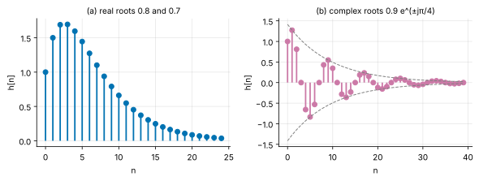
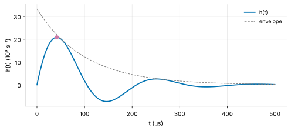
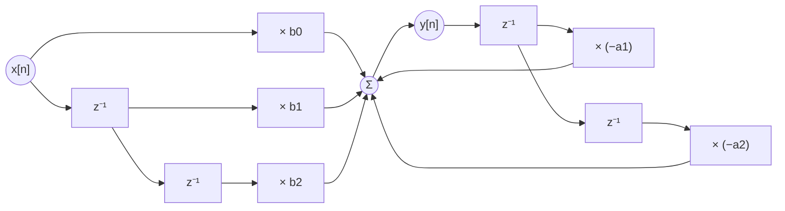
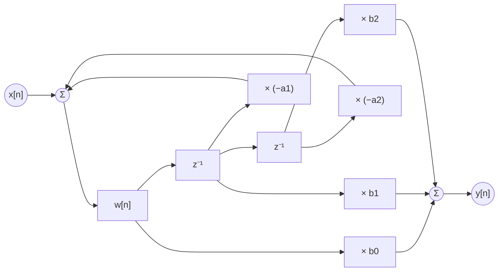
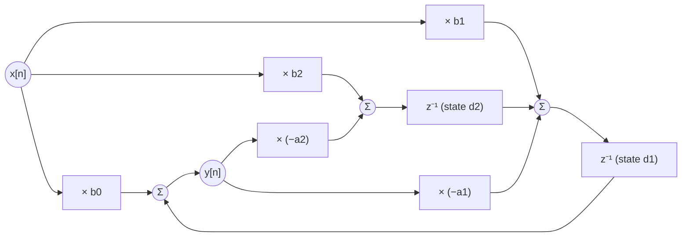
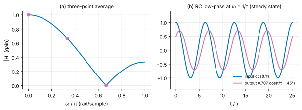

<!-- status: verified -->
# 11-04 · LTI Systems and Differential/Difference Equations

| | |
|---|---|
| **Course** | [11 · Signals and Systems](../README.md) |
| **University equivalent** | The properties of LTI systems read from the impulse response, linear constant-coefficient differential and difference equations, block-diagram realizations and the eigenfunction property of complex exponentials in a junior Signals and Systems course (Oppenheim & Willsky, *Signals and Systems*, ch. 2.3–2.4 and 3.2; Lathi, *Linear Systems and Signals*, ch. 2 and 3; MIT 6.003) |
| **Prerequisites** | [11-03 Convolution](11-03-convolution.md) (convolution, cascades, BIBO stability), [11-02 Systems and Their Properties](11-02-system-properties.md), [02-03 Second-Order Linear ODEs](../../02-complex-numbers-des-and-linear-algebra/chapters/02-03-second-order-linear-odes.md) (characteristic roots), [07-03 Second-Order RLC Transients](../../07-circuit-analysis-2-transient-and-ac/chapters/07-03-second-order-rlc-transients.md), [07-05 Sinusoidal Steady State](../../07-circuit-analysis-2-transient-and-ac/chapters/07-05-sinusoidal-steady-state-and-impedance.md) (phasors) |
| **Estimated study hours** | 8 |
| **Last verified** | 2026-11-20 |

**Learning objectives.** After this chapter you can:

1. Decide from an impulse response whether an LTI system is memoryless, causal, stable and invertible, and find simple inverses by convolution.
2. Solve linear constant-coefficient difference equations for their impulse responses, by iteration and from the roots of the characteristic equation, and decide stability from those roots.
3. Find the impulse response of a first- or second-order differential equation, including the jump conditions at $t = 0$, and connect it to the natural response of RC and RLC circuits.
4. Draw and cost direct-form I, direct-form II and transposed realizations of a difference equation, and explain why biquad cascades are the standard implementation.
5. Show that complex exponentials are eigenfunctions of LTI systems, compute the eigenvalue $H(z)$ or $H(s)$ from $h$ or from the equation, and predict the steady-state response to a sinusoid.

---

## 1. Big picture

11-03 showed that an LTI system is completely described by its impulse response $h$. In practice, systems are rarely *given* as an impulse response. A circuit is given by its components, which produce a **differential equation**; a digital filter is given by its coefficients, which form a **difference equation**; hardware and firmware implement either as a **block diagram** of adders, multipliers and delays or integrators. This chapter connects those three descriptions to $h$, and then to the idea that organizes the rest of the course: a complex exponential passes through any LTI system unchanged in shape, multiplied by a single complex number. That number, as a function of frequency, is the **frequency response**, and Fourier, Laplace and z-transforms (11-05 to 11-09) are the machinery for using it.

- **Every RLC circuit is a differential equation.** The natural response of 07-02 and 07-03 is the impulse response's shape; the circuit's poles are the roots of its characteristic equation.
- **Every recursive digital filter is a difference equation.** Audio codecs, sensor hubs and modems run them as cascades of second-order sections ("biquads"), a few multiply–accumulates each.
- **Block diagrams are the bill of materials.** Delays are registers, multipliers are MAC slots, adders are adders; the realization chosen sets memory, arithmetic and numerical robustness.
- **Stability is a root-location test.** A difference equation is stable when its characteristic roots lie inside the unit circle; a differential equation, when they lie in the left half-plane.
- **Sinusoids in, sinusoids out.** The eigenfunction property is why Bode plots (07-07) and filter specifications describe LTI systems completely.

## 2. Intuition first

**Equations describe the machine; the impulse response describes what it does.** A difference equation such as $y[n] = 0.5y[n - 1] + x[n]$ is a recipe: keep half of the last output and add the new input. Iterate it with a single unit input and the impulse response, $1, 0.5, 0.25, \dots$, falls out. The recipe is compact (two numbers) where the impulse response is infinitely long; that is the point of a recursive filter.

**Why exponentials are special.** Feed the recipe a signal that is itself an exponential, $x[n] = z^n$ for all $n$. Every term in the recipe is then a multiple of $z^n$: delays multiply by $z^{-1}$, gains by constants, and sums of multiples of $z^n$ are multiples of $z^n$. So the output can only be $H(z)\,z^n$, the same exponential with a new complex amplitude. Any LTI system treats every exponential this way, and that is the **eigenfunction** property: the signal keeps its shape and only gets scaled, exactly as an eigenvector of a matrix keeps its direction (02-08).

**An analogy from finance: exponential smoothing, and where it breaks.** An exponentially weighted moving average (EWMA), used for volatility estimates and trend signals, is $y[n] = (1 - \alpha)\,y[n - 1] + \alpha\,x[n]$: a first-order difference equation. Feed it a series that grows steadily at 1% a month, $x[n] = 1.01^n$, and once the start-up has faded the output also grows at exactly 1% a month, lagging the input by a constant factor: the input is an eigenfunction. Feed it a jump and it adjusts geometrically, at the rate set by its root $1 - \alpha$. The analogy breaks in two ways. Real series are not pure exponentials, so the output is a mixture of eigen-parts and start-up transients. And practitioners often vary α with conditions, which makes the filter time-varying, outside everything in this chapter.

## 3. Theory

> **Conventions.** Systems are LTI and start at rest unless an initial condition is given. (Notation: τ is the convolution integral's dummy variable, as in 11-03; α denotes the neper frequency $R/2L$ of §3.3 and, separately, the smoothing weight of the moving-average analogy in §2 and Problem 11-04.12.) Difference equations are normalized so that the coefficient of $y[n]$ is 1. Characteristic roots are written $r_i$ (DT) and $s_i$ (CT).

### 3.1 System properties from the impulse response

With $y[n] = \sum_k h[k]\,x[n - k]$ (11-03), each property of 11-02 becomes a condition on $h$.

**Memoryless ⇔ $h[n] = K\delta[n]$.** The output uses $x[n - k]$ exactly for the $k$ where $h[k] \ne 0$. It uses only $x[n]$ if and only if $h$ vanishes everywhere except $k = 0$. A memoryless LTI system is a pure gain, $y = Kx$.

**Causal ⇔ $h[n] = 0$ for $n < 0$.** If $h[k_0] \ne 0$ for some $k_0 < 0$, the output at $n$ uses $x[n - k_0]$, a *future* input. Conversely, if $h$ vanishes for negative indices, only $x[n], x[n - 1], \dots$ appear. So the impulse response of a causal system is a causal signal: it cannot start before the impulse.

**Stable ⇔ $\sum\lvert h\rvert < \infty$** (11-03).

**Invertible ⇔ there is an $h_i$ with $h * h_i = \delta$.** A cascade is a convolution, and the identity system has impulse response δ, so an LTI inverse must satisfy $h * h_i = \delta$. The accumulator and the first difference are the standard pair:

$$
u[n] * \big(\delta[n] - \delta[n - 1]\big) = u[n] - u[n - 1] = \delta[n] .
$$

A delay $\delta[n - n_0]$ has the inverse $\delta[n + n_0]$, an advance, which is noncausal. The echo channel of 11-02, $h = \delta[n] + b\,\delta[n - 1]$, has the causal inverse $(-b)^nu[n]$, stable only when $\lvert b\rvert < 1$. The CT statements are the same with integrals and $\delta(t)$.

### 3.2 Linear constant-coefficient difference equations

The general $N$th-order difference equation is

$$
y[n] + a_1y[n - 1] + \cdots + a_Ny[n - N] = b_0x[n] + b_1x[n - 1] + \cdots + b_Mx[n - M] .
$$

**It is a recipe.** Solved for $y[n]$, it computes each output from the present and past inputs and the past $N$ outputs:

$$
y[n] = \sum_{k=0}^{M}b_kx[n - k] - \sum_{k=1}^{N}a_ky[n - k] .
$$

With **initial rest** (the output is zero until the input starts), the recipe defines a causal LTI system: sums and constant multiples of inputs produce the same combinations of outputs, and since the coefficients do not depend on $n$, delaying the input delays the output. Without initial rest, the system is incrementally linear, and a zero-input response must be added (11-02, §3.6 below).

**FIR or IIR.** If $N = 0$ there is no feedback: $h[n] = b_n$ for $0 \le n \le M$ and zero after, a finite impulse response (FIR). With feedback ($N \ge 1$, some $a_k \ne 0$), every output feeds future outputs and $h$ is generally infinitely long: an infinite impulse response (IIR) filter, or **recursive** filter.

**Finding $h$ by iteration.** Set $x = \delta$ and run the recipe from rest: $h[0] = b_0$, then each $h[n]$ from the previous ones. This is how a computer finds $h$, and it is always the first check of a hand calculation (Example 11-04.2).

**Finding $h$ in closed form.** For $n > M$ the input terms are zero, so $h$ satisfies the **homogeneous** equation $h[n] + a_1h[n - 1] + \cdots + a_Nh[n - N] = 0$. Try $h[n] = r^n$: dividing by $r^{n-N}$ gives the **characteristic equation**

$$
r^N + a_1r^{N-1} + \cdots + a_N = 0 .
$$

With distinct roots $r_1, \dots, r_N$, every solution of the homogeneous equation is $\sum_ic_ir_i^n$, and the constants $c_i$ follow from the first few values found by iteration. (A root repeated $m$ times contributes $r^n, nr^n, \dots, n^{m-1}r^n$, exactly as for repeated roots of ODEs in 02-03.)

**Stability from the roots.** $h$ is a combination of $r_i^n$ (times polynomials in $n$ for repeated roots), which is absolutely summable exactly when every $\lvert r_i\rvert < 1$. So a causal difference equation is BIBO-stable if and only if all its characteristic roots lie strictly inside the unit circle (assuming no root is cancelled by the input side, a subtlety 11-09 handles). Simple (non-repeated) roots on the circle give bounded but non-summable responses (the accumulator, $r = 1$); repeated roots on the circle grow (a double root at 1 gives $h[n] = n + 1$); roots outside give growth.

**Second order, real roots.** For $y[n] - (r_1 + r_2)\,y[n - 1] + r_1r_2\,y[n - 2] = x[n]$, the characteristic polynomial factors as $(r - r_1)(r - r_2)$. The system is a cascade of two first-order recursions with impulse responses $r_1^nu[n]$ and $r_2^nu[n]$, so by 11-03 §3.2,

$$
h[n] = \frac{r_1^{n+1} - r_2^{n+1}}{r_1 - r_2}, \qquad n \ge 0 .
$$

**Second order, complex roots: a resonator.** If $r_{1,2} = re^{\pm j\theta}$, the equation is $y[n] - 2r\cos\theta\,y[n - 1] + r^2y[n - 2] = x[n]$ (the middle coefficient is $-(r_1 + r_2)$ and the last $r_1r_2$). Substituting into the formula above,

$$
h[n] = \frac{r^{n+1}\big(e^{j(n+1)\theta} - e^{-j(n+1)\theta}\big)}{r\big(e^{j\theta} - e^{-j\theta}\big)} = r^n\,\frac{\sin\big((n + 1)\theta\big)}{\sin\theta}, \qquad n \ge 0 :
$$

a sinusoid at θ rad/sample inside an envelope $r^n$ (Figure 1b). The angle sets the ringing frequency and the radius sets the decay. This is the DT counterpart of an underdamped RLC circuit, and it is the building block of every recursive resonator, notch and band-pass filter.

*Figure 1. Impulse responses of second-order difference equations. (a) Real roots 0.8 and 0.7 (Example 11-04.3): a rise and a slow decay. (b) Complex roots $0.9e^{\pm j\pi/4}$ (Example 11-04.4): an oscillation with an 8-sample period inside the envelope $\pm0.9^n/\sin(\pi/4)$.*

### 3.3 Linear constant-coefficient differential equations

The CT counterpart is

$$
a_N\frac{d^Ny}{dt^N} + \cdots + a_1\frac{dy}{dt} + a_0y = b_M\frac{d^Mx}{dt^M} + \cdots + b_0x .
$$

Every lumped linear circuit produces one: nodal analysis with capacitors and inductors (07-01 to 07-04) gives exactly this form. With initial rest it defines a causal LTI system, by the same argument as in DT.

**First order.** For $\tau\dot y + y = x$, the impulse response satisfies $\tau\dot h + h = \delta(t)$ with $h = 0$ for $t < 0$. Integrate the equation from $t = 0^-$ to $0^+$. The impulse contributes 1; $h$ is finite, so $\int_{0^-}^{0^+}h\,dt \to 0$; and $\int\tau\dot h\,dt = \tau\,[h(0^+) - h(0^-)]$. So $\tau\,h(0^+) = 1$: **the impulse makes $h$ jump to $1/\tau$**. For $t > 0$ the equation is homogeneous, with solution $h(0^+)e^{-t/\tau}$:

$$
h(t) = \frac{1}{\tau}e^{-t/\tau}u(t) ,
$$

the RC impulse response used in 11-03, now derived.

**Second order.** A series RLC circuit's capacitor voltage obeys $LC\,\ddot y + RC\,\dot y + y = x$, or, dividing by $LC$,

$$
\ddot y + 2\alpha\dot y + \omega_0^2y = \omega_0^2x, \qquad \alpha = \frac{R}{2L}, \quad \omega_0 = \frac{1}{\sqrt{LC}} ,
$$

with damping ratio $\zeta = \alpha/\omega_0$ (07-03). For the impulse response, integrate once across $t = 0$: the impulse $\omega_0^2\delta$ must be balanced by the highest derivative, so $\dot h$ jumps by $\omega_0^2$ while $h$ itself stays continuous at zero. (If $h$ jumped, $\dot h$ would contain an impulse and $\ddot h$ its derivative, which nothing on the right can balance.) For $t > 0$ the equation is homogeneous with characteristic roots $s = -\alpha \pm j\omega_d$, $\omega_d = \sqrt{\omega_0^2 - \alpha^2}$ (underdamped case). The solution with $h(0^+) = 0$ and $\dot h(0^+) = \omega_0^2$ is

$$
h(t) = \frac{\omega_0^2}{\omega_d}\,e^{-\alpha t}\sin(\omega_dt)\,u(t) .
$$

Units: $\omega_0^2/\omega_d$ is in 1/s, as an impulse response of a V/V system must be (11-03 §3.3). The impulse response is the natural response of 07-03, started by the impulse with exactly the initial slope that gives it unit area (Example 11-04.5).

**Stability from the roots.** $h$ is a combination of $e^{s_it}$ (times powers of $t$ for repeated roots), absolutely integrable exactly when every $\operatorname{Re}s_i < 0$: all characteristic roots in the **left half-plane**. This is 07-04's pole condition, now derived from the time domain. The DT unit circle and the CT left half-plane are the same statement in two coordinate systems: $\lvert r\rvert < 1$ for $r^n$ and $\operatorname{Re}s < 0$ for $e^{st}$ both mean "decays".

> **Math refresher — the jump conditions.** To find what an impulse does to an $N$th-order equation, ask which derivative can absorb it. Only the highest derivative may contain the impulse itself. Then the next lower derivative jumps by the impulse's weight divided by the leading coefficient, and every lower derivative is continuous. For $a_2\ddot h + a_1\dot h + a_0h = \delta$: $\ddot h$ contains $\delta/a_2$, $\dot h$ jumps by $1/a_2$, and $h$ is continuous. Integrating the equation once across $t = 0$ confirms it, because the integrals of the bounded lower terms over a vanishing interval are zero.

*Figure 2. Impulse response of the series RLC circuit of Example 11-04.5 (capacitor voltage; $L$ = 1 mH, $C$ = 1 µF, $R$ = 20 Ω). It starts at zero with slope $\omega_0^2$, peaks at 41.6 µs and rings at $\omega_d$ = 30 krad/s inside the envelope $(\omega_0^2/\omega_d)e^{-\alpha t}$.*

### 3.4 Block-diagram realizations

A difference equation is built from three elements: the **unit delay** $z^{-1}$ (a register clocked once per sample), the **gain** (a multiplier) and the **adder**. A differential equation is built the same way with **integrators** in place of delays. (Analog realizations use integrators, not differentiators, because a differentiator amplifies high-frequency noise while an integrator smooths it; analog computers and state-variable filters are integrator chains.)

**Direct form I** implements the equation as written: a tapped delay line on the input feeds the $b_k$ (the FIR part), a tapped delay line on the output feeds the $-a_k$ (the recursive part), and one adder combines them. For a second-order section with $N = M = 2$, the **biquad**:

It uses 4 delays, 5 multipliers and 4 two-input additions per output: 5 multiply–accumulates.

**Direct form II.** The FIR part and the recursive part are two LTI systems in cascade, so by 11-03 they can be swapped. Do the recursive part first: an intermediate signal $w[n] = x[n] - a_1w[n - 1] - a_2w[n - 2]$, then $y[n] = b_0w[n] + b_1w[n - 1] + b_2w[n - 2]$. Now both delay lines hold delayed copies of the *same* signal $w$, so one line serves both:

Same 5 multipliers, but only 2 delays: the minimum possible for a second-order system, so the form is called **canonical**. The **transposed** direct form II (reversing every arrow and swapping adders with branch points; the diagram below) has the same counts. Libraries choose between the forms on numerical grounds: Arm's CMSIS-DSP notes that direct form I "is numerically more robust for fixed-point data types", while the transposed form II "requires a wide dynamic range for the state variables", so it offers the transposed form only in floating point, where its advantage is "half the number of state variables" (§9, [2]).

The transposed form computes $y[n] = b_0x[n] + d_1[n - 1]$, then updates $d_1[n] = b_1x[n] - a_1y[n] + d_2[n - 1]$ and $d_2[n] = b_2x[n] - a_2y[n]$: two states, five multipliers, and every adder sits just before a delay.

**Why cascades of biquads.** A high-order filter could be realized as one long direct form, but the roots of a high-order polynomial are extremely sensitive to small coefficient changes: rounding the coefficients to a fixed word length can move roots outside the unit circle and make the filter unstable. Factoring the filter into second-order sections keeps each pair of roots controlled by its own two coefficients. An 8th-order filter becomes four biquads, a 9th-order one five biquads with one reduced to first order.

### 3.5 Complex exponentials are eigenfunctions

**DT.** Feed an LTI system the two-sided exponential $x[n] = z^n$, with $z$ any complex number. By convolution,

$$
y[n] = \sum_kh[k]\,z^{n - k} = z^n\sum_kh[k]\,z^{-k} = H(z)\,z^n, \qquad H(z) = \sum_kh[k]\,z^{-k} ,
$$

provided the sum converges. The output is the input times the complex constant $H(z)$: $z^n$ is an **eigenfunction** and $H(z)$ its **eigenvalue**, the **system function** (11-09 develops it as the z-transform).

**CT.** Likewise $x(t) = e^{st}$ gives

$$
y(t) = \int h(\tau)\,e^{s(t - \tau)}\,d\tau = H(s)\,e^{st}, \qquad H(s) = \int h(\tau)\,e^{-s\tau}\,d\tau ,
$$

the Laplace transform of $h$ (11-08, already met in 07-04).

**From the equation, without $h$.** Substitute $x = z^n$ and $y = H\,z^n$ into the difference equation. Every delay multiplies by $z^{-1}$:

$$
H(z)\big(1 + a_1z^{-1} + \cdots + a_Nz^{-N}\big) = b_0 + b_1z^{-1} + \cdots + b_Mz^{-M}, \qquad H(z) = \frac{\sum_kb_kz^{-k}}{1 + \sum_ka_kz^{-k}} .
$$

For the differential equation, every derivative multiplies by $s$, giving $H(s) = \sum b_ks^k/\sum a_ks^k$, the transfer function of 07-04. The denominator's roots are the characteristic roots of §3.2–3.3: the **poles**.

**Frequency response.** On the unit circle, $z = e^{j\omega}$, and on the imaginary axis, $s = j\omega$, the exponentials are complex sinusoids. A real LTI system has a real $h$, so $H(e^{-j\omega}) = H(e^{j\omega})^*$, and the response to a real sinusoid follows by adding the responses to $e^{j\omega n}$ and $e^{-j\omega n}$:

$$
\cos(\omega n + \phi) \;\longrightarrow\; \lvert H(e^{j\omega})\rvert\cos\big(\omega n + \phi + \angle H(e^{j\omega})\big) ,
$$

and likewise in CT. This is the phasor method of 07-05, now justified for every LTI system: a sinusoid comes out as a sinusoid at the same frequency, scaled by $\lvert H\rvert$ and shifted by $\angle H$ (Figure 3, Example 11-04.7).

*Figure 3. The eigenfunction property at work (Example 11-04.7). (a) The three-point average multiplies $\cos\omega n$ by $(1 + 2\cos\omega)/3$: 1 at DC, 2/3 at $\pi/3$, and 0 at $2\pi/3$, where it removes the tone completely. (b) An RC low-pass driven at $\omega = 1/\tau$: in steady state the output is the same sinusoid at 0.707 of the amplitude, 45° late.*

**Two-sided versus one-sided inputs.** The eigenfunction property is exact for an exponential that has existed forever. An exponential switched on at $n = 0$ produces the eigen-part $H(z)z^n$ plus a transient made of the system's own modes $r_i^n$, which becomes negligible relative to the eigen-part only if the system is stable *and* the input exponential decays more slowly than every mode, $\lvert z\rvert > \max\lvert r_i\rvert$, that is, if $z$ lies in the ROC of $H$ (Example 11-04.7c; 11-09). An input $0.3^n$ into a system with a pole at 0.5 is dominated by the transient forever. In circuit language: forced response plus natural response (07-02 to 07-05).

> **Going deeper — why eigenfunctions organize the whole course.** In linear algebra, a matrix with a full set of eigenvectors becomes diagonal in that basis: applying it is just scaling each component (02-08). Convolution is a linear operator on signals, and complex exponentials are its eigenvectors, the same ones for *every* LTI system. Expanding a signal in exponentials therefore turns every LTI system into simple multiplication, component by component. Expanding periodic signals in $e^{jk\omega_0t}$ is the Fourier series (11-05), general signals in $e^{j\omega t}$ the Fourier transform (11-06), and in $e^{st}$ or $z^n$ the Laplace and z-transforms (11-08, 11-09). The convolution theorem, "convolution in time is multiplication in frequency", is this diagonalization.

### 3.6 Initial conditions and the complete response

A difference or differential equation that does not start at rest is incrementally linear (11-02). Its output is the **zero-state response** (the convolution of the input with $h$) plus the **zero-input response**, the solution of the homogeneous equation that matches the initial conditions. For $y[n] = 0.5y[n - 1] + x[n]$ with $y[-1] = 4$, the zero-input response is $4 \cdot 0.5^{n+1}$, which a stable system forgets geometrically. Laplace and z-transforms carry initial conditions automatically (07-04, 11-09); in the time domain they must be matched by hand, exactly as in 02-03.

## 4. Worked examples

### Example 11-04.1 · Reading properties off the impulse response (tier A)

**Setup.** Classify each LTI system as memoryless or not, causal or not, stable or not, and find an inverse where one exists: (a) $h_a = 3\delta[n]$; (b) $h_b = \delta[n + 1] + \delta[n]$; (c) $h_c = 0.5^nu[n]$; (d) $h_d = u[n]$.

**Solution.** (a) Memoryless (a gain of 3), causal, stable ($\sum\lvert h\rvert = 3$), inverse $\tfrac13\delta[n]$.

(b) Not memoryless, **noncausal** ($h_b[-1] = 1 \ne 0$: $y[n] = x[n + 1] + x[n]$), stable ($\sum\lvert h\rvert = 2$). It is the echo channel of 11-02 with $b = 1$, advanced by one sample, so its inverse is the echo inverse *delayed* by one sample, $h_b^{-1}[n] = (-1)^{n-1}u[n - 1]$ (check: $h_b * h_b^{-1} = \delta[n]$), which is not stable.

(c) Memory, causal, stable with $\sum\lvert h\rvert$ = **2**. Inverse: the recursion $y[n] = 0.5y[n - 1] + x[n]$ is undone by $x[n] = y[n] - 0.5y[n - 1]$, so $h_i = \delta[n] - 0.5\,\delta[n - 1]$. Check: $0.5^nu[n] - 0.5 \cdot 0.5^{n-1}u[n - 1] = \delta[n]$.

(d) The accumulator: memory, causal, unstable ($\sum\lvert h\rvert = \infty$), with the first difference $\delta[n] - \delta[n - 1]$ as its inverse.

**Sanity check.** The inverse of (c) is FIR and stable, while (c) itself is IIR: inverting a recursion gives a finite filter, and inverting a finite filter gives a recursion.

### Example 11-04.2 · A first-order difference equation (tier A)

**Setup.** $y[n] - 0.5y[n - 1] = x[n] + x[n - 1]$, at rest. (a) Find $h[n]$ for $n = 0$ to 3 by iteration and in closed form. (b) Find the DC gain two ways.

**Solution.** (a) With $x = \delta$: $h[0] = 0 + 1 + 0$ = **1**; $h[1] = 0.5 \times 1 + 0 + 1$ = **1.5**; $h[2] = 0.5 \times 1.5$ = **0.75**; $h[3]$ = **0.375**. From $n = 2$ on the input terms are zero and $h$ halves each step: $h[n] = 1.5 \times 0.5^{n-1}$ for $n \ge 1$, with characteristic root 0.5.

(b) Summing $h$: $1 + 1.5\sum_{m\ge0}0.5^m = 1 + 3$ = **4**. From the equation with $z = 1$ (a constant input is $1^n$): $H(1) = (1 + 1)/(1 - 0.5) = 4$.

**Sanity check.** The root 0.5 lies inside the unit circle, so the filter is stable, as the finite sum confirms.

### Example 11-04.3 · Two real roots (tier B)

**Setup.** $y[n] - 1.5y[n - 1] + 0.56y[n - 2] = x[n]$. (a) Find the characteristic roots. (b) Find $h[n]$, its largest value and where it occurs, and $h[6]$. (c) Is it stable? Find its DC gain.

**Solution.** (a) $r^2 - 1.5r + 0.56 = 0$ gives $r = (1.5 \pm \sqrt{2.25 - 2.24})/2 = (1.5 \pm 0.1)/2$: **0.8** and **0.7**.

(b) $h[n] = (0.8^{n+1} - 0.7^{n+1})/0.1$. Values: 1, 1.5, **1.69**, **1.695**, 1.596, …: the maximum, 1.695, is at $n$ = **3** (Figure 1a), and $h[6] = (0.8^7 - 0.7^7)/0.1$ = **1.274**.

(c) Both roots are inside the unit circle: stable. DC gain $H(1) = 1/(1 - 1.5 + 0.56)$ = **16.67**, equal to $\sum h$ (all terms are positive).

**Sanity check.** Iterating from rest gives $h[0] = 1$, $h[1] = 1.5$, $h[2] = 1.5 \times 1.5 - 0.56 = 1.69$, matching the formula.

### Example 11-04.4 · A digital resonator (tier B)

**Setup.** Design a resonator with roots $0.9e^{\pm j\pi/4}$. (a) Write its difference equation. (b) Find $h[1]$, $h[2]$ and $h[3]$, and the period of its ringing. (c) After how many samples has the envelope fallen to 1%? (d) Find its DC gain.

**Solution.** (a) $2r\cos\theta = 1.8\cos(\pi/4)$ = **1.273** and $r^2$ = 0.81: $y[n] - 1.273y[n - 1] + 0.81y[n - 2] = x[n]$.

(b) $h[n] = 0.9^n\sin((n + 1)\pi/4)/\sin(\pi/4)$: $h[1] = 0.9 \times 1/0.7071$ = **1.273**, $h[2] = 0.81 \times 0.7071/0.7071$ = **0.81**, $h[3] = 0.729\sin\pi/0.7071$ = **0**. The angle $\pi/4$ rad/sample means a period of $2\pi/(\pi/4)$ = **8** samples (Figure 1b).

(c) $0.9^n = 0.01$ at $n = \ln0.01/\ln0.9$ = **43.7** samples, about five and a half cycles.

(d) $H(1) = 1/(1 - 1.2728 + 0.81)$ = **1.861** (with the unrounded $2(0.9)\cos(\pi/4) = 1.27279$).

**Sanity check.** Moving the roots closer to the unit circle ($r \to 1$) makes the ringing last longer and the resonance sharper; at $r = 1$ the oscillation never decays and the system is no longer stable.

### Example 11-04.5 · An RLC circuit's impulse response (tier B)

**Setup.** A series RLC circuit has $L$ = 1 mH, $C$ = 1 µF and $R$ = 20 Ω; the output is the capacitor voltage. (a) Find $\omega_0$, α, ζ and $\omega_d$. (b) Write $h(t)$. (c) Find the time and height of its first peak. (d) Find its area.

**Solution.** (a) $\omega_0 = 1/\sqrt{LC}$ = **31.62** krad/s; $\alpha = R/2L$ = **10000** s⁻¹; $\zeta = \alpha/\omega_0$ = **0.3162** (underdamped); $\omega_d = \sqrt{\omega_0^2 - \alpha^2} = \sqrt{10^9 - 10^8}$ = **30** krad/s.

(b) $h(t) = (\omega_0^2/\omega_d)\,e^{-\alpha t}\sin(\omega_dt)\,u(t) = 3.333 \times 10^4\,e^{-10^4t}\sin(3 \times 10^4t)$ s⁻¹ for $t \ge 0$.

(c) Setting $\dot h = 0$: $\omega_d\cos\omega_dt = \alpha\sin\omega_dt$, so $\tan\omega_dt = \omega_d/\alpha = 3$ and $t = \arctan(3)/\omega_d$ = **41.63** µs. The height is $3.333 \times 10^4\,e^{-0.4163}\sin(1.249)$ = **20.85** × 10³ s⁻¹ (Figure 2).

(d) The area is the DC gain $H(0) = \omega_0^2/\omega_0^2$ = **1**: a constant input appears unchanged across the capacitor in steady state.

**Units check.** $\omega_0^2/\omega_d$: (rad/s)²/(rad/s) = 1/s.

**Sanity check.** The impulse response is the circuit's natural response from 07-03, with $v_C(0^+) = 0$ and $dv_C/dt(0^+) = \omega_0^2$ per unit impulse: the voltage impulse delivers flux linkage (volt-seconds) to the inductor, so its current jumps by $1/L$ per unit impulse, while the capacitor voltage cannot jump; then $dv_C/dt(0^+) = i_L/C = 1/(LC) = \omega_0^2$.

### Example 11-04.6 · Realizations and their cost (tier B)

**Setup.** (a) Count the delays and multiply–accumulates per output of a biquad in direct form I and direct form II. (b) A codec's processing block offers 5 biquads [1]. What filter order is that, and how many MACs per second per channel at 48 kHz? Compare with the same codec's 25-tap FIR option. (c) Arm's CMSIS-DSP library writes its biquad as $y[n] = b_0x[n] + b_1x[n - 1] + b_2x[n - 2] + a_1y[n - 1] + a_2y[n - 2]$ [2]. How must the coefficients of Example 11-04.3's equation be entered?

**Solution.** (a) Direct form I: **4** delays and **5** MACs. Direct form II: **2** delays and the same 5 MACs.

(b) Five second-order sections give a filter of order **10** for $5 \times 5$ = **25** MACs per sample, $25 \times 48\,000$ = **1.2** million MAC/s per channel. The 25-tap FIR costs the same arithmetic but has only **24** zeros and no poles (away from the origin): for sharp frequency selectivity, the recursive filter usually does more with the same MACs, at the price of stability checks and nonlinear phase.

(c) In this chapter's convention the equation is $y[n] - 1.5y[n - 1] + 0.56y[n - 2] = x[n]$, so $a_1 = -1.5$ and $a_2 = 0.56$ on the left side. CMSIS puts the feedback terms on the right with a plus sign, so its coefficients are the negatives: $a_1$ = **1.5** and $a_2$ = **−0.56** (with $b_0 = 1$, $b_1 = b_2 = 0$). The library's documentation warns that some design tools use the opposite sign [2]. Entering the coefficients unnegated would build $y[n] = x[n] - 1.5y[n - 1] + 0.56y[n - 2]$, whose characteristic equation $r^2 + 1.5r - 0.56 = 0$ has roots **0.309** and **−1.809**: an unstable filter.

**Sanity check.** A sign error in a feedback coefficient does not cause a compile error; it changes the poles, here from a stable filter to an unstable one. Checking the impulse response against a reference (as in the lab) catches it.

### Example 11-04.7 · Eigenfunctions in action (tier C)

**Setup.** (a) An RC low-pass ($H(s) = 1/(1 + s\tau)$) is driven by $\cos(t/\tau)$. Find the steady-state gain and phase. (b) A three-point average $y[n] = \tfrac13(x[n] + x[n - 1] + x[n - 2])$ runs at 180 SPS. Find its gain at DC, at 30 Hz and at 60 Hz. (c) The system of Example 11-04.2 receives the one-sided input $x[n] = 0.9^nu[n]$. Find $H(0.9)$, the transient's coefficient, and $y[2]$.

**Solution.** (a) $H(j/\tau) = 1/(1 + j)$: gain $1/\sqrt2$ = **0.7071**, phase **−45**° (Figure 3b).

(b) $H(e^{j\omega}) = \tfrac13(1 + e^{-j\omega} + e^{-j2\omega}) = \tfrac13e^{-j\omega}(e^{j\omega} + 1 + e^{-j\omega}) = e^{-j\omega}(1 + 2\cos\omega)/3$. The factor $e^{-j\omega}$ is a one-sample delay, and the gain is $(1 + 2\cos\omega)/3$. DC ($\omega = 0$): **1**. 30 Hz is $\omega = 2\pi \cdot 30/180 = \pi/3$: $(1 + 1)/3$ = **0.6667**. 60 Hz is $\omega = 2\pi/3$: $(1 - 1)/3$ = **0**. A three-sample average at three times the mains frequency removes the hum completely (Figure 3a).

(c) $H(0.9) = (1 + 0.9^{-1})/(1 - 0.5 \times 0.9^{-1}) = 2.111/0.4444$ = **4.75**. The output is $4.75 \times 0.9^n + B\,0.5^n$, the eigen-part plus a transient at the system's root 0.5. At $n = 0$, $y[0] = x[0] = 1$, so $B = 1 - 4.75$ = **−3.75**. Then $y[2] = 4.75 \times 0.81 - 3.75 \times 0.25$ = **2.91**, which iteration confirms ($y[0] = 1$, $y[1] = 0.5 + 0.9 + 1 = 2.4$, $y[2] = 1.2 + 0.81 + 0.9 = 2.91$).

**Sanity check.** In (c) the transient decays as $0.5^n$ while the eigen-part decays as $0.9^n$, so after a few samples the output is almost exactly $4.75 \times$ the input: the eigenfunction property emerges once the start-up is forgotten, because the input's 0.9 exceeds the pole's 0.5.

### Answer key

<!-- answer-key -->
| ID | Quantity | Value | Unit |
|---|---|---|---|
| Ex 11-04.1a | absolute sum of h_c | 2 | — |
| Ex 11-04.2a | h[0] | 1 | — |
| Ex 11-04.2b | h[1] | 1.5 | — |
| Ex 11-04.2c | h[2] | 0.75 | — |
| Ex 11-04.2d | h[3] | 0.375 | — |
| Ex 11-04.2e | DC gain | 4 | — |
| Ex 11-04.3a | larger root | 0.8 | — |
| Ex 11-04.3b | smaller root | 0.7 | — |
| Ex 11-04.3c | h[2] | 1.69 | — |
| Ex 11-04.3d | largest h | 1.695 | — |
| Ex 11-04.3e | index of the largest h | 3 | — |
| Ex 11-04.3f | h[6] | 1.274 | — |
| Ex 11-04.3g | DC gain | 16.67 | — |
| Ex 11-04.4a | 2r cos θ | 1.273 | — |
| Ex 11-04.4b | h[1] | 1.273 | — |
| Ex 11-04.4c | h[2] | 0.81 | — |
| Ex 11-04.4d | h[3] | 0 | — |
| Ex 11-04.4e | ringing period | 8 | samples |
| Ex 11-04.4f | samples to 1% | 43.7 | — |
| Ex 11-04.4g | DC gain | 1.861 | — |
| Ex 11-04.5a | ω_0 | 31.62 | krad/s |
| Ex 11-04.5b | α | 10000 | s⁻¹ |
| Ex 11-04.5c | ζ | 0.3162 | — |
| Ex 11-04.5d | ω_d | 30 | krad/s |
| Ex 11-04.5e | ω_0²/ω_d | 3.333 | 10⁴ s⁻¹ |
| Ex 11-04.5f | time of first peak | 41.63 | µs |
| Ex 11-04.5g | first peak | 20.85 | 10³ s⁻¹ |
| Ex 11-04.5h | area | 1 | — |
| Ex 11-04.6a | DF-I delays | 4 | — |
| Ex 11-04.6b | MACs per biquad | 5 | — |
| Ex 11-04.6c | DF-II delays | 2 | — |
| Ex 11-04.6d | order of 5 biquads | 10 | — |
| Ex 11-04.6e | MACs per sample | 25 | — |
| Ex 11-04.6f | MAC rate at 48 kHz | 1.2 | MMAC/s |
| Ex 11-04.6g | CMSIS a1 | 1.5 | — |
| Ex 11-04.6h | CMSIS a2 | −0.56 | — |
| Ex 11-04.6i | zeros of a 25-tap FIR | 24 | — |
| Ex 11-04.6j | root with unnegated coefficients | 0.309 | — |
| Ex 11-04.6k | other root with unnegated coefficients | −1.809 | — |
| Ex 11-04.7a | RC gain at ω = 1/τ | 0.7071 | — |
| Ex 11-04.7b | RC phase at ω = 1/τ | −45 | ° |
| Ex 11-04.7c | moving-average gain at DC | 1 | — |
| Ex 11-04.7d | gain at 30 Hz | 0.6667 | — |
| Ex 11-04.7e | gain at 60 Hz | 0 | — |
| Ex 11-04.7f | H(0.9) | 4.75 | — |
| Ex 11-04.7g | transient coefficient | −3.75 | — |
| Ex 11-04.7h | y[2] | 2.91 | — |

*Every value is recomputed by [verify_11_04.py](../verify/verify_11_04.py): impulse responses by iterating the difference equations from rest (not from the closed forms), roots with `numpy.roots`, the RLC response by integrating the ODE from rest with a narrow input pulse and by solving the homogeneous equation with the jump conditions, peaks by root finding, DC gains by summing $h$, eigenvalues by driving the filters with long sinusoids and exponentials and measuring the steady-state ratio, and the biquad by running it in both direct forms. Library and data-sheet statements ([R-186](../../../reference/research-log.md#r-186--convolution-in-practice), [R-187](../../../reference/research-log.md#r-187--iir-filter-implementations)) are quoted.*

## 5. Simulate it

The lab, [labs/11-04-lab](../labs/11-04-lab/README.md), is a notebook in four parts:

1. Iterates difference equations from rest and compares the impulse responses with the closed forms of §3.2, then moves a pair of roots across the unit circle.
2. Integrates the RLC equation with ever-narrower input pulses and watches the response converge to the impulse response with its jump in slope.
3. Implements a biquad in direct form I, direct form II and transposed direct form II, checks that they agree, and then quantizes the coefficients of a sharp eighth-order filter to see why biquad cascades are used.
4. Drives filters with sinusoids and one-sided exponentials and measures the eigenvalue once the transient has died out.

**Guided exercise (predict, then run).** **Before running Part 3**, predict: an eighth-order low-pass filter with poles near the unit circle is implemented once as a single direct form and once as four biquads, with every coefficient rounded to 12 fractional bits. Which version stays stable? Then run it. (The single direct form becomes unstable or badly distorted, because the roots of an eighth-order polynomial move far when its coefficients are rounded; the biquad cascade stays close to the design.)

## 6. Engineering tradeoffs

| Knob | Improves | Costs | Typical decision owner |
|---|---|---|---|
| IIR instead of FIR | Sharp response with few MACs | Stability must be checked; nonlinear phase; sensitive to coefficient rounding | DSP designer |
| Direct form II instead of direct form I | Half the delay registers | Larger internal signal swings (overflow risk in fixed point) | DSP or firmware engineer |
| Biquad cascade instead of one high-order section | Robust to coefficient rounding; easy to scale | Section ordering and scaling choices; slightly more control logic | DSP designer |
| Poles closer to the unit circle | Sharper resonance or cutoff | Longer ringing, higher sensitivity, larger internal gain | Filter designer |
| Integrators instead of differentiators (analog) | Noise smoothing, bounded high-frequency gain | Need for initial-condition (reset) management | Analog designer |

## 7. Numbers to know

| Quantity | Value | Note |
|---|---|---|
| DT stability | All characteristic roots inside the unit circle | CT: all in the left half-plane |
| First-order DT impulse response | $a^nu[n]$ | Root $a$ |
| Second-order resonator | $h[n] = r^n\sin((n+1)\theta)/\sin\theta$ | Ringing period $2\pi/\theta$ samples |
| First-order CT impulse response | $\frac1\tau e^{-t/\tau}u(t)$ | Jumps to $1/\tau$ |
| Series RLC (capacitor) impulse response | $(\omega_0^2/\omega_d)e^{-\alpha t}\sin\omega_dt$ | Slope jumps by $\omega_0^2$ |
| Biquad cost | 5 MACs; 4 delays (DF-I) or 2 (DF-II) | CMSIS-DSP DF-I: 5 coefficients, 4 states per stage [2] |
| Eigenvalue | $H(z) = \sum h[k]z^{-k}$; $H(s) = \int h(\tau)e^{-s\tau}d\tau$ | Rational: $B/A$ from the equation |

## 8. Common mistakes

- **Sign conventions for feedback coefficients.** "$y[n] + a_1y[n - 1]$" and "$y[n] = \cdots + a_1y[n - 1]$" use opposite signs; libraries and design tools differ (Example 11-04.6).
- **Forgetting the jump conditions.** For a second-order equation driven by an impulse, the response is continuous and its *slope* jumps; for a first-order one, the response itself jumps.
- **Treating one-sided exponentials as eigenfunctions.** A switched-on exponential adds a transient at the system's own roots; the eigen-relation emerges only if that transient dies out relative to the input, which needs $\lvert z\rvert > \max\lvert r_i\rvert$.
- **Checking stability from the numerator.** Stability depends on the denominator's roots (the poles); the zeros shape the response but cannot make a causal system unstable, provided the system is proper (no more zeros than poles; in CT, the differentiator $H(s) = s$ is causal and not BIBO-stable).
- **Calling a root on the unit circle stable.** A simple root gives a bounded impulse response that is not summable (an accumulator, $r = 1$, or an undamped oscillator); a repeated one gives growth.
- **Implementing a high-order IIR filter as one direct form in fixed point.** Coefficient rounding moves the poles; use second-order sections.
- **Confusing $H(z)$ evaluated at a point with $h[n]$ at an index.** $H(0.9)$ is a gain applied to $0.9^n$, not a sample of the impulse response.

## 9. Practitioner lens

### State of the art (as of Nov 2026)

- **Embedded DSP libraries standardize on biquad cascades.** Arm's CMSIS-DSP library implements recursive filters "as a cascade of second order Biquad sections". Its direct form I version uses "5 coefficients and 4 state variables per stage", and a transposed direct form II version provides "a slight memory savings". An 8th-order filter uses 4 stages and a 9th-order filter 5, one configured as first order. The documentation warns that some design tools negate the feedback coefficients relative to the library's convention [2] **[Established]** (library documentation).
- **Audio codecs expose biquads in hardware.** The TLV320AIC3204's ADC processing blocks offer 0, 3 or 5 programmable biquads per channel alongside a first-order IIR section [1] **[Established]**.
- **The same mathematics describes circuits and code.** An RLC filter and a biquad are both second-order systems, one with poles in the s-plane and one in the z-plane; 11-09 and Course 16 map one to the other (for example, by the bilinear transform).

### Why it matters commercially

- **MACs per filter set the cost of always-on processing.** In hearing aids, earbuds and sensor hubs, a 10th-order IIR filter in 25 MACs per sample versus a long FIR can decide whether a feature fits in a power budget.
- **Numerical robustness is a product-quality issue.** Fixed-point recursive filters can drift unstable or sustain small oscillations (limit cycles) when coefficients and signals are rounded; mature libraries and structures exist precisely because these failures happened in shipped products.
- **Model fidelity drives simulation-based design.** Circuits, sensors and mechanical parts are modeled as differential equations; the quality of those models determines how much physical prototyping a product needs.

### Marketing vs Reality

- **"Programmable IIR filter, any order."** *Reality:* implemented as a fixed number of sections (here up to 5 biquads plus a first-order IIR section, so order 11) [1], each with a fixed coefficient word length. *Sanity check:* ask for the number of sections, the coefficient format and the internal word length.
- **"Drop-in coefficients from your design tool."** *Reality:* sign conventions for feedback coefficients differ between tools and libraries [2]; a mismatch silently builds a different filter. *Sanity check:* ask for an impulse-response or frequency-response test after loading coefficients.
- **"Stable by design."** *Reality:* stable with exact coefficients; rounding can move poles toward or across the unit circle. *Sanity check:* ask for the pole radii after quantization and the margin to the unit circle.

### Questions for engineering leaders

1. **"How are your recursive filters realized, and in what number format?"**
   *Strong:* second-order sections, a named form (DF-I or transposed DF-II), coefficient and accumulator word lengths, and the scaling between sections. *Evasive:* "we use the coefficients from MATLAB."
2. **"What is the largest pole radius after quantization?"**
   *Strong:* a number with margin to 1, and a test showing no limit cycles at low signal levels. *Evasive:* "it's stable in simulation."
3. **"Where do your circuit models come from, and how well do they match measurement?"**
   *Strong:* extracted parameters, measured impulse or frequency responses, and stated error. *Evasive:* "from the data sheet."
4. **"Why IIR rather than FIR here (or the reverse)?"**
   *Strong:* MAC budget, phase requirement, latency, numerical behavior. *Evasive:* habit.

## 10. Concept check

**Q1.** An LTI system's impulse response is $h[n] = \delta[n] + 2\delta[n - 3]$. Is it memoryless? Causal? Stable?

Answer

Not memoryless ($h[3] \ne 0$), causal ($h = 0$ for $n < 0$), stable ($\sum\lvert h\rvert = 3$). It is an FIR filter that adds twice the input from three samples ago.

**Q2.** A difference equation has characteristic roots 0.5 and −1.2. Is it stable? What does its impulse response do?

Answer

Unstable: $\lvert -1.2\rvert > 1$. The impulse response contains a term $c(-1.2)^n$ that alternates in sign and grows by 20% per sample.

**Q3.** Why does the capacitor voltage of a series RLC circuit not jump when the input is an impulse, while its slope does?

Answer

The impulse appears in the equation on the side of $\ddot v_C$; only the highest derivative can contain an impulse. Its integral, $\dot v_C$, therefore jumps by $\omega_0^2$, and $v_C$, the integral of a finite jump, stays continuous. Physically, the voltage impulse delivers flux linkage (volt-seconds) to the inductor, so the inductor current jumps by $1/L$ per unit impulse (the charge delivered in zero time is zero); the capacitor then charges from that current, at $dv_C/dt(0^+) = i_L/C = \omega_0^2$.

**Q4.** Direct form II uses half the delays of direct form I for the same equation. Why is that allowed?

Answer

Direct form I is a cascade of an FIR part and a recursive part, both LTI. LTI systems in cascade commute (11-03), so the recursive part can go first; then both delay lines carry the same intermediate signal and can be merged.

**Q5.** What is an eigenfunction of an LTI system, and why is $\cos\omega n$ not quite one?

Answer

An eigenfunction passes through the system multiplied by a constant: $z^n \to H(z)z^n$. $\cos\omega n$ is a sum of two eigenfunctions, $e^{\pm j\omega n}$, with conjugate eigenvalues; the output is again a cosine at $\omega$, but with a phase shift, so it is not a constant multiple of the input cosine unless $\angle H = 0$.

**Q6.** A filter coefficient's sign was entered wrongly. Will the code fail to run?

Answer

No. It runs and implements a different filter, with different poles, possibly unstable. Only a test against a reference response (impulse or frequency response) catches it.

[Problem set for this chapter](../problems/11-04-problems.md)

## 11. Key terms

[Difference equation](../../../reference/glossary.md#difference-equation) · [Characteristic equation](../../../reference/glossary.md#characteristic-equation) · [IIR filter](../../../reference/glossary.md#iir-filter) · [FIR filter](../../../reference/glossary.md#fir-filter) · [Initial rest](../../../reference/glossary.md#initial-rest) · [Jump conditions](../../../reference/glossary.md#jump-conditions) · [Direct form I and II](../../../reference/glossary.md#direct-form-i-and-ii) · [Biquad](../../../reference/glossary.md#biquad) · [Eigenfunction of an LTI system](../../../reference/glossary.md#eigenfunction-of-an-lti-system) · [System function](../../../reference/glossary.md#system-function) · [Frequency response](../../../reference/glossary.md#frequency-response) · [Impulse response](../../../reference/glossary.md#impulse-response) · [Limit cycle](../../../reference/glossary.md#limit-cycle)

## 12. Connections

- **Builds on:** convolution and stability from [11-03](11-03-convolution.md); system properties from [11-02](11-02-system-properties.md); characteristic roots of ODEs from [02-03](../../02-complex-numbers-des-and-linear-algebra/chapters/02-03-second-order-linear-odes.md); eigenvectors from [02-08](../../02-complex-numbers-des-and-linear-algebra/chapters/02-08-eigenvalues-and-eigenvectors.md); RLC transients from [07-03](../../07-circuit-analysis-2-transient-and-ac/chapters/07-03-second-order-rlc-transients.md); transfer functions from [07-04](../../07-circuit-analysis-2-transient-and-ac/chapters/07-04-laplace-domain-circuit-analysis.md); phasors from [07-05](../../07-circuit-analysis-2-transient-and-ac/chapters/07-05-sinusoidal-steady-state-and-impedance.md).
- **Next:** [11-05 Fourier Series](11-05-fourier-series.md) expands periodic signals in the eigenfunctions $e^{jk\omega_0t}$, so that an LTI system acts on each harmonic by multiplication.
- **Used later:** system functions and pole locations in [11-08](11-08-laplace-transform-and-system-functions.md) and [11-09](11-09-z-transform.md); state-space realizations in [15-10](../../15-control-systems/chapters/15-10-state-space-introduction.md); filter design, structures and quantization in Course 16.

## 13. Further study

- A. V. Oppenheim and A. S. Willsky with S. H. Nawab, *Signals and Systems*, 2nd ed., ch. 2.3–2.4 (properties of LTI systems; differential and difference equations; block diagrams) and ch. 3.2 (complex exponentials as eigenfunctions).
- B. P. Lathi, *Linear Systems and Signals*, ch. 2 (time-domain analysis of CT systems) and ch. 3 (DT systems and difference equations).
- MIT OpenCourseWare, 6.003 *Signals and Systems* (Fall 2011), the lectures on difference equations, block diagrams and feedback.
- The CMSIS-DSP biquad documentation [2]: a concise, real specification of filter structures and their conventions.

## 14. Sources

1. Texas Instruments, *TLV320AIC3204 Ultra Low Power Stereo Audio Codec*, SLOS602E, September 2008, revised September 2019, Table 2 (ADC processing blocks): [data sheet](https://www.ti.com/lit/ds/symlink/tlv320aic3204.pdf). [R-186](../../../reference/research-log.md#r-186--convolution-in-practice).
2. Arm, CMSIS-DSP library documentation, "Biquad Cascade IIR Filters Using Direct Form I Structure" and "Biquad Cascade IIR Filters Using a Direct Form II Transposed Structure" (accessed 20 Nov 2026): [DF-I](https://arm-software.github.io/CMSIS-DSP/latest/group__BiquadCascadeDF1.html), [DF-II transposed](https://arm-software.github.io/CMSIS-DSP/latest/group__BiquadCascadeDF2T.html). [R-187](../../../reference/research-log.md#r-187--iir-filter-implementations).
