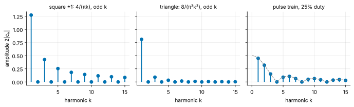
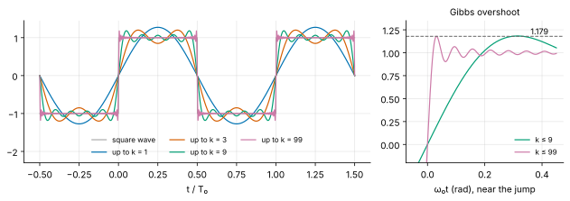
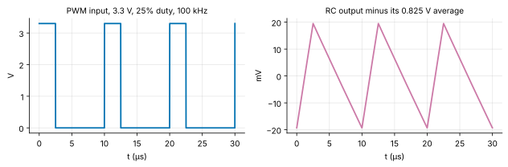
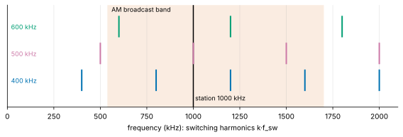

<!-- status: verified -->
# 11-05 · Fourier Series

| | |
|---|---|
| **Course** | [11 · Signals and Systems](../README.md) |
| **University equivalent** | The continuous-time Fourier series in a junior Signals and Systems course: exponential and trigonometric forms, convergence and the Gibbs phenomenon, properties, Parseval's relation, and the response of LTI systems to periodic inputs (Oppenheim & Willsky, *Signals and Systems*, ch. 3.2–3.5 and 3.8–3.9; Lathi, *Linear Systems and Signals*, ch. 6; MIT 6.003) |
| **Prerequisites** | [11-04 LTI Systems and Differential/Difference Equations](11-04-lti-systems-and-differential-equations.md) (eigenfunctions, frequency response), [11-01 Signals: Classification and Operations](11-01-signals-classification-and-operations.md) (periodicity, power, orthogonality of sinusoids), [02-01 Complex Numbers, Euler and Phasors](../../02-complex-numbers-des-and-linear-algebra/chapters/02-01-complex-numbers-euler-and-phasors.md), [01-06 Techniques of Integration](../../01-calculus-for-engineers/chapters/01-06-techniques-of-integration.md) (integration by parts) |
| **Estimated study hours** | 10 |
| **Last verified** | 2026-11-20 |

**Learning objectives.** After this chapter you can:

1. Derive the Fourier-series analysis formula from orthogonality, and compute the coefficients of standard periodic signals (square, triangle, sawtooth, pulse train, rectified sine) in exponential, trigonometric and amplitude–phase form.
2. Use symmetry and the properties of the series (time shift, differentiation, integration) to find and check coefficients with little integration.
3. Explain pointwise and mean-square convergence and the Gibbs phenomenon, and relate how fast coefficients decay to how smooth the signal is.
4. Apply Parseval's relation to find the power in each harmonic, the RMS value and the total harmonic distortion of a periodic waveform.
5. Find the steady-state output of an LTI system driven by a periodic signal by multiplying each harmonic by $H(jk\omega_0)$, as in PWM DACs and rectifier filters.
6. Reason about where a switching circuit puts its harmonics and how designers move them.

---

## 1. Big picture

11-04 showed that complex exponentials are eigenfunctions of every LTI system: $e^{j\omega t}$ goes in, $H(j\omega)e^{j\omega t}$ comes out. That would be a curiosity if real signals were never exponentials. The **Fourier series** says that every reasonable periodic signal *is* a sum of complex exponentials at multiples of its fundamental frequency, its **harmonics**. Put the two together and an LTI system's effect on any periodic input becomes arithmetic: multiply each harmonic by the system's frequency response at that harmonic, and add them back up. The series also gives a new way to see a signal, as a **spectrum** of lines at $0, f_0, 2f_0, 3f_0, \dots$, which is how spectrum analyzers display signals and how engineers reason about filters, distortion and interference.

- **Every switching circuit is a harmonic generator.** Clocks, PWM outputs, class-D amplifiers and switching regulators produce square-ish waves whose harmonics extend far above the switching frequency. Where those harmonics land decides EMI compliance and interference with radios (§9).
- **Filters are designed harmonic by harmonic.** A PWM DAC or a power-supply filter must pass the DC term and attenuate the switching harmonics; the Fourier coefficients say exactly how much is there to attenuate.
- **Distortion is measured in harmonics.** THD (11-02) is a ratio of Fourier coefficients, and Parseval's relation turns it into a power calculation.
- **Smoothness costs bandwidth.** Sharp edges need many harmonics. Slowing the edges of a digital signal removes high harmonics and reduces emissions, at the cost of timing margin.
- **Power systems have harmonics too.** Rectifier loads draw currents rich in odd harmonics, which raise RMS current and lower power factor (07-06).

## 2. Intuition first

**A chord, not a note.** Play the same note on a flute and on a violin. The pitch is the same (the fundamental $f_0$) but the sounds differ, because each instrument adds a different mix of overtones at $2f_0, 3f_0, \dots$. The Fourier series is the recipe for that mix: how much of each harmonic, and at what phase. A pure sine has one ingredient. A square wave, with its sharp corners, has an infinite list of odd harmonics whose amplitudes fall only as $1/k$.

**Projection onto perpendicular directions.** In three dimensions, the component of a vector along the $x$-axis is its dot product with the unit vector $\hat x$; this works because the axes are perpendicular. The harmonics $e^{jk\omega_0t}$ are "perpendicular" in the same sense: the average over a period of the product of two different harmonics (one conjugated) is zero (11-01). So the amount of harmonic $k$ in a signal is found by a "dot product", an average of the signal times $e^{-jk\omega_0t}$, and the other harmonics drop out. That is the whole derivation in §3.2.

**An analogy from finance: seasonality, and where it breaks.** Monthly retail sales have an annual cycle with harmonics: a December spike, a summer bump, quarter-end effects. Decomposing the pattern into cycles of 12, 6, 4 and 3 months is a Fourier series of one year's seasonal profile, and trigonometric seasonal terms of this kind are one standard way to model it (others use moving averages instead). The analogy shows the essential features: a few harmonics often capture most of the variation, and a sharp spike (like December) needs many harmonics to reproduce. It breaks because real business series are not exactly periodic: they trend, the seasonal pattern drifts, and one-off events never repeat. A Fourier series describes a signal that repeats forever, exactly; anything else needs the Fourier transform (11-06) and care.

## 3. Theory

> **Conventions.** $x(t)$ has fundamental period $T_0$ and fundamental frequency $f_0 = 1/T_0$, $\omega_0 = 2\pi f_0$. $\int_{T_0}$ means an integral over any interval of length $T_0$. The sinc function is $\operatorname{sinc}(u) = \sin(\pi u)/(\pi u)$, with $\operatorname{sinc}(0) = 1$. Coefficients $c_k$ have the units of $x$.

### 3.1 Harmonically related exponentials and their orthogonality

The functions $e^{jk\omega_0t}$, $k = 0, \pm1, \pm2, \dots$, all repeat with period $T_0$ (the $k$th one also repeats with period $T_0/k$). For integers $k \ne m$,

$$
\frac{1}{T_0}\int_{T_0}e^{jk\omega_0t}\,e^{-jm\omega_0t}\,dt = \frac{1}{T_0}\int_{T_0}e^{j(k - m)\omega_0t}\,dt = 0 ,
$$

because $e^{j(k-m)\omega_0t}$ goes around the unit circle exactly $k - m$ whole times in one period, and its average is zero. For $k = m$ the integrand is 1 and the average is 1. This is the **orthogonality** of the harmonics, the complex form of the result in 11-01 §3.2 that sinusoids at different frequencies have zero average product.

### 3.2 The exponential Fourier series

**Synthesis.** A periodic signal is represented as

$$
x(t) = \sum_{k=-\infty}^{\infty}c_k\,e^{jk\omega_0t} .
$$

**Analysis.** To find $c_m$, multiply both sides by $e^{-jm\omega_0t}$ and average over a period. By orthogonality every term with $k \ne m$ averages to zero, and the $k = m$ term gives $c_m$:

$$
c_k = \frac{1}{T_0}\int_{T_0}x(t)\,e^{-jk\omega_0t}\,dt .
$$

(Exchanging the sum and the integral is justified for the signals of this course; §3.5 states when the series converges.) Two coefficients are worth reading at once:

- $c_0 = \frac{1}{T_0}\int_{T_0}x\,dt$ is the **average (DC) value**.
- For a real signal, $c_{-k} = c_k^*$: taking the conjugate of the analysis formula replaces $k$ by $-k$. So $\lvert c_{-k}\rvert = \lvert c_k\rvert$ and the phases are opposite, and the negative-frequency terms carry no new information.

**Line spectrum.** Plotting $\lvert c_k\rvert$ and $\angle c_k$ against $k\omega_0$ (or $kf_0$) gives the signal's **line spectrum**: a periodic signal has power only at the harmonic frequencies (Figure 1).

### 3.3 Trigonometric forms and symmetry

Pair the terms $k$ and $-k$ of a real signal. With $c_k = \lvert c_k\rvert e^{j\phi_k}$,

$$
c_ke^{jk\omega_0t} + c_k^*e^{-jk\omega_0t} = 2\operatorname{Re}\{c_ke^{jk\omega_0t}\} = 2\lvert c_k\rvert\cos(k\omega_0t + \phi_k) .
$$

So a real periodic signal is

$$
x(t) = c_0 + \sum_{k=1}^{\infty}A_k\cos(k\omega_0t + \phi_k), \qquad A_k = 2\lvert c_k\rvert ,
$$

the **amplitude–phase form**: the $k$th harmonic is a sinusoid of amplitude $A_k$, which is what a spectrum analyzer reports. Expanding the cosine gives the **sine–cosine form** $x = a_0 + \sum(a_k\cos k\omega_0t + b_k\sin k\omega_0t)$ with $a_0 = c_0$, $a_k = 2\operatorname{Re}c_k$ and $b_k = -2\operatorname{Im}c_k$, or directly

$$
a_k = \frac{2}{T_0}\int_{T_0}x(t)\cos k\omega_0t\,dt, \qquad b_k = \frac{2}{T_0}\int_{T_0}x(t)\sin k\omega_0t\,dt .
$$

**Symmetry saves work.**

- An **even** signal ($x(-t) = x(t)$) has only cosines: $b_k = 0$ and $c_k$ is real.
- An **odd** signal ($x(-t) = -x(t)$) has only sines: $a_k = 0$ (including $a_0$) and $c_k$ is imaginary.
- **Half-wave symmetry**, $x(t + T_0/2) = -x(t)$ (the second half-period is the first one inverted), gives **only odd harmonics**: shifting by half a period multiplies harmonic $k$ by $e^{jk\pi} = (-1)^k$, so the condition forces $c_k = -c_k$ for even $k$. Square and triangle waves with zero average have this symmetry, which is why their spectra skip the even harmonics.

### 3.4 Standard series

**Square wave.** Let $x = +A$ for $0 < t < T_0/2$ and $-A$ for $T_0/2 < t < T_0$ (odd, half-wave symmetric). Then for $k \ne 0$

$$
c_k = \frac{1}{T_0}\left[\int_0^{T_0/2}Ae^{-jk\omega_0t}\,dt - \int_{T_0/2}^{T_0}Ae^{-jk\omega_0t}\,dt\right] = \frac{A}{jk\pi}\left(1 - (-1)^k\right) ,
$$

using $e^{-jk\omega_0T_0/2} = e^{-jk\pi} = (-1)^k$. So $c_k = 2A/(jk\pi)$ for odd $k$ and 0 for even $k$, and

$$
x(t) = \frac{4A}{\pi}\left(\sin\omega_0t + \frac13\sin3\omega_0t + \frac15\sin5\omega_0t + \cdots\right) .
$$

The fundamental's amplitude, $4A/\pi \approx 1.27A$, is larger than the square wave itself (Example 11-05.1).

**Pulse train (PWM).** Let $x = A$ for $0 \le t < DT_0$ and 0 for the rest of the period, a pulse with **duty cycle** $D$. Then

$$
c_k = \frac{A}{T_0}\int_0^{DT_0}e^{-jk\omega_0t}\,dt = \frac{A}{T_0}\cdot\frac{1 - e^{-jk2\pi D}}{jk\omega_0} = AD\,\operatorname{sinc}(kD)\,e^{-j\pi kD} ,
$$

using $1 - e^{-j2\theta} = 2je^{-j\theta}\sin\theta$ with $\theta = \pi kD$. The DC term is $AD$, the average. The magnitudes follow the **sinc envelope** $AD\lvert\operatorname{sinc}(kD)\rvert$, which is zero wherever $kD$ is a nonzero integer: a 25% duty cycle has no 4th, 8th, 12th, … harmonic (Figure 1, Example 11-05.2). The phase factor is the delay of the pulse's center, $DT_0/2$ (§3.7).

**Triangle wave.** The even triangle wave that peaks at $+A$ at $t = 0$ and reaches $-A$ at $t = \pm T_0/2$ has (Example 11-05.5)

$$
x(t) = \frac{8A}{\pi^2}\left(\cos\omega_0t + \frac19\cos3\omega_0t + \frac{1}{25}\cos5\omega_0t + \cdots\right) .
$$

**Sawtooth.** A ramp from $-A$ to $A$ over each period, $x = 2At/T_0$ for $-T_0/2 < t < T_0/2$, is odd with $b_k = (-1)^{k+1}\,2A/(\pi k)$: every harmonic, falling as $1/k$.

**Full-wave rectified sine.** $\lvert V_p\sin\omega t\rvert$ has period $\pi/\omega$, half that of the sine, so its fundamental is at $2\omega$:

$$
\lvert V_p\sin\omega t\rvert = \frac{2V_p}{\pi} - \frac{4V_p}{\pi}\sum_{m=1}^{\infty}\frac{\cos(2m\omega t)}{4m^2 - 1} ,
$$

a DC term of $2V_p/\pi$ (the rectifier's output, 10-01) plus ripple at 120 Hz, 240 Hz, … for 60 Hz mains (Example 11-05.6). *Derivation.* The waveform is even, so only cosines appear. With $\theta = \omega t$ over one period $0 < \theta < \pi$, the coefficient of harmonic $m$ (frequency $2m\omega$) is $c_m = \frac{V_p}{\pi}\int_0^\pi\sin\theta\cos 2m\theta\,d\theta$. The product-to-sum identity gives $\sin\theta\cos2m\theta = \tfrac12[\sin(2m + 1)\theta - \sin(2m - 1)\theta]$, and $\int_0^\pi\sin n\theta\,d\theta = 2/n$ for odd $n$, so

$$
c_m = \frac{V_p}{\pi}\left(\frac{1}{2m + 1} - \frac{1}{2m - 1}\right) = -\frac{2V_p}{\pi(4m^2 - 1)} .
$$

At $m = 0$ this is $2V_p/\pi$, the DC term; for $m \ge 1$ the cosine amplitude is $2c_m = -4V_p/[\pi(4m^2 - 1)]$, as displayed.

**Smoothness and decay.** The square wave and sawtooth jump, and their coefficients fall as $1/k$. The triangle is continuous with corners, and its coefficients fall as $1/k^2$. The rectified sine is continuous with corners, $1/k^2$ again. In general, if $x$ and its first $m - 1$ derivatives are continuous and the $m$th derivative jumps, the coefficients fall as $1/k^{m+1}$. The reason is the differentiation property (§3.7): each derivative multiplies $c_k$ by $jk\omega_0$, and a jump in the $m$th derivative appears as a $1/k$ series after $m$ differentiations. **Sharp edges mean slowly decaying spectra**, which is the Fourier-series form of the rule that fast edges need wide bandwidth and cause emissions.

*Figure 1. One-sided amplitude spectra $2\lvert c_k\rvert$: the ±1 square wave ($4/\pi k$, odd $k$), the triangle of amplitude 1 ($8/\pi^2k^2$, odd $k$) and a 0-to-1 pulse train with 25% duty, whose lines follow a sinc envelope with zeros at $k$ = 4, 8, 12 (Examples 11-05.1, 11-05.2 and 11-05.5).*

### 3.5 Convergence and the Gibbs phenomenon

**Dirichlet conditions.** If $x$ is absolutely integrable over a period and has finitely many maxima, minima and jumps per period, the series converges to $x(t)$ wherever $x$ is continuous, and to the midpoint $\tfrac12[x(t^-) + x(t^+)]$ at a jump. Every signal an engineer generates satisfies these conditions.

**Mean-square convergence.** For any signal with finite power, the partial sums $x_N = \sum_{\lvert k\rvert\le N}c_ke^{jk\omega_0t}$ converge in the sense that the power of the error, $\frac{1}{T_0}\int\lvert x - x_N\rvert^2dt$, goes to zero. Moreover, among all sums of harmonics up to $N$, the Fourier partial sum has the smallest error power: the coefficients are the least-squares best fit (the projection of §2). *Proof.* Try any coefficients $d_k$ for $\lvert k\rvert \le N$. Write the error as $x - \sum d_ke^{jk\omega_0t} = (x - x_N) + \sum(c_k - d_k)e^{jk\omega_0t}$. The first part contains only harmonics above $N$, so it is orthogonal to the second, and by orthogonality the error power is

$$
\frac{1}{T_0}\int_{T_0}\Big\lvert x - \sum_{\lvert k\rvert\le N}d_ke^{jk\omega_0t}\Big\rvert^2dt = \sum_{\lvert k\rvert > N}\lvert c_k\rvert^2 + \sum_{\lvert k\rvert\le N}\lvert c_k - d_k\rvert^2 ,
$$

which is smallest, term by term, when $d_k = c_k$. Truncating a Fourier series is therefore the best approximation of its size.

**The Gibbs phenomenon.** Near a jump, the partial sums overshoot. For the ±1 square wave, the peak of every large partial sum is about **1.179**: an overshoot of about 9% of the jump of 2 (Figure 2). Adding more harmonics squeezes the overshoot closer to the jump, at $\omega_0t \approx \pi/(N + 1)$, but does not reduce its height. The limiting peak is $\frac{2}{\pi}\operatorname{Si}(\pi)$, where $\operatorname{Si}(z) = \int_0^z\frac{\sin u}{u}du$. Mean-square convergence still holds, because the region of overshoot shrinks to zero width. The engineering consequences: any band-limited version of a sharp edge rings, and an ideal low-pass filter applied to a square wave produces this overshoot (11-06, 11-11).

*Figure 2. Partial sums of the ±1 square wave's series with harmonics up to $k$ = 1, 3, 9 and 99 (Examples 11-05.1 and 11-05.4). Right: near the jump the overshoot narrows as $N$ grows but its peak stays at about 1.179.*

> **Going deeper — why the overshoot does not shrink.** The partial sum near the jump can be written as an integral of $\sin((N + 1)u)/\sin u$, and substituting $v = (N + 1)u$ turns it into $\frac{2}{\pi}\int_0^{(N+1)\omega_0t}\frac{\sin v}{v}\,dv$ in the limit. The shape depends on $t$ only through $(N + 1)\omega_0t$: more harmonics compress the same curve horizontally, including its first maximum at $v = \pi$, where the value is $\frac{2}{\pi}\operatorname{Si}(\pi) = 1.17898$. The height is fixed by the integral, not by $N$. Smooth windowing of the coefficients (Fejér sums, or the window functions of Course 16) trades this overshoot for a slower rise.

### 3.6 Parseval's relation and harmonic power

The average power of $x$ equals the sum of the powers of its harmonics:

$$
P_x = \frac{1}{T_0}\int_{T_0}\lvert x(t)\rvert^2\,dt = \sum_{k=-\infty}^{\infty}\lvert c_k\rvert^2 .
$$

*Derivation.* Write $\lvert x\rvert^2 = x\,x^*$, expand both as series, and average. Every cross term $c_kc_m^*e^{j(k-m)\omega_0t}$ with $k \ne m$ averages to zero by orthogonality, leaving $\sum\lvert c_k\rvert^2$. This is 11-01's "powers of orthogonal components add", now for all harmonics at once.

For a real signal, the $k$th harmonic's power combines $c_k$ and $c_{-k}$: $2\lvert c_k\rvert^2 = A_k^2/2$, the familiar $A^2/2$ of a sinusoid. So

$$
P_x = c_0^2 + \sum_{k=1}^{\infty}\frac{A_k^2}{2}, \qquad X_{rms} = \sqrt{P_x} .
$$

**THD from Parseval.** The total harmonic distortion of a periodic waveform compares the RMS of all harmonics above the fundamental with the fundamental's RMS:

$$
\text{THD} = \frac{\sqrt{\sum_{k\ge2}A_k^2}}{A_1} = \sqrt{\frac{P_x - c_0^2 - A_1^2/2}{A_1^2/2}} ,
$$

which can be computed from the total power and the fundamental alone. For the square wave the fundamental holds $8/\pi^2 \approx 81\%$ of the power and the THD is about 48% (Example 11-05.3).

> **Math refresher — a sum you can now evaluate.** Parseval applied to the ±1 square wave gives $1 = \sum_{k\text{ odd}}\frac12\left(\frac{4}{\pi k}\right)^2 = \frac{8}{\pi^2}\sum_{k\text{ odd}}\frac{1}{k^2}$, so $1 + \frac19 + \frac{1}{25} + \cdots = \pi^2/8$. Physical reasoning about power has evaluated an infinite series. The full Basel sum $\sum_{k\ge1}1/k^2 = \pi^2/6$ follows, since the even terms are a quarter of the total.

### 3.7 Properties

Each property follows from the analysis formula by a substitution; $x \leftrightarrow c_k$ denotes a signal and its coefficients, with the same $T_0$.

| Property | Signal | Coefficients | Meaning |
|---|---|---|---|
| Linearity | $\alpha x + \beta y$ | $\alpha c_k + \beta d_k$ | Spectra add |
| Time shift | $x(t - t_0)$ | $c_ke^{-jk\omega_0t_0}$ | Magnitudes unchanged; phase falls linearly with $k$ |
| Time reversal | $x(-t)$ | $c_{-k}$ | |
| Time scaling | $x(at)$, $a > 0$ | $c_k$, at $ka\omega_0$ | Same coefficients, new fundamental |
| Differentiation | $dx/dt$ | $jk\omega_0c_k$ | High harmonics amplified |
| Integration (if $c_0 = 0$) | $\int^tx\,d\tau$ | $c_k/(jk\omega_0)$ | High harmonics attenuated |
| Multiplication | $x(t)y(t)$ | $\sum_mc_md_{k-m}$ | Convolution of coefficient sequences |
| Parseval | $\frac{1}{T_0}\int\lvert x\rvert^2$ | $\sum\lvert c_k\rvert^2$ | Power adds over harmonics |

The time-shift property explains the pulse train's phase factor: the pulse centered at $DT_0/2$ is a centered (even, real-coefficient) pulse delayed by $DT_0/2$. Differentiation and integration explain the decay rates of §3.4 and let one series generate another: the triangle wave is the integral of a square wave (Example 11-05.5).

### 3.8 LTI systems with periodic inputs

Each harmonic $c_ke^{jk\omega_0t}$ is an eigenfunction, so an LTI system with frequency response $H(j\omega)$ multiplies it by $H(jk\omega_0)$ (11-04). By linearity, the **steady-state** output is

$$
y(t) = \sum_kc_k\,H(jk\omega_0)\,e^{jk\omega_0t} ,
$$

a periodic signal with the same period and coefficients $c_kH(jk\omega_0)$. For a real system and signal, each harmonic's amplitude is multiplied by $\lvert H(jk\omega_0)\rvert$ and its phase shifted by $\angle H(jk\omega_0)$. Two consequences dominate practice:

- **Filtering a periodic waveform.** A low-pass filter keeps $c_0$ (times the DC gain $H(0)$) and attenuates the harmonics. A **PWM DAC** is exactly this: a digital pin toggles at a fixed frequency with a duty cycle $D$ that encodes the value, and an RC or LC filter extracts the average $AD$. The residual ripple is the filtered harmonics (Example 11-05.7, Figure 3).
- **Selecting a harmonic.** A resonant (band-pass) filter tuned to $kf_0$ picks out one harmonic. Frequency multipliers and the "harmonic mixers" of RF instruments work this way.

"Steady state" matters: these formulas describe the output after the start-up transient, at the system's own natural frequencies, has died out (11-04 §3.5).

*Figure 3. A 3.3 V, 25%-duty, 100 kHz PWM signal through an RC low-pass with a 1 kHz corner (Example 11-05.7). The output is 0.825 V plus a ripple of 38.9 mV peak to peak, almost triangular because the filter integrates each edge.*

## 4. Worked examples

### Example 11-05.1 · The square wave (tier A)

**Setup.** A ±1 V square wave (odd, as in §3.4). (a) Find $c_k$. (b) Give the amplitudes of the 1st, 3rd and 5th harmonics. (c) Why is there no 2nd harmonic?

**Solution.** (a) $c_k = 2/(jk\pi)$ V for odd $k$, 0 for even $k$; $c_0 = 0$ (the average is zero).

(b) $A_k = 2\lvert c_k\rvert = 4/(\pi k)$: $A_1$ = **1.273** V, $A_3$ = **0.4244** V, $A_5$ = **0.2546** V.

(c) Half-wave symmetry: $x(t + T_0/2) = -x(t)$ forces every even coefficient to zero (§3.3).

**Sanity check.** The fundamental's amplitude, 1.273 V, exceeds the square wave's height of 1 V. That is not a contradiction: the coefficient is the projection $\frac{2}{T_0}\int x\sin\omega_0t\,dt$, and the square wave stays at full height near the edges of each half cycle, where the sine is small, so the best-fitting sine must rise above 1 in the middle of the half cycle to make up the difference.

### Example 11-05.2 · A PWM signal's spectrum (tier A)

**Setup.** A microcontroller pin produces a 3.3 V, 100 kHz PWM signal with 25% duty. (a) Find the DC value. (b) Find $\lvert c_1\rvert$, the 100 kHz harmonic's amplitude, $\lvert c_2\rvert$ and the 200 kHz amplitude. (c) Find $c_4$.

**Solution.** (a) $c_0 = AD = 3.3 \times 0.25$ = **0.825** V.

(b) $\lvert c_1\rvert = AD\,\lvert\operatorname{sinc}(0.25)\rvert = 0.825 \times 0.9003$ = **0.7428** V, so $A_1$ = **1.486** V. $\lvert c_2\rvert = 0.825\,\operatorname{sinc}(0.5) = 0.825 \times 2/\pi$ = **0.5252** V, so $A_2$ = **1.050** V.

(c) $\operatorname{sinc}(1) = 0$, so $c_4$ = **0**: a 25% pulse fills exactly a quarter period, and the 4th harmonic completes one whole cycle under it, averaging to zero.

**Sanity check.** At $D = 0.5$ the formula gives $\lvert c_k\rvert = 0.5A\,\lvert\operatorname{sinc}(k/2)\rvert$, which vanishes for even $k$: the 0-to-$A$ square wave, the ±A square wave shifted up by $A$ and halved.

### Example 11-05.3 · Power in the harmonics (tier B)

**Setup.** For the ±1 square wave: (a) what fraction of the power is in the fundamental? (b) In harmonics up to the 5th? (c) Find the THD.

**Solution.** The total power is 1 (the signal is ±1 at all times).

(a) $A_1^2/2 = (4/\pi)^2/2 = 8/\pi^2$ = **81.06**%.

(b) $\frac{8}{\pi^2}(1 + \frac19 + \frac{1}{25})$ = **93.31**%.

(c) $\text{THD} = \sqrt{(1 - 8/\pi^2)/(8/\pi^2)}$ = **48.34**%.

**Sanity check.** A square wave is a very distorted sinusoid, so a THD near 50% is plausible. The square wave is the limit an overdriven sine oscillator approaches as it clips harder.

### Example 11-05.4 · The Gibbs overshoot (tier B)

**Setup.** Sum the ±1 square wave's series up to the 99th harmonic. (a) Find the peak value and where it occurs near $t = 0$. (b) Repeat up to the 999th harmonic. (c) What is the overshoot as a fraction of the jump?

**Solution.** Evaluating the partial sums numerically (lab Part 2):

(a) Peak **1.179** at $\omega_0t \approx \pi/100$ = **0.03142** rad, that is, $T_0/200$ after the jump.

(b) Peak **1.179** again, now at $\omega_0t \approx \pi/1000$: ten times closer to the jump, the same height.

(c) The overshoot $0.179$ is **8.95**% of the jump of 2. The limit is $\frac{2}{\pi}\operatorname{Si}(\pi)$ = **1.17898**.

**Sanity check.** Near the jump the partial sum depends on $t$ only through $(N + 1)\omega_0t$ (the Si integral of §3.5's "Going deeper"), so raising $N$ compresses the same shape horizontally toward the jump without changing its height: the peak sits at a fixed value of $(N + 1)\omega_0t \approx \pi$, and its height is the fixed number $\frac{2}{\pi}\operatorname{Si}(\pi)$. The non-vanishing overshoot is the price of a jump.

### Example 11-05.5 · The triangle from the square (tier B)

**Setup.** (a) Show that the even triangle wave of amplitude 1 (peak +1 at $t = 0$, −1 at $\pm T_0/2$) has $A_k = 8/(\pi^2k^2)$ for odd $k$, by integrating the square wave. (b) Find $A_1$ and $A_3$, and compare the 3rd harmonic's level relative to the fundamental with the square wave's.

**Solution.** (a) The triangle's slope is $-4/T_0$ on $(0, T_0/2)$ and $+4/T_0$ on $(-T_0/2, 0)$: its derivative is a square wave of amplitude $4/T_0$, negative on $(0, T_0/2)$. That square wave's coefficients are $-\frac{4}{T_0}\cdot\frac{2}{jk\pi}$ for odd $k$. Integration divides by $jk\omega_0$ (the triangle has zero average), so

$$
c_k = -\frac{4}{T_0}\cdot\frac{2}{jk\pi}\cdot\frac{1}{jk\omega_0} = \frac{8}{T_0\,k^2\pi\,\omega_0} = \frac{4}{\pi^2k^2}, \qquad k\ \text{odd},
$$

using $T_0\omega_0 = 2\pi$. The coefficients are real (even signal), and $A_k = 2c_k = 8/(\pi^2k^2)$.

(b) $A_1 = 8/\pi^2$ = **0.8106** and $A_3$ = **0.09006**. The 3rd harmonic is $1/9$ of the fundamental, **−19.08** dB, against $1/3$ (**−9.54** dB) for the square wave: one fewer jump, one more power of $k$.

**Sanity check.** At $t = 0$ the series gives $\frac{8}{\pi^2}(1 + \frac19 + \frac1{25} + \cdots) = \frac{8}{\pi^2}\cdot\frac{\pi^2}{8} = 1$, the triangle's peak, using the sum from §3.6.

### Example 11-05.6 · A rectifier's ripple (tier B)

**Setup.** A full-wave rectifier produces $\lvert V_p\sin(2\pi \cdot 60t)\rvert$. (a) Find the DC component and the amplitudes of the 120 Hz and 240 Hz components, as multiples of $V_p$. (b) Which matters most for the filter design?

**Solution.** (a) From §3.4: DC $2/\pi$ = **0.6366** $V_p$; 120 Hz ($m = 1$) $\frac{4}{\pi}\cdot\frac13$ = **0.4244** $V_p$; 240 Hz ($m = 2$) $\frac{4}{\pi}\cdot\frac{1}{15}$ = **0.0849** $V_p$.

(b) The 120 Hz component: it is the largest ripple term and the lowest in frequency, so a low-pass filter attenuates it least. The ripple falls as $1/m^2$ because the waveform is continuous.

**Sanity check.** The DC value $2V_p/\pi$ is the average of a rectified sine, the value a DC voltmeter reads on an unfiltered rectifier (10-01).

### Example 11-05.7 · A PWM DAC (tier B)

**Setup.** The PWM signal of Example 11-05.2 drives an RC low-pass with a 1 kHz corner, $H(jf) = 1/(1 + jf/f_c)$. (a) Find the output's DC value. (b) Find the amplitude of the 100 kHz and 200 kHz ripple components. (c) The full ripple, summing all harmonics (or solving the RC circuit directly), is **38.87** mV peak to peak. Compare with twice the fundamental's amplitude, and with the estimate $(A - AD)DT_0/RC$.

**Solution.** (a) $H(0) = 1$: **0.825** V.

(b) $\lvert H(j100\,\text{kHz})\rvert = 1/\sqrt{1 + 100^2}$ = **0.0100**, so the fundamental's amplitude is $1.4855\ \text{V} \times 0.0099995$ = **14.85** mV. $\lvert H(j200\,\text{kHz})\rvert$ = **0.00500**, giving $1.0504\ \text{V} \times 0.0049999$ = **5.252** mV (carry the unrounded amplitudes: 1.486 × 0.0100 would give 14.86).

(c) Twice the fundamental is 29.7 mV, so the fundamental alone underestimates the peak-to-peak ripple: the higher harmonics, though small, add up at the waveform's corners. The estimate assumes the capacitor current is constant during each phase (the capacitor voltage barely moves): during the high phase the current is $(A - AD)/R$ for a time $DT_0$, so the change is $(3.3 - 0.825) \times 2.5\ \mu\text{s}/159.2\ \mu\text{s}$ = **38.88** mV, within 0.03% of the exact value.

**Units check.** $\text{V} \times \text{s}/\text{s}$ = V.

**Sanity check.** Raising the PWM frequency tenfold divides the ripple by about ten (each harmonic moves up a decade on the filter's −20 dB/decade slope); raising the filter order steepens the slope instead. Both are standard PWM-DAC design knobs.

### Example 11-05.8 · Keeping switching harmonics out of the AM band (tier C)

**Setup.** A class-D audio amplifier switches at a selectable frequency of 400, 500 or 600 kHz [1]. A car radio is tuned to an AM station at 1000 kHz. (a) For each switching frequency, list the harmonics below 2000 kHz and the distance from the nearest one to the station. (b) Which settings are acceptable? (c) Compare with the data sheet's recommendation for stations between 917 and 1125 kHz.

**Solution.** The amplifier's output is a PWM waveform with fundamental $f_{sw}$, so its harmonics lie at $kf_{sw}$ (Figure 4).

(a) 400 kHz: 400, 800, 1200, 1600 kHz; nearest to 1000 kHz is 800 or 1200, **200** kHz away. 500 kHz: 500, 1000, 1500 kHz; the 2nd harmonic lands **0** kHz from the station. 600 kHz: 600, 1200, 1800 kHz; nearest **200** kHz away.

(b) 400 kHz and 600 kHz: no harmonic falls within 200 kHz of the station, far outside an AM channel (10 kHz spacing in the Americas). 500 kHz puts a strong harmonic on top of it; the radio would demodulate the amplifier's switching as a tone.

(c) The data sheet recommends 600 kHz (or 400 kHz) for stations from 917 to 1125 kHz, and states the principle: choose the frequency so that "the fundamental frequency and its second harmonic straddle the AM radio band listed" [1]. The test that matters is that no harmonic falls *inside* the band. For 600 kHz, the harmonics 600 and 1200 kHz lie on either side of the whole 917–1125 kHz band; for 400 kHz, 800 and 1200 kHz do. For 500 kHz, the harmonic at 1000 kHz lies inside it.

**Sanity check.** Harmonics are spaced $f_{sw}$ apart, so a band narrower than $f_{sw}$ contains at most one of them, but it may contain one. The art is choosing among a few available clock frequencies so that, for every slice of the band, one of them puts no harmonic inside the slice: hence the data sheet's table.

*Figure 4. Switching harmonics $kf_{sw}$ against the AM broadcast band and a station at 1000 kHz (Example 11-05.8). At 500 kHz the 2nd harmonic falls on the station; at 400 and 600 kHz the nearest harmonics are 200 kHz away on either side.*

### Answer key

<!-- answer-key -->
| ID | Quantity | Value | Unit |
|---|---|---|---|
| T 11-05.a | Gibbs peak of the ±1 square wave | 1.179 | — |
| T 11-05.b | fundamental's share of square-wave power | 81 | % |
| T 11-05.c | square-wave THD | 48 | % |
| T 11-05.d | RC PWM ripple, peak to peak | 38.9 | mV |
| T 11-05.e | TPA3116D2 switching frequencies: lowest | 400 | kHz |
| T 11-05.f | TPA3116D2 switching frequencies: highest | 1200 | kHz |
| T 11-05.g | second-order filter's 100 kHz ripple | 0.15 | mV |
| Ex 11-05.1a | A_1 | 1.273 | V |
| Ex 11-05.1b | A_3 | 0.4244 | V |
| Ex 11-05.1c | A_5 | 0.2546 | V |
| Ex 11-05.2a | DC value | 0.825 | V |
| Ex 11-05.2b | sinc(0.25) | 0.9003 | — |
| Ex 11-05.2c | magnitude of c_1 | 0.7428 | V |
| Ex 11-05.2d | A_1 | 1.486 | V |
| Ex 11-05.2e | magnitude of c_2 | 0.5252 | V |
| Ex 11-05.2f | A_2 | 1.050 | V |
| Ex 11-05.2g | c_4 | 0 | V |
| Ex 11-05.3a | power in the fundamental | 81.06 | % |
| Ex 11-05.3b | power up to the 5th harmonic | 93.31 | % |
| Ex 11-05.3c | THD | 48.34 | % |
| Ex 11-05.4a | peak, 99 harmonics | 1.179 | — |
| Ex 11-05.4b | location of the peak | 0.03142 | rad |
| Ex 11-05.4c | peak, 999 harmonics | 1.179 | — |
| Ex 11-05.4d | overshoot as a fraction of the jump | 8.95 | % |
| Ex 11-05.4e | limiting peak | 1.17898 | — |
| Ex 11-05.5a | triangle A_1 | 0.8106 | — |
| Ex 11-05.5b | triangle A_3 | 0.09006 | — |
| Ex 11-05.5c | triangle 3rd harmonic relative to fundamental | −19.08 | dB |
| Ex 11-05.5d | square 3rd harmonic relative to fundamental | −9.54 | dB |
| Ex 11-05.6a | DC | 0.6366 | V_p |
| Ex 11-05.6b | 120 Hz amplitude | 0.4244 | V_p |
| Ex 11-05.6c | 240 Hz amplitude | 0.0849 | V_p |
| Ex 11-05.7a | output DC | 0.825 | V |
| Ex 11-05.7b | filter gain at 100 kHz | 0.0100 | — |
| Ex 11-05.7c | 100 kHz ripple amplitude | 14.85 | mV |
| Ex 11-05.7d | filter gain at 200 kHz | 0.00500 | — |
| Ex 11-05.7e | 200 kHz ripple amplitude | 5.252 | mV |
| Ex 11-05.7f | full ripple, peak to peak | 38.87 | mV |
| Ex 11-05.7g | twice the fundamental | 29.7 | mV |
| Ex 11-05.7h | constant-current estimate | 38.88 | mV |
| Ex 11-05.8a | 400 kHz: distance to the nearest harmonic | 200 | kHz |
| Ex 11-05.8b | 500 kHz: distance to the nearest harmonic | 0 | kHz |
| Ex 11-05.8c | 600 kHz: distance to the nearest harmonic | 200 | kHz |

*Every value is recomputed by [verify_11_05.py](../verify/verify_11_05.py) by numerical integration of the analysis formula over one period (not from the closed forms), by FFTs of sampled periods, by evaluating partial sums on a fine grid for the Gibbs peak, by simulating the RC circuit's periodic steady state for the PWM ripple, and by listing harmonics for the AM example. Data-sheet values ([R-188](../../../reference/research-log.md#r-188--switching-harmonics-in-a-class-d-amplifier)) are quoted.*

## 5. Simulate it

The lab, [labs/11-05-lab](../labs/11-05-lab/README.md), is a notebook in four parts:

1. Computes Fourier coefficients of arbitrary sampled periodic signals with the analysis integral and with the FFT, and compares them with the closed forms of §3.4.
2. Animates partial sums of the square wave and measures the Gibbs peak and its position for increasing $N$.
3. Checks Parseval's relation numerically and computes THD from total power and the fundamental.
4. Passes a PWM signal through RC and second-order LC filters, harmonic by harmonic, and compares with a time-domain simulation.

**Guided exercise (predict, then run).** **Before running Part 4**, predict: if the RC filter of Example 11-05.7 is replaced by a second-order (two-pole) filter with the same 1 kHz corner, roughly how much smaller does the 100 kHz ripple become? Then run it. (Each harmonic now sees about $1/(f/f_c)^2$ instead of $1/(f/f_c)$: at 100 kHz that is 1/10,000 instead of 1/100, so the fundamental ripple falls about a hundredfold, from 14.85 mV to around **0.15** mV.)

## 6. Engineering tradeoffs

| Knob | Improves | Costs | Typical decision owner |
|---|---|---|---|
| Edge rate (rise/fall time) of a clock or switching node | Faster edges: lower switching loss, better timing | Slower spectral decay, more EMI | Board or power designer |
| PWM frequency | Ripple falls in proportion; smaller filter | Switching loss; timer resolution (fewer duty-cycle steps at a given clock) | Embedded or power designer |
| Filter order after a PWM or switching stage | Steeper attenuation of harmonics | Cost, size, phase lag in control loops | Analog or power designer |
| Choice of switching frequency | Harmonics placed between sensitive bands (AM, GPS, sensor bands) | Other constraints (efficiency, filter size) | System and EMC engineer |
| Number of harmonics kept in a model or simulation | Accuracy near edges | Computation; Gibbs ringing if truncated abruptly | Analyst |

## 7. Numbers to know

| Quantity | Value | Note |
|---|---|---|
| Square wave (±A) | $A_k = 4A/(\pi k)$, odd $k$; fundamental $1.27A$ | Fundamental holds $8/\pi^2 \approx 81\%$ of the power; THD ≈ 48% |
| Triangle (±A) | $A_k = 8A/(\pi^2k^2)$, odd $k$ | 3rd harmonic −19.1 dB |
| Pulse train | $c_k = AD\operatorname{sinc}(kD)e^{-j\pi kD}$ | Zeros at $k = 1/D, 2/D, \dots$ |
| Full-wave rectified sine | DC $0.637V_p$; first ripple term $0.424V_p$ at $2f$ | Ripple falls as $1/m^2$ |
| Gibbs overshoot | 1.179 for a ±1 jump (8.95% of the jump) | Does not shrink with $N$ |
| Decay rate | Jump: $1/k$; kink: $1/k^2$ | Smoother is narrower |
| Class-D switching frequencies (TPA3116D2) | 400 kHz to 1.2 MHz, pin-selectable [1] | As of Nov 2026 |

## 8. Common mistakes

- **Forgetting the factor of 2 between $c_k$ and $A_k$.** A real signal's $k$th harmonic has amplitude $2\lvert c_k\rvert$ because $c_k$ and $c_{-k}$ each carry half.
- **Integrating over the wrong interval.** The analysis integral must cover exactly one period (any one).
- **Expecting the series to equal $x$ at a jump.** It converges to the midpoint.
- **Expecting more harmonics to remove the Gibbs overshoot.** They narrow it; they do not lower it.
- **Adding harmonic amplitudes to get RMS.** RMS values of different harmonics add in quadrature (Parseval), not linearly.
- **Using the fundamental alone to estimate peak ripple.** Higher harmonics add up at corners (Example 11-05.7).
- **Applying $H(jk\omega_0)$ during start-up.** The harmonic-by-harmonic output is the steady state; transients come on top.
- **Confusing duty-cycle zeros with filtering.** A pulse train's missing harmonics are a property of the waveform; they move when the duty cycle changes.

## 9. Practitioner lens

### State of the art (as of Nov 2026)

- **Class-D amplifiers choose their switching frequency to dodge radio bands.** TI's TPA3116D2 offers switching (oscillator) frequencies of 400, 500, 600, 1000 and 1200 kHz (typical), selected with three pins, and its "AM avoidance" table recommends a frequency for each slice of the AM broadcast band so that "the fundamental frequency and its second harmonic straddle the AM radio band listed" [1] **[Established]** (data sheet). The data sheet also explains that an LC output filter with a corner below the switching frequency lets the switching ripple current circulate in the filter rather than the speaker [1].
- **Emissions concerns extend to tens of megahertz.** The same data sheet advises ferrite-bead output filters effective in the 10 to 100 MHz range, noting that "many of the specifications regulating consumer electronics have emissions limits as low as 30 MHz" [1] (the ferrite guidance is **[Established]** as the vendor's application advice; the regulatory remark is the vendor's summary, and the regulations themselves were not read here): the high harmonics of fast switching edges are what those limits catch.
- **Linearity specifications are Fourier coefficients.** The THD+N figures in 11-02 §9 (op-amps at −136 dB, codecs at −85 dB, class-D at 0.1% at half power) are ratios of the harmonic amplitudes of Example 11-05.3 with the noise in the measurement band added ("+N"), so they are upper bounds on the THD alone.

### Why it matters commercially

- **EMI compliance is a schedule risk.** A product that fails radiated-emissions testing late in development needs board changes or added filtering; knowing where switching harmonics fall is cheaper than finding out in the test chamber.
- **Switching frequency is a product-level tradeoff.** Higher frequency means smaller inductors and capacitors (lower cost and size) but more switching loss and higher-frequency harmonics. Vendors that make it selectable sell flexibility to the system integrator.
- **PWM is the cheapest DAC.** A timer pin and an RC filter replace a converter IC for slow signals (LED dimming, bias trims, motor control); its resolution and ripple are set by exactly the arithmetic of Example 11-05.7.

### Marketing vs Reality

- **"Spread-spectrum clocking eliminates EMI."** *Reality:* varying the clock frequency smears each harmonic over a band, lowering the *peak* that narrow-band EMI tests measure; it does not remove the energy (Parseval), and it can degrade jitter-sensitive circuits. *Sanity check:* ask for the total power in the band of concern, not only the peak reading, and for the jitter impact.
- **"No output filter needed."** *Reality:* filter-free claims refer to dropping the bulky LC filter, not the switching harmonics, which are still present and radiate from the speaker wires; the TPA3116D2 data sheet, for example, devotes sections to LC and ferrite-bead output filters and to AM avoidance [1]. *Sanity check:* ask for emissions results with the customer's cable lengths.
- **"16-bit PWM."** *Reality:* resolution trades against PWM frequency (the timer must count $2^{16}$ ticks per period), and ripple is set by the frequency and filter. *Sanity check:* ask for the PWM frequency at the quoted resolution and the residual ripple after the recommended filter.

### Questions for engineering leaders

1. **"What are your switching and clock frequencies, and where do their harmonics land relative to the radios in the product?"**
   *Strong:* a frequency plan listing each oscillator, the harmonics that fall in sensitive bands (GPS, cellular, Wi-Fi, AM/FM) and the mitigation for each. *Evasive:* "we'll see in EMC testing."
2. **"How did you size the filter after this PWM or switching stage?"**
   *Strong:* ripple requirement, harmonic amplitudes from the duty-cycle range, filter attenuation at the first harmonic, worst-case duty. *Evasive:* "standard values from the reference design."
3. **"Is your THD figure measured at the operating level and frequency?"**
   *Strong:* THD versus level and frequency, harmonic by harmonic, with the analyzer bandwidth. *Evasive:* one number.
4. **"What edge rates do your digital interfaces use, and were they slowed deliberately?"**
   *Strong:* edge-rate settings chosen against timing margin and emissions, with measured spectra. *Evasive:* defaults.

## 10. Concept check

**Q1.** A periodic signal is real and even. What can you say about its Fourier coefficients?

Answer

They are real and symmetric, $c_{-k} = c_k$: the series contains only cosines (and a DC term).

**Q2.** Why does a square wave with zero average contain no even harmonics?

Answer

It has half-wave symmetry, $x(t + T_0/2) = -x(t)$. Shifting by half a period multiplies harmonic $k$ by $(-1)^k$, so for even $k$ the condition requires $c_k = -c_k$, which means $c_k = 0$.

**Q3.** A signal has a jump; another is continuous but has a kink. Which spectrum decays faster, and why?

Answer

The continuous one: its coefficients fall as $1/k^2$, against $1/k$ for the jump. Differentiating the kinked signal once produces a jump, and differentiation multiplies coefficients by $jk\omega_0$, so the kinked signal's coefficients must be smaller by a factor of $k$.

**Q4.** The Gibbs overshoot does not shrink as more harmonics are added. Why does the series still converge?

Answer

It converges at every point away from the jump (and to the midpoint at the jump), and in mean square: the overshoot's height stays at about 9% of the jump, but its width shrinks to zero, so its contribution to the error power vanishes. What fails is uniform convergence near the jump.

**Q5.** How do the RMS values of the harmonics of a periodic signal combine into the signal's RMS value?

Answer

In quadrature: $X_{rms}^2 = c_0^2 + \sum_kA_k^2/2$, by Parseval's relation, because different harmonics are orthogonal and their cross terms average to zero.

**Q6.** A PWM DAC's ripple is too large. Name two independent fixes and what each costs.

Answer

Raise the PWM frequency (ripple falls roughly in proportion, but timer resolution or switching loss suffers), or raise the filter's order or lower its corner (stronger attenuation, but more components, slower response and more phase lag).

**Q7.** A class-D amplifier switching at 500 kHz interferes with an AM station at 1000 kHz. Why, and what is the fix?

Answer

The amplifier's output is a PWM waveform whose 2nd harmonic is exactly 1000 kHz, which the radio receives as a carrier and demodulates into a tone. Moving the switching frequency to 400 or 600 kHz puts two consecutive harmonics on either side of the station instead.

[Problem set for this chapter](../problems/11-05-problems.md)

## 11. Key terms

[Fourier series](../../../reference/glossary.md#fourier-series) · [Harmonic](../../../reference/glossary.md#harmonic) · [Fundamental frequency](../../../reference/glossary.md#fundamental-frequency) · [Line spectrum](../../../reference/glossary.md#line-spectrum) · [Orthogonality](../../../reference/glossary.md#orthogonality) · [Half-wave symmetry](../../../reference/glossary.md#half-wave-symmetry) · [Duty cycle](../../../reference/glossary.md#duty-cycle) · [Sinc function](../../../reference/glossary.md#sinc-function) · [Gibbs phenomenon](../../../reference/glossary.md#gibbs-phenomenon) · [Parseval's relation](../../../reference/glossary.md#parsevals-relation) · [Total harmonic distortion (THD)](../../../reference/glossary.md#total-harmonic-distortion-thd) · [PWM DAC](../../../reference/glossary.md#pwm-dac) · [Spread-spectrum clocking](../../../reference/glossary.md#spread-spectrum-clocking)

## 12. Connections

- **Builds on:** eigenfunctions and frequency response from [11-04](11-04-lti-systems-and-differential-equations.md); periodicity, power and orthogonality of sinusoids from [11-01](11-01-signals-classification-and-operations.md); THD from [11-02](11-02-system-properties.md); Euler's formula from [02-01](../../02-complex-numbers-des-and-linear-algebra/chapters/02-01-complex-numbers-euler-and-phasors.md); rectifiers from [10-01](../../10-electronics-1/chapters/10-01-diodes-and-diode-circuits.md); harmonics in power systems from [07-06](../../07-circuit-analysis-2-transient-and-ac/chapters/07-06-ac-power-and-power-factor.md).
- **Next:** [11-06 The Continuous-Time Fourier Transform](11-06-continuous-time-fourier-transform.md) lets the period go to infinity: the lines merge into a continuous spectrum, and the sinc envelope of §3.4 becomes the transform of a single pulse.
- **Used later:** the DT counterpart in [11-07](11-07-discrete-time-fourier-transform.md) and the DFT in Course 16; sampling as multiplication by a pulse train in [11-10](11-10-sampling-aliasing-reconstruction.md); modulation and mixing in [11-11](11-11-modulation-and-filtering-applications.md); switching converters in Course 22; EMI and signal integrity in Course 24.

## 13. Further study

- A. V. Oppenheim and A. S. Willsky with S. H. Nawab, *Signals and Systems*, 2nd ed., ch. 3.2–3.5 (the CT Fourier series, convergence, properties) and 3.8–3.9 (filtering periodic signals).
- B. P. Lathi, *Linear Systems and Signals*, ch. 6 (continuous-time signal analysis: the Fourier series).
- MIT OpenCourseWare, 6.003 *Signals and Systems* (Fall 2011), the lectures on Fourier series.
- The TPA3116D2 data sheet's sections on output filtering, ferrite beads and AM avoidance [1]: a real design discussion built entirely on harmonic placement.

## 14. Sources

1. Texas Instruments, *TPA3116D2, TPA3118D2, TPA3130D2 15-W, 30-W, 50-W Filter-Free Class-D Stereo Amplifier Family With AM Avoidance*, SLOS708G, April 2012, revised December 2017, §6.6 (oscillator frequency), §7.3.13–7.3.14 (LC and ferrite-bead filters) and §7.3.16 (AM avoidance, Table 6): [data sheet](https://www.ti.com/lit/ds/symlink/tpa3116d2.pdf). [R-179](../../../reference/research-log.md#r-179--class-d-audio-amplifier-data-sheet), [R-188](../../../reference/research-log.md#r-188--switching-harmonics-in-a-class-d-amplifier).
