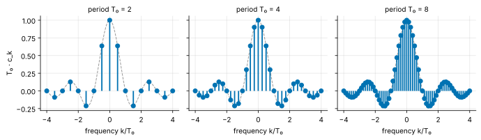
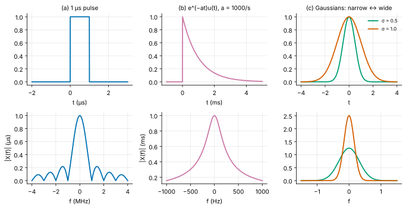
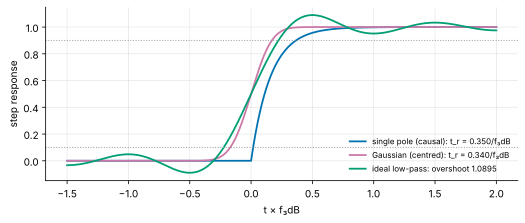
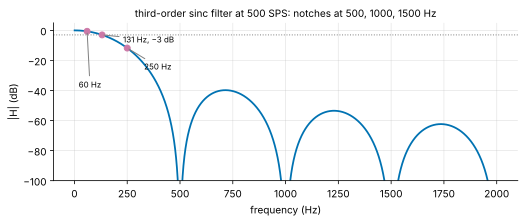

<!-- status: reviewed -->
# 11-06 · The Continuous-Time Fourier Transform

| | |
|---|---|
| **Course** | [11 · Signals and Systems](../README.md) |
| **University equivalent** | The continuous-time Fourier transform in a junior Signals and Systems course: definition as the limit of the Fourier series, transform pairs, properties, the convolution and multiplication theorems, frequency response and filtering, energy spectra and bandwidth (Oppenheim & Willsky, *Signals and Systems*, ch. 4 and 6.1–6.2; Lathi, *Linear Systems and Signals*, ch. 7; MIT 6.003) |
| **Prerequisites** | [11-05 Fourier Series](11-05-fourier-series.md), [11-04 LTI Systems and Differential/Difference Equations](11-04-lti-systems-and-differential-equations.md) (eigenfunctions), [11-03 Convolution](11-03-convolution.md), [11-01 Signals: Classification and Operations](11-01-signals-classification-and-operations.md) (energy, the impulse, time scaling), [03-04 Joint Distributions and the CLT](../../03-probability-statistics-and-random-variables/chapters/03-04-joint-distributions-and-clt.md) (variances of sums) |
| **Estimated study hours** | 12 |
| **Last verified** | 2026-11-20 |

**Learning objectives.** After this chapter you can:

1. Derive the Fourier transform and its inverse as the limit of the Fourier series, and state when the transform exists, including impulses in frequency for periodic signals.
2. Compute and use the standard transform pairs (exponential, rectangular pulse, sinc, impulse, constant, complex exponential, sinusoid, Gaussian, step).
3. Apply the properties (shift, scaling, modulation, differentiation, duality, convolution, multiplication, Parseval) to find transforms and responses with little integration.
4. Describe a filter by its frequency response, explain why ideal filters cannot be built, and relate magnitude and phase (group delay) to distortion.
5. Compute energy spectra and compare bandwidth definitions (−3 dB, null-to-null, fractional energy), and relate rise time to bandwidth, including how rise times combine in cascades.
6. Read and check frequency-domain specifications in data sheets and link standards.

---

## 1. Big picture

The Fourier series of 11-05 describes signals that repeat forever. Most signals that matter, a single data pulse, a radar echo, a heartbeat, a transient on a power rail, do not repeat. Let the period grow without bound and the spectral lines of the series crowd together into a continuous **spectrum** $X(j\omega)$: the **Fourier transform**. It assigns to every frequency a complex amplitude, and it inherits the decisive property of the series: an LTI system multiplies it by the frequency response, $Y(j\omega) = H(j\omega)X(j\omega)$. Convolution in time becomes multiplication in frequency. That single fact is why engineers think about filters, channels, modulation and sampling in the frequency domain, and why "bandwidth" is the first number on so many data sheets.

- **Bandwidth is the frequency extent of a spectrum.** A shorter pulse has a wider spectrum (time scaling), so faster data rates need wider bandwidth: every serial-link standard specifies its channel at a frequency (§9).
- **Filters are specified in frequency.** A filter's data sheet gives its passband, stopband and attenuation: samples of $\lvert H(j\omega)\rvert$. The transform connects them to the impulse response and the step response.
- **Modulation and sampling are multiplications.** Multiplying by a carrier or a sampling pulse train convolves spectra, shifting copies to new frequencies (11-10, 11-11).
- **Rise time and bandwidth are the same thing seen from two sides.** An oscilloscope's bandwidth sets the fastest edge it can show; the product of rise time and bandwidth is about 0.35.
- **Energy is conserved between the domains.** Parseval's relation lets one compute how much of a signal's energy a filter passes without ever solving for the output waveform.

## 2. Intuition first

**From lines to a continuum.** Take a pulse and repeat it every $T_0$ seconds. Its Fourier series has lines every $1/T_0$ hertz, with heights tracing a smooth envelope set by the pulse's shape. Double the period: the lines come twice as close, and each is half as tall (the average over the longer period is halved), but $T_0c_k$ traces the same envelope. In the limit of an isolated pulse, the lines fill the envelope completely: the spectrum of a single pulse is that envelope (Figure 1).

**Short in time, wide in frequency.** Compressing a signal in time by a factor $a$ makes every feature happen $a$ times faster, so every frequency component moves up by $a$: the spectrum stretches by $a$. A narrow pulse has a wide spectrum and a wide pulse a narrow one. This is the uncertainty principle of signal processing, and it is why sending more bits per second needs more bandwidth.

**An analogy from finance: a bond's schedule and its price–yield curve, and where it breaks.** A bond can be described by its schedule, the cash flow due on each date, or by its price as a function of yield, $P(y) = \sum_t CF_t\,e^{-yt}$ with continuous compounding. The second description is a transform of the first: each yield weights the whole schedule at once, and the schedule can be recovered from the whole curve. Questions that are hard in one view are easy in the other: "what is paid when" is read off the schedule, while interest-rate sensitivity (duration, $-P'/P$, and convexity) is natural on the price–yield curve. The Fourier transform does the same for signals: time and frequency are two complete descriptions, and filtering, a convolution in time, is a simple multiplication in frequency. The analogy breaks because the yield kernel $e^{-yt}$ is a real exponential that only shrinks distant flows, while the Fourier kernel $e^{-j\omega t}$ rotates without shrinking: it measures oscillation, not decay. (The yield transform is in fact a Laplace transform, the decaying cousin of 11-08.)

## 3. Theory

> **Conventions.** $X(j\omega) = \int x(t)e^{-j\omega t}dt$ with ω in rad/s; when hertz are more natural, $X(f) = X(j2\pi f)$, and the chapter says which. $\operatorname{sinc}(u) = \sin(\pi u)/(\pi u)$. $\operatorname{rect}(t/T)$ is 1 for $\lvert t\rvert < T/2$ and 0 otherwise. For a signal in volts, $X$ is in V·s (that is, V/Hz). $x \leftrightarrow X$ denotes a transform pair.

### 3.1 From the Fourier series to the transform

Let $x(t)$ be zero outside $\lvert t\rvert < T_1$, and let $\tilde x$ be its periodic extension with period $T_0 > 2T_1$. The series coefficients of $\tilde x$ are

$$
c_k = \frac{1}{T_0}\int_{-T_0/2}^{T_0/2}x(t)\,e^{-jk\omega_0t}\,dt = \frac{1}{T_0}X(jk\omega_0), \qquad X(j\omega) = \int_{-\infty}^{\infty}x(t)\,e^{-j\omega t}\,dt ,
$$

since $x$ is zero outside one period. So the coefficients are **samples of one function** $X(j\omega)$ at the harmonic frequencies, scaled by $1/T_0$. The synthesis formula becomes, with $\omega_0 = 2\pi/T_0$,

$$
\tilde x(t) = \sum_k\frac{1}{T_0}X(jk\omega_0)\,e^{jk\omega_0t} = \frac{1}{2\pi}\sum_kX(jk\omega_0)\,e^{jk\omega_0t}\,\omega_0 .
$$

As $T_0 \to \infty$, $\tilde x \to x$, the spacing $\omega_0$ becomes $d\omega$, and the sum becomes an integral (a Riemann sum, as in 11-03's staircase). This gives the transform pair:

$$
X(j\omega) = \int_{-\infty}^{\infty}x(t)\,e^{-j\omega t}\,dt, \qquad x(t) = \frac{1}{2\pi}\int_{-\infty}^{\infty}X(j\omega)\,e^{j\omega t}\,d\omega .
$$

In hertz the $2\pi$ disappears: $X(f) = \int x\,e^{-j2\pi ft}dt$ and $x = \int X(f)\,e^{j2\pi ft}df$. The **analysis** formula measures how much of each frequency the signal contains; the **synthesis** formula rebuilds the signal from a continuum of complex exponentials, each an eigenfunction of every LTI system (11-04).

*Figure 1. A unit pulse of width 1 repeated with period $T_0$ = 2, 4 and 8. The scaled coefficients $T_0c_k$ sit on the same envelope, $\operatorname{sinc}(f)$, at spacing $1/T_0$; as the period grows they fill it in. The envelope is the transform of the single pulse.*

**Existence.** If $x$ is absolutely integrable, $\int\lvert x\rvert\,dt < \infty$, then $X$ exists, is continuous and bounded by that integral. If $x$ has finite energy, $X$ exists in the mean-square sense (Parseval, §3.5). Signals with neither, such as constants, sinusoids, steps and periodic signals, have transforms containing **impulses in frequency**, which §3.2 derives. Those impulses are the same bookkeeping device as $\delta(t)$ (11-01): they let one formula cover both energy signals and power signals.

### 3.2 Transform pairs

Each pair below is derived, not just listed; Figure 2 shows three of them.

**Decaying exponential.** For $a > 0$,

$$
e^{-at}u(t) \;\leftrightarrow\; \int_0^\infty e^{-(a + j\omega)t}\,dt = \frac{1}{a + j\omega} .
$$

The magnitude $1/\sqrt{a^2 + \omega^2}$ is largest at DC, where it equals the signal's area $1/a$, and halves its power at $\omega = a$, where the phase is −45° (Example 11-06.1). This is the frequency response of the RC low-pass with $a = 1/\tau$, scaled by $\tau$.

**Rectangular pulse.** For a pulse of height 1 and width $T$ centered at 0,

$$
\operatorname{rect}(t/T) \;\leftrightarrow\; \int_{-T/2}^{T/2}e^{-j\omega t}\,dt = \frac{2\sin(\omega T/2)}{\omega} = T\operatorname{sinc}(fT) .
$$

Its value at DC is the area $T$; it first reaches zero at $f = 1/T$; its sidelobes decay as $1/f$, because the pulse jumps (11-05's smoothness rule, now continuous in frequency).

**Impulse and constant.** By sifting, $\delta(t) \leftrightarrow 1$: an impulse contains all frequencies equally. A constant has all its "energy" at DC. Using the synthesis formula on $2\pi\delta(\omega)$ gives $\frac{1}{2\pi}\int2\pi\delta(\omega)e^{j\omega t}d\omega = 1$, so

$$
1 \;\leftrightarrow\; 2\pi\,\delta(\omega), \qquad e^{j\omega_0t} \;\leftrightarrow\; 2\pi\,\delta(\omega - \omega_0), \qquad \cos\omega_0t \;\leftrightarrow\; \pi\big[\delta(\omega - \omega_0) + \delta(\omega + \omega_0)\big] .
$$

(In hertz: $1 \leftrightarrow \delta(f)$ and $\cos2\pi f_0t \leftrightarrow \tfrac12[\delta(f - f_0) + \delta(f + f_0)]$.) A periodic signal is a sum of complex exponentials, so its transform is a train of impulses at the harmonics, with weights $2\pi c_k$: the Fourier series is a special case of the transform.

**Sinc (by duality).** Exchanging the roles of $t$ and ω in the synthesis and analysis formulas gives the **duality** property: if $x(t) \leftrightarrow X(j\omega)$, then $X(jt) \leftrightarrow 2\pi x(-\omega)$. Applied to the pulse, a sinc in time has a rectangular spectrum:

$$
\frac{\sin Wt}{\pi t} \;\leftrightarrow\; \operatorname{rect}\!\left(\frac{\omega}{2W}\right) ,
$$

which is 1 for $\lvert\omega\rvert < W$ and 0 outside. This is the **ideal low-pass filter's** impulse response (§3.4).

**Gaussian.** For $x(t) = e^{-t^2/(2\sigma^2)}$, note that $\dot x = -(t/\sigma^2)x$. Transform both sides. Differentiation in time gives $\dot x \leftrightarrow j\omega X$; differentiation in frequency (§3.3) gives $t\,x(t) \leftrightarrow j\,dX/d\omega$. So $j\omega X = -\frac{1}{\sigma^2}\,j\frac{dX}{d\omega}$, and cancelling $j$, $dX/d\omega = -\sigma^2\omega X$. That first-order ODE (02-02) has the solution $X(0)e^{-\sigma^2\omega^2/2}$: again a Gaussian. Fixing the constant by $X(0) = \int x\,dt = \sigma\sqrt{2\pi}$,

$$
e^{-t^2/(2\sigma^2)} \;\leftrightarrow\; \sigma\sqrt{2\pi}\,e^{-\sigma^2\omega^2/2} .
$$

A Gaussian of width σ in time has width $1/\sigma$ in angular frequency (Figure 2c): it keeps its Gaussian form under the transform, and it achieves the smallest possible product of the two widths (§3.6). (It is not the only self-transforming shape: the Hermite–Gaussian functions, a Gaussian times a polynomial, also transform into scaled copies of themselves.)

**Step.** $u(t)$ is neither integrable nor of finite energy. Writing $u = \tfrac12 + \tfrac12\operatorname{sgn}(t)$ and using $\operatorname{sgn}(t) \leftrightarrow 2/(j\omega)$, which follows as a limit: $e^{-a\lvert t\rvert}\operatorname{sgn}t = e^{-at}u(t) - e^{at}u(-t)$ transforms to $\frac{1}{a + j\omega} - \frac{1}{a - j\omega} = \frac{-2j\omega}{a^2 + \omega^2}$, which tends to $-2j/\omega = 2/(j\omega)$ as $a \to 0$ for every $\omega \ne 0$,

$$
u(t) \;\leftrightarrow\; \pi\,\delta(\omega) + \frac{1}{j\omega} .
$$

*Figure 2. Transform pairs. (a) A 1 µs pulse and $\lvert X(f)\rvert = T\lvert\operatorname{sinc}(fT)\rvert$, with nulls every 1 MHz (Example 11-06.2). (b) $e^{-at}u(t)$ with $a$ = 1000 s⁻¹ and $\lvert X(f)\rvert = 1/\sqrt{a^2 + (2\pi f)^2}$ (Example 11-06.1). (c) Gaussians: the narrower one in time is the wider one in frequency.*

### 3.3 Properties

Each property follows from the definition by a substitution; the table states them, and the most important are derived below it.

| Property | Signal | Transform | Meaning |
|---|---|---|---|
| Linearity | $\alpha x + \beta y$ | $\alpha X + \beta Y$ | |
| Time shift | $x(t - t_0)$ | $e^{-j\omega t_0}X(j\omega)$ | Delay changes phase linearly, not magnitude |
| Frequency shift (modulation) | $e^{j\omega_0t}x(t)$ | $X(j(\omega - \omega_0))$ | Multiplying by a carrier moves the spectrum |
| Time scaling | $x(at)$ | $\frac{1}{\lvert a\rvert}X(j\omega/a)$ | Compress in time, stretch in frequency |
| Conjugate symmetry | $x$ real | $X(-j\omega) = X^*(j\omega)$ | Magnitude even, phase odd |
| Differentiation | $dx/dt$ | $j\omega X(j\omega)$ | High frequencies amplified |
| Integration | $\int_{-\infty}^tx\,d\tau$ | $\frac{X(j\omega)}{j\omega} + \pi X(0)\delta(\omega)$ | High frequencies attenuated |
| Frequency differentiation | $-jt\,x(t)$ | $dX/d\omega$ | |
| Duality | $X(jt)$ | $2\pi x(-\omega)$ | Every pair has a mirror pair |
| Convolution | $x * h$ | $X(j\omega)H(j\omega)$ | Filtering is multiplication |
| Multiplication | $x(t)\,p(t)$ | $\frac{1}{2\pi}X * P$ | Modulation and sampling convolve spectra |
| Parseval | $\int\lvert x\rvert^2dt$ | $\frac{1}{2\pi}\int\lvert X\rvert^2d\omega$ | Energy is the same in both domains |

**Time scaling.** For $a > 0$, substitute $u = at$: $\int x(at)e^{-j\omega t}dt = \frac1a\int x(u)e^{-j(\omega/a)u}du = \frac1aX(j\omega/a)$. For $a < 0$ the limits swap, giving $1/\lvert a\rvert$. Compressing by $a$ stretches the spectrum by $a$ and lowers it by $a$, keeping the area of $X$ (which is $2\pi x(0)$) unchanged.

**Convolution theorem.** With $y = x * h$,

$$
Y(j\omega) = \int\!\!\int x(\tau)\,h(t - \tau)\,e^{-j\omega t}\,d\tau\,dt = \int x(\tau)e^{-j\omega\tau}\left[\int h(u)e^{-j\omega u}\,du\right]d\tau = H(j\omega)\,X(j\omega) ,
$$

substituting $u = t - \tau$ in the inner integral (and exchanging the order, which absolute integrability allows; 11-03's refresher). This is the eigenfunction property of 11-04 applied to every frequency at once: each component $X(j\omega)e^{j\omega t}$ is multiplied by $H(j\omega)$. The **frequency response** of an LTI system is therefore the Fourier transform of its impulse response.

**Multiplication.** By duality, multiplying two signals convolves their spectra (with a $1/2\pi$ in the ω form): $x(t)p(t) \leftrightarrow \frac{1}{2\pi}X * P$. Multiplying by $\cos\omega_ct$, whose spectrum is two impulses, convolves $X$ with them and places half-height copies of $X$ at $\pm\omega_c$: amplitude modulation (Example 11-06.3, 11-11).

> **Math refresher — convolving with an impulse in frequency.** Exactly as $x(t) * \delta(t - t_0) = x(t - t_0)$ in time (11-03), $X(j\omega) * \delta(\omega - \omega_0) = X(j(\omega - \omega_0))$ in frequency: convolving with a shifted impulse shifts. So the multiplication property with $p = \cos\omega_ct$ gives $\frac{1}{2\pi}X * \pi[\delta(\omega - \omega_c) + \delta(\omega + \omega_c)] = \tfrac12X(j(\omega - \omega_c)) + \tfrac12X(j(\omega + \omega_c))$.

### 3.4 Frequency response and filtering

**Magnitude and phase.** Write $H(j\omega) = \lvert H(j\omega)\rvert e^{j\angle H(j\omega)}$. A real system has an even magnitude and an odd phase, so only $\omega \ge 0$ needs plotting (the Bode plots of 07-07). A sinusoid at ω comes out scaled by $\lvert H\rvert$ and shifted by $\angle H$ (11-04).

**Distortionless transmission.** A system leaves a signal's shape unchanged, apart from a gain $K$ and a delay $t_0$, if $y(t) = Kx(t - t_0)$, that is

$$
H(j\omega) = Ke^{-j\omega t_0} :
$$

constant magnitude and **linear phase**. The slope of the phase measures delay. The **group delay** $\tau_g(\omega) = -\frac{d\angle H}{d\omega}$ is the delay experienced by a narrow band of frequencies around ω, that is, by the envelope of a signal concentrated there. *Derivation.* Let $x(t) = a(t)\cos\omega_ct$, where the envelope $a(t)$ has spectrum confined to $\lvert\omega\rvert < B$ with $B \ll \omega_c$. Over the narrow band $\omega_c \pm B$, take $\lvert H\rvert \approx \lvert H(j\omega_c)\rvert$ and expand the phase to first order, $\angle H(j\omega) \approx \phi_c - \tau_g(\omega - \omega_c)$, with $\phi_c = \angle H(j\omega_c)$. The positive-frequency half of $x$, $\tfrac12a(t)e^{j\omega_ct}$, has spectrum $\tfrac12A(j(\omega - \omega_c))$, so the output's positive-frequency half is $\tfrac12\lvert H\rvert e^{j\phi_c}\cdot\frac{1}{2\pi}\int A(j\nu)e^{-j\tau_g\nu}e^{j(\omega_c + \nu)t}d\nu = \tfrac12\lvert H\rvert e^{j(\omega_ct + \phi_c)}a(t - \tau_g)$, using the shift property. Adding the conjugate half,

$$
y(t) \approx \lvert H(j\omega_c)\rvert\,a(t - \tau_g)\cos\big(\omega_c(t - \tau_p)\big), \qquad \tau_p = -\frac{\phi_c}{\omega_c} :
$$

the envelope is delayed by the group delay, the carrier by the **phase delay** $\tau_p$. They are equal only for linear phase. If τ_g varies with frequency, different parts of the spectrum arrive at different times and pulses spread: **dispersion**, a central impairment of long cables and fibers.

**Ideal filters.** The ideal low-pass filter passes $\lvert\omega\rvert < W$ unchanged and removes the rest: $H = \operatorname{rect}(\omega/2W)$, with impulse response $h(t) = \sin(Wt)/(\pi t)$ (duality, §3.2). It cannot be built, for three reasons that the theory of earlier chapters makes precise:

- $h$ is nonzero for $t < 0$: the filter is **noncausal** (11-04).
- $h$ decays only as $1/t$, so $\int\lvert h\rvert$ diverges: it is **not BIBO-stable** (11-03).
- Its step response, $\tfrac12 + \frac1\pi\operatorname{Si}(Wt)$, overshoots to **1.0895**, the Gibbs overshoot of 11-05 (Figure 3): a perfectly sharp band edge rings.

Real filters trade sharpness of the band edge against ringing, delay and complexity (Course 16, 07-08).

### 3.5 Energy and Parseval's relation

**Parseval's relation** (also called Plancherel's theorem) says the energy is the same in both domains:

$$
E_x = \int_{-\infty}^{\infty}\lvert x(t)\rvert^2\,dt = \frac{1}{2\pi}\int_{-\infty}^{\infty}\lvert X(j\omega)\rvert^2\,d\omega = \int_{-\infty}^{\infty}\lvert X(f)\rvert^2\,df .
$$

*Derivation.* $\int\lvert x\rvert^2dt = \int x^*(t)\left[\frac{1}{2\pi}\int X(j\omega)e^{j\omega t}d\omega\right]dt = \frac{1}{2\pi}\int X(j\omega)\left[\int x(t)e^{-j\omega t}dt\right]^*d\omega = \frac{1}{2\pi}\int\lvert X\rvert^2d\omega$.

The function $\lvert X(f)\rvert^2$ is the **energy spectral density** (ESD): energy per hertz, in V²·s/Hz for a voltage normalized to 1 Ω (11-01). Combined with the convolution theorem, the energy a filter passes is $\int\lvert H(f)\rvert^2\lvert X(f)\rvert^2df$, computable without finding the output waveform (Example 11-06.5).

### 3.6 Bandwidth, time–bandwidth and rise time

**Definitions of bandwidth.** "Bandwidth" means different things, and data sheets and standards choose differently:

- **−3 dB (half-power) bandwidth:** where $\lvert H\rvert$ falls to $1/\sqrt2$ of its peak. Natural for filters and amplifiers.
- **Null-to-null (or first-null) bandwidth:** to the first zero of the spectrum; for a pulse of width $T$, $1/T$.
- **Fractional-energy bandwidth:** the band containing a stated fraction (for example 99%) of the energy. Natural for occupied-spectrum rules.
- **Nyquist frequency of a data stream:** half the symbol rate, the fundamental frequency of the fastest pattern, one that alternates every symbol (11-01's PAM4 discussion).

These can differ enormously for the same signal: a decaying exponential's 99%-energy bandwidth is 64 times its −3 dB bandwidth, because its spectrum falls only as $1/\omega$ (Example 11-06.6).

**The time–bandwidth trade.** Time scaling makes the product of a signal's duration and its bandwidth independent of its scale: it depends only on its shape. For the RMS widths $\sigma_t^2 = \int t^2\lvert x\rvert^2dt/E$ and $\sigma_\omega^2 = \int\omega^2\lvert X\rvert^2d\omega/(2\pi E)$ (for a signal centered at $t = 0$ and $\omega = 0$),

$$
\sigma_t\,\sigma_\omega \ge \tfrac12 ,
$$

with equality only for the Gaussian.

> **Going deeper — the uncertainty principle.** The proof applies the Cauchy–Schwarz inequality to $\int t\,x\cdot\dot x\,dt$. Integration by parts gives $\int t\,x\,\dot x\,dt = -\tfrac12E$ for a real signal that decays fast enough, and Cauchy–Schwarz bounds its square by $\int t^2x^2dt\int\dot x^2dt = \sigma_t^2E \cdot \sigma_\omega^2E$, using Parseval and the differentiation property for the second factor. So $\tfrac14E^2 \le \sigma_t^2\sigma_\omega^2E^2$. Equality in Cauchy–Schwarz requires $\dot x \propto t\,x$, whose solution is the Gaussian. The same mathematics is Heisenberg's uncertainty relation in quantum mechanics (04-10), where position and momentum are a Fourier pair.

**Rise time and bandwidth.** For a single-pole system with −3 dB frequency $f_{3dB}$, the step response is $1 - e^{-t/\tau}$ with $\tau = 1/(2\pi f_{3dB})$, and its 10–90% rise time is $\tau\ln9$:

$$
t_r = \frac{\ln9}{2\pi f_{3dB}} \approx \frac{0.350}{f_{3dB}} .
$$

A system with a Gaussian impulse response of standard deviation σ, $h(t) = e^{-t^2/(2\sigma^2)}/(\sigma\sqrt{2\pi})$, has as its step response the Gaussian distribution function $\Phi(t/\sigma)$ (03-02), which crosses 10% and 90% at $\mp1.2816\sigma$: $t_r = 2.563\sigma$. Its transform is $\lvert H(f)\rvert = e^{-(2\pi f\sigma)^2/2}$ (§3.2), which falls to $1/\sqrt2$ when $(2\pi f\sigma)^2/2 = \tfrac12\ln2$, so $f_{3dB} = \sqrt{\ln2}/(2\pi\sigma) = 0.1325/\sigma$. The product is 0.340. Because the two very different shapes give nearly the same product, **$t_r \approx 0.35/\text{bandwidth}$** is a dependable rule (Figure 3, Example 11-06.7).

**Cascades: rise times add in quadrature.** When systems with nonnegative, unit-area impulse responses are cascaded, the impulse responses convolve, and the **variances of the impulse responses add**: the same arithmetic as for a sum of independent random variables (03-04), because a nonnegative unit-area function is a probability density and convolution is the density of a sum. For Gaussian-like responses, rise time is proportional to the standard deviation, so

$$
t_{r,\text{total}} \approx \sqrt{t_{r,1}^2 + t_{r,2}^2 + \cdots} .
$$

This is why an oscilloscope must be several times faster than the edge it measures (Example 11-06.7).

*Figure 3. Normalized step responses for the same −3 dB bandwidth: a causal single-pole system ($t_r = 0.350/f_{3dB}$), a Gaussian system drawn centered at its midpoint ($t_r = 0.340/f_{3dB}$), and an ideal low-pass filter (cutoff equal to the bandwidth), which rings and overshoots to 1.0895 and starts responding before $t = 0$.*

## 4. Worked examples

### Example 11-06.1 · A decaying exponential (tier A)

**Setup.** $x(t) = e^{-at}u(t)$ V with $a$ = 1000 s⁻¹. (a) Find $\lvert X\rvert$ at $\omega = 0$ and at $\omega = a$, and the phase at $\omega = a$. (b) Find the signal's energy in the time domain, and check it with Parseval.

**Solution.** (a) $X = 1/(a + j\omega)$: $\lvert X(0)\rvert = 1/a$ = **1** ms (V·s ×10⁻³); $\lvert X(ja)\rvert = 1/(a\sqrt2)$ = **0.7071** ms; phase $-\arctan1$ = **−45**°.

(b) $E = \int_0^\infty e^{-2at}dt = 1/(2a)$ = **0.5** V²·ms. Parseval: $\frac{1}{2\pi}\int\frac{d\omega}{a^2 + \omega^2} = \frac{1}{2\pi}\cdot\frac{\pi}{a} = \frac{1}{2a}$, the same.

**Units check.** $X$ is V·s; $\lvert X\rvert^2d\omega$ is V²·s²·s⁻¹ = V²·s.

**Sanity check.** $X(0)$ is the signal's area, as it must be: $\int x\,dt = 1/a$.

### Example 11-06.2 · A rectangular pulse (tier A)

**Setup.** A 1 V pulse lasts $T$ = 1 µs. (a) Find $X(f)$, its value at DC and at 0.5 MHz, and its first null. (b) What fraction of the energy lies within the first null, $\lvert f\rvert < 1/T$? Within $\lvert f\rvert < 1/(2T)$?

**Solution.** (a) $X(f) = T\operatorname{sinc}(fT)$ (times $e^{-j\pi fT}$ if the pulse starts at $t = 0$, which does not change the magnitude): $X(0) = T$ = 1 µs (V·s ×10⁻⁶); at 0.5 MHz, $T\operatorname{sinc}(0.5) = 2T/\pi$ = **0.6366** µs; first null at $1/T$ = **1** MHz.

(b) $E = T$ (V²·s), and the fraction within $\lvert f\rvert < 1/T$ is $\int_{-1}^{1}\operatorname{sinc}^2u\,du$ = **90.28**%. Within $\lvert f\rvert < 1/(2T)$ it is **77.37**%.

**Sanity check.** Ten percent of a rectangular pulse's energy lies beyond its first null: the jumps at its edges spread energy far out in frequency, the $1/f$ sidelobes of Figure 2a.

### Example 11-06.3 · Shifting, scaling and modulating (tier B)

**Setup.** Start from $p(t) = \operatorname{rect}(t/T)$ with $T$ = 1 µs. (a) Find the transform of $p(t - 2\ \mu\text{s})$. (b) Find the transform of $p(2t)$, its first null and its energy relative to $p$. (c) Find the spectrum of $p(t)\cos(2\pi f_ct)$ with $f_c$ = 10 MHz, and its value at $f_c$.

**Solution.** (a) Time shift: $T\operatorname{sinc}(fT)\,e^{-j2\pi f(2\ \mu\text{s})}$; the magnitude is unchanged and the phase falls by 2π every 0.5 MHz.

(b) Time scaling with $a = 2$: $\frac12T\operatorname{sinc}(fT/2)$, a pulse half as long, with its first null at $2/T$ = **2** MHz and half the energy (**0.5** times), since the energy of $x(at)$ is $E/\lvert a\rvert$ (11-01).

(c) Modulation: $\tfrac12T\operatorname{sinc}((f - f_c)T) + \tfrac12T\operatorname{sinc}((f + f_c)T)$, two half-height copies centered at ±10 MHz. At $f = f_c$ the first copy gives $T/2$ = **0.5** µs and the second, 20 MHz away, contributes $\tfrac12T\operatorname{sinc}(20) = 0$.

**Sanity check.** The modulated pulse occupies 9 to 11 MHz between first nulls: twice the baseband pulse's one-sided bandwidth, the familiar doubling of double-sideband modulation (11-11).

### Example 11-06.4 · Why an ADC's bandwidth is 0.262 times its data rate (tier B)

**Setup.** The ADS1292R's third-order sinc filter (11-03, Example 11-03.6) is a cascade of three boxcar averages, each one output period $T_{DR} = 1/f_{DR}$ long. Its data sheet gives a −3 dB bandwidth of $0.262f_{DR}$ [1]. (a) Using the transform of a boxcar, find the filter's magnitude response. (b) Find the −3 dB frequency as a multiple of $f_{DR}$, and at 500 SPS. (c) Find the attenuation at 60 Hz and 250 Hz, and the frequencies of the notches.

**Solution.** (a) A boxcar average over $T_{DR}$ has impulse response $\frac{1}{T_{DR}}\operatorname{rect}$ of width $T_{DR}$, with transform $\operatorname{sinc}(fT_{DR})$ (times a delay phase). Three in cascade multiply: $\lvert H(f)\rvert = \lvert\operatorname{sinc}(f/f_{DR})\rvert^3$. (The digital filter's exact response, $\lvert\sin(\pi fN/f_{MOD})/(N\sin(\pi f/f_{MOD}))\rvert^3$, approaches this when the decimation ratio $N$ is large, here 256.)

(b) Solving $\operatorname{sinc}^3(u) = 1/\sqrt2$ gives $u$ = **0.2619**: the −3 dB frequency is $0.262f_{DR}$, matching the data sheet [1], and at 500 SPS it is **131.0** Hz.

(c) At 60 Hz, $u = 0.12$: $20\log_{10}\operatorname{sinc}^3(0.12)$ = **−0.62** dB. At 250 Hz, $u = 0.5$: $(2/\pi)^3$, or **−11.77** dB. Notches at every multiple of $f_{DR}$: 500, 1000, 1500 Hz (Figure 4).

**Sanity check.** A data-sheet number that looked arbitrary is the cube of a boxcar's transform: the support rule of 11-03 gave the filter's latency, and the convolution theorem gives its bandwidth.

*Figure 4. The ADS1292R's sinc³ filter at 500 SPS (Example 11-06.4): −3 dB at 131 Hz, −0.62 dB at 60 Hz, −11.8 dB at 250 Hz, and notches at 500, 1000 and 1500 Hz.*

### Example 11-06.5 · Filtering seen through Parseval (tier B)

**Setup.** The 5 V, 2 ms pulse of Example 11-03.4 passes through the RC low-pass with τ = 1 ms. (a) Find the input energy. (b) Find the output energy by integrating $\lvert X(f)\rvert^2\lvert H(f)\rvert^2$, and check it against the time-domain output of Example 11-03.4. (c) What fraction of the energy passes?

**Solution.** (a) $E_x = 5^2 \times 2$ ms = **50** V²·ms.

(b) $X(f) = (5\ \text{V})(2\ \text{ms})\operatorname{sinc}(f \cdot 2\ \text{ms})$ in magnitude and $\lvert H(f)\rvert^2 = 1/(1 + (2\pi f\tau)^2)$. Integrating numerically over frequency gives $E_y$ = **28.38** V²·ms, the same as integrating the square of 11-03's piecewise output in time.

(c) $28.38/50$ = **56.77**%. The filter removes energy at high frequencies, where the pulse's edges put it, and rounds the pulse (11-03, Figure 4a).

**Sanity check.** A very slow filter would pass almost no energy (it barely charges); a very fast one would pass nearly all. With τ equal to half the pulse length, about half passing is plausible.

### Example 11-06.6 · Three bandwidths of one signal (tier B)

**Setup.** For $x = e^{-at}u(t)$: (a) find the −3 dB bandwidth of $\lvert X\rvert$; (b) find the bandwidth $W$ containing 99% of the energy; (c) compare with a Gaussian spectrum.

**Solution.** (a) $\lvert X\rvert^2 = 1/(a^2 + \omega^2)$ halves at $\omega = a$: the −3 dB bandwidth is $a$ rad/s.

(b) The fraction of energy within $\lvert\omega\rvert < W$ is $\frac{2}{\pi}\arctan(W/a)$. Setting it to 0.99: $W = a\tan(0.495\pi)$ = **63.66** $a$.

(c) For a Gaussian, $\lvert X\rvert^2 \propto e^{-\sigma^2\omega^2}$ halves at $\sigma\omega = \sqrt{\ln2}$, and 99% of the energy lies within $\sigma\omega = \operatorname{erf}^{-1}(0.99)$, a ratio of only **2.19**. A spectrum falling as $1/\omega$ (from the jump at $t = 0$) holds its energy in a long tail; a Gaussian, smooth everywhere, has a spectrum that falls faster than any power. "Bandwidth" without a definition is not a number.

**Sanity check.** For $W \gg a$ the energy fraction left outside is about $\frac{2}{\pi}\cdot\frac{a}{W}$, which is 1% at $W \approx 64a$. A signal with a jump is broadband.

### Example 11-06.7 · Rise time, bandwidth and measurement (tier B)

**Setup.** (a) A single-pole amplifier has $f_{3dB}$ = 100 MHz. Find its 10–90% rise time. (b) Find the rise-time–bandwidth product for a single pole and for a Gaussian response. (c) An oscilloscope with a 350 ps rise time displays an edge whose true rise time is 1 ns. Estimate the displayed rise time and the error.

**Solution.** (a) $t_r = \ln9/(2\pi \times 100\ \text{MHz})$ = **3.497** ns.

(b) Single pole: $\ln9/2\pi$ = **0.3497**. Gaussian: $2.563 \times 0.1325$ = **0.3396**.

(c) Quadrature: $\sqrt{1^2 + 0.35^2}$ = **1.059** ns, an error of about 6%. To keep the error below about 2%, the scope must be about five times faster than the edge.

**Sanity check.** The quadrature rule is exact for Gaussian responses (variances add under convolution) and close for the near-Gaussian responses of oscilloscopes; for a single pole it is an approximation.

### Example 11-06.8 · How much of a data pulse's energy lies below Nyquist (tier C)

**Setup.** A link sends rectangular (NRZ) symbols at 32 GBd. (a) Find the Nyquist frequency and the pulse's first null. (b) What fraction of a single symbol's energy lies below Nyquist? Below the first null? (c) PCIe 6.0 sends 64 GT/s as PAM4 at the same symbol rate [2]. How does its spectrum compare?

**Solution.** (a) $T$ = 31.25 ps, so the Nyquist frequency is $1/(2T)$ = **16** GHz and the first null is $1/T$ = **32** GHz.

(b) From Example 11-06.2, **77.37**% below Nyquist and **90.28**% below the first null.

(c) PAM4 at 32 GBd uses the same pulse duration, so each symbol has the same spectral shape; only the amplitudes change (four levels instead of two). The bandwidth the channel must support is set by the symbol rate, which is why PCIe 6.0 doubled the bit rate while keeping PCIe 5.0's 16 GHz Nyquist frequency [2].

**Sanity check.** Real transmitters shape their pulses (finite edge rates, equalization), so the actual spectrum falls faster than the rectangular pulse's $1/f$, but the Nyquist frequency remains the reference point at which channels are specified (§9).

### Answer key

<!-- answer-key -->
| ID | Quantity | Value | Unit |
|---|---|---|---|
| T 11-06.a | ideal low-pass step overshoot | 1.0895 | — |
| T 11-06.b | Gaussian t_r / σ | 2.563 | — |
| T 11-06.c | Gaussian f_3dB · σ | 0.1325 | — |
| T 11-06.d | PCIe 6.0 channel-loss amplitude factor at 32 dB | 0.0251 | — |
| T 11-06.e | 802.3ck Nyquist frequency | 26.56 | GHz |
| T 11-06.f | displayed edge, 1 GHz scope, 500 ps edge | 610 | ps |
| T 11-06.g | its error | 22 | % |
| T 11-06.h | equalizer gain needed at 32 dB | 40 | — |
| T 11-06.i | two 1 ns single-pole stages: quadrature estimate | 1.41 | ns |
| T 11-06.j | two 1 ns single-pole stages: exact | 1.53 | ns |
| T 11-06.k | excess over the estimate | 8 | % |
| T 11-06.l | limiting underestimate for many single-pole stages | 17 | % |
| Ex 11-06.1a | magnitude at DC | 1 | ms |
| Ex 11-06.1b | magnitude at ω = a | 0.7071 | ms |
| Ex 11-06.1c | phase at ω = a | −45 | ° |
| Ex 11-06.1d | energy | 0.5 | V²·ms |
| Ex 11-06.2a | X at 0.5 MHz | 0.6366 | µs |
| Ex 11-06.2b | first null | 1 | MHz |
| Ex 11-06.2c | energy within the first null | 90.28 | % |
| Ex 11-06.2d | energy within half the first null | 77.37 | % |
| Ex 11-06.3a | first null of p(2t) | 2 | MHz |
| Ex 11-06.3b | energy ratio of p(2t) | 0.5 | — |
| Ex 11-06.3c | modulated spectrum at f_c | 0.5 | µs |
| Ex 11-06.4a | −3 dB point / f_DR | 0.2619 | — |
| Ex 11-06.4b | −3 dB point at 500 SPS | 131.0 | Hz |
| Ex 11-06.4c | gain at 60 Hz | −0.62 | dB |
| Ex 11-06.4d | gain at 250 Hz | −11.77 | dB |
| Ex 11-06.5a | input energy | 50 | V²·ms |
| Ex 11-06.5b | output energy | 28.38 | V²·ms |
| Ex 11-06.5c | fraction passed | 56.77 | % |
| Ex 11-06.6a | 99% energy bandwidth / a | 63.66 | — |
| Ex 11-06.6b | Gaussian 99% / −3 dB bandwidth ratio | 2.19 | — |
| Ex 11-06.7a | single-pole rise time at 100 MHz | 3.497 | ns |
| Ex 11-06.7b | single-pole product | 0.3497 | — |
| Ex 11-06.7c | Gaussian product | 0.3396 | — |
| Ex 11-06.7d | displayed rise time | 1.059 | ns |
| Ex 11-06.8a | Nyquist frequency | 16 | GHz |
| Ex 11-06.8b | first null | 32 | GHz |
| Ex 11-06.8c | energy below Nyquist | 77.37 | % |
| Ex 11-06.8d | energy below the first null | 90.28 | % |

*Every value is recomputed by [verify_11_06.py](../verify/verify_11_06.py) by numerical evaluation of the transform integrals (scipy quad, on a grid of frequencies), by FFTs of finely sampled signals, by root finding on the computed magnitudes, by integrating step responses for rise times and by numerical convolution for the cascade rule. Data-sheet and standards values ([R-141](../../../reference/research-log.md#r-141--serdes-channel-loss-budgets), [R-184](../../../reference/research-log.md#r-184--signal-acquisition-data-sheets), [R-185](../../../reference/research-log.md#r-185--system-property-specifications-in-data-sheets)) are quoted.*

## 5. Simulate it

The lab, [labs/11-06-lab](../labs/11-06-lab/README.md), is a notebook in four parts:

1. Approximates the transform integral with an FFT of a finely sampled signal, and compares it with the exact transforms of the exponential, the pulse and the Gaussian, including the scaling between FFT bins and $X(f)$.
2. Verifies the convolution theorem numerically: the FFT of $x * h$ against the product of the FFTs.
3. Builds the sinc³ filter's response and finds its −3 dB point (Example 11-06.4).
4. Cascades step responses and checks the quadrature rule for rise times, for Gaussian and single-pole stages.

**Guided exercise (predict, then run).** **Before running Part 4**, predict: two identical single-pole stages, each with a 1 ns rise time, are cascaded (isolated by a buffer). Does the quadrature rule's **1.41** ns hold? Then run it. (The exact result for two identical poles is **1.53** ns, about **8**% more: the quadrature rule assumes every stage has the same ratio of rise time to standard deviation, and a single pole's (2.197) differs from a Gaussian's (2.563). As stages are added, the cascade's shape approaches a Gaussian by the central limit theorem of 03-04, so its rise time tends to 2.563 standard deviations while the rule keeps using 2.197: the rule's underestimate grows toward $2.563/2.197 - 1$ = **17**%. Built from Gaussian stages, the rule is exact.)

## 6. Engineering tradeoffs

| Knob | Improves | Costs | Typical decision owner |
|---|---|---|---|
| Pulse duration (symbol time) | Shorter: higher data rate | Proportionally wider bandwidth; more channel loss at Nyquist | Link architect |
| Edge rate of a digital signal | Faster edges: timing margin | Wider spectrum: emissions, crosstalk, reflections | Board designer |
| Filter sharpness | Steeper band edges, better rejection | Ringing (Gibbs), longer group delay, more complexity | Filter designer |
| Linear-phase design | No dispersion: pulses keep their shape | More delay and arithmetic (FIR) or analog complexity | DSP or analog designer |
| Instrument bandwidth | Faithful edges (rise time ≈ 0.35/BW) | Cost; more noise bandwidth | Test engineer |
| Bandwidth definition in a spec | Clarity of what is promised | A loose definition can hide a long spectral tail | Whoever writes the spec |

## 7. Numbers to know

| Quantity | Value | Note |
|---|---|---|
| $e^{-at}u(t)$ | $1/(a + j\omega)$; −3 dB at ω = a | 99% of energy within 63.7a |
| Rectangular pulse, width $T$ | $T\operatorname{sinc}(fT)$; first null $1/T$ | 90.3% of energy inside the first null; 77.4% inside $1/(2T)$ |
| Gaussian, width σ | $\sigma\sqrt{2\pi}e^{-\sigma^2\omega^2/2}$ | Minimum time–bandwidth product |
| Ideal low-pass step response | Overshoot 1.0895 | Gibbs |
| Rise time and bandwidth | $t_r \approx 0.35/f_{3dB}$ | 0.350 single pole, 0.340 Gaussian |
| Cascade rise time | $\sqrt{\sum t_{r,i}^2}$ | Exact for Gaussians |
| PCIe 5.0/6.0 Nyquist | 16 GHz; 6.0 channel loss < 32 dB there | As of Nov 2026 [2, 3] |
| ADS1292R bandwidth | $0.262f_{DR}$ = 131 Hz at 500 SPS | From sinc³ [1] |

## 8. Common mistakes

- **Mixing ω and f forms.** $X(j\omega)$ with $\frac{1}{2\pi}$ in the inverse, or $X(f)$ with none; mixing them misplaces factors of $2\pi$. Impulses scale too: $\delta(\omega) = \delta(f)/2\pi$.
- **Forgetting $1/\lvert a\rvert$ in time scaling.** Compressing a pulse lowers its spectrum as well as widening it.
- **Treating a delay as distortion.** A pure delay changes only phase, linearly; only nonlinear phase (varying group delay) distorts.
- **Quoting "bandwidth" without a definition.** −3 dB, null-to-null and 99% energy can differ by large factors.
- **Applying the quadrature rule to single-pole cascades as if exact.** It is exact for Gaussian responses only.
- **Thinking an ideal filter is a limit of real ones that real ones approach without cost.** Sharper edges bring ringing and delay; the ideal is noncausal and unstable.
- **Reading the FFT as the transform without scaling.** An FFT of samples spaced $\Delta t$ approximates $X(f)/\Delta t$; multiply by $\Delta t$ (lab Part 1).

## 9. Practitioner lens

### State of the art (as of Nov 2026)

- **Channels are specified as frequency responses at Nyquist.** IEEE 802.3ck (100 Gb/s per lane) set its backplane objective as an insertion loss of at most 28 dB at 26.56 GHz, the Nyquist frequency of its signaling (half of a 53.125 GBd symbol rate) [3] **[Established]** (task-force objectives). For PCIe 6.0, a PCI-SIG electrical work-group presentation gives a pad-to-pad channel loss below 32 dB at 16 GHz, with PCB loss around 1 dB per inch at 16 GHz [3] **[Industry estimate]** (work-group presentations; the specification itself is members-only). A 32 dB loss leaves **0.0251** of the amplitude at Nyquist: the receiver's equalizer must restore a factor of about **40**.
- **PAM4 trades levels for bandwidth.** PCIe 6.0 doubled PCIe 5.0's 32 GT/s by sending two bits per symbol at the same symbol rate, keeping the 16 GHz Nyquist frequency [2] **[Established]** (PCI-SIG presentations): Example 11-06.8's point that the symbol rate, not the bit rate, sets the spectrum.
- **Converter bandwidths follow from their filters.** The ADS1292R's −3 dB bandwidth of $0.262f_{DR}$ [1] **[Established]** is the cube of a boxcar's transform (Example 11-06.4).

> **Deeper:** see companion repo *Datacenter Networking* for channel loss budgets, PAM4 links and SerDes equalization at the system level.

### Why it matters commercially

- **Every doubling of link speed is a bandwidth problem.** Each generation of PCIe, Ethernet or memory interface either doubles the Nyquist frequency (more channel loss, costlier boards, retimers) or adds levels (less noise margin, more complex receivers). Which path a standard takes shapes the silicon and board markets for years.
- **Loss budgets allocate cost.** Splitting 32 dB among the root complex (the host chip's package and breakout), the system board and the add-in card (the work group's −8.0/−15.5/−8.5 dB split [3]) decides who pays for low-loss materials, retimers or cables.
- **Bandwidth claims are the first line of instrument and amplifier marketing.** Knowing that rise time ≈ 0.35/bandwidth, and that rise times add in quadrature, turns a bandwidth number into what can actually be measured.

### Marketing vs Reality

- **"Doubles bandwidth."** *Reality:* doubling the bit rate with PAM4 keeps the symbol rate and Nyquist frequency unchanged; the analog bandwidth requirement is the same, and the price is noise margin (11-01) [2]. *Sanity check:* ask for the symbol rate and the loss at Nyquist.
- **"1 GHz bandwidth amplifier."** *Reality:* which definition? −3 dB small-signal bandwidth can be far above the large-signal (slew-limited) bandwidth (10-09), and the 99% energy bandwidth of a signal is not the −3 dB bandwidth of a filter. *Sanity check:* ask for the definition and the conditions.
- **"Flat to 20 kHz."** *Reality:* a magnitude specification says nothing about phase; group-delay variation still distorts pulses. *Sanity check:* ask for group delay or the step response.

### Questions for engineering leaders

1. **"What is your channel loss at Nyquist, and how is it allocated?"**
   *Strong:* a budget in dB at the Nyquist frequency for package, board, connector and cable, with margin, and the equalization assumed. *Evasive:* "the reference design works."
2. **"Which bandwidth definition is in the spec, and what is the step response?"**
   *Strong:* −3 dB with conditions, plus rise time, overshoot and settling. *Evasive:* one number.
3. **"How fast must your test equipment be to verify this edge?"**
   *Strong:* the quadrature calculation and the resulting error. *Evasive:* "our scope is fast enough."
4. **"Is your filter's phase linear across the band? Does it matter for this signal?"**
   *Strong:* group-delay variation in the passband and its effect on the waveform. *Evasive:* a magnitude plot only.

## 10. Concept check

**Q1.** How is the Fourier transform of a pulse related to the Fourier series of the same pulse repeated with period $T_0$?

Answer

The series coefficients are samples of the transform at the harmonic frequencies, divided by the period: $c_k = X(jk\omega_0)/T_0$. As the period grows, the samples crowd together and fill in $X$.

**Q2.** A pulse is made four times shorter at the same height. What happens to its spectrum and its energy?

Answer

The spectrum becomes four times wider and four times lower (time scaling with $a = 4$), so its first null moves four times higher. The energy falls by four, since the pulse lasts a quarter as long at the same height.

**Q3.** Why does an LTI system's output spectrum equal $H(j\omega)X(j\omega)$?

Answer

The input is a continuum of complex exponentials $X(j\omega)e^{j\omega t}$, each an eigenfunction of the system with eigenvalue $H(j\omega)$; by linearity the output is the same continuum with each component multiplied by $H(j\omega)$. Equivalently, the transform turns the convolution $x * h$ into the product $XH$.

**Q4.** Why can't an ideal low-pass filter be built?

Answer

Its impulse response, $\sin(Wt)/\pi t$, is nonzero before $t = 0$ (noncausal), decays too slowly to be absolutely integrable (not BIBO-stable), and its step response rings with the Gibbs overshoot. Real filters approximate it with delay and finite sharpness.

**Q5.** A channel's magnitude response is flat, but its phase is not linear. What happens to a pulse sent through it?

Answer

Different frequency components are delayed by different amounts (the group delay varies), so the pulse spreads and changes shape even though no frequency is attenuated: dispersion.

**Q6.** An oscilloscope has a 1 GHz bandwidth. Roughly what is the fastest rise time it can display, and how does it affect a 500 ps edge?

Answer

About 0.35/1 GHz = 350 ps. Adding in quadrature, a 500 ps edge displays as about $\sqrt{500^2 + 350^2}$ = **610** ps, **22**% slow.

**Q7.** Doubling a link's bit rate with PAM4 instead of a faster symbol rate: what changes in the frequency domain?

Answer

Nothing about the spectrum's shape or the Nyquist frequency, which are set by the symbol rate. The amplitudes take four levels instead of two, so the eye openings shrink and the noise margin falls.

[Problem set for this chapter](../problems/11-06-problems.md)

## 11. Key terms

[Fourier transform](../../../reference/glossary.md#fourier-transform) · [Spectrum](../../../reference/glossary.md#spectrum) · [Duality (Fourier)](../../../reference/glossary.md#duality-fourier) · [Convolution theorem](../../../reference/glossary.md#convolution-theorem) · [Frequency response](../../../reference/glossary.md#frequency-response) · [Group delay](../../../reference/glossary.md#group-delay) · [Distortionless transmission](../../../reference/glossary.md#distortionless-transmission) · [Ideal low-pass filter](../../../reference/glossary.md#ideal-low-pass-filter) · [Energy spectral density](../../../reference/glossary.md#energy-spectral-density) · [Bandwidth](../../../reference/glossary.md#bandwidth) · [Time-bandwidth product](../../../reference/glossary.md#time-bandwidth-product) · [Rise time](../../../reference/glossary.md#rise-time) · [Nyquist frequency](../../../reference/glossary.md#nyquist-frequency) · [Insertion loss](../../../reference/glossary.md#insertion-loss) · [Gibbs phenomenon](../../../reference/glossary.md#gibbs-phenomenon)

## 12. Connections

- **Builds on:** the Fourier series and Parseval from [11-05](11-05-fourier-series.md); eigenfunctions from [11-04](11-04-lti-systems-and-differential-equations.md); convolution and absolute integrability from [11-03](11-03-convolution.md); energy, impulses and time scaling from [11-01](11-01-signals-classification-and-operations.md); variances of sums from [03-04](../../03-probability-statistics-and-random-variables/chapters/03-04-joint-distributions-and-clt.md); Bode plots from [07-07](../../07-circuit-analysis-2-transient-and-ac/chapters/07-07-frequency-response-and-bode-plots.md).
- **Next:** [11-07 The Discrete-Time Fourier Transform](11-07-discrete-time-fourier-transform.md) does the same for sequences, where the spectrum becomes periodic in ω.
- **Used later:** the Laplace transform as the transform with a decaying kernel in [11-08](11-08-laplace-transform-and-system-functions.md); sampling as multiplication by an impulse train in [11-10](11-10-sampling-aliasing-reconstruction.md); modulation in [11-11](11-11-modulation-and-filtering-applications.md); filter design and the FFT in Course 16; channels and equalization in Course 24.

## 13. Further study

- A. V. Oppenheim and A. S. Willsky with S. H. Nawab, *Signals and Systems*, 2nd ed., ch. 4 (the continuous-time Fourier transform) and ch. 6.1–6.2 (magnitude and phase, group delay).
- B. P. Lathi, *Linear Systems and Signals*, ch. 7 (continuous-time signal analysis: the Fourier transform).
- MIT OpenCourseWare, 6.003 *Signals and Systems* (Fall 2011), the lectures on the Fourier transform.
- R. N. Bracewell, *The Fourier Transform and Its Applications*: the classic reference for transform pairs, pictures of them, and their physical meaning.

## 14. Sources

1. Texas Instruments, *ADS129x Low-Power, 2-Channel, 24-Bit Analog Front-End for Biopotential Measurements*, SBAS502C, revised April 2020, electrical characteristics (digital filter −3 dB bandwidth) and §8.3.5: [data sheet](https://www.ti.com/lit/ds/symlink/ads1292r.pdf). [R-185](../../../reference/research-log.md#r-185--system-property-specifications-in-data-sheets), [R-186](../../../reference/research-log.md#r-186--convolution-in-practice).
2. D. Das Sharma (Intel; PCI-SIG), "PCIe 6.0" slides, IEEE San Diego CAS/SSCS, 27 Aug 2021: [slides](https://ewh.ieee.org/r6/san_diego/sscs/events/slides/2021_08_27_PCIe6.0_IEEE_CAS_iDLP_Debendra.pdf). [R-184](../../../reference/research-log.md#r-184--signal-acquisition-data-sheets).
3. IEEE 802.3ck objectives (March 2018) and M. Mazumder (PCI-SIG Electrical Work Group), SNIA SDC 2021 and 2024 presentations, as summarized in [R-141](../../../reference/research-log.md#r-141--serdes-channel-loss-budgets).
