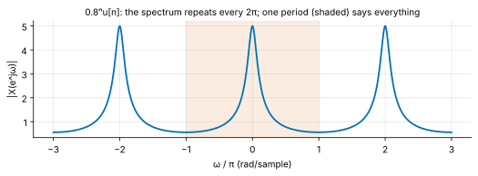
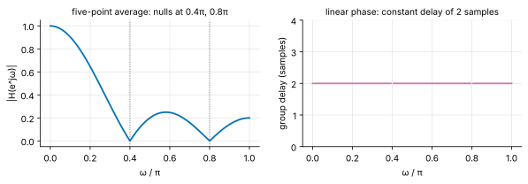
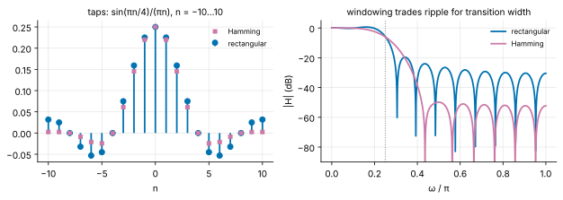
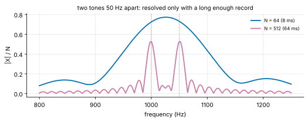

<!-- status: reviewed -->
# 11-07 · The Discrete-Time Fourier Transform

| | |
|---|---|
| **Course** | [11 · Signals and Systems](../README.md) |
| **University equivalent** | The discrete-time Fourier transform in a junior Signals and Systems course: definition, periodicity in ω, transform pairs and properties, the frequency response of DT systems, windowing and resolution, and the link to the DFT (Oppenheim & Willsky, *Signals and Systems*, ch. 5 and 6.4–6.6; Lathi, *Linear Systems and Signals*, ch. 9; MIT 6.003) |
| **Prerequisites** | [11-06 The Continuous-Time Fourier Transform](11-06-continuous-time-fourier-transform.md), [11-04 LTI Systems and Differential/Difference Equations](11-04-lti-systems-and-differential-equations.md) (difference equations, $H(z)$), [11-01 Signals: Classification and Operations](11-01-signals-classification-and-operations.md) (DT frequency modulo 2π) |
| **Estimated study hours** | 8 |
| **Last verified** | 2026-11-20 |

**Learning objectives.** After this chapter you can:

1. Define the DTFT and its inverse, derive the inverse from orthogonality, and explain why every DTFT is periodic in ω with period 2π.
2. Compute the DTFTs of standard sequences (unit sample, exponential, rectangular window, ideal low-pass, sinusoids) and use the properties to find others.
3. Find and interpret the frequency response of a difference equation or FIR filter: magnitude, phase, group delay and nulls, including linear-phase FIR filters.
4. Explain truncation and windowing in filter design and spectral analysis, and the trade between ripple, transition width and resolution.
5. Relate DT frequency to CT frequency for sampled signals, explain what the DFT computes, and expand a periodic sequence in its discrete-time Fourier series.

---

## 1. Big picture

Every DT system in this course so far, digital filters, decimators, recursions, has been described in time. 11-04 showed that an LTI system multiplies the sequence $e^{j\omega n}$ by $H(e^{j\omega})$. The **discrete-time Fourier transform** (DTFT) extends this to any sequence, exactly as 11-06 extended the Fourier series: it writes a sequence as a continuum of complex exponentials $e^{j\omega n}$ and gives each one a complex amplitude $X(e^{j\omega})$. The new feature is that DT frequency lives on a circle. Because $n$ is an integer, $e^{j(\omega + 2\pi)n} = e^{j\omega n}$ (11-01), so every DTFT repeats every 2π, and only frequencies from −π to π (DC to half the sample rate) are distinct. Everything a digital filter or a spectrum analyzer does happens on that circle.

- **Digital filters are specified by $H(e^{j\omega})$.** Passbands, stopbands and notches are statements about the DTFT of the impulse response, and the sample rate converts them to hertz.
- **Linear phase is a DT superpower.** A symmetric FIR filter delays every frequency by exactly the same number of samples, which no causal lumped (rational) analog filter can do exactly: audio, imaging and communications use this constantly.
- **Truncation costs ripple.** Making an infinite ideal response finite (to build it) creates Gibbs ripple; windows trade ripple for transition width. Every FIR design method is a version of this trade.
- **Resolution costs observation time.** Telling two close frequencies apart needs a record lasting about the inverse of their spacing: the time–bandwidth trade of 11-06, now in samples.
- **The FFT computes samples of the DTFT.** Spectrum analyzers, radar processors and AI audio front ends all run the DFT, which is the DTFT of a finite record sampled at $N$ frequencies (Course 16).

## 2. Intuition first

**Frequency on a circle.** A DT sinusoid $\cos(\omega n)$ is a set of samples, and samples cannot tell $\omega$ from $\omega + 2\pi$, or (for cosines) from $-\omega$. So DT frequency is an angle: going around the unit circle once is a full 2π, and the fastest possible oscillation, $(-1)^n$, sits at $\omega = \pi$, the opposite side from DC. A DTFT is a function on that circle; drawn on a straight line, it simply repeats (Figure 1).

**Sampling makes a periodic spectrum.** If the samples came from a CT signal at rate $f_s$, the circle's angle maps to hertz by $\omega = 2\pi f/f_s$: DC at $\omega = 0$, half the sample rate at $\omega = \pi$. A CT spectrum extending beyond $f_s/2$ wraps around the circle and overlaps itself: aliasing, the subject of 11-10.

**An analogy from finance: daily closes and the weekly cycle, and where it breaks.** Prices sampled once a day cannot reveal anything that oscillates faster than every two days: a two-day cycle is the fastest pattern daily data can show (ω = π), and an intraday cycle folds into some slower apparent pattern. A one-week cycle in daily data is at ω = 2π/7 rad/day, a 30-day cycle at 2π/30. Spectral analysis of daily returns lives on the circle from 0 to π rad/day. The analogy breaks because markets are not stationary: the "spectrum" of returns drifts with regimes, whereas a DTFT assumes one fixed sequence. And trading days are not uniform in time (weekends, holidays), so the samples are not equally spaced, an assumption the DTFT requires.

*Figure 1. $\lvert X(e^{j\omega})\rvert$ for $0.8^nu[n]$ (Example 11-07.1). The spectrum repeats every 2π; one period, from −π to π (shaded), holds all the information, and DC and the fastest frequency sit at its center and edges.*

## 3. Theory

> **Conventions.** $X(e^{j\omega}) = \sum_nx[n]e^{-j\omega n}$, with ω in rad/sample (11-01). The notation $X(e^{j\omega})$ records that the DTFT is the system function $X(z) = \sum x[n]z^{-n}$ (11-04, 11-09) evaluated on the unit circle. For sampled signals, $\omega = 2\pi f/f_s$.

### 3.1 Definition, inverse and periodicity

**From the eigenvalue to a transform.** 11-04 showed that an LTI system with impulse response $h$ responds to $e^{j\omega n}$ with $H(e^{j\omega})e^{j\omega n}$, where $H(e^{j\omega}) = \sum_nh[n]e^{-j\omega n}$. Applying the same sum to any sequence defines its **DTFT**:

$$
X(e^{j\omega}) = \sum_{n=-\infty}^{\infty}x[n]\,e^{-j\omega n} .
$$

**Periodicity.** Because $n$ is an integer, $e^{-j(\omega + 2\pi)n} = e^{-j\omega n}e^{-j2\pi n} = e^{-j\omega n}$, so $X(e^{j(\omega + 2\pi)}) = X(e^{j\omega})$. Every DTFT is periodic with period 2π, and all its information is in any interval of length 2π, usually $[-\pi, \pi)$.

**Inverse by orthogonality.** The exponentials $e^{j\omega n}$ for different integers $n$ are orthogonal over one period of ω:

$$
\frac{1}{2\pi}\int_{-\pi}^{\pi}e^{j\omega(n - m)}\,d\omega = \begin{cases}1 & n = m\\ 0 & n \ne m\end{cases}
$$

(for $n \ne m$ the integrand goes around the circle a whole number of times). Multiply the definition by $e^{j\omega m}$ and integrate over one period: every term but $n = m$ vanishes, leaving

$$
x[m] = \frac{1}{2\pi}\int_{-\pi}^{\pi}X(e^{j\omega})\,e^{j\omega m}\,d\omega .
$$

The roles have reversed from the Fourier series of 11-05: there, a periodic *time* signal had discrete *frequency* lines; here a discrete *time* signal has a periodic *frequency* function. The DTFT of a sequence is a Fourier series in ω, whose "coefficients" are the samples $x[n]$.

**Existence.** If $\sum\lvert x[n]\rvert < \infty$ (absolutely summable, as for a stable impulse response, 11-03), the sum converges uniformly to a continuous function. Finite-energy sequences have DTFTs in the mean-square sense, and periodic sequences and sinusoids have impulses in frequency, as in 11-06.

### 3.2 Transform pairs

**Unit sample.** $\delta[n] \leftrightarrow 1$, and $\delta[n - n_0] \leftrightarrow e^{-j\omega n_0}$.

**Exponential.** For $\lvert a\rvert < 1$, the geometric series gives

$$
a^nu[n] \;\leftrightarrow\; \sum_{n=0}^{\infty}\left(ae^{-j\omega}\right)^n = \frac{1}{1 - ae^{-j\omega}} .
$$

For $0 < a < 1$ the magnitude is largest at DC, $1/(1 - a)$, and smallest at ω = π, $1/(1 + a)$: a low-pass response (Figure 1, Example 11-07.1). For $-1 < a < 0$ the roles swap and the filter is high-pass.

**Rectangular window.** For $w[n] = 1$ at $n = 0, \dots, L - 1$ (an $L$-point boxcar),

$$
W(e^{j\omega}) = \sum_{n=0}^{L-1}e^{-j\omega n} = \frac{1 - e^{-j\omega L}}{1 - e^{-j\omega}} = e^{-j\omega(L-1)/2}\,\frac{\sin(\omega L/2)}{\sin(\omega/2)} ,
$$

factoring $e^{-j\omega L/2}$ from the numerator and $e^{-j\omega/2}$ from the denominator. The real factor $\sin(\omega L/2)/\sin(\omega/2)$ is the **Dirichlet kernel**: the DT counterpart of the sinc, equal to $L$ at DC and zero at $\omega = 2\pi k/L$ (other than multiples of 2π). Its main lobe is $4\pi/L$ wide. The ADS1292R's decimation filter of 11-03 and 11-06 is exactly this kernel, cubed, at the modulator rate.

**Ideal low-pass filter.** The DT filter that passes $\lvert\omega\rvert < \omega_c$ and blocks the rest of $[-\pi, \pi)$ has, by the inverse transform,

$$
h[n] = \frac{1}{2\pi}\int_{-\omega_c}^{\omega_c}e^{j\omega n}\,d\omega = \frac{\sin\omega_cn}{\pi n}, \qquad h[0] = \frac{\omega_c}{\pi} :
$$

samples of the CT ideal filter's sinc, infinitely long and noncausal (Example 11-07.4).

**Sinusoids.** $e^{j\omega_0n} \leftrightarrow 2\pi\sum_k\delta(\omega - \omega_0 - 2\pi k)$: an impulse at $\omega_0$ and at every frequency equivalent to it on the circle. A cosine gives impulses at $\pm\omega_0$ (and their 2π repeats).

### 3.3 Properties

| Property | Sequence | DTFT | Meaning |
|---|---|---|---|
| Periodicity | | $X(e^{j(\omega + 2\pi)}) = X(e^{j\omega})$ | Only $[-\pi, \pi)$ is distinct |
| Time shift | $x[n - n_0]$ | $e^{-j\omega n_0}X$ | A delay of $n_0$ samples is linear phase |
| Frequency shift | $e^{j\omega_0n}x[n]$ | $X(e^{j(\omega - \omega_0)})$ | Modulation |
| Alternation | $(-1)^nx[n]$ | $X(e^{j(\omega - \pi)})$ | Swaps low and high frequencies |
| Time reversal | $x[-n]$ | $X(e^{-j\omega})$ | |
| Conjugate symmetry | $x$ real | $X(e^{-j\omega}) = X^*(e^{j\omega})$ | Magnitude even, phase odd |
| First difference | $x[n] - x[n - 1]$ | $(1 - e^{-j\omega})X$ | Gain $2\lvert\sin(\omega/2)\rvert$: high-pass |
| Convolution | $x * h$ | $XH$ | Filtering is multiplication |
| Multiplication | $x[n]w[n]$ | $\frac{1}{2\pi}\int_{2\pi}X(e^{j\theta})W(e^{j(\omega - \theta)})d\theta$ | Windowing smears the spectrum (periodic convolution) |
| Parseval | $\sum\lvert x[n]\rvert^2$ | $\frac{1}{2\pi}\int_{-\pi}^{\pi}\lvert X\rvert^2d\omega$ | Energy in both domains |

The **alternation** property is the frequency shift with $\omega_0 = \pi$, since $(-1)^n = e^{j\pi n}$: flipping the sign of every other sample turns a low-pass filter into a high-pass one (Example 11-07.3). The **multiplication** property has no CT twin in this form: the convolution is *periodic*, over one period of ω, because both spectra are periodic. It is the mathematics of windowing (§3.5).

### 3.4 Frequency response of DT systems

**From a difference equation.** Substituting $x = e^{j\omega n}$, $y = He^{j\omega n}$ into $y[n] + \sum a_ky[n - k] = \sum b_kx[n - k]$ gives (11-04)

$$
H(e^{j\omega}) = \frac{\sum_{k=0}^{M}b_ke^{-j\omega k}}{1 + \sum_{k=1}^{N}a_ke^{-j\omega k}} ,
$$

periodic in ω because every term is. Its magnitude in dB, its phase and its group delay $\tau_g = -d\angle H/d\omega$ (in samples) describe the filter. A sampled system converts by $\omega = 2\pi f/f_s$: a group delay of $\tau_g$ samples is $\tau_g/f_s$ seconds.

**Geometry of nulls and peaks.** Writing the numerator and denominator in terms of their roots, $\lvert H\rvert$ is a product of distances from $e^{j\omega}$ on the unit circle to the zeros, divided by distances to the poles (11-09 develops this). A zero *on* the circle makes a perfect null at its angle; a pole close to the circle makes a peak there. The five-point average's zeros lie on the circle at $\pm0.4\pi$ and $\pm0.8\pi$ (Example 11-07.2); the resonator's poles at radius 0.9 and angle $\pm\pi/4$ make a peak near $\pi/4$ (Example 11-07.6).

**Linear-phase FIR filters.** If $h$ is real and symmetric about its center, $h[n] = h[M - n]$ for $n = 0, \dots, M$, pair each term with its mirror:

$$
H(e^{j\omega}) = e^{-j\omega M/2}\sum_nh[n]\,e^{-j\omega(n - M/2)} = e^{-j\omega M/2}\,A(\omega) ,
$$

where $A(\omega)$ is real because the paired exponentials $e^{\mp j\omega(n - M/2)}$ add to cosines. The phase is $-\omega M/2$ (plus jumps of π where $A$ changes sign), so the group delay is exactly $M/2$ samples at every frequency: **every frequency is delayed equally, and the waveform's shape is preserved**. This is the latency of 11-02 §3.5, $(N - 1)/2$ samples for $N = M + 1$ taps, now seen as a phase. Causal lumped (rational) analog filters cannot have exactly linear phase (only an ideal delay line can); FIR digital filters can, which is a major reason audio, imaging and data-link equalizers are digital.

*Figure 2. The five-point moving average (Example 11-07.2): nulls at $0.4\pi$ and $0.8\pi$ (100 and 200 Hz at 500 SPS) and a constant group delay of 2 samples, except at the nulls, where the phase jumps by π.*

### 3.5 Truncation, windows and resolution

**Designing by truncation.** The ideal low-pass $h[n] = \sin(\omega_cn)/(\pi n)$ is infinitely long. Keep only $\lvert n\rvert \le M/2$ and delay by $M/2$ to make it causal. Truncation multiplies $h$ by a rectangular window, which by the multiplication property convolves the ideal brick-wall response with the Dirichlet kernel. The kernel's main lobe smears the band edge into a **transition band**, and its sidelobes become **ripple**: Gibbs's phenomenon again, about **7**% overshoot for 21 taps and the stopband's worst point only about **27** dB down (Example 11-07.4, Figure 3).

**Windows.** Tapering the truncated response smoothly to zero instead of cutting it off, with a **window** such as the Hamming window, gives a kernel with far lower sidelobes and a wider main lobe. The result: much less ripple and much deeper stopband (about **50** dB for the same 21 taps), at the price of a wider transition band. Every window trades these two; longer filters narrow both.

**Resolution in spectral analysis.** Observing a signal for only $N$ samples is the same multiplication by a window, so each true spectral line is smeared into a copy of the window's kernel. Two tones closer than about a main-lobe width merge into one peak. For a rectangular window the main lobe's half-width is $2\pi/N$ rad/sample, so the resolvable spacing is about

$$
\Delta f \approx \frac{f_s}{N} = \frac{1}{T_{obs}} :
$$

**frequency resolution is the inverse of the observation time**, whatever the sample rate (Example 11-07.7, Figure 4). Sampling faster does not help; watching longer does.

*Figure 3. A 21-tap low-pass filter (cutoff π/4) by truncating the ideal response (Example 11-07.4). The rectangular window gives passband ripple and a stopband only about 27 dB down; the Hamming window gives a nearly flat passband and about 50 dB of stopband attenuation, with a wider transition.*

### 3.6 DT frequency, CT frequency and the DFT

**Sampled signals.** If $x[n] = x_c(nT_s)$, then (11-10 derives it)

$$
X(e^{j\omega}) = \frac{1}{T_s}\sum_kX_c\!\left(j\frac{\omega - 2\pi k}{T_s}\right) :
$$

the DTFT is the CT spectrum, scaled by $1/T_s$, with frequency $\Omega$ mapped to $\omega = \Omega T_s$, plus copies shifted by every multiple of 2π. If $X_c$ is zero above $f_s/2$, the copies do not overlap and one period of the DTFT is exactly the CT spectrum. Otherwise they overlap: aliasing.

**The DFT.** A computer cannot evaluate a continuous function. The **discrete Fourier transform** of $N$ samples, $X[k] = \sum_{n=0}^{N-1}x[n]e^{-j2\pi kn/N}$, is the DTFT of those $N$ samples evaluated at the $N$ equally spaced frequencies $\omega_k = 2\pi k/N$. Zero-padding the record to a longer length samples the same DTFT more finely; it makes the plot smoother but does not improve resolution, which is fixed by the true record length. The **FFT** is a fast algorithm for the DFT ($N\log_2N$ operations rather than $N^2$); Course 16 develops both.

> **Going deeper — why windows have the shapes they do.** A window's spectrum is a sum of shifted Dirichlet kernels when the window is a sum of cosines, as the Hamming window $0.54 - 0.46\cos(2\pi n/M)$ is. The three kernels (at 0 and ±one bin) are weighted so that their first sidelobes nearly cancel, which is why the Hamming window's highest sidelobe is far below the rectangle's while its main lobe is twice as wide. Families of windows (Hann, Blackman, Kaiser) choose different weights; the Kaiser window has a parameter that trades main-lobe width against sidelobe level continuously. The design rule behind all of them is the time–bandwidth trade of 11-06: a smoother taper in time means faster-decaying sidelobes in frequency.

*Figure 4. Tones at 1000 and 1050 Hz sampled at 8 kHz (Example 11-07.7). With 64 samples (8 ms) the window's main lobe, about 125 Hz wide per side, merges them; with 512 samples (64 ms) they are resolved.*

### 3.7 Periodic sequences: the discrete-time Fourier series

A sequence with period $N$ is the DT counterpart of 11-05's periodic signals, and it has a Fourier series with a twist: since $e^{jk(2\pi/N)n}$ repeats in $k$ with period $N$ (11-01 §3.7), only $N$ harmonics exist, so the series is a *finite* sum. The **discrete-time Fourier series** (DTFS) is

$$
x[n] = \sum_{k=0}^{N-1}a_ke^{jk(2\pi/N)n}, \qquad a_k = \frac1N\sum_{n=0}^{N-1}x[n]e^{-jk(2\pi/N)n} .
$$

*Derivation.* Multiply the synthesis sum by $e^{-jm(2\pi/N)n}$ and sum over one period. The finite geometric sum $\sum_{n=0}^{N-1}e^{j(k - m)(2\pi/N)n}$ equals $N$ when $k - m$ is a multiple of $N$ and $(1 - e^{j2\pi(k - m)})/(1 - e^{j2\pi(k - m)/N}) = 0$ otherwise. So only the term $k = m$ survives, giving $\sum_nx[n]e^{-jm(2\pi/N)n} = Na_m$: the analysis formula. Unlike the CT series, there is no convergence question; the sum is finite and exact.

Three connections tie it to the rest of the chapter. The coefficients are the DFT of one period divided by $N$, $a_k = X[k]/N$, so an FFT computes them. Power splits over the harmonics, $\frac1N\sum_{n=0}^{N-1}\lvert x[n]\rvert^2 = \sum_{k=0}^{N-1}\lvert a_k\rvert^2$ (Parseval, by the same orthogonality). And the DTFT of the periodic sequence is a train of lines, $X(e^{j\omega}) = 2\pi\sum_ka_k\,\delta(\omega - 2\pi k/N)$ with the index $k$ running over all integers ($a_k$ repeating with period $N$), just as a CT periodic signal's transform is lines at its harmonics (11-06). For example, the period-4 sequence $1, 1, 0, 0, \dots$ has $a_k = \tfrac14(1 + e^{-jk\pi/2})$: $a_0$ = **0.5** (its average), $\lvert a_1\rvert = \lvert a_3\rvert$ = **0.3536**, $a_2 = 0$, and the power $\tfrac14(1 + 1)$ = **0.5** equals $0.25 + 2 \times 0.125$.

## 4. Worked examples

### Example 11-07.1 · An exponential's spectrum (tier A)

**Setup.** $x[n] = 0.8^nu[n]$. Find $\lvert X\rvert$ at ω = 0, π/2 and π, and the phase at π/2. Is it low-pass or high-pass?

**Solution.** $X = 1/(1 - 0.8e^{-j\omega})$. At ω = 0: $1/0.2$ = **5**. At ω = π: $1/(1 + 0.8)$ = **0.5556**. At ω = π/2: $e^{-j\pi/2} = -j$, so $X = 1/(1 + 0.8j)$, magnitude $1/\sqrt{1.64}$ = **0.7809** and phase $-\arctan0.8$ = **−38.66**°. Low-pass: nine times more gain at DC than at π.

**Sanity check.** At DC the DTFT equals $\sum x[n] = 1/(1 - 0.8) = 5$, the sequence's sum, as a transform at zero frequency must.

### Example 11-07.2 · A five-point moving average (tier A)

**Setup.** $y[n] = \frac15\sum_{k=0}^{4}x[n - k]$ runs at 500 SPS (the causal version of 11-02's centered average). (a) Find $H(e^{j\omega})$. (b) Find its nulls in rad/sample and in hertz. (c) Find its gain at 50 Hz. (d) Find its group delay.

**Solution.** (a) A 5-point boxcar divided by 5: $H = e^{-j2\omega}\frac{\sin(5\omega/2)}{5\sin(\omega/2)}$.

(b) Zeros where $\sin(5\omega/2) = 0$ with $\omega \ne 0$: $\omega = 0.4\pi$ and $0.8\pi$, which at 500 SPS ($\omega = 2\pi f/f_s$) are **100** Hz and **200** Hz.

(c) 50 Hz is $\omega = 0.2\pi$: $\sin(0.5\pi)/(5\sin(0.1\pi))$ = **0.6472**.

(d) The phase is $-2\omega$ (plus π jumps at the nulls), so the group delay is **2** samples, **4** ms: exactly the latency found for the delayed centered average in 11-02 (Figure 2).

**Sanity check.** An $L$-point average removes every frequency that completes a whole number of cycles in $L$ samples: at 500 SPS and $L$ = 5, 100 Hz completes one cycle in 5 samples.

### Example 11-07.3 · Low-pass to high-pass (tier B)

**Setup.** (a) Find the magnitude response of the two-point difference $h = \tfrac12, -\tfrac12$. (b) Multiply the five-point average's taps by $(-1)^n$. What does the new filter do at DC and at ω = π?

**Solution.** (a) $H = \tfrac12(1 - e^{-j\omega}) = je^{-j\omega/2}\sin(\omega/2)$, so $\lvert H\rvert = \lvert\sin(\omega/2)\rvert$: 0 at DC and **1** at ω = π. A high-pass filter.

(b) Alternation shifts the response by π: the new magnitude at ω is the old one at $\omega - \pi$. At DC it equals the old value at π, $\lvert\sin(5\pi/2)/(5\sin(\pi/2))\rvert$ = **0.2**; at π it equals the old DC gain, **1**. The taps $\tfrac15(1, -1, 1, -1, 1)$ pass the fastest alternation and attenuate slow signals.

**Sanity check.** Feeding $(-1)^n$ to the alternating-sign average gives $\tfrac15(1 + 1 + 1 + 1 + 1) = 1$ in magnitude: every term adds.

### Example 11-07.4 · Designing a low-pass filter by truncation (tier B)

**Setup.** Design a 21-tap low-pass filter with cutoff $\omega_c = \pi/4$ by truncating the ideal response to $n = -10, \dots, 10$. (a) Find $h[0]$ and $h[1]$. (b) Find the peak passband gain and the worst stopband gain (for $\omega \ge 0.5\pi$) with a rectangular window and with a Hamming window. (c) What is the gain at the cutoff?

**Solution.** (a) $h[0] = \omega_c/\pi$ = **0.25**; $h[1] = \sin(\pi/4)/\pi$ = **0.2251**.

(b) Evaluating $\sum h[n]\cos(\omega n)$ on a fine grid: rectangular window, passband peak **1.073** (a 7% overshoot) and worst stopband magnitude **−26.5** dB; Hamming window, passband peak **1.004** and worst stopband **−49.8** dB (Figure 3).

(c) About **0.5** (−6 dB) in both cases: windowing smears the brick-wall edge symmetrically, so the cutoff sits halfway down the transition.

**Sanity check.** The rectangular window's overshoot approaches Gibbs's 9% as the filter lengthens; the Hamming window's sidelobes are lower by design, at the cost of a transition roughly twice as wide.

### Example 11-07.5 · Parseval in discrete time (tier B)

**Setup.** Find the energy of $0.8^nu[n]$ in time and by integrating $\lvert X(e^{j\omega})\rvert^2$ over one period.

**Solution.** Time: $\sum0.64^n = 1/(1 - 0.64)$ = **2.778** (as in 11-01). Frequency: $\frac{1}{2\pi}\int_{-\pi}^{\pi}\frac{d\omega}{\lvert1 - 0.8e^{-j\omega}\rvert^2}$, evaluated numerically, gives 2.778.

**Sanity check.** Most of the energy sits near DC, where $\lvert X\rvert^2$ reaches **25** (Figure 1); the integral over a full period averages that peak against the floor of **0.31** near π.

### Example 11-07.6 · The resonator's frequency response (tier B)

**Setup.** The resonator of 11-04, $y[n] - 1.2728y[n - 1] + 0.81y[n - 2] = x[n]$ with poles at $0.9e^{\pm j\pi/4}$ (so $a_1 = 2 \times 0.9\cos(\pi/4) = 1.27279$, printed to five digits; the numbers below use the exact value). Find (a) its DC gain, (b) its peak gain and the frequency of the peak, (c) its −3 dB bandwidth and the ratio of peak frequency to bandwidth.

**Solution.** Evaluating $\lvert H\rvert = 1/\lvert1 - 1.2728e^{-j\omega} + 0.81e^{-j2\omega}\rvert$ numerically:

(a) **1.861**, as 11-04 found.

(b) Peak **7.443** at ω = **0.7798** rad/sample, slightly below π/4 = 0.7854 (the mirror pole at $-\pi/4$ pulls the peak down).

(c) The half-power points are **0.2140** rad/sample apart, a ratio of **3.64**. For poles at radius $r$ close to 1 the bandwidth approaches $2(1 - r)$, here 0.2.

**Sanity check.** Moving the poles closer to the circle sharpens and raises the peak: the distance from $e^{j\omega}$ to the pole, at the pole's angle, is $1 - r$.

### Example 11-07.7 · How long to listen (tier C)

**Setup.** Tones at 1000 Hz and 1050 Hz are sampled at 8 kHz. (a) Find their DT frequencies. (b) With a rectangular window, what spacing can $N$ = 64 samples resolve, and $N$ = 512? (c) What is the minimum observation time to separate tones 50 Hz apart, by the $1/T_{obs}$ rule?

**Solution.** (a) $\omega = 2\pi \cdot 1000/8000$ = **0.25**π and $2\pi \cdot 1050/8000 = 0.2625\pi$.

(b) $f_s/N$ = **125** Hz for 64 samples: the tones, 50 Hz apart, merge. For 512 samples, **15.63** Hz: resolved (Figure 4).

(c) $1/(50\ \text{Hz})$ = **20** ms, that is, **160** samples at 8 kHz. Any sample rate needs the same 20 ms.

**Sanity check.** Doubling the sample rate doubles $N$ for the same 20 ms but also doubles $f_s$, leaving $f_s/N$ unchanged: resolution depends on time, not on the number of samples.

### Answer key

<!-- answer-key -->
| ID | Quantity | Value | Unit |
|---|---|---|---|
| T 11-07.a | 25-tap symmetric FIR delay at 48 kHz | 0.25 | ms |
| T 11-07.b | that delay in samples | 12 | samples |
| T 11-07.c | ω = π/2 at 1 kSPS | 250 | Hz |
| T 11-07.d | ω = π at 1 kSPS | 500 | Hz |
| T 11-07.e | resolution of a 100 ms record | 10 | Hz |
| T 11-07.f | 21-tap rectangular overshoot | 7 | % |
| T 11-07.g | 21-tap rectangular stopband depth | 27 | dB |
| T 11-07.h | 21-tap Hamming stopband depth | 50 | dB |
| T 11-07.i | peak of the exponential's squared magnitude | 25 | — |
| T 11-07.j | its floor at π | 0.31 | — |
| T 11-07.k | transition narrowing from 21 to 81 taps | 3.6 | — |
| T 11-07.l | 81-tap rectangular overshoot | 9.4 | % |
| T 11-07.m | DTFS a₀ of 1, 1, 0, 0 | 0.5 | — |
| T 11-07.n | DTFS magnitude of a₁ | 0.3536 | — |
| T 11-07.o | power of 1, 1, 0, 0 | 0.5 | — |
| Ex 11-07.1a | magnitude at DC | 5 | — |
| Ex 11-07.1b | magnitude at π | 0.5556 | — |
| Ex 11-07.1c | magnitude at π/2 | 0.7809 | — |
| Ex 11-07.1d | phase at π/2 | −38.66 | ° |
| Ex 11-07.2a | first null | 100 | Hz |
| Ex 11-07.2b | second null | 200 | Hz |
| Ex 11-07.2c | gain at 50 Hz | 0.6472 | — |
| Ex 11-07.2d | group delay | 2 | samples |
| Ex 11-07.2e | group delay in time | 4 | ms |
| Ex 11-07.3a | difference filter gain at π | 1 | — |
| Ex 11-07.3b | alternating average at DC | 0.2 | — |
| Ex 11-07.3c | alternating average at π | 1 | — |
| Ex 11-07.4a | h[0] | 0.25 | — |
| Ex 11-07.4b | h[1] | 0.2251 | — |
| Ex 11-07.4c | rectangular: passband peak | 1.073 | — |
| Ex 11-07.4d | rectangular: worst stopband | −26.5 | dB |
| Ex 11-07.4e | Hamming: passband peak | 1.004 | — |
| Ex 11-07.4f | Hamming: worst stopband | −49.8 | dB |
| Ex 11-07.4g | gain at the cutoff | 0.5 | — |
| Ex 11-07.5a | energy | 2.778 | — |
| Ex 11-07.6a | DC gain | 1.861 | — |
| Ex 11-07.6b | peak gain | 7.443 | — |
| Ex 11-07.6c | peak frequency | 0.7798 | rad/sample |
| Ex 11-07.6d | −3 dB bandwidth | 0.2140 | rad/sample |
| Ex 11-07.6e | peak frequency / bandwidth | 3.64 | — |
| Ex 11-07.7a | DT frequency of 1000 Hz | 0.25 | π rad/sample |
| Ex 11-07.7b | resolution with 64 samples | 125 | Hz |
| Ex 11-07.7c | resolution with 512 samples | 15.63 | Hz |
| Ex 11-07.7d | minimum observation time | 20 | ms |
| Ex 11-07.7e | samples at 8 kHz | 160 | — |

*Every value is recomputed by [verify_11_07.py](../verify/verify_11_07.py) by summing the DTFT definition directly on fine frequency grids (not from the closed forms), by numerical integration for Parseval, by root finding and optimization on computed magnitudes, by FFTs of zero-padded records for the resolution example, and by running the filters on test sinusoids.*

## 5. Simulate it

The lab, [labs/11-07-lab](../labs/11-07-lab/README.md), is a notebook in four parts:

1. Computes DTFTs by direct summation and by zero-padded FFTs, and shows that they agree at the FFT's frequencies.
2. Measures frequency responses by driving filters with sinusoids and comparing with $H(e^{j\omega})$, including the five-point average's nulls.
3. Designs low-pass filters by windowed truncation for several lengths and windows and plots ripple against transition width.
4. Resolves two close tones as the observation time grows, and shows that zero-padding smooths the plot without improving resolution.

**Guided exercise (predict, then run).** **Before running Part 3**, predict: if the rectangular-window filter of Example 11-07.4 is lengthened from 21 to 81 taps, does its passband overshoot shrink, and does its transition band? Then run it. (The 10–90% transition narrows **3.6**-fold, roughly in proportion to the length, but the overshoot *rises* to **9.4**%: it is Gibbs's overshoot, and only a better window removes it. It sits a little above 11-05's 8.95% limit because the ringing from the passband's other edge, at $-\pi/4$, adds to the peak; that contribution fades as the filter lengthens.)

## 6. Engineering tradeoffs

| Knob | Improves | Costs | Typical decision owner |
|---|---|---|---|
| FIR length | Narrower transition, deeper stopband | MACs per sample; latency $(N - 1)/2$ samples | DSP designer |
| Window choice | Lower sidelobes and ripple | Wider transition band (main lobe) | DSP designer |
| Linear phase (symmetric FIR) | No phase distortion; constant delay | Longer filters than IIR for the same sharpness; fixed latency | DSP or system architect |
| IIR (poles) instead of FIR | Sharp responses with few MACs | Nonlinear phase; stability and quantization care (11-04) | DSP designer |
| Observation time in spectral analysis | Finer resolution ($1/T_{obs}$) | Latency; nonstationary signals blur | Test or firmware engineer |
| Zero-padding the DFT | Smoother plots, better peak interpolation | Computation; no real resolution gain | Analyst |

## 7. Numbers to know

| Quantity | Value | Note |
|---|---|---|
| DT frequency | $\omega = 2\pi f/f_s$; π is $f_s/2$ | Spectrum periodic in 2π |
| $a^nu[n]$ | $1/(1 - ae^{-j\omega})$ | DC gain $1/(1 - a)$ |
| $L$-point boxcar | Dirichlet kernel; nulls at $2\pi k/L$ | Main lobe $4\pi/L$ wide |
| Ideal DT low-pass | $h[n] = \sin(\omega_cn)/(\pi n)$ | Truncation → Gibbs ripple |
| Symmetric FIR of $N$ taps | Group delay $(N - 1)/2$ samples | Exactly linear phase |
| Window trade | Rectangular: about 27 dB stopband (21 taps); Hamming: about 50 dB | Hamming's transition about twice as wide |
| Resolution | $\Delta f \approx 1/T_{obs} = f_s/N$ | Zero-padding does not help |

## 8. Common mistakes

- **Plotting a DTFT beyond π and reading new information there.** It repeats; the band from π to 2π is the negative frequencies again.
- **Forgetting the sample rate when converting.** ω in rad/sample becomes hertz only through $f = \omega f_s/2\pi$.
- **Reading phase jumps at nulls as delay.** At a zero of $A(\omega)$ the phase jumps by π; group delay is defined between them.
- **Expecting zero-padding to resolve close tones.** It interpolates the same smeared spectrum.
- **Truncating an ideal filter and expecting ripple to vanish with length.** The transition narrows; the Gibbs overshoot stays near 9%.
- **Assuming a recursive (IIR) filter has linear phase.** Only symmetric (or antisymmetric) FIR filters do.
- **Confusing the DFT with the DTFT.** The DFT is $N$ samples of the DTFT of a finite record.

## 9. Practitioner lens

### State of the art (as of Nov 2026)

- **Converter decimation filters are Dirichlet kernels.** The ADS1292R's digital filter is a third-order sinc filter, $\lvert(1 - z^{-N})/(1 - z^{-1})\rvert^3$ at the modulator rate [1]: on the unit circle, the cube of the Dirichlet kernel of §3.2, with nulls at every multiple of the output data rate **[Established]** (data sheet).
- **Embedded and codec DSP mixes FIR and IIR.** The TLV320AIC3204's ADC processing blocks offer FIR filters of 20 or 25 taps and up to five biquads [2], and Arm's CMSIS-DSP library provides both FIR functions (in floating point and in Q7, Q15 and Q31 fixed point) and biquad-cascade functions [3] **[Established]**: designers choose per block between linear phase (FIR) and few-MAC selectivity (IIR).
- **Linear phase is a selling point where waveform shape matters.** A 25-tap symmetric FIR at 48 kHz has a fixed group delay of **12** samples, **0.25** ms, at every frequency (by §3.4; the codec's own coefficients are user-programmable and need not be symmetric).

### Why it matters commercially

- **Filter requirements become silicon cost.** A sharper anti-alias or channel filter needs more taps or more biquads, which is area, power and latency in an always-on product.
- **Spectral analysis has a time cost.** Any product that "listens" for a tone, a heartbeat rhythm or a fault frequency is limited by $1/T_{obs}$: fine frequency discrimination costs response time, a hard limit no processor removes.
- **Phase response is a hidden differentiator.** Two filters with identical magnitude plots can sound or measure differently because of their group delay; specifications that omit phase leave room for both good and poor implementations.

### Marketing vs Reality

- **"High-resolution FFT analysis."** *Reality:* resolution is $1/T_{obs}$; a large FFT on a short record, zero-padded, looks smooth but resolves nothing finer. *Sanity check:* ask for the record length, not the FFT size.
- **"Programmable FIR filter."** *Reality:* a fixed number of taps (here 20 or 25 [2]) bounds the transition width and stopband depth; windows trade between them. *Sanity check:* ask for the tap count and the achievable attenuation at the needed transition width.
- **"Linear-phase filtering."** *Reality:* true only if the coefficients are symmetric; a programmable block may hold any coefficients. *Sanity check:* ask whether the shipped coefficients are symmetric and what the group delay is.

### Questions for engineering leaders

1. **"What frequency resolution does your detector need, and how long must it listen?"**
   *Strong:* the required $\Delta f$, the resulting observation time, and how latency requirements are met. *Evasive:* "we use a 4096-point FFT."
2. **"Why FIR here and IIR there?"**
   *Strong:* phase requirements, MAC budget, latency and numerical robustness, block by block. *Evasive:* convention.
3. **"What window does your spectral analysis use, and what does it cost in resolution?"**
   *Strong:* the window, its sidelobe level and main-lobe width, and the dynamic range needed between strong and weak tones. *Evasive:* defaults.
4. **"What is the end-to-end group delay through your filters?"**
   *Strong:* per-stage delays in samples and seconds. *Evasive:* "it's real-time."

## 10. Concept check

**Q1.** Why is every DTFT periodic with period 2π, while a CT Fourier transform need not be?

Answer

The DTFT is built from $e^{-j\omega n}$ with integer $n$, and $e^{-j(\omega + 2\pi)n} = e^{-j\omega n}$; a CT transform uses $e^{-j\omega t}$ with real $t$, which does not repeat in ω.

**Q2.** At 1 kSPS, which CT frequency corresponds to ω = π/2, and which to ω = π?

Answer

$f = \omega f_s/2\pi$: **250** Hz and **500** Hz (half the sample rate).

**Q3.** Why does a symmetric FIR filter delay every frequency by the same amount?

Answer

Pairing each tap with its mirror image makes $H(e^{j\omega}) = e^{-j\omega M/2}A(\omega)$ with $A$ real, so the phase is linear in ω with slope $-M/2$ (apart from π jumps), and the group delay is $M/2$ samples at all frequencies.

**Q4.** A 21-tap truncated ideal low-pass filter ripples by 7%. Will 201 taps fix it?

Answer

No: the transition narrows about tenfold, but the overshoot tends to Gibbs's 9%, not zero. A tapered window (Hamming, Kaiser) reduces the ripple, at the cost of a wider transition for a given length.

**Q5.** A record of 100 ms is zero-padded to make a 1-million-point FFT. What frequency resolution does it have?

Answer

About $1/(100\ \text{ms})$ = **10** Hz. Zero-padding only interpolates the smeared spectrum.

**Q6.** How do you turn a low-pass FIR filter into a high-pass one with the same transition sharpness?

Answer

Multiply its taps by $(-1)^n$: the response shifts by π, moving the passband from DC to the highest frequency.

[Problem set for this chapter](../problems/11-07-problems.md)

## 11. Key terms

[Discrete-time Fourier transform (DTFT)](../../../reference/glossary.md#discrete-time-fourier-transform-dtft) · [Discrete-time frequency](../../../reference/glossary.md#discrete-time-frequency) · [Dirichlet kernel](../../../reference/glossary.md#dirichlet-kernel) · [Frequency response](../../../reference/glossary.md#frequency-response) · [Linear phase](../../../reference/glossary.md#linear-phase) · [Group delay](../../../reference/glossary.md#group-delay) · [Window function](../../../reference/glossary.md#window-function) · [Transition band](../../../reference/glossary.md#transition-band) · [Frequency resolution](../../../reference/glossary.md#frequency-resolution) · [Discrete Fourier transform (DFT)](../../../reference/glossary.md#discrete-fourier-transform-dft) · [Zero-padding](../../../reference/glossary.md#zero-padding) · [Gibbs phenomenon](../../../reference/glossary.md#gibbs-phenomenon)

## 12. Connections

- **Builds on:** the CT Fourier transform from [11-06](11-06-continuous-time-fourier-transform.md); difference equations and $H(z)$ from [11-04](11-04-lti-systems-and-differential-equations.md); DT frequency from [11-01](11-01-signals-classification-and-operations.md); the moving average from [11-02](11-02-system-properties.md); the boxcar cascade from [11-03](11-03-convolution.md).
- **Next:** [11-08 The Laplace Transform and System Functions](11-08-laplace-transform-and-system-functions.md) generalizes the CT transform to complex frequencies $s$, and [11-09 The z-Transform](11-09-z-transform.md) does the same for $z$ off the unit circle, where poles and zeros live.
- **Used later:** sampling and aliasing in [11-10](11-10-sampling-aliasing-reconstruction.md); FIR and IIR design, windows and the FFT in Course 16; channelizers and OFDM in Course 17.

## 13. Further study

- A. V. Oppenheim and A. S. Willsky with S. H. Nawab, *Signals and Systems*, 2nd ed., ch. 5 (the DTFT) and ch. 6.4–6.6 (DT frequency response, first- and second-order systems).
- B. P. Lathi, *Linear Systems and Signals*, ch. 9 (DT signal analysis: the DTFT).
- A. V. Oppenheim and R. W. Schafer, *Discrete-Time Signal Processing*, the chapters on filter design by windowing and on the DFT: the standard next step (Course 16).
- MIT OpenCourseWare, 6.003 *Signals and Systems* (Fall 2011), the lectures on DT frequency response and the DTFT.

## 14. Sources

1. Texas Instruments, *ADS129x Low-Power, 2-Channel, 24-Bit Analog Front-End for Biopotential Measurements*, SBAS502C, revised April 2020, §8.3.5: [data sheet](https://www.ti.com/lit/ds/symlink/ads1292r.pdf). [R-186](../../../reference/research-log.md#r-186--convolution-in-practice).
2. Texas Instruments, *TLV320AIC3204 Ultra Low Power Stereo Audio Codec*, SLOS602E, revised September 2019, Table 2: [data sheet](https://www.ti.com/lit/ds/symlink/tlv320aic3204.pdf). [R-186](../../../reference/research-log.md#r-186--convolution-in-practice).
3. Arm, CMSIS-DSP library documentation, biquad cascade and FIR functions (accessed 20 Nov 2026): [biquad documentation](https://arm-software.github.io/CMSIS-DSP/latest/group__BiquadCascadeDF1.html), [FIR documentation](https://arm-software.github.io/CMSIS-DSP/latest/group__FIR.html). [R-187](../../../reference/research-log.md#r-187--iir-filter-implementations).
