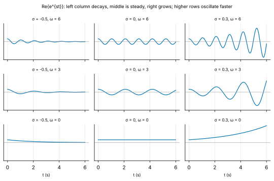
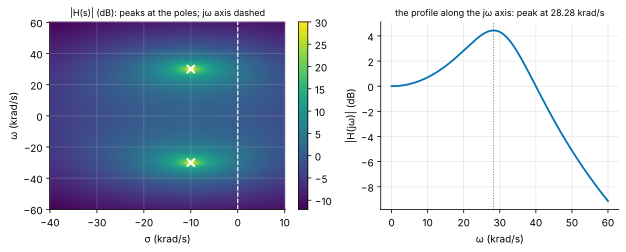
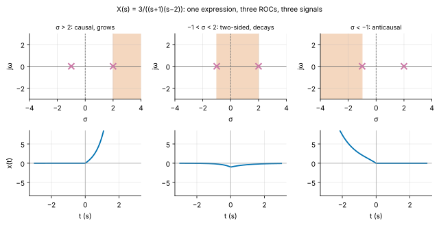
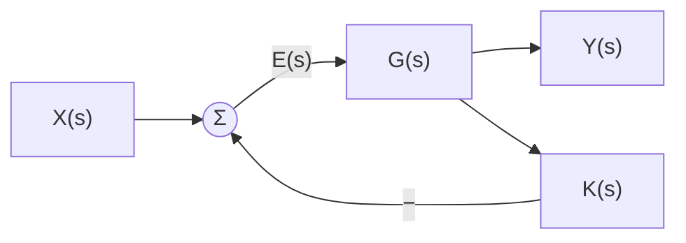
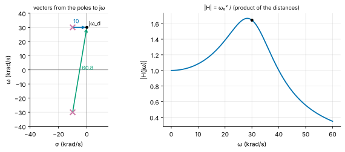
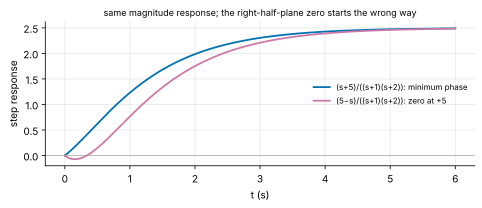
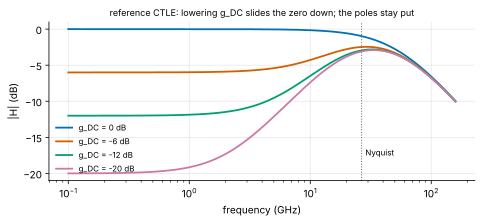

<!-- status: verified -->
# 11-08 · The Laplace Transform and System Functions

| | |
|---|---|
| **Course** | [11 · Signals and Systems](../README.md) |
| **University equivalent** | The Laplace transform in a junior Signals and Systems course: the bilateral transform and its region of convergence, poles and zeros, inverse transforms with the ROC, causality and stability from the ROC, system functions of differential equations and interconnections, and geometric evaluation of the frequency response (Oppenheim & Willsky, *Signals and Systems*, ch. 9; Lathi, *Linear Systems and Signals*, ch. 4; MIT 6.003) |
| **Prerequisites** | [11-06 The Continuous-Time Fourier Transform](11-06-continuous-time-fourier-transform.md), [11-04 LTI Systems and Differential/Difference Equations](11-04-lti-systems-and-differential-equations.md) (eigenfunctions, $H(s)$, the RLC example), [02-05 The Laplace Transform for ODEs](../../02-complex-numbers-des-and-linear-algebra/chapters/02-05-laplace-transform-for-odes.md) (the unilateral transform, partial fractions), [07-04 Laplace-Domain Circuit Analysis](../../07-circuit-analysis-2-transient-and-ac/chapters/07-04-laplace-domain-circuit-analysis.md) |
| **Estimated study hours** | 10 |
| **Last verified** | 2026-11-20 |

**Learning objectives.** After this chapter you can:

1. Define the bilateral Laplace transform as a Fourier transform of an exponentially weighted signal, find its region of convergence (ROC), and explain why an algebraic expression without its ROC does not determine the signal.
2. State and derive the properties of the ROC (strips, no poles inside, right-, left- and two-sided signals) and decide when the Fourier transform equals $X(s)$ on the $j\omega$ axis.
3. Invert rational transforms by partial fractions, choosing right- or left-sided terms from the ROC.
4. Decide causality and BIBO stability of an LTI system from $H(s)$ and its ROC, and form the system functions of differential equations and of cascade, parallel and feedback interconnections.
5. Evaluate a frequency response geometrically from poles and zeros, read natural frequency, damping, Q and bandwidth from pole positions, and explain all-pass and minimum-phase systems.

---

## 1. Big picture

The Fourier transform of 11-06 describes a signal as a sum of pure oscillations $e^{j\omega t}$. It fails for signals and systems that grow: an unstable impulse response, a ramp, even the step $u(t)$ need impulses or have no transform at all. The **Laplace transform** fixes this by letting the exponent be complex, $e^{st}$ with $s = \sigma + j\omega$, so that a signal is built from exponentials that grow or decay *and* oscillate. 02-05 and 07-04 used its one-sided form as a machine for solving circuits with initial conditions. This chapter uses the two-sided form as a *description of systems*: the system function $H(s)$, with its poles and zeros, says at a glance whether a system is causal and stable, how it rings, and what its frequency response looks like.

- **Poles are a system's natural modes.** Their real parts say how fast transients die, their imaginary parts how they ring. Every stability discussion, from an LDO to a phase-locked loop, is about where the poles sit.
- **Feedback moves poles.** Closing a loop replaces $G$ by $G/(1 + GK)$, and its poles are where $1 + GK = 0$. Compensation, oscillation and control (Course 13) are the study of that movement.
- **The frequency response is a slice.** $H(j\omega)$ is the system function along the imaginary axis; a pole near the axis makes a peak, a zero on it makes a notch. Designers place poles and zeros to shape a response.
- **Equalizers are pole–zero placements.** A high-speed link's receiver boosts high frequencies with a continuous-time linear equalizer whose zero and poles are specified directly as frequencies (§9).
- **Some systems cannot be undone.** A zero in the right half-plane makes the response start the wrong way and forbids a stable causal inverse: a hard limit on equalization and control.

## 2. Intuition first

**The s-plane is a map of exponentials.** Each point $s = \sigma + j\omega$ stands for the signal $e^{st} = e^{\sigma t}e^{j\omega t}$. The horizontal coordinate σ (in s⁻¹) is a growth rate: to the left of the imaginary axis the exponential decays, to the right it grows, and on the axis it neither grows nor decays. The vertical coordinate ω (in rad/s) is an oscillation frequency. A real signal like $e^{-\sigma t}\cos\omega t$ uses the pair of points $-\sigma \pm j\omega$, mirror images across the real axis (Figure 1). The Fourier transform uses only the imaginary axis; the Laplace transform uses the whole plane.

*Figure 1. The signal $\operatorname{Re}\{e^{st}\}$ at nine points of the s-plane. Left of the imaginary axis it decays, right of it it grows, and farther from the real axis it oscillates faster.*

**A system function is a rubber sheet.** Plot $\lvert H(s)\rvert$ as a height above the s-plane. At each pole the sheet is pushed up to infinity, like a tent pole; at each zero it is pinned to the ground. The frequency response is the profile of the sheet along the imaginary axis (Figure 2). A pole close to the axis lifts the profile into a sharp peak as the axis passes near it; a zero on the axis pulls it to zero, a notch. Everything in §3.7 is a careful version of this picture.

*Figure 2. $\lvert H(s)\rvert$ in decibels for the series RLC circuit of 11-04 (capacitor output), poles at $-10 \pm j30$ krad/s. Left: the sheet over the s-plane, with the two poles as bright peaks and the imaginary axis marked. Right: its profile along the axis, the frequency response, peaking at 28.28 krad/s (Example 11-08.4).*

**An analogy from finance: valuing a stream that runs both ways, and where it breaks.** 02-05 read $\int_0^\infty x(t)e^{-st}dt$ at a real rate $s$ as a present value. Extend it to a stream with a past as well as a future. A future cash flow at time $t > 0$ is discounted, $x(t)e^{-\sigma t}$; a past one at $t < 0$ is *compounded* up to today, $x(t)e^{\sigma\lvert t\rvert}$. If the future flows grow at rate $g$, discounting tames them only if $\sigma > g$. If the past flows (looking backward) shrink at rate $d$, compounding is tamed only if $\sigma < d$. So the total value is finite only for discount rates in a band, $g < \sigma < d$: exactly the strip-shaped ROC of a two-sided signal (§3.3), and the right half-plane $\sigma > g$ for a stream with no past. The analogy breaks in two ways. Finance uses real rates only, while the transform needs complex $s$, whose imaginary part (oscillation) has no economic meaning. And finance values a stream at one rate, while engineering uses the whole function $X(s)$, whose poles, the rates at which value becomes infinite, carry the information.

## 3. Theory

> **Conventions.** $X(s) = \int_{-\infty}^{\infty}x(t)e^{-st}dt$ with $s = \sigma + j\omega$; σ in s⁻¹ (nepers per second), ω in rad/s. "ROC" is the region of convergence. A system function is $H(s)$, and the Fourier transform of 11-06 is $X(j\omega)$. Poles are marked × and zeros ○ in pole–zero plots.

### 3.1 From the Fourier transform to the Laplace transform

The Fourier transform $X(j\omega) = \int x(t)e^{-j\omega t}dt$ exists as an ordinary function when $x$ is absolutely integrable (11-06). A signal that grows, or even one that does not decay, like $u(t)$, fails that test. Multiply the signal by a decaying exponential $e^{-\sigma t}$ first, and take the Fourier transform of the product:

$$
\int_{-\infty}^{\infty}\left[x(t)e^{-\sigma t}\right]e^{-j\omega t}dt = \int_{-\infty}^{\infty}x(t)e^{-(\sigma + j\omega)t}dt .
$$

Writing $s = \sigma + j\omega$ defines the **bilateral Laplace transform**

$$
X(s) = \int_{-\infty}^{\infty}x(t)\,e^{-st}\,dt .
$$

Units: if $x$ is in volts and $t$ in seconds, $X(s)$ is in volt-seconds, like a Fourier transform. The integral converges absolutely when

$$
\int_{-\infty}^{\infty}\lvert x(t)\rvert e^{-\sigma t}dt < \infty ,
$$

because $\lvert e^{-st}\rvert = e^{-\sigma t}$. The set of $s$ for which this holds is the **region of convergence** (ROC). Notice that the test involves only σ, the real part of $s$: the ROC is made of vertical lines.

**Inverse.** For a fixed σ in the ROC, $X(\sigma + j\omega)$ is the Fourier transform of $x(t)e^{-\sigma t}$, so the Fourier inverse of 11-06 gives

$$
x(t)e^{-\sigma t} = \frac{1}{2\pi}\int_{-\infty}^{\infty}X(\sigma + j\omega)e^{j\omega t}d\omega .
$$

Multiply both sides by $e^{\sigma t}$ and change variable to $s = \sigma + j\omega$, so $ds = j\,d\omega$ along the vertical line:

$$
x(t) = \frac{1}{2\pi j}\int_{\sigma - j\infty}^{\sigma + j\infty}X(s)\,e^{st}\,ds .
$$

The signal is a continuum of exponentials $e^{st}$ along any vertical line inside the ROC. You will almost never evaluate this integral; for rational transforms, partial fractions do the job (§3.4). Its role is to show that $X(s)$ *together with its ROC* determines $x(t)$.

### 3.2 First transforms, and why the ROC matters

**A right-sided exponential.** For $x(t) = e^{-at}u(t)$, with $a$ real or complex,

$$
X(s) = \int_0^{\infty}e^{-(s + a)t}dt = \left[\frac{-e^{-(s + a)t}}{s + a}\right]_0^{\infty} = \frac{1}{s + a}, \qquad \operatorname{Re}\{s\} > -\operatorname{Re}\{a\} ,
$$

because $e^{-(s + a)t} \to 0$ as $t \to \infty$ only when $\operatorname{Re}\{s + a\} > 0$; otherwise the integral diverges. The ROC is the half-plane to the right of the pole at $s = -a$.

**A left-sided exponential.** For $x(t) = -e^{-at}u(-t)$,

$$
X(s) = -\int_{-\infty}^{0}e^{-(s + a)t}dt = -\left[\frac{-e^{-(s + a)t}}{s + a}\right]_{-\infty}^{0} = \frac{1}{s + a}, \qquad \operatorname{Re}\{s\} < -\operatorname{Re}\{a\} ,
$$

because now the limit at $t \to -\infty$ vanishes only when $\operatorname{Re}\{s + a\} < 0$. *The same expression, $1/(s + a)$, belongs to two different signals,* one living in $t > 0$ and one in $t < 0$; only the ROC tells them apart. This is the central new fact of the bilateral transform. The one-sided transform of 02-05 never met it, because it only ever transforms signals that start at $t = 0$, whose ROC is always a right half-plane.

**Special cases.** With $a = 0$: $u(t) \leftrightarrow 1/s$ for $\sigma > 0$. The impulse: $\int\delta(t)e^{-st}dt = 1$ for every $s$, so the ROC is the entire plane.

**Damped sinusoids.** Write $e^{-\alpha t}\cos(\omega_dt) = \tfrac12\left[e^{-(\alpha - j\omega_d)t} + e^{-(\alpha + j\omega_d)t}\right]$ and use the right-sided pair with $a = \alpha \mp j\omega_d$:

$$
e^{-\alpha t}\cos(\omega_dt)\,u(t) \leftrightarrow \frac12\left[\frac{1}{s + \alpha - j\omega_d} + \frac{1}{s + \alpha + j\omega_d}\right] = \frac{s + \alpha}{(s + \alpha)^2 + \omega_d^2}, \qquad \sigma > -\alpha ,
$$

and, in the same way, $e^{-\alpha t}\sin(\omega_dt)u(t) \leftrightarrow \omega_d/[(s + \alpha)^2 + \omega_d^2]$. The poles are the complex pair $-\alpha \pm j\omega_d$: the decay rate and the ringing frequency, read directly as coordinates.

**A two-sided exponential.** For $x(t) = e^{-b\lvert t\rvert}$ with $b > 0$, split it into $e^{-bt}u(t)$, with transform $1/(s + b)$ for $\sigma > -b$, and $e^{bt}u(-t)$, which is the left-sided pair with $a = -b$ and a sign change: $-1/(s - b)$ for $\sigma < b$. Both must converge, so the ROC is the strip where both conditions hold:

$$
e^{-b\lvert t\rvert} \leftrightarrow \frac{1}{s + b} - \frac{1}{s - b} = \frac{-2b}{s^2 - b^2} = \frac{2b}{b^2 - s^2}, \qquad -b < \sigma < b .
$$

If $b \le 0$ the strip is empty and the signal has no Laplace transform at all: $e^{\lvert t\rvert}$ grows too fast in both directions for any single exponential weight to tame.

**A finite pulse.** For $p(t) = u(t) - u(t - T)$, $P(s) = \int_0^Te^{-st}dt = (1 - e^{-sT})/s$ for every $s$. The apparent pole at $s = 0$ is removable: as $s \to 0$, $(1 - e^{-sT})/s \to T$, the pulse's area. The ROC is the entire plane.

| Signal | $X(s)$ | ROC |
|---|---|---|
| $\delta(t)$ | 1 | all $s$ |
| $u(t)$ | $1/s$ | $\sigma > 0$ |
| $e^{-at}u(t)$ | $1/(s + a)$ | $\sigma > -\operatorname{Re}\{a\}$ |
| $-e^{-at}u(-t)$ | $1/(s + a)$ | $\sigma < -\operatorname{Re}\{a\}$ |
| $t^{m-1}e^{-at}u(t)/(m - 1)!$ | $1/(s + a)^m$ | $\sigma > -\operatorname{Re}\{a\}$ |
| $e^{-\alpha t}\cos(\omega_dt)u(t)$ | $(s + \alpha)/[(s + \alpha)^2 + \omega_d^2]$ | $\sigma > -\alpha$ |
| $e^{-\alpha t}\sin(\omega_dt)u(t)$ | $\omega_d/[(s + \alpha)^2 + \omega_d^2]$ | $\sigma > -\alpha$ |
| $e^{-b\lvert t\rvert}$, $b > 0$ | $2b/(b^2 - s^2)$ | $-b < \sigma < b$ |
| $u(t) - u(t - T)$ | $(1 - e^{-sT})/s$ | all $s$ |

The repeated-pole row follows from the multiplication-by-$t$ property of §3.5 applied $m - 1$ times.

### 3.3 Properties of the region of convergence

Each property below follows from the convergence test $\int\lvert x(t)\rvert e^{-\sigma t}dt < \infty$.

1. **The ROC is a single vertical strip** (which may be a half-plane, the whole plane, or empty). Vertical, because the test depends only on σ. A single strip, because if $\sigma_1 < \sigma_2$ both pass, then for any σ between them $e^{-\sigma t} \le e^{-\sigma_1t} + e^{-\sigma_2t}$ at every $t$ (for $t > 0$ the first term dominates $e^{-\sigma t}$, for $t < 0$ the second), so σ passes too.
2. **No poles inside the ROC.** Inside it, $\lvert X(s)\rvert \le \int\lvert x(t)\rvert e^{-\sigma t}dt$, which is finite; a pole is a point where $X$ is infinite. For a rational $X(s)$, the ROC is therefore bounded by poles or extends to infinity.
3. **A finite-duration, absolutely integrable signal has the whole plane as its ROC.** If $x = 0$ outside $[T_1, T_2]$, then on that interval $e^{-\sigma t} \le \max(e^{-\sigma T_1}, e^{-\sigma T_2})$, a finite constant for any σ.
4. **A right-sided signal has a right half-plane ROC.** If $x = 0$ for $t < T_1$ and $\sigma_0$ is in the ROC, then for $\sigma > \sigma_0$ and $t > T_1$, $e^{-\sigma t} = e^{-\sigma_0t}e^{-(\sigma - \sigma_0)t} \le e^{-\sigma_0t}e^{-(\sigma - \sigma_0)T_1}$, so σ passes. For rational $X$, the ROC lies to the right of the rightmost pole.
5. **A left-sided signal has a left half-plane ROC**, to the left of the leftmost pole, by the mirror argument.
6. **A two-sided signal has a strip ROC** bounded by two poles (or none at all): the intersection of a right half-plane from its future and a left half-plane from its past.
7. **The Fourier transform and the imaginary axis.** If the ROC contains the imaginary axis σ = 0, then $x$ is absolutely integrable and its Fourier transform is $X(j\omega) = X(s)\rvert_{s = j\omega}$. If the axis lies outside the ROC, $x$ is not absolutely integrable. On the boundary, care is needed: $u(t)$ has $X(s) = 1/s$ with the axis as its boundary, and its Fourier transform is $1/(j\omega) + \pi\delta(\omega)$ (11-06), not simply $1/(j\omega)$.

For a rational transform with poles at $N$ distinct real parts, there are $N + 1$ possible strips, and so up to $N + 1$ different signals with the same algebraic $X(s)$ (Example 11-08.2, Figure 3).

*Figure 3. One expression, three signals (Example 11-08.2). The poles at −1 and 2 split the plane into three possible ROCs. Right of 2: a causal, growing signal. Between the poles: a two-sided, decaying signal, the only one with a Fourier transform. Left of −1: an anticausal signal.*

### 3.4 Inverse transforms by partial fractions

For a proper rational $X(s)$ with distinct poles $p_k$, partial fractions (02-05) give

$$
X(s) = \sum_k\frac{A_k}{s - p_k}, \qquad A_k = \left[(s - p_k)X(s)\right]_{s = p_k} .
$$

Each term has two possible inverses (§3.2), and the ROC picks one:

- if the ROC lies to the **right** of $p_k$, the term is $A_ke^{p_kt}u(t)$ (right-sided);
- if the ROC lies to the **left** of $p_k$, the term is $-A_ke^{p_kt}u(-t)$ (left-sided).

The rule to remember: *poles to the left of the ROC make the future, poles to the right make the past.* For a repeated pole, $A/(s - p)^m$ inverts to $At^{m-1}e^{pt}u(t)/(m - 1)!$ or to $-At^{m-1}e^{pt}u(-t)/(m - 1)!$ by the same rule. If $X$ is improper (numerator degree at least that of the denominator), long division first leaves a polynomial in $s$, which inverts to impulses and their derivatives ($1 \leftrightarrow \delta$, $s \leftrightarrow \delta'$).

### 3.5 Properties of the transform

Each property follows by substituting into the defining integral. Let $x \leftrightarrow X$ with ROC $R$.

| Property | Signal | Transform | ROC |
|---|---|---|---|
| Linearity | $ax_1 + bx_2$ | $aX_1 + bX_2$ | at least $R_1 \cap R_2$ |
| Time shift | $x(t - t_0)$ | $e^{-st_0}X(s)$ | $R$ |
| s-shift | $e^{s_0t}x(t)$ | $X(s - s_0)$ | $R$ shifted right by $\operatorname{Re}\{s_0\}$ |
| Time scaling | $x(at)$ | $\frac{1}{\lvert a\rvert}X(s/a)$ | $R$ scaled by $a$ |
| Differentiation | $dx/dt$ | $sX(s)$ | at least $R$ |
| Multiplication by $t$ | $t\,x(t)$ | $-dX/ds$ | $R$ |
| Running integral | $\int_{-\infty}^tx(\tau)d\tau$ | $X(s)/s$ | at least $R \cap \{\sigma > 0\}$ |
| Convolution | $x * h$ | $X(s)H(s)$ | at least $R_x \cap R_h$ |

**Time shift.** Substitute $t' = t - t_0$: $\int x(t - t_0)e^{-st}dt = e^{-st_0}\int x(t')e^{-st'}dt'$. A delay of $t_0$ multiplies the transform by $e^{-st_0}$, which on the imaginary axis is the linear phase $e^{-j\omega t_0}$ of 11-06.

**Differentiation.** Integrate by parts: $\int\dot x\,e^{-st}dt = \left[x(t)e^{-st}\right]_{-\infty}^{\infty} + s\int x\,e^{-st}dt$. Inside the ROC $x(t)e^{-st} \to 0$ at both ends, so the bracket vanishes and the transform is $sX(s)$. No initial condition appears, because the bilateral transform sees the whole history of $x$.

**Convolution.** With $y(t) = \int h(\tau)x(t - \tau)d\tau$,

$$
Y(s) = \int\!\!\int h(\tau)x(t - \tau)e^{-st}\,d\tau\,dt = \int h(\tau)e^{-s\tau}\left[\int x(t - \tau)e^{-s(t - \tau)}dt\right]d\tau = H(s)X(s) ,
$$

where swapping the order of integration is justified wherever both integrals converge absolutely, that is, in $R_x \cap R_h$. Linearity's ROC can be *larger* than the intersection when poles cancel: $\frac{1}{s + 1} - \frac{1}{s + 1} = 0$ converges everywhere.

**The unilateral transform.** 02-05 and 07-04 used $X_I(s) = \int_{0^-}^{\infty}x(t)e^{-st}dt$, which is the bilateral transform of $x(t)u(t)$, so its ROC is always a right half-plane and is usually left unstated. Integrating by parts from $0^-$ instead of $-\infty$ leaves the boundary term: $\dot x \leftrightarrow sX_I(s) - x(0^-)$. That term is how initial conditions enter, and it is why the unilateral form is the tool for circuits switched at $t = 0$ with stored energy. The bilateral form is the tool for describing systems and signals that exist for all time.

> **Math refresher — analytic functions and poles.** A rational function $B(s)/A(s)$ is finite and smooth (analytic) everywhere except at the roots of $A$, its poles. Near a simple pole $p$ it behaves like $A_p/(s - p)$, where $A_p$ is the residue of §3.4. The inverse integral of §3.1 can be evaluated by closing the vertical line with a large semicircle and summing residues (Cauchy's residue theorem): closing to the left for $t > 0$ picks up the poles left of the line, and closing to the right for $t < 0$ picks up the poles right of it. That is the deeper reason for the partial-fraction rule of §3.4.

### 3.6 System functions: causality, stability and interconnections

The **system function** of an LTI system is the Laplace transform of its impulse response, $H(s) = \int h(t)e^{-st}dt$. 11-04 showed that the input $e^{st}$ produces

$$
y(t) = \int h(\tau)e^{s(t - \tau)}d\tau = H(s)\,e^{st} ,
$$

and now we can say when: for $s$ in the ROC of $H$, where the integral converges. By the convolution property, $Y(s) = H(s)X(s)$ for any input whose ROC overlaps that of $H$.

**Causality.** A causal system has $h(t) = 0$ for $t < 0$, a right-sided signal, so its ROC is a right half-plane (§3.3, property 4). For a rational $H(s)$, the converse also holds: a ROC to the right of the rightmost pole gives a right-sided $h$ built from terms $A_ke^{p_kt}u(t)$, all starting at $t = 0$. (A non-rational factor such as $e^{sT}$, a time advance, can make a right-sided $h$ start before zero, so for non-rational $H$ "right half-plane" alone does not prove causality.)

**Stability.** 11-03 proved that an LTI system is BIBO-stable exactly when $\int\lvert h(t)\rvert dt < \infty$. That is the ROC test at σ = 0. So **an LTI system is stable if and only if the ROC of $H(s)$ contains the imaginary axis.**

**Both together.** A causal rational system has its ROC to the right of its rightmost pole; that half-plane contains the imaginary axis only if every pole is strictly to its left. So

$$
\text{causal and stable rational system} \iff \text{all poles in the open left half-plane, } \operatorname{Re}\{p_k\} < 0 .
$$

(The system function must also be proper: $H(s) = s$, a differentiator, has no finite poles but is not BIBO-stable, since a bounded input with a jump gives an impulse.) A system with a pole in the right half-plane can be causal or stable, but not both: it is either a causal system whose response grows, or a stable system that responds before its input arrives (Example 11-08.2).

**From a differential equation.** Transforming $\sum_ka_k\,d^ky/dt^k = \sum_kb_k\,d^kx/dt^k$ with the differentiation property gives $A(s)Y(s) = B(s)X(s)$, so

$$
H(s) = \frac{B(s)}{A(s)} = \frac{b_Ms^M + \cdots + b_0}{a_Ns^N + \cdots + a_0} .
$$

The poles are the roots of $A(s)$, the characteristic roots of 11-04, and the zeros are the roots of $B(s)$. The equation alone does not fix the ROC: the same equation describes a causal system, an anticausal one, and possibly a two-sided one. The extra condition, initial rest (11-02, 11-04), is what selects the causal ROC.

**Interconnections.** Two systems in cascade multiply, $H = H_1H_2$ (the convolution property); in parallel they add, $H = H_1 + H_2$. For the feedback loop of Figure 4, the error is $E = X - K(s)Y$ and the output is $Y = G(s)E$. Substituting,

$$
Y = GX - GKY \quad\Rightarrow\quad H(s) = \frac{Y}{X} = \frac{G(s)}{1 + G(s)K(s)} .
$$

*Figure 4. A negative-feedback loop: $H = G/(1 + GK)$.*

The closed loop's poles are the roots of $1 + G(s)K(s) = 0$, not the poles of $G$. Feedback can move a stable system's poles into the right half-plane (oscillation, 07-04's Example 6) or pull an unstable or marginal system's poles into the left half-plane (stabilization, Example 11-08.3). Course 13 develops this as root locus and frequency-domain stability.

### 3.7 Poles, zeros and geometric evaluation

Factor a rational system function by its zeros $z_i$ and poles $p_k$:

$$
H(s) = K\,\frac{\prod_i(s - z_i)}{\prod_k(s - p_k)} .
$$

On the imaginary axis each factor $(j\omega - z_i)$ is a complex number: the **vector drawn from the zero $z_i$ to the point $j\omega$**, and likewise for each pole. Magnitudes multiply and angles add, so

$$
\lvert H(j\omega)\rvert = \lvert K\rvert\,\frac{\prod_i\lvert j\omega - z_i\rvert}{\prod_k\lvert j\omega - p_k\rvert}, \qquad \angle H(j\omega) = \angle K + \sum_i\angle(j\omega - z_i) - \sum_k\angle(j\omega - p_k) .
$$

*The magnitude is the product of the distances to the zeros divided by the product of the distances to the poles; the phase is the sum of the zero angles minus the sum of the pole angles.* As ω moves up the axis, the vectors swing and stretch, and you can sketch a response without computing anything (Figure 5).

*Figure 5. Geometric evaluation for the RLC circuit (Example 11-08.4). At ω = ω_d = 30 krad/s the vector from the upper pole is horizontal and only 10 krad/s long, while the other is 60.8 krad/s long; their product sets $\lvert H\rvert$ = 1.644 there.*

**First order.** $H(s) = \omega_c/(s + \omega_c)$ has a pole at $-\omega_c$. The vector from it to $j\omega$ has length $\sqrt{\omega_c^2 + \omega^2}$ and angle $\arctan(\omega/\omega_c)$, so $\lvert H\rvert = \omega_c/\sqrt{\omega_c^2 + \omega^2}$: down by $\sqrt2$ (3 dB) when the vector is $\sqrt2$ times its DC length, at ω = ω_c, with phase −45°.

**Second order: reading the poles.** Write the denominator $s^2 + 2\zeta\omega_0s + \omega_0^2$ (07-03, 11-04). For ζ < 1 the poles are $-\alpha \pm j\omega_d$ with $\alpha = \zeta\omega_0$ and $\omega_d = \omega_0\sqrt{1 - \zeta^2}$. Then:

- the distance from the origin to either pole is $\sqrt{\alpha^2 + \omega_d^2} = \omega_0$: **the natural frequency is the radius**;
- the angle θ between the pole and the negative real axis has $\cos\theta = \alpha/\omega_0 = \zeta$: **the damping ratio is the cosine of that angle**, and $Q = 1/(2\zeta)$;
- the real part, α, is the decay rate of the ringing, $e^{-\alpha t}$; the imaginary part, $\omega_d$, its frequency.

Poles on the negative real axis (θ = 0) are overdamped or critically damped, poles on the imaginary axis (θ = 90°) are undamped, and sliding a pole pair along a circle centered on the origin changes the damping while ω₀ stays fixed.

**Phase at ω₀.** For the all-pole form $H = \omega_0^2/(s^2 + 2\zeta\omega_0s + \omega_0^2)$, the two pole vectors to $j\omega_0$ have angles $\theta_1 = \arctan[(\omega_0 - \omega_d)/\alpha]$ and $\theta_2 = \arctan[(\omega_0 + \omega_d)/\alpha]$. The product of the tangents is $(\omega_0^2 - \omega_d^2)/\alpha^2 = 1$, so $\tan(\theta_1 + \theta_2) = (t_1 + t_2)/(1 - t_1t_2)$ has a zero denominator and $\theta_1 + \theta_2 = 90°$: the phase is exactly −90° at ω₀, at any damping. And the magnitude there is $\omega_0^2/(2\zeta\omega_0^2) = Q$.

**High-Q resonance and bandwidth.** When Q is large, the poles sit close to the axis. Near ω ≈ ω_d the far pole's vector is about $2\omega_d$ long and barely changes, while the near pole's vector has length $\sqrt{\alpha^2 + (\omega - \omega_d)^2}$. The magnitude falls by $\sqrt2$ when that length grows from α to $\sqrt2\,\alpha$, at $\omega = \omega_d \pm \alpha$. So

$$
\text{−3 dB bandwidth} \approx 2\alpha = \frac{\omega_0}{Q}, \qquad Q \gg 1 .
$$

A resonance is as narrow as its pole is close to the axis: the pole's distance from the axis, α, is half the bandwidth and also the decay rate of the ringing, which is why a sharp filter rings for a long time (the time–bandwidth trade of 11-06). For the band-pass form $2\alpha s/(s^2 + 2\alpha s + \omega_0^2)$, the bandwidth is exactly $2\alpha$ at any Q; for low Q the edges are not centered on ω_d (Example 11-08.4).

**Zeros.** A zero on the imaginary axis at $\pm j\omega_z$ makes a vector of zero length at ω_z: a perfect notch. A zero near the axis makes a dip. A zero at the origin makes $\lvert H\rvert \propto \omega$ at low frequency: a high-pass or band-pass shape.

**Poles on a circle: the Butterworth response.** A second-order filter with poles at $\omega_c e^{j(\pi \pm \pi/4)}$, at 45° from the negative real axis (ζ = 0.7071), has

$$
\lvert j\omega - p_1\rvert^2\lvert j\omega - p_2\rvert^2 = \omega^4 + \omega_c^4 ,
$$

so $\lvert H\rvert = \omega_c^2/\sqrt{\omega^4 + \omega_c^4} = 1/\sqrt{1 + (\omega/\omega_c)^4}$, the flattest possible response near DC (Example 11-08.7). The $n$th-order Butterworth filter puts its $n$ poles at equal angles on the left half of a circle of radius ω_c and has $\lvert H\rvert = 1/\sqrt{1 + (\omega/\omega_c)^{2n}}$.

### 3.8 All-pass and minimum-phase systems

**Reflecting a zero changes only the phase.** A zero at $z = \sigma_z + j\omega_z$ and a zero at its mirror image across the imaginary axis, $-z^* = -\sigma_z + j\omega_z$, are the same distance from every point on the axis:

$$
\lvert j\omega - z\rvert^2 = \sigma_z^2 + (\omega - \omega_z)^2 = \lvert j\omega + z^*\rvert^2 .
$$

So flipping a zero from the left half-plane to the right leaves $\lvert H(j\omega)\rvert$ unchanged at every frequency and changes only the phase.

**All-pass systems.** The simplest example is $H_{ap}(s) = (a - s)/(a + s)$ with $a > 0$: a pole at $-a$ and a zero at its mirror image $+a$. Its magnitude is 1 at every frequency. Its phase is $\angle(a - j\omega) - \angle(a + j\omega) = -2\arctan(\omega/a)$, falling from 0 to −180°, and its group delay is

$$
\tau(\omega) = -\frac{d\angle H}{d\omega} = \frac{2a}{a^2 + \omega^2} > 0 .
$$

An all-pass system passes every frequency at full strength but delays them by different amounts. It is used as a phase or delay equalizer, and it is exactly what reflecting a zero multiplies a system by.

**Minimum phase.** A causal, stable system whose zeros are also all in the left half-plane is **minimum-phase**. Any causal, stable rational system can be written as $H = H_{min}H_{ap}$: reflect every right-half-plane zero into the left half-plane to get $H_{min}$, and collect the reflections into an all-pass factor. Since every all-pass factor adds positive group delay, the minimum-phase system has the *least* delay and the least phase lag of all systems with the same magnitude response. Its response builds up as fast as that magnitude allows.

**Consequences of a right-half-plane zero.**

- **No stable causal inverse.** The inverse system $1/H$ has poles where $H$ has zeros. A right-half-plane zero becomes a right-half-plane pole, so a causal inverse is unstable and a stable inverse is noncausal: the CT version of 11-02's echo channel. Only minimum-phase systems can be inverted exactly, causally and stably; equalizers can only approximate the inverse of the minimum-phase part.
- **The wrong-way start.** A real zero at $+a$ makes the step response start in the direction opposite to where it ends (Example 11-08.5). Physically, two paths with different delays and signs compete, and the fast one has the wrong sign. Boost converters, which store energy in an inductor before delivering it, have such a zero in their control-to-output response, and it limits how fast their control loops can be.
- **A bandwidth limit for feedback.** Trying to speed up a loop around a right-half-plane zero at $a$ by raising gain drives the closed-loop poles toward that zero (Course 13), so practical loops keep their crossover well below $a$.

> **Going deeper — Bode's gain–phase relation.** For a minimum-phase system the phase is completely determined by the magnitude response: there is no freedom left once $\lvert H(j\omega)\rvert$ is fixed. Bode showed in 1940 that a magnitude falling at a constant $6k$ dB per octave over a wide band corresponds to a phase of about $-k\pi/2$ radians there [3]. The proof uses the fact that $\ln H(s) = \ln\lvert H\rvert + j\angle H$ is analytic in the right half-plane when $H$ has no poles or zeros there, so its real and imaginary parts on the axis are linked by a Hilbert transform. A right-half-plane zero breaks the link and adds phase lag on top of the minimum. This is why a feedback designer cannot cut a loop's gain steeply near crossover without losing phase margin, the subject of Course 13.

## 4. Worked examples

### Example 11-08.1 · Two decaying exponentials (tier A)

**Setup.** Find the Laplace transform, its poles, zero and ROC for $x(t) = e^{-2t}u(t) + e^{-3t}u(t)$. Evaluate $X(s)$ at $s = 1$ and decide whether the Fourier transform exists; if so, find $X(j0)$.

**Solution.** By linearity and the right-sided pair,

$$
X(s) = \frac{1}{s + 2} + \frac{1}{s + 3} = \frac{2s + 5}{(s + 2)(s + 3)} .
$$

The poles are at −3 and −2; the zero, where $2s + 5 = 0$, is at **−2.5**. Each term converges to the right of its own pole, so both converge for $\sigma > -2$: the ROC is the half-plane right of **−2**, the rightmost pole, as property 4 requires for a right-sided signal. At $s = 1$: $\tfrac13 + \tfrac14 = \tfrac{7}{12}$ = **0.5833**. The ROC contains the imaginary axis, so the Fourier transform exists and $X(j0) = \tfrac12 + \tfrac13$ = **0.8333**.

**Units check.** $X(s)$ has units of $x$ times seconds; $1/(s + 2)$ is in seconds when $s$ is in s⁻¹.

**Sanity check.** $X(0) = \int x\,dt = \int_0^\infty(e^{-2t} + e^{-3t})dt = \tfrac12 + \tfrac13$: the area of the signal, as the definition at $s = 0$ requires.

### Example 11-08.2 · One expression, three signals (tier B)

**Setup.** $X(s) = 3/[(s + 1)(s - 2)]$. (a) Find the partial-fraction residues. (b) For each possible ROC, find $x(t)$ and say whether it is causal and whether it has a Fourier transform. (c) For the two-sided signal, evaluate $x(1)$, $x(-1)$, its area and its energy. (d) Evaluate the causal signal at $t = 1$ and the anticausal one at $t = -1$.

**Solution.** (a) $A_1 = [3/(s - 2)]_{s = -1}$ = **−1** and $A_2 = [3/(s + 1)]_{s = 2}$ = **1**, so $X(s) = -1/(s + 1) + 1/(s - 2)$.

(b) The poles at −1 and 2 allow three ROCs (Figure 3).

- **σ > 2:** both poles lie to the left, so both terms are right-sided: $x(t) = (-e^{-t} + e^{2t})u(t)$. Causal, but it grows: the imaginary axis is outside the ROC, so there is no Fourier transform, and as an impulse response it would be unstable.
- **−1 < σ < 2:** the pole at −1 lies left of the strip (right-sided term) and the pole at 2 lies right of it (left-sided term): $x(t) = -e^{-t}u(t) - e^{2t}u(-t)$. Two-sided and noncausal, but it decays in both directions; the strip contains the imaginary axis, so it has a Fourier transform, and as an impulse response it is stable.
- **σ < −1:** both terms are left-sided: $x(t) = (e^{-t} - e^{2t})u(-t)$. Anticausal; it grows as $t \to -\infty$ (from the $e^{-t}$ term), and has no Fourier transform.

(c) For the two-sided signal: $x(1) = -e^{-1}$ = **−0.3679** and $x(-1) = -e^{-2}$ = **−0.1353**. Its area is $X(0) = 3/[(1)(-2)]$ = **−1.5**, which checks against $\int_0^\infty -e^{-t}dt + \int_{-\infty}^0 -e^{2t}dt = -1 - 0.5$. Its energy is $\int_0^\infty e^{-2t}dt + \int_{-\infty}^0e^{4t}dt = 0.5 + 0.25$ = **0.75**.

(d) Causal: $x(1) = -e^{-1} + e^{2}$ = **7.021**. Anticausal: $x(-1) = e^{1} - e^{-2}$ = **2.583**.

**Sanity check.** Transform each signal back. For the two-sided one, $-e^{-t}u(t) \leftrightarrow -1/(s + 1)$ needs σ > −1 and $-e^{2t}u(-t) \leftrightarrow 1/(s - 2)$ needs σ < 2: both hold exactly in the strip, and their sum is $X(s)$. The same check works for the other two ROCs.

**What it means.** A system with a right-half-plane pole cannot be both causal and stable. Choosing causality gives growth; choosing stability requires a response to the future.

### Example 11-08.3 · Feedback moves the poles (tier B)

**Setup.** A plant $G(s) = K/[s(s + 2)]$ (an integrator with a lag, like a motor's position or a PLL's phase) is placed in a unity-feedback loop, $K(s) = 1$ in Figure 4's notation, with gain $K$. (a) Find the closed-loop system function. (b) For $K$ = 5, find the poles, ω₀, ζ and the step overshoot. (c) For which $K$ is ζ = 0.7071, and for which is the loop critically damped?

**Solution.** (a) $H = G/(1 + G) = K/[s(s + 2) + K] = K/(s^2 + 2s + K)$. The open-loop plant has poles at 0 and −2; its pole at the origin makes it not BIBO-stable (a bounded step input produces a ramp). Feedback replaces them by the roots of $s^2 + 2s + K = 0$.

(b) With $K$ = 5, $s = -1 \pm \sqrt{1 - 5} = -1 \pm j2$: real part **−1**, imaginary part **2** rad/s. The radius is $\omega_0 = \sqrt5$ = **2.236** rad/s, and $\zeta = \alpha/\omega_0 = 1/\sqrt5$ = **0.4472**. The step overshoot of a second-order all-pole system (07-03) is $e^{-\pi\zeta/\sqrt{1 - \zeta^2}} = e^{-\pi/2}$ = **20.79**%.

(c) Matching $s^2 + 2s + K$ to $s^2 + 2\zeta\omega_0s + \omega_0^2$ gives $\omega_0 = \sqrt K$ and $\zeta = 1/\sqrt K$. So ζ = 0.7071 needs $K$ = **2**, and critical damping (ζ = 1, a double pole at −1) needs $K$ = **1**.

**Sanity check.** For every $K > 1$ the poles are $-1 \pm j\sqrt{K - 1}$: their real part stays at −1 while the imaginary part grows. Raising the gain makes the loop ring faster and overshoot more, but its transients decay at the same rate $e^{-t}$: the poles move vertically. The closed-loop DC gain is $H(0) = K/K = 1$, so the output follows a step input exactly in steady state, thanks to the integrator.

### Example 11-08.4 · The RLC circuit, read from its poles (tier B)

**Setup.** The series RLC circuit of 11-04 (Example 11-04.5) has $L$ = 1 mH, $C$ = 1 µF and $R$ = 20 Ω, driven by a voltage source. (a) Find its poles, ω₀, ζ and Q. (b) For the capacitor voltage, $H_C(s) = \omega_0^2/(s^2 + 2\alpha s + \omega_0^2)$ with $\alpha = R/2L$, evaluate $\lvert H_C\rvert$ at ω = ω_d geometrically, then find the peak and its frequency, and the gain at ω₀. (c) For the resistor voltage, $H_R(s) = 2\alpha s/(s^2 + 2\alpha s + \omega_0^2)$, find the −3 dB edges and bandwidth, and compare with the high-Q estimate.

**Solution.** (a) $\omega_0 = 1/\sqrt{LC}$ = **31.62** krad/s and $\alpha = R/(2L) = 10^4$ s⁻¹, so the poles are $-\alpha \pm j\omega_d$ with $\omega_d = \sqrt{\omega_0^2 - \alpha^2} = \sqrt{10^9 - 10^8}$: real part **−10** krad/s, imaginary part **30** krad/s. Then $\zeta = \alpha/\omega_0$ = **0.3162** and $Q = 1/(2\zeta)$ = **1.581**.

(b) At $j\omega_d = j30$ krad/s, the vector from the upper pole $-10 + j30$ is horizontal with length 10 krad/s; the vector from the lower pole $-10 - j30$ has length $\sqrt{10^2 + 60^2}$ = 60.83 krad/s. So

$$
\lvert H_C(j\omega_d)\rvert = \frac{\omega_0^2}{10 \times 60.83\ (\text{krad/s})^2} = \frac{1000}{608.3} = \mathbf{1.644} .
$$

The true peak is a little lower in frequency, where the shrinking far vector and the growing near vector balance. Setting the derivative of $\lvert s^2 + 2\alpha s + \omega_0^2\rvert^2$ at $s = j\omega$ to zero (07-07) gives $\omega_{pk} = \omega_0\sqrt{1 - 2\zeta^2} = 31.62\sqrt{0.8}$ = 28.28 krad/s, or **4.502** kHz, with peak value $1/(2\zeta\sqrt{1 - \zeta^2}) = 1/(2 \times 0.3162 \times 0.9487)$ = **1.667** (4.44 dB). At ω₀ the gain is exactly Q, **1.581**, with phase −90° (§3.7).

(c) $\lvert H_R\rvert = 2\alpha\omega/\sqrt{(\omega_0^2 - \omega^2)^2 + (2\alpha\omega)^2}$ equals $1/\sqrt2$ when $\lvert\omega_0^2 - \omega^2\rvert = 2\alpha\omega$. The positive roots are $\omega = \sqrt{\omega_0^2 + \alpha^2} \mp \alpha = 33.17 \mp 10$ krad/s: 23.17 and 43.17 krad/s, or **3.687** kHz and **6.870** kHz. The bandwidth is exactly $2\alpha$ = 20 krad/s = **3.183** kHz. The high-Q estimate $\omega_d \pm \alpha$ = 20 to 40 krad/s (3.18 to 6.37 kHz) has the right width but sits 3.17 krad/s too low: at Q = 1.58 the far pole is not "far", and the estimate is only rough.

**Units check.** $\omega_0^2$ in (rad/s)² over a product of two distances in rad/s: dimensionless, as a voltage ratio must be.

**Sanity check.** The edges multiply to $(\omega_0^2 + \alpha^2) - \alpha^2 = \omega_0^2$: they are geometrically centered on ω₀ (5.033 kHz), as the band-pass's symmetry in $\omega \to \omega_0^2/\omega$ requires. ngspice confirms the poles, the peak and the edges ([labs/11-08-lab/rlc_poles.cir](../labs/11-08-lab/rlc_poles.cir)).

### Example 11-08.5 · Same magnitude, different phase (tier B)

**Setup.** Compare $H_1(s) = (s + 5)/[(s + 1)(s + 2)]$ with $H_2(s) = (5 - s)/[(s + 1)(s + 2)]$. (a) Show that their magnitudes are equal and evaluate them at ω = 2 rad/s. (b) Find their phases there and their group delays at DC. (c) Find $H_2$'s step response, its most negative value and when it occurs.

**Solution.** (a) $H_2$ has its zero at +5, the mirror image of $H_1$'s zero at −5, and $\lvert 5 - j\omega\rvert = \lvert 5 + j\omega\rvert$, so $\lvert H_1\rvert = \lvert H_2\rvert$ at every ω. At ω = 2: $\sqrt{29}/(\sqrt5\sqrt8)$ = **0.8515**.

(b) Angles at $j2$: zero at −5, $+\arctan(2/5) = 21.80°$; zero at +5 (the factor $5 - j2$), $-21.80°$; poles, $-\arctan 2 - \arctan 1 = -108.43°$. So $\angle H_1$ = **−86.63**° and $\angle H_2$ = **−130.24**°. Group delay: a pole at $-p$ contributes $p/(p^2 + \omega^2)$, a left-half-plane zero at $-a$ contributes $-a/(a^2 + \omega^2)$, and a right-half-plane zero at $+a$ contributes $+a/(a^2 + \omega^2)$. At DC: $H_1$, $1 + 0.5 - 0.2$ = **1.3** s; $H_2$, $1 + 0.5 + 0.2$ = **1.7** s. The difference, 0.4 s, is the group delay $2a/a^2 = 2/5$ of the all-pass factor $(5 - s)/(5 + s)$ that turns $H_1$ into $H_2$.

(c) $Y_2(s) = H_2(s)/s = (5 - s)/[s(s + 1)(s + 2)] = 2.5/s - 6/(s + 1) + 3.5/(s + 2)$, with residues found by cover-up. So $y_2(t) = 2.5 - 6e^{-t} + 3.5e^{-2t}$ for $t \ge 0$. It starts at 0 with slope $6 - 7 = -1$: downward. Its minimum is where $6e^{-t} = 7e^{-2t}$, at $t = \ln(7/6)$ = **0.1542** s, with value $2.5 - 6(6/7) + 3.5(6/7)^2 = -1/14$ = **−0.07143**, before it rises to its final value **2.5**. The minimum-phase $H_1$ gives $y_1 = 2.5 - 4e^{-t} + 1.5e^{-2t}$, which starts with slope $+1$ and rises monotonically.

**Sanity check.** The initial slope of a step response is $\lim_{s\to\infty}s^2Y(s) = \lim sH(s)$: $s(5 - s)/s^2 \to -1$ for $H_2$ and $+1$ for $H_1$. The wrong-way start is the right-half-plane zero's signature.

*Figure 6. Step responses of Example 11-08.5. The two systems have identical magnitude responses; the one with its zero at +5 dips to −0.07143 at 0.1542 s before rising, and lags the minimum-phase one throughout.*

### Example 11-08.6 · A SerDes equalizer as poles and a zero (tier C)

**Setup.** The IEEE 802.3ck task force's reference receiver equalizer for 100 Gb/s-per-lane electrical links, at a signaling rate $f_b$ = 53.125 GBd, is the continuous-time linear equalizer (CTLE) [1]

$$
H(f) = \frac{G + jf/f_z}{(1 + jf/f_{p1})(1 + jf/f_{p2})}, \qquad G = 10^{g_{DC}/20},
$$

with $f_z = f_{p1}$ = 21.25 GHz, $f_{p2}$ = 53.125 GHz, and $g_{DC}$ selectable from −20 to 0 dB. For $g_{DC}$ = −12 dB: (a) find $G$, the zero's frequency and the poles; (b) find the gain at DC and at the Nyquist frequency $f_b/2$, and the boost between them; (c) find the frequency and height of the peak relative to DC. (d) What does the equalizer do at $g_{DC}$ = 0 dB?

**Solution.** (a) $G = 10^{-12/20}$ = **0.2512**. In terms of $s = j2\pi f$, the numerator $G + s/(2\pi f_z)$ vanishes at $s = -2\pi Gf_z$: a real zero at $Gf_z = 0.2512 \times 21.25$ = **5.338** GHz. The poles are real, at 21.25 GHz and 53.125 GHz (that is, at $s = -2\pi \times$ those frequencies). The zero sits below both poles.

(b) At DC $H = G$, −12 dB. At $f_N = f_b/2$ = 26.5625 GHz, $f/f_z = 1.25$ and $f/f_{p2} = 0.5$:

$$
\lvert H(f_N)\rvert = \frac{\lvert 0.2512 + j1.25\rvert}{\lvert 1 + j1.25\rvert\,\lvert 1 + j0.5\rvert} = \frac{1.2750}{1.6008 \times 1.1180} = 0.7124 ,
$$

or **−2.95** dB. The boost, Nyquist gain over DC gain, is $-2.95 - (-12)$ = **9.05** dB.

(c) Geometrically: above the zero the zero vector grows like $f$, so the response rises at 20 dB/decade until the first pole's vector also starts growing (near 21.25 GHz), flattens, and falls once the second pole's vector grows too (near 53 GHz). A numerical search finds the peak at **32.54** GHz, **9.19** dB above DC.

(d) At $g_{DC}$ = 0 dB, $G = 1$ and the zero lands at $f_z = f_{p1}$, exactly on top of the first pole: they cancel, leaving $H = 1/(1 + jf/f_{p2})$, a gentle low-pass that is **−0.97** dB at Nyquist. Turning the $g_{DC}$ knob down slides the zero toward the origin by the factor $G$, while the poles stay put. The boost comes from *lowering the low-frequency gain*, not from raising the high-frequency gain, which stays near −3 dB.

**Sanity check.** Between the zero and the first pole the gain rises at 20 dB/decade; from 5.338 to 21.25 GHz is 0.60 decades, about 12 dB, which matches lifting −12 dB at DC to about 0 dB (less the second pole's droop). At $g_{DC}$ = −20 dB the same reasoning predicts about 17 dB of boost at Nyquist; the exact value is 16.91 dB.

*Figure 7. The reference CTLE of Example 11-08.6 at $g_{DC}$ = 0, −6, −12 and −20 dB. The low-frequency gain drops with the setting while the high-frequency gain, set by the poles, stays near −3 dB, so the boost at Nyquist (dotted) grows by about 1 dB per dB of setting.*

### Example 11-08.7 · Poles on a circle (tier B)

**Setup.** (a) Show that a second-order low-pass with poles at $\omega_c e^{j(\pi \pm \pi/4)}$ and unity DC gain has $\lvert H\rvert = 1/\sqrt{1 + (\omega/\omega_c)^4}$. (b) Give its damping ratio and its gain at $2\omega_c$. (c) A third-order Butterworth filter has $\lvert H\rvert = 1/\sqrt{1 + (f/f_c)^6}$; with $f_c$ = 1 kHz, find its gain at 3 kHz, and compare with the second-order one.

**Solution.** (a) The poles are $p_{1,2} = c(-1 \pm j)$ with $c = \omega_c/\sqrt2$. Squared distances from $j\omega$: $\lvert j\omega - p_1\rvert^2 = c^2 + (\omega - c)^2$ and $\lvert j\omega - p_2\rvert^2 = c^2 + (\omega + c)^2$. Their product is

$$
(\omega^2 + 2c^2 - 2c\omega)(\omega^2 + 2c^2 + 2c\omega) = (\omega^2 + 2c^2)^2 - 4c^2\omega^2 = \omega^4 + 4c^4 = \omega^4 + \omega_c^4 .
$$

At DC the product of distances is $\omega_c^2$, so with unity DC gain $H = \omega_c^2/[(s - p_1)(s - p_2)]$ and $\lvert H\rvert = \omega_c^2/\sqrt{\omega^4 + \omega_c^4}$, as claimed.

(b) The poles are 45° from the negative real axis, so ζ = cos 45° = **0.7071** (Q = 0.7071). At $2\omega_c$: $1/\sqrt{17}$, or **−12.30** dB.

(c) At 3 kHz, $1/\sqrt{1 + 3^6} = 1/\sqrt{730}$, or **−28.63** dB. The second-order filter at 3 kHz gives $1/\sqrt{1 + 81}$, or **−19.14** dB: each extra pole adds 20 dB/decade of eventual roll-off.

**Sanity check.** Both responses are −3.01 dB at $\omega_c$, where $1 + 1 = 2$: the radius of the pole circle is the cutoff frequency.

### Answer key

<!-- answer-key -->
| ID | Quantity | Value | Unit |
|---|---|---|---|
| T 11-08.a | Nyquist frequency at 53.125 GBd | 26.56 | GHz |
| T 11-08.b | low-frequency pole–zero pair, f_b/80 | 664.1 | MHz |
| T 11-08.c | ESR zero, 0.1 Ω with 2.2 µF | 723 | kHz |
| T 11-08.d | CTLE zero at g_DC = −20 dB | 2.125 | GHz |
| T 11-08.e | CTLE boost at Nyquist, g_DC = −20 dB | 16.91 | dB |
| T 11-08.f | number of possible ROCs, poles at −1 and 2 | 3 | — |
| T 11-08.g | ω₀ for poles at −2 ± j6 | 6.32 | rad/s |
| T 11-08.h | ζ for poles at −2 ± j6 | 0.32 | — |
| Ex 11-08.1a | zero | −2.5 | s⁻¹ |
| Ex 11-08.1b | ROC boundary | −2 | s⁻¹ |
| Ex 11-08.1c | X(1) | 0.5833 | s |
| Ex 11-08.1d | X(j0) | 0.8333 | s |
| Ex 11-08.2a | residue at −1 | −1 | — |
| Ex 11-08.2b | residue at 2 | 1 | — |
| Ex 11-08.2c | two-sided signal at t = 1 | −0.3679 | — |
| Ex 11-08.2d | two-sided signal at t = −1 | −0.1353 | — |
| Ex 11-08.2e | two-sided signal's area | −1.5 | s |
| Ex 11-08.2f | two-sided signal's energy | 0.75 | s |
| Ex 11-08.2g | causal signal at t = 1 | 7.021 | — |
| Ex 11-08.2h | anticausal signal at t = −1 | 2.583 | — |
| Ex 11-08.3a | pole real part, K = 5 | −1 | s⁻¹ |
| Ex 11-08.3b | pole imaginary part, K = 5 | 2 | rad/s |
| Ex 11-08.3c | ω₀, K = 5 | 2.236 | rad/s |
| Ex 11-08.3d | ζ, K = 5 | 0.4472 | — |
| Ex 11-08.3e | step overshoot, K = 5 | 20.79 | % |
| Ex 11-08.3f | K for ζ = 0.7071 | 2 | — |
| Ex 11-08.3g | K for critical damping | 1 | — |
| Ex 11-08.4a | ω₀ | 31.62 | krad/s |
| Ex 11-08.4b | pole real part | −10 | krad/s |
| Ex 11-08.4c | pole imaginary part | 30 | krad/s |
| Ex 11-08.4d | ζ | 0.3162 | — |
| Ex 11-08.4e | Q | 1.581 | — |
| Ex 11-08.4f | capacitor gain at ω_d | 1.644 | — |
| Ex 11-08.4g | peak frequency | 4.502 | kHz |
| Ex 11-08.4h | peak gain | 1.667 | — |
| Ex 11-08.4i | gain at ω₀ | 1.581 | — |
| Ex 11-08.4j | band-pass lower edge | 3.687 | kHz |
| Ex 11-08.4k | band-pass upper edge | 6.870 | kHz |
| Ex 11-08.4l | band-pass bandwidth | 3.183 | kHz |
| Ex 11-08.4m | distance from the lower pole to jω_d | 60.83 | krad/s |
| Ex 11-08.4n | peak frequency | 28.28 | krad/s |
| Ex 11-08.4o | peak gain | 4.44 | dB |
| Ex 11-08.4p | band-pass lower edge | 23.17 | krad/s |
| Ex 11-08.4q | band-pass upper edge | 43.17 | krad/s |
| Ex 11-08.4r | offset of the high-Q estimate | 3.17 | krad/s |
| Ex 11-08.4s | geometric center of the edges | 5.033 | kHz |
| Ex 11-08.4t | √(ω₀² + α²) | 33.17 | krad/s |
| Ex 11-08.4u | high-Q estimate, lower edge | 3.18 | kHz |
| Ex 11-08.4v | high-Q estimate, upper edge | 6.37 | kHz |
| Ex 11-08.5a | magnitude at 2 rad/s | 0.8515 | — |
| Ex 11-08.5b | minimum-phase phase at 2 rad/s | −86.63 | ° |
| Ex 11-08.5c | non-minimum-phase phase at 2 rad/s | −130.24 | ° |
| Ex 11-08.5d | minimum-phase group delay at DC | 1.3 | s |
| Ex 11-08.5e | non-minimum-phase group delay at DC | 1.7 | s |
| Ex 11-08.5f | time of the undershoot | 0.1542 | s |
| Ex 11-08.5g | undershoot | −0.07143 | — |
| Ex 11-08.5h | final value | 2.5 | — |
| Ex 11-08.5i | angle of the zero vector at j2 | 21.80 | ° |
| Ex 11-08.5j | sum of the pole angles at j2 | −108.43 | ° |
| Ex 11-08.5k | all-pass group delay at DC | 0.4 | s |
| Ex 11-08.6a | G at −12 dB | 0.2512 | — |
| Ex 11-08.6b | zero frequency | 5.338 | GHz |
| Ex 11-08.6c | gain at Nyquist | −2.95 | dB |
| Ex 11-08.6d | boost at Nyquist | 9.05 | dB |
| Ex 11-08.6e | peak frequency | 32.54 | GHz |
| Ex 11-08.6f | peak relative to DC | 9.19 | dB |
| Ex 11-08.6g | gain at Nyquist, g_DC = 0 dB | −0.97 | dB |
| Ex 11-08.6h | gain at Nyquist, linear | 0.7124 | — |
| Ex 11-08.6i | span from the zero to the first pole | 0.60 | decades |
| Ex 11-08.6j | numerator magnitude at Nyquist | 1.2750 | — |
| Ex 11-08.6k | first-pole factor at Nyquist | 1.6008 | — |
| Ex 11-08.6l | second-pole factor at Nyquist | 1.1180 | — |
| Ex 11-08.7a | damping ratio | 0.7071 | — |
| Ex 11-08.7b | second-order gain at 2ω_c | −12.30 | dB |
| Ex 11-08.7c | third-order gain at 3 kHz | −28.63 | dB |
| Ex 11-08.7d | second-order gain at 3 kHz | −19.14 | dB |
| Ex 11-08.7e | gain at ω_c | −3.01 | dB |

*Every value is recomputed by [verify_11_08.py](../verify/verify_11_08.py): transforms by numerical integration of $x(t)e^{-st}$ (never from the table), residues from numerically evaluated limits, poles with `numpy.roots`, step responses by integrating the differential equations, peaks and edges by optimization and root finding on computed magnitudes, phases and group delays by evaluating and differentiating the factored and expanded forms, and the CTLE from the formula in the IEEE 802.3ck COM code [1]. The RLC poles, peak and edges are also confirmed in ngspice.*

## 5. Simulate it

The lab, [labs/11-08-lab](../labs/11-08-lab/README.md), has a notebook in four parts and an ngspice netlist:

1. Computes Laplace integrals numerically at points inside and outside the ROC and watches them converge or diverge, for the three signals of Example 11-08.2.
2. Maps $\lvert H(s)\rvert$ over the s-plane and checks the geometric rule (products of distances, sums of angles) against direct evaluation.
3. Closes the loop of Example 11-08.3 for a range of gains, tracks the poles and measures the step responses.
4. Compares minimum- and non-minimum-phase step responses, and computes the CTLE's boost at every $g_{DC}$ setting.

The netlist [rlc_poles.cir](../labs/11-08-lab/rlc_poles.cir) runs ngspice's pole–zero analysis on the RLC circuit and measures its peak and band-pass edges.

**Guided exercise (predict, then run).** **Before running Part 3**, predict: as the loop gain $K$ of Example 11-08.3 rises from 1 to 25, what happens to the overshoot, the ringing frequency and the time the transient takes to die? Then run it. (Overshoot grows, to **52.66**% at $K$ = 25; the ringing frequency $\sqrt{K - 1}$ grows, to **4.899** rad/s; but the envelope $e^{-t}$ does not change at all, because the poles move straight up.)

## 6. Engineering tradeoffs

| Knob | Improves | Costs | Typical decision owner |
|---|---|---|---|
| Pole closer to the $j\omega$ axis (higher Q) | Sharper resonance, narrower band | Longer ringing; sensitivity to component drift; closer to instability | Analog or filter designer |
| More poles (filter order) | Steeper roll-off (20 dB/decade each) | Components or area; more group-delay variation; tuning | Filter designer |
| Loop gain in feedback | Faster, more accurate tracking | Poles move toward the axis; overshoot; less margin | Control or loop designer |
| CTLE peaking (lower $g_{DC}$) | Compensates more channel loss | Amplifies high-frequency noise and crosstalk; less signal at low frequency | SerDes architect |
| Minimum-phase choice | Least delay for a given magnitude | May not be available (physics fixes some zeros) | System architect |
| All-pass phase equalizer | Flatter group delay | Added average delay; extra poles and zeros | Filter or link designer |

## 7. Numbers to know

| Quantity | Value | Note |
|---|---|---|
| $e^{-at}u(t)$ | $1/(s + a)$, ROC right of $-a$ | The left-sided version has the same formula, ROC to the left |
| Causal and stable | All poles with $\operatorname{Re} < 0$ | ROC contains the $j\omega$ axis |
| Second-order poles | Radius ω₀; ζ = cos θ from the negative real axis | $Q = 1/(2\zeta)$ |
| Resonance bandwidth | $2\alpha = \omega_0/Q$ | Exact for the band-pass form; approximate peak location for $Q \gg 1$ |
| Gain at ω₀ (all-pole second order) | Q, at −90° | Any damping |
| Butterworth | $1/\sqrt{1 + (\omega/\omega_c)^{2n}}$; poles on a circle | n = 2: ζ = 0.7071 |
| First-order all-pass | $(a - s)/(a + s)$; delay $2/a$ at DC | Magnitude 1 everywhere |
| 802.3ck reference CTLE | Zero at $Gf_z$; poles 21.25 and 53.125 GHz; $g_{DC}$ −20 to 0 dB | As of the draft 3.1 configuration (Nov 2021) [1] |

## 8. Common mistakes

- **Giving $X(s)$ without its ROC.** $1/(s + a)$ is two different signals; the ROC is part of the answer.
- **Testing stability by "poles in the left half-plane" for a noncausal system.** The general test is whether the ROC contains the $j\omega$ axis; "all poles in the LHP" is the test only for causal systems.
- **Putting a pole inside the ROC.** The ROC is bounded by poles and never contains one.
- **Substituting $s = j\omega$ when the axis is outside the ROC.** The result is not a Fourier transform; for $e^{t}u(t)$ there is none.
- **Forgetting that pole–zero cancellation can be fragile.** A cancelled right-half-plane pole still exists inside the system; any mismatch brings it back.
- **Reading the resonance peak at ω₀ or ω_d interchangeably.** The capacitor-output peak is at $\omega_0\sqrt{1 - 2\zeta^2}$, the band-pass peak at ω₀, the ringing at ω_d; they coincide only for high Q.
- **Equating a CTLE's "boost" with high-frequency gain.** Most of the boost is low-frequency attenuation.

## 9. Practitioner lens

### State of the art (as of Nov 2026)

- **High-speed links specify their equalizers as poles and zeros.** The IEEE 802.3ck task force's channel operating margin (COM) tool evaluates candidate channels with the reference CTLE of Example 11-08.6, $H(f) = (G + jf/f_z)/[(1 + jf/f_{p1})(1 + jf/f_{p2})]$ [1]. Its configuration sheet for draft 3.1 (dated 30 Nov 2021, distributed with COM version 3.70 in March 2022) sets, for backplane (KR) channels, a signaling rate of 53.125 GBd (Nyquist **26.56** GHz), $f_z = f_{p1}$ = 21.25 GHz, $f_{p2}$ = 53.125 GHz and $g_{DC}$ from −20 to 0 dB in 1 dB steps, plus a second low-frequency stage with a pole–zero pair at $f_b/80$ = **664.1** MHz and its own gain from −6 to 0 dB **[Established]** (task-force tool; the values in the published standard were not checked here). At the deepest setting the zero sits at **2.125** GHz and the boost at Nyquist is **16.91** dB.
- **Regulators are stabilized by placing a zero.** TI's application note on LDO stability explains that an LDO's loop has three important poles and that the output capacitor's ESR supplies a stabilizing zero; for the TPS76050 with 2.2 µF, the ESR must be between 0.1 Ω and 20 Ω [2] **[Established]**. At 0.1 Ω the zero is at $1/(2\pi \times 0.1 \times 2.2\ \mu\text{F})$ = **723** kHz (the note's printed 72.3 kHz is a slip of a factor of ten; see R-117). Ceramic-stable LDOs move that zero inside the chip.
- **Simulators find poles directly.** ngspice's `.pz` analysis computes the poles and zeros of a circuit's transfer function [4]; the lab uses it to confirm Example 11-08.4.

### Why it matters commercially

- **Equalization sets reach and power.** How much loss a SerDes can equalize, and with how much noise penalty, determines whether a link runs over a backplane, a cable or only a short trace, and how much power each lane burns in an AI cluster's switch or accelerator.
- **Stability is a qualification risk.** A regulator or loop that rings or oscillates with some customer's capacitor is a field failure; data-sheet stability ranges (ESR, capacitance, load) are where pole placement becomes a support cost.
- **Right-half-plane zeros cap performance.** Boost converters, some actuators and some channels have them; no amount of gain or silicon removes the limit, so architecture (topology, sensor placement) must.

### Marketing vs Reality

- **"Up to 20 dB of equalization."** *Reality:* a CTLE's boost is the ratio of high- to low-frequency gain; in the reference design the high-frequency gain stays near −3 dB while the low-frequency gain drops (Example 11-08.6), and the noise and crosstalk at high frequency are passed at full strength. *Sanity check:* ask for gain at Nyquist and at DC separately, and for the noise bandwidth.
- **"Stable with any output capacitor."** *Reality:* stability is about pole and zero locations over the whole range of capacitance, ESR, load and temperature. *Sanity check:* ask for the tested range and the phase margin at its corners.
- **"Linear-phase analog filter."** *Reality:* a causal rational filter cannot have exactly linear phase; some, like Bessel designs, approximate constant group delay over a band. *Sanity check:* ask for the group-delay variation across the passband.

### Questions for engineering leaders

1. **"Where are your loop's closed-loop poles at the worst-case corner, and how far are they from the $j\omega$ axis?"**
   *Strong:* the dominant pole pair's damping or phase margin at process, voltage, temperature and load corners, from simulation and from a measured loop gain. *Evasive:* "it's stable in the lab."
2. **"How much of your equalizer's boost is low-frequency attenuation, and what does it cost in noise?"**
   *Strong:* DC and Nyquist gains, peaking frequency, the noise integrated through the CTLE, and how the setting is adapted. *Evasive:* a single peak-boost number.
3. **"Is the plant minimum-phase? If not, where is the right-half-plane zero, and what bandwidth does it leave you?"**
   *Strong:* the zero's location and how it moves with operating point, and a crossover kept well below it. *Evasive:* "we'll tune the compensation."
4. **"Is your model's transfer function fitted or physical, and how many poles and zeros does it need?"**
   *Strong:* the fit's frequency range and error, and causality and passivity checks on fitted models. *Evasive:* "the tool generates it."

## 10. Concept check

**Q1.** Why does $1/(s + 3)$ not determine a signal by itself?

Answer

It is the transform of $e^{-3t}u(t)$ with ROC σ > −3 and of $-e^{-3t}u(-t)$ with ROC σ < −3. The ROC says which.

**Q2.** A system has poles at −1 and 2. How many ROCs are possible, and which describe a stable system?

Answer

**3**: σ < −1, −1 < σ < 2 and σ > 2. Only the strip −1 < σ < 2 contains the $j\omega$ axis, so only it is stable, and that system is noncausal.

**Q3.** Why must the ROC of a causal system be a right half-plane?

Answer

Its impulse response is zero for $t < 0$, a right-sided signal; if the integral converges at σ₀ it converges for every larger σ, since $e^{-\sigma t}$ only shrinks faster for $t > 0$.

**Q4.** A pole pair sits at $-2 \pm j6$ rad/s. Read off ω₀, ζ and the decay rate.

Answer

$\omega_0 = \sqrt{4 + 36} = \sqrt{40} \approx 6.32$ rad/s; $\zeta = 2/6.32 \approx 0.32$; transients decay as $e^{-2t}$, ringing at 6 rad/s.

**Q5.** Using the geometric picture, explain why a high-Q resonance is narrow.

Answer

The pole is a distance α from the axis. As $j\omega$ passes it, the distance changes from α to $\sqrt2\alpha$ within ±α of the peak, so the half-power band is about 2α wide, and α is small when Q is large.

**Q6.** Two systems have identical magnitude responses. One has a zero at +4, the other at −4. Which has the smaller group delay, and why can only one of them be inverted causally and stably?

Answer

The one with the zero at −4 (minimum-phase): the other equals it times an all-pass factor, which adds positive delay. The inverse has poles at the zeros; a zero at +4 becomes a right-half-plane pole, so its causal inverse is unstable.

**Q7.** In a feedback loop $G/(1 + GK)$, where are the closed-loop poles?

Answer

At the roots of $1 + G(s)K(s) = 0$, not at the poles of $G$: feedback moves them.

[Problem set for this chapter](../problems/11-08-problems.md)

## 11. Key terms

[Laplace transform](../../../reference/glossary.md#laplace-transform) · [Bilateral Laplace transform](../../../reference/glossary.md#bilateral-laplace-transform) · [Region of convergence (ROC)](../../../reference/glossary.md#region-of-convergence-roc) · [s-plane](../../../reference/glossary.md#s-plane) · [Poles and zeros](../../../reference/glossary.md#poles-and-zeros) · [System function](../../../reference/glossary.md#system-function) · [Geometric evaluation](../../../reference/glossary.md#geometric-evaluation) · [All-pass filter](../../../reference/glossary.md#all-pass-filter) · [Minimum-phase system](../../../reference/glossary.md#minimum-phase-system) · [Continuous-time linear equalizer (CTLE)](../../../reference/glossary.md#continuous-time-linear-equalizer-ctle) · [Butterworth response](../../../reference/glossary.md#butterworth-response)

## 12. Connections

- **Builds on:** the Fourier transform from [11-06](11-06-continuous-time-fourier-transform.md); eigenfunctions, $H(s)$ and the RLC impulse response from [11-04](11-04-lti-systems-and-differential-equations.md); BIBO stability from [11-03](11-03-convolution.md); the echo channel's unstable inverse from [11-02](11-02-system-properties.md); the unilateral transform from [02-05](../../02-complex-numbers-des-and-linear-algebra/chapters/02-05-laplace-transform-for-odes.md) and [07-04](../../07-circuit-analysis-2-transient-and-ac/chapters/07-04-laplace-domain-circuit-analysis.md); Bode plots from [07-07](../../07-circuit-analysis-2-transient-and-ac/chapters/07-07-frequency-response-and-bode-plots.md).
- **Next:** [11-09 The z-Transform](11-09-z-transform.md) does the same for DT systems, with the unit circle in place of the imaginary axis.
- **Used later:** sampling in [11-10](11-10-sampling-aliasing-reconstruction.md); feedback, root locus and phase margin in Course 13; active filters and amplifier compensation in Course 12; SerDes equalization in Course 17.

## 13. Further study

- A. V. Oppenheim and A. S. Willsky with S. H. Nawab, *Signals and Systems*, 2nd ed., ch. 9 (the Laplace transform, the ROC, geometric evaluation, system functions).
- B. P. Lathi, *Linear Systems and Signals*, ch. 4 (the Laplace transform and frequency response from poles and zeros).
- MIT OpenCourseWare, 6.003 *Signals and Systems* (Fall 2011), the lectures on Laplace transforms and frequency response.
- For equalization in context: the IEEE 802.3ck task force's public COM tool and presentations [1].

## 14. Sources

1. IEEE P802.3ck Task Force, channel operating margin tool, version 3.70 (R. Mellitz, posted March 2022), `com_ieee8023_93a_370.m` (function `FD_CTLE`) and configuration sheet `config_com_ieee8023_93a=3ck_d3p1_KR_11_30_21.xlsx`: [tools page](https://www.ieee802.org/3/ck/public/tools/index.html). [R-189](../../../reference/research-log.md#r-189--serdes-reference-equalizer).
2. J. Falin and J. Cummings, *ESR, Stability, and the LDO Regulator*, Texas Instruments SLVA115A (May 2002, revised Feb 2020): [application note](https://www.ti.com/lit/an/slva115a/slva115a.pdf). [R-117](../../../reference/research-log.md#r-117--ldo-stability-and-output-capacitor-esr).
3. H. W. Bode, "Relations Between Attenuation and Phase in Feedback Amplifier Design," *Bell System Technical Journal* 19(3):421–454, July 1940. [R-127](../../../reference/research-log.md#r-127--bodes-gainphase-work).
4. H. Vogt et al., *Ngspice User's Manual*, version 47 (Aug 2026), `.pz` analysis. [R-118](../../../reference/research-log.md#r-118--pole-zero-analysis-and-s-domain-models-in-ngspice).
