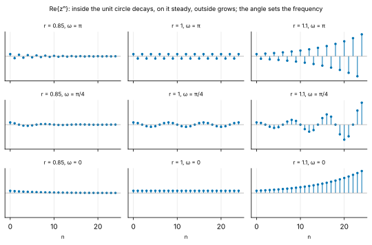
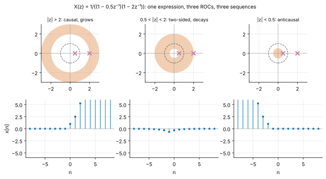
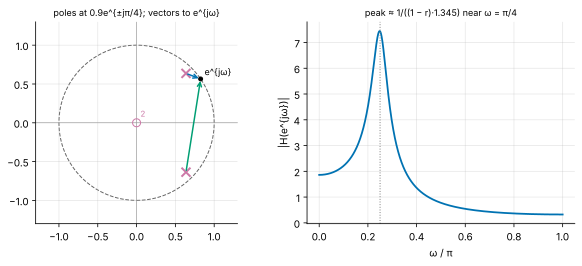
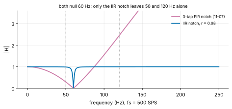
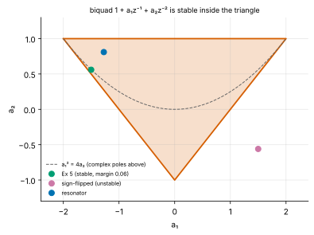
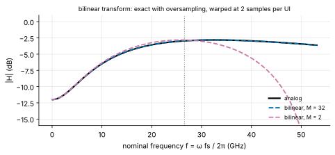

<!-- status: reviewed -->
# 11-09 · The z-Transform

| | |
|---|---|
| **Course** | [11 · Signals and Systems](../README.md) |
| **University equivalent** | The z-transform in a junior Signals and Systems course: definition and region of convergence, properties, inversion by partial fractions and power series, system functions of difference equations, causality and stability in the z-plane, geometric evaluation on the unit circle, and the link to the Laplace transform (Oppenheim & Willsky, *Signals and Systems*, ch. 10; Lathi, *Linear Systems and Signals*, ch. 5; MIT 6.003) |
| **Prerequisites** | [11-08 The Laplace Transform and System Functions](11-08-laplace-transform-and-system-functions.md), [11-07 The Discrete-Time Fourier Transform](11-07-discrete-time-fourier-transform.md), [11-04 LTI Systems and Differential/Difference Equations](11-04-lti-systems-and-differential-equations.md) (difference equations, resonators, biquads), [01-08 Sequences, Series and Taylor](../../01-calculus-for-engineers/chapters/01-08-sequences-series-and-taylor.md) (geometric series) |
| **Estimated study hours** | 10 |
| **Last verified** | 2026-11-20 |

**Learning objectives.** After this chapter you can:

1. Define the z-transform as the DTFT of an exponentially weighted sequence, find its region of convergence (an annulus), and explain why the ROC is part of the answer.
2. State and derive the ROC properties for finite, right-sided, left-sided and two-sided sequences, and decide when the DTFT equals $X(z)$ on the unit circle.
3. Invert rational z-transforms by partial fractions (choosing each term's side from the ROC) and by power-series long division, and solve difference equations with initial conditions using the unilateral transform.
4. Form the system function of a difference equation, decide causality and stability from its poles and ROC, and test a biquad's stability with the stability triangle.
5. Evaluate frequency responses geometrically on the unit circle, design simple pole–zero filters (resonator, notch), and map continuous-time systems to discrete time with $z = e^{sT}$ and the bilinear transform.

---

## 1. Big picture

The Laplace transform of 11-08 describes CT signals with exponentials $e^{st}$ and puts the frequency response on the imaginary axis. The **z-transform** does the same for sequences: it describes them with geometric sequences $z^n$, where $z$ is any complex number, and puts the frequency response of 11-07 on the **unit circle**, $\lvert z\rvert = 1$. Inside the circle, $z^n$ decays; outside, it grows. Every digital filter in a codec, a sensor hub, a radio or a SerDes simulator is a ratio of polynomials in $z^{-1}$, and its poles and zeros, placed relative to that circle, tell a designer whether it is stable, where it rings, where it notches and how long it takes to settle.

- **Recursive filters are pole placements.** A biquad's two feedback coefficients set a pole pair's radius and angle; the radius sets selectivity and ringing, the angle sets frequency.
- **Stability is a circle.** A causal digital filter is stable exactly when its poles are inside the unit circle. Fixed-point coefficient rounding moves poles, and a pole that crosses the circle turns a filter into an oscillator.
- **The FIR/IIR distinction is a pole question.** FIR filters have all their poles at $z = 0$ and are always stable; IIR filters buy sharpness with poles near the circle.
- **Analog designs become digital through a map from s to z.** Simulators, digital controllers and digitally assisted analog circuits all convert $H(s)$ to $H(z)$, and the map chosen decides what is preserved and what is distorted.
- **Decimation filters use pole–zero cancellation.** The sinc filters in sigma–delta converters are implemented as integrators and differencers whose pole at $z = 1$ is cancelled exactly by a zero.

## 2. Intuition first

**The z-plane is a map of geometric sequences.** Each point $z = re^{j\omega}$ stands for the sequence $z^n = r^ne^{j\omega n}$: a spiral whose radius changes by the factor $r$ each sample and whose angle advances by ω each sample. Points inside the unit circle are decaying sequences, points on it are pure DT sinusoids, and points outside are growing ones; the angle is the DT frequency of 11-07 (Figure 1). The real axis carries non-oscillating sequences: $0.8^n$ at $z = 0.8$, and the fastest alternation $(-0.8)^n$ at $z = -0.8$.

*Figure 1. $\operatorname{Re}\{z^n\}$ at nine points of the z-plane. Inside the unit circle ($r$ = 0.85) the sequence decays, on it ($r$ = 1) it is a steady DT sinusoid, outside ($r$ = 1.1) it grows; the angle sets how fast it oscillates, from none at ω = 0 to alternating at ω = π.*

**Compared with the s-plane.** The left half of the s-plane (decay) becomes the inside of the unit circle; the imaginary axis (steady oscillation) becomes the circle itself; and because DT frequency is only defined modulo 2π, the infinitely tall s-plane wraps around the circle. A sampled $e^{st}$ is exactly $(e^{sT})^n$, so sampling maps $s$ to $z = e^{sT}$ (§3.8).

**An analogy from finance: compounding per period, and where it breaks.** A cash flow of 1 per period growing by the factor $g$ each period is the sequence $g^n$. Its value discounted at a per-period factor $1/z$ is $\sum_{n\ge0}g^nz^{-n}$, a geometric series that converges when $\lvert g/z\rvert < 1$: the discount factor must outrun the growth, $\lvert z\rvert > g$. That sum is the z-transform of $g^nu[n]$, $1/(1 - gz^{-1})$, with ROC $\lvert z\rvert > g$. Periodic compounding is the natural home of the z-transform, as continuous compounding was for the Laplace transform. The analogy breaks, as in 11-08, because finance uses real positive discount factors while $z$ is complex: its angle (oscillation per period) has no counterpart in a discount rate. And a portfolio is valued at one rate, while a designer uses the whole function $X(z)$, especially where it blows up.

## 3. Theory

> **Conventions.** $X(z) = \sum_{n=-\infty}^{\infty}x[n]z^{-n}$, with $z = re^{j\omega}$ and ω in rad/sample (11-07). System functions are written in powers of $z^{-1}$, $H(z) = B(z)/A(z)$ with $A(z) = 1 + a_1z^{-1} + \cdots + a_Nz^{-N}$, matching the difference equation $y[n] + a_1y[n - 1] + \cdots = b_0x[n] + b_1x[n - 1] + \cdots$ of 11-04. Poles are ×, zeros ○, and the unit circle is drawn dashed.

### 3.1 From the DTFT to the z-transform

The DTFT $X(e^{j\omega}) = \sum x[n]e^{-j\omega n}$ (11-07) needs $\sum\lvert x[n]\rvert < \infty$. Weight the sequence by $r^{-n}$ first:

$$
\sum_{n=-\infty}^{\infty}\left[x[n]r^{-n}\right]e^{-j\omega n} = \sum_{n=-\infty}^{\infty}x[n]\left(re^{j\omega}\right)^{-n} .
$$

Writing $z = re^{j\omega}$ defines the **(bilateral) z-transform**

$$
X(z) = \sum_{n=-\infty}^{\infty}x[n]\,z^{-n} .
$$

Since $\lvert z^{-n}\rvert = r^{-n}$, the series converges absolutely when $\sum\lvert x[n]\rvert r^{-n} < \infty$. The set of $z$ where this holds is the **region of convergence** (ROC). The test depends only on $r = \lvert z\rvert$, so the ROC is made of circles centered on the origin.

**Inverse.** For a fixed $r$ in the ROC, $X(re^{j\omega})$ is the DTFT of $x[n]r^{-n}$, so the DTFT inverse of 11-07 gives $x[n]r^{-n} = \frac{1}{2\pi}\int_{2\pi}X(re^{j\omega})e^{j\omega n}d\omega$. Multiply by $r^n$ and change variable to $z = re^{j\omega}$, for which $dz = jz\,d\omega$ around the circle:

$$
x[n] = \frac{1}{2\pi}\int_{2\pi}X(re^{j\omega})\left(re^{j\omega}\right)^nd\omega = \frac{1}{2\pi j}\oint X(z)\,z^{n-1}\,dz ,
$$

a counterclockwise integral around any circle inside the ROC. As with the Laplace transform, partial fractions replace this integral in practice; its role is to show that $X(z)$ *with its ROC* determines $x[n]$.

> **Math refresher — the geometric series.** For complex $q$, $\sum_{n=0}^{N-1}q^n = (1 - q^N)/(1 - q)$ for $q \ne 1$ (multiply by $1 - q$ and watch the terms telescope). As $N \to \infty$ this converges to $1/(1 - q)$ exactly when $\lvert q\rvert < 1$, and diverges otherwise (01-08). Nearly every z-transform pair in this chapter is this one formula with $q = az^{-1}$ or $q = a^{-1}z$.

### 3.2 First transforms, and why the ROC matters

**A right-sided geometric sequence.** For $x[n] = a^nu[n]$,

$$
X(z) = \sum_{n=0}^{\infty}\left(az^{-1}\right)^n = \frac{1}{1 - az^{-1}} = \frac{z}{z - a}, \qquad \lvert z\rvert > \lvert a\rvert ,
$$

by the geometric series with $q = az^{-1}$, which converges when $\lvert a/z\rvert < 1$. There is a pole at $z = a$ and a zero at $z = 0$, and the ROC is the outside of the circle through the pole.

**A left-sided geometric sequence.** For $x[n] = -a^nu[-n - 1]$ (nonzero for $n \le -1$),

$$
X(z) = -\sum_{n=-\infty}^{-1}a^nz^{-n} = -\sum_{m=1}^{\infty}\left(a^{-1}z\right)^m = -\frac{a^{-1}z}{1 - a^{-1}z} = \frac{1}{1 - az^{-1}}, \qquad \lvert z\rvert < \lvert a\rvert ,
$$

substituting $m = -n$ and summing a geometric series in $q = z/a$. *The same formula belongs to two sequences, one living at $n \ge 0$ and one at $n < 0$*, and only the ROC (outside or inside the circle $\lvert z\rvert = \lvert a\rvert$) tells them apart. This is 11-08's central fact, with circles in place of vertical lines.

**More pairs.** The unit sample: $\delta[n] \leftrightarrow 1$ for all $z$. The step: $u[n] \leftrightarrow 1/(1 - z^{-1})$ for $\lvert z\rvert > 1$ ($a = 1$). A damped DT sinusoid, by Euler and the right-sided pair with $a = re^{\pm j\theta}$:

$$
r^n\cos(\theta n)\,u[n] \leftrightarrow \frac{1 - r\cos\theta\,z^{-1}}{1 - 2r\cos\theta\,z^{-1} + r^2z^{-2}}, \qquad r^n\sin(\theta n)\,u[n] \leftrightarrow \frac{r\sin\theta\,z^{-1}}{1 - 2r\cos\theta\,z^{-1} + r^2z^{-2}},
$$

both for $\lvert z\rvert > r$, with poles at $re^{\pm j\theta}$: the radius is the decay per sample and the angle the frequency, the resonator of 11-04.

**A finite boxcar.** For $x[n] = 1$ at $n = 0, \ldots, L - 1$, the finite geometric sum gives

$$
X(z) = \sum_{n=0}^{L-1}z^{-n} = \frac{1 - z^{-L}}{1 - z^{-1}} ,
$$

valid for every $z \ne 0$. The apparent pole at $z = 1$ is cancelled by one of the $L$ zeros of $1 - z^{-L}$ (the $L$th roots of unity), leaving zeros at $e^{j2\pi k/L}$ for $k = 1, \ldots, L - 1$: on the unit circle, these are the nulls of 11-07's Dirichlet kernel. The $L - 1$ poles left at $z = 0$ are the FIR filter's delays.

**A two-sided sequence.** $a^{\lvert n\rvert}$ with $\lvert a\rvert < 1$ is $a^nu[n]$ plus $a^{-n}u[-n - 1]$. The first converges for $\lvert z\rvert > \lvert a\rvert$; the second, a left-sided sequence with ratio $1/a$, for $\lvert z\rvert < 1/\lvert a\rvert$. The ROC is the ring $\lvert a\rvert < \lvert z\rvert < 1/\lvert a\rvert$, which contains the unit circle, so the DTFT exists: it is 11-07's $(1 - a^2)/(1 - 2a\cos\omega + a^2)$.

| Sequence | $X(z)$ | ROC |
|---|---|---|
| $\delta[n]$ | 1 | all $z$ |
| $\delta[n - k]$, $k > 0$ | $z^{-k}$ | $z \ne 0$ |
| $u[n]$ | $1/(1 - z^{-1})$ | $\lvert z\rvert > 1$ |
| $a^nu[n]$ | $1/(1 - az^{-1})$ | $\lvert z\rvert > \lvert a\rvert$ |
| $-a^nu[-n - 1]$ | $1/(1 - az^{-1})$ | $\lvert z\rvert < \lvert a\rvert$ |
| $na^nu[n]$ | $az^{-1}/(1 - az^{-1})^2$ | $\lvert z\rvert > \lvert a\rvert$ |
| $r^n\cos(\theta n)u[n]$ | $(1 - r\cos\theta\,z^{-1})/(1 - 2r\cos\theta\,z^{-1} + r^2z^{-2})$ | $\lvert z\rvert > r$ |
| $r^n\sin(\theta n)u[n]$ | $r\sin\theta\,z^{-1}/(1 - 2r\cos\theta\,z^{-1} + r^2z^{-2})$ | $\lvert z\rvert > r$ |
| boxcar, $0 \le n \le L - 1$ | $(1 - z^{-L})/(1 - z^{-1})$ | $z \ne 0$ |

The $na^nu[n]$ row follows from the differentiation property of §3.5.

### 3.3 Properties of the region of convergence

Each follows from the test $\sum\lvert x[n]\rvert r^{-n} < \infty$.

1. **The ROC is a single ring** $r_1 < \lvert z\rvert < r_2$ centered on the origin, possibly a disk, the outside of a disk, the whole plane or empty. Circles, because the test involves only $r$; a single ring, by the same convexity argument as 11-08's single strip ($r^{-n}$ between $r_1^{-n}$ and $r_2^{-n}$ is bounded by their sum for every $n$).
2. **No poles inside the ROC**, since $\lvert X(z)\rvert \le \sum\lvert x[n]\rvert r^{-n}$ is finite there. For rational $X$ the ring is bounded by poles.
3. **A finite-length sequence converges everywhere except possibly at $z = 0$ and $z = \infty$.** Terms with $n > 0$ contain $z^{-n}$, infinite at $z = 0$; terms with $n < 0$ contain $z^{\lvert n\rvert}$, infinite at $z = \infty$.
4. **A right-sided sequence has an ROC outside a circle**, $\lvert z\rvert > r_{max}$, the radius of the outermost pole for rational $X$. If the sequence is also zero for $n < 0$ (causal), the ROC includes $z = \infty$.
5. **A left-sided sequence has an ROC inside a circle**, $\lvert z\rvert < r_{min}$, the innermost pole.
6. **A two-sided sequence has a ring ROC** between two poles, or none.

   *Why 4–6 hold.* Suppose $x$ is right-sided, zero for $n < N_1$, and the test sum converges at some radius $r_0$. For $r > r_0$, each term with $n \ge 0$ is multiplied by $(r_0/r)^n \le 1$, so it can only shrink, and the finitely many terms with $N_1 \le n < 0$ are finite for any $r > 0$ (and absent if $x$ is causal, which is why $z = \infty$ is then included). So convergence at $r_0$ implies convergence at every larger radius: the ROC is the outside of a circle, bounded by the outermost pole. For a left-sided sequence the same argument runs the other way ($n \le 0$ terms shrink as $r$ decreases), giving the inside of a circle. A two-sided sequence is the sum of one of each, so its ROC is the overlap of an outside and an inside, a ring, or empty if the circles do not overlap.
7. **The DTFT and the unit circle.** If the ROC contains the unit circle, the sequence is absolutely summable and its DTFT is $X(e^{j\omega}) = X(z)\rvert_{z = e^{j\omega}}$. That is why 11-07 wrote the DTFT as $X(e^{j\omega})$.

For a rational $X(z)$ with poles at $N$ distinct radii, there are $N + 1$ possible rings, and so up to $N + 1$ sequences with the same algebraic $X(z)$ (Example 11-09.2, Figure 2).

*Figure 2. One expression, three sequences (Example 11-09.2). Outside $\lvert z\rvert$ = 2: causal and growing. The ring between the poles, which contains the unit circle (dashed): two-sided and decaying, the only one with a DTFT. Inside $\lvert z\rvert$ = 0.5: anticausal.*

### 3.4 Inverting the z-transform

**Partial fractions.** Write a rational $X(z)$ in powers of $z^{-1}$. If the numerator's degree is at least the denominator's, divide first; the quotient is a polynomial in $z^{-1}$, an FIR sequence. For distinct poles $p_k$ the proper remainder expands as

$$
X(z) = \sum_k\frac{A_k}{1 - p_kz^{-1}}, \qquad A_k = \left[(1 - p_kz^{-1})X(z)\right]_{z = p_k} .
$$

**Repeated poles.** A pole of multiplicity 2 at $p$ needs a second term, $B/(1 - pz^{-1})^2$. Its causal inverse follows from the sequence $na^nu[n] \leftrightarrow az^{-1}/(1 - az^{-1})^2$ (the table's row, from the differentiation property of §3.5): since $\frac{1}{(1 - az^{-1})^2} = \frac{az^{-1}}{(1 - az^{-1})^2} + \frac{1}{1 - az^{-1}}$ (put both over the common denominator: $az^{-1} + 1 - az^{-1} = 1$), its inverse is $na^nu[n] + a^nu[n] = (n + 1)a^nu[n]$. Higher multiplicities add terms with $(1 - pz^{-1})^{-3}$ and so on, whose inverses carry $n^2$ and higher powers.

The ROC chooses each term's side, exactly as in 11-08: if the ROC lies **outside** $\lvert p_k\rvert$, the term is $A_kp_k^nu[n]$; if it lies **inside**, the term is $-A_kp_k^nu[-n - 1]$. *Poles inside the ROC's inner circle make the future; poles outside its outer circle make the past.*

**Power series by long division.** For a causal sequence, dividing $B(z)$ by $A(z)$ as polynomials in $z^{-1}$ produces $x[0] + x[1]z^{-1} + x[2]z^{-2} + \cdots$ one coefficient at a time. That division is exactly the recursion of the difference equation run on a unit-sample input: each new quotient term is $x[n] = b_n - a_1x[n - 1] - \cdots - a_Nx[n - N]$ (with $b_n = 0$ beyond the numerator). It gives samples, not a closed form, and is the way a filter computes its own impulse response. (For a left-sided sequence, divide in ascending powers of $z$ instead.)

**The initial-value theorem.** For a causal sequence, every term $x[n]z^{-n}$ with $n \ge 1$ vanishes as $z \to \infty$, so $x[0] = \lim_{z\to\infty}X(z)$: a quick check on any inverse.

### 3.5 Properties

Each property follows by substituting into the defining sum. Let $x \leftrightarrow X$ with ROC $R$.

| Property | Sequence | Transform | ROC |
|---|---|---|---|
| Linearity | $ax_1 + bx_2$ | $aX_1 + bX_2$ | at least $R_1 \cap R_2$ |
| Time shift | $x[n - k]$ | $z^{-k}X(z)$ | $R$, except possibly 0 or ∞ |
| Scaling by $a^n$ | $a^nx[n]$ | $X(z/a)$ | $\lvert a\rvert R$ |
| Time reversal | $x[-n]$ | $X(1/z)$ | $1/R$ |
| Differentiation in $z$ | $n\,x[n]$ | $-z\,dX/dz$ | $R$ |
| Convolution | $x * h$ | $X(z)H(z)$ | at least $R_x \cap R_h$ |
| Accumulation | $\sum_{k\le n}x[k]$ | $X(z)/(1 - z^{-1})$ | at least $R \cap \{\lvert z\rvert > 1\}$ |

**Time shift.** With $m = n - k$: $\sum x[n - k]z^{-n} = z^{-k}\sum x[m]z^{-m}$. A delay of one sample multiplies by $z^{-1}$, which is why block diagrams label delay elements $z^{-1}$.

**Convolution.** $\sum_n\left(\sum_kh[k]x[n - k]\right)z^{-n} = \sum_kh[k]z^{-k}\sum_nx[n - k]z^{-(n-k)} = H(z)X(z)$, where the swap of sums is justified by absolute convergence in $R_x \cap R_h$.

**The unilateral z-transform and initial conditions.** $X_I(z) = \sum_{n\ge0}x[n]z^{-n}$ is the bilateral transform of $x[n]u[n]$. Its shift property keeps the sample that slides in from $n = -1$:

$$
x[n - 1] \leftrightarrow z^{-1}X_I(z) + x[-1], \qquad x[n - 2] \leftrightarrow z^{-2}X_I(z) + x[-1]z^{-1} + x[-2] ,
$$

because $\sum_{n\ge0}x[n - 1]z^{-n} = x[-1] + \sum_{m\ge0}x[m]z^{-(m+1)}$. Transforming a difference equation with these rules brings in its initial conditions, and the solution splits into zero-input and zero-state parts as in 11-02 (Example 11-09.7). It is the DT version of the $x(0^-)$ term of 02-05 and 11-08.

### 3.6 System functions, causality and stability

The system function of an LTI system is $H(z) = \sum h[n]z^{-n}$. 11-04 showed that the input $z^n$ produces $H(z)z^n$; now we add that this holds for $z$ in the ROC. Transforming the difference equation $\sum_ka_ky[n - k] = \sum_kb_kx[n - k]$ with the time-shift property gives

$$
H(z) = \frac{Y(z)}{X(z)} = \frac{b_0 + b_1z^{-1} + \cdots + b_Mz^{-M}}{1 + a_1z^{-1} + \cdots + a_Nz^{-N}} .
$$

Its poles are the characteristic roots of 11-04 (roots of $z^N + a_1z^{N-1} + \cdots + a_N$), and its zeros come from the numerator.

- **Causality.** A causal $h$ is right-sided and zero for $n < 0$, so its ROC is the outside of a circle and includes $z = \infty$. For rational $H$ written in powers of $z^{-1}$, that means the ROC is outside the outermost pole.
- **Stability.** BIBO stability is $\sum\lvert h[n]\rvert < \infty$ (11-03), the ROC test at $r = 1$. So **an LTI system is stable exactly when the ROC of $H(z)$ contains the unit circle.**
- **Both.** A causal rational system is stable exactly when **all its poles lie strictly inside the unit circle**, $\lvert p_k\rvert < 1$.
- **FIR filters** have $A(z) = 1$, so in positive powers of $z$ all their poles sit at $z = 0$: every FIR filter is stable. IIR filters have poles elsewhere, and stability must be designed and kept.

**The biquad stability triangle.** A second-order section $A(z) = 1 + a_1z^{-1} + a_2z^{-2}$ with real coefficients has poles at the roots of $P(z) = z^2 + a_1z + a_2$. Both are inside the unit circle exactly when

$$
\lvert a_2\rvert < 1 \qquad\text{and}\qquad \lvert a_1\rvert < 1 + a_2 ,
$$

a triangle in the $(a_1, a_2)$ plane (Figure 5). *Derivation.* The product of the roots is $a_2$. If they are a complex pair, both have $\lvert p\rvert^2 = a_2$, so they are inside exactly when $a_2 < 1$; and a real quadratic with complex roots is positive on the real axis, so $P(\pm1) > 0$ holds automatically. If they are real, $P(1) = (1 - p_1)(1 - p_2)$ and $P(-1) = (1 + p_1)(1 + p_2)$. Both roots in $(-1, 1)$ makes both products positive and $\lvert p_1p_2\rvert < 1$. Conversely, suppose $P(1) > 0$, $P(-1) > 0$ and $\lvert p_1p_2\rvert < 1$: if $p_1 \ge 1$, then $P(1) > 0$ forces $p_2 > 1$ too, and $p_1p_2 > 1$, a contradiction; the same happens for $p_1 \le -1$. So both roots are in $(-1, 1)$. Finally $P(1) > 0$ and $P(-1) > 0$ are $1 + a_1 + a_2 > 0$ and $1 - a_1 + a_2 > 0$, together $\lvert a_1\rvert < 1 + a_2$. The poles are complex inside the parabola $a_1^2 < 4a_2$, real outside it.

### 3.7 Geometric evaluation on the unit circle

Write $H(z)$ in positive powers of $z$, $H(z) = Kz^{N-M}\prod_i(z - z_i)/\prod_k(z - p_k)$. On the unit circle $z = e^{j\omega}$, the factor $z^{N-M}$ has magnitude 1 (a pure delay or advance), so

$$
\lvert H(e^{j\omega})\rvert = \lvert K\rvert\,\frac{\prod_i\lvert e^{j\omega} - z_i\rvert}{\prod_k\lvert e^{j\omega} - p_k\rvert} .
$$

The magnitude response is the product of the distances from the point $e^{j\omega}$ to the zeros divided by the product of the distances to the poles, *as the point walks around the circle* from DC ($z = 1$) through $f_s/4$ ($z = j$) to half the sample rate ($z = -1$). Everything in 11-08 §3.7 carries over, with the circle in place of the axis:

- a pole close to the circle at angle θ makes a peak near ω = θ;
- a zero on the circle at angle θ makes a perfect null at ω = θ; zeros at $z = -1$ kill half the sample rate, zeros at $z = 1$ kill DC;
- a pole at radius $r$ close to 1 gives a −3 dB bandwidth of about $2(1 - r)$ rad/sample, because near the pole the distance is $\sqrt{(1 - r)^2 + (\omega - \theta)^2}$, which grows by $\sqrt2$ at $\lvert\omega - \theta\rvert = 1 - r$. Its impulse response decays as $r^n$, with time constant $-1/\ln r \approx 1/(1 - r)$ samples: narrow bandwidth and long ringing are the same fact.

**The IIR notch.** 11-07's Problem 8 found that a three-tap FIR notch (zeros only) is far too wide: it attenuates 50 Hz to 0.30 and amplifies 120 Hz by 2.5. The fix is to put a pole just inside the circle next to each zero:

$$
H(z) = K\,\frac{1 - 2\cos\omega_0\,z^{-1} + z^{-2}}{1 - 2r\cos\omega_0\,z^{-1} + r^2z^{-2}} .
$$

Away from ω₀, each pole is almost as far from the point $e^{j\omega}$ as its neighboring zero, so their ratio is nearly 1 and the response is flat. Only near ω₀, where the zero's distance shrinks to 0 while the pole's stays at least $1 - r$, does the response dip. The notch's −3 dB width is about $2(1 - r)$ rad/sample (Example 11-09.4).

*Figure 3. Geometric evaluation for the resonator of 11-04 and 11-07 (poles at $0.9e^{\pm j\pi/4}$, Example 11-09.3). The near pole's vector is short as the point on the unit circle passes angle π/4, giving a peak of about 7.4.*

### 3.8 From s to z

**Sampling maps s to z.** Sampling $e^{st}$ at $t = nT$ gives $e^{snT} = (e^{sT})^n$, a geometric sequence with ratio

$$
z = e^{sT}: \qquad s = \sigma + j\Omega \;\mapsto\; \lvert z\rvert = e^{\sigma T}, \quad \angle z = \Omega T .
$$

(Here Ω in rad/s is the CT frequency, to keep it apart from the DT ω in rad/sample.) The left half-plane σ < 0 maps inside the unit circle, the imaginary axis onto it, and every horizontal strip of height $2\pi/T$ onto the whole plane: frequencies differing by the sample rate land on the same $z$, which is aliasing (11-10). A CT pole pair $-\alpha \pm j\omega_d$ becomes a DT pole pair at radius $e^{-\alpha T}$ and angle $\omega_dT$. Sampling a CT impulse response, $h[n] = Th(nT)$, puts the DT poles exactly there; this is the **impulse-invariance** method, which preserves the impulse response's shape but aliases its frequency response.

**The bilinear transform.** Most analog-to-digital filter conversions instead substitute

$$
s = \frac{2}{T}\,\frac{1 - z^{-1}}{1 + z^{-1}}, \qquad\text{equivalently}\qquad z = \frac{1 + sT/2}{1 - sT/2} .
$$

It comes from the trapezoidal rule for integration ($1/s$ replaced by $\frac{T}{2}\frac{1 + z^{-1}}{1 - z^{-1}}$). It maps the whole left half-plane into the unit disk, so stable analog filters stay stable, and it maps the entire imaginary axis onto the circle exactly once, so there is no aliasing. The price is **frequency warping**: putting $z = e^{j\omega}$ into $s = j\Omega$ gives

$$
\Omega = \frac{2}{T}\tan\frac{\omega}{2}, \qquad \omega = 2\arctan\frac{\Omega T}{2} .
$$

Low frequencies map almost linearly ($\omega \approx \Omega T$ when $\Omega T \ll 1$), while the infinite analog axis is compressed into ω < π. DC maps to $z = 1$ exactly (DC gain is preserved), and $s = \infty$ maps to $z = -1$, so an analog filter with more poles than zeros gains zeros at $z = -1$. Designers either oversample heavily, so the band of interest has $\Omega T \ll 1$, or **prewarp**: replace the constant $2/T$ by $\Omega_c/\tan(\omega_c/2)$, which makes one chosen critical frequency $\Omega_c$ land exactly on its intended digital frequency $\omega_c$ (the rest of the band is still warped around it; Example 11-09.6).

> **Going deeper — why poles near z = 1 are hard to place.** In a biquad with $B$ fractional bits, $a_2 = r^2$ and $a_1 = -2r\cos\theta$ can only take values on a grid of step $2^{-B}$. Near $z = 1$ (θ small, $r$ near 1), $\cos\theta \approx 1 - \theta^2/2$ changes only quadratically with θ, so the grid of realizable angles is very coarse there. With $B$ = 15 and the largest radius below 1, the smallest nonzero angle that the direct-form coefficients can express is **0.005524** rad, which at a 48 kHz sample rate is **42.20** Hz. A high-Q filter at a few tens of hertz in a 48 kHz audio stream cannot be placed accurately in a direct-form biquad at that word length; designers raise the word length, decimate first, or use structures (coupled or lattice forms) whose realizable poles are spread more evenly. The lab plots the grid.

## 4. Worked examples

### Example 11-09.1 · Two geometric sequences (tier A)

**Setup.** For $x[n] = 0.5^nu[n] + 0.25^nu[n]$, find $X(z)$, its poles, zero and ROC; evaluate $X(1)$ and $X(-1)$, and check $x[0]$ with the initial-value theorem.

**Solution.** By linearity and the right-sided pair,

$$
X(z) = \frac{1}{1 - 0.5z^{-1}} + \frac{1}{1 - 0.25z^{-1}} = \frac{2 - 0.75z^{-1}}{(1 - 0.5z^{-1})(1 - 0.25z^{-1})} .
$$

In positive powers, $X(z) = z(2z - 0.75)/[(z - 0.5)(z - 0.25)]$: poles at 0.5 and 0.25, zeros at 0 and **0.375**. Both terms converge for $\lvert z\rvert > 0.5$, the outermost pole. The ROC contains the unit circle, so $X(1)$ is the DTFT at DC, the sum of the sequence: $2 + \tfrac43$ = **3.333**. At $z = -1$ (ω = π): $1/1.5 + 1/1.25$ = **1.467**. As $z \to \infty$, $X \to 1 + 1$ = **2** = $x[0]$.

**Sanity check.** $\sum_n0.5^n = 2$ and $\sum_n0.25^n = \tfrac43$: the geometric series sums agree with $X(1)$.

### Example 11-09.2 · One expression, three sequences (tier B)

**Setup.** $X(z) = 1/[(1 - 0.5z^{-1})(1 - 2z^{-1})]$. (a) Find the residues. (b) Write the sequence for each possible ROC and classify it. (c) For the stable one, find $x[0]$, $x[-1]$, $x[2]$ and its sum. (d) Find the causal sequence at $n = 3$ and the anticausal one at $n = -2$.

**Solution.** (a) $A_1 = [1/(1 - 2z^{-1})]_{z = 0.5} = 1/(1 - 4)$ = **−0.3333**; $A_2 = [1/(1 - 0.5z^{-1})]_{z = 2} = 1/(1 - 0.25)$ = **1.333**.

(b) Poles at radii 0.5 and 2 allow three ROCs (Figure 2).

- $\lvert z\rvert > 2$: both terms right-sided, $x = -\tfrac13(0.5)^nu[n] + \tfrac43\,2^nu[n]$. Causal and growing; no DTFT.
- $0.5 < \lvert z\rvert < 2$: the pole at 0.5 is inside the ring (right-sided term) and the pole at 2 outside it (left-sided term): $x = -\tfrac13(0.5)^nu[n] - \tfrac43\,2^nu[-n - 1]$. Two-sided and decaying both ways; the ring contains the unit circle, so this is the stable one.
- $\lvert z\rvert < 0.5$: both left-sided, $x = \tfrac13(0.5)^nu[-n - 1] - \tfrac43\,2^nu[-n - 1]$. Anticausal; it grows as $n \to -\infty$ through $(0.5)^n$.

(c) $x[0] = -\tfrac13$ = **−0.3333**; $x[-1] = -\tfrac43 \times 2^{-1}$ = **−0.6667**; $x[2] = -\tfrac13 \times 0.25$ = **−0.08333**. Its sum is $X(1) = 1/[(0.5)(-1)]$ = **−2**, which checks: $-\tfrac13 \times 2 - \tfrac43 \times 1 = -2$.

(d) Causal: $x[3] = -\tfrac13(0.125) + \tfrac43(8)$ = **10.625**. Anticausal: $x[-2] = \tfrac13(4) - \tfrac43(0.25)$ = **1**.

**What it means.** A pole outside the unit circle makes a filter either causal and unstable or stable and noncausal: the DT version of 11-08's Example 2.

### Example 11-09.3 · The resonator, three ways (tier B)

**Setup.** The resonator of 11-04 has poles at $0.9e^{\pm j\pi/4}$. (a) Write $H(z)$ and its coefficients. (b) Find $h[0]$ to $h[4]$ by long division and check $h[3]$ against the closed form $r^n\sin((n + 1)\theta)/\sin\theta$. (c) Find the DC gain. (d) Estimate the peak gain and the −3 dB bandwidth geometrically, and compare with the exact values from 11-07 (7.443 and 0.2140 rad/sample).

**Solution.** (a) $H(z) = 1/(1 + a_1z^{-1} + a_2z^{-2})$ with $a_1 = -2(0.9)\cos(\pi/4)$ = **−1.273** and $a_2 = 0.81$.

(b) Long division is the recursion $h[n] = -a_1h[n - 1] - a_2h[n - 2]$ from $h[0] = 1$: $h[1]$ = **1.273**, $h[2] = a_1^2 - 0.81 = 1.62 - 0.81$ = **0.81** (with the exact $a_1 = 0.9\sqrt2$, $a_1^2 = 1.62$), $h[3] = a_1 \times 0.81 - 0.81 \times a_1$ = **0**, $h[4]$ = **−0.6561**. The closed form gives $h[3] = 0.9^3\sin(\pi)/\sin(\pi/4) = 0$: the ringing has a period of 8 samples, and $n = 3$ falls on a zero crossing of $\sin((n + 1)\pi/4)$.

(c) $H(1) = 1/(1 - 1.2728 + 0.81)$ = **1.861** (carry $a_1$ to five digits: 1.273 would give 1.862): geometrically, $1/\lvert1 - p\rvert^2$, the inverse squared distance from $z = 1$ to the poles.

(d) At $e^{j\pi/4}$ the near pole is at distance $1 - r = 0.1$, the far pole at $\lvert e^{j\pi/4} - 0.9e^{-j\pi/4}\rvert$ = **1.345**. So the peak is about $1/(0.1 \times 1.345)$ = **7.433**, within **0.14**% of the exact 7.443 (the true peak sits slightly off π/4 because the far pole's distance also varies). The bandwidth estimate $2(1 - r)$ = **0.2** rad/sample is **6.5**% below the exact 0.2140: at $r$ = 0.9 the pole is not very close to the circle.

**Sanity check.** $H(z)$ in positive powers is $z^2/[(z - p)(z - p^*)]$; the double zero at the origin is at distance 1 from every point on the circle, so it does not affect the magnitude.

### Example 11-09.4 · A notch that works (tier B)

**Setup.** Reject 60 Hz mains interference from an ECG sampled at 500 SPS (11-07, Problem 8) with the IIR notch of §3.7, $r$ = 0.98, normalized to unity DC gain. (a) Find ω₀, the coefficients and the normalizing gain $K$. (b) Find the gains at 50 Hz, 120 Hz and half the sample rate. (c) Find the −3 dB notch edges and width, and compare with the estimate $2(1 - r)$.

**Solution.** (a) $\omega_0 = 2\pi \times 60/500$ = **0.24**π, $\cos\omega_0$ = **0.7290**. Numerator $1 - 1.4579z^{-1} + z^{-2}$; denominator $1 - 2r\cos\omega_0z^{-1} + r^2z^{-2}$ with $a_1$ = **−1.4288** and $a_2$ = **0.9604**. The unnormalized DC gain is $(2 - 2\cos\omega_0)/(1 + a_1 + a_2)$, so $K = (1 + a_1 + a_2)/(2 - 2\cos\omega_0)$ = **0.9807**.

(b) Evaluating $\lvert H(e^{j\omega})\rvert$ at ω = 2π × 50/500, 2π × 120/500 and π: **0.9879**, **1.0003** and **1.0006**. Compare 11-07's FIR notch: 0.2953 and 2.458.

(c) Solving $\lvert H\rvert = 1/\sqrt2$ on each side of ω₀ gives edges at **58.39** Hz and **61.61** Hz, a width of **3.211** Hz. The estimate is $2(1 - r) = 0.04$ rad/sample, or $0.04 \times 500/(2\pi)$ = **3.183** Hz, within 1%.

**Sanity check.** The poles are at radius 0.98, so the notch's transient decays as $0.98^n$, with time constant $1/\ln(1/0.98) \approx 49.5$ samples, about 0.1 s: a narrower notch would take longer to settle when the hum changes.

*Figure 4. The three-tap FIR notch of 11-07 (zeros only) against the IIR notch with poles at radius 0.98: both null 60 Hz, but only the IIR notch leaves 50 Hz and 120 Hz near unity gain.*

### Example 11-09.5 · The stability triangle in practice (tier B)

**Setup.** 11-04's Example 3 used $y[n] = 1.5y[n - 1] - 0.56y[n - 2] + x[n]$, and its Example 6 noted that CMSIS-DSP expects the feedback coefficients with the opposite sign [1]. (a) Place the correct section in the triangle and find its margin $1 + a_2 - \lvert a_1\rvert$. (b) Do the same for the sign-flipped entry and find its roots. (c) Find the resonator's margin.

**Solution.** (a) In this chapter's convention $A(z) = 1 - 1.5z^{-1} + 0.56z^{-2}$, so $a_1 = -1.5$, $a_2 = 0.56$: $\lvert a_2\rvert < 1$ and $1.5 < 1.56$, stable, but with a margin of only **0.06**, because one pole (at 0.8) is fairly close to $z = 1$. Its $P(1) = 1 - 1.5 + 0.56$ is the same 0.06.

(b) Entering the coefficients with the wrong sign gives $a_1 = +1.5$, $a_2 = -0.56$: $1 + a_2 = 0.44 < 1.5$, outside the triangle, with $P(-1) = 1 - 1.5 - 0.56$ = **−1.06** < 0. The roots of $z^2 + 1.5z - 0.56$ are **0.3095** and **−1.809**: one pole outside the circle on the negative real axis, so the "filter" oscillates at half the sample rate with growing amplitude.

(c) The resonator ($a_1 = -1.273$, $a_2 = 0.81$) has margin $1.81 - 1.273$ = **0.5372**, well inside.

**Sanity check.** The margin $1 + a_2 - \lvert a_1\rvert$ equals $\min(P(1), P(-1))$; for the stable section it is the product $(1 - 0.7)(1 - 0.8) = 0.06$.

*Figure 5. The biquad stability triangle $\lvert a_2\rvert < 1$, $\lvert a_1\rvert < 1 + a_2$, with the parabola $a_1^2 = 4a_2$ (complex poles above it). The design of Example 11-09.5 sits just inside the left edge (and just below the parabola: real poles at 0.7 and 0.8); its sign-flipped twin is far outside.*

### Example 11-09.6 · A SerDes equalizer, digitized (tier C)

**Setup.** The IEEE 802.3ck COM tool applies its reference CTLE (11-08, Example 6) to sampled pulse responses by converting it to a digital filter with the bilinear transform, using $2/T = 2f_bM$, where $M$ is the number of samples per unit interval; its backplane configuration uses $M$ = 32 [2] (task-force tool version 3.70 and a draft 3.1 configuration; the values in the published standard were not checked). For $g_{DC}$ = −12 dB (zero at 5.338 GHz, poles at 21.25 and 53.125 GHz, $f_b$ = 53.125 GBd): (a) find $T$ and the digital poles and zero for $M$ = 32; (b) find the DT frequency of the Nyquist frequency $f_b/2$, the analog frequency the bilinear transform maps there, and the digital filter's gain at that point compared with the analog −2.946 dB; (c) repeat (a) and (b) for $M$ = 2.

**Solution.** (a) $T = 1/(32 \times 53.125\ \text{GHz})$ = **0.5882** ps. Each real pole or zero at $s = -2\pi f$ maps to $z = (1 + sT/2)/(1 - sT/2)$: the poles go to **0.9244** (21.25 GHz) and **0.8212** (53.125 GHz), and the zero to **0.9805**. The analog filter has one more pole than zeros, so the digital filter also gets a zero at $z = -1$, which the COM code includes explicitly [2].

(b) $f_b/2$ is at $\omega = 2\pi(f_b/2)T = \pi/M$ = **0.09817** rad/sample. The bilinear transform maps this ω to the analog frequency $\frac{1}{\pi T}\tan(\omega/2)$ = **26.58** GHz, only **0.080**% above 26.5625 GHz. The digital filter there has the analog response at 26.58 GHz, **−2.945** dB: warping costs **0.0011** dB.

(c) With $M$ = 2, $T$ = **9.412** ps, the poles map to **0.2283** and **−0.2220** and the zero to **0.7274**. Nyquist is now at ω = π/2, which the bilinear transform takes to $\frac{1}{\pi T}\tan(\pi/4)$ = **33.82** GHz, **27.3**% too high, and the digital gain there is **−2.816** dB, **0.130** dB off. With only two samples per UI the CTLE's second pole sits at $f_b = f_s/2$, the very edge of what the digital filter can represent, and the whole band of interest is warped. Prewarping can make the response exact at one chosen frequency, such as Nyquist, but not across the band; the remedy is more samples per UI, which is why the configuration uses 32.

**Sanity check.** Both versions keep the DC gain at exactly −12 dB, because $s = 0$ maps to $z = 1$. Heavy oversampling ($M$ = 32) makes $\Omega T \ll 1$ across the band of interest, where the bilinear transform is almost exactly the identity map $\omega = \Omega T$.

*Figure 6. The reference CTLE at $g_{DC}$ = −12 dB (Example 11-09.6): analog, and digitized by the bilinear transform at $M$ = 32 and $M$ = 2 samples per UI, each plotted against the nominal frequency $f = \omega/(2\pi T)$ (the frequency a sample-rate conversion would assign, not the warped analog frequency of Example 11-09.6(b)). At $M$ = 32 the curves coincide up to Nyquist; at $M$ = 2 warping compresses the response toward $f_b$.*

### Example 11-09.7 · A difference equation with an initial condition (tier B)

**Setup.** Solve $y[n] = 0.5y[n - 1] + x[n]$ for $x[n] = u[n]$ with $y[-1] = 4$, using the unilateral z-transform. Split the result into zero-input and zero-state parts, and give $y[0]$, $y[1]$, $y[5]$ and the final value.

**Solution.** Transforming with $y[n - 1] \leftrightarrow z^{-1}Y + y[-1]$:

$$
Y(z) - 0.5\left[z^{-1}Y(z) + 4\right] = \frac{1}{1 - z^{-1}} \;\Rightarrow\; Y(z) = \underbrace{\frac{2}{1 - 0.5z^{-1}}}_{\text{zero-input}} + \underbrace{\frac{1}{(1 - 0.5z^{-1})(1 - z^{-1})}}_{\text{zero-state}} .
$$

The zero-input part is $2(0.5)^n$. The zero-state part has residues $1/(1 - 0.5) = 2$ at $z = 1$ and $1/(1 - 2) = -1$ at $z = 0.5$, so it is $2 - 0.5^n$. Together, $y[n] = 2 + 0.5^n$ for $n \ge 0$: $y[0]$ = **3**, $y[1]$ = **2.5**, $y[5]$ = **2.03125**, and the final value is **2**.

**Sanity check.** Iterating directly: $y[0] = 0.5 \times 4 + 1 = 3$, $y[1] = 0.5 \times 3 + 1 = 2.5$. The final value is the DC gain $1/(1 - 0.5) = 2$ times the step.

### Answer key

<!-- answer-key -->
| ID | Quantity | Value | Unit |
|---|---|---|---|
| T 11-09.a | smallest realizable angle, 15 fractional bits | 0.005524 | rad/sample |
| T 11-09.b | that angle at 48 kHz | 42.20 | Hz |
| T 11-09.c | FIR notch gain at 50 Hz (11-07) | 0.2953 | — |
| T 11-09.d | FIR notch gain at 120 Hz (11-07) | 2.458 | — |
| T 11-09.e | ADS1292R sinc-filter decimation ratio at 500 SPS | 256 | — |
| T 11-09.f | number of possible ROCs, poles at radii 0.5 and 2 | 3 | — |
| T 11-09.g | resonance for poles at 0.1π, 10 kHz | 500 | Hz |
| T 11-09.h | bandwidth for radius 0.99, 10 kHz | 31.8 | Hz |
| T 11-09.i | time constant for radius 0.99 | 100 | samples |
| T 11-09.j | that time constant at 10 kHz | 10 | ms |
| T 11-09.k | hum transient to 1%, r = 0.98 | 228 | samples |
| T 11-09.l | that time at 500 SPS | 0.456 | s |
| T 11-09.m | slowdown for r = 0.995 | 4.03 | — |
| Ex 11-09.1a | zero | 0.375 | — |
| Ex 11-09.1b | X(1) | 3.333 | — |
| Ex 11-09.1c | X(−1) | 1.467 | — |
| Ex 11-09.1d | x[0] | 2 | — |
| Ex 11-09.2a | residue at 0.5 | −0.3333 | — |
| Ex 11-09.2b | residue at 2 | 1.333 | — |
| Ex 11-09.2c | stable x[0] | −0.3333 | — |
| Ex 11-09.2d | stable x[−1] | −0.6667 | — |
| Ex 11-09.2e | stable x[2] | −0.08333 | — |
| Ex 11-09.2f | stable sum X(1) | −2 | — |
| Ex 11-09.2g | causal x[3] | 10.625 | — |
| Ex 11-09.2h | anticausal x[−2] | 1 | — |
| Ex 11-09.3a | a₁ | −1.273 | — |
| Ex 11-09.3b | h[1] | 1.273 | — |
| Ex 11-09.3c | h[2] | 0.81 | — |
| Ex 11-09.3d | h[3] | 0 | — |
| Ex 11-09.3e | h[4] | −0.6561 | — |
| Ex 11-09.3f | DC gain | 1.861 | — |
| Ex 11-09.3g | far-pole distance at π/4 | 1.345 | — |
| Ex 11-09.3h | estimated peak | 7.433 | — |
| Ex 11-09.3i | estimated bandwidth | 0.2 | rad/sample |
| Ex 11-09.3j | peak estimate's error | 0.14 | % |
| Ex 11-09.3k | bandwidth estimate's shortfall | 6.5 | % |
| Ex 11-09.4a | ω₀ | 0.24 | π rad/sample |
| Ex 11-09.4b | cos ω₀ | 0.7290 | — |
| Ex 11-09.4c | a₁ | −1.4288 | — |
| Ex 11-09.4d | a₂ | 0.9604 | — |
| Ex 11-09.4e | normalizing gain K | 0.9807 | — |
| Ex 11-09.4f | gain at 50 Hz | 0.9879 | — |
| Ex 11-09.4g | gain at 120 Hz | 1.0003 | — |
| Ex 11-09.4h | gain at half the sample rate | 1.0006 | — |
| Ex 11-09.4i | lower −3 dB edge | 58.39 | Hz |
| Ex 11-09.4j | upper −3 dB edge | 61.61 | Hz |
| Ex 11-09.4k | notch width | 3.211 | Hz |
| Ex 11-09.4l | estimated width | 3.183 | Hz |
| Ex 11-09.4m | numerator middle coefficient magnitude | 1.4579 | — |
| Ex 11-09.4n | transient time constant | 49.5 | samples |
| Ex 11-09.5a | margin of the correct section | 0.06 | — |
| Ex 11-09.5b | P(−1) of the sign-flipped section | −1.06 | — |
| Ex 11-09.5c | sign-flipped root, inside | 0.3095 | — |
| Ex 11-09.5d | sign-flipped root, outside | −1.809 | — |
| Ex 11-09.5e | resonator margin | 0.5372 | — |
| Ex 11-09.6a | T at M = 32 | 0.5882 | ps |
| Ex 11-09.6b | digital pole for 21.25 GHz, M = 32 | 0.9244 | — |
| Ex 11-09.6c | digital pole for 53.125 GHz, M = 32 | 0.8212 | — |
| Ex 11-09.6d | digital zero, M = 32 | 0.9805 | — |
| Ex 11-09.6e | Nyquist in DT frequency, M = 32 | 0.09817 | rad/sample |
| Ex 11-09.6f | analog frequency mapped there, M = 32 | 26.58 | GHz |
| Ex 11-09.6g | digital gain there, M = 32 | −2.945 | dB |
| Ex 11-09.6h | T at M = 2 | 9.412 | ps |
| Ex 11-09.6i | digital pole for 21.25 GHz, M = 2 | 0.2283 | — |
| Ex 11-09.6j | digital pole for 53.125 GHz, M = 2 | −0.2220 | — |
| Ex 11-09.6k | digital zero, M = 2 | 0.7274 | — |
| Ex 11-09.6l | analog frequency mapped to π/2, M = 2 | 33.82 | GHz |
| Ex 11-09.6m | digital gain there, M = 2 | −2.816 | dB |
| Ex 11-09.6n | analog Nyquist gain | −2.946 | dB |
| Ex 11-09.6o | frequency warping at Nyquist, M = 32 | 0.080 | % |
| Ex 11-09.6p | gain error at Nyquist, M = 32 | 0.0011 | dB |
| Ex 11-09.6q | frequency warping at Nyquist, M = 2 | 27.3 | % |
| Ex 11-09.6r | gain error at Nyquist, M = 2 | 0.130 | dB |
| Ex 11-09.7a | y[0] | 3 | — |
| Ex 11-09.7b | y[1] | 2.5 | — |
| Ex 11-09.7c | y[5] | 2.03125 | — |
| Ex 11-09.7d | final value | 2 | — |

*Every value is recomputed by [verify_11_09.py](../verify/verify_11_09.py): transforms by summing the defining series numerically (never from the table), residues as numerical limits, sequences by running the difference equations and by checking that candidate sequences sum back to $X(z)$ inside their ROCs, frequency responses by direct evaluation on the unit circle, notch edges by root finding, stability by `numpy.roots`, and the bilinear mapping by transforming the CTLE with `scipy.signal.bilinear_zpk` and evaluating the digital filter.*

## 5. Simulate it

The lab, [labs/11-09-lab](../labs/11-09-lab/README.md), is a notebook in four parts:

1. Watches the partial sums of $\sum x[n]z^{-n}$ converge or diverge at points inside and outside each ROC of Example 11-09.2.
2. Places poles and zeros and compares the geometric magnitude with direct evaluation; then filters a synthetic ECG with 60 Hz hum through the FIR and IIR notches.
3. Draws the stability triangle and the grid of poles a biquad can realize with a given number of fractional bits.
4. Converts the CTLE to digital form with the bilinear transform at several oversampling ratios, with and without prewarping.

**Guided exercise (predict, then run).** **Before running Part 2's hum test**, predict: if the hum's amplitude doubles suddenly, how long does the IIR notch with $r$ = 0.98 take to suppress the new hum to 1% of its jump, and would $r$ = 0.995 be faster or slower? Then run it. (The transient decays as $r^n$: about **228** samples, **0.456** s, for $r$ = 0.98; **4.03** times longer for $r$ = 0.995, whose notch is four times narrower.)

## 6. Engineering tradeoffs

| Knob | Improves | Costs | Typical decision owner |
|---|---|---|---|
| Pole radius closer to 1 | Narrower peak or notch | Longer transients; coefficient sensitivity; closer to instability | DSP designer |
| IIR instead of FIR | Sharp responses with a few MACs | Nonlinear phase; stability and word-length care | DSP or system architect |
| Coefficient word length | Accurate pole placement, especially near $z = 1$ | Memory, multiplier width, power | DSP or hardware designer |
| Sample rate (oversampling) | Less warping and aliasing in s-to-z maps | More samples to compute; poles crowd toward $z = 1$ | System architect |
| Biquad cascade vs direct form | Robust pole placement per section | Section ordering and scaling decisions | DSP designer |
| Bilinear vs impulse invariance | No aliasing; stability preserved | Frequency warping (prewarp needed) | Modeling or DSP engineer |

## 7. Numbers to know

| Quantity | Value | Note |
|---|---|---|
| $a^nu[n]$ | $1/(1 - az^{-1})$, ROC $\lvert z\rvert > \lvert a\rvert$ | Left-sided twin: same formula, inside |
| Causal and stable | All poles with $\lvert p\rvert < 1$ | ROC contains the unit circle |
| Biquad stability | $\lvert a_2\rvert < 1$, $\lvert a_1\rvert < 1 + a_2$ | For $1 + a_1z^{-1} + a_2z^{-2}$ |
| Pole near the circle | Bandwidth ≈ $2(1 - r)$ rad/sample; time constant ≈ $1/(1 - r)$ samples | Same fact twice |
| Sampling map | $z = e^{sT}$; radius $e^{-\alpha T}$, angle $\omega_dT$ | Left half-plane → inside the disk |
| Bilinear warping | $\Omega = (2/T)\tan(\omega/2)$ | Negligible when $\Omega T \ll 1$ |
| Boxcar of $L$ samples | Zeros at $e^{j2\pi k/L}$, $k \ne 0$ | The Dirichlet nulls |

## 8. Common mistakes

- **Giving $X(z)$ without its ROC.** $1/(1 - az^{-1})$ is two sequences.
- **Mixing powers of $z$ and $z^{-1}$ when reading poles.** Poles are roots in $z$; rewrite $1 + a_1z^{-1} + a_2z^{-2}$ as $(z^2 + a_1z + a_2)/z^2$ first.
- **Using the s-plane stability rule in the z-plane.** "Left half-plane" becomes "inside the unit circle"; a pole at $z = -0.5$ is stable, a pole at $z = 1.01$ is not.
- **Forgetting the sign convention of the target library.** CMSIS-DSP's feedback coefficients are the negatives of the $a_k$ in $1 + a_1z^{-1} + a_2z^{-2}$ [1].
- **Assuming a pole–zero cancellation is harmless.** A cancelled pole on or outside the circle survives in any implementation whose arithmetic is not exact.
- **Converting an analog design with the bilinear transform at a low sample rate without prewarping.** Critical frequencies land in the wrong place.
- **Reading the unilateral and bilateral shift rules interchangeably.** Only the unilateral one carries $x[-1]$.

## 9. Practitioner lens

### State of the art (as of Nov 2026)

- **Embedded DSP runs biquad cascades.** Arm's CMSIS-DSP library implements IIR filters as cascades of second-order sections in direct form I (5 coefficients, 4 states per stage; Q15, Q31 and floating point) or transposed direct form II (floating point only, with half the state memory), and warns that its feedback coefficients carry the opposite sign from some design tools [1] **[Established]**. The documentation gives the reason for the split: direct form I "is numerically more robust for fixed-point data types" [1] (its states are the filter's own inputs and outputs, which stay within range; 11-04). Every section's poles must sit inside the stability triangle after coefficient quantization.
- **Sigma–delta converters decimate with pole–zero cancellation.** The ADS1292R's digital filter is a third-order sinc filter, $\lvert(1 - z^{-N})/(1 - z^{-1})\rvert^3$, at the modulator rate, with the decimation ratio $N$ set by the data rate [3] **[Established]**; at its default 500 SPS from a 128 kHz modulator, $N$ = **256**. In z-domain terms each stage is a boxcar whose pole at $z = 1$ is cancelled by a zero. Hardware commonly implements such filters as integrators at the high rate followed by differencers at the low rate; the integrators' pole on the unit circle would let their registers grow without bound, but in wraparound (two's-complement) arithmetic the final differences are still exact as long as the registers are wide enough to hold the final output range.
- **Link simulators digitize analog models.** The IEEE 802.3ck COM code applies its CTLE to sampled pulse responses as a bilinear-transformed digital filter at 32 samples per UI, with the extra zero at $z = -1$ written out [2] **[Established]** for that tool (version 3.70, draft 3.1 configuration; the published standard's values were not checked) (Example 11-09.6).

### Why it matters commercially

- **Filter cost is word length as much as MACs.** A biquad's coefficient and state widths decide whether low-frequency, high-Q filters work at audio or sensor sample rates; that drives DSP block area and power in always-on parts.
- **Settling time is a product specification.** A notch or band-pass with poles near the circle rings for $1/(1 - r)$ samples; for a medical or industrial front end, that is how long a measurement is corrupted after a disturbance.
- **Model fidelity drives qualification.** Link budgets and margins computed from digitized analog models are only as good as the discretization; under-sampled models can misplace equalizer peaks by tens of percent in frequency.

### Marketing vs Reality

- **"IIR filtering at a fraction of the compute."** *Reality:* true per output sample, but poles near the circle need longer words, careful section ordering and limit-cycle checks; nonlinear phase may be unacceptable. *Sanity check:* ask for the coefficient and accumulator widths and the worst-case pole radius after quantization.
- **"Unconditionally stable digital filters."** *Reality:* FIR filters are; IIR filters are stable only while every quantized pole stays inside the circle. *Sanity check:* ask whether stability was checked with the quantized coefficients, not the designed ones.
- **"Bit-exact analog model."** *Reality:* any s-to-z conversion distorts something (warping for bilinear, aliasing for impulse invariance). *Sanity check:* ask for the oversampling ratio and whether critical frequencies were prewarped.

### Questions for engineering leaders

1. **"Where are your IIR poles after coefficient quantization, and how close is the closest to the unit circle?"**
   *Strong:* a pole–zero plot of the shipped coefficients, the stability margin per section, and the word length that was needed. *Evasive:* "the design tool said it was stable."
2. **"How long does your filter take to settle after a step or an interference change?"**
   *Strong:* the dominant pole radius and the resulting time constant in samples and milliseconds, and how that meets the product's recovery requirement. *Evasive:* a passband plot only.
3. **"How did you discretize your analog models, and at what oversampling ratio?"**
   *Strong:* the method (bilinear, impulse invariance, matched z), the ratio, prewarping of key frequencies, and a comparison against the analog response. *Evasive:* "the simulator handles it."
4. **"Do your decimation filters rely on pole–zero cancellation, and what arithmetic guarantees it?"**
   *Strong:* register widths sized for the output range and wraparound arithmetic in the integrators. *Evasive:* uncertainty about overflow behavior.

## 10. Concept check

**Q1.** Why does $1/(1 - 0.9z^{-1})$ not determine a sequence by itself?

Answer

It is the transform of $0.9^nu[n]$ for $\lvert z\rvert > 0.9$ and of $-0.9^nu[-n - 1]$ for $\lvert z\rvert < 0.9$; the ROC says which.

**Q2.** A causal filter has poles at $z$ = 0.95 and $z = -1.02$. Is it stable? What would you look for in its impulse response?

Answer

No: the pole at −1.02 is outside the unit circle. The impulse response contains a term proportional to $(-1.02)^n$, alternating in sign every sample and growing about 2% per sample.

**Q3.** Why are FIR filters always stable?

Answer

Their system functions are polynomials in $z^{-1}$, so all their poles are at $z = 0$, inside the unit circle; equivalently, a finite impulse response is always absolutely summable.

**Q4.** A pole pair sits at radius 0.99 and angle 0.1π, at a 10 kHz sample rate. Estimate the resonance frequency, the −3 dB bandwidth and the ringing time constant.

Answer

Frequency $0.1\pi \times 10\ \text{kHz}/2\pi$ = **500** Hz; bandwidth about $2(1 - 0.99) = 0.02$ rad/sample, or **31.8** Hz; time constant about $1/(1 - 0.99)$ = **100** samples, **10** ms.

**Q5.** Which point of the unit circle corresponds to DC, which to $f_s/4$, and which to $f_s/2$?

Answer

$z = 1$, $z = j$ and $z = -1$.

**Q6.** Why does the bilinear transform never alias, while impulse invariance does?

Answer

The bilinear transform maps the whole imaginary axis of the s-plane onto the unit circle exactly once (compressing it with the tangent), so no two analog frequencies share a digital one. Impulse invariance samples the impulse response, which maps frequencies differing by the sample rate onto the same point.

**Q7.** In the biquad $1 + a_1z^{-1} + a_2z^{-2}$, which coefficient sets the pole radius when the poles are complex?

Answer

$a_2 = r^2$: the radius is $\sqrt{a_2}$. The angle then follows from $a_1 = -2r\cos\theta$.

[Problem set for this chapter](../problems/11-09-problems.md)

## 11. Key terms

[z-transform](../../../reference/glossary.md#z-transform) · [Region of convergence (ROC)](../../../reference/glossary.md#region-of-convergence-roc) · [z-plane](../../../reference/glossary.md#z-plane) · [Unit circle](../../../reference/glossary.md#unit-circle) · [Poles and zeros](../../../reference/glossary.md#poles-and-zeros) · [System function](../../../reference/glossary.md#system-function) · [Stability triangle](../../../reference/glossary.md#stability-triangle) · [Notch filter](../../../reference/glossary.md#notch-filter) · [Bilinear transform](../../../reference/glossary.md#bilinear-transform) · [Frequency warping](../../../reference/glossary.md#frequency-warping) · [Impulse invariance](../../../reference/glossary.md#impulse-invariance) · [Biquad](../../../reference/glossary.md#biquad)

## 12. Connections

- **Builds on:** the Laplace transform and its ROC from [11-08](11-08-laplace-transform-and-system-functions.md); the DTFT from [11-07](11-07-discrete-time-fourier-transform.md); difference equations, resonators and biquads from [11-04](11-04-lti-systems-and-differential-equations.md); BIBO stability from [11-03](11-03-convolution.md); geometric series from [01-08](../../01-calculus-for-engineers/chapters/01-08-sequences-series-and-taylor.md).
- **Next:** [11-10 Sampling, Aliasing and Reconstruction](11-10-sampling-aliasing-reconstruction.md) explains the $z = e^{sT}$ map's wrapping as aliasing and shows how to avoid it.
- **Used later:** digital filter design and multirate systems in Course 16; digital control in Course 15 (15-11); CIC decimators in multirate DSP (16-09) and sigma–delta converters (20-08).

## 13. Further study

- A. V. Oppenheim and A. S. Willsky with S. H. Nawab, *Signals and Systems*, 2nd ed., ch. 10 (the z-transform) and §10.8 (the unilateral transform).
- B. P. Lathi, *Linear Systems and Signals*, ch. 5 (the z-transform and DT system analysis).
- A. V. Oppenheim and R. W. Schafer, *Discrete-Time Signal Processing*, the chapters on filter structures (coefficient quantization) and on IIR design by the bilinear transform: the next step (Course 16).
- MIT OpenCourseWare, 6.003 *Signals and Systems* (Fall 2011), the lectures on the z-transform.

## 14. Sources

1. Arm, CMSIS-DSP library documentation, biquad cascade functions, direct form I and transposed direct form II (accessed 20 Nov 2026): [documentation](https://arm-software.github.io/CMSIS-DSP/latest/group__BiquadCascadeDF1.html). [R-187](../../../reference/research-log.md#r-187--iir-filter-implementations).
2. IEEE P802.3ck Task Force, channel operating margin tool, version 3.70 (posted March 2022), function `TD_CTLE` and configuration parameter `M` (samples per UI): [tools page](https://www.ieee802.org/3/ck/public/tools/index.html). [R-189](../../../reference/research-log.md#r-189--serdes-reference-equalizer).
3. Texas Instruments, *ADS129x Low-Power, 2-Channel, 24-Bit Analog Front-End for Biopotential Measurements*, SBAS502C, revised April 2020, §8.3.5: [data sheet](https://www.ti.com/lit/ds/symlink/ads1292r.pdf). [R-186](../../../reference/research-log.md#r-186--convolution-in-practice).
