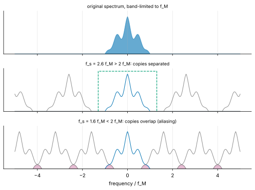
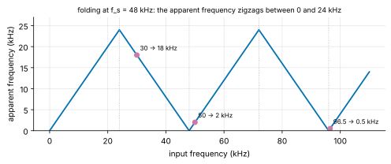
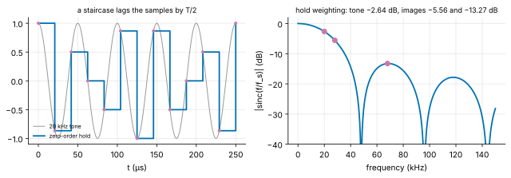
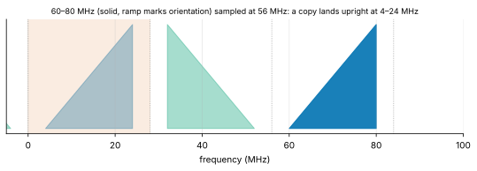
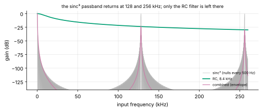

<!-- status: reviewed -->
# 11-10 · Sampling, Aliasing and Reconstruction

| | |
|---|---|
| **Course** | [11 · Signals and Systems](../README.md) |
| **University equivalent** | Sampling in a junior Signals and Systems course: impulse-train sampling and the sampled spectrum, the sampling theorem, aliasing, anti-aliasing filters, ideal (sinc) and zero-order-hold reconstruction, discrete-time processing of continuous-time signals, oversampling and band-pass sampling (Oppenheim & Willsky, *Signals and Systems*, ch. 7; Lathi, *Linear Systems and Signals*, ch. 8; MIT 6.003) |
| **Prerequisites** | [11-06 The Continuous-Time Fourier Transform](11-06-continuous-time-fourier-transform.md), [11-07 The Discrete-Time Fourier Transform](11-07-discrete-time-fourier-transform.md), [11-09 The z-Transform](11-09-z-transform.md) (§3.8, $z = e^{sT}$), [11-08 The Laplace Transform and System Functions](11-08-laplace-transform-and-system-functions.md) (Butterworth responses), [11-01 Signals: Classification and Operations](11-01-signals-classification-and-operations.md) (sampled-tone ambiguity) |
| **Estimated study hours** | 10 |
| **Last verified** | 2026-11-20 |

**Learning objectives.** After this chapter you can:

1. Model sampling as multiplication by an impulse train, derive the sampled spectrum (replicas every $f_s$), and state and justify the sampling theorem.
2. Predict the apparent frequency and phase of any sampled tone, and explain how aliasing folds signals and noise into the band of interest.
3. Specify an anti-aliasing filter (attenuation at the first alias frequency, Butterworth order) and quantify how oversampling relaxes it.
4. Derive ideal sinc reconstruction and the zero-order hold's droop, images and delay, and size reconstruction and compensation filters.
5. Analyze DT processing of CT signals, oversampling and decimation in converters, aperture jitter, and band-pass sampling.

---

## 1. Big picture

Every digital system that touches the physical world, a microphone, an ECG front end, a radio receiver, a SerDes, a power-converter controller, begins by **sampling**: keeping a CT signal's values at instants $nT$ and discarding everything in between. 11-07 and 11-09 analyzed what happens to the resulting sequences; this chapter answers the question underneath them. When do the samples hold *all* the information in the CT signal, what goes wrong when they do not, and how is a CT signal rebuilt from samples? The answers are frequency-domain statements: sampling copies a signal's spectrum at every multiple of the sample rate, the copies must not overlap, and whatever does overlap (aliasing) can never be separated again.

- **The sample rate sets the usable bandwidth.** Only frequencies below $f_s/2$ are represented unambiguously; anything above folds down on top of real content.
- **Aliasing cannot be undone after the fact.** It must be prevented by an analog **anti-aliasing filter** before the sampler; a digital filter afterward is too late.
- **Oversampling moves the hard filtering into digital.** Sigma–delta converters sample far faster than needed, use a gentle analog filter, then filter and decimate digitally (the ADS1292R and the TLV320AIC3204 both do).
- **Reconstruction has its own errors.** Real DACs hold each value for a sample period (a zero-order hold), which tilts the passband and leaves images at multiples of $f_s$.
- **Timing is signal.** Jitter in the sampling instants turns into noise that grows with signal frequency; it limits high-speed ADCs and the SerDes receivers that use them.

## 2. Intuition first

**A strobe light.** Film a spinning wheel at 24 frames per second. If it turns at exactly 24 revolutions per second, every frame catches it in the same position and it appears frozen. At 23 revolutions per second it seems to creep forward slowly (1 rev/s); at 25 it seems to creep *backward* (−1 rev/s). The camera cannot distinguish a fast rotation from a slow one that differs by a whole number of revolutions per frame. That is aliasing: frequencies that differ by a multiple of the sample rate give identical samples (11-01).

**Copies of the spectrum.** In frequency, sampling makes copies of the signal's spectrum centered on 0, $\pm f_s$, $\pm 2f_s$, and so on (Figure 1). If the signal occupies less than $\pm f_s/2$, the copies sit side by side with gaps between them, and a low-pass filter can cut out the original. If it is wider, neighboring copies overlap, and the overlapped parts are summed into a single spectrum that no filter can pull apart.

*Figure 1. Sampling a signal band-limited to $f_M$. Top: the original spectrum. Middle: sampled at $f_s > 2f_M$, the copies at multiples of $f_s$ are separated and a low-pass filter (dashed) recovers the original. Bottom: sampled at $f_s < 2f_M$, the copies overlap and the shaded region is aliased.*

**An analogy from finance: month-end statements, and where it breaks.** A business that books revenue unevenly within each month, but is only seen through month-end balances, can hide any pattern that repeats every month: a sales spike in the last week of every month and a smooth sales flow produce the same month-end trend. An intra-month cycle is "aliased" into a slower pattern or into nothing at all; to see a weekly cycle you need at least two observations per week. The analogy breaks because accounts are cumulative (a month-end balance integrates the month, closer to an averaging sampler than to an instantaneous one, which partially filters fast variation), and because a financial analyst can often ask for the underlying daily data, while an ADC's discarded values are gone for good.

## 3. Theory

> **Conventions.** Sampling period $T$, sample rate $f_s = 1/T$, samples $x[n] = x(nT)$. CT spectra are written in hertz, $X(f) = \int x(t)e^{-j2\pi ft}dt$ (11-06), and DT frequency is $\omega = 2\pi f/f_s$ in rad/sample (11-01, 11-07). The Nyquist frequency is $f_s/2$; the Nyquist rate of a signal band-limited to $f_M$ is $2f_M$.

### 3.1 Sampling as multiplication by an impulse train

Model an ideal sampler as multiplying $x(t)$ by a train of unit impulses spaced $T$ apart:

$$
x_s(t) = x(t)\sum_{n=-\infty}^{\infty}\delta(t - nT) = \sum_{n=-\infty}^{\infty}x(nT)\,\delta(t - nT) ,
$$

using the sifting property of 11-01 ($x(t)\delta(t - nT) = x(nT)\delta(t - nT)$). The weights of the impulses are exactly the samples, so $x_s(t)$ is a CT stand-in for the sequence $x[n]$.

**The impulse train's Fourier series.** The train is periodic with period $T$, so it has a Fourier series (11-05) with coefficients

$$
c_k = \frac{1}{T}\int_{-T/2}^{T/2}\delta(t)e^{-j2\pi kf_st}dt = \frac{1}{T} = f_s \qquad\Rightarrow\qquad \sum_n\delta(t - nT) = f_s\sum_{k=-\infty}^{\infty}e^{j2\pi kf_st} .
$$

Every harmonic of $f_s$ is present with the same strength.

**The sampled spectrum.** Multiplying $x(t)$ by $e^{j2\pi kf_st}$ shifts its spectrum by $kf_s$ (the modulation property of 11-06). So

$$
X_s(f) = f_s\sum_{k=-\infty}^{\infty}X(f - kf_s) .
$$

*Sampling makes copies of the spectrum at every multiple of the sample rate, each scaled by $f_s$.* Units check: $x_s(t)$ is volts times impulses (each in s⁻¹), so its transform $X_s(f)$ is in volts; on the right, $f_s$ (s⁻¹) times $X(f)$ (V·s) is also volts.

**The link to the DTFT.** Transforming $x_s(t)$ directly gives $X_s(f) = \sum_nx(nT)e^{-j2\pi fnT} = \sum_nx[n]e^{-j\omega n}$ with $\omega = 2\pi fT$: the DTFT of the samples, $X(e^{j\omega})$, read at $\omega = 2\pi f/f_s$. Equating the two expressions,

$$
X(e^{j\omega}) = f_s\sum_{k=-\infty}^{\infty}X\!\left(\frac{(\omega - 2\pi k)f_s}{2\pi}\right) .
$$

The DTFT of the samples is the CT spectrum, scaled by $f_s$, with frequency $f$ relabeled as $\omega = 2\pi f/f_s$ and repeated every 2π. This is why every DTFT is periodic (11-07), and it is the frequency-domain face of 11-09's map $z = e^{sT}$, which wraps every horizontal strip of height $2\pi f_s$ in the s-plane onto the same z-plane.

> **Going deeper — the Poisson summation formula.** The identity $\sum_nx(nT)e^{-j2\pi fnT} = f_s\sum_kX(f - kf_s)$ holds for any reasonably smooth, decaying $x$, not only band-limited ones; at $f = 0$ it says $T\sum_nx(nT) = \sum_kX(kf_s)$: a sum of samples in one domain equals a sum of samples in the other. It gives a quick error estimate for numerical integration by the rectangle rule (11-03's lab): the error is the sum of the spectrum's values at the nonzero multiples of $f_s$, which is tiny when the signal is smooth and the samples are dense.

### 3.2 The sampling theorem

If $X(f) = 0$ for $\lvert f\rvert > f_M$ (the signal is **band-limited** to $f_M$) and $f_s > 2f_M$, the copies in $X_s(f)$ do not overlap: the copy at $kf_s$ occupies $[kf_s - f_M, kf_s + f_M]$, and its neighbor starts at $(k + 1)f_s - f_M > kf_s + f_M$ exactly when $f_s > 2f_M$. Then an ideal low-pass filter with gain $T$ and cutoff anywhere between $f_M$ and $f_s - f_M$ (usually $f_s/2$) removes every copy except the original, and returns $x(t)$ exactly.

> **The sampling theorem.** A signal band-limited to $f_M$ is uniquely determined by its samples taken at a rate $f_s > 2f_M$, and it can be rebuilt from them by ideal low-pass filtering.

The strict inequality matters, because the definition allows content exactly at $f_M$ (a sinusoid's spectral lines, for example). A sinusoid at exactly $f_s/2$ is sampled at the same phase twice per cycle: $\sin(\pi f_st)$ sampled at $t = nT$ gives $\sin(\pi n) = 0$ for every $n$, and its samples vanish entirely.

The minimum rate $2f_M$ is the signal's **Nyquist rate**. Real designs sample faster, because no real signal is perfectly band-limited and no real filter is ideal: the gap between $f_M$ and $f_s - f_M$ is the **transition band** the anti-aliasing filter needs (§3.4).

### 3.3 Aliasing

**Where a tone lands.** For a cosine at $f_0$, the sampled sequence is $\cos(2\pi f_0nT + \phi)$. Since $e^{j2\pi kf_snT} = e^{j2\pi kn} = 1$, replacing $f_0$ by $f_0 - kf_s$ for any integer $k$ changes nothing; and a cosine is even, so a negative frequency can be reflected to a positive one with its phase negated. Together:

$$
f_a = \left\lvert f_0 - kf_s\right\rvert \text{ for the integer } k \text{ that makes it at most } f_s/2, \qquad \phi_a = \begin{cases}\phi & f_0 - kf_s \ge 0\\ -\phi & f_0 - kf_s < 0\end{cases}
$$

The apparent frequency **folds** back and forth between 0 and $f_s/2$ as $f_0$ rises (Figure 2): input frequencies from $f_s/2$ to $f_s$ come out running backward from $f_s/2$ to 0, those from $f_s$ to $3f_s/2$ run forward again, and so on. Bands that land reversed are called **spectrally inverted**.

*Figure 2. The folding diagram at $f_s$ = 48 kHz. A tone's apparent frequency zigzags between 0 and $f_s/2$; the three tones of Example 11-10.1 (30, 50 and 96.5 kHz) land at 18, 2 and 0.5 kHz.*

**Aliasing of noise.** Wideband noise is a continuum of components, and every one of them folds. If white noise with density $e_n$ (V/√Hz) extends to $B_n \gg f_s/2$ and is sampled without filtering, all of its power, $e_n^2B_n$, lands in the band from 0 to $f_s/2$, instead of the $e_n^2f_s/2$ that belongs there: the in-band noise power rises by $B_n/(f_s/2)$ (Example 11-10.2). This is why an anti-aliasing filter is needed even when there is no interfering tone, and why sampling a noisy wideband signal at a low rate is never "free".

### 3.4 Anti-aliasing filters

The job of the analog filter before the sampler is to attenuate everything that would alias into the band of interest, $0$ to $f_B$, by enough to meet the system's dynamic range. The lowest input frequency that aliases onto $f_B$ is $f_s - f_B$ (it folds to $f_s - (f_s - f_B) = f_B$); anything between $f_B$ and $f_s - f_B$ aliases into the unused band between $f_B$ and $f_s/2$, which can be discarded digitally. So the requirement is

$$
\text{attenuation at } f_s - f_B \;\ge\; A_{\min}\ \text{dB} .
$$

For an $n$th-order Butterworth filter with $-3$ dB frequency $f_c$ (11-08 §3.7), $\lvert H\rvert^2 = 1/[1 + (f/f_c)^{2n}]$, so the attenuation is $10\log_{10}[1 + (f/f_c)^{2n}]$ and the minimum order is

$$
n \ge \frac{\ln\!\left(10^{A_{\min}/10} - 1\right)}{2\ln\!\left[(f_s - f_B)/f_c\right]} .
$$

The denominator is the key: the order needed falls with the logarithm of the ratio between the first alias frequency and the cutoff. Sampling audio (20 kHz) at 48 kHz leaves a ratio of only 1.4, and 90 dB of protection would need a 31st-order filter; sampling the same audio at 6.144 MHz makes the ratio about 306 and a second-order filter suffices (Example 11-10.3). That is the case for **oversampling**: sample fast with a cheap analog filter, then filter sharply and reduce the rate in the digital domain, where steep filters are exact, repeatable and free of component drift.

### 3.5 Reconstruction

**Ideal reconstruction.** The ideal low-pass filter of §3.2, with gain $T$ and cutoff $f_s/2$, has impulse response $h_r(t) = T\cdot\frac{\sin(\pi f_st)}{\pi t} = \operatorname{sinc}(t/T)$, where $\operatorname{sinc}(u) = \sin(\pi u)/(\pi u)$. Passing the impulse train $x_s(t)$ through it gives

$$
x_r(t) = \sum_{n=-\infty}^{\infty}x[n]\,\operatorname{sinc}\!\left(\frac{t - nT}{T}\right) .
$$

Each sample launches a sinc pulse centered at its own instant. Because $\operatorname{sinc}(m) = 0$ at every nonzero integer $m$ and $\operatorname{sinc}(0) = 1$, every pulse passes through its own sample and through zero at all the others: the sum interpolates the samples exactly, and between them it fills in the unique band-limited curve. This **sinc interpolation** cannot be built exactly (the sinc is noncausal and infinitely long, the ideal filter of 11-06), but it is the target that every reconstruction filter approximates.

**The zero-order hold.** A real DAC holds each sample's value for one period, producing a staircase. That is $x_s(t)$ convolved with a rectangular pulse $h_0(t) = 1$ for $0 \le t < T$, whose transform (11-06) is

$$
H_0(f) = T\,\frac{\sin(\pi fT)}{\pi fT}\,e^{-j\pi fT} = T\operatorname{sinc}(f/f_s)\,e^{-j\pi fT} .
$$

Three consequences:

- **Droop.** Relative to DC, the passband is shaped by $\operatorname{sinc}(f/f_s)$: down to $2/\pi$, **−3.92** dB, at $f_s/2$.
- **Images.** The copies at $kf_s$ are not removed, only weighted by the same sinc: the first image of a tone at $f$ appears at $f_s - f$, attenuated by just $\operatorname{sinc}(1 - f/f_s)$, which is a few dB. A reconstruction (smoothing) filter must remove them.
- **Delay.** The linear phase $e^{-j\pi fT}$ is a delay of half a sample, $T/2$: the staircase's "center of mass" lags the samples.

Designers compensate the droop with a digital "inverse-sinc" pre-emphasis before the DAC and push images away by digital interpolation to a higher rate (oversampling DACs), so the analog smoothing filter can again be gentle.

*Figure 3. The zero-order hold (Example 11-10.4). Left: a staircase follows the samples with a half-sample lag. Right: the hold's $\lvert\operatorname{sinc}(f/f_s)\rvert$ weights the 20 kHz signal (−2.64 dB) and its images at 28 and 68 kHz (−5.56 and −13.27 dB) at $f_s$ = 48 kHz.*

### 3.6 Discrete-time processing of continuous-time signals

A sampler, a DT system $H(e^{j\omega})$ and an ideal reconstructor in cascade behave, for inputs band-limited below $f_s/2$, exactly like a CT LTI system with frequency response

$$
H_{\text{eff}}(f) = H\!\left(e^{j2\pi f/f_s}\right), \qquad \lvert f\rvert < f_s/2 ,
$$

because a band-limited input's spectrum passes through the sampler unaliased, is multiplied by $H$ at $\omega = 2\pi f/f_s$, and is recovered by the reconstructor. Without an anti-aliasing filter, the cascade is not LTI in CT terms at all: an input above $f_s/2$ is treated as its alias, so the "filter" responds to a 450 Hz input exactly as to a 50 Hz one (Example 11-10.5).

### 3.7 Oversampling, decimation, quantization and jitter

**Quantization noise.** An ADC with $N$ bits over a full-scale range $V_{FS}$ has step $\Delta = V_{FS}/2^N$. If the error is uniformly distributed over one step (a good model for busy signals, 03-02), its variance is $\Delta^2/12$. A full-scale sine has power $(V_{FS}/2)^2/2$, so the ideal signal-to-quantization-noise ratio is

$$
\text{SNR} = 10\log_{10}\frac{V_{FS}^2/8}{V_{FS}^2/(12 \cdot 2^{2N})} = 10\log_{10}\left(1.5 \cdot 2^{2N}\right) = 6.02N + 1.76\ \text{dB} .
$$

**Oversampling gain.** That noise is spread evenly from 0 to $f_s/2$. Sampling at $\text{OSR}$ times the Nyquist rate of a band $f_B$ and then filtering digitally to $f_B$ keeps only $1/\text{OSR}$ of it: an improvement of $10\log_{10}(\text{OSR})$ dB, half a bit per doubling of the rate. Sigma–delta converters add **noise shaping**, pushing quantization noise to high frequencies before it is filtered, to gain far more (20-08).

**Decimation.** After digital low-pass filtering to the new band, keeping every $M$th sample reduces the rate (11-07, Problem 12). The filter before decimation is itself an anti-aliasing filter, in the digital domain, against everything between the new $f_s/2$ and the old one. The ADS1292R's sinc³ filter plays exactly this role, with nulls at every multiple of its output data rate [1]. Its one blind spot is near multiples of the *modulator* rate, where its response repeats: interference there needs the analog filter (Example 11-10.7).

**Aperture jitter.** If the sampling instant wanders randomly by $\delta t$ with RMS value $\sigma_t$, a sine $A\sin(2\pi f_0t)$ is sampled with an error $\approx A\cdot2\pi f_0\cos(2\pi f_0t)\,\delta t$ (its slope times the timing error). The error power is $A^2(2\pi f_0)^2\sigma_t^2/2$ against a signal power $A^2/2$, so

$$
\text{SNR}_{\text{jitter}} = -20\log_{10}\left(2\pi f_0\sigma_t\right)\ \text{dB} .
$$

It depends on the input frequency, not on the sample rate: high-frequency signals need very clean clocks. 100 fs RMS limits a 70 MHz input to about 87 dB, whatever the ADC's resolution.

### 3.8 Band-pass sampling

A signal that occupies only a band $f_L < \lvert f\rvert < f_H$, of width $B = f_H - f_L$, does not need $f_s > 2f_H$. Sampling makes copies of both the positive band and its negative-frequency mirror; they must not overlap. Placing the band entirely within one **Nyquist zone**, the interval $[(n - 1)f_s/2,\ nf_s/2]$ for some integer $n \ge 1$, guarantees this, because then the band and every copy of its mirror fall in different zones. The conditions $(n - 1)f_s/2 \le f_L$ and $f_H \le nf_s/2$ give the window below. It is nonempty only if $2f_H/n \le 2f_L/(n - 1)$, that is $(n - 1)f_H \le nf_L$, or $n(f_H - f_L) \le f_H$: $n \le f_H/B$, the upper limit on $n$.

$$
\frac{2f_H}{n} \le f_s \le \frac{2f_L}{n - 1}, \qquad 1 \le n \le \left\lfloor\frac{f_H}{B}\right\rfloor .
$$

The highest allowed $n$ gives the lowest usable rate, which can approach $2B$, the band-pass signal's Nyquist rate. The band then appears in the first zone (0 to $f_s/2$), upright if $n$ is odd and spectrally inverted if $n$ is even. This **undersampling** lets one ADC digitize an intermediate-frequency (IF) band directly, replacing an analog mixer. Its costs: the allowed windows of $f_s$ narrow as $n$ grows, so clock tolerance matters; the anti-aliasing filter becomes a band-pass filter that must reject the other zones; and aperture jitter is set by the high input frequency, not by the low sample rate.

*Figure 4. Band-pass sampling (Example 11-10.6). The 60–80 MHz band sampled at 56 MHz lies in the third Nyquist zone (56–84 MHz); its copy lands upright at 4–24 MHz, with no overlap from the mirror's copies.*

## 4. Worked examples

### Example 11-10.1 · Where do the tones land? (tier A)

**Setup.** A codec samples at 48 kHz with no anti-aliasing filter. Find the apparent frequencies of tones at 30 kHz, 50 kHz and 96.5 kHz, and the apparent phase of $\cos(2\pi \cdot 30\,\text{kHz}\,t + 60°)$.

**Solution.** 30 kHz: $\lvert 30 - 48\rvert$ = **18** kHz (30 kHz lies in the second Nyquist zone, 24–48 kHz, which folds back reversed, so the phase flips). 50 kHz: $50 - 48$ = **2** kHz. 96.5 kHz: $96.5 - 2 \times 48$ = **0.5** kHz. For the 30 kHz cosine, $30 - 48 = -18 < 0$, so it appears as $\cos(2\pi \cdot 18\,\text{kHz}\,nT - 60°)$: phase **−60**°.

**Sanity check.** At 48 kHz, 30 kHz completes 0.625 cycles per sample, which is the same as −0.375 cycles, i.e. 18 kHz running backward: the backward rotation is the phase flip.

### Example 11-10.2 · Noise folds in (tier A)

**Setup.** An amplifier's output noise is white at 20 nV/√Hz up to 1 MHz. It is sampled at 48 kHz (a 24 kHz Nyquist band) with no anti-aliasing filter. By how much does the in-band noise power rise, compared with a perfect filter at 24 kHz?

**Solution.** All of the noise from 0 to 1 MHz folds into 0–24 kHz: the in-band power rises by the factor $1\,\text{MHz}/24\,\text{kHz}$ = **41.67**, or $10\log_{10}41.67$ = **16.2** dB. In RMS terms the noise grows from $20\,\text{nV}\sqrt{24\,\text{kHz}}$ = 3.10 µV to $20\,\text{nV}\sqrt{1\,\text{MHz}}$ = 20 µV.

**Sanity check.** The sampled sequence's noise variance cannot depend on where the noise came from: every sample carries the full 20 µV RMS of the unfiltered noise, so all of it must appear somewhere in the 0–24 kHz band.

### Example 11-10.3 · How steep must the filter be? (tier B)

**Setup.** Audio from 0 to 20 kHz must be protected by 90 dB against anything that could alias into it. Use a Butterworth anti-aliasing filter with $f_c$ = 20 kHz. (a) Find the minimum order when sampling at 48 kHz. (b) Repeat for an oversampled converter running its modulator at $128 \times 48$ kHz (the oversampling ratio at which the TLV320AIC3204's ADC performance is specified [2]; R-185) and find the attenuation a first- and a second-order filter give at the first alias frequency.

**Solution.** (a) The first alias frequency is $48 - 20$ = 28 kHz, a ratio of 1.4 to $f_c$. From §3.4, $n \ge \ln(10^9 - 1)/(2\ln1.4) = 20.72/0.673$ = **30.8**, so **31**st order: impractical.

(b) The modulator rate is $f_s$ = **6.144** MHz, so the first alias frequency is **6.124** MHz, a ratio of **306.2**. Now $n \ge 20.72/(2\ln306.2)$ = **1.81**: a second-order filter is enough. First order gives $10\log_{10}(1 + 306.2^2)$ = **49.7** dB and second order **99.4** dB at that frequency. The rest of the 90 dB protection must then come from the digital decimation filter. Before the rate drops to 48 kHz it must attenuate everything from 28 kHz up (whatever would then fold onto 0–20 kHz), or from 24 kHz up for a clean band, with 20–28 kHz as its transition band; in DSP that costs taps, not precision analog parts.

**Sanity check.** Each extra order adds $20\log_{10}(\text{ratio})$ dB: about 2.9 dB per order at a ratio of 1.4, but 49.7 dB per order at a ratio of 306.

### Example 11-10.4 · A DAC's zero-order hold (tier B)

**Setup.** A DAC at 48 kHz holds each sample for one period. For a 20 kHz tone: (a) find the droop relative to DC; (b) find the levels of the images at 28 kHz and 68 kHz, relative to a DC-scaled input; (c) find the hold's delay; (d) give the gain at $f_s/2$.

**Solution.** (a) $\operatorname{sinc}(20/48) = \sin(0.4167\pi)/(0.4167\pi)$ = **0.7379**, or **−2.64** dB: the top of the audio band is attenuated by 2.6 dB unless compensated.

(b) The image at $48 - 20$ = 28 kHz has weight $\lvert\operatorname{sinc}(28/48)\rvert$ = **0.5271**, **−5.56** dB, only 2.92 dB below the wanted tone. The image at $48 + 20$ = 68 kHz has weight **0.2170**, **−13.27** dB.

(c) Half a sample: $T/2$ = **10.42** µs.

(d) $\operatorname{sinc}(0.5) = 2/\pi$, **−3.92** dB.

**Sanity check.** The images are strong because a staircase is a poor approximation of a smooth sine: they are the staircase's corners. The smoothing filter after the DAC must attenuate 28 kHz heavily while passing 20 kHz, the same steep-filter problem as Example 11-10.3, solved the same way (digital interpolation to a higher rate first).

### Example 11-10.5 · A filter that passes what it should block (tier B)

**Setup.** The five-point moving average of 11-07 runs on samples taken at 500 SPS, without an anti-aliasing filter. Its response has nulls at 100 and 200 Hz and a gain of 0.6472 at 50 Hz. What does it do to inputs at 450 Hz and 600 Hz?

**Solution.** 450 Hz aliases to $\lvert 450 - 500\rvert$ = **50** Hz, so it emerges as a 50 Hz tone with gain **0.6472**: the "low-pass filter" passes a frequency far above its cutoff, disguised as one inside it. 600 Hz aliases to $600 - 500$ = **100** Hz, which falls on a null, and disappears. Neither behavior is that of a CT filter: the cascade is only equivalent to $H_{\text{eff}}(f) = H(e^{j2\pi f/f_s})$ for inputs below 250 Hz.

**Sanity check.** Sampling cos(2π·450t) at 500 SPS gives cos(1.8πn) = cos(0.2πn), literally the same sequence as a 50 Hz input; no DT system can treat them differently.

### Example 11-10.6 · Sampling a 20 MHz band centred at 70 MHz (tier C)

**Setup.** A receiver's IF occupies 60–80 MHz. (a) List the allowed sample-rate windows for band-pass sampling. (b) Choose $f_s$ = 56 MHz: which Nyquist zone holds the band, where does it land, and is it inverted? (c) With 100 fs RMS clock jitter, find the jitter-limited SNR at 70 MHz and at 80 MHz.

**Solution.** (a) $B$ = 20 MHz and $\lfloor f_H/B\rfloor = 4$. From §3.8: $n$ = 1, $f_s \ge 160$ MHz (ordinary sampling); $n$ = 2, 80–120 MHz; $n$ = 3, **53.33**–**60** MHz; $n$ = 4, exactly **40** MHz (no margin at all).

(b) 56 MHz lies in the $n$ = 3 window. The third zone is $[2 \times 28, 3 \times 28] = [56, 84]$ MHz, which contains 60–80. Subtracting $f_s$, the band lands at **4**–**24** MHz, upright because $n$ is odd (60 MHz maps to 4 MHz and 80 MHz to 24 MHz, in order).

(c) $-20\log_{10}(2\pi \cdot 70\,\text{MHz} \cdot 100\,\text{fs})$ = **87.1** dB, and at 80 MHz **86.0** dB. A 56 MHz clock with 100 fs of jitter limits SNR exactly as it would at 160 MHz: the input frequency sets the slope.

**Sanity check.** The rate 56 MHz is 2.8 times the bandwidth, comfortably above the band-pass Nyquist rate of 40 MHz but far below the 160 MHz that low-pass sampling would need.

### Example 11-10.7 · The ADS1292R's two anti-aliasing filters (tier C)

**Setup.** The ADS1292R samples with a modulator at $f_{MOD}$ = 128 kHz, decimates with a sinc³ filter ($N$ = 256) to $f_{DR}$ = 500 SPS, and filters the PGA output before the modulator with an RC filter whose −3 dB bandwidth is 8.4 kHz (an internal 2 kΩ and an external 4.7 nF) [1]. (a) The data sheet's PGA diagram draws 2 kΩ in each output leg and the capacitor across the two outputs: show that 8.4 kHz is consistent with that. (b) Interference at 450 Hz would alias to 50 Hz at the output: find the sinc³ attenuation. (c) Interference at $f_{MOD} - 50$ Hz = 127.95 kHz would also alias to 50 Hz: find the sinc³ and RC attenuations and their total.

**Solution.** (a) A differential RC with $R_S$ = 2 kΩ in each leg and $C$ across the pair has time constant $2R_SC$: $1/(2\pi \times 4\,\text{k}\Omega \times 4.7\,\text{nF})$ = **8.47** kHz, consistent with the stated 8.4 kHz (and with the 15% tolerance on $R_S$ [1]). The data sheet's Figure 22 (PGA implementation) draws exactly this circuit, and its specification table defines $C_{FILTER}$ as "the capacitor accross the PGA outputs" [1].

(b) The sinc³ response is $\left\lvert\sin(\pi f/f_{DR})/(N\sin(\pi f/f_{MOD}))\right\rvert^3$. At 450 Hz: **1.306** × 10⁻³, or **−57.7** dB.

(c) At 127.95 kHz the sinc³ response has *repeated*: $\sin(\pi f/f_{MOD})$ is small again near $f = f_{MOD}$, and the filter attenuates by only **0.43** dB. The RC gives $10\log_{10}[1 + (127.95/8.4)^2]$ = **23.7** dB. Total: **24.1** dB. An interferer near 128 kHz, from a switching regulator or a radio, reaches the 50 Hz output only 24 dB down, which is why the data sheet asks that "the input R-C anti-aliasing filters in the system" be chosen to attenuate interference around multiples of $f_{MOD}$ [1]. The on-chip PGA-output RC is one filter in that chain; the external filter at the electrode inputs is the place to add attenuation.

**Sanity check.** A decimation filter is periodic in the *modulator's* sample rate (it is a DT filter running at $f_{MOD}$), so it cannot protect against anything near $kf_{MOD}$; only an analog filter before the modulator can.

*Figure 5. The ADS1292R's anti-aliasing chain (Example 11-10.7). The sinc³ filter's nulls at multiples of 500 Hz protect the output band, but its passband reappears at 128 kHz, where only the RC filter's 23.7 dB stands between an interferer and the 0–250 Hz output.*

### Answer key

<!-- answer-key -->
| ID | Quantity | Value | Unit |
|---|---|---|---|
| T 11-10.a | ZOH gain at f_s/2 | −3.92 | dB |
| T 11-10.b | jitter-limited SNR, 70 MHz, 100 fs | 87.1 | dB |
| T 11-10.c | ideal SNR per bit | 6.02 | dB |
| T 11-10.d | ideal SNR offset | 1.76 | dB |
| T 11-10.e | ADS1292R modulator rate | 128 | kHz |
| T 11-10.f | ADS1292R decimation ratio at 500 SPS | 256 | — |
| T 11-10.g | ZOH gain at f_s/4 | 0.9003 | — |
| T 11-10.h | ZOH gain at f_s/4 | −0.91 | dB |
| T 11-10.i | alias of 7 kHz at 10 kHz | 3 | kHz |
| T 11-10.j | 127.95 kHz interferer's advantage over 450 Hz | 33.6 | dB |
| T 11-10.k | Nyquist at 53.125 GBd | 26.56 | GHz |
| T 11-10.l | CD sample rate over a 20 kHz band | 2.2 | — |
| Ex 11-10.1a | alias of 30 kHz | 18 | kHz |
| Ex 11-10.1b | alias of 50 kHz | 2 | kHz |
| Ex 11-10.1c | alias of 96.5 kHz | 0.5 | kHz |
| Ex 11-10.1d | apparent phase | −60 | ° |
| Ex 11-10.2a | noise power ratio | 41.67 | — |
| Ex 11-10.2b | noise power ratio | 16.2 | dB |
| Ex 11-10.2c | filtered RMS noise | 3.10 | µV |
| Ex 11-10.2d | unfiltered RMS noise | 20 | µV |
| Ex 11-10.3a | order bound at 48 kHz | 30.8 | — |
| Ex 11-10.3b | order needed at 48 kHz | 31 | — |
| Ex 11-10.3c | modulator rate | 6.144 | MHz |
| Ex 11-10.3d | order bound, oversampled | 1.81 | — |
| Ex 11-10.3e | first-order attenuation | 49.7 | dB |
| Ex 11-10.3f | second-order attenuation | 99.4 | dB |
| Ex 11-10.3g | dB per order at ratio 1.4 | 2.9 | dB |
| Ex 11-10.3h | ln(10⁹ − 1) | 20.72 | — |
| Ex 11-10.3i | 2 ln 1.4 | 0.673 | — |
| Ex 11-10.3j | ratio of first alias to cutoff, oversampled | 306.2 | — |
| Ex 11-10.3k | first alias frequency, oversampled | 6.124 | MHz |
| Ex 11-10.4a | droop at 20 kHz | 0.7379 | — |
| Ex 11-10.4b | droop at 20 kHz | −2.64 | dB |
| Ex 11-10.4c | image weight at 28 kHz | 0.5271 | — |
| Ex 11-10.4d | image level at 28 kHz | −5.56 | dB |
| Ex 11-10.4e | image below the tone | 2.92 | dB |
| Ex 11-10.4f | image weight at 68 kHz | 0.2170 | — |
| Ex 11-10.4g | image level at 68 kHz | −13.27 | dB |
| Ex 11-10.4h | hold delay | 10.42 | µs |
| Ex 11-10.5a | alias of 450 Hz | 50 | Hz |
| Ex 11-10.5b | gain for 450 Hz input | 0.6472 | — |
| Ex 11-10.5c | alias of 600 Hz | 100 | Hz |
| Ex 11-10.6a | n = 3 window, low end | 53.33 | MHz |
| Ex 11-10.6b | n = 3 window, high end | 60 | MHz |
| Ex 11-10.6c | n = 4 rate | 40 | MHz |
| Ex 11-10.6d | aliased band, low edge | 4 | MHz |
| Ex 11-10.6e | aliased band, high edge | 24 | MHz |
| Ex 11-10.6f | jitter SNR at 70 MHz | 87.1 | dB |
| Ex 11-10.6g | jitter SNR at 80 MHz | 86.0 | dB |
| Ex 11-10.6h | rate as a multiple of the bandwidth | 2.8 | — |
| Ex 11-10.7a | differential RC bandwidth | 8.47 | kHz |
| Ex 11-10.7b | sinc³ response at 450 Hz | 1.306 | 10⁻³ |
| Ex 11-10.7c | sinc³ attenuation at 450 Hz | 57.7 | dB |
| Ex 11-10.7d | sinc³ attenuation at 127.95 kHz | 0.43 | dB |
| Ex 11-10.7e | RC attenuation at 127.95 kHz | 23.7 | dB |
| Ex 11-10.7f | total attenuation at 127.95 kHz | 24.1 | dB |

*Every value is recomputed by [verify_11_10.py](../verify/verify_11_10.py): aliases by sampling the tones and locating the FFT peak, phases by fitting the sampled sequence, noise folding by simulating white noise above the Nyquist band, filter orders by searching Butterworth responses from `scipy.signal`, the zero-order hold by numerically transforming a staircase, band-pass windows by checking replica overlap on a grid of rates, jitter by Monte Carlo sampling with random timing errors, and the ADS1292R chain by evaluating the sinc³ transfer function of the data sheet [1] and the RC response.*

## 5. Simulate it

The lab, [labs/11-10-lab](../labs/11-10-lab/README.md), is a notebook in four parts:

1. Samples tones and a chirp below and above $f_s/2$ and watches them fold, in time and in the FFT.
2. Reconstructs a band-limited signal by sinc interpolation and by a zero-order hold, and measures the hold's droop and images.
3. Simulates noise folding with and without an anti-aliasing filter, and tabulates Butterworth orders against oversampling ratio.
4. Simulates the ADS1292R's chain: an RC filter, a 128 kHz modulator modeled as an ideal sampler, and a sinc³ decimator, with interferers at 450 Hz and 127.95 kHz.

**Guided exercise (predict, then run).** **Before running Part 4**, predict: which interferer reaches the 500 SPS output more strongly, a 450 Hz tone or a 127.95 kHz tone of the same amplitude? Both alias to 50 Hz. Then run it. (The 127.95 kHz tone wins by about **33.6** dB: the sinc³ filter gives 57.7 dB against 450 Hz but only 0.43 dB near $f_{MOD}$, where only the RC filter's 23.7 dB helps.)

## 6. Engineering tradeoffs

| Knob | Improves | Costs | Typical decision owner |
|---|---|---|---|
| Sample rate | Wider usable band; gentler anti-aliasing filter | ADC power, data rate, DSP load | System architect |
| Oversampling plus decimation | Cheap analog filter; quantization noise gain of 10 log OSR | Digital filter area and power; latency | Converter or SoC architect |
| Anti-aliasing filter order | Alias rejection at a given rate | Components, passband ripple and phase, tolerance sensitivity | Analog designer |
| Reconstruction (hold, interpolation, smoothing) | Image suppression; flat passband | Interpolation filters; analog filter; delay | Audio or DAC designer |
| Clock jitter | SNR at high input frequencies | Low-noise PLLs and oscillators, power | Clocking or RF designer |
| Band-pass sampling | Lower ADC rate; no analog mixer | Band-pass filter; narrow rate windows; jitter set by RF frequency | Radio architect |

## 7. Numbers to know

| Quantity | Value | Note |
|---|---|---|
| Sampling theorem | $f_s > 2f_M$ | Strict inequality |
| Alias of $f_0$ | $\lvert f_0 - kf_s\rvert \le f_s/2$ | Phase flips when folded from a reversed zone |
| First alias onto the band edge | $f_s - f_B$ | Sets the anti-aliasing requirement |
| Zero-order hold | $\operatorname{sinc}(f/f_s)$; −3.92 dB at $f_s/2$; delay $T/2$ | Images at $kf_s \pm f$ |
| Ideal ADC SNR | $6.02N + 1.76$ dB | Full-scale sine, uniform error |
| Oversampling gain | $10\log_{10}(\text{OSR})$ dB | Without noise shaping |
| Jitter-limited SNR | $-20\log_{10}(2\pi f_0\sigma_t)$ | 100 fs at 70 MHz: about 87 dB |
| Band-pass sampling | $2f_H/n \le f_s \le 2f_L/(n - 1)$ | Odd $n$ upright, even $n$ inverted |

## 8. Common mistakes

- **Filtering after the ADC to remove aliases.** Once folded, an alias is indistinguishable from in-band signal.
- **Sampling at exactly twice the bandwidth.** The theorem needs strict inequality, and real filters need a transition band.
- **Forgetting noise folds too.** Without a filter, out-of-band noise adds to in-band noise.
- **Ignoring the ZOH droop and images.** A DAC's output is not the samples; it is a staircase with a sinc-shaped spectrum.
- **Trusting a decimation filter near multiples of its input rate.** Its response repeats there; the analog filter must cover it.
- **Specifying jitter by sample rate.** The SNR limit depends on the input frequency.
- **Choosing a band-pass sampling rate at the edge of its window.** Clock tolerance or band edges then cause overlap.

## 9. Practitioner lens

### State of the art (as of Nov 2026)

- **Biopotential front ends combine two anti-aliasing filters.** The ADS1292R samples with a second-order ΔΣ modulator at a typical 128 kHz and decimates with a sinc³ filter whose nulls fall at the output data rate and its multiples; the data sheet notes that its passband "repeats itself at every fMOD" and that the system's input R-C anti-aliasing filters should be chosen to attenuate interference around multiples of $f_{MOD}$. On chip, the PGA output is filtered by an internal 2 kΩ in each leg with an external 4.7 nF across the outputs, a −3 dB bandwidth of 8.4 kHz; the internal resistor is accurate to 15%, and a larger capacitor improves anti-aliasing at the cost of THD [1] **[Established]** (data sheet).
- **Audio codecs oversample.** The TLV320AIC3204's ADC uses a delta-sigma modulator with a programmable oversampling ratio followed by a digital decimation filter, supports sampling rates from 8 kHz to 192 kHz, and its processing blocks with decimation filter A use an oversampling ratio of 128 or 64 [2] **[Established]**. At 48 kHz and a ratio of 128, the modulator runs at **6.144** MHz (Example 11-10.3).
- **Links that sample once per symbol fold everything above Nyquist.** A receiver that samples a 53.125 GBd lane once per symbol has a Nyquist frequency of 26.56 GHz, the frequency at which 11-08's reference CTLE is evaluated; by §3.3, signal and noise above it fold into the band, so the noise a receiver admits above Nyquist matters as much as the noise below it **[Established]** (a consequence of the sampling theorem; specific receiver architectures are outside this chapter).

> **Deeper:** see companion repo *Datacenter Networking* for ADC-based SerDes receivers, clock recovery and jitter budgets.

### Why it matters commercially

- **Sample rate is power.** ADC and DSP power scale with rate; an architecture that oversamples heavily pays in digital power to save analog parts and board area. The balance shifts with each process node, which makes digital filtering cheaper.
- **Interference is a field-failure mode.** A product that passes the lab can fail beside a switching regulator whose frequency sits near a converter's modulator rate (Example 11-10.7). Anti-aliasing margin is a robustness specification, not just a fidelity one.
- **Clock quality is a hidden bill of materials.** Jitter, not resolution, often limits high-frequency SNR; low-jitter clocks cost power, area or external parts.

### Marketing vs Reality

- **"24-bit ADC."** *Reality:* the bits describe the output word; noise, jitter and aliasing set the usable resolution (effective number of bits, $(\text{SINAD} - 1.76)/6.02$, where SINAD is the ratio of signal to noise plus distortion). *Sanity check:* ask for SNR or ENOB at the relevant input frequency and bandwidth.
- **"No anti-aliasing filter needed."** *Reality:* oversampling converters relax the analog filter but cannot reject interference near multiples of the modulator rate; something analog must. *Sanity check:* ask for the alias rejection near $f_{MOD}$.
- **"Samples at 2× the bandwidth."** *Reality:* this ignores transition bands and folding noise; practical rates are noticeably above 2× with sharp analog filters (CD audio's 44.1 kHz for a 20 kHz band is **2.2**×; Problem 11-10.8 shows how little room that leaves), or far higher with oversampling. *Sanity check:* ask for the anti-aliasing filter's attenuation at $f_s - f_B$.

### Questions for engineering leaders

1. **"What protects your band from aliasing, and how much attenuation do you have at the first alias frequency?"**
   *Strong:* the analog filter's order and corner, the digital decimation filter's stopband, and the rejection near multiples of the modulator rate. *Evasive:* "the ADC handles it."
2. **"What limits your SNR at the highest input frequency: quantization, thermal noise or clock jitter?"**
   *Strong:* a noise budget with each term and the jitter specification of the clock. *Evasive:* the ADC's nominal bit count.
3. **"How did you choose the sample rate?"**
   *Strong:* band edges, filter transition, oversampling ratio, power and data-rate costs. *Evasive:* "the standard rate."
4. **"How do you reconstruct, and what happens to the images?"**
   *Strong:* interpolation rate, inverse-sinc compensation, smoothing-filter order and the image levels at the output connector. *Evasive:* "it's a DAC."

## 10. Concept check

**Q1.** Why does sampling make the spectrum periodic?

Answer

Sampling multiplies by an impulse train, whose Fourier series contains every harmonic of $f_s$ with equal weight; multiplying by each harmonic shifts a copy of the spectrum to that harmonic.

**Q2.** A 7 kHz tone is sampled at 10 kHz. What frequency appears, and why can no digital filter remove it while keeping a real 3 kHz tone?

Answer

$\lvert 7 - 10\rvert$ = **3** kHz. The 7 kHz tone's samples are identical to a 3 kHz tone's samples (with a phase flip), so after sampling they are the same sequence.

**Q3.** Why is $f_s = 2f_M$ not enough?

Answer

A sinusoid at exactly $f_s/2$ can be sampled at its zero crossings and vanish; the theorem needs $f_s > 2f_M$, and real filters need a transition band besides.

**Q4.** Why does oversampling make the analog anti-aliasing filter easier?

Answer

The first frequency that can alias into the band, $f_s - f_B$, moves far above $f_B$, so each filter order gives far more attenuation there; the sharp filtering is done digitally before decimation.

**Q5.** What does a zero-order hold do to a signal at $f_s/4$?

Answer

Multiplies it by $\operatorname{sinc}(0.25)$ = **0.9003** (**−0.91** dB), delays it by half a sample, and leaves an image at $3f_s/4$.

**Q6.** Why does a band-pass sampled band sometimes appear reversed?

Answer

In even Nyquist zones the copy that lands in 0 to $f_s/2$ comes from the negative-frequency mirror shifted up, so frequencies run backward.

[Problem set for this chapter](../problems/11-10-problems.md)

## 11. Key terms

[Sampling theorem](../../../reference/glossary.md#sampling-theorem) · [Nyquist rate](../../../reference/glossary.md#nyquist-rate) · [Nyquist frequency](../../../reference/glossary.md#nyquist-frequency) · [Aliasing (sampling)](../../../reference/glossary.md#aliasing-sampling) · [Anti-aliasing filter](../../../reference/glossary.md#anti-aliasing-filter) · [Zero-order hold](../../../reference/glossary.md#zero-order-hold) · [Sinc interpolation](../../../reference/glossary.md#sinc-interpolation) · [Oversampling](../../../reference/glossary.md#oversampling) · [Decimation](../../../reference/glossary.md#decimation) · [Aperture jitter](../../../reference/glossary.md#aperture-jitter) · [Band-pass sampling](../../../reference/glossary.md#band-pass-sampling) · [Nyquist zone](../../../reference/glossary.md#nyquist-zone)

## 12. Connections

- **Builds on:** the CT Fourier transform, modulation and the ideal low-pass filter from [11-06](11-06-continuous-time-fourier-transform.md); the DTFT from [11-07](11-07-discrete-time-fourier-transform.md); $z = e^{sT}$ from [11-09](11-09-z-transform.md); Butterworth responses from [11-08](11-08-laplace-transform-and-system-functions.md); sampled-tone ambiguity from [11-01](11-01-signals-classification-and-operations.md); the uniform distribution from [03-02](../../03-probability-statistics-and-random-variables/chapters/03-02-random-variables-and-distributions.md).
- **Next:** [11-11 Modulation and Filtering Applications](11-11-modulation-and-filtering-applications.md) uses the same frequency shifting for communication.
- **Used later:** data converters (SAR, pipeline, sigma–delta) in Course 20 (20-06 to 20-08); multirate DSP in Course 16; RF receivers and band-pass sampling in Course 21 (21-08); SerDes receivers in the networking material.

## 13. Further study

- A. V. Oppenheim and A. S. Willsky with S. H. Nawab, *Signals and Systems*, 2nd ed., ch. 7 (sampling).
- B. P. Lathi, *Linear Systems and Signals*, ch. 8 (sampling: the bridge from continuous to discrete).
- A. V. Oppenheim and R. W. Schafer, *Discrete-Time Signal Processing*, the chapter on sampling of CT signals (DT processing of CT signals, changing the sampling rate, oversampling and noise shaping).
- MIT OpenCourseWare, 6.003 *Signals and Systems* (Fall 2011), the lectures on sampling and quantization.

## 14. Sources

1. Texas Instruments, *ADS129x Low-Power, 2-Channel, 24-Bit Analog Front-End for Biopotential Measurements*, SBAS502C, revised April 2020, §8.3.4 (PGA output filter, ΔΣ modulator) and §8.3.5 (digital decimation filter): [data sheet](https://www.ti.com/lit/ds/symlink/ads1292r.pdf). [R-190](../../../reference/research-log.md#r-190--sampling-and-anti-aliasing-in-converter-data-sheets).
2. Texas Instruments, *TLV320AIC3204 Ultra Low Power Stereo Audio Codec*, SLOS602E, revised September 2019, §9.3.3 (ADC) and Table 2: [data sheet](https://www.ti.com/lit/ds/symlink/tlv320aic3204.pdf). [R-190](../../../reference/research-log.md#r-190--sampling-and-anti-aliasing-in-converter-data-sheets).
