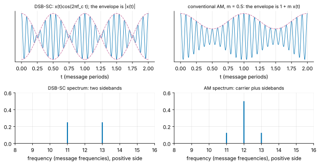
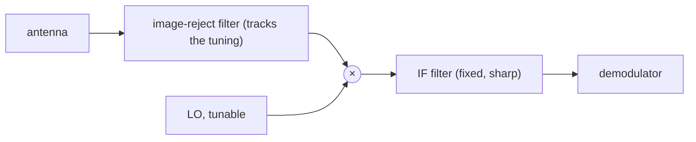
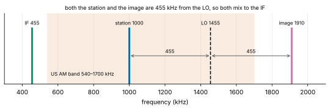
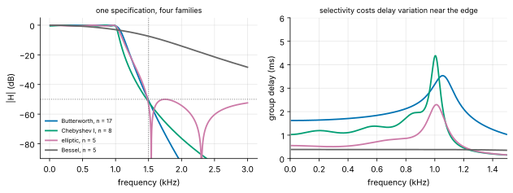

<!-- status: reviewed -->
# 11-11 · Modulation and Filtering Applications

| | |
|---|---|
| **Course** | [11 · Signals and Systems](../README.md) |
| **University equivalent** | The communication-systems chapter of a junior Signals and Systems course: amplitude modulation (DSB-SC and conventional AM), coherent and envelope demodulation, frequency shifting and the superheterodyne receiver, frequency-division multiplexing, ideal versus practical filters, and an introduction to communication links (Oppenheim & Willsky, *Signals and Systems*, §§8.1–8.3 and §6.4; Lathi, *Linear Systems and Signals*, ch. 7; MIT 6.003). The rest of that chapter is in Course 17: single-sideband and frequency modulation in [17-03](../../17-communication-systems/chapters/17-03-analog-modulation.md), pulse-amplitude modulation in [17-04](../../17-communication-systems/chapters/17-04-baseband-digital-transmission.md) |
| **Prerequisites** | [11-06 The Continuous-Time Fourier Transform](11-06-continuous-time-fourier-transform.md) (modulation property, ideal filters), [11-08 The Laplace Transform and System Functions](11-08-laplace-transform-and-system-functions.md) (Butterworth poles, group delay), [11-10 Sampling, Aliasing and Reconstruction](11-10-sampling-aliasing-reconstruction.md) (frequency shifting by sampling) |
| **Estimated study hours** | 7 |
| **Last verified** | 2026-11-20 |

**Learning objectives.** After this chapter you can:

1. Derive the spectrum of a DSB-SC AM signal from the modulation property, demodulate it coherently, and quantify the loss from a carrier phase error.
2. Explain conventional AM, its modulation index and power efficiency, and size an envelope detector's time constant.
3. Explain frequency shifting with a mixer, find image frequencies, and describe why receivers use a superheterodyne architecture.
4. Compare Butterworth, Chebyshev, elliptic and Bessel filters by order, ripple, transition width and group delay, and choose one for a requirement.
5. Describe a communication link in terms of bandwidth and signal-to-noise ratio, and use the Shannon capacity to bound its data rate.

---

## 1. Big picture

Antennas radiate efficiently only at frequencies whose wavelengths are comparable to their size, and many users must share one medium without hearing each other. Both problems are solved by the property of 11-06 that multiplying by a sinusoid shifts a spectrum: **modulation** moves a baseband message (voice, data) up to a carrier frequency where it can be radiated and where it occupies its own slot, and **demodulation** moves it back. Filters then separate the slots. This chapter surveys the signal-processing core of every radio, from AM broadcast to Wi-Fi and 5G, and the practical filter families that make channel separation possible. It closes Course 11 by turning its tools (transforms, convolution, sampling, poles and zeros) into the building blocks of communication systems, which Course 17 develops fully.

- **Modulation is multiplication.** A mixer multiplies two signals; in frequency it adds and subtracts their frequencies. Every radio's up- and down-conversion is this one operation.
- **Receivers trade image rejection against complexity.** Shifting a band to a fixed intermediate frequency (IF) makes filtering easy but admits an "image" band, which must be filtered before the mixer.
- **Practical filters trade sharpness against phase.** Elliptic filters reach a specification with the fewest poles; Bessel filters keep waveform shape; Butterworth and Chebyshev sit between.
- **Front-end filters are a business.** Each cellular band needs its own filter, and filters are a large share of a phone's RF front-end cost (§9).
- **Capacity is bounded by bandwidth and SNR.** Shannon's formula sets the ceiling every modem design works toward.

## 2. Intuition first

**A message riding a carrier.** Picture a fast cosine, the carrier, whose amplitude is slowly pushed up and down by a voice signal. The result looks like the voice drawn as the envelope of a dense oscillation. In frequency, the voice's spectrum, which lived near DC, now sits on both sides of the carrier frequency: an upper sideband (the voice shifted up) and a lower sideband (its mirror image). To recover the voice, a receiver either multiplies by the same carrier again (which shifts a copy back to DC) or simply traces the envelope.

*Figure 1. A tone message on a carrier. DSB-SC (left) has the envelope $\lvert x(t)\rvert$, which folds the negative half of the message, and two sideband lines; conventional AM with $m$ = 0.5 (right) keeps its envelope equal to $1 + mx(t)$ at the cost of a carrier line holding most of the power.*

**Shifting to a fixed frequency.** A radio must select one station among many. Building a sharp, tunable filter at every possible station frequency is hard; building one sharp filter at a single fixed frequency is easy. So the receiver shifts the wanted station to that fixed IF by mixing with a tunable local oscillator (LO), and filters there. Mixing is symmetric, though: a station on the far side of the LO, the **image**, lands on the same IF, and must be removed before mixing.

**An analogy from finance: currency conversion and back, and where it breaks.** Modulation is like converting a portfolio into another currency to trade in a different market, then converting back. Done with the same exchange rate both ways, nothing is lost; done with a slightly different rate (a carrier phase or frequency error), the value returned is scaled or drifts over time. The analogy breaks because currency conversion is linear in one variable, while mixing also creates an unwanted twin (the sum or difference frequency, and the image), which has no counterpart in a currency trade: no one receives a phantom second portfolio that must be filtered out.

## 3. Theory

> **Conventions.** Message $x(t)$ band-limited to $W$ (Hz), carrier frequency $f_c \gg W$, spectra in hertz (11-06). A cosine at $f_0$ has spectral lines of weight ½ at $\pm f_0$.

### 3.1 DSB-SC amplitude modulation

Multiplying the message by a carrier gives **double-sideband suppressed-carrier** (DSB-SC) AM:

$$
s(t) = x(t)\cos(2\pi f_ct) \quad\leftrightarrow\quad S(f) = \tfrac12X(f - f_c) + \tfrac12X(f + f_c) ,
$$

by Euler's formula and the modulation (frequency-shift) property. The message's spectrum appears centered on $\pm f_c$, at half height. The part above $f_c$ is the **upper sideband** and the part below is the **lower sideband**; together they occupy $2W$, twice the message bandwidth. No spectral line at $f_c$ appears, because a zero-mean message has no DC component: the carrier is suppressed.

### 3.2 Coherent demodulation

Multiply the received signal by a local carrier with phase error φ and low-pass filter:

$$
s(t)\cos(2\pi f_ct + \phi) = x(t)\cdot\tfrac12\left[\cos\phi + \cos(4\pi f_ct + \phi)\right] .
$$

The second term sits at $2f_c$ and is removed by a low-pass filter with cutoff between $W$ and $2f_c - W$, leaving $\tfrac12x(t)\cos\phi$. The demodulator needs the carrier's **frequency and phase**: a phase error φ scales the output by $\cos\phi$ (zero at 90°, where the message is lost entirely), and a small frequency error $\Delta f$ makes $\phi = 2\pi\Delta ft$ drift, so the output beats as $\cos(2\pi\Delta ft)$. Real receivers recover the carrier with a phase-locked loop (15-12, 20-10) or transmit a reference.

### 3.3 Conventional AM and envelope detection

Adding a large carrier lets a receiver skip carrier recovery. With $\lvert x(t)\rvert \le 1$ and a **modulation index** $0 < m \le 1$,

$$
s(t) = A\left[1 + m\,x(t)\right]\cos(2\pi f_ct) .
$$

Because $1 + mx(t) \ge 0$, the envelope of $s$ is exactly $A[1 + mx(t)]$, and an **envelope detector**, a diode charging a capacitor that discharges through a resistor, recovers it. The spectrum is the DSB-SC spectrum plus carrier lines of weight $A/2$ at $\pm f_c$.

**Power efficiency.** The carrier carries no information. Let the message have power $P_x = \overline{x^2}$ and zero mean, $\overline{x} = 0$, and let it vary slowly compared with the carrier ($f_c \gg W$). Then $s^2 = A^2(1 + mx)^2\cos^2(2\pi f_ct) = \tfrac12A^2(1 + mx)^2[1 + \cos(4\pi f_ct)]$, and the double-frequency term averages to zero against the slowly varying envelope. Expanding $(1 + mx)^2 = 1 + 2mx + m^2x^2$ and averaging, the cross term vanishes because $\overline{x} = 0$, so the transmitted power is $\frac{A^2}{2}(1 + m^2P_x)$: the carrier's $A^2/2$ plus the sidebands' $A^2m^2P_x/2$. The sidebands carry the fraction

$$
\eta = \frac{m^2P_x}{1 + m^2P_x} .
$$

For a full-scale tone ($P_x = \tfrac12$) at $m = 1$, η = 1/3: two-thirds of the power is spent on the carrier. Conventional AM buys a cheap receiver with transmitter power.

**Sizing the envelope detector.** The capacitor must follow the envelope but not the carrier. Between carrier peaks it discharges with time constant $RC$, so $RC \gg 1/f_c$ smooths the carrier ripple. But it must also fall as fast as the envelope does. For a tone envelope $A(1 + m\cos\omega_mt)$, the discharge slope $-v/RC$ must be at least as steep as the envelope's fastest descent, so $RC \le (1 + m\cos\theta)/(m\omega_m\sin\theta)$ at every phase θ. The right-hand side is smallest where its derivative vanishes, at $\cos\theta = -m$, giving

$$
RC \le \frac{\sqrt{1 - m^2}}{m\,\omega_m} .
$$

A larger $RC$ causes **diagonal clipping**: the output lags the falling envelope and distorts it (Example 11-11.2).

### 3.4 Frequency shifting, mixers and images

A **mixer** multiplies an input at $f_{RF}$ by a local oscillator at $f_{LO}$. Since $\cos a\cos b = \tfrac12[\cos(a - b) + \cos(a + b)]$, the output contains $\lvert f_{RF} - f_{LO}\rvert$ and $f_{RF} + f_{LO}$; a filter keeps one. A **superheterodyne** receiver keeps the difference, the intermediate frequency $f_{IF} = \lvert f_{RF} - f_{LO}\rvert$, and tunes by moving the LO, so that all the sharp channel filtering happens at one fixed frequency.

*Figure 2. A superheterodyne receiver: the tunable LO moves the wanted station to a fixed IF, where one sharp filter selects it.*

**The image.** Any input at $f_{LO} \pm f_{IF}$ produces the same IF. With the LO above the wanted signal (high-side injection, $f_{LO} = f_{RF} + f_{IF}$), the image is at

$$
f_{image} = f_{LO} + f_{IF} = f_{RF} + 2f_{IF} ,
$$

$2f_{IF}$ away from the wanted signal. Once mixed, image and signal are inseparable (like an alias in 11-10; Figure 3), so an **image-reject filter** must attenuate the image before the mixer. A higher IF moves the image farther away and eases that filter, but a lower IF eases the channel filter: the classic superheterodyne trade, often resolved with two conversions. Sampling (11-10) is itself a mixer with every harmonic of $f_s$, which is why band-pass sampling works and why its anti-aliasing filter plays the image-reject role.

*Figure 3. Example 11-11.3's frequency plan. The station and the image sit symmetrically 455 kHz either side of the LO.*

### 3.5 Frequency-division multiplexing

Different messages modulated onto different carriers occupy different slots and can share one medium: **frequency-division multiplexing** (FDM). Each receiver selects its slot with a band-pass filter (or by mixing to IF and low-pass filtering). Slot spacing must exceed each signal's bandwidth by a **guard band** wide enough for the selection filter's transition. Radio broadcasting, cable television and cellular bands are FDM at the largest scale; OFDM (Course 17) is FDM made digital, with thousands of closely spaced subcarriers separated by an FFT rather than by analog filters.

### 3.6 Ideal versus practical filters

The ideal brick-wall filter of 11-06 is noncausal and cannot be built; every practical filter approximates it with a finite number of poles and zeros (11-08). Four classical families divide the trade-off between passband flatness, transition sharpness and phase:

| Family | Poles and zeros | Passband | Stopband | Transition for a given order | Group delay |
|---|---|---|---|---|---|
| Butterworth | Poles on a circle | Maximally flat, monotonic | Monotonic | Widest of the three sharp families | Moderate peaking near cutoff |
| Chebyshev (type I) | Poles on an ellipse | Equiripple | Monotonic | Sharper | Larger peaking |
| Elliptic (Cauer) | Poles plus zeros on the $j\omega$ axis | Equiripple | Equiripple (finite zeros) | Sharpest | Large variation near cutoff |
| Bessel | Poles chosen for flat delay | Gentle roll-off | Monotonic | Widest | Maximally flat |

*Why the ranking:* Chebyshev filters spread the allowed passband error evenly instead of concentrating flatness at DC, which buys roll-off; elliptic filters also put zeros on the $j\omega$ axis just beyond the passband (notches, 11-08 §3.7), which pulls the response down fastest. Both move poles closer to the axis, which is what makes their group delay peak. A Bessel filter, designed for constant delay, preserves pulse shape (11-06's distortionless transmission) at the cost of selectivity. Example 11-11.4 puts numbers on the trade.

**Minimum order.** A specification gives a passband edge $\omega_p$ with at most $A_p$ dB of loss and a stopband edge $\omega_s$ with at least $A_s$ dB. Define the **discrimination** $D = (10^{A_s/10} - 1)/(10^{A_p/10} - 1)$, the ratio of the two allowed values of "$1/\lvert H\rvert^2 - 1$". For Butterworth, $1/\lvert H\rvert^2 - 1 = (\omega/\omega_c)^{2n}$; writing this at both edges and dividing eliminates $\omega_c$:

$$
\left(\frac{\omega_s}{\omega_p}\right)^{2n} \ge D \quad\Longrightarrow\quad n \ge \frac{\log_{10}D}{2\log_{10}(\omega_s/\omega_p)} .
$$

For Chebyshev type I, $1/\lvert H\rvert^2 - 1 = \varepsilon^2T_n^2(\omega/\omega_p)$, where $T_n(x) = \cosh(n\operatorname{arccosh}x)$ for $x > 1$ is the Chebyshev polynomial and $\varepsilon^2 = 10^{A_p/10} - 1$ sets the ripple. At the stopband edge the condition is $T_n(\omega_s/\omega_p) \ge \sqrt D$, so

$$
n \ge \frac{\operatorname{arccosh}\sqrt D}{\operatorname{arccosh}(\omega_s/\omega_p)} .
$$

Because $\operatorname{arccosh}x$ grows like $\ln 2x$ while $\log_{10}$ of a ratio near 1 is tiny, the Chebyshev order grows far more slowly for a sharp transition. The elliptic order has a closed form in complete elliptic integrals $K$, $n \ge K(k)K(\sqrt{1 - k_1^2})/[K(k_1)K(\sqrt{1 - k^2})]$ with $k = \omega_p/\omega_s$ and $k_1 = 1/\sqrt D$; in practice it is evaluated numerically (`scipy.signal.ellipord`). Each bound is rounded up to the next integer.

### 3.7 A communication link in one equation

A link sends symbols through a channel of bandwidth $B$ that adds noise. Its quality is the **signal-to-noise ratio** at the receiver, SNR. Shannon showed in 1948 that no scheme can communicate reliably faster than the **channel capacity**

$$
C = B\log_2(1 + \text{SNR})\ \text{bit/s} ,
$$

for a channel with additive white Gaussian noise, and that rates below $C$ are achievable with good enough coding. Two consequences shape every modem: capacity grows linearly with bandwidth but only logarithmically with SNR (each extra bit per second per hertz needs about 3 dB more SNR at high SNR), and the gap between a real modem and $C$ is a measure of its design quality. **Why digital:** a digital receiver decides each symbol and regenerates it, so noise does not accumulate along a chain of repeaters, and error-correcting codes can approach $C$; an analog link's noise only adds up.

## 4. Worked examples

### Example 11-11.1 · Voice on a carrier (tier A)

**Setup.** Telephone-quality voice (300–3400 Hz) DSB-SC modulates a 100 kHz carrier. (a) Which band does it occupy, and how wide is it? (b) A coherent demodulator's carrier is 30° out of phase: by how much is the output reduced? (c) What happens at 90°?

**Solution.** (a) The sidebands span $100 \pm 3.4$ kHz, from **96.6** to **103.4** kHz, a width of $2 \times 3.4$ = **6.8** kHz (with a gap of ±0.3 kHz around the carrier, since voice has no content below 300 Hz). (b) The output scales by $\cos 30°$ = **0.8660**, or **−1.25** dB. (c) $\cos 90° = 0$: the output vanishes.

**Sanity check.** DSB-SC always takes twice the message bandwidth: one copy for each sideband.

### Example 11-11.2 · An AM broadcast receiver's detector (tier B)

**Setup.** A station transmits a 5 kHz test tone with $m$ = 0.5 on a 1 MHz carrier. (a) What fraction of the transmitted power is in the sidebands? (b) What would it be at $m$ = 1? (c) Find the largest envelope-detector time constant that avoids diagonal clipping, and compare it with the carrier period.

**Solution.** (a) For a tone, $P_x = \tfrac12$, so $\eta = (0.25 \times 0.5)/(1 + 0.25 \times 0.5) = 0.125/1.125$ = **11.1**%. (b) At $m$ = 1: $0.5/1.5$ = **33.3**%. (c) $RC \le \sqrt{1 - 0.25}/(0.5 \times 2\pi \times 5000)$ = **55.1** µs. The carrier period is **1** µs, so any $RC$ well above 1 µs and below 55.1 µs works; a value in the lower part of that range leaves margin against clipping while still smoothing the carrier.

**Sanity check.** At $m \to 1$ the bound $\sqrt{1 - m^2}/(m\omega_m)$ tends to zero: a fully modulated envelope touches zero, where its slope is steepest relative to its value, and no RC detector can follow it perfectly.

### Example 11-11.3 · The image of an AM station (tier B)

**Setup.** A superheterodyne AM receiver with a 455 kHz IF and high-side LO is tuned to 1000 kHz. (a) Find the LO frequency and the image frequency. (b) A tuned RLC image-reject filter at 1000 kHz with $Q$ = 20 precedes the mixer; its response is $1/\sqrt{1 + Q^2(f/f_0 - f_0/f)^2}$. Find its attenuation at the image. (c) Is the image inside the band that the TPA3116D2's AM-avoidance table covers (540–1700 kHz [1])?

**Solution.** (a) $f_{LO} = 1000 + 455$ = **1455** kHz; $f_{image} = 1000 + 2 \times 455$ = **1910** kHz. (b) $Q(f/f_0 - f_0/f) = 20(1.91 - 0.5236)$ = **27.73**, so the attenuation is $10\log_{10}(1 + 27.73^2)$ = **28.9** dB. (c) No: 1910 kHz is above 1700 kHz, so with this IF the image of a 1000 kHz station falls outside the band; but for stations near the bottom of the band (540 kHz, image at **1450** kHz) the image lands inside it, where another station can sit.

**Sanity check.** The image is always $2f_{IF}$ from the wanted signal; a 455 kHz IF puts it 910 kHz away, comparable to the band's width, which is why the front-end filter must track the tuning.

### Example 11-11.4 · Which filter family? (tier B)

**Setup.** An anti-aliasing filter must pass 0–1 kHz with at most 0.5 dB of loss and attenuate by at least 50 dB from 1.5 kHz. Find the minimum order for Butterworth, Chebyshev type I and elliptic designs, and compare the spread of group delay (maximum minus minimum) across the passband.

**Solution.** The discrimination is $D = (10^5 - 1)/(10^{0.05} - 1)$ = **8.195** × 10⁵ and the transition ratio is 1.5. Butterworth: $n \ge \log_{10}D/(2\log_{10}1.5) = 5.914/0.3522$ = **16.79**, so order **17**. Chebyshev type I: $\sqrt D$ = 905.3 and $n \ge \operatorname{arccosh}(905.3)/\operatorname{arccosh}(1.5) = 7.501/0.9624$ = **7.79**, so **8**. Elliptic: the elliptic-integral formula gives **4.96**, so only **5** (the same as `scipy.signal.buttord`, `cheb1ord` and `ellipord` for analog prototypes). Their passband group delays (1 Hz to 1 kHz) spread by **1.55** ms, **3.33** ms and **1.76** ms respectively. The elliptic filter meets the magnitude specification with less than a third of the Butterworth's poles; the Chebyshev's delay varies most. If waveform shape mattered too, no Bessel filter would do, at any order. Scaled for 0.5 dB of loss at 1 kHz, a tenth-order Bessel filter loses only **1.13** dB at 1.5 kHz and reaches 50 dB only at **8.96** kHz, and higher orders do no better: as the order grows the Bessel response approaches a Gaussian, whose loss in decibels grows only as the square of frequency, $0.5 \times 1.5^2$ = **1.125** dB at 1.5 kHz. The options are a far more relaxed specification, or a sharp (elliptic) filter followed by an all-pass delay equalizer, or oversampling and a linear-phase digital filter (11-07, 11-10).

*Figure 4. Example 11-11.4's designs: orders 17, 8 and 5 meet the same magnitude specification; a fifth-order Bessel filter, shown for contrast, misses it badly but has the flattest delay.*

**Sanity check.** The transition ratio is only 1.5; Butterworth filters gain $20\log_{10}1.5$ ≈ **3.5** dB per order there, so about 50/3.5 ≈ **14** orders plus the passband allowance: the 17 found is consistent.

### Example 11-11.5 · What can a 20 MHz channel carry? (tier B)

**Setup.** A Wi-Fi-like channel is 20 MHz wide. Find the Shannon capacity at SNR = 30 dB, 25 dB, 10 dB and 0 dB.

**Solution.** $C = 20\,\text{MHz}\times\log_2(1 + 10^{\text{SNR}/10})$: **199.3** Mb/s at 30 dB, **166.2** Mb/s at 25 dB, **69.2** Mb/s at 10 dB and **20** Mb/s at 0 dB. Dropping 5 dB from 30 dB costs **16.6**% of capacity; at low SNR capacity is roughly proportional to SNR.

**Sanity check.** At high SNR each 3 dB adds about 1 bit/s/Hz, 20 Mb/s here: 30 dB to 25 dB is 5 dB, about **1.66** bit/s/Hz, **33** Mb/s, matching $199.3 - 166.2$.

### Answer key

<!-- answer-key -->
| ID | Quantity | Value | Unit |
|---|---|---|---|
| T 11-11.a | AM sideband efficiency, tone at m = 1 | 0.3333 | — |
| T 11-11.b | iPhone 13 (A2481) LTE bands, FDD plus TDD | 32 | — |
| T 11-11.c | US unlicensed 6 GHz band width | 1200 | MHz |
| T 11-11.d | bandwidth of a Q = 20 circuit at 1 MHz | 50 | kHz |
| T 11-11.e | fades per second for a 2 Hz error | 4 | — |
| T 11-11.f | capacity gain from doubling SNR at 30 dB | 10 | % |
| Ex 11-11.1a | lower band edge | 96.6 | kHz |
| Ex 11-11.1b | upper band edge | 103.4 | kHz |
| Ex 11-11.1c | occupied width | 6.8 | kHz |
| Ex 11-11.1d | output at 30° error | 0.8660 | — |
| Ex 11-11.1e | output at 30° error | −1.25 | dB |
| Ex 11-11.2a | sideband fraction at m = 0.5 | 11.1 | % |
| Ex 11-11.2b | sideband fraction at m = 1 | 33.3 | % |
| Ex 11-11.2c | maximum RC | 55.1 | µs |
| Ex 11-11.2d | carrier period | 1 | µs |
| Ex 11-11.3a | LO frequency | 1455 | kHz |
| Ex 11-11.3b | image frequency | 1910 | kHz |
| Ex 11-11.3c | Q times detuning | 27.73 | — |
| Ex 11-11.3d | image attenuation | 28.9 | dB |
| Ex 11-11.3e | image of a 540 kHz station | 1450 | kHz |
| Ex 11-11.4a | Butterworth order | 17 | — |
| Ex 11-11.4b | Chebyshev I order | 8 | — |
| Ex 11-11.4c | elliptic order | 5 | — |
| Ex 11-11.4d | Butterworth delay spread | 1.55 | ms |
| Ex 11-11.4e | Chebyshev I delay spread | 3.33 | ms |
| Ex 11-11.4f | elliptic delay spread | 1.76 | ms |
| Ex 11-11.4g | Butterworth dB per order at 1.5 | 3.5 | dB |
| Ex 11-11.4h | rough order estimate | 14 | — |
| Ex 11-11.4i | discrimination D | 8.195 × 10⁵ | — |
| Ex 11-11.4j | Butterworth order bound | 16.79 | — |
| Ex 11-11.4k | Chebyshev order bound | 7.79 | — |
| Ex 11-11.4l | elliptic order bound | 4.96 | — |
| Ex 11-11.4m | Bessel (10th order) loss at 1.5 kHz | 1.13 | dB |
| Ex 11-11.4n | Bessel (10th order) 50 dB frequency | 8.96 | kHz |
| Ex 11-11.4o | Gaussian-limit loss at 1.5 kHz | 1.125 | dB |
| Ex 11-11.5a | capacity at 30 dB | 199.3 | Mb/s |
| Ex 11-11.5b | capacity at 25 dB | 166.2 | Mb/s |
| Ex 11-11.5c | capacity at 10 dB | 69.2 | Mb/s |
| Ex 11-11.5d | capacity at 0 dB | 20 | Mb/s |
| Ex 11-11.5e | spectral efficiency lost from 30 to 25 dB | 1.66 | bit/s/Hz |
| Ex 11-11.5f | capacity lost from 30 to 25 dB | 33 | Mb/s |
| Ex 11-11.5g | fraction of capacity lost, 30 to 25 dB | 16.6 | % |

*Every value is recomputed by [verify_11_11.py](../verify/verify_11_11.py): spectra by FFTs of modulated signals, demodulator outputs by simulating multiplication and low-pass filtering, the envelope detector's clipping limit by simulating a diode–RC detector, the image filter by evaluating the RLC response, filter orders by searching designs from `scipy.signal`, group delays by differentiating computed phase, and capacities from the formula. Sourced facts ([R-134](../../../reference/research-log.md#r-134--rf-filters-and-bands), [R-188](../../../reference/research-log.md#r-188--switching-harmonics-in-a-class-d-amplifier)) are quoted.*

## 5. Simulate it

The lab, [labs/11-11-lab](../labs/11-11-lab/README.md), is a notebook in four parts:

1. Modulates a two-tone message (DSB-SC), demodulates it with phase and frequency errors, and plots the spectra at each step.
2. Builds conventional AM and an envelope detector, then raises $RC$ past the clipping limit and watches the distortion appear.
3. Mixes a wanted station and its image to the IF and shows they become inseparable.
4. Designs Butterworth, Chebyshev, elliptic and Bessel filters to one specification and compares magnitude, group delay and step responses.

**Guided exercise (predict, then run).** **Before running Part 2**, predict: for the tone of Example 11-11.2 ($m$ = 0.5, 5 kHz), what happens to the detected tone's distortion as $RC$ rises from 20 µs to 55 µs to 150 µs? Then run it. (Below the 55.1 µs limit the residual is small carrier ripple; above it the falling half of each cycle is cut off by an exponential, and the harmonic distortion jumps.)

## 6. Engineering tradeoffs

| Knob | Improves | Costs | Typical decision owner |
|---|---|---|---|
| DSB-SC vs conventional AM | Power efficiency (DSB-SC) | Carrier recovery in every receiver | System architect |
| Modulation index | Sideband power, SNR | Envelope-detector distortion near m = 1 | Transmitter designer |
| IF frequency | Image rejection (high IF) or channel filtering (low IF) | The other one; extra conversions | Radio architect |
| Filter family and order | Selectivity per pole (elliptic) or phase fidelity (Bessel) | Group-delay variation or order | Filter designer |
| Guard band in FDM | Easier channel filters | Spectrum, the scarcest resource | Standards body, operator |
| Bandwidth vs SNR | Capacity (linear in B, log in SNR) | Spectrum cost vs transmit power | Link architect |

## 7. Numbers to know

| Quantity | Value | Note |
|---|---|---|
| DSB-SC bandwidth | $2W$ | Two sidebands |
| Coherent demodulation | Output ∝ cos φ | Lost at 90° |
| AM efficiency | $m^2P_x/(1 + m^2P_x)$; 1/3 for a tone at m = 1 | Carrier carries no information |
| Envelope detector | $1/f_c \ll RC \le \sqrt{1 - m^2}/(m\omega_m)$ | Diagonal clipping above |
| Image frequency | $f_{RF} + 2f_{IF}$ (high-side LO) | Must be filtered before the mixer |
| Shannon capacity | $B\log_2(1 + \text{SNR})$ | ≈ 1 bit/s/Hz per 3 dB at high SNR |

## 8. Common mistakes

- **Forgetting the factor ½ in modulation.** Each sideband carries half the message amplitude.
- **Assuming DSB-SC can be envelope-detected.** Its envelope is $\lvert x(t)\rvert$, which folds negative messages; only conventional AM with $m \le 1$ has an envelope equal to the message.
- **Filtering the image after the mixer.** Like an alias, it is inseparable once converted.
- **Choosing a filter family by magnitude alone.** Elliptic and Chebyshev filters distort pulse shapes through group delay.
- **Treating Shannon capacity as a data rate a product achieves.** It is an upper bound; implementations fall short by coding gaps and overheads.

## 9. Practitioner lens

### State of the art (as of Nov 2026)

- **Phones need a filter per band.** The filter company Resonant's annual report for fiscal 2021 (Form 10-K, filed March 2022) states that the iPhone 13 (model A2481) supports 24 FDD-LTE and 8 TDD-LTE bands, that "each band requires a filter", and, citing the analyst firm Mobile Experts, that filters, duplexers and multiplexers are more than half the cost of the RF front end [2] **[Established]** that the filing says this; the cost share is an **[Industry estimate]**. Broadcom makes FBAR acoustic filters in its own fabs [2] **[Established]**.
- **New spectrum keeps arriving.** The US opened 1200 MHz of unlicensed spectrum at 5.925–7.125 GHz in 2020, and 3GPP's NR bands n77, n78 and n79 cover 3.3–4.2 GHz and 4.4–5.0 GHz [2] **[Established]**; every new band adds filter and image-rejection requirements to front ends.
- **Mixed-signal products must stay out of the AM band.** The TPA3116D2 class-D amplifier's data sheet tabulates switching frequencies for each part of the US AM band (540–1700 kHz) so that no switching harmonic lands inside the slice of the band being received [1] **[Established]** (11-05).

> **Deeper:** see companion repo *Datacenter Networking* for how the same modulation and equalization ideas appear in PAM4 SerDes and coherent optics.

### Why it matters commercially

- **RF front ends are a large, consolidating market.** The filter count per phone, set by the number of bands, drives acoustic-filter demand; Skyworks completed its combination with Qorvo on 5 Oct 2026 [2] **[Established]**, one response to that scale.
- **Spectrum is expensive; SNR is cheaper.** Operators pay for bandwidth, so modem designers chase every decibel of SNR and every fraction of the gap to capacity.
- **Coexistence is a design constraint.** Switching converters, clocks and high-speed links inside a product radiate harmonics that land in someone's band; avoiding them is cheaper at architecture time than at certification.

### Marketing vs Reality

- **"Gigabit wireless."** *Reality:* peak rates assume the widest channels and the highest SNR; capacity falls logarithmically with SNR and linearly with bandwidth. *Sanity check:* ask for the rate at the SNR of a typical user, not the best.
- **"Brick-wall filtering."** *Reality:* every real filter has a transition band, ripple and group delay; sharper means more poles, more delay variation or both. *Sanity check:* ask for the order, family and group-delay variation.
- **"No interference with radio."** *Reality:* any switching circuit has harmonics; the question is where they land and how strong they are. *Sanity check:* ask for emission test results and the frequency plan (like the TPA3116D2's AM table).

### Questions for engineering leaders

1. **"How many bands does this product support, and what does each cost in filters and area?"**
   *Strong:* a band plan with filter technology per band and the cost of adding the next one. *Evasive:* "the module handles it."
2. **"What is your receiver's image rejection, and where does it come from?"**
   *Strong:* the IF plan, the front-end filter's attenuation at the image, and any image-reject mixer architecture. *Evasive:* a sensitivity number only.
3. **"How far is your link from Shannon capacity at the operating SNR?"**
   *Strong:* the gap in dB, broken into coding, modulation and implementation losses. *Evasive:* the peak data rate.
4. **"Which filter family did you choose for this channel, and what does its group delay do to your signal?"**
   *Strong:* the family, order and delay variation, and how equalization handles it. *Evasive:* a magnitude plot only.

## 10. Concept check

**Q1.** Why does DSB-SC AM need twice the message bandwidth?

Answer

Multiplying by a cosine places a copy of the message's spectrum, positive and negative frequencies included, around $+f_c$ (and another around $-f_c$); around $+f_c$ the copy spans $f_c - W$ to $f_c + W$, two sidebands of width $W$.

**Q2.** A coherent demodulator's carrier drifts by 2 Hz from the transmitter's. What does the listener hear?

Answer

The output is multiplied by $\cos(2\pi \cdot 2t)$: the audio fades in and out **4** times per second (twice per beat cycle, through zero).

**Q3.** Why can a $Q$ = 20 tuned circuit not replace the IF channel filter?

Answer

At 1 MHz its −3 dB bandwidth is $f_0/Q$ = **50** kHz, far wider than one 10 kHz-class channel; and its bandwidth would change as it is tuned. The fixed IF filter can be both narrow and fixed.

**Q4.** Which filter family would you choose for an oscilloscope's input, and why?

Answer

A Bessel (or similar constant-delay) response: preserving pulse shape without overshoot matters more than sharp selectivity when the user looks at waveforms.

**Q5.** Doubling a channel's bandwidth or doubling its SNR: which raises capacity more at 30 dB SNR?

Answer

Doubling bandwidth doubles capacity; doubling SNR adds only about 1 bit/s/Hz to roughly 10 (about **+10**%).

[Problem set for this chapter](../problems/11-11-problems.md)

## 11. Key terms

[Amplitude modulation (AM)](../../../reference/glossary.md#amplitude-modulation-am) · [DSB-SC modulation](../../../reference/glossary.md#dsb-sc-modulation) · [Modulation index](../../../reference/glossary.md#modulation-index) · [Envelope detector](../../../reference/glossary.md#envelope-detector) · [Coherent demodulation](../../../reference/glossary.md#coherent-demodulation) · [Mixer](../../../reference/glossary.md#mixer) · [Superheterodyne receiver](../../../reference/glossary.md#superheterodyne-receiver) · [Image frequency](../../../reference/glossary.md#image-frequency) · [Frequency-division multiplexing (FDM)](../../../reference/glossary.md#frequency-division-multiplexing-fdm) · [Elliptic filter](../../../reference/glossary.md#elliptic-filter) · [Bessel filter](../../../reference/glossary.md#bessel-filter) · [Shannon capacity](../../../reference/glossary.md#shannon-capacity)

## 12. Connections

- **Builds on:** the modulation property and ideal filters from [11-06](11-06-continuous-time-fourier-transform.md); pole placement, Butterworth and group delay from [11-08](11-08-laplace-transform-and-system-functions.md); frequency shifting by sampling from [11-10](11-10-sampling-aliasing-reconstruction.md); class-D AM avoidance from [11-05](11-05-fourier-series.md); filter design from [07-08](../../07-circuit-analysis-2-transient-and-ac/chapters/07-08-filters-and-resonance.md).
- **Next:** the Course 11 exam and review; then Course 12 (Electronics II). Control and phase-locked loops follow in Course 15.
- **Used later:** communication systems (modulation, noise, digital modulation, OFDM) in Course 17; RF front ends and mixers in Course 21 (21-05, 21-08).

## 13. Further study

- A. V. Oppenheim and A. S. Willsky with S. H. Nawab, *Signals and Systems*, 2nd ed., ch. 8 (communication systems) and §6.4–6.5 (filters).
- B. P. Lathi, *Linear Systems and Signals*, ch. 7 (frequency-domain analysis: filtering and modulation).
- B. P. Lathi and Z. Ding, *Modern Digital and Analog Communication Systems*, the chapters on amplitude modulation and on channel capacity: the next step (Course 17).
- C. E. Shannon, "A Mathematical Theory of Communication," *Bell System Technical Journal*, 1948: the origin of the capacity formula.

## 14. Sources

1. Texas Instruments, *TPA3116D2/TPA3118D2/TPA3130D2*, SLOS708G (April 2012, revised December 2017), §7.3.16 and Table 6: [data sheet](https://www.ti.com/lit/ds/symlink/tpa3116d2.pdf). [R-188](../../../reference/research-log.md#r-188--switching-harmonics-in-a-class-d-amplifier).
2. RF filters and bands: Resonant Inc. Form 10-K (FY2021), Broadcom Inc. Form 10-K (FY2025), FCC 20-51, ETSI TS 138 101-1 V19.7.0, Skyworks Form 8-K exhibits: links in [R-134](../../../reference/research-log.md#r-134--rf-filters-and-bands).
