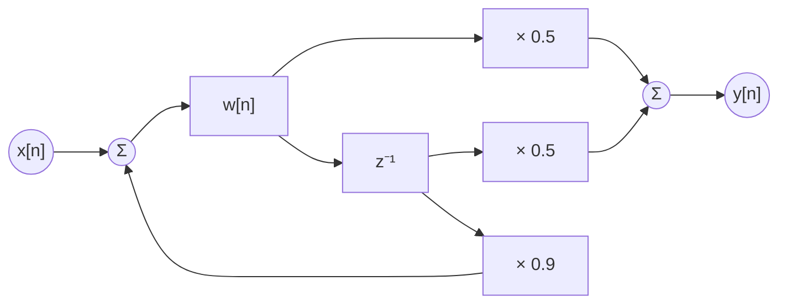

# Solutions 11-04 · LTI Systems and Differential/Difference Equations

Problems: [11-04 problems](../problems/11-04-problems.md) · Chapter: [11-04](../chapters/11-04-lti-systems-and-differential-equations.md). Every number below is recomputed by [verify_11_04.py](../verify/verify_11_04.py), which iterates the equations, integrates the ODEs and finds roots numerically.

---

## Solutions

### Solution 11-04.1

(a) $y[n] = x[n] - x[n - 2]$: memory, causal, stable with $\sum\lvert h\rvert$ = **2**. Its inverse is the recursion $w[n] = y[n] + w[n - 2]$, whose roots are ±1: not stable, because $h$ is zero at $\omega = 0$ and $\omega = \pi$ (it removes DC and the fastest alternation, which cannot be restored).

(b) $h(t) = e^{-t}$ for $t > -1$: nonzero for $-1 < t < 0$, so **noncausal** (the output responds up to 1 s before the input). It is stable: $\int_{-1}^{\infty}e^{-t}\,dt = e$ = **2.718**.

(c) $h[n] = 2^n$ for $n \le 0$: values $1, 0.5, 0.25, \dots$ at $n = 0, -1, -2, \dots$. Noncausal (anticausal), and stable with $\sum\lvert h\rvert = 1/(1 - 0.5)$ = **2**. A stable system need not be causal.

(d) A 2 s delay: memory, causal, stable; its inverse $\delta(t + 2)$ is an advance, noncausal.

### Solution 11-04.2

(a) $h[0] = 0.2$ = **0.2**, $h[1] = 0.8 \times 0.2$ = **0.16**, $h[2]$ = **0.128**: $h[n] = 0.2 \times 0.8^nu[n]$.

(b) $\sum h = 0.2/(1 - 0.8)$ = **1**: the average of a constant is that constant.

(c) $s[n] = \sum_{k=0}^{n}0.2 \times 0.8^k = 1 - 0.8^{n+1}$, so $s[9] = 1 - 0.8^{10}$ = **0.8926**.

### Solution 11-04.3

(a) $r^2 - 0.9r - 0.1 = (r - 1)(r + 0.1)$: roots **1** and **−0.1**. A root on the unit circle: the impulse response tends to a nonzero constant, so it is not summable and the system is **not** BIBO-stable (a step makes the output grow linearly).

(b) $r^2 + 0.25 = 0$: $r = \pm0.5j$, radius **0.5**, angle $\pi/2$. Stable; the ringing period is $2\pi/(\pi/2)$ = **4** samples.

(c) $r^2 - 2.5r + 1 = (r - 2)(r - 0.5)$: roots **2** and **0.5**. Unstable: the term $2^n$ grows.

### Solution 11-04.4

(a) $r^2 - 1.2r + 0.32 = 0$: $r = (1.2 \pm \sqrt{1.44 - 1.28})/2 = (1.2 \pm 0.4)/2$, so **0.8** and **0.4**.

(b) $h[n] = (0.8^{n+1} - 0.4^{n+1})/(0.8 - 0.4)$. Values: $h[0] = 1$, $h[1] = (0.64 - 0.16)/0.4 = 1.2$, $h[2] = (0.512 - 0.064)/0.4 = 1.12$, $h[3] = (0.4096 - 0.0256)/0.4$ = **0.96**. Iterating: $h[1] = 1.2 \times 1 = 1.2$; $h[2] = 1.2 \times 1.2 - 0.32 = 1.12$; $h[3] = 1.2 \times 1.12 - 0.32 \times 1.2 = 0.96$.

(c) $H(1) = 1/(1 - 1.2 + 0.32)$ = **8.333**.

### Solution 11-04.5

The ringing frequency in rad/sample is $\theta = 2\pi \times 1/8$ = π/4, about **0.7854** rad/sample. The envelope $r^n$ must fall to 0.01 in $10\ \text{ms} \times 8\ \text{kHz} = 80$ samples: $r = 0.01^{1/80}$ = **0.9441**. The equation is $y[n] - 2r\cos\theta\,y[n - 1] + r^2y[n - 2] = x[n]$ with $2r\cos\theta$ = **1.335** and $r^2$ = **0.8913**.

### Solution 11-04.6

(a) With $x = e^{st}$ and $y = H(s)e^{st}$: $sH + 2H = s + 3$, so $H(s) = (s + 3)/(s + 2)$.

(b) $H(s) = 1 + 1/(s + 2)$. The constant 1 is a direct path from input to output, whose impulse response is $\delta(t)$; the fraction is a first-order system with impulse response $e^{-2t}u(t)$. So $h(t) = \delta(t) + e^{-2t}u(t)$. The impulse appears because the numerator and denominator have the same order: the input's derivative reaches the output directly, as in a circuit with a capacitor path straight from input to output.

(c) $H(0) = 3/2$ = **1.5**; and $\int h = 1 + \int_0^\infty e^{-2t}\,dt = 1 + 0.5$ = 1.5.

### Solution 11-04.7

(a) $\alpha = R/2L = 5 \times 10^4$ s⁻¹ and $\omega_0^2 = 10^9$ s⁻², so $s = -\alpha \pm \sqrt{\alpha^2 - \omega_0^2} = -5 \times 10^4 \pm$ **3.873** × 10⁴ s⁻¹: $s_1$ = **−11.27** × 10³ s⁻¹ and $s_2$ = **−88.73** × 10³ s⁻¹. Both real and negative: overdamped and stable.

(b) $h = A(e^{s_1t} - e^{s_2t})$ satisfies $h(0^+) = 0$; then $\dot h(0^+) = A(s_1 - s_2) = \omega_0^2$, so $A = \omega_0^2/(s_1 - s_2) = 10^9/77\,460$ = **12.91** × 10³ s⁻¹.

(c) $\dot h = 0$ when $s_1e^{s_1t} = s_2e^{s_2t}$, that is $t = \ln(s_2/s_1)/(s_1 - s_2)$ = **26.64** µs. More damping removes the ringing of Example 11-04.5 and gives an earlier, lower peak.

### Solution 11-04.8

(a) Dividing by 2, $\ddot h + 1.5\dot h + 0.5h = 0.5\,\delta(t)$: $h(0^+) = 0$ and $\dot h(0^+)$ = **0.5**.

(b) The roots of $2s^2 + 3s + 1 = (2s + 1)(s + 1)$ are −0.5 and −1. With $h = A(e^{-0.5t} - e^{-t})$, $\dot h(0^+) = A(-0.5 + 1) = 0.5A = 0.5$, so $A = 1$: $h(t) = (e^{-t/2} - e^{-t})\,u(t)$.

(c) $\dot h = -\tfrac12e^{-t/2} + e^{-t} = 0$ gives $e^{-t/2} = \tfrac12$, $t = 2\ln2$ = **1.386** s, and $h = \tfrac12 - \tfrac14$ = **0.25**.

(d) $\int_0^\infty h\,dt = 2 - 1$ = **1**, and $H(0) = 1/(2 \cdot 0 + 3 \cdot 0 + 1) = 1$.

### Solution 11-04.9

(a) Direct form I: the input delay line holds $x[n - 1]$ and the output delay line holds $y[n - 1]$: **2** delays, **3** multipliers (0.5, 0.5, 0.9) and **2** additions. Direct form II: $w[n] = x[n] + 0.9w[n - 1]$, $y[n] = 0.5w[n] + 0.5w[n - 1]$, sharing one delay: **1** delay, the same 3 multipliers and 2 additions.

(b) $H(1) = (0.5 + 0.5)/(1 - 0.9)$ = **10**.

### Solution 11-04.10

$H(e^{j\omega}) = \dfrac{0.5(1 + e^{-j\omega})}{1 - 0.9e^{-j\omega}}$. At $\omega = 0$: **10**. At $\omega = \pi$: $e^{-j\pi} = -1$, so the numerator is zero: **0**. At $\omega = \pi/2$: $e^{-j\pi/2} = -j$, so $H = 0.5(1 - j)/(1 + 0.9j)$, with magnitude $0.5\sqrt2/\sqrt{1.81}$ = **0.5256** and phase $-45° - \arctan0.9$ = **−86.99**°. A low-pass filter: high gain at DC, falling to zero at the highest DT frequency.

### Solution 11-04.11

(a) $1.2728 \times 16 = 20.36$, which rounds to 20: **1.25**. $0.81 \times 16 = 12.96$, which rounds to 13: **0.8125**.

(b) $r^2 = 0.8125$ gives $r$ = **0.9014** (designed 0.9). $2r\cos\theta = 1.25$ gives $\cos\theta = 1.25/(2 \times 0.9014)$ = **0.6934** and θ = **46.10**° (designed 45°). The ringing period becomes $360/46.10$ = **7.81** samples instead of 8.

(c) A 4-bit coefficient moved the resonance by **2.4**% in frequency. A narrow resonance (poles very close to the unit circle) is far more sensitive, and the pole can even cross the circle. Narrow resonators and notch filters need long coefficient words, or structures designed for low sensitivity.

### Solution 11-04.12

(a) The step response is $1 - (1 - \alpha)^{n+1}$, which reaches $1 - e^{-1}$ (63%) when $(1 - \alpha)^{n} \approx e^{-1}$. For $n = 50$: $\alpha = 1 - e^{-1/50}$ = **0.0198**.

(b) Within 1% after $\ln100$ = **4.605** time constants, about 4.6 s.

(c) The exponential average stores one number and does 2 multiplications per sample. A 5 s moving average at 50 SPS stores **250** samples and needs 250 additions (or a running sum with one addition and one subtraction, but still 250 words of memory).

(d) Its impulse response never ends, so old data are never completely forgotten; it weights recent samples most, which lags a moving trend; and it has nonlinear phase. For a heart-rate display these are usually acceptable trades for the memory and power saved.

---

## Answer key

<!-- answer-key -->
| ID | Quantity | Value | Unit |
|---|---|---|---|
| 11-04.1a | absolute sum, (a) | 2 | — |
| 11-04.1b | absolute integral, (b) | 2.718 | — |
| 11-04.1c | absolute sum, (c) | 2 | — |
| 11-04.2a | h[0] | 0.2 | — |
| 11-04.2b | h[1] | 0.16 | — |
| 11-04.2c | h[2] | 0.128 | — |
| 11-04.2d | DC gain | 1 | — |
| 11-04.2e | s[9] | 0.8926 | — |
| 11-04.3a | root 1, (a) | 1 | — |
| 11-04.3b | root 2, (a) | −0.1 | — |
| 11-04.3c | pole radius, (b) | 0.5 | — |
| 11-04.3d | ringing period, (b) | 4 | samples |
| 11-04.3e | root 1, (c) | 2 | — |
| 11-04.3f | root 2, (c) | 0.5 | — |
| 11-04.4a | larger root | 0.8 | — |
| 11-04.4b | smaller root | 0.4 | — |
| 11-04.4c | h[3] | 0.96 | — |
| 11-04.4d | DC gain | 8.333 | — |
| 11-04.5a | θ | 0.7854 | rad/sample |
| 11-04.5b | r | 0.9441 | — |
| 11-04.5c | 2r cos θ | 1.335 | — |
| 11-04.5d | r² | 0.8913 | — |
| 11-04.6a | DC gain | 1.5 | — |
| 11-04.7a | s_1 | −11.27 | 10³ s⁻¹ |
| 11-04.7b | s_2 | −88.73 | 10³ s⁻¹ |
| 11-04.7c | A | 12.91 | 10³ s⁻¹ |
| 11-04.7d | peak time | 26.64 | µs |
| 11-04.7e | square-root term | 3.873 | 10⁴ s⁻¹ |
| 11-04.8a | slope jump | 0.5 | s⁻² |
| 11-04.8b | peak time | 1.386 | s |
| 11-04.8c | peak value | 0.25 | s⁻¹ |
| 11-04.8d | area | 1 | — |
| 11-04.9a | DF-I delays | 2 | — |
| 11-04.9b | multipliers | 3 | — |
| 11-04.9c | additions | 2 | — |
| 11-04.9d | DF-II delays | 1 | — |
| 11-04.9e | DC gain | 10 | — |
| 11-04.10a | gain at ω = 0 | 10 | — |
| 11-04.10b | gain at ω = π | 0 | — |
| 11-04.10c | gain at ω = π/2 | 0.5256 | — |
| 11-04.10d | phase at ω = π/2 | −86.99 | ° |
| 11-04.11a | stored first coefficient | 1.25 | — |
| 11-04.11b | stored second coefficient | 0.8125 | — |
| 11-04.11c | new radius | 0.9014 | — |
| 11-04.11d | new angle | 46.10 | ° |
| 11-04.11e | new period | 7.81 | samples |
| 11-04.11f | cos θ after rounding | 0.6934 | — |
| 11-04.11g | frequency shift | 2.4 | % |
| 11-04.12a | α | 0.0198 | — |
| 11-04.12b | time constants to 1% | 4.605 | — |
| 11-04.12c | moving-average memory | 250 | samples |
