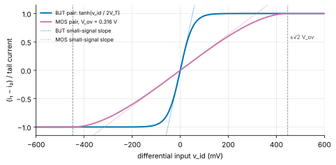

<!-- status: verified -->
# 12-01 · Differential Pairs

| | |
|---|---|
| **Course** | [12 · Electronics II](../README.md) |
| **University equivalent** | The differential-pair chapter of a second electronics course: BJT and MOS pairs, large-signal transfer characteristics, half-circuit analysis of differential and common-mode gain, CMRR, input common-mode range, and offset from mismatch (Sedra & Smith, *Microelectronic Circuits*, the differential-amplifier chapter; Razavi, *Design of Analog CMOS Integrated Circuits*, ch. 4; Gray, Hurst, Lewis & Meyer, ch. 3) |
| **Prerequisites** | [10-04 Small-Signal Models](../../10-electronics-1/chapters/10-04-small-signal-models.md), [10-06 MOS Single-Stage Amplifiers](../../10-electronics-1/chapters/10-06-mos-single-stage-amplifiers.md), [10-07 BJT Single-Stage Amplifiers](../../10-electronics-1/chapters/10-07-bjt-single-stage-amplifiers.md), [10-08 Current Sources and Mirrors](../../10-electronics-1/chapters/10-08-current-sources-and-mirrors.md) (tail sources, Pelgrom mismatch), [10-10 Op-Amp Application Circuits](../../10-electronics-1/chapters/10-10-op-amp-application-circuits.md) (CMRR) |
| **Estimated study hours** | 10 |
| **Last verified** | 2026-11-20 |

**Learning objectives.** After this chapter you can:

1. Derive the large-signal transfer characteristics of BJT and MOS differential pairs and find their linear and full-switching input ranges.
2. Use half-circuits to find differential gain, common-mode gain and CMRR, including the effect of the tail source's output resistance and of load mismatch.
3. Find a pair's input common-mode range and output swing from the saturation conditions of its transistors and tail.
4. Derive the input offset voltage produced by threshold, current-factor, saturation-current and load mismatch, and build a statistical offset budget with Pelgrom's law.
5. Explain how differential pairs serve as op-amp input stages, comparators and current-mode-logic buffers, and what limits them in each role.

---

## 1. Big picture

Every op-amp, comparator, analog-to-digital converter front end and high-speed serial link begins with two matched transistors whose emitters or sources share one current source. This **differential pair** responds to the *difference* between its two inputs and ignores, to a first approximation, what they have in common. That one property is why it is everywhere: on a chip, the supply, the substrate and the ground all carry noise that reaches both inputs equally, and a differential pair rejects it. It also gives twice the output swing of a single-ended stage from the same supply, a clean way to set bias with a current source, and a natural input for feedback. Its weaknesses are just as instructive: the two halves are never perfectly matched, and the mismatch shows up as an offset voltage that sets the floor of precision analog design.

- **Op-amp input stages are differential pairs.** The input offset, its drift, the common-mode range and much of the CMRR in every op-amp data sheet come from this circuit (10-09).
- **Comparators and ADCs start here.** A pair amplifies a tiny difference before a latch decides; its offset is the comparator's offset.
- **SerDes buffers are pairs that switch.** Current-mode logic (CML) steers a tail current fully to one side or the other at tens of gigahertz.
- **Mismatch is a cost lever.** Offset falls as the square root of transistor area, so precision costs silicon, power or calibration circuitry.

## 2. Intuition first

**A seesaw for current.** The tail source fixes the *total* current, $I_{SS}$. The pair can only decide how to split it. A positive difference between the gates tilts the split toward one side; a negative one tilts it the other way; equal inputs leave it balanced at $I_{SS}/2$ each, wherever the inputs sit. Raising both inputs together, a **common-mode** change, merely lifts the shared source node; with an ideal current source the split cannot change, so the outputs do not move. Push the difference far enough and one transistor takes all the current while the other turns off: the pair has switched, and the output stops growing. Figure 1 shows both pairs' transfer curves.

*Figure 1. Large-signal transfer of a BJT pair (tanh, switching within about ±4V_T) and of a MOS pair with $V_{ov}$ = 0.316 V (switching fully at ±√2 $V_{ov}$ = ±0.447 V). The MOS pair's linear range is set by its overdrive, the BJT pair's by $V_T$. Dotted lines: the small-signal slopes at balance.*

**An analogy from finance: a market-neutral long–short position, and where it breaks.** A fund that holds a long position in one stock and an equal short position in a similar one earns on the *spread* between them and is insensitive to the market as a whole: if both rise 5%, the position is unchanged. That is a differential pair: the spread is the differential input, the market is the common mode, and the fund's "CMRR" is how well the two legs really offset. The analogy also shows the weaknesses. If the two stocks have slightly different market betas, a market move leaks into the position: common-mode-to-differential conversion from mismatch. And a position that shows a gain even when the spread is zero has an offset. The analogy breaks because a pair's legs are matched transistors whose mismatch is random and fixed at manufacture, not chosen weights that a manager can rebalance; and a pair saturates (switches) at a finite spread, whereas a long–short position's profit grows without limit.

## 3. Theory

> **Conventions.** Course 10's: $V_T$ = 25.852 mV at 300 K; MOS square law $i_D = \tfrac12k_n(v_{GS} - V_{TN})^2$ with $k_n = \mu_nC_{ox}W/L$ and $V_{TN}$ = 0.5 V, λ = 0 unless stated; $g_m = \sqrt{2k_nI_D}$; BJT $g_m = I_C/V_T$, $r_\pi = \beta/g_m$. The differential input is $v_{id} = v_{G1} - v_{G2}$ and the common-mode input $v_{ic} = (v_{G1} + v_{G2})/2$. "Differential output" means $v_{od} = v_{o1} - v_{o2}$; "single-ended output" means one drain or collector.

### 3.1 The BJT pair's large-signal characteristic

Two matched transistors Q1 and Q2 share an emitter node fed by a tail current $I_{EE}$; collector resistors $R_C$ connect to $V_{CC}$. In the active region each collector current is $I_Se^{v_{BE}/V_T}$, and both emitters sit at the same node, so

$$
\frac{i_{C1}}{i_{C2}} = \frac{e^{v_{BE1}/V_T}}{e^{v_{BE2}/V_T}} = e^{(v_{B1} - v_{B2})/V_T} = e^{v_{id}/V_T} .
$$

The tail fixes the sum, $i_{C1} + i_{C2} = \alpha I_{EE}$. Solving the two equations,

$$
i_{C1} = \frac{\alpha I_{EE}}{1 + e^{-v_{id}/V_T}}, \qquad i_{C2} = \frac{\alpha I_{EE}}{1 + e^{v_{id}/V_T}}, \qquad i_{C1} - i_{C2} = \alpha I_{EE}\tanh\!\left(\frac{v_{id}}{2V_T}\right) ,
$$

where the last form follows from $\frac{1}{1 + e^{-x}} - \frac{1}{1 + e^{x}} = \frac{e^{x/2} - e^{-x/2}}{e^{x/2} + e^{-x/2}}$ with $x = v_{id}/V_T$. Three consequences:

- **Common mode does not appear.** $v_{ic}$ cancels from the ratio: an ideal tail makes the split depend only on the difference.
- **The linear range is tiny.** $\tanh u \approx u$ only for $\lvert u\rvert \ll 1$, so the pair is linear only for $\lvert v_{id}\rvert$ well under $2V_T \approx 52$ mV. The output is within 1% of its linear extrapolation for $\lvert v_{id}\rvert$ up to about 9 mV, and the current difference reaches 90% of the tail current at $v_{id} = 2V_T\operatorname{artanh}(0.9)$ = 76.1 mV (Example 12-01.1).
- **The slope at balance is the gain.** $d(i_{C1} - i_{C2})/dv_{id} = \alpha I_{EE}/(2V_T)$ at $v_{id} = 0$: each transistor's $g_m = I_C/V_T$ at $I_C = \alpha I_{EE}/2$.

**Extending the range: emitter degeneration.** Resistors $R_E$ in each emitter add local feedback: the transfer becomes approximately linear over $\lvert v_{id}\rvert \lesssim I_{EE}R_E$, and the transconductance falls to about $1/(R_E + 1/g_m)$, the trade of 10-07 between gain and linearity.

### 3.2 The MOS pair's large-signal characteristic

For matched MOSFETs in saturation, $i_{D1,2} = \tfrac12k_n(v_{GS1,2} - V_{TN})^2$, the sources share a node, and $i_{D1} + i_{D2} = I_{SS}$. Write $a = \sqrt{i_{D1}}$ and $b = \sqrt{i_{D2}}$. The gate–source voltages are $V_{TN} + a\sqrt{2/k_n}$ and $V_{TN} + b\sqrt{2/k_n}$, and their difference is $v_{id}$:

$$
a - b = v_{id}\sqrt{k_n/2}, \qquad a^2 + b^2 = I_{SS} .
$$

The current difference is $a^2 - b^2 = (a - b)(a + b)$, and $(a + b)^2 = 2(a^2 + b^2) - (a - b)^2 = 2I_{SS} - k_nv_{id}^2/2$. Therefore

$$
i_{D1} - i_{D2} = \frac{k_nv_{id}}{2}\sqrt{\frac{4I_{SS}}{k_n} - v_{id}^2}, \qquad \lvert v_{id}\rvert \le \sqrt{\frac{2I_{SS}}{k_n}} = \sqrt2\,V_{ov} ,
$$

where $V_{ov} = \sqrt{I_{SS}/k_n}$ is each transistor's overdrive at balance ($I_D = I_{SS}/2 = \tfrac12k_nV_{ov}^2$). At $\lvert v_{id}\rvert = \sqrt2V_{ov}$ one transistor carries all of $I_{SS}$ and the other just turns off; beyond it the formula no longer applies and the pair is fully switched.

- **The slope at balance** is $\frac{k_n}{2}\sqrt{4I_{SS}/k_n} = \sqrt{k_nI_{SS}}$, which is each transistor's $g_m = \sqrt{2k_nI_D}$ at $I_D = I_{SS}/2$, and also equals $I_{SS}/V_{ov}$.
- **The linear range scales with overdrive.** A MOS pair switches fully at $\sqrt2V_{ov}$, a few hundred millivolts, and stays within 1% of linear up to about $0.28V_{ov}$ (Problem 12-01.12), several tens of millivolts, against about ±9 mV for a BJT pair: a large $V_{ov}$ buys linearity at the cost of $g_m$ per unit current ($g_m/I_D = 2/V_{ov}$ against $1/V_T$ for a BJT, 10-04).

### 3.3 Small-signal analysis with half-circuits

For small signals, a symmetric circuit driven by $v_{id}/2$ on one side and $-v_{id}/2$ on the other has a symmetric response: the currents in the two halves change by equal and opposite amounts, so the shared node, the sum of both, does not move. **For differential signals the tail node is a virtual ground**, and each half is a plain common-source (or common-emitter) stage. With drain resistors $R_D$ and no load,

$$
v_{o1} = -g_mR_D\frac{v_{id}}{2}, \quad v_{o2} = +g_mR_D\frac{v_{id}}{2} \qquad\Rightarrow\qquad A_d = \frac{v_{od}}{v_{id}} = -g_mR_D, \quad A_{d,se} = \frac{v_{o1}}{v_{id}} = -\frac{g_mR_D}{2} .
$$

(Signs depend on which output is taken; magnitudes are what matter here.) For a BJT pair replace $R_D$ by $R_C$ and $g_m$ by $I_C/V_T$; the differential input resistance is $2r_\pi$.

**Common mode.** Drive both inputs with the same $v_{ic}$ and let the tail source have output resistance $R_{SS}$. Now the two halves carry identical currents, the tail resistance carries their sum, and the circuit splits into two halves each with $2R_{SS}$ in its source (the same voltage drop with half the current). Each half is a degenerated common-source stage (10-06):

$$
A_{cm} = \frac{v_{o1}}{v_{ic}} = -\frac{g_mR_D}{1 + 2g_mR_{SS}} \approx -\frac{R_D}{2R_{SS}} \qquad (2g_mR_{SS} \gg 1) .
$$

With a differential output and perfectly matched halves, $v_{o1} - v_{o2} = 0$: the common-mode gain to the differential output is zero.

**CMRR.** The **common-mode rejection ratio** compares the gain to the wanted (differential) signal with the gain to the unwanted (common-mode) one. For a single-ended output,

$$
\text{CMRR}_{se} = \left\lvert\frac{A_{d,se}}{A_{cm}}\right\rvert = \frac{g_mR_D/2}{g_mR_D/(1 + 2g_mR_{SS})} = \frac{1 + 2g_mR_{SS}}{2} \approx g_mR_{SS} .
$$

It is set entirely by the tail: an ideal current source ($R_{SS} \to \infty$) gives infinite CMRR. A resistor tail gives a modest value; a single-transistor mirror tail gives $R_{SS} = r_o$, and a cascode tail multiplies that by about $g_mr_o$ (10-08).

**Mismatch converts common mode to differential.** With a differential output, CMRR is limited by asymmetry. If the drain resistors differ by $\Delta R_D$, a common-mode input that moves each drain current by $g_mv_{ic}/(1 + 2g_mR_{SS})$ produces a differential output $\Delta R_D$ times that current:

$$
A_{cm\to dm} = \frac{g_m\,\Delta R_D}{1 + 2g_mR_{SS}}, \qquad \text{CMRR}_{diff} = \frac{g_mR_D}{A_{cm\to dm}} = \frac{R_D}{\Delta R_D}(1 + 2g_mR_{SS}) .
$$

A transconductance mismatch $\Delta g_m$ acts the same way: the common-mode current $v_{ic}/(1 + 2g_mR_{SS})$ per unit transconductance flows through unequal $g_m$'s, giving $A_{cm\to dm} = R_D\Delta g_m/(1 + 2g_mR_{SS})$ and $\text{CMRR}_{diff} = (g_m/\Delta g_m)(1 + 2g_mR_{SS})$ (Problem 12-01.9). Both mismatches add (with signs), so the differential CMRR is $(1 + 2g_mR_{SS})$ divided by the net fractional mismatch. The differential output buys a factor of $R_D/\Delta R_D$ (100 for 1% resistors): this is why fully differential circuits reject supply and substrate noise so much better than single-ended ones.

### 3.4 Input common-mode range and output swing

All three transistors must stay saturated. For an NMOS pair with resistor loads from $V_{DD}$ and a tail transistor that needs $V_{ov,t}$ across it:

- **Lower limit.** The common source sits $V_{GS} = V_{TN} + V_{ov}$ below the inputs, and the tail needs at least $V_{ov,t}$, so $V_{IC,\min} = V_{TN} + V_{ov} + V_{ov,t}$.
- **Upper limit.** Each input transistor stays saturated while its drain is above its gate minus $V_{TN}$: $V_{DD} - I_DR_D \ge V_{IC} - V_{TN}$, so $V_{IC,\max} = V_{DD} - I_DR_D + V_{TN}$.

Gain, swing and range compete for the same supply: a larger $I_DR_D$ (more gain) pushes the upper limit down, and a larger $V_{ov}$ (more linearity) pushes the lower limit up. At low supply voltages the window can shrink to a few hundred millivolts (Example 12-01.2), which is why rail-to-rail input stages place an NMOS and a PMOS pair in parallel (12-08).

### 3.5 Offset from mismatch

The **input offset voltage** $V_{OS}$ is the differential input that makes the output exactly balanced (zero differential output). With perfect matching it is zero; with mismatch it is not. Write each mismatched quantity as its mean ± half its difference, linearize, and ask what $v_{id}$ restores $v_{od} = 0$.

**MOS pair.** Balanced output means $I_{D1}R_{D1} = I_{D2}R_{D2}$. With $R_{D1,2} = R_D \pm \Delta R_D/2$, $k_{n1,2} = k_n \pm \Delta k_n/2$ and thresholds $V_{TN} \pm \Delta V_{TN}/2$, the currents must split in the ratio $I_{D1}/I_{D2} = R_{D2}/R_{D1} \approx 1 - \Delta R_D/R_D$. The gate voltage needed for each current is $V_{GS} = V_{TN} + \sqrt{2I_D/k_n}$; its derivative with respect to $I_D$ is $V_{ov}/(2I_D)$ and with respect to $k_n$ is $-V_{ov}/(2k_n)$. Adding the three first-order shifts,

$$
V_{OS} = \Delta V_{TN} + \frac{V_{ov}}{2}\left(-\frac{\Delta R_D}{R_D} - \frac{\Delta k_n}{k_n}\right) ,
$$

with signs that depend on which side is larger. In magnitude: **threshold mismatch appears one for one; load and current-factor mismatch appear scaled by $V_{ov}/2$.** A small overdrive suppresses the latter two, at the cost of linear range.

**BJT pair.** Balance needs $I_{C1}/I_{C2} = R_{C2}/R_{C1}$, and $v_{BE} = V_T\ln(I_C/I_S)$, so

$$
V_{OS} = V_T\left[\ln\frac{I_{C1}}{I_{C2}} - \ln\frac{I_{S1}}{I_{S2}}\right] \approx -V_T\left(\frac{\Delta R_C}{R_C} + \frac{\Delta I_S}{I_S}\right) .
$$

Bipolar mismatch is scaled by $V_T$ (26 mV), well below a typical MOS overdrive's $V_{ov}/2$, and there is no threshold term: one reason precision op-amps long used bipolar inputs.

**Offset drift.** For the bipolar term, $V_{OS} = V_T\ln(I_{S2}/I_{S1})$ where the ratio $I_{S2}/I_{S1}$ is set by geometry and is almost temperature-independent. So $V_{OS} \propto T$, and

$$
\frac{dV_{OS}}{dT} = \frac{V_{OS}}{T} ,
$$

about 3.3 µV/K per millivolt of offset at 300 K (Example 12-01.5). Trimming the offset to zero by adjusting the collector-resistor ratio (which cancels the $I_S$ ratio at one temperature) also nulls this drift to first order, because both terms then scale with $V_T$; trimming by adding an external voltage does not.

**Random offset and Pelgrom's law.** Mismatch between identically drawn devices is random, with standard deviations that shrink with area (10-08, [R-181](../../../reference/research-log.md#r-181--transistor-matching)):

$$
\sigma(\Delta V_{TN}) = \frac{A_{VT}}{\sqrt{WL}}, \qquad \sigma\!\left(\frac{\Delta k_n}{k_n}\right) = \frac{A_\beta}{\sqrt{WL}} .
$$

Independent random contributions add in variance: $\sigma^2(V_{OS}) = \sigma^2(\Delta V_{TN}) + (V_{ov}/2)^2[\sigma^2(\Delta R_D/R_D) + \sigma^2(\Delta k_n/k_n)]$. Halving the offset needs four times the area, which also quadruples the input capacitance: offset, speed and area trade directly (Example 12-01.4). Production limits are set several standard deviations out, plus a test guardband, which is why data-sheet maximum offsets are several times the typical values (5.3 times for the part in §9).

**Input bias and offset currents (bipolar pairs).** A BJT pair draws base current: each input carries $I_B = I_{EE}/[2(\beta + 1)]$. If the two transistors' β differ, the base currents differ by the **input offset current** $I_{OS} \approx I_B\,\Delta\beta/\beta$. Both turn into offset voltage through the source resistances: $I_B$ times any *difference* between the two inputs' source resistances, and $I_{OS}$ times the source resistance itself (Problem 12-01.15). This is why bipolar-input op-amps balance the resistance seen by both inputs, and why MOS inputs, with picoamp gate leakage, suit high-impedance sources (10-09).

> **Going deeper — systematic offset.** Besides random mismatch, a pair can have a *systematic* offset from design asymmetry: unequal drain voltages with nonzero λ, a single-ended active load that is not balanced (12-02), or thermal gradients across the die. Systematic offset is identical on every chip and is removed by design (matching drain voltages, common-centroid layout, keeping the pair away from hot output stages), not by area.

### 3.6 The pair as a switch: current-mode logic

Driven beyond $\sqrt2V_{ov}$ (MOS) or a few $V_T$ (BJT), a pair steers its whole tail current to one side. The output then swings between $V_{DD}$ and $V_{DD} - I_{SS}R_D$ on each side, a differential swing of $\pm I_{SS}R_D$, with the tail current flowing continuously. This is **current-mode logic** (CML): because the supply current never changes, it injects little switching noise, and because the swing is small (a few hundred millivolts) and the loads are small resistors, it is fast. The output time constant $R_DC_L$ sets the bandwidth; the 50 Ω-class terminations of high-speed links make $R_D$ small and the bandwidth high, at the price of milliamps of tail current per buffer (Example 12-01.6).

## 4. Worked examples

### Example 12-01.1 · A BJT pair's transfer (tier A)

**Setup.** A BJT pair has $I_{EE}$ = 1 mA (take α = 1) and $R_C$ = 5 kΩ. (a) Find the collector currents at $v_{id}$ = 0, 10 mV and 50 mV. (b) Find the differential-output small-signal gain. (c) Find the input at which 90% of the current is in one transistor, and the input below which the output stays within 1% of linear.

**Solution.** (a) $i_{C1} = I_{EE}/(1 + e^{-v_{id}/V_T})$: at 0, **0.5** mA each; at 10 mV, $i_{C1}$ = **0.5955** mA and $i_{C2}$ = **0.4045** mA; at 50 mV, **0.8737** and **0.1263** mA.

(b) $g_m = 0.5\ \text{mA}/V_T$ = 19.34 mA/V, so $\lvert A_d\rvert = g_mR_C$ = **96.70**.

(c) 90% in Q1 means $\tanh(v_{id}/2V_T) = 0.8$, or $i_{C1}/I_{EE} = 0.9$: $v_{id} = V_T\ln 9 = 2V_T\operatorname{artanh}(0.8)$ = **56.80** mV. (The input at which the current *difference* reaches 90% of $I_{EE}$ is $2V_T\operatorname{artanh}(0.9)$ = **76.12** mV.) The output is within 1% of the linear extrapolation while $\tanh u/u \ge 0.99$, which holds for $u \le 0.1743$, that is $\lvert v_{id}\rvert \le 2V_Tu$ = **9.01** mV.

**Sanity check.** At 10 mV the linear estimate is $\Delta I = g_m \times 10$ mV = 0.1934 mA; the exact difference is $0.5955 - 0.4045 = 0.1910$ mA, **1.2**% lower: just past the 1% limit.

### Example 12-01.2 · A MOS pair on 1.8 V (tier B)

**Setup.** An NMOS pair has $k_n$ = 2 mA/V², $V_{TN}$ = 0.5 V, $I_{SS}$ = 200 µA, $R_D$ = 10 kΩ and $V_{DD}$ = 1.8 V; the tail transistor needs 0.2 V. (a) Find $V_{ov}$, $g_m$ and the differential gain. (b) Find the input that switches the pair fully, and the drain currents at $v_{id}$ = 0.2 V. (c) Find the input common-mode range.

**Solution.** (a) $V_{ov} = \sqrt{I_{SS}/k_n}$ = **0.3162** V; $g_m = \sqrt{k_nI_{SS}}$ = **0.6325** mA/V; $\lvert A_d\rvert = g_mR_D$ = **6.325**.

(b) Full switching at $\sqrt2V_{ov}$ = **0.4472** V. At 0.2 V, $\Delta I = (k_n \times 0.2/2)\sqrt{4I_{SS}/k_n - 0.04} = 0.2\ \text{mA/V} \times 0.6$ V = 120 µA, so $i_{D1}$ = **160** µA and $i_{D2}$ = **40** µA. These are the currents the pair *steers*, assuming both transistors stay saturated. With these 10 kΩ loads they would not: 160 µA drops 1.6 V and leaves D1 at **0.2** V, while M1's gate sits above 1 V anywhere in the common-mode window of (c), so M1 would enter the triode region and the split would differ (the lab's ngspice run shows it). Large differential swings need loads that keep the drains high, such as the current-mirror loads of 12-02, or a smaller $R_D$.

(c) $V_{IC,\min} = 0.5 + 0.3162 + 0.2$ = **1.016** V. $V_{IC,\max} = 1.8 - 0.1\ \text{mA} \times 10\ \text{k}\Omega + 0.5$ = **1.3** V. The usable window is under 0.3 V wide.

**Sanity check.** The linear estimate at 0.2 V is $g_m \times 0.2$ = 126.5 µA, **5.4**% above the exact 120 µA: 0.2 V is **63.2**% of $V_{ov}$, well into the nonlinear region.

### Example 12-01.3 · CMRR from the tail and from the loads (tier B)

**Setup.** The pair of Example 12-01.2 has a tail with output resistance $R_{SS}$ = 50 kΩ. (a) Find the single-ended differential gain, the common-mode gain and the single-ended CMRR. (b) With a differential output and drain resistors mismatched by 1%, find the common-mode-to-differential gain and the CMRR.

**Solution.** (a) $\lvert A_{d,se}\rvert = g_mR_D/2$ = **3.162**. $\lvert A_{cm}\rvert = g_mR_D/(1 + 2g_mR_{SS}) = 6.325/64.25$ = **0.09844**. CMRR = $(1 + 2g_mR_{SS})/2$ = **32.12**, or **30.1** dB: a resistor tail rejects common mode poorly.

(b) $\Delta R_D$ = 100 Ω: $A_{cm\to dm} = g_m\Delta R_D/(1 + 2g_mR_{SS})$ = **9.844** × 10⁻⁴. CMRR = $6.325/9.844 \times 10^{-4}$ = **6425**, or **76.2** dB: the differential output gains a factor of **200** ($2R_D/\Delta R_D$) over the single-ended CMRR.

**Sanity check.** Doubling $R_{SS}$ roughly doubles both CMRRs; replacing the resistor by a mirror with $r_o$ of a few hundred kilohms, or a cascode, adds the 20–40 dB that real op-amps show.

### Example 12-01.4 · An offset budget (tier B)

**Setup.** The input pair is drawn $W/L$ = 20 µm/0.5 µm. Take an illustrative $A_{VT}$ = 3.5 mV·µm (as in 10-08), a current-factor mismatch σ = 0.5% and load resistors matched to σ = 1%. With $V_{ov}$ = 0.3162 V: (a) find each contribution's σ; (b) find σ($V_{OS}$) and a 3σ value; (c) compare a bipolar pair whose $I_S$ match to σ = 1%.

**Solution.** (a) $\sigma(\Delta V_{TN}) = 3.5/\sqrt{20 \times 0.5}$ = **1.107** mV. Loads: $(V_{ov}/2) \times 1\%$ = **1.581** mV. Current factor: $(V_{ov}/2) \times 0.5\%$ = **0.7906** mV.

(b) $\sigma(V_{OS}) = \sqrt{1.107^2 + 1.581^2 + 0.7906^2}$ = **2.086** mV; 3σ = **6.257** mV. The loads dominate: matching them better, or reducing $V_{ov}$, helps more than enlarging the pair.

(c) $V_T \times 1\%$ = **0.2585** mV: an order of magnitude lower.

**Sanity check.** Quadrupling the gate area at the same $W/L$ (doubling both $W$ and $L$) halves the threshold and current-factor terms, which both follow Pelgrom's law (to **0.553** and **0.395** mV), but leaves the load term alone: the total only falls to about **1.72** mV. Area is not the main lever here.

### Example 12-01.5 · Bipolar offset drift (tier B)

**Setup.** A bipolar pair has $V_{OS}$ = 1.0 mV at 300 K, caused entirely by $I_S$ mismatch. (a) Find its drift. (b) Find its offset at 350 K. (c) What happens to the drift if the offset is trimmed by adjusting the collector-resistor ratio, and if it is trimmed by adding a fixed external voltage?

**Solution.** (a) $V_{OS}/T = 1\ \text{mV}/300\ \text{K}$ = **3.333** µV/K.

(b) $1.0 \times 350/300$ = **1.167** mV.

(c) Resistor-ratio trim: the corrected offset is $V_T[\ln(R_{C2}/R_{C1}) - \ln(I_{S1}/I_{S2})] = 0$, both terms proportional to $T$, so it stays zero at every temperature (to first order). External-voltage trim: the fixed correction cancels 1.0 mV only at 300 K; at 350 K the residual is **0.1667** mV, a drift of 3.33 µV/K left untouched.

**Sanity check.** A residual offset of 30 µV left after a ratio trim would drift by only 0.1 µV/K by the same $V_{OS}/T$ rule: low drift follows from low offset, provided the trim scales with temperature.

### Example 12-01.6 · A CML buffer (tier C)

**Setup.** A CML buffer for a serial link has $I_{SS}$ = 4 mA, $R_D$ = 100 Ω and $k_n$ = 100 mA/V² per transistor, driving 100 fF per output. (a) Find the single-ended and differential output swings. (b) Find the input needed to switch it fully. (c) Estimate the output pole frequency.

**Solution.** (a) Each output swings between $V_{DD}$ and $V_{DD} - I_{SS}R_D$: **0.4** V single-ended, and the differential output swings ±0.4 V (0.8 V peak to peak).

(b) $V_{ov} = \sqrt{I_{SS}/k_n}$ = **0.2** V, so full switching needs $\sqrt2V_{ov}$ = **0.2828** V: the previous stage's swing must exceed this.

(c) $1/(2\pi R_DC_L) = 1/(2\pi \times 100\ \Omega \times 100\ \text{fF})$ = **15.92** GHz.

**Sanity check.** A chain of CML stages each switching fully regenerates the signal; the price is a constant 4 mA per stage regardless of data, about 7 mW at 1.8 V.

### Answer key

<!-- answer-key -->
| ID | Quantity | Value | Unit |
|---|---|---|---|
| T 12-01.a | 2V_T | 52 | mV |
| T 12-01.b | drift per millivolt of offset at 300 K | 3.3 | µV/K |
| T 12-01.c | TLV9062 maximum over typical offset | 5.3 | — |
| T 12-01.d | 90% current-difference input, 2V_T artanh 0.9 | 76.1 | mV |
| Ex 12-01.1a | balanced collector current | 0.5 | mA |
| Ex 12-01.1b | i_C1 at 10 mV | 0.5955 | mA |
| Ex 12-01.1c | i_C2 at 10 mV | 0.4045 | mA |
| Ex 12-01.1d | i_C1 at 50 mV | 0.8737 | mA |
| Ex 12-01.1e | i_C2 at 50 mV | 0.1263 | mA |
| Ex 12-01.1f | g_m | 19.34 | mA/V |
| Ex 12-01.1g | differential gain | 96.70 | — |
| Ex 12-01.1h | input for 90% in one transistor | 56.80 | mV |
| Ex 12-01.1i | input for 90% current difference | 76.12 | mV |
| Ex 12-01.1j | tanh(u)/u = 0.99 at u | 0.1743 | — |
| Ex 12-01.1k | 1% linear range | 9.01 | mV |
| Ex 12-01.1l | linear estimate at 10 mV | 0.1934 | mA |
| Ex 12-01.1m | exact difference at 10 mV | 0.1910 | mA |
| Ex 12-01.1n | shortfall from linear at 10 mV | 1.2 | % |
| Ex 12-01.2a | V_ov | 0.3162 | V |
| Ex 12-01.2b | g_m | 0.6325 | mA/V |
| Ex 12-01.2c | differential gain | 6.325 | — |
| Ex 12-01.2d | full-switching input | 0.4472 | V |
| Ex 12-01.2e | i_D1 at 0.2 V | 160 | µA |
| Ex 12-01.2f | i_D2 at 0.2 V | 40 | µA |
| Ex 12-01.2l | D1 voltage if 160 µA flowed in 10 kΩ | 0.2 | V |
| Ex 12-01.2g | V_IC,min | 1.016 | V |
| Ex 12-01.2h | V_IC,max | 1.3 | V |
| Ex 12-01.2i | linear estimate at 0.2 V | 126.5 | µA |
| Ex 12-01.2j | linear estimate's excess at 0.2 V | 5.4 | % |
| Ex 12-01.2k | 0.2 V as a fraction of V_ov | 63.2 | % |
| Ex 12-01.3a | single-ended differential gain | 3.162 | — |
| Ex 12-01.3b | common-mode gain | 0.09844 | — |
| Ex 12-01.3c | single-ended CMRR | 32.12 | — |
| Ex 12-01.3d | single-ended CMRR | 30.1 | dB |
| Ex 12-01.3e | CM-to-differential gain | 9.844 × 10⁻⁴ | — |
| Ex 12-01.3f | differential CMRR | 6425 | — |
| Ex 12-01.3g | differential CMRR | 76.2 | dB |
| Ex 12-01.3h | differential over single-ended CMRR | 200 | — |
| Ex 12-01.4a | threshold contribution | 1.107 | mV |
| Ex 12-01.4b | load contribution | 1.581 | mV |
| Ex 12-01.4c | current-factor contribution | 0.7906 | mV |
| Ex 12-01.4d | σ(V_OS) | 2.086 | mV |
| Ex 12-01.4e | 3σ offset | 6.257 | mV |
| Ex 12-01.4f | bipolar offset σ | 0.2585 | mV |
| Ex 12-01.4g | threshold term at 4× area | 0.553 | mV |
| Ex 12-01.4h | total at 4× area | 1.72 | mV |
| Ex 12-01.4i | current-factor term at 4× area | 0.395 | mV |
| Ex 12-01.4j | σ(V_OS) with half the overdrive | 0.985 | mV |
| Ex 12-01.5a | drift | 3.333 | µV/K |
| Ex 12-01.5b | offset at 350 K | 1.167 | mV |
| Ex 12-01.5c | residual after voltage trim at 350 K | 0.1667 | mV |
| Ex 12-01.5d | drift of a 30 µV residual | 0.1 | µV/K |
| Ex 12-01.6a | single-ended swing | 0.4 | V |
| Ex 12-01.6b | V_ov | 0.2 | V |
| Ex 12-01.6c | full-switching input | 0.2828 | V |
| Ex 12-01.6d | output pole | 15.92 | GHz |
| Ex 12-01.6e | power at 1.8 V | 7 | mW |

*Every value is recomputed by [verify_12_01.py](../verify/verify_12_01.py): transfer characteristics by solving the device equations with the tail constraint numerically, gains and CMRR by modified nodal analysis of the full small-signal circuit (not the half-circuit formulas), offsets by solving for the balancing input of mismatched circuits and by Monte Carlo sampling, and the drift by evaluating the offset at two temperatures. The MOS pair's transfer, gain and common-mode behavior are also confirmed in ngspice.*

## 5. Simulate it

The lab, [labs/12-01-lab](../labs/12-01-lab/README.md), has a notebook and an ngspice netlist:

1. Sweeps both pairs' large-signal transfer and compares them with the tanh and square-law formulas.
2. Builds the full small-signal circuit with mismatch and computes differential gain, common-mode gain and CMRR, single-ended and differential.
3. Runs a Monte Carlo offset simulation with Pelgrom-scaled threshold and current-factor mismatch and load mismatch, and checks the RSS budget.
4. Simulates bipolar offset drift with and without ratio trimming.

The netlist [diffpair.cir](../labs/12-01-lab/diffpair.cir) simulates the MOS pair of Example 12-01.2 in ngspice: the current split at 0.2 V with ideal loads that keep both transistors saturated, the differential gain with the 10 kΩ loads, and the common-mode gains with a 50 kΩ tail, with and without 1% load mismatch.

**Guided exercise (predict, then run).** **Before running Part 3**, predict: in the offset budget of Example 12-01.4, if you halve the overdrive (by making $W$ four times wider at the same $L$ and current), does σ($V_{OS}$) fall, and by about how much? Then run it. (It falls by a little more than half, from 2.09 mV to **0.985** mV: the load term halves with $V_{ov}$; the fourfold area halves the threshold term; and the current-factor term falls fourfold, halved once by $V_{ov}$ and once by Pelgrom's law.)

## 6. Engineering tradeoffs

| Knob | Improves | Costs | Typical decision owner |
|---|---|---|---|
| Overdrive $V_{ov}$ | Linear range; speed per area | $g_m/I_D$; offset from load and β mismatch; headroom | Analog designer |
| Input device area $WL$ | Random offset (∝ 1/√(WL)) | Input capacitance, bandwidth, die area | Analog designer |
| Tail output resistance | CMRR, supply rejection | Headroom (cascode tails need more voltage) | Analog designer |
| Differential vs single-ended output | CMRR, swing, noise rejection | A common-mode feedback loop (12-08) | Architect |
| Bipolar vs MOS input | Offset, drift, noise at low frequency | Input bias current; process cost | Product line, process owner |
| Trim or auto-zero | Offset and drift | Test time, circuitry, chopping artifacts | Product engineer |
| Tail current (CML) | Bandwidth and swing | Static power on every lane | SerDes architect |

## 7. Numbers to know

| Quantity | Value | Note |
|---|---|---|
| BJT pair linear range | ≈ ±9 mV for 1% linearity; switched by ≈ ±4V_T | tanh(v_id/2V_T) |
| MOS pair full switching | $\sqrt2V_{ov}$ | Linear range scales with $V_{ov}$ |
| Differential gain | $g_mR_D$ (differential output) | Half-circuit |
| Single-ended CMRR | ≈ $g_mR_{SS}$ | Set by the tail |
| Differential CMRR with mismatch | ≈ $(R_D/\Delta R_D)(1 + 2g_mR_{SS})$ | Set by matching |
| MOS offset | $\Delta V_{TN} + (V_{ov}/2)(\Delta R/R + \Delta k/k)$ | Magnitudes; signs vary |
| BJT offset | $V_T(\Delta R/R + \Delta I_S/I_S)$; drift $V_{OS}/T$ | 3.3 µV/K per mV at 300 K |
| Pelgrom | σ(ΔV_TN) = A_VT/√(WL) | 4× area for half the offset |

## 8. Common mistakes

- **Treating the tail node as ground for common-mode signals.** It is a virtual ground only for differential signals; for common mode it carries $2R_{SS}$ per half.
- **Using the small-signal gain beyond the linear range.** A BJT pair is linear only to about ±9 mV (1%); larger inputs compress.
- **Quoting CMRR without saying which output.** Single-ended and differential CMRR can differ by 40 dB.
- **Forgetting that offset adds in variance, not linearly.** Independent random sources combine as RSS; only systematic offsets add directly.
- **Assuming bigger devices always fix offset.** Area shrinks the threshold and current-factor terms; the load-mismatch term, set by the resistors' matching and $V_{ov}$, is unaffected.
- **Ignoring the common-mode range.** A pair driven outside it leaves saturation, and its gain and CMRR collapse.

## 9. Practitioner lens

### State of the art (as of Nov 2026)

- **General-purpose CMOS op-amps.** TI's TLV9062 specifies an input offset of ±0.3 mV typical and ±1.6 mV maximum at 5 V, offset drift of ±0.53 µV/°C typical, and CMRR of 103 dB typical (80 dB minimum) over part of its input range, falling to 87 dB typical (57 dB minimum) over the full rail-to-rail range [1] **[Established]** (data sheet). The ratio of maximum to typical offset, **5.3**, reflects the statistical spread of §3.5; the lower full-range CMRR is consistent with the crossover between the complementary input pairs that rail-to-rail inputs use (12-08).
- **Zero-drift amplifiers attack offset by auto-correction.** The OPA333 corrects its internal offset continuously, every 8 µs [2] **[Established]**, trading circuitry and some switching artifacts for microvolt offsets that no area budget could reach.
- **Mismatch scales with area.** Pelgrom's area law, $\sigma(\Delta V_{TH}) = A_{VT}/\sqrt{WL}$, remains the design rule for input pairs [3] **[Established]**; the coefficient $A_{VT}$ is process-specific and confidential in detail, and the 3.5 mV·µm used here is illustrative.

### Why it matters commercially

- **Offset sets precision tiers and prices.** The same op-amp family is often sold in grades by maximum offset; the tighter grades are screened or trimmed, and cost more.
- **Precision costs area or calibration.** Every halving of random offset costs four times the input-pair area, or a trim or auto-zero scheme: a recurring trade in sensor front ends and data converters.
- **Differential signaling is the default at speed.** CML and its relatives dominate serial links because rejecting common-mode noise is cheaper than preventing it.

### Marketing vs Reality

- **"Low offset."** *Reality:* a typical value is the center of a distribution; the maximum (and its temperature range) is what a design can rely on. *Sanity check:* ask for the maximum over temperature, and whether it is tested or guaranteed by design.
- **"High CMRR."** *Reality:* CMRR depends on frequency, on the common-mode range and on the source impedances' match. *Sanity check:* ask for CMRR at the frequency of the interference (mains, switching) and over the whole input range.
- **"Rail-to-rail input."** *Reality:* usually two pairs in parallel, with a crossover region where offset and CMRR degrade. *Sanity check:* ask for offset and CMRR across the full range, not only at mid-supply.

### Questions for engineering leaders

1. **"What is your offset budget, and which term dominates?"**
   *Strong:* threshold, load and β contributions with their σ values, the multiple of σ specified, and whether trimming is used. *Evasive:* a single typical number.
2. **"Is your offset drift specified after trim, and how is trim done?"**
   *Strong:* trim method (ratio, fuse, auto-zero), drift before and after, over temperature. *Evasive:* room-temperature data only.
3. **"What sets your CMRR: the tail, the matching, or the frequency?"**
   *Strong:* tail impedance, layout matching, and CMRR versus frequency. *Evasive:* the DC value only.
4. **"How much power does each CML lane burn, and what sets its tail current?"**
   *Strong:* swing, termination, bandwidth and the current that meets them, per lane. *Evasive:* total chip power only.

## 10. Concept check

**Q1.** Why does an ideal tail current source make a pair insensitive to common-mode input?

Answer

The tail fixes the total current; a common-mode change moves both gates and the shared source together, so the gate–source voltages, and therefore the split, cannot change.

**Q2.** Why is a BJT pair's linear input range so much smaller than a MOS pair's?

Answer

The BJT's current depends exponentially on $v_{BE}$ with scale $V_T$ (26 mV), so the split saturates within a few $V_T$ (1% linear to about ±9 mV); the MOSFET's square law has the scale $V_{ov}$, so a MOS pair stays 1% linear to about $0.28V_{ov}$, tens of millivolts, and switches fully at $\sqrt2V_{ov}$.

**Q3.** A pair's single-ended CMRR is 30 dB, but its differential-output CMRR is 76 dB. Why the difference?

Answer

With a differential output, common mode reaches the output only through mismatch, which scales the common-mode gain by $\Delta R_D/R_D$; the single-ended output sees the full common-mode gain $R_D/2R_{SS}$.

**Q4.** Doubling the input pair's area does what to each offset term?

Answer

The threshold and current-factor mismatch terms fall by √2; the load-mismatch term is unchanged (it depends on the loads and $V_{ov}$).

**Q5.** Why does trimming a bipolar pair's offset with a resistor ratio also cancel its drift?

Answer

Both the $I_S$-mismatch offset and the correction from the resistor ratio are $V_T$ times a temperature-independent logarithm, so they cancel at every temperature.

**Q6.** What limits the upper end of a resistor-loaded NMOS pair's input common-mode range?

Answer

The input transistors leave saturation when their drains fall below their gates by more than $V_{TN}$: $V_{IC,\max} = V_{DD} - I_DR_D + V_{TN}$.

[Problem set for this chapter](../problems/12-01-problems.md)

## 11. Key terms

[Differential pair](../../../reference/glossary.md#differential-pair) · [Differential-mode gain](../../../reference/glossary.md#differential-mode-gain) · [Common-mode gain](../../../reference/glossary.md#common-mode-gain) · [Common-mode rejection ratio (CMRR)](../../../reference/glossary.md#common-mode-rejection-ratio-cmrr) · [Half-circuit](../../../reference/glossary.md#half-circuit) · [Input common-mode range](../../../reference/glossary.md#input-common-mode-range) · [Input offset voltage](../../../reference/glossary.md#input-offset-voltage) · [Pelgrom's law](../../../reference/glossary.md#pelgroms-law) · [Current-mode logic (CML)](../../../reference/glossary.md#current-mode-logic-cml) · [Tail current source](../../../reference/glossary.md#tail-current-source)

## 12. Connections

- **Builds on:** small-signal models from [10-04](../../10-electronics-1/chapters/10-04-small-signal-models.md); common-source, common-emitter and degenerated stages from [10-06](../../10-electronics-1/chapters/10-06-mos-single-stage-amplifiers.md) and [10-07](../../10-electronics-1/chapters/10-07-bjt-single-stage-amplifiers.md); mirrors, tails and Pelgrom mismatch from [10-08](../../10-electronics-1/chapters/10-08-current-sources-and-mirrors.md); CMRR of op-amp circuits from [10-10](../../10-electronics-1/chapters/10-10-op-amp-application-circuits.md); the tanh shape echoes the sigmoid-like compressions met in [11-02](../../11-signals-and-systems/chapters/11-02-system-properties.md)'s nonlinear systems.
- **Next:** [12-02 Active Loads, Cascodes and Multistage Amplifiers](12-02-active-loads-cascodes-multistage.md) replaces the resistors with a current-mirror load and builds the first op-amp gain stage.
- **Used later:** op-amp internals and common-mode feedback in 12-08; noise in 12-10; comparators and ADC front ends in Course 20; CML and equalizers in Course 24.

## 13. Further study

- A. S. Sedra and K. C. Smith, *Microelectronic Circuits*, the chapter on differential and multistage amplifiers.
- B. Razavi, *Design of Analog CMOS Integrated Circuits*, ch. 4 (differential amplifiers) and the chapter on nonidealities (offset).
- P. R. Gray, P. J. Hurst, S. H. Lewis and R. G. Meyer, *Analysis and Design of Analog Integrated Circuits*, ch. 3 (single-transistor and multiple-transistor amplifiers: the differential pair and offset).
- M. J. M. Pelgrom, A. C. J. Duinmaijer and A. P. G. Welbers, "Matching properties of MOS transistors," *IEEE JSSC*, 1989 [3].

## 14. Sources

1. Texas Instruments, *TLV906xS 10MHz, RRIO, CMOS Operational Amplifiers*, SBOS839N (Mar 2017, revised Jul 2026), §6.10: [data sheet](https://www.ti.com/lit/ds/symlink/tlv9062.pdf). [R-182](../../../reference/research-log.md#r-182--op-amp-data-sheets).
2. Texas Instruments, *OPA333* data sheet, internal offset correction: [R-185](../../../reference/research-log.md#r-185--system-property-specifications-in-data-sheets).
3. M. J. M. Pelgrom, A. C. J. Duinmaijer and A. P. G. Welbers, "Matching properties of MOS transistors," *IEEE Journal of Solid-State Circuits* 24(5):1433–1439, Oct 1989. [R-181](../../../reference/research-log.md#r-181--transistor-matching).
