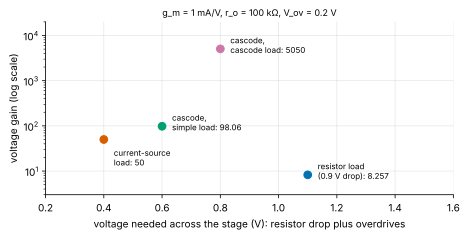

<!-- status: reviewed -->
# 12-02 · Active Loads, Cascodes and Multistage Amplifiers

| | |
|---|---|
| **Course** | [12 · Electronics II](../README.md) |
| **University equivalent** | The active-load, cascode and multistage sections of a second electronics course: current-source and current-mirror loads, the differential pair with a mirror load, cascode amplifiers and output resistance, the telescopic cascode, cascading stages, DC coupling and level shifting (Sedra & Smith, *Microelectronic Circuits*, the chapters on building blocks of integrated-circuit amplifiers and on differential and multistage amplifiers; Razavi, *Design of Analog CMOS Integrated Circuits*, ch. 3 (cascode) and ch. 5 (active loads); Gray, Hurst, Lewis & Meyer, ch. 3–4) |
| **Prerequisites** | [12-01 Differential Pairs](12-01-differential-pairs.md), [10-04 Small-Signal Models](../../10-electronics-1/chapters/10-04-small-signal-models.md) ($g_m$, $r_o$, intrinsic gain), [10-06 MOS Single-Stage Amplifiers](../../10-electronics-1/chapters/10-06-mos-single-stage-amplifiers.md) (common source, common gate, follower, degeneration), [10-08 Current Sources and Mirrors](../../10-electronics-1/chapters/10-08-current-sources-and-mirrors.md) |
| **Estimated study hours** | 10 |
| **Last verified** | 2026-11-20 |

**Learning objectives.** After this chapter you can:

1. Explain why resistor loads cap a stage's gain at a few times $V_{RD}/V_{ov}$, and compute the gain of a common-source stage with a current-source (active) load.
2. Derive the differential gain, common-mode gain and CMRR of a differential pair with a current-mirror load (the five-transistor OTA), and find its output DC level and common-mode range.
3. Derive a cascode's output resistance and open-circuit gain from its small-signal circuit, and compare cascode and simple loads.
4. Find a telescopic cascode's gain and output swing, and explain the trade between gain and headroom.
5. Compute the gain and input-referred offset of a cascade of stages, and design DC coupling between stages, including level shifting and the systematic-offset condition of a two-stage amplifier.

---

## 1. Big picture

A single transistor can give a voltage gain of at most its **intrinsic gain** $g_mr_o$ (10-04): a few tens in a modern short-channel process. Resistor loads do not even reach that, because every ohm of load resistance also drops DC voltage, and the supply runs out long before the resistance is large enough. The cure is to replace resistors with transistors: a current source looks like a huge resistor to signals while dropping only an overdrive or so of DC. **Active loads** get a stage to about half its intrinsic gain; **cascodes** multiply output resistance by another $g_mr_o$, reaching gains in the thousands from one stage; and **multistage** amplifiers multiply the gains of several stages, which is how op-amps reach the hundred-thousands to millions. Each step costs something: headroom, bias circuitry, poles that threaten stability (12-03, 12-06), and DC levels that must line up between stages.

- **Every op-amp input stage is a pair with a mirror load.** The five-transistor OTA of §3.3 is the first stage of the classic two-stage op-amp and of countless comparators and regulators.
- **Cascodes are the high-gain workhorse.** Telescopic and folded cascodes give 60–80 dB in one stage at low power, which is why they are common in the switched-capacitor circuits of data converters.
- **Gain versus supply voltage is the analog scaling problem.** Each cascode stacks another overdrive between the rails; as supplies fall, designers trade cascodes for more stages (20-12).
- **DC coupling is mandatory on chip.** Capacitors big enough to couple low frequencies do not fit, so every stage must hand the next one a usable bias voltage.

## 2. Intuition first

**A load should be stiff to signals and cheap in volts.** A resistor's small-signal resistance and its DC drop are tied together by Ohm's law: $R_D = V_{RD}/I_D$. A current source breaks that link. Its DC drop can be as small as one overdrive, yet a change in voltage across it barely changes its current, so its small-signal resistance is its $r_o$, tens to hundreds of kilohms at microamp currents. Put it where the resistor was, and the gain jumps from a few to tens.

**A cascode is a guard on the drain.** A common-source transistor's output resistance is limited because its drain voltage modulates its current (channel-length modulation, λ). Stack a common-gate transistor on top, with its gate held at a fixed voltage. Now the output can swing, but the cascode device's source, and so the lower transistor's drain, barely moves: the cascode absorbs the voltage change, and the lower device keeps a nearly constant current. The output resistance rises by roughly the cascode device's own gain, $g_mr_o$.

**An analogy from finance: a ring-fenced subsidiary, and where it breaks.** A holding company that places a risky business in a ring-fenced subsidiary protects the parent's balance sheet: shocks are absorbed inside the fence, and the parent sees only a small fraction of them. A cascode device is the fence: output-voltage shocks are absorbed across it, and the input transistor sees about $1/(g_mr_o)$ of them. The analogy captures the cost too: the fence needs its own capital, and the cascode needs its own slice of the supply voltage. It breaks in two ways. The protection is a fixed ratio set by the device's intrinsic gain, not a legal boundary that holds absolutely; and stacking fences has no analog in headroom: two cascodes give $(g_mr_o)^2$ more isolation but need two more overdrives, which a low-voltage supply may not have.

*Figure 1. Gain against the voltage each option needs across the stage (the resistor's drop plus the overdrives), for devices with $g_m$ = 1 mA/V, $r_o$ = 100 kΩ ($g_mr_o$ = 100) and $V_{ov}$ = 0.2 V (Examples 12-02.1 and 12-02.3). The resistor load spends 0.9 V of drop for a gain of 8.257; a current-source load reaches 50; cascoding only the input side wastes the effort (98.06); cascoding both sides reaches 5050 for one more overdrive per side.*

## 3. Theory

> **Conventions.** Course 10's square law: $g_m = \sqrt{2k_nI_D} = 2I_D/V_{ov}$ and $r_o = 1/(\lambda I_D)$, with $V_{TN} = \lvert V_{TP}\rvert$ = 0.5 V unless stated; the PMOS small-signal model is identical to the NMOS one (a controlled current $g_mv_{gs}$ and $r_o$ between drain and source). The body effect, $g_{mb} = \chi g_m$, is neglected unless stated. All results are midband (capacitances are 12-03's subject). "Intrinsic gain" is $g_mr_o = 2/(\lambda V_{ov})$. Subscripts number transistors as in each circuit's description.

### 3.1 Why resistor loads run out of gain

A common-source stage with drain resistor $R_D$ has gain $-g_m(R_D \parallel r_o)$ (10-06). Write $g_m = 2I_D/V_{ov}$ and $R_D = V_{RD}/I_D$, where $V_{RD}$ is the DC drop across the resistor. Ignoring $r_o$,

$$
\lvert A_v\rvert = g_mR_D = \frac{2I_D}{V_{ov}}\cdot\frac{V_{RD}}{I_D} = \frac{2V_{RD}}{V_{ov}} .
$$

The current cancels: the gain depends only on how many volts the resistor drops and how small the overdrive is. With a 1.8 V supply, a resistor can drop perhaps 0.9 V while leaving room for the transistor, and an overdrive of 0.2 V gives a gain of 9. To approach the transistor's own limit, $g_mr_o$, the resistor would need to be comparable to $r_o$, which means dropping $I_Dr_o = 1/\lambda$ volts, typically 5–20 V: far beyond any modern supply.

### 3.2 The current-source load

Replace $R_D$ with a PMOS current source M2 (gate at a fixed bias, source at $V_{DD}$). For DC it supplies the bias current and needs only $\lvert V_{DS2}\rvert \ge V_{ov2}$. For signals its gate and source are fixed, so its controlled source is idle and only its $r_{o2}$ remains. The output node sees $r_{o1} \parallel r_{o2}$:

$$
A_v = -g_{m1}(r_{o1} \parallel r_{o2}) \;\xrightarrow{\;\lambda_1 = \lambda_2\;}\; -\frac{g_{m1}r_{o1}}{2} = -\frac{1}{\lambda V_{ov}} .
$$

Half the intrinsic gain, and independent of current at fixed overdrive. That is the **active load**: the gain of Example 12-02.1 rises from 9 to 50 at the same current.

**The catch: who sets the output's DC level?** The output node is where two current sources meet: M1 sinks whatever its gate voltage dictates and M2 sources a fixed current. Any mismatch between the two currents must be absorbed by a change of $V_{DS}$ across the large output resistance, so the output DC level is extremely sensitive: a 1% current mismatch across $r_{o1} \parallel r_{o2}$ = 50 kΩ at 100 µA moves the output by 50 mV, and an open-loop stage can easily slam into a rail. High-gain stages are therefore always used inside a feedback loop (an op-amp's own feedback, or a common-mode feedback circuit, 12-08) that sets the DC operating point. This is not a defect to be designed away; it is the price of high gain.

### 3.3 The differential pair with a current-mirror load

The pair of 12-01 with resistor loads gives a gain of $g_mR_D$ only if both outputs are used. Replace the loads with a PMOS current mirror: M3 diode-connected on M1's side, M4 copying M3's current on M2's side, with the single-ended output at the drains of M2 and M4. This five-transistor circuit (with the tail M5) is the simplest **operational transconductance amplifier (OTA)**.

**Differential gain, in two steps.** The circuit is not symmetric (one side has a diode, the other an output), so the tail node is *not* a virtual ground in general: with the output open it moves by about a quarter of $v_{id}$ in Example 12-02.2's numbers. The reliable route is $A_d = G_mR_{out}$, with the short-circuit transconductance found with the output held at AC ground and the output resistance found with the inputs grounded.

- *Short-circuit transconductance.* With the output held still, the two halves see nearly the same drain voltages and the tail barely moves. Apply $v_{id}/2$ and $-v_{id}/2$: M1's drain current rises by $i = g_mv_{id}/2$ and M2's falls by the same $i$. M3 carries M1's extra current and M4 copies it, so M4 *pushes* an extra $i$ into the output node while M2 *draws* $i$ less. Both changes push current into the output in the same direction: $G_m = 2i/v_{id} = g_{m1}$. The mirror recovers the half of the signal that a single-ended resistor-loaded output wastes.
- *Output resistance.* Apply a test voltage $v_t$ to the output with the inputs grounded. Current $v_t/r_{o4}$ flows into M4's $r_o$. The path down through M2 alone looks like about $2r_{o2}$ (M2's source is degenerated by the common-gate M1 and the diode M3), so it draws $i_x \approx v_t/(2r_{o2})$. But that current flows on through M1 into the diode M3, reducing M3's current by $i_x$; M4 copies the reduction, so the test source must supply a second $i_x$. The M2 branch therefore looks like $r_{o2}$, and $R_{out} \approx r_{o2} \parallel r_{o4}$ (the exact value differs by a fraction of a percent).

So

$$
A_d = \frac{v_{out}}{v_{id}} = G_mR_{out} = g_{m1}(r_{o2} \parallel r_{o4}) ,
$$

the same as one active-loaded common-source stage, but now with a differential input and a single-ended output.

**Common-mode gain.** With equal inputs $v_{ic}$ and a tail of finite output resistance $R_{SS}$, each input transistor's current changes by the same $i_c = g_{m1}v_{ic}/(1 + 2g_{m1}R_{SS})$ (12-01 §3.3). Now use symmetry. If the output voltage equals the diode node's voltage, then M4 has exactly the same gate, source and drain voltages as M3 and carries the same current, and M2 matches M1 in the same way: every branch current and node voltage is consistent. So with perfectly matched halves the output simply follows the diode node. That node carries $i_c$ through the diode-connected M3, whose small-signal resistance is about $1/g_{m3}$, so

$$
A_{cm} = \frac{v_{out}}{v_{ic}} \approx -\frac{1}{g_{m3}}\cdot\frac{g_{m1}}{1 + 2g_{m1}R_{SS}} \approx -\frac{1}{2g_{m3}R_{SS}} .
$$

This is much smaller than a resistor-loaded pair's single-ended $R_D/(2R_{SS})$, because the common-mode current appears across the diode's small $1/g_{m3}$ instead of across a load resistor. The rejection ratio is

$$
\text{CMRR} = \left\lvert\frac{A_d}{A_{cm}}\right\rvert \approx (1 + 2g_{m1}R_{SS})\,g_{m3}(r_{o2} \parallel r_{o4}) \approx 2g_{m1}g_{m3}R_{SS}(r_{o2} \parallel r_{o4}) .
$$

These are hand estimates; the full small-signal circuit, with every $r_o$ in place, lands within a few percent (Example 12-02.2).

**DC levels and the systematic offset.** At balance, the diode node sits at $V_{DD} - V_{SG3}$, and by the symmetry argument the output sits there too. That is the output's DC level *only* when the stage is perfectly balanced; any current mismatch moves it by the mismatch times $r_{o2} \parallel r_{o4}$, as in §3.2. When the stage drives a second stage, the second stage's input must sit at exactly $V_{DD} - V_{SG3}$ for the first stage to be balanced; any other required level forces an input imbalance, a **systematic offset** (Example 12-02.6).

**Common-mode range.** The lower limit is 12-01's, $V_{TN} + V_{ov1} + V_{ov5}$ (the pair plus the tail). The upper limit is set by M1 staying saturated with its drain at the diode node: $V_{DD} - V_{SG3} \ge V_{IC} - V_{TN}$, so $V_{IC,\max} = V_{DD} - V_{SG3} + V_{TN}$.

### 3.4 The cascode

Stack a common-gate transistor M2 on a common-source transistor M1: M1's drain is M2's source (node $x$), M2's gate is at a fixed bias (signal ground), and the output is M2's drain.

**Output resistance.** Drive the output with a test current $i_t$ and ground the input. The same current flows through both devices (M2's gate draws none). At node $x$ it develops $v_x = i_tr_{o1}$ across M1's $r_{o1}$ (M1's controlled source is idle with its gate grounded). In M2, $v_{gs2} = 0 - v_x = -i_tr_{o1}$, so M2's controlled source carries $g_{m2}v_{gs2} = -g_{m2}r_{o1}i_t$ and its $r_{o2}$ must carry the rest, $i_t - (-g_{m2}r_{o1}i_t) = i_t(1 + g_{m2}r_{o1})$. The output voltage is $v_x$ plus the drop across $r_{o2}$:

$$
R_{out} = \frac{v_t}{i_t} = r_{o1} + r_{o2} + g_{m2}r_{o2}r_{o1} \approx g_{m2}r_{o2}\,r_{o1} .
$$

This is a degenerated common-source output resistance (10-06 §3.3) with the degeneration resistor $r_{o1}$: the cascode multiplies $r_{o1}$ by about M2's intrinsic gain.

**Open-circuit gain.** With an ideal current-source load the output is open for signals, so the cascode's small-signal current is zero, and so is M1's. M1: $g_{m1}v_{in} + v_x/r_{o1} = 0$, so $v_x = -g_{m1}r_{o1}v_{in}$. M2: $g_{m2}(0 - v_x) + (v_{out} - v_x)/r_{o2} = 0$, so $v_{out} = v_x(1 + g_{m2}r_{o2})$. Therefore

$$
A_{v,oc} = -g_{m1}r_{o1}\,(1 + g_{m2}r_{o2}) \approx -(g_mr_o)^2 ,
$$

the product of the two intrinsic gains. With a finite load $R_L$, the gain is $-G_m(R_{out} \parallel R_L)$, where $G_m = \lvert A_{v,oc}\rvert/R_{out}$ is the cascode's short-circuit transconductance: slightly below $g_{m1}$, because a little of M1's signal current is lost into $r_{o1}$ when the output is shorted.

**The load must match.** A cascode's $R_{out}$ in the megohms is wasted on a simple current-source load with $r_o$ = 100 kΩ: the parallel combination is about the load's $r_o$, and the gain falls back to about $g_mr_o$. To keep the gain, cascode the load too: a PMOS cascode current source has the same form of output resistance, $g_{m}r_o^2$, and the gain becomes about $g_m(g_mr_o^2 \parallel g_mr_o^2) = (g_mr_o)^2/2$ (Example 12-02.3).

**Headroom.** Each stacked device needs at least its overdrive across it. An NMOS cascode needs the output at least $V_{ov1} + V_{ov2}$ above ground, against $V_{ov1}$ for a single device, and a cascode load needs two overdrives from the top rail. The cascode's gate bias must be at least $V_{b,\min} = V_{ov1} + V_{GS2}$ to keep M1 saturated, plus some margin for process and temperature; a bias circuit generates it (10-08's low-voltage cascode; 20-02).

> **Going deeper — bipolar cascodes and mirror loads.** The same structures work with bipolar transistors, with two differences. A BJT cascode's output resistance cannot exceed about $\beta r_o$: the base current of the cascode device returns part of the signal current to ground, so $R_{out} \approx r_{o2}(1 + g_{m2}(r_{o1} \parallel r_{\pi2})) \to \beta r_{o2}$ when $r_{\pi2} \ll r_{o1}$. And a simple bipolar mirror load has a systematic offset: the diode side supplies both mirror transistors' base currents, so the copy is short by about $2/\beta$ of the current, and the output must move until the pair is unbalanced by that much (Problem 12-02.13).

**Body effect.** M2's source is not at ground, so its body effect adds $g_{mb2}$ to its transconductance in the $R_{out}$ formula: $R_{out} = r_{o1} + r_{o2} + (g_{m2} + g_{mb2})r_{o2}r_{o1}$. The body effect *raises* the cascode's output resistance slightly; it does not hurt here.

### 3.5 The telescopic cascode amplifier

Combine §3.3 and §3.4: a differential pair M1–M2 with NMOS cascodes M3–M4 on its drains, loaded by PMOS cascode current sources M5–M8, and a tail M9. With differential outputs, the half-circuit is a cascode with a cascode load:

$$
A_d = g_{m1}\left[(g_{m3}r_{o3}r_{o1}) \parallel (g_{m5}r_{o5}r_{o7})\right] \approx \frac{(g_mr_o)^2}{2} .
$$

With $g_mr_o$ = 100 this is 5000, about 74 dB, from a single stage with one high-impedance (dominant) node per output, so it is fast and power-efficient. Its weakness is swing. Counting overdrives from ground on each side (tail, input device, NMOS cascode) and from the supply (PMOS cascode, PMOS source), each output can move only over

$$
V_{DD} - (V_{ov9} + V_{ov1} + V_{ov3} + V_{ov5} + V_{ov7}) \approx V_{DD} - 5V_{ov} ,
$$

and the input common-mode level is tied to the cascode bias, so the stage cannot easily be used with its output connected back to its input (as a unity-gain buffer). The **folded cascode** (12-08) folds the cascode transistors to the other polarity to relax this, at the cost of more current (the folding current sources carry the input current plus the cascode current) and of the folding sources' extra noise. Many designs instead use two simpler stages (§3.6).

### 3.6 Multistage amplifiers

**Gains multiply, with loading.** Cascade stages with open-circuit gains $A_i$, output resistances $R_{o,i}$ and input resistances $R_{in,i}$. The voltage reaching stage $i + 1$ is divided by $R_{in,i+1}/(R_{o,i} + R_{in,i+1})$, so

$$
A_{total} = \prod_iA_i\cdot\prod_i\frac{R_{in,i+1}}{R_{o,i} + R_{in,i+1}} .
$$

MOS gates draw no DC current, so stages that drive gates are unloaded at low frequency ($R_{in} \to \infty$); bipolar stages and resistive loads are not.

**The two-stage op-amp.** The classic CMOS op-amp is the five-transistor OTA followed by a common-source second stage with a current-source load. If the OTA has an NMOS input pair and a PMOS mirror, its output sits at $V_{DD} - V_{SG3}$, and a PMOS common-source transistor M6 with its source at $V_{DD}$ and its gate on the OTA's output sees $V_{SG6} = V_{SG3}$: the DC levels line up naturally. The total gain is about

$$
A_{total} = g_{m1}(r_{o2} \parallel r_{o4})\cdot g_{m6}(r_{o6} \parallel r_{o7}) \approx \frac{(g_mr_o)^2}{4} ,
$$

the same order as a telescopic cascode, but each stage needs only two overdrives of headroom, so the output can swing to within $V_{ov}$ of each rail. The price is a second high-impedance node and a second pole, which needs frequency compensation (12-06).

**Offset referred to the input.** An offset $V_{OS,i}$ at the input of stage $i$ is amplified by every stage after it; referred to the amplifier's input it is divided by the gain before it:

$$
V_{OS,in} = V_{OS,1} + \frac{V_{OS,2}}{A_1} + \frac{V_{OS,3}}{A_1A_2} + \cdots ,
$$

adding linearly for systematic offsets and in quadrature for independent random ones. The first stage dominates both offset and noise (12-10), which is why its devices are made large and its gain high.

**DC coupling and level shifting.** On chip, a coupling capacitor large enough to pass audio would be nanofarads, far too big, so stages are directly coupled and the DC output of one stage *is* the bias of the next. Three standard ways to make the levels compatible:

- **Alternate polarities.** An NMOS stage's output sits high; a PMOS stage's input wants a level about one $V_{SG}$ below $V_{DD}$, and the two-stage op-amp exploits exactly that.
- **Level-shift with a follower.** A source follower moves a level down by $V_{GS} = V_{TN} + V_{ov}$ at a gain slightly below 1 (about $1/(1 + \chi)$ with body effect, 10-06), adding a pole and some noise.
- **Use diodes or resistors carrying a fixed current** to drop a set voltage, the bipolar tradition ($V_{BE}$ shifts in op-amps such as the classic 741).

## 4. Worked examples

### Example 12-02.1 · Resistor load against active load (tier A)

**Setup.** An NMOS common-source stage runs at $I_D$ = 100 µA with $V_{ov}$ = 0.2 V and λ = 0.1 V⁻¹, from 1.8 V. (a) With a resistor load dropping 0.9 V, find $g_m$, $R_D$ and the gain, ignoring and then including $r_o$. (b) Find the intrinsic gain and the gain with a PMOS current-source load of the same λ. (c) How much DC drop would a resistor need to give the active-load gain?

**Solution.** (a) $g_m = 2I_D/V_{ov}$ = **1** mA/V and $R_D = 0.9\ \text{V}/100\ \mu\text{A}$ = **9** kΩ, so $\lvert A_v\rvert = g_mR_D = 2V_{RD}/V_{ov}$ = **9**. With $r_o = 1/(\lambda I_D)$ = **100** kΩ in parallel: $g_m(9\ \text{k}\Omega \parallel 100\ \text{k}\Omega)$ = **8.257**.

(b) $g_mr_o$ = **100**. With the current-source load, $g_m(r_{o1} \parallel r_{o2}) = 1\ \text{mA/V} \times 50\ \text{k}\Omega$ = **50**, or **34.0** dB.

(c) A resistor $R_D$ with $R_D \parallel r_o$ = 50 kΩ must itself be 100 kΩ, dropping $100\ \mu\text{A} \times 100\ \text{k}\Omega$ = **10** V: more than five times the supply.

**Units check.** mA/V times kΩ is dimensionless.

**Sanity check.** The active-load gain $1/(\lambda V_{ov}) = 1/(0.1 \times 0.2)$ = 50 does not depend on the current: halving the current doubles $r_o$ and halves $g_m$.

### Example 12-02.2 · The five-transistor OTA (tier B)

**Setup.** A differential pair with a PMOS mirror load has $I_{SS}$ = 200 µA, every transistor at $V_{ov}$ = 0.2 V and λ = 0.1 V⁻¹ (including the tail, whose output resistance is its $r_o$), on 1.8 V. (a) Find $g_m$, $r_o$, the tail resistance and the differential gain. (b) Estimate the common-mode gain and CMRR by hand. (c) Find the output's DC level at balance and the input common-mode range. The full small-signal circuit gives a differential gain of **49.75**, a common-mode gain of **0.009706** and a CMRR of **5126** (**74.2** dB); compare.

**Solution.** (a) Each side carries 100 µA: $g_m$ = **1** mA/V and $r_o$ = **100** kΩ. The tail at 200 µA has $R_{SS} = 1/(0.1 \times 200\ \mu\text{A})$ = **50** kΩ. $A_d = g_{m1}(r_{o2} \parallel r_{o4}) = 1\ \text{mA/V} \times 50\ \text{k}\Omega$ = **50**.

(b) $\lvert A_{cm}\rvert \approx 1/(2g_{m3}R_{SS}) = 1/(2 \times 1\ \text{mA/V} \times 50\ \text{k}\Omega)$ = **0.0100**, so CMRR ≈ 50/0.0100 = **5000**, or **74.0** dB. The full circuit's values are within 3%: the hand estimates neglect $r_{o3}$ in parallel with the diode and the slight difference between the two branches' $r_o$ loading.

(c) $V_{SG3} = \lvert V_{TP}\rvert + V_{ov} = 0.7$ V, so the output sits at $1.8 - 0.7$ = **1.1** V. Common-mode range: $V_{IC,\min} = 0.5 + 0.2 + 0.2$ = **0.9** V and $V_{IC,\max} = 1.1 + 0.5$ = **1.6** V.

**Sanity check.** A resistor-loaded pair with the same tail has single-ended CMRR $\approx g_mR_{SS}$ = **50** (12-01); the mirror load improves it **100**-fold, because the common-mode current lands on the diode's **1** kΩ ($1/g_{m3}$) instead of a load resistor.

### Example 12-02.3 · How much a cascode buys (tier B)

**Setup.** All transistors have $g_m$ = 1 mA/V and $r_o$ = 100 kΩ. (a) Find the output resistance of an NMOS cascode. (b) Find its open-circuit gain with an ideal current-source load. (c) Find the gain with a PMOS cascode load of the same output resistance, and (d) with a simple PMOS current-source load ($r_o$ = 100 kΩ).

**Solution.** (a) $R_{out} = r_{o1} + r_{o2} + g_{m2}r_{o2}r_{o1} = 100 + 100 + 10\,000$ kΩ = **10.2** MΩ.

(b) $A_{v,oc} = -g_{m1}r_{o1}(1 + g_{m2}r_{o2}) = -100 \times 101$ = **−10 100**, or **80.09** dB. The cascode's transconductance is $G_m = 10\,100/10.2\ \text{M}\Omega$ = **0.9902** mA/V, a hair below $g_{m1}$.

(c) $G_m(10.2\ \text{M}\Omega \parallel 10.2\ \text{M}\Omega) = 0.9902\ \text{mA/V} \times 5.1\ \text{M}\Omega$ = **5050**, or **74.07** dB.

(d) $G_m(10.2\ \text{M}\Omega \parallel 100\ \text{k}\Omega) = 0.9902\ \text{mA/V} \times 99.03\ \text{k}\Omega$ = **98.06**, or **39.83** dB: nearly twice the simple active load's 50, but still below the 100 a single device reaches with an ideal load.

**Sanity check.** The output resistance is the parallel combination, so the gain is set by the *weaker* side. A cascode is worth building only if the load is cascoded too.

### Example 12-02.4 · A telescopic cascode's swing (tier B)

**Setup.** A fully differential telescopic cascode runs from $V_{DD}$ = 1.8 V with every transistor at $V_{ov}$ = 0.2 V and the devices of Example 12-02.3. (a) Find the differential gain. (b) Find the range over which each output can swing, and the largest differential peak-to-peak output. (c) Compare with a two-stage design whose output stage needs one overdrive from each rail.

**Solution.** (a) The half-circuit is Example 12-02.3(c)'s cascode with a cascode load: **5050**, 74.07 dB.

(b) Five overdrives are stacked between the rails on each side, so each output can move over $1.8 - 5 \times 0.2$ = **0.8** V. Each output swings 0.8 V peak to peak in antiphase, so the differential output swings ±0.8 V: **1.6** V peak to peak.

(c) A common-source output stage with a current-source load can swing from $V_{ov}$ to $V_{DD} - V_{ov}$: **1.4** V per side, 1.75 times the telescopic swing.

**Sanity check.** Dropping the supply to 1.2 V leaves the telescopic stage $1.2 - 1.0$ = 0.2 V per side, almost nothing: telescopic cascodes belong to supplies with room to stack.

### Example 12-02.5 · A two-stage amplifier's gain and offset (tier B)

**Setup.** The OTA of Example 12-02.2 drives a PMOS common-source stage biased at 400 µA with $V_{ov}$ = 0.2 V, whose load is an NMOS current source; λ = 0.1 V⁻¹ throughout. (a) Find the second stage's $g_m$, $r_o$ and gain. (b) Find the total gain using the hand value of the first stage. (c) An offset of 10 mV at the second stage's input: what is it referred to the amplifier's input?

**Solution.** (a) $g_{m6} = 2 \times 400\ \mu\text{A}/0.2\ \text{V}$ = **4** mA/V, $r_{o6} = r_{o7} = 1/(0.1 \times 400\ \mu\text{A})$ = **25** kΩ, so $A_2 = 4\ \text{mA/V} \times 12.5\ \text{k}\Omega$ = **50**.

(b) $50 \times 50$ = **2500**, or **67.96** dB.

(c) $10\ \text{mV}/50$ = **0.2** mV: the first stage's gain shrinks the second stage's offset fiftyfold.

**Sanity check.** $(g_mr_o)^2/4 = 100^2/4$ = 2500 with every stage at $g_mr_o$ = 100: the two-stage formula of §3.6.

### Example 12-02.6 · Making the DC levels meet (tier C)

**Setup.** The OTA of Example 12-02.2 (output at 1.1 V) must drive a second stage. (a) An NMOS common-source transistor with $k_n$ = 20 mA/V² (sized for 400 µA at $V_{ov}$ = 0.2 V) has its gate on the OTA's output and its source at ground. What current would it want? (Body effect is ignored in (a) and (b); in (c) it changes the follower's gain, and its threshold shift is ignored, as Problem 12-02.10 treats it.) (b) A PMOS second stage instead has $V_{SG6} = V_{SG4}$. What width ratio $(W/L)_6/(W/L)_4$ gives 400 µA, given 100 µA in M4? If its current-source load supplies 380 µA instead, what input-referred systematic offset results (first-stage gain 50, $g_{m6}$ = 4 mA/V)? (c) Alternatively, an NMOS source follower biased at 100 µA with $k_n$ = 4 mA/V² shifts the level down: by how much, and with what gain if χ = 0.2 (first ignoring $r_o$, then with $r_o$ = 100 kΩ for the follower and for its current source)?

**Solution.** (a) $V_{GS} = 1.1$ V gives $V_{ov} = 0.6$ V and $I = \tfrac12 \times 20\ \text{mA/V}^2 \times 0.36\ \text{V}^2$ = **3.6** mA, **9** times the 400 µA its current source can sink. The transistor wins: it pulls its drain down into the triode region, and the output sticks near ground.

(b) At equal $V_{SG}$, the current scales with $W/L$: the ratio is $400/100$ = **4**. With only 380 µA of sink current, the loop around the amplifier settles where M6 carries 380 µA, so $V_{SG6}$ must fall by $\Delta I/g_{m6} = 20\ \mu\text{A}/(4\ \text{mA/V})$ = **5** mV at the first stage's output. That imbalance, referred to the input, is $5\ \text{mV}/50$ = **0.1** mV of systematic offset: the design condition is that the second stage's current ratio equal its width ratio exactly.

(c) The follower drops $V_{GS} = V_{TN} + \sqrt{2I/k_n} = 0.5 + 0.2236$ = **0.7236** V. Its gain is $g_m/(g_m + g_{mb}) = 1/(1 + \chi)$ = **0.8333** ignoring $r_o$; with the follower's and the current source's $r_o$, $g_m/(g_m(1 + \chi) + 2/r_o)$ with $g_m$ = 0.8944 mA/V gives **0.8181**.

**Sanity check.** The PMOS second stage is the natural choice: it needs no extra parts, adds no pole, and its systematic offset is controlled by a width ratio, which matches to a fraction of a percent.

### Answer key

<!-- answer-key -->
| ID | Quantity | Value | Unit |
|---|---|---|---|
| T 12-02.a | resistor-load gain, V_RD = 0.9 V, V_ov = 0.2 V | 9 | — |
| T 12-02.b | current mismatch's output shift, 1% at 100 µA into 50 kΩ | 50 | mV |
| T 12-02.c | telescopic gain estimate, g_m r_o = 100 | 5000 | — |
| T 12-02.d | TLV9062 typical minus minimum open-loop gain | 26 | dB |
| T 12-02.e | that spread as a ratio | 20 | — |
| T 12-02.f | 130 dB as a voltage gain | 3 × 10⁶ | — |
| T 12-02.g | equivalent input offset of a 50 mV output shift, gain 50 | 1 | mV |
| T 12-02.h | TLV9062 dominant pole, 10 MHz over 130 dB | 3.2 | Hz |
| Ex 12-02.1a | g_m | 1 | mA/V |
| Ex 12-02.1b | R_D | 9 | kΩ |
| Ex 12-02.1c | gain ignoring r_o | 9 | — |
| Ex 12-02.1d | r_o | 100 | kΩ |
| Ex 12-02.1e | gain including r_o | 8.257 | — |
| Ex 12-02.1f | intrinsic gain | 100 | — |
| Ex 12-02.1g | active-load gain | 50 | — |
| Ex 12-02.1h | active-load gain | 34.0 | dB |
| Ex 12-02.1i | resistor drop for that gain | 10 | V |
| Ex 12-02.2a | g_m | 1 | mA/V |
| Ex 12-02.2b | r_o | 100 | kΩ |
| Ex 12-02.2c | tail resistance | 50 | kΩ |
| Ex 12-02.2d | differential gain, hand | 50 | — |
| Ex 12-02.2e | common-mode gain, hand | 0.0100 | — |
| Ex 12-02.2f | CMRR, hand | 5000 | — |
| Ex 12-02.2g | CMRR, hand | 74.0 | dB |
| Ex 12-02.2h | output DC level | 1.1 | V |
| Ex 12-02.2i | V_IC,min | 0.9 | V |
| Ex 12-02.2j | V_IC,max | 1.6 | V |
| Ex 12-02.2k | differential gain, full circuit | 49.75 | — |
| Ex 12-02.2l | common-mode gain, full circuit | 0.009706 | — |
| Ex 12-02.2m | CMRR, full circuit | 5126 | — |
| Ex 12-02.2n | CMRR, full circuit | 74.2 | dB |
| Ex 12-02.2o | resistor-loaded single-ended CMRR estimate | 50 | — |
| Ex 12-02.2p | improvement from the mirror load | 100 | — |
| Ex 12-02.2q | diode resistance 1/g_m3 | 1 | kΩ |
| Ex 12-02.3a | cascode output resistance | 10.2 | MΩ |
| Ex 12-02.3b | open-circuit gain | −10100 | — |
| Ex 12-02.3c | open-circuit gain | 80.09 | dB |
| Ex 12-02.3d | cascode transconductance | 0.9902 | mA/V |
| Ex 12-02.3e | gain with cascode load | 5050 | — |
| Ex 12-02.3f | gain with cascode load | 74.07 | dB |
| Ex 12-02.3g | gain with simple load | 98.06 | — |
| Ex 12-02.3h | gain with simple load | 39.83 | dB |
| Ex 12-02.4a | telescopic differential gain | 5050 | — |
| Ex 12-02.4b | swing per output | 0.8 | V |
| Ex 12-02.4c | differential peak-to-peak | 1.6 | V |
| Ex 12-02.4d | two-stage swing per output | 1.4 | V |
| Ex 12-02.4e | ratio of swings | 1.75 | — |
| Ex 12-02.4f | telescopic swing at 1.2 V | 0.2 | V |
| Ex 12-02.5a | g_m6 | 4 | mA/V |
| Ex 12-02.5b | r_o6 | 25 | kΩ |
| Ex 12-02.5c | second-stage gain | 50 | — |
| Ex 12-02.5d | total gain | 2500 | — |
| Ex 12-02.5e | total gain | 67.96 | dB |
| Ex 12-02.5f | input-referred second-stage offset | 0.2 | mV |
| Ex 12-02.6a | NMOS second-stage current | 3.6 | mA |
| Ex 12-02.6b | ratio to the sink current | 9 | — |
| Ex 12-02.6c | width ratio | 4 | — |
| Ex 12-02.6d | first-stage output shift | 5 | mV |
| Ex 12-02.6e | systematic offset | 0.1 | mV |
| Ex 12-02.6f | follower level shift | 0.7236 | V |
| Ex 12-02.6g | follower gain, body effect only | 0.8333 | — |
| Ex 12-02.6h | follower gain with r_o | 0.8181 | — |

*Every value is recomputed by [verify_12_02.py](../verify/verify_12_02.py): gains, output resistances and CMRR by modified nodal analysis of the complete small-signal circuits (test-source and open-circuit solutions, not the closed forms), DC levels and the second-stage current from the square law solved for the operating point, and the follower's gain from its small-signal circuit with body effect. The OTA and cascode results are also confirmed in ngspice.*

## 5. Simulate it

The lab, [labs/12-02-lab](../labs/12-02-lab/README.md), has a notebook and an ngspice netlist:

1. Compares load options (resistor, current source, cascode with simple and cascode loads) by solving their small-signal circuits, and plots gain against headroom.
2. Solves the five-transistor OTA's large-signal transfer from the square law with channel-length modulation, showing how steep the high-gain region is and how far the output moves for a 1% current mismatch.
3. Computes the OTA's differential and common-mode gains as the tail's output resistance varies, against the hand formulas.
4. Builds a two-stage amplifier and checks its gain and input-referred offset.

The netlist [ota_cascode.cir](../labs/12-02-lab/ota_cascode.cir) solves the small-signal OTA and cascode circuits of Examples 12-02.2 and 12-02.3 in ngspice, and a large-signal OTA whose output settles at the diode node's voltage when the halves are matched.

**Guided exercise (predict, then run).** **Before running Part 2**, predict: in the OTA of Example 12-02.2 run open loop, if the mirror's output transistor M4 carries 1% more current than M3 copies, how far does the output move from its balanced level, and does the differential gain change much? Then run it. (The output moves by about 1% of 100 µA times $r_{o2} \parallel r_{o4}$, roughly **50** mV, a large fraction of the swing for the equivalent of a **1** mV input offset; the gain is almost unchanged. High-gain stages need feedback to set their operating point.)

## 6. Engineering tradeoffs

| Knob | Improves | Costs | Typical decision owner |
|---|---|---|---|
| Current-source (active) load | Gain from $2V_{RD}/V_{ov}$ to $g_mr_o/2$ | Output DC level set only by feedback; one more device | Analog designer |
| Cascode (input side and load) | Output resistance and gain by about $g_mr_o$ | One overdrive of swing per device; bias circuit | Analog designer |
| Telescopic over two-stage | Speed and power (one pole, one current path) | Swing ($V_{DD} - 5V_{ov}$), input common-mode tied to output | Architect |
| Two-stage over telescopic | Swing to within $V_{ov}$ of the rails | Second pole, compensation, more power | Architect |
| Longer channel ($L$) | λ falls, $g_mr_o$ rises | Area, capacitance, bandwidth | Analog designer |
| Lower overdrive | $g_m/I_D$ and gain | Speed per area; larger devices | Analog designer |
| More stages | Total gain | Poles, compensation, stability margin | Architect |

## 7. Numbers to know

| Quantity | Value | Note |
|---|---|---|
| Resistor-load CS gain | $2V_{RD}/V_{ov}$: single digits at 1.8 V | Independent of current |
| Active-load CS gain | $g_mr_o/2 = 1/(\lambda V_{ov})$ | Tens in short-channel processes |
| Cascode output resistance | $\approx g_mr_o^2$ | ×$g_mr_o$ over one device |
| Cascode open-circuit gain | $g_{m1}r_{o1}(1 + g_{m2}r_{o2}) \approx (g_mr_o)^2$ | Halved by a matching cascode load |
| Five-transistor OTA | $A_d = g_m(r_{o2} \parallel r_{o4})$; $A_{cm} \approx 1/(2g_{m3}R_{SS})$ | Single-ended output |
| Telescopic swing per side | $V_{DD} - 5V_{ov}$ | Five stacked overdrives |
| Two-stage gain | $\approx (g_mr_o)^2/4$ | Second pole needs compensation |
| Input-referred offset | $V_{OS1} + V_{OS2}/A_1 + \cdots$ | First stage dominates |

## 8. Common mistakes

- **Cascoding one side only.** The output resistance is the parallel combination; the weaker side sets the gain.
- **Expecting an open-loop high-gain stage to sit at a predictable DC level.** Its output level is set by current mismatch across a megohm-scale resistance; feedback must set it.
- **Using $g_mR_{out}$ for the cascode's open-circuit gain without checking $G_m$.** It is close, but the exact result is $g_{m1}r_{o1}(1 + g_{m2}r_{o2})$.
- **Forgetting the mirror load's single-ended output when computing CMRR.** The resistor-loaded pair's differential-output CMRR and the mirror-loaded pair's single-ended CMRR come from different mechanisms.
- **Ignoring loading between stages.** Bipolar inputs and resistive loads divide the signal; only gate inputs are free at DC.
- **Adding offsets of later stages at full value.** Refer each to the input by dividing by the gain before it.

## 9. Practitioner lens

### State of the art (as of Nov 2026)

- **Op-amps reach very high open-loop gain by stacking stages.** TI's TLV9062, a 10 MHz CMOS rail-to-rail op-amp, specifies an open-loop gain of 130 dB typical (104 dB minimum) at 5.5 V into 10 kΩ [1] **[Established]** (data sheet), and the zero-drift OPA333 also specifies 130 dB typical (106 dB minimum) [1] **[Established]**. 130 dB is a voltage gain of about **3** × 10⁶, far beyond a simple cascode stage's $(g_mr_o)^2$ of a few thousand at short channel lengths, so such parts most likely use two or more gain stages or gain-boosted cascodes (the data sheets do not show their internals) **[Industry estimate]**. The **26** dB (factor of **20**) between typical and minimum gain is a guaranteed limit that includes test guardband and the temperature range, not only process spread.
- **Intrinsic gain falls with scaling, so cascodes and stages compensate.** Short-channel transistors have intrinsic gains of tens (10-04), so a single active-loaded stage gives only 20–30 dB; analog designers use longer-than-minimum channels, cascodes and extra stages to recover gain (20-12) **[Established]** (textbook design practice).

### Why it matters commercially

- **Gain architecture decides which supply voltages a product supports.** A telescopic design that works at 1.8 V may not work at 1.0 V; low-voltage products need multistage or folded designs with more power or area.
- **Analog area does not shrink like digital.** Long channels and stacked devices for gain mean analog blocks gain little from a new node, which shapes the economics of mixed-signal chips and chiplet partitioning (20-12).
- **High open-loop gain is what makes closed-loop precision cheap.** The gain error of a feedback amplifier is about one over the loop gain (10-09); every stage of gain becomes accuracy in the final product.

### Marketing vs Reality

- **"130 dB open-loop gain."** *Reality:* a typical DC value into a specified load; it falls as the load resistance decreases, with temperature and at frequency. For the TLV9062, 10 MHz of gain-bandwidth over 130 dB of gain puts the dominant pole near **3.2** Hz [1]: above that, the gain falls 20 dB per decade. *Sanity check:* ask for the minimum and the loop gain at the frequency of interest.
- **"Rail-to-rail output."** *Reality:* a common-source output stage swings to within an overdrive or so of each rail, and less under heavy load. *Sanity check:* ask for the output swing at the actual load current.
- **"Single-stage, so it is stable."** *Reality:* a single high-gain stage still has nondominant poles from mirrors and cascode nodes. *Sanity check:* ask for the phase margin with the intended load capacitance (12-06).

### Questions for engineering leaders

1. **"How does your amplifier reach its gain: cascodes, stages or both, and what supply does that need?"**
   *Strong:* the architecture, the headroom budget per device, and the minimum supply at corner conditions. *Evasive:* "it is a standard op-amp."
2. **"What sets the operating point of your high-gain nodes?"**
   *Strong:* the feedback loop or common-mode feedback that sets each one, and its range. *Evasive:* "the bias currents are matched."
3. **"What is your systematic offset, separate from random offset?"**
   *Strong:* the design condition (current and width ratios, drain-voltage matching) and its simulated residue. *Evasive:* a single total offset number.
4. **"How much does gain fall at your minimum supply and maximum temperature?"**
   *Strong:* corner simulation results and the resulting closed-loop error. *Evasive:* nominal values only.

## 10. Concept check

**Q1.** Why does the gain of a resistor-loaded common-source stage not depend on its bias current at fixed overdrive and resistor drop?

Answer

$g_m = 2I_D/V_{ov}$ grows with current while $R_D = V_{RD}/I_D$ shrinks with it; their product is $2V_{RD}/V_{ov}$.

**Q2.** Why does a current-mirror load double the single-ended output current of a differential pair?

Answer

The mirror copies the current change of the input transistor on the other side and delivers it to the output with the sign that adds to the output-side transistor's own change, so both halves' signal currents reach the output.

**Q3.** Why is the mirror-loaded pair's common-mode gain so small?

Answer

By symmetry the output follows the diode node, and the common-mode current appears across the diode's small resistance $1/g_{m3}$ rather than across a high-resistance load.

**Q4.** A cascode has $R_{out}$ = 10 MΩ. Why is its gain only about 100 with a 100 kΩ current-source load?

Answer

The output sees $R_{out}$ in parallel with the load, about 100 kΩ, so the gain is about $g_m \times 100\ \text{k}\Omega$: the load wastes the cascode's resistance.

**Q5.** Why can a high-gain stage not be relied on to hold its output DC level open loop?

Answer

Its output node is the meeting point of two current sources; any mismatch between them moves the output by the mismatch times a very large resistance, so only a feedback loop can set the level.

**Q6.** In a three-stage amplifier, which stage's offset matters most at the input, and why?

Answer

The first: later stages' offsets are divided by the gain before them when referred to the input.

[Problem set for this chapter](../problems/12-02-problems.md)

## 11. Key terms

[Active load](../../../reference/glossary.md#active-load) · [Intrinsic gain](../../../reference/glossary.md#intrinsic-gain) · [Current-mirror load](../../../reference/glossary.md#current-mirror-load) · [Five-transistor OTA](../../../reference/glossary.md#five-transistor-ota) · [Cascode](../../../reference/glossary.md#cascode) · [Telescopic cascode amplifier](../../../reference/glossary.md#telescopic-cascode-amplifier) · [Multistage amplifier](../../../reference/glossary.md#multistage-amplifier) · [Systematic offset](../../../reference/glossary.md#systematic-offset) · [DC level shifting](../../../reference/glossary.md#dc-level-shifting)

## 12. Connections

- **Builds on:** the differential pair from [12-01](12-01-differential-pairs.md); $g_m$, $r_o$ and intrinsic gain from [10-04](../../10-electronics-1/chapters/10-04-small-signal-models.md); common-source, common-gate, follower and degenerated stages from [10-06](../../10-electronics-1/chapters/10-06-mos-single-stage-amplifiers.md); mirrors and cascode current sources from [10-08](../../10-electronics-1/chapters/10-08-current-sources-and-mirrors.md); loop gain and gain error from [10-09](../../10-electronics-1/chapters/10-09-real-op-amps-nonidealities.md).
- **Next:** [12-03 Frequency Response](12-03-frequency-response-miller-poles-zeros.md) adds the device capacitances that set where all this gain rolls off.
- **Used later:** feedback and compensation of multistage amplifiers in 12-05 and 12-06; op-amp internals, folded cascodes and common-mode feedback in 12-08; two-stage op-amp design in 20-02; why analog does not scale in 20-12.

## 13. Further study

- A. S. Sedra and K. C. Smith, *Microelectronic Circuits*, the chapters on building blocks of integrated-circuit amplifiers and on differential and multistage amplifiers.
- B. Razavi, *Design of Analog CMOS Integrated Circuits*, ch. 3 (cascode stages) and ch. 5 (current mirrors and active loads), and the chapter on operational amplifiers (telescopic and two-stage designs).
- P. R. Gray, P. J. Hurst, S. H. Lewis and R. G. Meyer, *Analysis and Design of Analog Integrated Circuits*, ch. 3 and 4 (multiple-transistor amplifiers and current mirrors).
- P. E. Allen and D. R. Holberg, *CMOS Analog Circuit Design*, the two-stage op-amp design procedure and its systematic-offset condition.

## 14. Sources

1. Texas Instruments data sheets: *TLV906xS*, SBOS839N (Mar 2017, revised Jul 2026), and *OPA333*, SBOS351E (Mar 2006, revised Dec 2015), open-loop gain specifications: [TLV9062](https://www.ti.com/lit/ds/symlink/tlv9062.pdf), [OPA333](https://www.ti.com/lit/ds/symlink/opa333.pdf). [R-182](../../../reference/research-log.md#r-182--op-amp-data-sheets).
