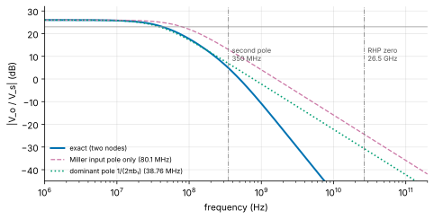

<!-- status: verified -->
# 12-03 · Frequency Response: Device Capacitances, Miller Effect, Poles and Zeros

| | |
|---|---|
| **Course** | [12 · Electronics II](../README.md) |
| **University equivalent** | The high-frequency-response chapter of a second electronics course: MOSFET and BJT capacitances, the transition frequency $f_T$, the Miller theorem and effect, the dominant-pole approximation, and the high-frequency response of common-source (common-emitter), common-gate and common-drain stages and the cascode (Sedra & Smith, *Microelectronic Circuits*, the frequency-response chapter; Razavi, *Design of Analog CMOS Integrated Circuits*, ch. 6; Gray, Hurst, Lewis & Meyer, ch. 7) |
| **Prerequisites** | [12-02 Active Loads, Cascodes and Multistage Amplifiers](12-02-active-loads-cascodes-multistage.md), [09-09 The Long-Channel MOSFET](../../09-semiconductor-devices/chapters/09-09-long-channel-mosfet.md) ($C_{gs}$, $f_T$), [07-07 Frequency Response and Bode Plots](../../07-circuit-analysis-2-transient-and-ac/chapters/07-07-frequency-response-and-bode-plots.md), [11-08 The Laplace Transform and System Functions](../../11-signals-and-systems/chapters/11-08-laplace-transform-and-system-functions.md) (poles and zeros) |
| **Estimated study hours** | 12 |
| **Last verified** | 2026-11-20 |

**Learning objectives.** After this chapter you can:

1. List the capacitances of a MOSFET and a bipolar transistor, estimate them from geometry or a data sheet, and derive and compute the transition frequency $f_T$.
2. State and derive the Miller theorem, apply it to a feedback capacitor, and explain what the approximation misses.
3. Derive the exact transfer function of a common-source stage with source resistance and load capacitance, find its poles and zero, and compare the Miller and dominant-pole estimates with the exact bandwidth.
4. Find the high-frequency response of common-gate and common-drain stages and of the cascode, and explain why each avoids or reduces the Miller effect.
5. Use gain–bandwidth reasoning to compare stages, and explain why a device's $f_T$ is not the bandwidth of an amplifier built from it.

---

## 1. Big picture

Every amplifier in 12-01 and 12-02 had a gain that did not depend on frequency. Real transistors store charge: the gate of a MOSFET is a capacitor, the base of a bipolar transistor holds minority carriers, and every junction has a depletion capacitance. At high enough frequency these capacitances short the signal to ground or feed the output back to the input, and the gain falls. This chapter shows where the capacitances come from, how to turn a circuit into poles and zeros, and why one particular capacitance, the one bridging a stage's input and inverted output, does far more damage than its size suggests: the **Miller effect**. It is the reason a 2 GHz transistor makes a 40 MHz common-source amplifier, and the reason cascodes and common-gate stages exist.

- **Bandwidth is a product specification.** Op-amp gain–bandwidth, ADC driver settling, SerDes front ends and RF low-noise amplifiers are all set by the capacitances of this chapter.
- **$f_T$ is the device's figure of merit, not the circuit's.** Foundries quote $f_T$; product bandwidth is usually ten to a hundred times lower.
- **Poles set stability.** The poles found here become the loop poles of feedback amplifiers (12-05) and the reason they need compensation (12-06).
- **The Miller effect is used deliberately.** Op-amp compensation multiplies a small capacitor by a stage's gain to create one dominant pole (12-06).

## 2. Intuition first

**Every node is an RC.** Each node of an amplifier has a resistance to AC ground (a source resistance, a load, an $r_o$) and a capacitance to ground (device and wiring capacitance). Together they form a low-pass filter with a corner at $1/(2\pi RC)$. A high-gain node has a large resistance, so even a small capacitance puts its corner low. To first order, the stage's bandwidth is set by its slowest node.

**A capacitor across a gain is magnified.** Put a capacitor $C$ between the input and output of an inverting amplifier with gain $-A$. When the input rises by 1 mV, the output falls by $A$ mV, so the capacitor's voltage changes by $(1 + A)$ mV, and it draws $(1 + A)$ times the current a grounded capacitor would. Seen from the input, it is a capacitor $(1 + A)C$ to ground. A 6 fF gate-to-drain overlap in a gain-of-20 stage looks like 126 fF at the gate: more than the gate's own capacitance.

**An analogy from finance: leverage on a small exposure, and where it breaks.** A trader with a small position that is levered twenty times carries the risk of a position twenty times as large; a modest market move becomes a large loss. The feedback capacitor is a small position levered by the stage's gain: its current, and so its loading on the input, is $(1 + A)$ times what its size suggests. The analogy breaks in two ways. The "leverage" here is not a choice made in advance: it is the gain at each frequency, and it falls exactly as the capacitor begins to matter, so the Miller multiplication is an approximation valid only near the dominant pole. And unlike a levered position, the effect can be turned to advantage: compensation (12-06) multiplies a small capacitor on purpose to make a large one cheaply.

*Figure 1. Example 12-03.2's common-source stage: gain 20, source resistance 10 kΩ. The exact response (solid) falls 3 dB at 42.93 MHz; the estimate from the Miller input pole alone (dashed) puts it at 80.1 MHz, and the dominant-pole estimate $1/(2\pi b_1)$ at 38.76 MHz. The second pole is at 350 MHz and the right-half-plane zero at 26.5 GHz.*

## 3. Theory

> **Conventions.** Small-signal models of 10-04 with capacitances added; all capacitances are linear at the bias point. $s = j\omega$, frequencies in hertz are $f = \omega/2\pi$. "Pole at $f_p$" means a factor $1/(1 + s/\omega_p)$ with $\omega_p = 2\pi f_p$. Resistances such as $R_L$ include every resistance at the node ($R_D \parallel r_o$ and any load). Body effect is neglected unless stated.

### 3.1 Device capacitances and the transition frequency

**MOSFET.** In saturation, the channel charge is controlled by the gate and the source, so most of the intrinsic gate capacitance appears between gate and source: $C_{gs,int} = \tfrac23WLC_{ox}$, derived in 09-09 from the channel charge's profile. The drain end of the channel is pinched off, so the intrinsic gate–drain capacitance is nearly zero. Real devices add:

- **Overlap capacitances.** The gate extends slightly over the source and drain diffusions, adding $C_{ov}$ per unit width to each side: $C_{gs} = \tfrac23WLC_{ox} + WC_{ov}$ and $C_{gd} = WC_{ov}$. Small as it is, $C_{gd}$ is the capacitance the Miller effect multiplies.
- **Junction capacitances** $C_{db}$ and $C_{sb}$, the drain and source depletion capacitances to the body (09-06), which load the output and the source.

**Bipolar transistor.** The base–emitter junction stores the minority charge in transit across the base, $Q_F = \tau_FI_C$, where $\tau_F$ is the forward transit time. Its derivative is the **diffusion capacitance** $C_{de} = dQ_F/dV_{BE} = \tau_Fg_m$, which grows with current. Adding the base–emitter depletion capacitance $C_{je}$ gives $C_\pi = \tau_Fg_m + C_{je}$. The collector–base junction's depletion capacitance is $C_\mu$, the bipolar equivalent of $C_{gd}$.

**The transition frequency.** Drive the gate with a small current $i_{in}$ and short the drain to AC ground. The input current charges $C_{gs} + C_{gd}$, so $v_{gs} = i_{in}/[s(C_{gs} + C_{gd})]$, and the output current is $g_mv_{gs}$ (neglecting the small current through $C_{gd}$ into the drain). The short-circuit current gain is

$$
\frac{i_{out}}{i_{in}} = \frac{g_m}{s(C_{gs} + C_{gd})} \qquad\Rightarrow\qquad f_T = \frac{g_m}{2\pi(C_{gs} + C_{gd})} ,
$$

the frequency at which its magnitude falls to 1. For the bipolar transistor, $f_T = g_m/[2\pi(C_\pi + C_\mu)]$, so $C_\pi + C_\mu = g_m/(2\pi f_T)$: a data sheet's $f_T$ at a stated current gives the total input capacitance. $f_T$ is a property of the device at its bias point: it rises with overdrive for a MOSFET ($f_T \propto V_{ov}/L^2$ in the long-channel limit, 09-09) and with current for a bipolar transistor until high-injection effects make it fall.

**Why $f_T$ is not the amplifier's bandwidth.** $f_T$ is measured with the output shorted, so there is no voltage gain and no Miller effect, and with an ideal current drive, so there is no source resistance. A real stage has both, and its bandwidth is typically a small fraction of $f_T$ (Example 12-03.2: 42.93 MHz from a 2.02 GHz device).

### 3.2 From a circuit to poles and zeros

A stage's transfer function is a ratio of polynomials in $s$ (11-08). For a two-node circuit,

$$
H(s) = A_0\frac{1 + s/z}{1 + b_1s + b_2s^2} = A_0\frac{1 + s/z}{(1 + s/\omega_{p1})(1 + s/\omega_{p2})} .
$$

Matching coefficients, $b_1 = 1/\omega_{p1} + 1/\omega_{p2}$ and $b_2 = 1/(\omega_{p1}\omega_{p2})$. If one pole is far below the other ($\omega_{p1} \ll \omega_{p2}$), then

$$
\omega_{p1} \approx \frac{1}{b_1}, \qquad \omega_{p2} \approx \frac{b_1}{b_2} .
$$

This is the **dominant-pole approximation**: the coefficient $b_1$, which is easy to find, gives the dominant pole, and the bandwidth is about $1/(2\pi b_1)$. The approximation errs on the low side when the poles are not well separated, because $b_1$ includes $1/\omega_{p2}$. 12-04 shows how to find $b_1$ directly as a sum of time constants, without solving the circuit.

### 3.3 The Miller theorem

Consider an impedance $Z$ connected between nodes 1 and 2, where the circuit enforces $V_2 = AV_1$. The current leaving node 1 through $Z$ is $(V_1 - V_2)/Z = V_1(1 - A)/Z$. A grounded impedance $Z_1 = Z/(1 - A)$ at node 1 draws the same current. At node 2 the current is $(V_2 - V_1)/Z = V_2(1 - 1/A)/Z$, the current of a grounded $Z_2 = Z/(1 - 1/A)$. So the bridging impedance can be replaced by

$$
Z_1 = \frac{Z}{1 - A}, \qquad Z_2 = \frac{Z}{1 - 1/A} .
$$

For a capacitor ($Z = 1/sC$) across an inverting gain $A = -A_v$:

$$
C_1 = C(1 + A_v), \qquad C_2 = C\left(1 + \frac{1}{A_v}\right) \approx C .
$$

This is the **Miller effect**. The theorem is exact *if* $A$ is the true ratio $V_2/V_1$ in the circuit with $Z$ in place. In practice designers use the low-frequency gain for $A$, which ignores that the gain itself falls with frequency and that $Z$ loads the output. The result is a good estimate of the input pole when the input node dominates, but it misses the right-half-plane zero and can badly misplace the poles when the output node is slow (§3.4).

### 3.4 The common-source stage

Drive the gate through a source resistance $R_S$; the output node has total resistance $R_L$ (including $r_o$) and capacitance $C_L$ to ground (including $C_{db}$ and the next stage's input); $C_{gs}$ is at the gate and $C_{gd}$ bridges gate and drain.

**Exact transfer function.** Kirchhoff's current law at the gate and at the output:

$$
\begin{aligned}
\frac{V_g - V_s}{R_S} + sC_{gs}V_g + sC_{gd}(V_g - V_o) &= 0 ,\\
sC_{gd}(V_o - V_g) + g_mV_g + \frac{V_o}{R_L} + sC_LV_o &= 0 .
\end{aligned}
$$

The second equation gives $V_g = -V_o[1/R_L + s(C_{gd} + C_L)]/(g_m - sC_{gd})$. Substituting into the first, multiplying through by $R_SR_L(g_m - sC_{gd})$ and collecting powers of $s$:

$$
\frac{V_o}{V_s} = \frac{-g_mR_L\left(1 - sC_{gd}/g_m\right)}{1 + b_1s + b_2s^2},
$$

$$
b_1 = R_S\big[C_{gs} + C_{gd}(1 + g_mR_L)\big] + R_L(C_{gd} + C_L), \qquad b_2 = R_SR_L\,(C_{gs}C_{gd} + C_{gs}C_L + C_{gd}C_L) .
$$

Read off three facts.

- **The Miller term is in $b_1$.** $R_S\,C_{gd}(1 + g_mR_L)$ is exactly the Miller capacitance times the source resistance. But $b_1$ also contains the output node's time constant $R_L(C_{gd} + C_L)$, which the Miller input-pole estimate leaves out.
- **The dominant pole** is about $1/b_1$, the second pole about $b_1/b_2$.
- **A right-half-plane zero** at $s = +g_m/C_{gd}$. At that frequency the current through $C_{gd}$ equals the transistor's $g_mv_{gs}$ and cancels it, so the output current reverses sign. The zero is usually far above the bandwidth (at about $f_T$ times $C_{gs}/C_{gd}$), but it adds phase lag without reducing gain, which matters for stability (12-06).

**Three estimates of the bandwidth.** Example 12-03.2 compares them: the Miller input pole alone overestimates the bandwidth by about 87% because the output node is nearly as slow as the input; $1/(2\pi b_1)$ underestimates it by about 10%; the exact −3 dB frequency lies between.

**Gain against bandwidth.** If the output node dominates ($R_S$ small), the bandwidth is about $1/[2\pi R_L(C_L + C_{gd})]$ and the gain is $g_mR_L$, so the **gain–bandwidth product** is about $g_m/[2\pi(C_L + C_{gd})]$, independent of $R_L$: raising the load resistance raises the gain and lowers the bandwidth in proportion. If the input node dominates, the Miller term makes the bandwidth fall roughly as $1/A_v$ too. Either way, a single stage trades gain for bandwidth at roughly constant product.

### 3.5 The common-gate stage

Drive the source through $R_S$ with the gate at AC ground. The input sees $C_{gs}$ (plus $C_{sb}$) to ground in parallel with $R_S \parallel (1/g_m)$, and the output sees $R_L$ with $C_L + C_{gd}$, since $C_{gd}$ now goes from drain to the grounded gate. There is no capacitor bridging an inverting gain, so **no Miller effect**:

$$
\omega_{in} \approx \frac{1}{(R_S \parallel 1/g_m)\,C_{gs}}, \qquad \omega_{out} = \frac{1}{R_L(C_L + C_{gd})} .
$$

The input pole is near $\omega_T$ when $R_S \gg 1/g_m$, so the output pole usually dominates. The price is the low input resistance $1/g_m$: with a high-impedance source the signal current divides, and the gain from the source is $g_mR_L/(1 + g_mR_S)$ (Example 12-03.4). The common-gate stage suits sources that deliver current, or low-impedance (50 Ω) ones.

### 3.6 The source follower

Drive the gate from an ideal source and load the output (the source) with $C_L$ and a current-source bias. $C_{gd}$ connects the input to the AC-grounded drain and does not load the follower's output. Kirchhoff's law at the output: the transistor's current $g_m(V_i - V_o)$ plus the current through $C_{gs}$, $sC_{gs}(V_i - V_o)$, charges $C_L$:

$$
\frac{V_o}{V_i} = \frac{g_m + sC_{gs}}{g_m + s(C_{gs} + C_L)} .
$$

A left-half-plane zero at $g_m/C_{gs}$ (about $\omega_T$) and a pole at $g_m/(C_{gs} + C_L)$: the follower is fast because its output resistance is only $1/g_m$. With a resistive source driving the gate the follower becomes second order, and its output impedance can look inductive, so it can peak or ring with a capacitive load; 12-04 treats that case.

### 3.7 The cascode against the Miller effect

Put a common-gate device M2 on the drain of the common-source device M1 (12-02). M1's drain now sees M2's source, whose small-signal resistance is about $1/g_{m2}$, so the gain from M1's gate to its drain is only about $-g_{m1}/g_{m2} \approx -1$. The Miller multiplication of $C_{gd1}$ falls from $(1 + g_mR_L)$ to about 2:

$$
C_{in} \approx C_{gs1} + 2C_{gd1} .
$$

The new internal node has a pole near $g_{m2}/C_x$, where $C_x$ collects $C_{gs2}$, $C_{db1}$ and $C_{sb2}$: of the order of $\omega_T$, far above the bandwidth. The full gain $g_{m1}R_L$ appears only at the output, where $C_{gd2}$ goes to the grounded gate. The cascode keeps the common-source stage's gain with the common-gate stage's freedom from the Miller effect (Example 12-03.5).

## 4. Worked examples

### Example 12-03.1 · Capacitances and f_T of a MOSFET (tier A)

**Setup.** An NMOS with $W$ = 20 µm, $L$ = 0.5 µm, $C_{ox}$ = 10 fF/µm² and overlap capacitance 0.3 fF/µm runs at $I_D$ = 100 µA with $V_{ov}$ = 0.2 V. Find $g_m$, $C_{gs}$, $C_{gd}$ and $f_T$.

**Solution.** $g_m = 2I_D/V_{ov}$ = **1** mA/V. $C_{gs} = \tfrac23 \times 20 \times 0.5 \times 10 + 20 \times 0.3$ = 66.67 + 6 = **72.67** fF. $C_{gd} = 20 \times 0.3$ = **6** fF. $f_T = 1\ \text{mA/V}/[2\pi \times 78.67\ \text{fF}]$ = **2.023** GHz.

**Units check.** (A/V)/F = 1/s; divided by 2π, hertz.

**Sanity check.** The overlap adds 8% to $C_{gs}$ but is the *whole* of $C_{gd}$: small, but it is the one the Miller effect multiplies.

### Example 12-03.2 · A common-source stage, three ways (tier B)

**Setup.** The transistor of Example 12-03.1 is a common-source stage with $R_S$ = 10 kΩ, $R_L$ = 20 kΩ (all resistance at the drain) and $C_L$ = 100 fF at the drain. (a) Find the midband gain and the Miller input capacitance and input pole. (b) Find $b_1$, $b_2$ and the dominant-pole estimate. (c) Find the exact poles, the zero and the exact −3 dB frequency, and compare.

**Solution.** (a) $A_0 = g_mR_L$ = **20**. $C_{in} = C_{gs} + C_{gd}(1 + 20) = 72.67 + 126$ = **198.7** fF, so the Miller input pole is $1/(2\pi \times 10\ \text{k}\Omega \times 198.7\ \text{fF})$ = **80.11** MHz.

(b) $b_1 = 10\ \text{k}\Omega \times 198.7\ \text{fF} + 20\ \text{k}\Omega \times 106\ \text{fF}$ = 1.987 + 2.120 = **4.107** ns: the output node contributes more than the Miller term. The dominant-pole estimate is $1/(2\pi b_1)$ = **38.76** MHz. $b_2 = 10\ \text{k}\Omega \times 20\ \text{k}\Omega \times (72.67 \times 6 + 72.67 \times 100 + 6 \times 100)$ fF² = **1.661** × 10⁻¹⁸ s², and the second-pole estimate $b_1/b_2$ corresponds to **393.6** MHz.

(c) The roots of $1 + b_1s + b_2s^2$ are at **43.58** MHz and **350.0** MHz. The zero is at $g_m/(2\pi C_{gd})$ = **26.53** GHz, in the right half-plane. Solving $\lvert H(j\omega)\rvert = 20/\sqrt2$ numerically gives the −3 dB frequency **42.93** MHz. The Miller-only estimate is **87**% high; $1/(2\pi b_1)$ is **10**% low.

**Sanity check.** The poles are only eight times apart, so the dominant-pole estimate errs low, as §3.2 predicts. The gain–bandwidth product, 20 × 42.93 MHz = **858.6** MHz, is under half the device's $f_T$.

### Example 12-03.3 · Gain against bandwidth (tier B)

**Setup.** In Example 12-03.2, suppose the source resistance were negligible. (a) What would the bandwidth and the gain–bandwidth product be? (b) What if $R_L$ were halved to 10 kΩ?

**Solution.** (a) With $R_S$ → 0 only the output node remains: $1/[2\pi \times 20\ \text{k}\Omega \times 106\ \text{fF}]$ = **75.07** MHz, and GBW = 20 × 75.07 = **1501** MHz, about $g_m/[2\pi(C_L + C_{gd})]$.

(b) The gain halves to **10** and the bandwidth doubles to **150.1** MHz: the product is unchanged.

**Sanity check.** $g_m/[2\pi \times 106\ \text{fF}]$ = 1501 MHz: the product depends only on the transistor's $g_m$ and the capacitance it must drive.

### Example 12-03.4 · The common-gate stage (tier B)

**Setup.** The same transistor as a common-gate stage, $R_L$ = 20 kΩ, $C_L$ = 100 fF. (a) With a 10 kΩ source: find the gain from the source, the input and output poles, and the −3 dB frequency. (b) Repeat with a 50 Ω source.

**Solution.** (a) The input resistance is $1/g_m$ = 1 kΩ, so the source current divides: gain $g_mR_L/(1 + g_mR_S) = 20/11$ = **1.818**. Input pole: $1/[2\pi(10\ \text{k}\Omega \parallel 1\ \text{k}\Omega)\,72.67\ \text{fF}]$ = **2.409** GHz. Output pole: $1/[2\pi \times 20\ \text{k}\Omega \times 106\ \text{fF}]$ = **75.07** MHz, which dominates; the exact −3 dB frequency is **75.00** MHz.

(b) Gain $20/1.05$ = **19.05**; the input pole moves to **45.99** GHz; the −3 dB frequency is **75.07** MHz.

**Sanity check.** With the 10 kΩ source, the common-gate stage has 1.75 times the common-source stage's bandwidth but a tenth of its gain: no Miller effect, but the low input resistance wastes the signal. With a 50 Ω source it has the gain *and* the bandwidth.

### Example 12-03.5 · A cascode against the Miller effect (tier B)

**Setup.** Cascode Example 12-03.2's stage with an identical device M2 ($g_m$ = 1 mA/V, same capacitances); the internal node has $C_x = C_{gs2} + 10$ fF of drain junction capacitance; $R_L$ = 20 kΩ and $C_L$ = 100 fF at the output, with $r_o$ neglected. Find the Miller input capacitance and pole, the internal node's pole, and the exact −3 dB frequency.

**Solution.** The gain from M1's gate to its drain is about $-g_{m1}/g_{m2} = -1$, so $C_{in} = C_{gs1} + 2C_{gd1}$ = **84.67** fF and the input pole is $1/(2\pi \times 10\ \text{k}\Omega \times 84.67\ \text{fF})$ = **188.0** MHz. The internal node: $g_{m2}/(2\pi C_x) = 1\ \text{mA/V}/(2\pi \times 82.67\ \text{fF})$ = **1.925** GHz. The output pole is 75.07 MHz, as before. Solving the full circuit, the gain is **20** and the −3 dB frequency is **66.07** MHz, against 42.93 MHz without the cascode.

**Sanity check.** The bandwidth is now set mostly by the output node (75.07 MHz), as it should be: the cascode has removed the input node's Miller penalty without changing the gain.

### Example 12-03.6 · A 300 MHz transistor in a common-emitter stage (tier C)

**Setup.** A 2N3904's data sheet gives $f_T \ge$ 300 MHz at $I_C$ = 10 mA and $C_{obo} \le$ 4.0 pF (collector–base, at 5 V) [1]. Use these as estimates at 10 mA, with β = 100. (a) Find $g_m$, $C_\pi + C_\mu$, $C_\pi$ (taking $C_\mu$ = 4 pF) and $r_\pi$. (b) The transistor amplifies a 50 Ω source into $R_L$ = 500 Ω. Estimate the Miller input capacitance and the bandwidth. (c) The exact solution of the hybrid-π circuit gives a gain from the source of **162.1** and a −3 dB frequency of **3.734** MHz. Compare, and comment on "a 300 MHz transistor".

**Solution.** (a) $g_m = 10\ \text{mA}/25.852\ \text{mV}$ = **386.8** mA/V. $C_\pi + C_\mu = g_m/(2\pi f_T)$ = **205.2** pF, so $C_\pi$ ≈ **201.2** pF. $r_\pi = \beta/g_m$ = **258.5** Ω.

(b) The gain from base to collector is $g_mR_L$ = **193.4**, so $C_{in} = 201.2 + 4 \times 194.4$ = **978.8** pF. The input node sees $50\ \Omega \parallel 258.5\ \Omega$ = **41.90** Ω, so the pole is $1/(2\pi \times 41.90\ \Omega \times 978.8\ \text{pF})$ = **3.881** MHz.

(c) The Miller estimate is within 4% of the exact bandwidth here, because the output node (500 Ω with only $C_\mu$) is fast. A "300 MHz transistor" makes a 3.7 MHz amplifier at this gain: $f_T$ is a device property measured with the output shorted.

**Sanity check.** $C_\mu$ is under 2% of the transistor's input capacitance, yet multiplied by 194.4 it supplies about four-fifths of $C_{in}$.

### Answer key

<!-- answer-key -->
| ID | Quantity | Value | Unit |
|---|---|---|---|
| T 12-03.a | Miller capacitance of 6 fF at gain 20 | 126 | fF |
| T 12-03.b | 2N3904 f_T (minimum, 10 mA) | 300 | MHz |
| T 12-03.c | CS −3 dB with a 1 kΩ source (guided exercise) | 70.83 | MHz |
| Ex 12-03.1a | g_m | 1 | mA/V |
| Ex 12-03.1b | C_gs | 72.67 | fF |
| Ex 12-03.1c | C_gd | 6 | fF |
| Ex 12-03.1d | f_T | 2.023 | GHz |
| Ex 12-03.1e | overlap share of C_gs | 8 | % |
| Ex 12-03.2a | midband gain | 20 | — |
| Ex 12-03.2b | Miller input capacitance | 198.7 | fF |
| Ex 12-03.2c | Miller input pole | 80.11 | MHz |
| Ex 12-03.2d | b_1 | 4.107 | ns |
| Ex 12-03.2e | dominant-pole estimate | 38.76 | MHz |
| Ex 12-03.2f | b_2 | 1.661 × 10⁻¹⁸ | s² |
| Ex 12-03.2g | second-pole estimate b_1/b_2 | 393.6 | MHz |
| Ex 12-03.2h | first pole, exact | 43.58 | MHz |
| Ex 12-03.2i | second pole, exact | 350.0 | MHz |
| Ex 12-03.2j | right-half-plane zero | 26.53 | GHz |
| Ex 12-03.2k | −3 dB frequency, exact | 42.93 | MHz |
| Ex 12-03.2l | Miller-only estimate's error | 87 | % |
| Ex 12-03.2m | dominant-pole estimate's error | 10 | % |
| Ex 12-03.2n | gain–bandwidth product | 858.6 | MHz |
| Ex 12-03.3a | bandwidth with R_S → 0 | 75.07 | MHz |
| Ex 12-03.3b | gain–bandwidth product | 1501 | MHz |
| Ex 12-03.3c | gain with R_L halved | 10 | — |
| Ex 12-03.3d | bandwidth with R_L halved | 150.1 | MHz |
| Ex 12-03.4a | CG gain, 10 kΩ source | 1.818 | — |
| Ex 12-03.4b | CG input pole, 10 kΩ source | 2.409 | GHz |
| Ex 12-03.4c | CG output pole | 75.07 | MHz |
| Ex 12-03.4d | CG −3 dB, 10 kΩ source | 75.00 | MHz |
| Ex 12-03.4e | CG gain, 50 Ω source | 19.05 | — |
| Ex 12-03.4f | CG input pole, 50 Ω source | 45.99 | GHz |
| Ex 12-03.4g | CG −3 dB, 50 Ω source | 75.07 | MHz |
| Ex 12-03.4h | CG over CS bandwidth, 10 kΩ source | 1.75 | — |
| Ex 12-03.5a | cascode Miller input capacitance | 84.67 | fF |
| Ex 12-03.5b | cascode input pole | 188.0 | MHz |
| Ex 12-03.5c | internal-node pole | 1.925 | GHz |
| Ex 12-03.5d | cascode gain | 20 | — |
| Ex 12-03.5e | cascode −3 dB, exact | 66.07 | MHz |
| Ex 12-03.6a | g_m | 386.8 | mA/V |
| Ex 12-03.6b | C_π + C_μ | 205.2 | pF |
| Ex 12-03.6c | C_π | 201.2 | pF |
| Ex 12-03.6d | r_π | 258.5 | Ω |
| Ex 12-03.6e | base-to-collector gain | 193.4 | — |
| Ex 12-03.6f | Miller input capacitance | 978.8 | pF |
| Ex 12-03.6g | input-node resistance | 41.90 | Ω |
| Ex 12-03.6h | Miller bandwidth estimate | 3.881 | MHz |
| Ex 12-03.6i | gain from the source, exact | 162.1 | — |
| Ex 12-03.6j | −3 dB frequency, exact | 3.734 | MHz |
| Ex 12-03.6k | Miller estimate's error | 4 | % |

*Every value is recomputed by [verify_12_03.py](../verify/verify_12_03.py): transfer functions by complex nodal analysis of the full small-signal circuits at each frequency, −3 dB frequencies by root finding on $\lvert H(j\omega)\rvert$, poles by finding where the nodal matrix becomes singular, and the transition frequency by locating unity short-circuit current gain. The common-source stage is also confirmed in ngspice (AC sweep and pole–zero analysis).*

## 5. Simulate it

The lab, [labs/12-03-lab](../labs/12-03-lab/README.md), has a notebook and an ngspice netlist:

1. Measures a MOSFET's short-circuit current gain against frequency and reads off $f_T$.
2. Computes the common-source stage's exact response and compares it with the Miller and dominant-pole estimates as $R_S$ and $C_L$ vary.
3. Compares common-source, common-gate and cascode stages built from the same device.
4. Sweeps the source follower with a resistive source and a capacitive load to show where it starts to peak.

The netlist [cs_freq.cir](../labs/12-03-lab/cs_freq.cir) runs an AC sweep and a pole–zero analysis of Example 12-03.2's stage.

**Guided exercise (predict, then run).** **Before running Part 2**, predict: in Example 12-03.2, if the source resistance is cut from 10 kΩ to 1 kΩ, does the bandwidth rise tenfold? Then run it. (No: it rises from 42.93 MHz to only **70.83** MHz, because the output node, untouched by $R_S$, now sets the limit near 75 MHz.)

## 6. Engineering tradeoffs

| Knob | Improves | Costs | Typical decision owner |
|---|---|---|---|
| Shorter channel | $f_T$ (∝ $1/L^2$ long-channel) | $r_o$ and gain, matching | Process and analog designer |
| Higher overdrive or current | $f_T$, bandwidth | Power; for MOS, $g_m/I_D$ | Analog designer |
| Narrower device (smaller $W$) | Less $C_{gs}$ and $C_{gd}$ | Less $g_m$ at a given current | Analog designer |
| Cascode | Removes the Miller multiplication | Headroom; one more node | Analog designer |
| Common-gate input | No Miller effect; wide bandwidth | Low input resistance; noise | RF designer |
| Lower load resistance | Bandwidth | Gain (constant gain–bandwidth) | Architect |
| Buffer (follower) before a capacitive load | Bandwidth of the previous stage | Level shift, power, possible peaking | Analog designer |

## 7. Numbers to know

| Quantity | Value | Note |
|---|---|---|
| $C_{gs}$ in saturation | $\tfrac23WLC_{ox} + WC_{ov}$ | 09-09 |
| $C_{gd}$ | $WC_{ov}$ (overlap only) | Multiplied by Miller |
| $f_T$ | $g_m/[2\pi(C_{gs} + C_{gd})]$ | Device, output shorted |
| Bipolar $C_\pi$ | $\tau_Fg_m + C_{je}$ | Grows with current |
| Miller capacitance | $C(1 + A_v)$ | At the input of an inverting gain |
| CS dominant pole | $1/b_1$, $b_1 = R_S[C_{gs} + C_{gd}(1 + g_mR_L)] + R_L(C_{gd} + C_L)$ | Errs low if poles are close |
| CS right-half-plane zero | $g_m/C_{gd}$ | Phase lag without gain loss |
| Single-stage gain–bandwidth | ≈ $g_m/[2\pi(C_L + C_{gd})]$ | Output-limited case |
| SiGe HBT $f_T/f_{max}$ | 300/500 GHz (IHP SG13G2) [2] | As of Feb 2026 |

## 8. Common mistakes

- **Using the Miller input pole as the bandwidth when the output node is slow.** Check $R_L(C_L + C_{gd})$ against the Miller time constant; use $b_1$ when they are comparable.
- **Treating $f_T$ as an amplifier's bandwidth.** It is measured with no voltage gain and no source resistance.
- **Forgetting the right-half-plane zero.** It adds phase lag at high frequency, which matters inside feedback loops.
- **Applying the Miller theorem with the wrong gain.** Use the gain between the two nodes the capacitor actually bridges (gate to drain of M1 in a cascode, not the whole stage).
- **Ignoring $C_L$'s components.** The drain junction, the next stage's gate and the wiring all add to it.
- **Expecting the dominant-pole estimate to be exact.** With poles less than a decade apart it errs low by 10–20%.

## 9. Practitioner lens

### State of the art (as of Nov 2026)

- **Discrete small-signal bipolar transistors.** onsemi's 2N3904 specifies $f_T$ ≥ 300 MHz at 10 mA and 20 V, with output capacitance ≤ 4.0 pF and input capacitance ≤ 8.0 pF [1] **[Established]** (data sheet); Example 12-03.6 shows such a part making a few-megahertz amplifier at high gain.
- **SiGe BiCMOS for millimeter-wave work.** IHP's SG13G2 process offers heterojunction bipolar transistors with peak $f_T/f_{max}$ of 300/500 GHz, and SG13G3Cu reaches up to 470/650 GHz [2] **[Established]** (foundry technology sheet). As Example 12-03.6 shows for a slower part, circuit bandwidths sit well below such device figures.

> **Deeper:** see companion repo *Datacenter Networking* for how transistor speed and the capacitances of this chapter set SerDes and optical-driver bandwidths.

### Why it matters commercially

- **Bandwidth per milliwatt is the competitive metric in high-speed analog.** Faster devices let a design reach the same bandwidth at lower current; that is a large part of why RF and SerDes front ends follow advanced or specialty processes.
- **Capacitive loads cost power.** Driving a large capacitance (an ADC's sampling capacitor, a long wire, a pad) at a given bandwidth needs a proportional $g_m$, so loads translate directly into current.
- **Device figures are marketing-ready; circuit figures are not.** Foundry $f_T$/$f_{max}$ and product bandwidths differ by orders of magnitude, and comparisons must use like with like.

### Marketing vs Reality

- **"300 GHz transistors."** *Reality:* $f_T$ and $f_{max}$ are device limits at an optimal bias with shorted or matched terminations; amplifiers with useful gain run far below them. *Sanity check:* ask for the circuit's gain and bandwidth, and the ratio of operating frequency to $f_{max}$.
- **"Bandwidth 100 MHz."** *Reality:* at what gain and with what load capacitance? Bandwidth falls in proportion to gain and to load. *Sanity check:* ask for the gain–bandwidth product and the load.
- **"Stable, single-pole response."** *Reality:* every real stage has a second pole and often a right-half-plane zero. *Sanity check:* ask where they are relative to the unity-gain frequency.

### Questions for engineering leaders

1. **"What sets your bandwidth: the input node, the output node or an internal one?"**
   *Strong:* the time constants of each node and which one dominates, with the plan to move it. *Evasive:* "the process is fast enough."
2. **"How far below the transistors' $f_T$ do you operate, and why there?"**
   *Strong:* the ratio, the gain per stage, and the margin for process corners. *Evasive:* a comparison of $f_T$ with the operating frequency only.
3. **"Where are your second pole and your right-half-plane zero?"**
   *Strong:* their frequencies relative to the loop's unity-gain frequency, and the phase margin. *Evasive:* "we compensate it."
4. **"What capacitive load does the block drive at its worst, and what current does that cost?"**
   *Strong:* a load budget with $g_m$ and current derived from it. *Evasive:* nominal load only.

## 10. Concept check

**Q1.** Why is a MOSFET's intrinsic gate–drain capacitance in saturation nearly zero?

Answer

The channel is pinched off at the drain end, so the drain voltage barely changes the channel charge; what remains is the overlap capacitance.

**Q2.** Derive the Miller capacitance seen at the input of an inverting amplifier of gain $A_v$ with a capacitor $C$ from input to output.

Answer

The capacitor's voltage is $V_{in} - (-A_vV_{in}) = (1 + A_v)V_{in}$, so it draws $sC(1 + A_v)V_{in}$ from the input: the current of a capacitor $C(1 + A_v)$ to ground.

**Q3.** Why can the Miller input-pole estimate overestimate a common-source stage's bandwidth?

Answer

It ignores the output node's time constant $R_L(C_L + C_{gd})$; when that node is nearly as slow as the input, the true bandwidth is lower.

**Q4.** What causes the common-source stage's right-half-plane zero, and why is it harmful?

Answer

At $\omega = g_m/C_{gd}$ the current fed forward through $C_{gd}$ cancels the transistor's $g_mv_{gs}$. A right-half-plane zero adds phase lag like a pole while leaving the gain up, which erodes phase margin in feedback loops.

**Q5.** Why does a cascode reduce the Miller effect but not the gain?

Answer

M1's drain sees about $1/g_{m2}$, so its gate-to-drain gain is about −1 and $C_{gd1}$ is only doubled; the full gain appears at M2's drain, where $C_{gd2}$ goes to an AC-grounded gate.

**Q6.** Why does a common-gate stage have a wide bandwidth but often a low gain from a high-impedance source?

Answer

No capacitor bridges an inverting gain, so there is no Miller effect; but its input resistance is only $1/g_m$, so a high source resistance divides the signal current away.

[Problem set for this chapter](../problems/12-03-problems.md)

## 11. Key terms

[Miller effect](../../../reference/glossary.md#miller-effect) · [Miller theorem](../../../reference/glossary.md#miller-theorem) · [Overlap capacitance](../../../reference/glossary.md#overlap-capacitance) · [Diffusion capacitance](../../../reference/glossary.md#diffusion-capacitance) · [Cutoff frequency](../../../reference/glossary.md#cutoff-frequency) · [Dominant-pole approximation](../../../reference/glossary.md#dominant-pole-approximation) · [Right-half-plane zero](../../../reference/glossary.md#right-half-plane-zero) · [Gain-bandwidth product](../../../reference/glossary.md#gain-bandwidth-product)

## 12. Connections

- **Builds on:** stages and cascodes from [12-02](12-02-active-loads-cascodes-multistage.md); $C_{gs}$ and $f_T$ from [09-09](../../09-semiconductor-devices/chapters/09-09-long-channel-mosfet.md); junction and diffusion capacitance from [09-06](../../09-semiconductor-devices/chapters/09-06-pn-junction-iv-and-capacitance.md); Bode plots from [07-07](../../07-circuit-analysis-2-transient-and-ac/chapters/07-07-frequency-response-and-bode-plots.md); poles and zeros from [11-08](../../11-signals-and-systems/chapters/11-08-laplace-transform-and-system-functions.md); the Miller effect in resistive form from [10-05](../../10-electronics-1/chapters/10-05-amplifier-fundamentals.md).
- **Next:** [12-04 High-Frequency Analysis Methods](12-04-high-frequency-analysis-methods.md) finds $b_1$ as a sum of open-circuit time constants and treats the follower's peaking.
- **Used later:** feedback and loop poles in 12-05; compensation, which uses the Miller effect on purpose, in 12-06; op-amp internals in 12-08; LNAs and RF stages in Course 21; SerDes front ends in Course 24.

## 13. Further study

- A. S. Sedra and K. C. Smith, *Microelectronic Circuits*, the frequency-response chapter (device capacitances, the Miller theorem, CS, CG, CD and cascode high-frequency response).
- B. Razavi, *Design of Analog CMOS Integrated Circuits*, ch. 6 (frequency response of amplifiers).
- P. R. Gray, P. J. Hurst, S. H. Lewis and R. G. Meyer, *Analysis and Design of Analog Integrated Circuits*, ch. 7 (frequency response).
- T. H. Lee, *The Design of CMOS Radio-Frequency Integrated Circuits*, the chapter on bandwidth estimation, for a practitioner's view of time-constant methods.

## 14. Sources

1. onsemi, *2N3903, 2N3904 General Purpose Transistors NPN Silicon*, Rev. 9, August 2021, small-signal characteristics: [data sheet](https://www.onsemi.com/pdf/datasheet/2n3903-d.pdf). [R-178](../../../reference/research-log.md#r-178--bipolar-transistor-data-sheets).
2. Europractice, *IHP February 2026* technology sheet (SG13S, SG13G2, SG13G3Cu): [PDF](https://europractice-ic.com/wp-content/uploads/2026/02/IHP_February_2026.pdf). [R-168](../../../reference/research-log.md#r-168--bipolar-transistor-references).
