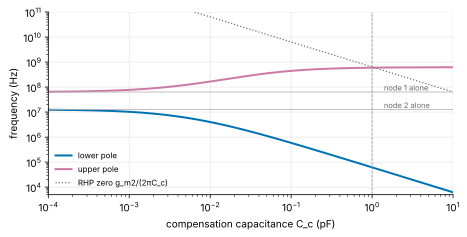

<!-- status: reviewed -->
# 12-04 · High-Frequency Analysis Methods

| | |
|---|---|
| **Course** | [12 · Electronics II](../README.md) |
| **University equivalent** | The bandwidth-estimation sections of a second electronics course: open-circuit time constants, zero-value (second-order) time constants, short-circuit time constants for the low-frequency corner, and pole splitting (Sedra & Smith, *Microelectronic Circuits*, the frequency-response chapter's time-constant methods; Gray, Hurst, Lewis & Meyer, ch. 7; T. H. Lee, *The Design of CMOS Radio-Frequency Integrated Circuits*, the bandwidth-estimation chapter) |
| **Prerequisites** | [12-03 Frequency Response](12-03-frequency-response-miller-poles-zeros.md), [06-08 Thévenin and Norton Equivalents](../../06-circuit-analysis-1-dc/chapters/06-08-thevenin-and-norton.md) (resistance seen by an element), [02-07 Determinants, Inverses, Rank and Vector Spaces](../../02-complex-numbers-des-and-linear-algebra/chapters/02-07-determinants-inverses-and-vector-spaces.md) |
| **Estimated study hours** | 8 |
| **Last verified** | 2026-11-20 |

**Learning objectives.** After this chapter you can:

1. Estimate a circuit's upper −3 dB frequency by open-circuit time constants, explain why it works, and say which capacitor limits the bandwidth.
2. Find $b_2$ with zero-value time constants and estimate the second pole.
3. Estimate a coupled amplifier's lower −3 dB frequency by short-circuit time constants.
4. Derive pole splitting in a two-stage amplifier with a bridging capacitor, and compute the split poles and the right-half-plane zero.
5. Derive the source follower's second-order response, find its Q, and predict when it peaks.

---

## 1. Big picture

12-03 found a common-source stage's poles by solving its two node equations. Real amplifiers have dozens of capacitances, and solving the full circuit by hand is impractical; even simulators give answers without insight. Designers need a way to estimate the bandwidth *and* to see which capacitor limits it, so that they know what to change. **Time-constant methods** do exactly that: each capacitor is examined alone, with a simple resistance calculation, and the results add. The sum is close to the true bandwidth when one pole dominates, and when the poles are real it errs on the safe side. The same reasoning, turned around, explains **pole splitting**, the mechanism that makes two-stage op-amps stable (12-06).

- **Design reviews run on time constants.** "The output node is 60% of the delay" is a time-constant statement; it tells a team where to spend effort.
- **Discrete and AC-coupled designs** set their low-frequency corner with coupling and bypass capacitors, sized by short-circuit time constants.
- **Op-amp compensation** relies on pole splitting: one small capacitor pushes one pole down and another up.
- **Followers ring.** Buffers that drive capacitive loads from a high-impedance node peak or ring, and the second-order analysis here predicts when.

## 2. Intuition first

**One capacitor at a time.** If a circuit had only one capacitor $C$, its pole would be $1/(RC)$, where $R$ is the resistance the capacitor sees, with every source zeroed. With several capacitors, each one's time constant $R_iC_i$ measures how much it slows the circuit if acting alone. If one is much larger than the rest, it alone sets the bandwidth. If several are comparable, they add, roughly as delays add in a chain.

**Why "open" the others?** At the frequencies where the dominant pole matters, the other capacitors are still small admittances: nearly open circuits. So the resistance each capacitor sees is computed with the others removed. This is exactly what the mathematics of the next section confirms: the sum of these open-circuit time constants is the exact coefficient $b_1$.

**An analogy from finance: the critical path of a project, and where it breaks.** A project's duration is set by its slowest sequence of tasks; shortening a task off the critical path changes nothing, and shortening the longest task helps most. The time constants are the tasks: the largest $R_iC_i$ is where effort pays. The analogy breaks in two ways. Time constants add rather than taking the maximum, so even small ones cost something; and the estimate is only good when one pole dominates, whereas a critical path is exact by construction.

## 3. Theory

> **Conventions.** All sources are zeroed when finding the resistance an element sees (voltage sources shorted, current sources opened); controlled sources stay. "$R_{i0}$" is the resistance seen by capacitor $C_i$ with every other capacitor open; "$R_j^i$" is the resistance seen by $C_j$ with $C_i$ shorted and the rest open. Transistor models are 12-03's.

### 3.1 Open-circuit time constants

For a circuit with capacitors $C_1, \dots, C_n$ and otherwise only resistors and controlled sources, the nodal equations are $(\mathbf{G} + s\mathbf{C})\mathbf{v} = \mathbf{b}$, and every pole is a root of $\det(\mathbf{G} + s\mathbf{C})$. Normalize so that the denominator is $D(s) = 1 + b_1s + b_2s^2 + \cdots + b_ns^n$.

**The theorem.** $b_1 = \sum_iR_{i0}C_i$.

*Why.* A capacitor $C_i$ between nodes $p$ and $q$ enters the nodal matrix as $sC_i\mathbf{u}_i\mathbf{u}_i^{\mathsf T}$, where the column vector $\mathbf{u}_i$ has $+1$ in row $p$, $-1$ in row $q$ (no entry if that node is ground) and zeros elsewhere: a rank-one term. For an invertible matrix $\mathbf{A}$, the **matrix determinant lemma** states

$$
\det\big(\mathbf{A} + t\,\mathbf{u}\mathbf{u}^{\mathsf T}\big) = \det\mathbf{A}\,\big(1 + t\,\mathbf{u}^{\mathsf T}\mathbf{A}^{-1}\mathbf{u}\big) ,
$$

which is affine (degree at most one) in $t$. So $\det(\mathbf{G} + s\mathbf{C})$ has degree at most one in each $C_i$, and since every $C_i$ arrives multiplied by $s$, the coefficient of $s^k$ contains only products of $k$ *different* capacitors. In particular $b_1 = \sum_ia_iC_i$, and each $a_i$ can be found with every other capacitor set to zero (open). That leaves a one-capacitor circuit, for which the lemma with $\mathbf{A} = \mathbf{G}$ and $t = sC_i$ gives

$$
D(s) = \frac{\det\big(\mathbf{G} + sC_i\mathbf{u}_i\mathbf{u}_i^{\mathsf T}\big)}{\det\mathbf{G}} = 1 + sC_i\,\mathbf{u}_i^{\mathsf T}\mathbf{G}^{-1}\mathbf{u}_i .
$$

The number $\mathbf{u}_i^{\mathsf T}\mathbf{G}^{-1}\mathbf{u}_i$ is exactly $R_{i0}$: $\mathbf{G}^{-1}\mathbf{u}_i$ is the vector of node voltages produced by a 1 A test current injected at $p$ and drawn out at $q$ (controlled sources included, since they are part of $\mathbf{G}$), and $\mathbf{u}_i^{\mathsf T}$ picks out $v_p - v_q$. So $a_i = R_{i0}$. ∎

> **Going deeper — the matrix determinant lemma.** Write $\mathbf{A} + t\mathbf{u}\mathbf{u}^{\mathsf T} = \mathbf{A}(\mathbf{I} + t\mathbf{w}\mathbf{u}^{\mathsf T})$ with $\mathbf{w} = \mathbf{A}^{-1}\mathbf{u}$. Every vector $\mathbf{x}$ with $\mathbf{u}^{\mathsf T}\mathbf{x} = 0$ is unchanged by $\mathbf{I} + t\mathbf{w}\mathbf{u}^{\mathsf T}$, which gives the eigenvalue 1 on an $(n-1)$-dimensional subspace, and $\mathbf{w}$ itself maps to $(1 + t\mathbf{u}^{\mathsf T}\mathbf{w})\mathbf{w}$, the last eigenvalue. The determinant is the product of the eigenvalues, $1 + t\mathbf{u}^{\mathsf T}\mathbf{A}^{-1}\mathbf{u}$. (If $\mathbf{u}^{\mathsf T}\mathbf{w} = 0$ the matrix is the identity plus a nilpotent term, with determinant 1, which the formula also gives; by continuity the affine dependence on $t$ holds for singular $\mathbf{A}$ too.)

The denominator also factors as $\prod_k(1 + s/\omega_{pk})$, so $b_1 = \sum_k1/\omega_{pk}$: the sum of the time constants equals the sum of the pole time constants. The **open-circuit time constant (OCTC) estimate** is

$$
\omega_H \approx \frac{1}{\sum_iR_{i0}C_i} .
$$

It is accurate when one pole dominates. **When every pole is real, it is also a guaranteed lower bound.** At a frequency $\omega \le 1/b_1$ the ratios $x_k = \omega/\omega_{pk}$ sum to at most 1, and the all-pole gain relative to DC is $|H|^2 = 1/\prod_k(1 + x_k^2)$. The function $\ln(1 + x^2)$ is convex for $0 \le x \le 1$ (its second derivative, $2(1 - x^2)/(1 + x^2)^2$, is not negative there), so with the sum of the $x_k$ fixed the product is largest when one $x_k$ takes the whole sum; with the sum at most 1, the product is at most 2. The gain therefore stays at or above −3 dB at every frequency up to $1/b_1$, and the true bandwidth is at or above the estimate. Real zeros only help: each multiplies the gain by $|1 + j\omega/\omega_z| \ge 1$.

**With complex poles the bound fails.** Example 12-04.5's follower driven from $R_S$ = 100 kΩ has $Q$ = **1.68**. OCTC gives **95.15** MHz, but the exact −3 dB frequency is **82.38** MHz: the estimate is **15.5**% optimistic. The sum of time constants still equals $b_1$ exactly; it is the reading of $1/b_1$ as a bandwidth that breaks down when the poles ring.

**The bridging capacitor's resistance.** For $C_{gd}$ in a common-source stage, apply a test current $i_t$ from drain to gate with the other capacitors open. The gate sits at $v_g = i_tR_S$ (the current flows out through $R_S$); the drain node carries $i_t$ plus the transistor's $g_mv_g$ into $R_L$, so $v_d = -(i_t + g_mi_tR_S)R_L$. The test voltage is $v_g - v_d$:

$$
R_{gd0} = R_S + R_L + g_mR_SR_L .
$$

The last term is the Miller multiplication, found here without any assumption about gain. With $R_{gs0} = R_S$ and $R_{L0} = R_L$, the OCTC sum reproduces exactly 12-03's $b_1$ (Example 12-04.1).

### 3.2 Zero-value time constants and the second pole

The same argument applied to $b_2$, the coefficient of $s^2$, picks out pairs of capacitors:

$$
b_2 = \sum_{i<j}R_{i0}C_i\,R_j^iC_j ,
$$

where $R_j^i$ is the resistance seen by $C_j$ with $C_i$ *shorted* (its "zero value" of impedance) and the rest open. The order within a pair does not matter: $R_{i0}R_j^i = R_{j0}R_i^j$, a useful check. With $b_1$ and $b_2$, the second pole is about $\omega_{p2} \approx b_1/b_2$ when the poles are well separated (12-03 §3.2).

### 3.3 Short-circuit time constants for the low corner

Discrete and AC-coupled amplifiers have coupling capacitors in series with the signal and bypass capacitors across bias resistors. These are large and matter only at low frequency, where they are nearly open; at midband they are short circuits. The low-frequency poles come from them, and the dual of §3.1 holds: with $R_{is}$ the resistance seen by $C_i$ with all *other* low-frequency capacitors **shorted**,

$$
\omega_L \approx \sum_i\frac{1}{R_{is}C_i} ,
$$

the **short-circuit time constant (SCTC)** estimate.

*Why.* Substitute $p = 1/s$. A capacitor's impedance $1/(sC_i)$ becomes $pS_i$, with the elastance $S_i = 1/C_i$: in the variable $p$ each capacitor behaves like an inductor, and $S_i = 0$ is a short. Write the nodal equations with each capacitor's current $i_i$ as an extra unknown and its branch equation $v_p - v_q - pS_i\,i_i = 0$. Now $S_i$ appears in a single matrix entry, so the determinant is affine in each $S_i$, and the denominator, normalized to 1 at $p = 0$ (midband, every capacitor shorted), is $1 + a_1p + \cdots$ with $a_1 = \sum_iS_i \times$ (its coefficient with every other capacitor shorted). A single capacitor seeing $R_{is}$ has its pole at $s = -1/(R_{is}C_i)$, the factor $1 + pS_i/R_{is}$, so $a_1 = \sum_i1/(R_{is}C_i)$. Factored, the same denominator is $\prod_k(1 + p\,\omega_{pk})$ over the low-frequency poles $\omega_{pk}$, so the SCTC sum equals $\sum_k\omega_{pk}$ exactly.

The estimate is good when one capacitor dominates the low corner. When the low-frequency poles are real, the convexity argument of §3.1 with $x_k = \omega_{pk}/\omega$ shows that it is an upper bound on the true corner (it errs high, conservatively); real zeros away from the origin, like the one a bypass capacitor adds, only push the true corner lower. The largest $1/(R_{is}C_i)$, usually the source-bypass capacitor because it sees the small $1/g_m$, is the one to enlarge first (Example 12-04.3).

### 3.4 Pole splitting

Put a capacitor $C_c$ across the inverting second stage of a two-stage amplifier: from the first stage's output node (resistance $R_1$, capacitance $C_1$ to ground) to the second stage's output (resistance $R_2$, capacitance $C_2$), with second-stage transconductance $g_{m2}$. This is 12-03's common-source circuit with $R_S \to R_1$, $C_{gs} \to C_1$, $C_{gd} \to C_c$, $C_L \to C_2$, so its denominator is

$$
1 + \big[R_1(C_1 + C_c(1 + g_{m2}R_2)) + R_2(C_c + C_2)\big]s + R_1R_2\big[C_1C_2 + C_c(C_1 + C_2)\big]s^2 .
$$

When $C_c$ dominates $b_1$ through its Miller term,

$$
\omega_{p1} \approx \frac{1}{g_{m2}R_1R_2C_c}, \qquad \omega_{p2} \approx \frac{b_1}{b_2} \approx \frac{g_{m2}C_c}{C_1C_2 + C_c(C_1 + C_2)} \approx \frac{g_{m2}}{C_1 + C_2} \quad (C_c \gg C_1) .
$$

Adding one capacitor pushes the low pole *down* (the Miller-multiplied $C_c$ loads node 1) and the other pole *up*: at high frequency $C_c$ shorts the second stage's gate to its drain, turning the second transistor into a diode of resistance $1/g_{m2}$, which makes node 2 fast. That is **pole splitting**. It comes with the right-half-plane zero at $g_{m2}/C_c$ (12-03 §3.4), which 12-06 deals with.

*Figure 1. Pole splitting in Example 12-04.4's amplifier: from 12.73 and 63.66 MHz with no $C_c$ (the grey lines) to 61.75 kHz and 596.6 MHz at $C_c$ = 1 pF (dashed). The right-half-plane zero (dotted) falls as $1/C_c$ and crosses the upper pole near 1 pF: the problem 12-06 solves.*

### 3.5 The source follower driven from a resistance

12-03 §3.6 treated the follower driven from an ideal source. With a source resistance $R_S$, $C_{gs}$ from gate to output and $C_{gd}$ from gate to AC ground (the drain is at AC ground), KCL at the gate and at the output reads

$$
\frac{V_g - V_s}{R_S} + sC_{gd}V_g + sC_{gs}(V_g - V_o) = 0, \qquad (g_m + sC_{gs})(V_g - V_o) = sC_LV_o .
$$

The second says that the transistor's current $g_m(V_g - V_o)$, plus the current through $C_{gs}$, charges $C_L$. Solve it for $V_g = V_o\,[g_m + s(C_{gs} + C_L)]/(g_m + sC_{gs})$, multiply the first by $R_S$ to get $V_g[1 + sR_S(C_{gs} + C_{gd})] - sR_SC_{gs}V_o = V_s$, and substitute. In the resulting numerator the $sg_mR_SC_{gs}$ terms cancel, and so do the $s^2R_SC_{gs}^2$ terms, leaving

$$
\frac{V_o}{V_s} = \frac{g_m + sC_{gs}}{g_m + s\,(C_{gs} + C_L + g_mR_SC_{gd}) + s^2R_S\Sigma}, \qquad \Sigma = C_{gs}C_{gd} + C_{gd}C_L + C_{gs}C_L .
$$

Written in the standard second-order form (07-03), the natural frequency and quality factor are

$$
\omega_0 = \sqrt{\frac{g_m}{R_S\Sigma}}, \qquad Q = \frac{\sqrt{g_mR_S\Sigma}}{C_{gs} + C_L + g_mR_SC_{gd}} .
$$

$Q$ grows as $\sqrt{R_S}$ at first, so a follower driven from a high-impedance node can have complex poles and peak or ring; the second-order part peaks once $Q > 1/\sqrt2$, and the left-half-plane zero at $g_m/C_{gs}$ adds a little more. At very large $R_S$ the $g_mR_SC_{gd}$ term takes over the denominator and $Q$ falls again as $1/\sqrt{R_S}$, so peaking occupies a window of source resistances (Example 12-04.5).

The physical picture: seen from the load, the follower's output impedance rises from $1/g_m$ at low frequency toward $R_S$ at high frequency, because $C_{gs}$ couples the source resistance through. With $C_{gd}$ neglected and $V_s$ zeroed, a test source at the output gives (Problem 12-04.11)

$$
Z_{out} = \frac{1 + sR_SC_{gs}}{g_m + sC_{gs}} = \frac{1}{g_m} + \Big(sL \parallel \big(R_S - \tfrac{1}{g_m}\big)\Big), \qquad L = \frac{C_{gs}}{g_m}\Big(R_S - \frac{1}{g_m}\Big) :
$$

a resistance $1/g_m$ in series with an inductance $L$ that is shunted by $R_S - 1/g_m$. An inductive source driving a capacitive load is a resonant pair. Its damping comes from the series $1/g_m$, so a *larger* $g_m$ (less damping) or a *smaller* $C_L$ (a higher characteristic impedance $\sqrt{L/C_L}$ against the same damping) raises $Q$ over the usual range, until $g_mR_SC_{gd}$ approaches $C_{gs} + C_L$ (Example 12-04.5). When $R_S = 1/g_m$ the inductance vanishes and the output impedance is flat. The cures are therefore a smaller $R_S$ (less inductance, at the cost of a stronger driving stage), a resistor in series with the output (more damping), or a larger $C_L$ (lower $Q$, at the cost of bandwidth).

## 4. Worked examples

### Example 12-04.1 · Open-circuit time constants of a common-source stage (tier A)

**Setup.** Use Example 12-03.2's stage: $g_m$ = 1 mA/V, $C_{gs}$ = 72.67 fF, $C_{gd}$ = 6 fF, $C_L$ = 100 fF, $R_S$ = 10 kΩ, $R_L$ = 20 kΩ. Find each capacitor's open-circuit resistance and time constant, the sum, and the bandwidth estimate. Which capacitor matters most?

**Solution.** $R_{gs0} = R_S$ = **10** kΩ, so $\tau_{gs}$ = **0.7267** ns. $R_{gd0} = 10 + 20 + 1 \times 10 \times 20$ kΩ = **230** kΩ, so $\tau_{gd}$ = **1.38** ns. $R_{L0}$ = 20 kΩ, so $\tau_L$ = **2** ns. The sum is **4.107** ns, exactly 12-03's $b_1$, and the estimate is **38.76** MHz against the exact 42.93 MHz. The load capacitor contributes the most (**49**%), then $C_{gd}$ (34%): a smaller load or a cascode helps more than a smaller input device.

**Sanity check.** The 6 fF $C_{gd}$ contributes almost twice as much as the 72.67 fF $C_{gs}$, because it sees 23 times the resistance.

### Example 12-04.2 · The second pole by zero-value time constants (tier B)

**Setup.** For the same stage, find $R_{gd}^{gs}$, $R_L^{gs}$ and $R_L^{gd}$, then $b_2$ and the second-pole estimate.

**Solution.** With $C_{gs}$ shorted, the gate is at ground, the transistor's controlled source is idle, and $C_{gd}$ sees $R_L$ (gate to drain): $R_{gd}^{gs}$ = **20** kΩ, and likewise $R_L^{gs}$ = 20 kΩ. With $C_{gd}$ shorted, gate and drain are one node, the transistor becomes a diode ($g_m$), and $C_L$ sees $R_L \parallel R_S \parallel 1/g_m$ = **869.6** Ω. Then

$$
b_2 = R_{gs0}C_{gs}(R_{gd}^{gs}C_{gd} + R_L^{gs}C_L) + R_{gd0}C_{gd}R_L^{gd}C_L = 1.661 \times 10^{-18}\ \text{s}^2 ,
$$

matching 12-03, and the second-pole estimate $b_1/b_2$ is **393.6** MHz (exact 350.0 MHz).

**Sanity check.** $R_{gd0}R_L^{gd} = 230\ \text{k}\Omega \times 869.6\ \Omega$ should equal $R_{L0}R_{gd}^L$; with $C_L$ shorted, $C_{gd}$ sees just $R_S$ = 10 kΩ, and $20\ \text{k}\Omega \times 10\ \text{k}\Omega$ = 2.000 × 10⁸ Ω² = $230\ \text{k}\Omega \times 869.6\ \Omega$. ✓

### Example 12-04.3 · The low corner of a discrete amplifier (tier B)

**Setup.** A discrete common-source amplifier has a 1 kΩ signal source, a 0.1 µF input coupling capacitor into a 1 MΩ gate bias resistor, a 2 kΩ source resistor bypassed by 10 µF, $g_m$ = 4 mA/V, $R_D$ = 5 kΩ, and a 1 µF output coupling capacitor into a 10 kΩ load. Estimate the lower −3 dB frequency by short-circuit time constants, and compare with the exact value of **72.32** Hz.

**Solution.** Input coupling: $R_{1s}$ = 1 kΩ + 1 MΩ, so $1/(R_{1s}C_1)$ = **9.990** rad/s. Bypass: the source sees $2\ \text{k}\Omega \parallel 1/g_m$ = **222.2** Ω, so $1/(222.2\ \Omega \times 10\ \mu\text{F})$ = **450** rad/s. Output coupling: $R_D + R_L$ = 15 kΩ, so **66.67** rad/s. Sum **526.7** rad/s, or $f_L$ ≈ **83.82** Hz, 16% above the exact 72.32 Hz: conservative, as expected.

**Sanity check.** The bypass capacitor contributes 85% of the sum: to lower the corner, enlarge it first. Its small resistance, $1/g_m$, is why bypass capacitors must be much larger than coupling capacitors.

### Example 12-04.4 · Pole splitting (tier B)

**Setup.** A two-stage amplifier's first-stage output has $R_1$ = 50 kΩ and $C_1$ = 50 fF; the second stage has $g_{m2}$ = 4 mA/V, $R_2$ = 12.5 kΩ and $C_2$ = 1 pF. (a) Find the two poles without compensation. (b) With $C_c$ = 1 pF across the second stage, find $b_1$, $b_2$, the estimated and exact poles, and the right-half-plane zero.

**Solution.** (a) Node 1: $1/(2\pi \times 50\ \text{k}\Omega \times 50\ \text{fF})$ = **63.66** MHz. Node 2: $1/(2\pi \times 12.5\ \text{k}\Omega \times 1\ \text{pF})$ = **12.73** MHz. Two poles a factor of 5 apart, within a decade: a feedback loop around this amplifier would ring badly (12-06). Two poles alone cannot make a loop oscillate, since their phase lag never reaches 180°, but they leave almost no phase margin, and one more parasitic pole could tip it over.

(b) $b_1 = 50\ \text{k}\Omega(50\ \text{fF} + 1\ \text{pF} \times 51) + 12.5\ \text{k}\Omega \times 2\ \text{pF}$ = **2.578** µs, so $\omega_{p1} \approx 1/b_1$ corresponds to **61.75** kHz. $b_2 = 50\ \text{k}\Omega \times 12.5\ \text{k}\Omega \times (0.05 + 1.05)\ \text{pF}^2$ = **6.875** × 10⁻¹⁶ s², so $b_1/b_2$ corresponds to **596.7** MHz. The exact roots are at **61.75** kHz and **596.6** MHz. The right-half-plane zero is at $g_{m2}/(2\pi C_c)$ = **636.6** MHz.

**Sanity check.** The poles moved from 12.73 and 63.66 MHz to 61.75 kHz and 596.6 MHz: a ratio of almost 10⁴ between them, from one capacitor. The simple forms $1/(g_{m2}R_1R_2C_c)$ (**63.66** kHz) and $g_{m2}C_c/[C_1C_2 + C_c(C_1 + C_2)]$ (**578.7** MHz) are both within **3**% of the exact poles.

### Example 12-04.5 · When a follower peaks (tier C)

**Setup.** The transistor of Example 12-04.1 is a source follower driving $C_L$ = 1 pF from a source resistance $R_S$. (a) Find $Q$ and $f_0$ for $R_S$ = 30 kΩ and 10 kΩ. (b) The exact responses peak by **2.59** dB (at 84.57 MHz) and **0.16** dB: compare. (c) Find the $R_S$ at which $Q = 1/\sqrt2$.

**Solution.** $\Sigma = C_{gs}C_{gd} + C_{gd}C_L + C_{gs}C_L$ = 436 + 6000 + 72 667 fF² = 79 103 fF².

(a) At 30 kΩ: $g_mR_S\Sigma = 2.373 \times 10^{-24}$ F², so $Q = 1.540\ \text{pF}/(72.67 + 1000 + 180)\ \text{fF}$ = **1.230** and $f_0 = \sqrt{g_m/(R_S\Sigma)}/2\pi$ = **103.3** MHz. At 10 kΩ: $Q$ = **0.7852** and $f_0$ = **178.9** MHz.

(b) $Q$ = 1.23 predicts clear peaking, and the response peaks by 2.59 dB; $Q$ = 0.785, just above $1/\sqrt2$, predicts a trace of it, 0.16 dB.

(c) Solving $Q(R_S) = 1/\sqrt2$ numerically gives $R_S$ = **7.933** kΩ: a follower driven from more than about 8 kΩ will peak with this load. The peaking window is bounded above too: $Q$ is largest, **1.75**, at $R_S$ ≈ **178.8** kΩ, where $g_mR_SC_{gd} = C_{gs} + C_L$, and it falls back to $1/\sqrt2$ at about **4.03** MΩ.

**Sanity check.** At $R_S$ = 30 kΩ, doubling $g_m$ ($Q$ → **1.521**) or halving $C_L$ ($Q$ → **1.451**) *raises* $Q$: less series damping, or a lighter load on the same inductance (§3.5). Doubling $C_L$ lowers it ($Q$ → **0.9658**) at the cost of bandwidth, and so do a smaller $R_S$ or a resistor in series with the output.

### Example 12-04.6 · Open-circuit time constants of a cascode (tier B)

**Setup.** Apply OCTC to Example 12-03.5's cascode ($r_o$ neglected, so the cascode device's source presents $1/g_{m2}$ = 1 kΩ): $C_{gs1}$ = 72.67 fF, $C_{gd1}$ = 6 fF, $C_x$ = 82.67 fF at the internal node, and $C_{gd2} + C_L$ = 106 fF at the output; $R_S$ = 10 kΩ, $R_L$ = 20 kΩ. Compare with the exact 66.07 MHz.

**Solution.** $\tau_{gs1} = 10\ \text{k}\Omega \times 72.67\ \text{fF}$ = 0.7267 ns. $R_{gd1,0} = R_S + R_x + g_mR_SR_x = 10 + 1 + 10$ kΩ = **21** kΩ, so $\tau_{gd1}$ = **0.126** ns. $\tau_x = 1\ \text{k}\Omega \times 82.67\ \text{fF}$ = **0.08267** ns. $\tau_{out} = 20\ \text{k}\Omega \times 106\ \text{fF}$ = **2.12** ns. Sum **3.055** ns: estimate **52.09** MHz, 21% below the exact 66.07 MHz.

**Sanity check.** The output node is 69% of the sum: after cascoding, it is the bottleneck, so the next improvement must come from the load ($R_L$ or $C_L$).

### Answer key

<!-- answer-key -->
| ID | Quantity | Value | Unit |
|---|---|---|---|
| T 12-04.a | follower Q at 100 kΩ | 1.68 | — |
| T 12-04.b | its OCTC estimate | 95.15 | MHz |
| T 12-04.c | its exact −3 dB frequency | 82.38 | MHz |
| T 12-04.d | estimate's excess | 15.5 | % |
| Ex 12-04.1a | R_gs0 | 10 | kΩ |
| Ex 12-04.1b | τ_gs | 0.7267 | ns |
| Ex 12-04.1c | R_gd0 | 230 | kΩ |
| Ex 12-04.1d | τ_gd | 1.38 | ns |
| Ex 12-04.1e | τ_L | 2 | ns |
| Ex 12-04.1f | sum | 4.107 | ns |
| Ex 12-04.1g | bandwidth estimate | 38.76 | MHz |
| Ex 12-04.1h | load capacitor's share | 49 | % |
| Ex 12-04.1i | C_gd's share | 34 | % |
| Ex 12-04.1j | ratio of resistances seen by C_gd and C_gs | 23 | — |
| Ex 12-04.2a | R_gd with C_gs shorted | 20 | kΩ |
| Ex 12-04.2b | R_L with C_gd shorted | 869.6 | Ω |
| Ex 12-04.2c | b_2 | 1.661 × 10⁻¹⁸ | s² |
| Ex 12-04.2d | second-pole estimate | 393.6 | MHz |
| Ex 12-04.2e | R_gd0 R_L^gd | 2.000 × 10⁸ | Ω² |
| Ex 12-04.3a | input coupling 1/(RC) | 9.990 | rad/s |
| Ex 12-04.3b | resistance seen by the bypass capacitor | 222.2 | Ω |
| Ex 12-04.3c | bypass 1/(RC) | 450 | rad/s |
| Ex 12-04.3d | output coupling 1/(RC) | 66.67 | rad/s |
| Ex 12-04.3e | sum | 526.7 | rad/s |
| Ex 12-04.3f | low-corner estimate | 83.82 | Hz |
| Ex 12-04.3g | exact low corner | 72.32 | Hz |
| Ex 12-04.3h | estimate's excess | 16 | % |
| Ex 12-04.3i | bypass share | 85 | % |
| Ex 12-04.4a | node-1 pole, uncompensated | 63.66 | MHz |
| Ex 12-04.4b | node-2 pole, uncompensated | 12.73 | MHz |
| Ex 12-04.4c | b_1 | 2.578 | µs |
| Ex 12-04.4d | first pole estimate | 61.75 | kHz |
| Ex 12-04.4e | b_2 | 6.875 × 10⁻¹⁶ | s² |
| Ex 12-04.4f | second pole estimate | 596.7 | MHz |
| Ex 12-04.4g | first pole, exact | 61.75 | kHz |
| Ex 12-04.4h | second pole, exact | 596.6 | MHz |
| Ex 12-04.4i | right-half-plane zero | 636.6 | MHz |
| Ex 12-04.4j | simple first-pole form | 63.66 | kHz |
| Ex 12-04.4k | simple second-pole form | 578.7 | MHz |
| Ex 12-04.4l | larger error of the simple forms | 3 | % |
| Ex 12-04.4m | first pole at C_c = 0.1 pF | 587.5 | kHz |
| Ex 12-04.4n | second pole at C_c = 0.1 pF | 445.0 | MHz |
| Ex 12-04.5a | Σ | 79103 | fF² |
| Ex 12-04.5b | Q at 30 kΩ | 1.230 | — |
| Ex 12-04.5c | f_0 at 30 kΩ | 103.3 | MHz |
| Ex 12-04.5d | Q at 10 kΩ | 0.7852 | — |
| Ex 12-04.5e | f_0 at 10 kΩ | 178.9 | MHz |
| Ex 12-04.5f | peak at 30 kΩ | 2.59 | dB |
| Ex 12-04.5g | frequency of that peak | 84.57 | MHz |
| Ex 12-04.5h | peak at 10 kΩ | 0.16 | dB |
| Ex 12-04.5i | R_S for Q = 1/√2 | 7.933 | kΩ |
| Ex 12-04.5j | largest Q | 1.75 | — |
| Ex 12-04.5k | R_S at the largest Q | 178.8 | kΩ |
| Ex 12-04.5l | upper R_S for Q = 1/√2 | 4.03 | MΩ |
| Ex 12-04.5m | Q with g_m doubled | 1.521 | — |
| Ex 12-04.5n | Q with C_L halved | 1.451 | — |
| Ex 12-04.5o | Q with C_L doubled | 0.9658 | — |
| Ex 12-04.6a | R_gd1,0 | 21 | kΩ |
| Ex 12-04.6b | τ_gd1 | 0.126 | ns |
| Ex 12-04.6c | τ_x | 0.08267 | ns |
| Ex 12-04.6d | τ_out | 2.12 | ns |
| Ex 12-04.6e | sum | 3.055 | ns |
| Ex 12-04.6f | estimate | 52.09 | MHz |
| Ex 12-04.6g | estimate's shortfall | 21 | % |
| Ex 12-04.6h | output node's share | 69 | % |

*Every value is recomputed by [verify_12_04.py](../verify/verify_12_04.py): resistances seen by each capacitor with a test source in the solved small-signal circuit, $b_1$ and $b_2$ from the polynomial $\det(\mathbf{G} + s\mathbf{C})$ itself, poles as generalized eigenvalues, corner frequencies and peaks by root finding and optimization on the solved response, and the follower's $Q$ from its fitted denominator. The pole-splitting example is also confirmed in ngspice.*

## 5. Simulate it

The lab, [labs/12-04-lab](../labs/12-04-lab/README.md), has a notebook and an ngspice netlist:

1. Computes every open-circuit time constant of the common-source stage and the cascode by test sources, and checks the sum against $\det(\mathbf{G} + s\mathbf{C})$.
2. Sweeps the bypass capacitor of the discrete amplifier and compares the SCTC estimate with the exact low corner.
3. Sweeps the compensation capacitor of the two-stage amplifier and plots the two poles splitting apart.
4. Maps the follower's peaking against source resistance and load capacitance.

The netlist [pole_split.cir](../labs/12-04-lab/pole_split.cir) finds the two-stage amplifier's poles with and without $C_c$ by pole–zero analysis.

**Guided exercise (predict, then run).** **Before running Part 3**, predict: as $C_c$ grows from 0 to 1 pF in Example 12-04.4, does the second pole rise steadily, and does the first fall steadily? Then run it. (Both move monotonically, and fast at first: at $C_c$ = 0.1 pF the first pole is already down to **587.5** kHz and the second up to **445.0** MHz.)

## 6. Engineering tradeoffs

| Knob | Improves | Costs | Typical decision owner |
|---|---|---|---|
| Attack the largest time constant | Bandwidth, most per unit effort | Depends on the node (current, area, a cascode) | Analog designer |
| Larger bypass capacitor | Lower low-frequency corner | Board area, cost, start-up time | Board or discrete designer |
| Compensation capacitor $C_c$ | Splits poles, makes one dominant | Bandwidth, slew rate, RHP zero | Analog designer |
| Lower driving resistance for a follower | Removes peaking | Power in the driving stage | Analog designer |
| Series output resistor | Damps follower peaking | A small DC drop, lower drive | Board or analog designer |
| Larger load capacitance on a follower | Damps peaking | Bandwidth, drive current | Analog designer |

## 7. Numbers to know

| Quantity | Value | Note |
|---|---|---|
| OCTC bandwidth | $1/\sum R_{i0}C_i$ | Exact $b_1$; a lower bound if every pole is real |
| Bridging-capacitor resistance (CS) | $R_S + R_L + g_mR_SR_L$ | Miller without a gain assumption |
| Second pole | $\approx b_1/b_2$ | $b_2$ from zero-value pairs |
| SCTC low corner | $\sum 1/(R_{is}C_i)$ | Exact sum of low poles; an upper bound if they are real |
| Split poles | $1/(g_{m2}R_1R_2C_c)$ and $\approx g_{m2}/(C_1 + C_2)$ | $C_c \gg C_1$ |
| Follower Q | $\sqrt{g_mR_S\Sigma}/(C_{gs} + C_L + g_mR_SC_{gd})$ | Peaks above about $1/\sqrt2$ |

## 8. Common mistakes

- **Forgetting the controlled source when finding $R_{i0}$.** Only independent sources are zeroed; the $g_m$ term is what produces $g_mR_SR_L$.
- **Shorting instead of opening the other capacitors for OCTC (or the reverse for SCTC).**
- **Reading the OCTC estimate as exact.** It is a lower bound on bandwidth only when every pole is real, and then it can be 20% low or more; with complex poles, as in a peaking follower, it can be optimistic.
- **Ignoring the bypass capacitor's small resistance.** It sees $1/g_m$ in parallel with the source resistor and dominates the low corner.
- **Treating a follower as always well behaved.** From a high-impedance node into a capacitive load it can peak and ring.

## 9. Practitioner lens

### State of the art (as of Nov 2026)

- **Simulators compute poles directly, but designers still use time constants to decide what to change.** ngspice's `.pz` analysis returns poles and zeros (the 11-08 and 12-03 labs used it) [1] **[Established]**, but it does not say which capacitor to shrink; open-circuit time constants do, which is why the method remains standard in analog and RF design texts **[Established]** (textbook practice; 12-03's Further study lists them).
- **Compensated op-amps publish the results of their pole placement.** The TLV9062 data sheet specifies 10 MHz gain–bandwidth and 55° phase margin [2] **[Established]**. The data sheet does not describe the internal compensation; reading such numbers as the outcome of a designed pole split is the textbook interpretation for an internally compensated op-amp, not a disclosed fact **[Industry estimate]**. 12-06 shows how such numbers follow from $C_c$ and $g_m$.

### Why it matters commercially

- **Time-constant bookkeeping shortens design cycles.** Knowing which node dominates avoids blind simulation sweeps and late surprises.
- **Discrete designs pay for capacitors in area and cost.** SCTC sizing tells a board designer which capacitor must be large and which can be small.
- **Buffer peaking is a field-failure source.** Ringing on a reference or sensor line can corrupt measurements; the second-order analysis predicts it before layout.

### Marketing vs Reality

- **"Bandwidth limited only by the process."** *Reality:* bandwidth is limited by the slowest node, often a load or an internal node unrelated to the transistors' speed. *Sanity check:* ask for the time-constant breakdown.
- **"Unity-gain stable buffer."** *Reality:* stable with what load capacitance and source impedance? Followers and op-amps peak with capacitive loads. *Sanity check:* ask for the response with the actual load.

### Questions for engineering leaders

1. **"Which node limits your bandwidth, and by how much?"**
   *Strong:* a time-constant table with shares and the plan for the largest. *Evasive:* a simulated bandwidth number only.
2. **"How did you size the coupling and bypass capacitors?"**
   *Strong:* the low-corner budget by SCTC and which capacitor dominates. *Evasive:* "standard values."
3. **"How much capacitive load can your buffers drive before they peak?"**
   *Strong:* a $Q$ or phase-margin analysis against load. *Evasive:* "they are followers, so they are stable."

## 10. Concept check

**Q1.** Why does the sum of open-circuit time constants equal $b_1$ exactly?

Answer

Each capacitor enters the nodal matrix as a rank-one term $sC_i\mathbf{u}_i\mathbf{u}_i^{\mathsf T}$, and by the matrix determinant lemma the determinant is affine in each such term. So the coefficient of $s$ is a sum of single-capacitor terms, each found with the other capacitors at zero (open), and for a single capacitor the lemma gives $1 + sC_i\mathbf{u}_i^{\mathsf T}\mathbf{G}^{-1}\mathbf{u}_i = 1 + sR_{i0}C_i$.

**Q2.** Why is the OCTC estimate conservative when every pole is real, and when can it be optimistic?

Answer

Up to $\omega = 1/b_1$ the ratios $\omega/\omega_{pk}$ sum to at most 1, and by convexity $\prod_k(1 + x_k^2) \le 2$ for such ratios, so the gain is still at or above −3 dB there: the true bandwidth is at least the estimate. The argument needs real poles. With complex poles, such as a follower with $Q$ = 1.68, the true bandwidth can fall below the estimate (by 15.5% in §3.1's example).

**Q3.** In SCTC, why are the other low-frequency capacitors shorted rather than opened?

Answer

Near the low corner, the other coupling and bypass capacitors are still large admittances, nearly short circuits. Formally, in the variable $p = 1/s$ each capacitor is an impedance $p/C_i$ whose zero value is a short; the denominator is affine in each $1/C_i$, so the coefficient of $p$, the sum of the low-frequency poles, is a sum of single-capacitor terms, each found with the others shorted.

**Q4.** Why does a compensation capacitor push the second pole *up*?

Answer

At high frequency it connects the second transistor's gate to its drain, so the transistor behaves as a diode of resistance $1/g_{m2}$, making the output node fast.

**Q5.** Why can a source follower peak?

Answer

Driven from a resistance, its output impedance rises with frequency (it looks inductive), and an inductive source with a capacitive load forms a resonant pair with $Q$ that can exceed $1/\sqrt2$.

[Problem set for this chapter](../problems/12-04-problems.md)

## 11. Key terms

[Open-circuit time constants](../../../reference/glossary.md#open-circuit-time-constants) · [Short-circuit time constants](../../../reference/glossary.md#short-circuit-time-constants) · [Zero-value time constants](../../../reference/glossary.md#zero-value-time-constants) · [Pole splitting](../../../reference/glossary.md#pole-splitting) · [Dominant-pole approximation](../../../reference/glossary.md#dominant-pole-approximation) · [Miller effect](../../../reference/glossary.md#miller-effect)

## 12. Connections

- **Builds on:** poles, $b_1$ and the common-source transfer function from [12-03](12-03-frequency-response-miller-poles-zeros.md); resistance seen by an element from [06-08](../../06-circuit-analysis-1-dc/chapters/06-08-thevenin-and-norton.md); determinants from [02-07](../../02-complex-numbers-des-and-linear-algebra/chapters/02-07-determinants-inverses-and-vector-spaces.md); second-order systems and Q from [07-03](../../07-circuit-analysis-2-transient-and-ac/chapters/07-03-second-order-rlc-transients.md).
- **Next:** [12-05 Feedback: Theory and the Four Topologies](12-05-feedback-topologies.md).
- **Used later:** compensation by pole splitting in 12-06; op-amp internals in 12-08; LNA and buffer design in Course 21; SerDes front ends in Course 24.

## 13. Further study

- A. S. Sedra and K. C. Smith, *Microelectronic Circuits*, the frequency-response chapter (open-circuit and short-circuit time constants).
- P. R. Gray, P. J. Hurst, S. H. Lewis and R. G. Meyer, *Analysis and Design of Analog Integrated Circuits*, ch. 7 (zero-value time constants) and ch. 9 (frequency compensation and pole splitting).
- T. H. Lee, *The Design of CMOS Radio-Frequency Integrated Circuits*, the chapter on bandwidth estimation (open-circuit time constants and their extensions).

## 14. Sources

1. H. Vogt et al., *Ngspice User's Manual*, version 47 (Aug 2026), `.pz` analysis. [R-118](../../../reference/research-log.md#r-118--pole-zero-analysis-and-s-domain-models-in-ngspice).
2. Texas Instruments, *TLV906xS*, SBOS839N (Mar 2017, revised Jul 2026), frequency response: [data sheet](https://www.ti.com/lit/ds/symlink/tlv9062.pdf). [R-129](../../../reference/research-log.md#r-129--op-amp-frequency-response-specifications).
