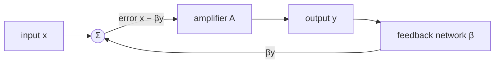
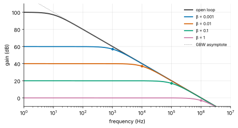

<!-- status: reviewed -->
# 12-05 · Feedback: Theory and the Four Topologies

| | |
|---|---|
| **Course** | [12 · Electronics II](../README.md) |
| **University equivalent** | The feedback chapter of a second electronics course: the ideal feedback structure and loop gain, gain desensitivity, bandwidth extension and distortion reduction, the four topologies and their effect on input and output impedance, and return-ratio analysis with Blackman's impedance formula (Sedra & Smith, *Microelectronic Circuits*, the feedback chapter; Gray, Hurst, Lewis & Meyer, ch. 8; Razavi, *Design of Analog CMOS Integrated Circuits*, the feedback chapter) |
| **Prerequisites** | [12-04 High-Frequency Analysis Methods](12-04-high-frequency-analysis-methods.md), [10-05 Amplifier Fundamentals](../../10-electronics-1/chapters/10-05-amplifier-fundamentals.md) (two-port models), [10-09 Real Op-Amps: Non-Idealities](../../10-electronics-1/chapters/10-09-real-op-amps-nonidealities.md) (loop gain and gain error), [11-08 The Laplace Transform and System Functions](../../11-signals-and-systems/chapters/11-08-laplace-transform-and-system-functions.md) (feedback moves poles) |
| **Estimated study hours** | 12 |
| **Last verified** | 2026-11-20 |

**Learning objectives.** After this chapter you can:

1. Derive the closed-loop gain $A/(1 + A\beta)$, define the loop gain, and compute the error and the sensitivity of a feedback amplifier.
2. Show how negative feedback extends bandwidth, reduces distortion and leaves the gain–bandwidth product unchanged, and explain what it does not improve.
3. Identify the four feedback topologies, derive how each changes input and output impedance, and apply the two-port loading method.
4. Compute a circuit's loop gain as a return ratio, and its closed-loop gain with the asymptotic-gain formula, without splitting it into idealized A and β blocks.
5. Find a feedback circuit's port impedance with Blackman's formula.

---

## 1. Big picture

Transistors are poor components: their gain varies by a factor of two or more with process, temperature and signal level, and they are nonlinear. Precision electronics is built from them anyway, by **negative feedback**: a fraction of the output is compared with the input, and the difference drives a high-gain amplifier. If that amplifier's gain is large enough, the output is set almost entirely by the feedback network, usually two resistors that match to a fraction of a percent. Feedback trades excess gain for every property designers care about: accuracy, linearity, bandwidth and impedances. It is also the reason amplifiers oscillate, which 12-06 deals with.

- **Every op-amp circuit is a feedback circuit.** The gain of a non-inverting amplifier is $1 + R_2/R_1$ only because the op-amp's open-loop gain is enormous (10-09).
- **Regulators, PLLs and bias circuits** are feedback loops; their accuracy and speed follow from the loop gain.
- **Feedback sets impedances.** A voltage regulator's near-zero output impedance and an op-amp buffer's near-infinite input impedance are feedback effects.
- **Excess gain is the currency.** The loop gain $T$ is what feedback spends; 12-02's stages and cascodes exist to provide it.

## 2. Intuition first

**A thermostat.** A heater controlled by a thermostat holds the room near the set point regardless of the heater's power or the weather, provided the heater has plenty of power to spare. The thermostat compares the measured temperature with the set point and drives the heater with the difference. The room's temperature is then set by the *thermostat's calibration*, not by the heater. An amplifier with feedback works the same way: the output is set by the feedback network, and the amplifier's gain only has to be large.

**Why gain is traded away.** Suppose the amplifier has gain $A$ and the feedback network returns a fraction $\beta$ of the output. If the output is $y$, the amplifier sees $x - \beta y$ and produces $y = A(x - \beta y)$. If $A$ is huge, the only way for $y$ to be finite is for $x - \beta y$ to be tiny: $y \approx x/\beta$. The amplifier's own gain has disappeared from the answer. What is left is the error $x - \beta y$, which is smaller the larger $A$ is.

**An analogy from finance: a portfolio rebalancing rule, and where it breaks.** A fund that rebalances to a 60/40 target whenever the mix drifts holds its allocation near the target whatever the markets do, as long as rebalancing is frequent enough; the allocation is set by the rule, not by market returns. The "loop gain" is how aggressively deviations are corrected. The analogy breaks in two ways. Rebalancing acts in discrete steps with no risk of runaway, whereas an amplifier loop acts continuously and, if its corrections arrive late (phase lag), can overshoot and oscillate (12-06). And the fund can see its true allocation exactly, whereas an amplifier's feedback network is itself a physical circuit that loads the amplifier and has its own errors.

*Figure 1. The ideal feedback structure: the mixer subtracts the fed-back signal $\beta y$ from the input, and the amplifier amplifies the difference. Real circuits blur the boundaries between A and β; §3.6 handles them without splitting.*

## 3. Theory

> **Conventions.** $A$ is the forward (open-loop) gain, $\beta$ the feedback factor, $T = A\beta$ the loop gain (positive for negative feedback), $A_f$ the closed-loop gain. Signals may be voltages or currents depending on the topology (§3.5). "Return ratio" $T$ is defined in §3.6 and agrees with $A\beta$ for the ideal structure.

### 3.1 The closed-loop gain

From Figure 1, $y = A\varepsilon$ and $\varepsilon = x - \beta y$. Eliminating $\varepsilon$:

$$
y = A(x - \beta y) \quad\Rightarrow\quad A_f = \frac{y}{x} = \frac{A}{1 + A\beta} = \frac{1}{\beta}\cdot\frac{T}{1 + T} .
$$

The second form separates the ideal gain $1/\beta$ from the **gain error factor** $T/(1 + T)$, which is $1 - 1/(1 + T)$: the fractional gain error is about $1/T$ when $T \gg 1$. The error signal is $\varepsilon = x/(1 + T)$: the amplifier sees only a small fraction of the input, which is why its own nonlinearity matters less (§3.4).

### 3.2 Desensitivity

How much does $A_f$ change when $A$ does? Differentiate:

$$
\frac{dA_f}{dA} = \frac{(1 + A\beta) - A\beta}{(1 + A\beta)^2} = \frac{1}{(1 + T)^2} \quad\Rightarrow\quad \frac{dA_f}{A_f} = \frac{1}{1 + T}\cdot\frac{dA}{A} .
$$

A fractional change in the open-loop gain is divided by $1 + T$, the **desensitivity factor**. With $T$ = 1000, a 10% fall in $A$ moves $A_f$ by only 0.01% (Example 12-05.1). The feedback network gets no such protection: $A_f \approx 1/\beta$, so a 1% change in $\beta$ changes $A_f$ by 1%. That is why feedback networks are built from matched resistors or capacitors.

### 3.3 Bandwidth extension

Let the amplifier have a single pole: $A(s) = A_0/(1 + s/\omega_p)$. With frequency-independent $\beta$,

$$
A_f(s) = \frac{A_0/(1 + s/\omega_p)}{1 + A_0\beta/(1 + s/\omega_p)} = \frac{A_0}{1 + A_0\beta + s/\omega_p} = \frac{A_0/(1 + A_0\beta)}{1 + s/[\omega_p(1 + A_0\beta)]} .
$$

The low-frequency gain falls by $1 + T_0$ and the bandwidth rises by the same factor, so the **gain–bandwidth product is unchanged**: $A_0\omega_p$.

*Figure 2. Example 12-05.2's amplifier ($A_0$ = 10⁵, pole at 10 Hz) closed with four feedback factors. Each tenfold increase in β trades 20 dB of gain for a decade of bandwidth; the dots mark the −3 dB points, which all lie on the open-loop response's gain–bandwidth asymptote.* Feedback moves the pole along the real axis to $-\omega_p(1 + T_0)$ (11-08 §3.6). With more than one pole, the poles also move toward each other and can become complex, which is the stability problem of 12-06.

### 3.4 What else feedback improves, and what it does not

- **Nonlinearity.** If the amplifier's gain varies with signal level, each local variation is desensitized by $1 + T$ just like a slow change; harmonic distortion generated inside the loop is reduced by about $1 + T$ at the frequency of the harmonic. Loop gain falls with frequency, so distortion rises at high frequency.
- **Disturbances inside the loop.** A disturbance added at the amplifier's output (supply ripple, a load change) is reduced by $1 + T$, since the loop corrects it like an error.
- **Noise and offset at the input are not reduced.** An error added at the amplifier's *input* is indistinguishable from the signal and is amplified by $A_f$ like the signal. Feedback cannot clean what it cannot tell from the input; input-referred noise and offset are set by the first stage (12-10).

### 3.5 The four topologies

A feedback amplifier **samples** the output (as a voltage, by connecting the feedback network in shunt, or as a current, by putting it in series) and **mixes** the fed-back signal at the input (in series, as a voltage, or in shunt, as a current). The four combinations are named input-mixing first:

| Topology (mixing–sampling) | Amplifier type | $A_f$ units | Input impedance | Output impedance |
|---|---|---|---|---|
| Series–shunt | Voltage amplifier | V/V | × $(1 + T)$ | ÷ $(1 + T)$ |
| Shunt–series | Current amplifier | A/A | ÷ $(1 + T)$ | × $(1 + T)$ |
| Series–series | Transconductance | A/V | × $(1 + T)$ | × $(1 + T)$ |
| Shunt–shunt | Transresistance | V/A | ÷ $(1 + T)$ | ÷ $(1 + T)$ |

**Series mixing raises input impedance.** In series mixing, the input voltage $v_i$ equals the amplifier's own input voltage $v_\varepsilon$ plus the fed-back voltage $\beta y$. The amplifier draws $i_i = v_\varepsilon/Z_i$, and $y = Av_\varepsilon$, so $v_i = v_\varepsilon(1 + A\beta)$ and

$$
Z_{if} = \frac{v_i}{i_i} = Z_i(1 + T) .
$$

The fed-back voltage opposes the input, so for a given input voltage only a small current flows.

**Shunt mixing lowers input impedance.** The input current $i_i$ divides at the input node: the amplifier takes $i_\varepsilon = v_i/Z_i$, and the feedback network draws the fed-back current $\beta y$. For a current-input amplifier $y = Ai_\varepsilon$, so $i_i = i_\varepsilon + A\beta i_\varepsilon = i_\varepsilon(1 + T)$ and

$$
Z_{if} = \frac{v_i}{i_i} = \frac{Z_i}{1 + T} .
$$

The loop absorbs almost all of the input current, so the input node hardly moves: the virtual ground of an inverting amplifier.

**Shunt sampling lowers output impedance.** With the input zeroed, apply a test voltage $v_t$ at the output. The feedback network returns $\beta v_t$, the amplifier sees $-\beta v_t$ and its internal source produces $-A\beta v_t$ behind its output impedance $Z_o$. The test source supplies $i_t = [v_t - (-A\beta v_t)]/Z_o$, so

$$
Z_{of} = \frac{v_t}{i_t} = \frac{Z_o}{1 + T} .
$$

The loop fights any change in output voltage, which is what a low output impedance means.

**Series sampling raises output impedance.** Model the amplifier's output as a Norton source $Ax_\varepsilon$ (delivered out of the port node) in parallel with $Z_o$, with the feedback network sensing the output current $y$. With the input zeroed, push a test current $i_t$ into the port, so $y = -i_t$. The network returns $\beta y = -\beta i_t$, the amplifier sees $x_\varepsilon = -\beta y = \beta i_t$, and its source delivers $A\beta i_t$ into the port node. Both currents leave through $Z_o$, so $v_t = Z_oi_t(1 + T)$ and

$$
Z_{of} = \frac{v_t}{i_t} = Z_o(1 + T) .
$$

The loop fights any change in output current: the current can move only $1/(1 + T)$ as far as it would open loop, so the port behaves as a stiffer current source. These formulas assume the ideal structure of Figure 1, with the loop gain evaluated with the port in the condition the derivation used; §3.6 gives the exact statement.

### 3.6 Return-ratio analysis

Real circuits rarely split cleanly into an amplifier A and a network β: the feedback resistors load the amplifier, signals feed forward through the network, and a transistor can be part of both. **Return-ratio analysis** (Bode; Rosenstark's asymptotic-gain form) avoids the split by working with one controlled source in the loop.

**The return ratio.** Pick a controlled source in the loop, of value $Px$, where $x$ is its controlling variable. Zero the independent inputs, replace the controlled source by an *independent* source of value $s_c$, and find the value $Px_r$ that the controlling variable would now call for. The return ratio is

$$
T = -\frac{Px_r}{s_c} .
$$

It is the gain around the loop, measured at a point where the loop is cut without disturbing any loading.

**The asymptotic-gain formula.** By linearity, with the controlled source treated as independent, the output and the controlling variable are $y = a\,u + b\,s_c$ and $x = c\,u + d\,s_c$, where $u$ is the input. With the loop closed, $s_c = Px$, so $x = cu/(1 - dP)$ and $y = au + bPcu/(1 - dP)$. Here $T = -dP$. Define the **direct transmission** $A_{\mathrm{dir}} = a$ (the gain with $P = 0$; the subscript keeps it distinct from the DC open-loop gain $A_0$) and the **asymptotic gain** $A_\infty = a - bc/d$ (the gain as $P \to \infty$, which forces $x \to 0$: a virtual ground or virtual short). Then

$$
A_f = \frac{y}{u} = A_\infty\frac{T}{1 + T} + \frac{A_{\mathrm{dir}}}{1 + T} .
$$

*Check.* $A_\infty T + A_{\mathrm{dir}} = (a - bc/d)(-dP) + a = a(1 - dP) + bcP$, and dividing by $1 + T = 1 - dP$ gives $a + bcP/(1 - dP)$, the closed-loop gain found above. ∎

The formula says: the closed-loop gain is the ideal gain $A_\infty$ (found by assuming the controlling variable is zero, the way every op-amp circuit is first analysed), corrected by the loop's error factor $T/(1 + T)$, plus a feed-forward term $A_{\mathrm{dir}}/(1 + T)$ that is usually tiny. No loading has been neglected (Example 12-05.4).

**Blackman's impedance formula.** The impedance at any port of a feedback circuit is

$$
Z_{port} = Z_{port}^{(0)}\,\frac{1 + T_{sc}}{1 + T_{oc}} ,
$$

where $Z_{port}^{(0)}$ is the port impedance with the controlled source set to zero, $T_{sc}$ is the return ratio with the port short-circuited, and $T_{oc}$ is the return ratio with the port open. It contains §3.5's rules: series mixing at an input breaks the loop when the port is open ($T_{oc}$ = 0), so the impedance is multiplied by $1 + T_{sc}$; shunt sampling at an output kills the loop when the port is shorted ($T_{sc}$ = 0), so the impedance is divided by $1 + T_{oc}$.

> **Going deeper — why Blackman's formula holds.** Drive the port with a test current $i$ and take the port voltage $v$ as the output. The asymptotic-gain argument, with $P$ the only parameter, shows that $Z(P) = v/i$ is a ratio of two functions linear in $P$: $Z = (\alpha + \beta'P)/(1 + \gamma P)$, and $Z(0) = \alpha = Z^{(0)}$. The denominator is the closed-loop denominator of the circuit as driven, by a current source, which leaves the port open for the loop: $1 + \gamma P = 1 + T_{oc}$. Now drive the port with a test *voltage* instead and take the current as the output: the admittance $1/Z$ has the denominator of the loop with the port held by a voltage source, that is shorted, $1 + T_{sc}$. That denominator must be the numerator of $Z$, up to a constant that $P = 0$ fixes, so $\alpha + \beta'P = Z^{(0)}(1 + T_{sc})$. Gray, Hurst, Lewis and Meyer (ch. 8) give the full proof.

### 3.7 The two-port (loading) method

Many textbooks, and many exam problems, use an older route to the same numbers: absorb the feedback network's loading into the amplifier, then treat what is left as the ideal structure of Figure 1. For the series–shunt amplifier (a voltage divider $R_2$ from output to inverting input, $R_1$ from there to ground):

1. **β** is the fraction of the output voltage the network returns with its input port open: $\beta = R_1/(R_1 + R_2)$.
2. **Input loading.** The network loads the amplifier's input with the resistance seen at its input port with its *output port shorted* (shunt sampling): $R_{11} = R_1 \parallel R_2$, in series with $R_{id}$.
3. **Output loading.** It loads the amplifier's output with the resistance seen at its output port with its *input port open* (series mixing): $R_{22} = R_1 + R_2$.
4. **The loaded amplifier.** $A_L = A\,\dfrac{R_{id}}{R_{id} + R_{11}}\cdot\dfrac{R_{22}}{R_{22} + R_o}$, so $T = A_L\beta$, $A_f = A_L/(1 + T)$, $R_{if} = (R_{id} + R_{11})(1 + T)$ and $R_{of} = (R_o \parallel R_{22})/(1 + T)$.

The rule for each port is "short a shunt connection, open a series one", the same conditions that kill the network's influence at the other port. For Example 12-05.3's amplifier, $R_{11}$ = **990** Ω and $R_{22}$ = **100** kΩ give $A_L$ = **9.980** × 10⁴ and $T$ = **998.0**, the same as the return ratio to four figures, and the closed-loop results of the full circuit. The method neglects two things the return ratio keeps: signal fed *forward* through the network (the direct transmission) and signal fed *backward* through the amplifier. Both are tiny in op-amp circuits and can matter in single-transistor stages, where the return ratio and Blackman's formula are the safer tools. Problem 12-05.15 compares the two on a heavily loaded amplifier.

## 4. Worked examples

### Example 12-05.1 · Loop gain and desensitivity (tier A)

**Setup.** A non-inverting amplifier uses an op-amp with $A$ = 10⁵ and a divider with β = 0.01. (a) Find $T$ and $A_f$, and the gain error. (b) If $A$ falls by 10%, by how much does $A_f$ change?

**Solution.** (a) $T = A\beta$ = **1000**; $A_f = A/(1 + T)$ = **99.90**, against the ideal $1/\beta$ = 100: a gain error of $1/(1 + T)$ = **0.0999**%.

(b) The sensitivity rule predicts a change of $-10\%/(1 + T)$ = **−0.00999**% (to first order). Exactly, $A = 9 \times 10^4$ gives $A_f$ = **99.889**, a change of **−0.0111**%; the first-order rule underestimates slightly because a 10% change is not infinitesimal.

**Sanity check.** A 10% process variation in a transistor gain becomes a hundredth of a percent of closed-loop gain: this is why precision amplifiers are possible.

### Example 12-05.2 · Bandwidth extension (tier A)

**Setup.** An op-amp has $A_0$ = 10⁵ and a single pole at 10 Hz. Find its gain–bandwidth product and the closed-loop gain and bandwidth with β = 0.1.

**Solution.** GBW $= A_0f_p$ = **1** MHz. $T_0 = 10^4$, so $A_f = 10^5/10\,001$ = **9.999** and the pole moves to $10\ \text{Hz} \times 10\,001$ = **100.01** kHz. The product $9.999 \times 100.01$ kHz is again 1 MHz.

**Sanity check.** Unity-gain feedback (β = 1) gives about 1 MHz of bandwidth: the "unity-gain bandwidth" on a data sheet.

### Example 12-05.3 · A series–shunt amplifier's impedances (tier B)

**Setup.** The op-amp of Example 12-05.1 has a differential input resistance of 1 MΩ and an output resistance of 100 Ω; the divider is $R_2$ = 99 kΩ and $R_1$ = 1 kΩ. (a) Estimate the closed-loop input and output resistances with §3.5's rules. (b) Solving the full circuit gives a gain of **99.90**, an input resistance of **1.000** GΩ and an output resistance of **0.1000** Ω. Compare.

**Solution.** (a) Series mixing: $R_{if} \approx 1\ \text{M}\Omega \times 1001$ = **1.001** GΩ. Shunt sampling: $R_{of} \approx 100\ \Omega/1001$ = **0.0999** Ω.

(b) The estimates agree to within about 0.1%. The small differences come from the divider loading the op-amp's output and from the op-amp's input resistance shunting $R_1$, both of which the ideal structure ignores.

(c) Blackman's formula reproduces the full circuit exactly. The return ratio at the op-amp's controlled source, with the input port shorted, is $T = A\,(R_1 \parallel R_{id})/(R_o + R_2 + R_1 \parallel R_{id})$ = **998.0**, a little below $A\beta$ = 1000 because $R_o$ and $R_{id}$ load the divider. *Input:* with the op-amp's gain set to zero, the port sees $R_{id}$ in series with $R_1 \parallel (R_2 + R_o)$, $Z^{(0)}$ = **1.00099** MΩ. Opening the port leaves no path for current into the + input, so $v_d$ = 0 and $T_{oc}$ = 0. So $R_{in} = 1.00099\ \text{M}\Omega \times (1 + 998.0)$ = **1.000** GΩ. *Output:* with the gain set to zero, $Z^{(0)} = R_o \parallel (R_2 + R_1 \parallel R_{id})$ = **99.90** Ω. Shorting the port kills the loop ($T_{sc}$ = 0), and with it open $T_{oc}$ = 998.0, so $R_{out}$ = 99.90 Ω/999.0 = **0.1000** Ω.

**Sanity check.** Feedback has turned a 1 MΩ, 100 Ω amplifier into a 1 GΩ, 0.1 Ω one: three orders of magnitude each way, from a loop gain of 1000.

### Example 12-05.4 · A shunt–shunt stage by return ratio (tier B)

**Setup.** A common-source stage ($g_m$ = 4 mA/V, $r_o$ neglected) has $R_D$ = 10 kΩ from drain to AC ground and a feedback resistor $R_F$ = 50 kΩ from drain to gate. It is driven by a signal current source with source resistance $R_S$ = 10 kΩ at the gate. Find (a) the return ratio at the $g_m$ source, (b) $A_\infty$ and $A_{\mathrm{dir}}$ for the transresistance $v_d/i_s$, (c) the closed-loop transresistance, and (d) the input and output resistances by Blackman's formula.

**Solution.** (a) Replace $g_mv_{gs}$ by a current $i_t$ drawn from the drain. The drain sees $R_D \parallel (R_F + R_S)$ = **8.571** kΩ, so $v_d = -i_t \times 8.571$ kΩ, and the gate is the divided fraction $v_g = v_dR_S/(R_F + R_S)$. The returned source value is $g_mv_g$, so

$$
T = g_m\,[R_D \parallel (R_F + R_S)]\,\frac{R_S}{R_F + R_S} = 4\ \text{mA/V} \times 8.571\ \text{k}\Omega \times \tfrac16 = \mathbf{5.714} .
$$

(b) As $g_m \to \infty$ the gate is held at zero (a virtual ground), so all of $i_s$ flows through $R_F$: $A_\infty = -R_F$ = **−50** kΩ. With $g_m$ = 0, $i_s$ divides between $R_S$ and the path $R_F + R_D$, and $v_d = i_s\,R_SR_D/(R_S + R_F + R_D)$: $A_{\mathrm{dir}}$ = **1.429** kΩ.

(c) $A_f = (-50 \times 5.714 + 1.429)/6.714$ kΩ = **−42.34** kΩ, which a direct nodal solution confirms. The ideal value $-R_F$ is 18% too high in magnitude here because $T$ is only 5.7.

(d) Input: with $g_m$ = 0 the source sees $R_S \parallel (R_F + R_D)$ = **8.571** kΩ; shorting the input port kills the loop ($T_{sc}$ = 0), and with it open $T_{oc} = T$, so $R_{in} = 8.571/6.714$ = **1.277** kΩ. Output: likewise $R_D \parallel (R_F + R_S)$ = 8.571 kΩ divided by $1 + T$: **1.277** kΩ. Both are lowered, as shunt mixing and shunt sampling should.

**Sanity check.** The feed-forward term $A_{\mathrm{dir}}/(1 + T)$ is only 213 Ω against the 42 kΩ answer: in most amplifiers it is negligible, but the formula does not need that assumption.

### Example 12-05.5 · Gain spread and feedback (tier B)

**Setup.** Across process and temperature, an op-amp's gain ranges from 5 × 10⁴ to 2 × 10⁵. With β = 0.01, find the closed-loop gain at both extremes and the spread.

**Solution.** $5 \times 10^4/501$ = **99.80** and $2 \times 10^5/2001$ = **99.95**: a spread of **0.15**% from a fourfold spread in open-loop gain.

**Sanity check.** The minimum loop gain, 500, sets the worst-case error, about 0.2%: specifications quote the *minimum* open-loop gain for this reason.

### Example 12-05.6 · Degeneration as series–series feedback (tier C)

**Setup.** A common-source transistor with $g_m$ = 2 mA/V and $r_o$ = 50 kΩ has a 1 kΩ resistor in its source. Treat it as a transconductance amplifier with series–series feedback. (a) Find the loop gain, ignoring $r_o$, and the transconductance $g_m/(1 + T)$. (b) Find the output resistance by Blackman's formula, and compare with 10-06's $r_o + R_S + g_mr_oR_S$.

**Solution.** (a) The source resistor feeds back a voltage proportional to the output current: $T = g_mR_S$ = **2**, so $G_m = g_m/(1 + T)$ = **0.6667** mA/V. (With $r_o$ included, the full circuit gives **0.6623** mA/V.)

(b) With $g_m$ = 0, the drain sees $r_o + R_S$ = **51** kΩ. With the drain shorted, a current injected at the controlled source develops $v_s$ across $R_S \parallel r_o$ and returns $-g_mv_s$: $T_{sc} = g_m(R_S \parallel r_o)$ = **1.961**. With the drain open, the injected current has to circulate through $r_o$ and none reaches $R_S$: $T_{oc}$ = 0. So $R_{out} = 51\ \text{k}\Omega \times 2.961$ = **151** kΩ, exactly $r_o + R_S + g_mr_oR_S$.

**Sanity check.** Series sampling raised the output resistance by $1 + T_{sc}$ ≈ 3, as the topology table says; Blackman's formula gave the exact result without any approximation about loading.

### Answer key

<!-- answer-key -->
| ID | Quantity | Value | Unit |
|---|---|---|---|
| Ex 12-05.1a | loop gain | 1000 | — |
| Ex 12-05.1b | closed-loop gain | 99.90 | — |
| Ex 12-05.1c | gain error | 0.0999 | % |
| Ex 12-05.1d | first-order change for −10% in A | −0.00999 | % |
| Ex 12-05.1e | closed-loop gain at 0.9A | 99.889 | — |
| Ex 12-05.1f | exact change | −0.0111 | % |
| Ex 12-05.2a | gain–bandwidth product | 1 | MHz |
| Ex 12-05.2b | closed-loop gain | 9.999 | — |
| Ex 12-05.2c | closed-loop bandwidth | 100.01 | kHz |
| Ex 12-05.3a | input resistance estimate | 1.001 | GΩ |
| Ex 12-05.3b | output resistance estimate | 0.0999 | Ω |
| Ex 12-05.3c | gain, full circuit | 99.90 | — |
| Ex 12-05.3d | input resistance, full circuit | 1.000 | GΩ |
| Ex 12-05.3e | output resistance, full circuit | 0.1000 | Ω |
| Ex 12-05.3f | return ratio | 998.0 | — |
| Ex 12-05.3g | input Z with the gain zeroed | 1.00099 | MΩ |
| Ex 12-05.3h | input resistance by Blackman | 1.000 | GΩ |
| Ex 12-05.3i | output Z with the gain zeroed | 99.90 | Ω |
| Ex 12-05.3j | output resistance by Blackman | 0.1000 | Ω |
| T 12-05.a | R_11 | 990 | Ω |
| T 12-05.b | R_22 | 100 | kΩ |
| T 12-05.c | loaded amplifier gain | 9.980 × 10⁴ | — |
| T 12-05.d | loop gain by the loading method | 998.0 | — |
| Ex 12-05.4a | drain resistance with the loop cut | 8.571 | kΩ |
| Ex 12-05.4b | return ratio | 5.714 | — |
| Ex 12-05.4c | asymptotic gain | −50 | kΩ |
| Ex 12-05.4d | direct transmission | 1.429 | kΩ |
| Ex 12-05.4e | closed-loop transresistance | −42.34 | kΩ |
| Ex 12-05.4f | ideal value's excess | 18 | % |
| Ex 12-05.4g | input resistance with g_m = 0 | 8.571 | kΩ |
| Ex 12-05.4h | input resistance | 1.277 | kΩ |
| Ex 12-05.4i | output resistance | 1.277 | kΩ |
| Ex 12-05.4j | feed-forward term | 213 | Ω |
| Ex 12-05.5a | gain at 5 × 10⁴ | 99.80 | — |
| Ex 12-05.5b | gain at 2 × 10⁵ | 99.95 | — |
| Ex 12-05.5c | spread | 0.15 | % |
| Ex 12-05.5d | worst-case error | 0.2 | % |
| Ex 12-05.6a | loop gain | 2 | — |
| Ex 12-05.6b | transconductance, r_o ignored | 0.6667 | mA/V |
| Ex 12-05.6c | transconductance, full circuit | 0.6623 | mA/V |
| Ex 12-05.6d | output resistance with g_m = 0 | 51 | kΩ |
| Ex 12-05.6e | T with the output shorted | 1.961 | — |
| Ex 12-05.6f | output resistance | 151 | kΩ |
| Prac 12-05.a | minimum loop gain, gain of 100 | 1585 | — |
| Prac 12-05.b | gain error at that loop gain | 0.063 | % |
| Prac 12-05.c | loop gain at 100 kHz | 1 | — |
| Sim 12-05.a | open-loop second harmonic | 0.25 | % |
| Sim 12-05.b | loop gain | 99 | — |
| Sim 12-05.c | closed-loop second harmonic | 0.00250 | % |
| Sim 12-05.d | reduction | 99.99 | — |
| Sim 12-05.e | 1 + T | 100 | — |

*Every value is recomputed by [verify_12_05.py](../verify/verify_12_05.py): closed-loop gains and impedances by direct nodal analysis of the complete circuits (test sources at each port), return ratios by replacing the controlled source with an independent one in the solved circuit, and the asymptotic and direct gains as the limits $g_m \to$ large and $g_m = 0$. The shunt–shunt stage is also confirmed in ngspice.*

## 5. Simulate it

The lab, [labs/12-05-lab](../labs/12-05-lab/README.md), has a notebook and an ngspice netlist:

1. Sweeps the loop gain of a non-inverting amplifier and plots the gain error against $1/T$.
2. Builds a two-pole amplifier, closes the loop at several β, and shows the poles moving (and, for large loop gain, becoming complex: the preview of 12-06).
3. Computes return ratios, asymptotic and direct gains for Example 12-05.4's stage as $g_m$ varies, and checks the asymptotic-gain formula against direct solution.
4. Applies a nonlinear amplifier inside a loop and measures how the second harmonic falls with loop gain.

The netlist [shunt_shunt.cir](../labs/12-05-lab/shunt_shunt.cir) solves Example 12-05.4's stage and measures its transresistance and port resistances.

**Guided exercise (predict, then run).** **Before running Part 4**, predict: an amplifier with a small-signal gain of 1000 has a square-law term that produces **0.25**% second harmonic at 1 V output. It is placed in a loop with β = 0.099, so $T$ = **99**. At the same 1 V output, does the second harmonic fall by about 100 times? Then run it. (Yes: the notebook finds **0.00250**% with the loop closed, a reduction of **99.99** times against $1 + T$ = **100**. The small shortfall arises because the amplifier's incremental gain, and with it the loop gain, varies slightly over the cycle.)

## 6. Engineering tradeoffs

| Knob | Improves | Costs | Typical decision owner |
|---|---|---|---|
| Larger loop gain $T$ | Accuracy, linearity, impedances (all by $1 + T$) | More stages or power; harder stability | Analog designer |
| Smaller β (higher closed-loop gain) | Gain | Loop gain and bandwidth (GBW fixed) | Architect |
| Precision feedback network | Absolute accuracy ($A_f \approx 1/\beta$) | Matched or trimmed components | Analog designer |
| Topology choice | Matches source and load (high or low impedances) | Each topology suits one signal type | Architect |
| Loop bandwidth | Disturbance rejection at high frequency | Stability margin (12-06) | Analog designer |

## 7. Numbers to know

| Quantity | Value | Note |
|---|---|---|
| Closed-loop gain | $A/(1 + T) = (1/\beta)\,T/(1 + T)$ | Error ≈ $1/T$ |
| Sensitivity | $dA_f/A_f = (dA/A)/(1 + T)$ | β not desensitized |
| Single-pole bandwidth | $\omega_p(1 + T_0)$; GBW constant | |
| Impedances | ×$(1 + T)$ for series, ÷$(1 + T)$ for shunt | Input mixing and output sampling |
| Asymptotic gain | $A_f = A_\infty T/(1 + T) + A_{\mathrm{dir}}/(1 + T)$ | No A/β split needed |
| Blackman | $Z = Z^{(0)}(1 + T_{sc})/(1 + T_{oc})$ | Any port |

## 8. Common mistakes

- **Expecting feedback to reduce input-referred noise or offset.** It reduces errors inside the loop, not errors at its input.
- **Forgetting that β is not desensitized.** The closed-loop gain is only as accurate as the feedback network.
- **Splitting a circuit into A and β and ignoring loading.** Use the return ratio and asymptotic gain, or include the loading explicitly.
- **Mixing up mixing and sampling.** Name the topology by how the signal is mixed at the input, then how it is sampled at the output.
- **Using the impedance rules with the wrong loop gain.** Blackman's formula specifies which: with the port shorted or open.
- **Assuming more loop gain is always better.** Beyond a point it costs stability (12-06).

## 9. Practitioner lens

### State of the art (as of Nov 2026)

- **Loop gain is specified as open-loop gain.** The TLV9062's open-loop gain is 130 dB typical and 104 dB minimum at 5.5 V into 10 kΩ, with a 10 MHz gain–bandwidth product [1] **[Established]** (data sheet). In a gain-of-100 circuit at DC, the minimum leaves a loop gain of 104 − 40 = 64 dB, about **1585**, and a gain error of about **0.063**%. At 100 kHz the open-loop gain is only about 10 MHz/100 kHz = 100, so the loop gain has fallen to about **1**: that frequency is the closed-loop bandwidth, where the gain is already 3 dB down.
- **Feedback sets precision more cheaply than components do.** A 0.1% resistor ratio and a large loop gain give a 0.1%-accurate amplifier from transistors whose gain varies by tens of percent **[Established]** (§3.2).

### Why it matters commercially

- **Loop gain at frequency decides real-world accuracy.** Data-sheet DC gain is not the gain error at the signal frequency; products that work at audio may fail at ultrasound.
- **Feedback is the reason analog precision survives process scaling.** As transistors become less ideal, more of the burden moves into loop gain (more stages) and precise passive ratios.
- **Topologies map to products.** Transimpedance amplifiers (shunt–shunt) for photodiodes, transconductors (series–series) for current-mode drivers and filters, voltage amplifiers (series–shunt) almost everywhere else.

### Marketing vs Reality

- **"0.01% gain accuracy."** *Reality:* at DC, with the specified resistor network; at frequency the loop gain falls and the error grows. *Sanity check:* ask for the gain error at the operating frequency.
- **"Feedback removes distortion."** *Reality:* it divides internal distortion by $1 + T$, which shrinks with frequency, and it cannot remove input-stage nonlinearity or crossover effects completely. *Sanity check:* ask for THD against frequency.
- **"Ultra-low output impedance."** *Reality:* at DC; the output impedance rises with frequency as the loop gain falls, and looks inductive. *Sanity check:* ask for output impedance against frequency.

### Questions for engineering leaders

1. **"What is your loop gain at the highest signal frequency, at the worst corner?"**
   *Strong:* a number with margin, and the resulting gain error and distortion. *Evasive:* the DC open-loop gain.
2. **"Which errors does your loop correct, and which are outside it?"**
   *Strong:* a clear split of input-referred noise and offset (not corrected) from output-stage errors (corrected). *Evasive:* "the feedback takes care of it."
3. **"How accurate is your feedback network over temperature and life?"**
   *Strong:* matching, drift and trimming of the β network. *Evasive:* nominal resistor values.

## 10. Concept check

**Q1.** Why does a large open-loop gain make the closed-loop gain depend only on β?

Answer

$A_f = (1/\beta)\,T/(1 + T)$, and $T/(1 + T) \to 1$ as $T \to \infty$; physically the error $x - \beta y$ must be tiny for a finite output, so $y \approx x/\beta$.

**Q2.** By what factor does feedback reduce the sensitivity of $A_f$ to $A$, and to β?

Answer

To $A$: by $1 + T$. To β: not at all; $A_f \approx 1/\beta$ follows β one for one.

**Q3.** Why does feedback leave the gain–bandwidth product of a single-pole amplifier unchanged?

Answer

The low-frequency gain falls by $1 + T_0$ while the pole moves out by $1 + T_0$; their product is $A_0\omega_p$.

**Q4.** Why does series mixing raise input impedance?

Answer

The fed-back voltage is in series with the input and opposes it, so the amplifier's own input sees only $1/(1 + T)$ of the input voltage and draws $1/(1 + T)$ of the current.

**Q5.** What does the asymptotic-gain formula give that the A/β split does not?

Answer

An exact closed-loop gain without neglecting loading or feed-forward: the ideal gain $A_\infty$ corrected by $T/(1 + T)$, plus the direct transmission $A_{\mathrm{dir}}/(1 + T)$.

**Q6.** Why can feedback not reduce an amplifier's input-referred noise?

Answer

Noise at the input is indistinguishable from the signal, so the loop amplifies it exactly as it amplifies the signal.

[Problem set for this chapter](../problems/12-05-problems.md)

## 11. Key terms

[Negative feedback](../../../reference/glossary.md#negative-feedback) · [Loop gain](../../../reference/glossary.md#loop-gain) · [Desensitivity factor](../../../reference/glossary.md#desensitivity-factor) · [Feedback topology](../../../reference/glossary.md#feedback-topology) · [Return ratio](../../../reference/glossary.md#return-ratio) · [Asymptotic-gain formula](../../../reference/glossary.md#asymptotic-gain-formula) · [Blackman's impedance formula](../../../reference/glossary.md#blackmans-impedance-formula) · [Two-port loading method](../../../reference/glossary.md#two-port-loading-method) · [Bootstrapping](../../../reference/glossary.md#bootstrapping) · [Gain–bandwidth product](../../../reference/glossary.md#gain-bandwidth-product-gbw)

## 12. Connections

- **Builds on:** two-port amplifier models from [10-05](../../10-electronics-1/chapters/10-05-amplifier-fundamentals.md); op-amp loop gain and gain error from [10-09](../../10-electronics-1/chapters/10-09-real-op-amps-nonidealities.md); poles moved by feedback from [11-08](../../11-signals-and-systems/chapters/11-08-laplace-transform-and-system-functions.md); degeneration from [10-06](../../10-electronics-1/chapters/10-06-mos-single-stage-amplifiers.md); pole splitting from [12-04](12-04-high-frequency-analysis-methods.md).
- **Next:** [12-06 Stability and Frequency Compensation](12-06-stability-and-compensation.md) asks when a feedback loop oscillates and how to prevent it.
- **Used later:** op-amp internals in 12-08; regulators in 20-04; PLLs in 15-12 and 20-10; control systems in Course 15.

## 13. Further study

- A. S. Sedra and K. C. Smith, *Microelectronic Circuits*, the feedback chapter.
- P. R. Gray, P. J. Hurst, S. H. Lewis and R. G. Meyer, *Analysis and Design of Analog Integrated Circuits*, ch. 8 (feedback, return ratio and Blackman's formula).
- S. Rosenstark, *Feedback Amplifier Principles* (Macmillan, 1986), for the asymptotic-gain formula.

## 14. Sources

1. Texas Instruments, *TLV906xS*, SBOS839N (Mar 2017, revised Jul 2026), open-loop gain and gain–bandwidth: [data sheet](https://www.ti.com/lit/ds/symlink/tlv9062.pdf). [R-182](../../../reference/research-log.md#r-182--op-amp-data-sheets).
