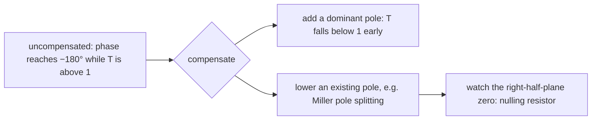

<!-- status: reviewed -->
# 12-06 · Stability and Frequency Compensation

| | |
|---|---|
| **Course** | [12 · Electronics II](../README.md) |
| **University equivalent** | The stability and compensation part of a second electronics or analog IC course: the Bode stability test, phase and gain margin and their link to the closed-loop step response, dominant-pole compensation, Miller compensation of a two-stage amplifier, the right-half-plane zero and the nulling resistor (Sedra & Smith, *Microelectronic Circuits*, the stability sections of the feedback chapter; Gray, Hurst, Lewis & Meyer, ch. 9; Razavi, *Design of Analog CMOS Integrated Circuits*, the stability and compensation chapter) |
| **Prerequisites** | [12-05 Feedback: Theory and the Four Topologies](12-05-feedback-topologies.md), [12-04 High-Frequency Analysis Methods](12-04-high-frequency-analysis-methods.md) (pole splitting), [07-07 Frequency Response and Bode Plots](../../07-circuit-analysis-2-transient-and-ac/chapters/07-07-frequency-response-and-bode-plots.md), [07-03 Second-Order RLC Transients](../../07-circuit-analysis-2-transient-and-ac/chapters/07-03-second-order-rlc-transients.md) (Q, damping and overshoot) |
| **Estimated study hours** | 10 |
| **Last verified** | 2026-11-20 |

**Learning objectives.** After this chapter you can:

1. State when a feedback loop is unstable, and compute its phase margin and gain margin from the loop gain.
2. Relate phase margin to the closed-loop quality factor, step overshoot and frequency-response peaking of a two-pole loop.
3. Compensate a multi-pole amplifier with a dominant pole, and explain why lowering an existing pole costs less bandwidth than adding a new one.
4. Design the Miller compensation of a two-stage amplifier: choose $C_c$ for a target phase margin, predict the gain–bandwidth product, the non-dominant pole and the right-half-plane zero, and check the result against an exact solution.
5. Use a nulling resistor to remove or move the right-half-plane zero, and state what it costs.

---

## 1. Big picture

Chapter 12-05 showed that feedback buys accuracy, linearity and bandwidth with loop gain. The bill arrives in the time domain. Every amplifier has more than one pole, so the signal returned by the loop lags the input by more and more as frequency rises. If the lag reaches 180° while the loop gain is still above one, the "negative" feedback has become positive at that frequency, and the circuit oscillates. **Stability analysis** finds how close a loop is to that edge; **frequency compensation** reshapes the loop gain so that it falls below one before the phase runs out. Nearly every op-amp, regulator and PLL on a chip contains a compensation capacitor, and choosing it is one of the analog designer's central jobs.

- **Phase margin** is the headline number. It sets the overshoot and ringing of a step response and the peaking of the frequency response; data sheets quote it for exactly this reason.
- **Compensation costs bandwidth.** A compensated op-amp's gain–bandwidth product is set by the compensation capacitor, not by the transistors' speed.
- **Unity gain is the hardest case.** A loop with β = 1 has the most loop gain, so an amplifier that is stable as a buffer is stable at every resistive gain, provided the feedback network adds no lag of its own (input capacitance can break this, §3.7); "unity-gain stable" is a data-sheet property.
- **Capacitive loads move poles.** Many field failures are an amplifier that was stable on the bench and oscillates when driving a cable or a large capacitor.

## 2. Intuition first

**A shower with a long pipe.** You adjust the hot tap, but the water takes several seconds to arrive. If you react to the temperature you feel *now*, you over-correct: too hot, turn it down, too cold, turn it up. A patient person (low "loop gain") converges; an impatient one with the same delay oscillates. The fix is to react more gently to fast changes: that is compensation. The delay plays the role of phase lag, the impatience the loop gain. Stability depends on both together: a loop is safe if, by the frequency at which the correction comes back a half-cycle late, it has become too weak to sustain itself.

**The analogy and its limits.** The shower has a pure time delay, whose phase lag grows without limit; an amplifier's poles each add at most 90° of lag, so a two-pole loop can approach but never reach 180°, while a three-pole loop can pass it. The shower's operator also adapts, while an amplifier's loop is fixed by its components, so it has to be designed with margin for the worst process corner, temperature and load.

**What the margins measure.** Plot the loop gain $T(j\omega)$ on a Bode plot. At the **crossover frequency** $\omega_c$, where $\lvert T \rvert$ = 1, the phase margin is how far the phase is from −180°. At the frequency $\omega_{180}$ where the phase reaches −180°, the gain margin is how far $\lvert T \rvert$ is below one, in decibels. A loop with 60° of phase margin has a well-damped step response; one with 0° rings forever.

*Figure 1. The design flow of this chapter: diagnose with the margins, then reshape the loop gain.*

## 3. Theory

> **Conventions.** $T(s)$ is the loop gain (12-05), defined so that the closed-loop gain is $A_\infty T/(1 + T)$ plus a small feed-forward term; for negative feedback $T(0) > 0$. Phases are measured from 0° at DC and unwrapped (they run continuously past −180°). $f_u = T_0f_1$ denotes the product of a loop's DC gain and its dominant pole frequency, the frequency at which a single-pole loop would cross unity.

### 3.1 When does a loop oscillate?

The closed-loop poles are the roots of $1 + T(s) = 0$. If $T(j\omega_0) = -1$ at some real frequency, $s = j\omega_0$ is a closed-loop pole on the imaginary axis: the loop sustains a sinusoid at $\omega_0$ with no input. If $\lvert T \rvert > 1$ where the phase is −180°, the poles have crossed into the right half-plane and any disturbance grows exponentially until the amplifier saturates (11-08 §3.6–3.7).

**Why a one-pole loop is always stable.** $T(s) = T_0/(1 + s/\omega_1)$ has phase between 0° and −90°, so $T(j\omega) = -1$ is impossible; the closed-loop pole is $-\omega_1(1 + T_0)$, always in the left half-plane (12-05 §3.3).

**Why two poles are stable but can ring.** With $T(s) = T_0/[(1 + s/\omega_1)(1 + s/\omega_2)]$ the phase approaches −180° only as $\omega \to \infty$, where $\lvert T \rvert \to 0$. The closed-loop poles stay in the left half-plane, but as $T_0$ grows they meet and become a complex pair with rising $Q$ (12-05 lab Part 2).

**Why three poles can oscillate.** Three poles can deliver 180° of lag at a finite frequency. For three real poles the phase is −180° where

$$
\arctan\frac{\omega}{\omega_1} + \arctan\frac{\omega}{\omega_2} + \arctan\frac{\omega}{\omega_3} = \pi \quad\Longleftrightarrow\quad \omega_{180}^2 = \omega_1\omega_2 + \omega_1\omega_3 + \omega_2\omega_3 ,
$$

and the loop is unstable if $\lvert T(j\omega_{180}) \rvert > 1$. The condition comes from the tangent-sum identity. With $t_i = \omega/\omega_i$,

$$
\tan(\theta_1 + \theta_2 + \theta_3) = \frac{t_1 + t_2 + t_3 - t_1t_2t_3}{1 - (t_1t_2 + t_1t_3 + t_2t_3)} ,
$$

where $\theta_i = \arctan t_i$. Each angle lies between 0 and π/2, so the sum lies between 0 and 3π/2, and the only multiple of π it can reach is π itself, where the tangent's numerator vanishes: $t_1 + t_2 + t_3 = t_1t_2t_3$. Multiplying by $\omega_1\omega_2\omega_3/\omega$ gives $\omega_2\omega_3 + \omega_1\omega_3 + \omega_1\omega_2 = \omega^2$. (The denominator vanishes where the sum is π/2.)

### 3.2 Phase margin and gain margin

For a loop whose open-loop gain $T(s)$ (previewed in 07-07 §3.9) has no right-half-plane poles and whose magnitude crosses unity once, the **Bode stability criterion** is: the closed loop is stable if and only if the phase at crossover is above −180°. Two margins measure the distance from instability:

$$
\text{PM} = 180^\circ + \angle T(j\omega_c), \qquad \text{GM} = -20\log_{10}\lvert T(j\omega_{180})\rvert\ \text{dB} .
$$

Phase margin is the extra lag the loop could tolerate before oscillating (from an unmodelled pole, a delay or a capacitive load); gain margin is the extra loop gain it could tolerate (from a process corner or a smaller closed-loop gain). Typical design targets are a PM of 45° to 70° and a GM of at least 10 dB.

> **Going deeper — the Nyquist criterion.** The Bode test is a special case. The general rule counts encirclements: plot $T(j\omega)$ for $-\infty < \omega < \infty$ in the complex plane; the number of closed-loop right-half-plane poles equals the number of clockwise encirclements of −1 plus the number of right-half-plane poles of $T$ itself. It follows from the argument principle of complex analysis applied to $1 + T(s)$ around a contour enclosing the right half-plane. It is needed for loops whose gain crosses unity several times, for "conditionally stable" loops that are stable only within a band of gains, and for loops that are open-loop unstable. Course 15 develops it.

### 3.3 Phase margin and the closed-loop response

The link between phase margin and time response is exact for the most important case: a loop with a dominant pole far below crossover and one more pole $\omega_2$. Near crossover, $T(s) \approx \omega_u/[s(1 + s/\omega_2)]$, where $\omega_u = T_0\omega_1$. The closed-loop response normalized to its ideal gain is

$$
\frac{T}{1 + T} = \frac{1}{1 + s/\omega_u + s^2/(\omega_u\omega_2)} = \frac{1}{1 + s/(Q\omega_n) + s^2/\omega_n^2}, \qquad \omega_n = \sqrt{\omega_u\omega_2},\quad Q = \sqrt{\frac{\omega_u}{\omega_2}} .
$$

So $Q$ depends only on the ratio $r = \omega_2/\omega_u$: $Q = 1/\sqrt{r}$. The crossover $\omega_c = x\,\omega_u$ solves $\lvert T \rvert = 1$, that is $x^2(1 + x^2/r^2) = 1$, and the phase margin is $90^\circ - \arctan(x/r)$: the dominant pole contributes 90° and the second pole the rest. The damping ratio is $\zeta = 1/(2Q)$, and 07-03 §3.6's step-response results apply: overshoot $e^{-\pi\zeta/\sqrt{1 - \zeta^2}}$ for $\zeta < 1$, and frequency-response peaking $Q/\sqrt{1 - 1/(4Q^2)}$ for $Q > 1/\sqrt2$.

| $r = f_2/f_u$ | Phase margin | $Q$ | Step overshoot | Peaking |
|---|---|---|---|---|
| 1 | 51.83° | 1 | 16.30% | 1.249 dB |
| 1.5 | 60.00° | 0.8165 | 8.77% | 0.280 dB |
| 2 | 65.53° | 0.7071 | 4.32% | 0 dB |
| 3 | 72.38° | 0.5774 | 0.43% | 0 dB |

*Table 1. Phase margin against the closed-loop response for a two-pole loop. The second pole at 1.5 times $f_u$ gives exactly 60°: $x = \sqrt3/2$ and $\arctan(x/1.5) = 30^\circ$.*

The rules of thumb follow: **45°** of phase margin rings noticeably (about 23% overshoot); **60°** gives under 10% overshoot and almost no peaking; the step response stops overshooting altogether at **76.35**°, where $r$ = 4, $Q$ = 1/2 and the poles are critically damped. Beyond about 70° the extra margin buys little except a slower response. Practical loops have more than two poles, so the table is a guide, not a law; but almost all well-designed amplifiers behave like it near crossover.

### 3.4 Dominant-pole compensation

The simplest fix for an unstable multi-pole amplifier is to add a pole at a very low frequency $f_d$, so low that the loop gain falls to unity before the other poles add much lag. With the others far away, the crossover is near $T_0f_d$, and the phase margin is about 90° minus the lag the other poles add there. To guarantee stability at unity gain (β = 1, the largest loop gain), the crossover must sit below the amplifier's first non-dominant pole.

The price is bandwidth: the closed-loop bandwidth of a buffer is about the crossover frequency, which has to be below the lowest of the original poles. A cleverer move is to **lower the existing first pole** instead of adding a new one. Its own lag, already present, then becomes the dominant 90°, and the crossover can rise to just below the *second* original pole, usually ten times higher (Example 12-06.4). This is what Miller compensation does: a capacitor across a gain stage multiplies the capacitance at that stage's input and moves its pole down, while splitting the next pole upward (12-04 §3.4).

### 3.5 Miller compensation of a two-stage amplifier

Model a two-stage amplifier by two nodes. Stage 1 has transconductance $g_{m1}$ and drives node 1 ($R_1$, $C_1$); stage 2 is an inverting stage $g_{m2}$ driving node 2 ($R_2$, $C_L$, which includes the load). The compensation capacitor $C_c$ connects node 1 to node 2. From 12-04 §3.4 (pole splitting), with $g_{m2}R_2 \gg 1$:

$$
p_1 \approx \frac{1}{g_{m2}R_1R_2C_c}, \qquad p_2 \approx \frac{g_{m2}C_c}{C_1C_L + C_c(C_1 + C_L)} \approx \frac{g_{m2}}{C_L}, \qquad z = +\frac{g_{m2}}{C_c} .
$$

**The gain–bandwidth product.** The DC gain is $g_{m1}R_1g_{m2}R_2$, so above $p_1$ the gain falls as

$$
\lvert A(j\omega) \rvert \approx \frac{g_{m1}R_1g_{m2}R_2}{\omega\,g_{m2}R_1R_2C_c} = \frac{g_{m1}}{\omega C_c}, \qquad \omega_u = \frac{g_{m1}}{C_c} .
$$

The output resistances and the second stage have dropped out: the gain–bandwidth product is set by the input stage's $g_{m1}$ and the compensation capacitor alone. Physically, above $p_1$ node 2 acts as a virtual ground for $C_c$ (the second stage is an integrator), so the first stage's current $g_{m1}v_{in}$ all flows into $C_c$.

**The phase margin.** At unity gain the crossover is about $\omega_u$, the dominant pole contributes 90°, and

$$
\text{PM} \approx 90^\circ - \arctan\frac{\omega_u}{p_2} - \arctan\frac{\omega_u}{z} .
$$

The right-half-plane zero subtracts phase like a pole (12-03 §3.4) while *raising* the magnitude, which is worse. With $\omega_u/z = g_{m1}/g_{m2}$, the classic design rules are:

1. **Make $g_{m2}$ about ten times $g_{m1}$.** Then the zero costs only $\arctan(0.1)$ = **5.711**°.
2. **Place $p_2$ at about 2.2 times $\omega_u$.** With $p_2 \approx g_{m2}/C_L$ and $\omega_u = g_{m1}/C_c$, this means $C_c \approx 2.2(g_{m1}/g_{m2})C_L$ = **0.22** $C_L$. It costs $\arctan(1/2.2)$ = **24.44**°.

Together they give $90 - 24.44 - 5.71$ = **59.85**°. These are estimates: the crossover is a little below $\omega_u$ (raising PM) but $C_1$ lowers $p_2$ (lowering it). Example 12-06.5 checks them against the exact circuit.

*Figure 2. Example 12-06.5's amplifier as a unity-gain buffer, from the exact circuit. The dominant pole, at **1.439** kHz (the estimate $1/(2\pi g_{m2}R_1R_2C_c)$ gives 1.447 kHz), brings the phase to −90°, where it stays for about four decades; without $R_z$, the second pole and the right-half-plane zero pull the phase toward −270° and leave **58.56**° at crossover. With the cancelling nulling resistor (Example 12-06.6) the phase stays near −90° until well beyond crossover, for a margin of **84.37**°.*

### 3.6 The right-half-plane zero and the nulling resistor

The zero exists because $C_c$ is a feed-forward path: at high frequency, the current through $C_c$ from node 1 reaches node 2 directly, in phase with the input, while the second stage's current $g_{m2}v_1$ is inverted. At the frequency where the two cancel, $sC_c v_1 = g_{m2}v_1$, the output is zero: $s = g_{m2}/C_c$, a positive (right-half-plane) value.

**The nulling resistor.** Put a resistor $R_z$ in series with $C_c$. The feed-forward current is now $v_1/(R_z + 1/(sC_c))$ (exactly, because at the zero the output voltage, node 2's, is zero by definition), and the cancellation condition becomes $R_z + 1/(sC_c) = 1/g_{m2}$, so

$$
z = \frac{1}{C_c\,(1/g_{m2} - R_z)} .
$$

- $R_z = 1/g_{m2}$ moves the zero to infinity: the compensation branch no longer feeds forward faster than the second stage.
- $R_z > 1/g_{m2}$ makes the zero negative, a **left-half-plane** zero that adds phase *lead*. Choosing it to sit on the non-dominant pole, $1/[C_c(R_z - 1/g_{m2})] = g_{m2}/C_L$, gives

$$
R_z = \frac{1}{g_{m2}}\left(1 + \frac{C_L}{C_c}\right) ,
$$

which cancels $p_2$ and leaves the loop nearly single-pole up to a new third pole at about $1/(R_zC_1)$, created by $R_z$ and node 1's capacitance.

The cancellation is only as good as the match between $R_z$ (a resistor or a transistor in triode) and $g_{m2}$ and $C_L$; designers usually aim the zero slightly beyond $p_2$ rather than on it. Other remedies block the feed-forward path with a buffer (a source follower in series with $C_c$) or return the compensation current to a low-impedance node of a cascode ("Ahuja" or cascode compensation); 12-08 meets them in op-amp designs.

### 3.7 Capacitive loads and the feedback factor

- **Capacitive loads.** In a Miller-compensated amplifier, $p_2 \approx g_{m2}/C_L$: doubling the load capacitance halves $p_2$ and can take 13–18° of phase margin away (Problem 12-06.10). Amplifiers meant to drive large capacitances either compensate for the worst load or use an output isolation resistor that separates the load's pole from the loop.
- **Larger closed-loop gain helps.** The loop gain is $A\beta$, so with β < 1 the crossover moves down to about $\beta\,\omega_u$, where the non-dominant poles add less lag. **Decompensated** op-amps exploit this: they use a smaller $C_c$ for a higher gain–bandwidth product and are specified as stable only above a minimum closed-loop gain.
- **Feedback-network poles count.** A capacitance at the inverting input (the source's capacitance, the input capacitance of the op-amp) makes β fall with frequency, adding lag to the loop; a small capacitor across the feedback resistor restores it.

## 4. Worked examples

### Example 12-06.1 · Phase margin of a two-pole loop (tier A)

**Setup.** A loop gain has $T_0$ = 1000 and poles at 1 kHz and 2 MHz. Estimate the crossover and phase margin, then find them exactly.

**Solution.** The single-pole crossover estimate is $f_u = T_0f_1$ = **1** MHz. There the dominant pole contributes almost 90° and the second $\arctan(1/2)$, so PM ≈ $90 - 26.57$ = **63.43**°.

Exactly, solve $\lvert T(jf) \rvert = 1$: $f_c$ = **0.9102** MHz, because the second pole already reduces the magnitude below crossover. The phase there is $-\arctan(f_c/1\ \text{kHz}) - \arctan(f_c/2\ \text{MHz}) = -89.94^\circ - 24.47^\circ$, so PM = **65.59**°.

**Sanity check.** Here $f_2/f_u$ = 2, and Table 1 gives 65.53° for the ideal two-pole loop; the small difference is the dominant pole's lag falling just short of 90°.

### Example 12-06.2 · From phase margin to overshoot (tier A)

**Setup.** A two-pole loop has its second pole at 1.5 times $f_u$. Find its phase margin, the closed-loop $Q$, the step overshoot and the frequency-response peaking.

**Solution.** With $r$ = 1.5, $x^2(1 + x^2/2.25) = 1$ gives $x^2$ = 0.75, so $x = \sqrt3/2$ and PM $= 90^\circ - \arctan(0.8660/1.5)$ = **60.00**°. $Q = 1/\sqrt{1.5}$ = **0.8165**, so $\zeta$ = **0.6124** and the overshoot is $e^{-\pi \times 0.6124/0.7906}$ = **8.77**%. Since $Q > 0.7071$ the magnitude peaks, by $Q/\sqrt{1 - 1/(4Q^2)}$ = 1.033, that is **0.280** dB.

**Sanity check.** A 60° margin is the usual target precisely because it sits just past the knee: less than 10% overshoot, a fraction of a decibel of peaking, and little lost speed.

### Example 12-06.3 · An uncompensated three-pole amplifier (tier B)

**Setup.** An amplifier has $A_0$ = 10⁴ and poles at 1, 10 and 100 MHz. It is used as a unity-gain buffer (β = 1). Is it stable?

**Solution.** The phase reaches −180° at $f_{180} = \sqrt{1 \times 10 + 1 \times 100 + 10 \times 100}$ MHz = **33.32** MHz. There

$$
\lvert T \rvert = \frac{10^4}{\sqrt{(1 + 1110)(1 + 11.1)(1 + 0.111)}} = \mathbf{81.83} ,
$$

so GM = **−38.26** dB: the loop gain is 82 times too large at the oscillation frequency. Its crossover is at **208.0** MHz with a phase margin of **−61.30**°. The buffer oscillates.

**Sanity check.** A negative gain margin means the closed loop has right-half-plane poles; any noise grows until the output clips, typically settling into a large oscillation near $f_{180}$.

### Example 12-06.4 · Add a pole, or move one? (tier B)

**Setup.** Compensate Example 12-06.3's amplifier for a 60° phase margin at unity gain (a) by adding a dominant pole $f_d$, and (b) by lowering the 1 MHz pole to a new frequency $f_1'$. Compare the closed-loop bandwidths.

**Solution.** (a) With all three original poles still present, the crossover has to sit well below 1 MHz. Solving PM = 60° numerically gives $f_d$ = **56.73** Hz, crossover **0.5056** MHz, and a closed-loop −3 dB bandwidth of **0.8390** MHz.

(b) Lowering the 1 MHz pole leaves only the 10 and 100 MHz poles to eat phase. PM = 60° needs $f_1'$ = **575.0** Hz; the crossover rises to **5.113** MHz and the closed-loop bandwidth to **8.456** MHz, about **10.1** times better.

**Sanity check.** Moving an existing pole spends its 90° of lag usefully, so the crossover can approach the next pole instead of the first: the bandwidth gain is the ratio of those poles, 10. This is why Miller compensation (which moves node 1's pole) beats adding a capacitor at a new node.

### Example 12-06.5 · Designing Miller compensation (tier B)

**Setup.** A two-stage amplifier has $g_{m1}$ = 1 mA/V, $R_1$ = 200 kΩ, $C_1$ = 0.2 pF, $g_{m2}$ = 10 mA/V, $R_2$ = 50 kΩ and $C_L$ = 5 pF. Choose $C_c$ by the rules of §3.5, predict the GBW, $p_2$, the zero and the phase margin, and check the margin against an exact solution of the circuit at unity gain.

**Solution.** The DC gain is $200 \times 500$ = **10⁵**. With $g_{m2} = 10g_{m1}$ the zero rule is met; $C_c = 0.22C_L$ = **1.1** pF. Then

- GBW $= g_{m1}/(2\pi C_c)$ = **144.7** MHz;
- $p_2 \approx g_{m2}/(2\pi C_L)$ = **318.3** MHz;
- $z = g_{m2}/(2\pi C_c)$ = **1447** MHz;
- PM ≈ **59.85**°.

Including $C_1$, the better estimate of $p_2$ is $g_{m2}C_c/[2\pi(C_1C_L + C_c(C_1 + C_L))]$ = **260.5** MHz. The full two-node circuit, with $C_c$ bridging the nodes, has the gain of 12-04 §3.4,

$$
A(s) = \frac{A_0(1 - s/z)}{1 + b_1s + b_2s^2}, \qquad
\begin{aligned}
b_1 &= R_1[C_1 + C_c(1 + g_{m2}R_2)] + R_2(C_c + C_L) = 1.106 \times 10^{-4}\ \text{s}, \\
b_2 &= R_1R_2[C_1C_L + C_c(C_1 + C_L)] = 6.72 \times 10^{-14}\ \text{s}^2 ,
\end{aligned}
$$

with $A_0$ = 10⁵ and $z = g_{m2}/C_c$ = **9.091** × 10⁹ rad/s. Solving $\lvert A(jf) \rvert$ = 1 numerically gives a crossover of **129.5** MHz and a phase margin of **58.56**°. The rule landed within 1.3°; an exact 60° needs $C_c$ = **1.180** pF, with a GBW of **134.9** MHz.

**Sanity check.** Compensation set the speed: 1.1 pF and 1 mA/V give about 145 MHz however fast the transistors are. To go faster at the same margin, $g_{m1}$, $g_{m2}$ and the power have to rise together.

### Example 12-06.6 · The nulling resistor (tier C)

**Setup.** Add a resistor $R_z$ in series with Example 12-06.5's 1.1 pF capacitor. Find the phase margin with (a) $R_z = 1/g_{m2}$ and (b) $R_z$ chosen to cancel $p_2$, and estimate the new third pole for (b).

**Solution.** (a) $R_z$ = **100** Ω removes the zero; the exact solution gives a phase margin of **63.49**°, a gain of about 5° as the zero's lag disappears.

(b) $R_z = (1 + C_L/C_c)/g_{m2} = (1 + 4.545)/10\ \text{mA/V}$ = **554.5** Ω. The compensation branch now has its own node, and the exact gain is third order,

$$
A(s) = \frac{A_0(1 + s/z')}{1 + a_1s + a_2s^2 + a_3s^3}, \qquad z' = \frac{1}{C_c(R_z - 1/g_{m2})} = 2.000 \times 10^9\ \text{rad/s} ,
$$

with $a_1$ = 1.106 × 10⁻⁴ s, $a_2$ = 6.738 × 10⁻¹⁴ s² and $a_3 = R_1R_2R_zC_1C_LC_c$ = 6.100 × 10⁻²⁴ s³ (from the three node equations, or from 12-04's time-constant sums). The exact solution gives a crossover of **143.3** MHz and a phase margin of **84.37**°. The new pole is near $1/(2\pi R_zC_1)$ = **1435** MHz, ten times above crossover.

**Sanity check.** The cancellation turned a two-pole loop back into a nearly single-pole one up to 1.4 GHz, so the phase margin approaches 90°. If $C_L$ changes, the zero no longer sits on $p_2$; a designer would aim for a margin near 70° that survives the expected spread of $C_L$, rather than for 84°.

### Answer key

<!-- answer-key -->
| ID | Quantity | Value | Unit |
|---|---|---|---|
| T 12-06.a | phase margin, r = 1 | 51.83 | ° |
| T 12-06.b | overshoot, r = 1 | 16.30 | % |
| T 12-06.c | peaking, r = 1 | 1.249 | dB |
| T 12-06.d | Q, r = 1.5 | 0.8165 | — |
| T 12-06.e | phase margin, r = 2 | 65.53 | ° |
| T 12-06.f | Q, r = 2 | 0.7071 | — |
| T 12-06.g | overshoot, r = 2 | 4.32 | % |
| T 12-06.h | phase margin, r = 3 | 72.38 | ° |
| T 12-06.i | Q, r = 3 | 0.5774 | — |
| T 12-06.j | overshoot, r = 3 | 0.43 | % |
| T 12-06.k | overshoot at 45° | 23 | % |
| T 12-06.l | zero's phase cost, g_m2 = 10 g_m1 | 5.711 | ° |
| T 12-06.m | C_c rule | 0.22 | C_L |
| T 12-06.n | p_2's phase cost at 2.2 ω_u | 24.44 | ° |
| T 12-06.o | estimated phase margin | 59.85 | ° |
| T 12-06.p | phase margin at critical damping (r = 4) | 76.35 | ° |
| Ex 12-06.1a | single-pole crossover estimate | 1 | MHz |
| Ex 12-06.1b | estimated phase margin | 63.43 | ° |
| Ex 12-06.1c | exact crossover | 0.9102 | MHz |
| Ex 12-06.1d | exact phase margin | 65.59 | ° |
| Ex 12-06.2a | phase margin | 60.00 | ° |
| Ex 12-06.2b | Q | 0.8165 | — |
| Ex 12-06.2c | damping ratio | 0.6124 | — |
| Ex 12-06.2d | overshoot | 8.77 | % |
| Ex 12-06.2e | peaking | 0.280 | dB |
| Ex 12-06.3a | phase-crossover frequency | 33.32 | MHz |
| Ex 12-06.3b | loop gain there | 81.83 | — |
| Ex 12-06.3c | gain margin | −38.26 | dB |
| Ex 12-06.3d | crossover | 208.0 | MHz |
| Ex 12-06.3e | phase margin | −61.30 | ° |
| Ex 12-06.4a | added dominant pole | 56.73 | Hz |
| Ex 12-06.4b | crossover, added pole | 0.5056 | MHz |
| Ex 12-06.4c | closed-loop bandwidth, added pole | 0.8390 | MHz |
| Ex 12-06.4d | lowered first pole | 575.0 | Hz |
| Ex 12-06.4e | crossover, lowered pole | 5.113 | MHz |
| Ex 12-06.4f | closed-loop bandwidth, lowered pole | 8.456 | MHz |
| Ex 12-06.4g | bandwidth ratio | 10.1 | — |
| Ex 12-06.5a | DC gain | 1 × 10⁵ | — |
| Ex 12-06.5b | compensation capacitor | 1.1 | pF |
| Ex 12-06.5c | GBW estimate | 144.7 | MHz |
| Ex 12-06.5d | p_2 estimate | 318.3 | MHz |
| Ex 12-06.5e | right-half-plane zero | 1447 | MHz |
| Ex 12-06.5f | phase margin estimate | 59.85 | ° |
| Ex 12-06.5g | p_2 including C_1 | 260.5 | MHz |
| Ex 12-06.5h | exact crossover | 129.5 | MHz |
| Ex 12-06.5i | exact phase margin | 58.56 | ° |
| Ex 12-06.5j | C_c for exactly 60° | 1.180 | pF |
| Ex 12-06.5k | GBW at that C_c | 134.9 | MHz |
| Ex 12-06.6a | R_z removing the zero | 100 | Ω |
| Ex 12-06.6b | phase margin with it | 63.49 | ° |
| Ex 12-06.6c | R_z cancelling p_2 | 554.5 | Ω |
| Ex 12-06.6d | crossover with it | 143.3 | MHz |
| Ex 12-06.6e | phase margin with it | 84.37 | ° |
| Ex 12-06.6f | third-pole estimate | 1435 | MHz |
| Ex 12-06.6g | C_L/C_c | 4.545 | — |
| Ex 12-06.5l | dominant pole | 1.439 | kHz |
| Ex 12-06.5m | dominant-pole estimate | 1.447 | kHz |
| Ex 12-06.5n | b_1 | 1.106 × 10⁻⁴ | s |
| Ex 12-06.5o | b_2 | 6.72 × 10⁻¹⁴ | s² |
| Ex 12-06.5p | right-half-plane zero | 9.091 × 10⁹ | rad/s |
| Ex 12-06.6h | left-half-plane zero with the cancelling R_z | 2.000 × 10⁹ | rad/s |
| Ex 12-06.6i | a_1 | 1.106 × 10⁻⁴ | s |
| Ex 12-06.6j | a_2 | 6.738 × 10⁻¹⁴ | s² |
| Ex 12-06.6k | a_3 | 6.100 × 10⁻²⁴ | s³ |
| Ex 12-06.1e | dominant pole's lag at crossover | 89.94 | ° |
| Ex 12-06.1f | second pole's lag at crossover | 24.47 | ° |
| Ex 12-06.1g | second pole's lag at 1 MHz | 26.57 | ° |
| Ex 12-06.2f | peak magnitude ratio | 1.033 | — |
| Prac 12-06.a | f_2/f_u for 55° | 1.170 | — |
| Prac 12-06.b | Q for 55° | 0.925 | — |
| Prac 12-06.c | overshoot for 55° | 13 | % |
| Sim 12-06.a | GBW estimate at 0.55 pF | 289.4 | MHz |
| Sim 12-06.b | crossover at 0.55 pF | 211.4 | MHz |
| Sim 12-06.c | phase margin at 0.55 pF | 43.06 | ° |

*Every value is recomputed by [verify_12_06.py](../verify/verify_12_06.py): margins by root finding on the loop gain with unwrapped phase, the two-stage amplifier by complex nodal analysis of the full circuit (with and without the nulling resistor), the closed-loop $Q$ from the poles of $1 + T(s)$, overshoot from a simulated step response and peaking by optimization. The two-stage amplifier's margins are also confirmed in ngspice.*

## 5. Simulate it

The lab, [labs/12-06-lab](../labs/12-06-lab/README.md), has a notebook and an ngspice netlist:

1. Plots the loop gain of Example 12-06.3's three-pole amplifier and reads both margins; then closes the loop at several β and shows the step response grow from ringing to oscillation.
2. Simulates the step response of two-pole loops with the second pole at 1, 1.5, 2 and 3 times $f_u$, and measures the overshoot against Table 1.
3. Sweeps $C_c$ in Example 12-06.5's amplifier and plots the exact phase margin and crossover against the §3.5 estimates.
4. Sweeps the nulling resistor from 0 to 1 kΩ and plots the phase margin.

The netlist [two_stage.cir](../labs/12-06-lab/two_stage.cir) runs an AC analysis of Example 12-06.5's amplifier, without and with the cancelling nulling resistor, and measures crossover and phase margin.

**Guided exercise (predict, then run).** **Before running Part 3**, predict: if $C_c$ is halved from 1.1 to 0.55 pF, the estimated GBW doubles to **289.4** MHz. Does the crossover double, and what happens to the phase margin? Then run it. (No: the crossover rises only to **211.4** MHz, because $p_2$ is now close, and the phase margin falls from 58.56° to **43.06**°. Speed bought by shrinking $C_c$ is paid in margin.)

## 6. Engineering tradeoffs

| Knob | Improves | Costs | Typical decision owner |
|---|---|---|---|
| Larger $C_c$ | Phase margin | GBW ($g_{m1}/C_c$), slew rate (12-08), area | Analog designer |
| Larger $g_{m2}$ | $p_2$ and the zero move up: more margin or speed | Second-stage current | Analog designer |
| Larger $g_{m1}$ | GBW at fixed margin (with $C_c$ scaled) | Input-stage current; noise trade-offs (12-10) | Analog designer |
| Nulling resistor | Removes or cancels the RHP zero | A third pole; sensitivity to $C_L$ and process | Analog designer |
| Unity-gain stable vs decompensated | Ease of use vs bandwidth at high gain | Customers must respect a minimum gain | Product definition |
| Capacitive-load rating | Robust in the field | Bandwidth, or an isolation resistor | Product definition, applications |

## 7. Numbers to know

| Quantity | Value | Note |
|---|---|---|
| Phase margin | $180^\circ + \angle T(j\omega_c)$ | Target 45°–70° |
| Gain margin | $-20\log\lvert T(j\omega_{180})\rvert$ | Target ≥ 10 dB |
| Two-pole loop | $Q = \sqrt{f_u/f_2}$ | 60° at $f_2 = 1.5f_u$ |
| 60° phase margin | 8.8% overshoot, 0.28 dB peaking | 45°: about 23% overshoot |
| Miller GBW | $g_{m1}/(2\pi C_c)$ | Independent of output resistances |
| Non-dominant pole | $\approx g_{m2}/C_L$ | Falls with load capacitance |
| RHP zero | $g_{m2}/C_c$ | Push it beyond 10× GBW |
| Rules of thumb | $g_{m2} \approx 10g_{m1}$, $C_c \approx 0.22C_L$ | About 60° |
| Nulling resistor | $1/g_{m2}$ removes the zero; $(1 + C_L/C_c)/g_{m2}$ cancels $p_2$ | New pole near $1/(R_zC_1)$ |

## 8. Common mistakes

- **Checking stability at the wrong gain.** The worst case is the largest loop gain, usually unity closed-loop gain; a circuit tested at a gain of 10 can oscillate as a buffer.
- **Reading the phase margin at $f_u = T_0f_1$ instead of the true crossover.** Nearby poles lower the crossover (Example 12-06.1); use the frequency where $\lvert T \rvert$ = 1.
- **Treating a right-half-plane zero like a left-half-plane one.** It adds lag, not lead, and raises the magnitude.
- **Forgetting the load.** $p_2$ moves with $C_L$; compensate for the largest load you will see.
- **Assuming the Bode test always applies.** Loops with several unity crossings or open-loop instability need the Nyquist criterion.
- **Expecting a bigger $C_c$ to be free.** It lowers GBW and slew rate.

## 9. Practitioner lens

### State of the art (as of Nov 2026)

- **Data sheets quote phase margin.** The TLV9062 specifies a 10 MHz GBW and a **55**° phase margin [1] **[Established]** (data sheet). Read through Table 1's two-pole model, 55° corresponds to a second pole at about **1.170** times $f_u$, a closed-loop $Q$ near **0.925** and about **13**% overshoot as a buffer, consistent with mild ringing on a step response. (The two-pole reading is a model, not the data sheet's claim **[Industry estimate]**.)
- **Two-stage Miller-compensated op-amps remain the workhorse** of CMOS analog design, with nulling-resistor or cascode ("indirect") compensation to manage the right-half-plane zero **[Established]** (Gray, Hurst, Lewis and Meyer, ch. 9; Razavi).

### Why it matters commercially

- **Stability problems are a common source of analog field failures [Industry estimate].** An amplifier that oscillates with a customer's cable or a regulator that rings with a particular capacitor becomes an applications-engineering cost and, at worst, a recall.
- **Compensation sets power efficiency.** For a given margin, bandwidth is bought with $g_m$, hence with current; a vendor's "speed per milliamp" reflects how well its compensation is done.
- **LDO regulators and PLLs are stability products.** Their data sheets specify allowed output-capacitor ranges and loop bandwidths for this reason.

### Marketing vs Reality

- **"Unity-gain stable."** *Reality:* with the specified load; a large capacitive load can still make it ring or oscillate. *Sanity check:* look for phase margin or overshoot against load capacitance.
- **"Stable with any capacitive load."** *Reality:* usually achieved by an internal isolation scheme that slows the response at large loads. *Sanity check:* ask what the settling time is at the largest load.
- **"High GBW."** *Reality:* it may be a decompensated part, stable only above a minimum gain. *Sanity check:* check the minimum stable gain.

### Questions for engineering leaders

1. **"What is the phase margin at your worst corner and worst load?"**
   *Strong:* a number from simulation across process, voltage, temperature and load, with a target. *Evasive:* the typical value.
2. **"How do you handle the right-half-plane zero?"**
   *Strong:* nulling resistor or indirect compensation, with how it tracks process. *Evasive:* "the Miller capacitor takes care of it."
3. **"How much bandwidth would you gain by relaxing the margin by 10°, and why not?"**
   *Strong:* a quantitative trade with settling and overshoot specs. *Evasive:* no trade-off offered.

## 10. Concept check

**Q1.** Why can a two-pole loop never oscillate, while a three-pole loop can?

Answer

Two poles give at most 180° of lag, reached only at infinite frequency where the loop gain is zero; three poles reach 180° at a finite frequency, where the loop gain may still exceed one.

**Q2.** Define phase margin and gain margin.

Answer

Phase margin is 180° plus the loop-gain phase at the frequency where $\lvert T \rvert$ = 1; gain margin is how far $\lvert T \rvert$ is below one, in decibels, where the phase reaches −180°.

**Q3.** What does a 45° phase margin look like in a step response, and a 60° one?

Answer

About 23% overshoot with visible ringing at 45°; under 10% (8.8%) at 60°.

**Q4.** Why does lowering an existing pole beat adding a new dominant pole?

Answer

The existing pole's lag is already in the loop; moving it down makes it the dominant 90° and lets the crossover approach the next pole, about ten times higher, instead of staying below the first.

**Q5.** What sets a Miller-compensated amplifier's gain–bandwidth product?

Answer

$g_{m1}/C_c$: above the dominant pole the second stage acts as an integrator, so the first stage's current all flows into $C_c$.

**Q6.** Where does the right-half-plane zero come from, and how does a nulling resistor remove it?

Answer

From the feed-forward current through $C_c$, which cancels the second stage's inverted current at $s = g_{m2}/C_c$. A series resistor of $1/g_{m2}$ makes the compensation branch's feed-forward no stronger than the second stage, moving the zero to infinity.

**Q7.** Why does a large capacitive load threaten a Miller-compensated amplifier?

Answer

The non-dominant pole is about $g_{m2}/C_L$; a larger load lowers it toward the crossover and removes phase margin.

[Problem set for this chapter](../problems/12-06-problems.md)

## 11. Key terms

[Phase margin](../../../reference/glossary.md#phase-margin) · [Gain margin](../../../reference/glossary.md#gain-margin) · [Crossover frequency](../../../reference/glossary.md#crossover-frequency) · [Dominant-pole compensation](../../../reference/glossary.md#dominant-pole-compensation) · [Miller compensation](../../../reference/glossary.md#miller-compensation) · [Right-half-plane zero](../../../reference/glossary.md#right-half-plane-zero) · [Nulling resistor](../../../reference/glossary.md#nulling-resistor) · [Unity-gain stable](../../../reference/glossary.md#unity-gain-stable)

## 12. Connections

- **Builds on:** loop gain and the return ratio from [12-05](12-05-feedback-topologies.md); pole splitting from [12-04](12-04-high-frequency-analysis-methods.md); the right-half-plane zero from [12-03](12-03-frequency-response-miller-poles-zeros.md); $Q$, damping and overshoot from [07-03](../../07-circuit-analysis-2-transient-and-ac/chapters/07-03-second-order-rlc-transients.md); Bode plots from [07-07](../../07-circuit-analysis-2-transient-and-ac/chapters/07-07-frequency-response-and-bode-plots.md).
- **Next:** [12-07 Output Stages and Power Amplifiers](12-07-output-stages.md); then 12-08 builds complete op-amps with these compensation methods and adds slew rate, which $C_c$ also sets.
- **Used later:** oscillators (12-09) are loops designed to fail the stability test on purpose; control systems (Course 15) develop the Nyquist criterion and loop shaping; regulators and PLLs (Course 20).

## 13. Further study

- P. R. Gray, P. J. Hurst, S. H. Lewis and R. G. Meyer, *Analysis and Design of Analog Integrated Circuits*, ch. 9 (frequency response and stability of feedback amplifiers, Miller compensation, nulling resistor).
- B. Razavi, *Design of Analog CMOS Integrated Circuits*, the stability and frequency compensation chapter.
- A. S. Sedra and K. C. Smith, *Microelectronic Circuits*, the stability sections of the feedback chapter.

## 14. Sources

1. Texas Instruments, *TLV906xS*, SBOS839N (Mar 2017, revised Jul 2026), gain–bandwidth product and phase margin: [data sheet](https://www.ti.com/lit/ds/symlink/tlv9062.pdf). [R-182](../../../reference/research-log.md#r-182--op-amp-data-sheets).
