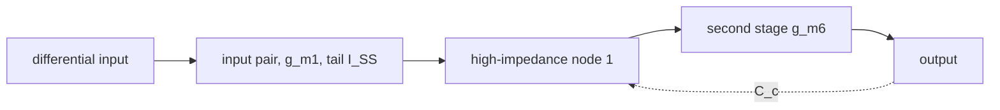
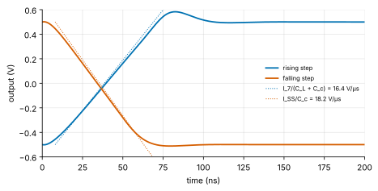

<!-- status: reviewed -->
# 12-08 · Op-Amp Internals

| | |
|---|---|
| **Course** | [12 · Electronics II](../README.md) |
| **University equivalent** | The operational-amplifier design chapter of an analog IC course: the two-stage CMOS op-amp and its gain, bandwidth and compensation, the origin of slew rate, the folded-cascode single-stage op-amp, fully differential amplifiers and common-mode feedback, and rail-to-rail input and output stages (Gray, Hurst, Lewis & Meyer, ch. 6 and 12; Razavi, *Design of Analog CMOS Integrated Circuits*, the operational amplifier chapter; Johns & Martin, *Analog Integrated Circuit Design*) |
| **Prerequisites** | [12-06 Stability and Frequency Compensation](12-06-stability-and-compensation.md), [12-02 Active Loads, Cascodes and Multistage Amplifiers](12-02-active-loads-cascodes-multistage.md), [12-01 Differential Pairs](12-01-differential-pairs.md) (large-signal pair, input common-mode range), [12-07 Output Stages and Power Amplifiers](12-07-output-stages.md) |
| **Estimated study hours** | 10 |
| **Last verified** | 2026-11-20 |

**Learning objectives.** After this chapter you can:

1. Compute the gain, gain–bandwidth product and phase margin of a two-stage CMOS op-amp from its bias currents and device parameters.
2. Derive the slew rate from the large-signal behaviour of the input pair and output stage, and relate it to the gain–bandwidth product through the input pair's overdrive.
3. Analyse a folded-cascode op-amp's gain, output resistance, bandwidth and non-dominant pole.
4. Explain why a fully differential amplifier needs common-mode feedback, and size its loop gain.
5. Determine the input common-mode range of a complementary rail-to-rail input stage and the variation of its transconductance.

---

## 1. Big picture

Chapters 12-01 to 12-07 built the parts: differential pairs, current-mirror loads, cascodes, frequency compensation and output stages. This chapter assembles them into the circuit most of analog design revolves around. An op-amp is a high-gain differential amplifier designed to be used with feedback: its own gain is imprecise and only has to be large, while its bandwidth, stability, swing, input range and slew rate decide whether the feedback circuit around it works. Two architectures dominate CMOS designs. The **two-stage Miller op-amp** gives high gain and wide output swing; the **folded cascode** gives high speed in one stage and compensates itself with its load. Around them sit the details that data sheets report: slew rate, input range to the rails, output swing, and for differential designs, the common-mode feedback that holds their outputs in range.

- **Every data-converter driver, filter and regulator error amplifier** on a chip is one of these architectures or a variant.
- **Slew rate** is a large-signal limit set by bias current and capacitance; it explains why fast op-amps burn current.
- **Rail-to-rail** inputs and outputs are standard in low-voltage parts; their seams (the input-pair crossover) show up in data-sheet specifications.
- **Fully differential** amplifiers drive almost every high-resolution ADC.

## 2. Intuition first

**An op-amp as a chain of current and capacitance.** The input pair converts a voltage difference into a current; the compensation capacitor integrates that current; the second stage buffers the result to the output. Small signals see a gain set by $g_{m1}$ and $C_c$ (12-06). Large signals see something else: the input pair can steer at most its tail current $I_{SS}$, so the capacitor charges at most at $I_{SS}/C_c$ volts per second. That maximum is the **slew rate**, and it is why an op-amp's response to a large step is a ramp rather than an exponential.

**An analogy: a water tank filled through a valve.** The level (output voltage) rises at a rate set by the flow; the valve opening (the input difference) sets the flow, but only up to the pipe's capacity (the tail current). For small adjustments the level follows the valve smoothly; for a large demand, the pipe runs flat out and the level rises at a fixed rate whatever the demand. The analogy breaks in that an op-amp's "pipe" has two segments, the input pair and the output stage, and whichever saturates first sets the rate; and the op-amp's "valve" is driven by feedback, so the large error during slewing is what forces the pipe open.

**Why fully differential circuits need an extra loop.** A high-gain stage's output sits where a pull-up current and a pull-down current balance through a very large resistance. With one output, the feedback loop holds that voltage. With two outputs, feedback acts only on their *difference*; their average (common mode) is set by how well two currents match, divided by a conductance of a few hundred nanosiemens. A mismatch of a fraction of a percent moves it by volts. A second loop, **common-mode feedback**, measures the average and corrects it.

*Figure 1. The two-stage op-amp: the input pair drives node 1, the second stage drives the output, and $C_c$ bridges them (Miller compensation).*

## 3. Theory

> **Conventions.** Square-law MOSFETs (10-02) with $I_D = (k/2)V_{ov}^2$, $g_m = 2I_D/V_{ov}$ and $r_o = 1/(\lambda I_D)$; $I_{SS}$ is the input pair's tail current, set by the tail device M5, so each input device carries $I_{SS}/2$. The first stage's output resistance is $R_1 = r_{o2} \parallel r_{o4}$ and the second's $R_2 = r_{o6} \parallel r_{o7}$, where M6 is the common-source device and M7 its current-source load carrying $I_7$. The compensation network is 12-06 §3.5's.

### 3.1 The two-stage CMOS op-amp

The first stage is 12-02's five-transistor OTA: an NMOS pair M1–M2 with a PMOS current-mirror load M3–M4 and tail current $I_{SS}$. Its single-ended output, at the mirror side a source–gate voltage below $V_{DD}$, drives the gate of M6, a PMOS common-source stage with its source at $V_{DD}$, loaded by the NMOS current sink M7. The capacitor $C_c$ connects M6's gate and drain. (A PMOS input pair with an NMOS mirror would call for an NMOS M6 instead, and every statement below about rising and falling edges would swap.)

**DC gain.** From 12-02, the first stage's gain is $g_{m1}R_1$ and the second's $g_{m6}R_2$, so

$$
A_0 = g_{m1}(r_{o2} \parallel r_{o4})\cdot g_{m6}(r_{o6} \parallel r_{o7}) .
$$

With square-law devices, $g_mr_o = 2/(\lambda V_{ov})$: each stage's gain is about $1/(\lambda V_{ov})$ when the two output resistances are equal, typically 20 to 100. Two stages give $10^3$ to $10^4$, which is why the two-stage op-amp is the default when gain matters.

**Bandwidth and compensation.** 12-06 §3.5 applies directly: GBW $= g_{m1}/(2\pi C_c)$, the non-dominant pole is near $g_{m6}/(2\pi C_L)$, and the right-half-plane zero sits at $g_{m6}/(2\pi C_c)$. The design rules $g_{m6} \approx 10g_{m1}$ and $C_c \approx 0.22C_L$ give about 60° of phase margin. With equal overdrive voltages, $g_{m6} = 10g_{m1}$ means $I_7 = 5I_{SS}$: the second stage takes most of the current, because it has to drive the load capacitance at a frequency above the GBW.

**Other ways to tame the zero.** The nulling resistor of 12-06 §3.6 is one remedy. Two others block or reroute the feed-forward path through $C_c$. A **buffered** scheme puts a source follower between the output and $C_c$, so current can flow back from the output into node 1 but not forward from node 1 to the output; the zero disappears, at the cost of the follower's $V_{GS}$ of headroom and its own pole. **Indirect** (cascode, or "Ahuja") compensation connects $C_c$ from the output to the low-impedance source of a cascode device in the first stage: the compensation current still reaches node 1 through the cascode, but node 1's voltage no longer drives $C_c$ directly, so the feed-forward path is gone, and the non-dominant pole moves higher than with plain Miller compensation. Course 20 (20-02) designs both.

**Input common-mode range, output swing and supply rejection.** The input pair needs $V_{CM} \ge V_{GS1} + V_{ov,tail}$ to keep the tail source saturated, and $V_{CM} \le V_{DD} - V_{SG3} + V_{TN}$ to keep M1 saturated with its drain one $V_{SG}$ below the supply (12-01 §3.4). The output swings from $V_{ov7}$ (M7 saturated) to $V_{DD} - V_{ov6}$ (M6 saturated), within one overdrive of each rail. Ripple on $V_{DD}$ reaches the output mainly through M6, whose source is the supply: at low frequency the loop suppresses it by the loop gain, like any disturbance inside the loop (12-05), but above the dominant pole $C_c$ ties M6's gate to its drain, M6 behaves as a diode from $V_{DD}$, and the output follows the supply ripple more and more closely. The positive-supply rejection therefore falls at about 20 dB per decade above the dominant pole, a known weakness of Miller-compensated two-stage op-amps [2].

**Systematic offset.** For the output to sit at its intended level with zero input, M6's current density must match what the mirror sets (12-02 §3.6): $(W/L)_6/(W/L)_4 = 2(W/L)_7/(W/L)_5$ in the standard design. This is a sizing condition, not a random error.

### 3.2 Slew rate

**The large-signal limit.** Apply a large positive step to a unity-gain follower. Until the output catches up, the differential input is large, so the input pair is fully switched: one side carries all of $I_{SS}$, the other none (12-01 §3.2). The first stage's output current is therefore at its limit, $\pm I_{SS}$. Meanwhile the second stage, with its large gain, keeps node 1 nearly still (it is a Miller integrator), so all of $I_{SS}$ flows through $C_c$ and

$$
\frac{dv_{out}}{dt} = \frac{I_{SS}}{C_c} .
$$

This is the **internal slew rate**. The output stage can also limit, on one edge. When the output rises, the first stage pulls node 1 down, the PMOS M6 conducts harder and can source far more than $I_7$, so only the internal limit applies. When the output falls, the first stage pushes node 1 up and M6 shuts off; only the sink $I_7$ can discharge the output. Node 1 is then free to move, and the first stage keeps forcing its full $I_{SS}$ through $C_c$ *into* the output node, so the net current discharging $C_L$ is $I_7 - I_{SS}$ (with $C_1$ neglected; Problem 12-08.13 keeps it). Hence

$$
\text{SR}_{rise} \approx \frac{I_{SS}}{C_c}, \qquad \text{SR}_{fall} = \min\left(\frac{I_{SS}}{C_c},\ \frac{I_7 - I_{SS}}{C_L}\right) .
$$

If node 1 instead runs into its rail and stops, $C_c$ no longer carries a fixed current and the output node sees $C_L + C_c$, so the bound becomes $I_7/(C_L + C_c)$. Real amplifiers sit near one bound or between the two; data sheets quote the measured edges.

*Figure 2. Example 12-08.1's op-amp as a follower, from a large-signal model with an NMOS input pair and a PMOS second stage: a 1 V step up is limited by the input stage, $I_{SS}/C_c$, and a step down, on which M6 cuts off, by the output stage, $(I_7 - I_{SS})/C_L$ (dotted lines). Once the error is small, the response turns into the small-signal settling set by the phase margin.*

**Slew rate and bandwidth are linked through the overdrive.** Divide the internal slew rate by $\omega_u = g_{m1}/C_c$:

$$
\frac{\text{SR}}{\omega_u} = \frac{I_{SS}}{g_{m1}} = V_{ov1}, \quad \text{since } g_{m1} = \frac{2(I_{SS}/2)}{V_{ov1}} .
$$

For a bipolar input pair, $g_{m1} = (I_{EE}/2)/V_T$, so $\text{SR}/\omega_u = 2V_T$ ≈ 52 mV. A MOS pair in **weak inversion**, common in micropower parts, behaves like a bipolar one with $V_T$ replaced by $nV_T$ ($g_m = I_D/(nV_T)$, with the slope factor $n$ ≈ 1.2–1.5), so $\text{SR}/\omega_u = 2nV_T$: **72.39** mV for $n$ = 1.4. A MOS pair with $V_{ov}$ = 0.2 V slews about four times faster at the same GBW. Bipolar op-amps that need slew rate degenerate their input pair with emitter resistors, which multiplies $\text{SR}/\omega_u$ by $1 + g_mR_E$ (Problem 12-08.5).

**Full-power bandwidth.** A sine $V_p\sin\omega t$ has a maximum slope $\omega V_p$. The highest frequency at which the op-amp can deliver it without slew distortion is

$$
f_{FP} = \frac{\text{SR}}{2\pi V_p} .
$$

Above it, a sine output turns into a triangle wave. Note the difference from the small-signal bandwidth: slew limits depend on amplitude, bandwidth limits do not.

### 3.3 The folded cascode

A telescopic cascode (12-02 §3.4) stacks the input devices and cascodes between the rails, which wastes headroom. The **folded cascode** turns the signal current around: the NMOS input pair's drain currents are subtracted from fixed PMOS current sources at two folding nodes, and PMOS common-gate devices carry the difference down to the output, where a cascoded NMOS current mirror forms the load. The mirror matters for a single-ended output: it folds the other side's signal current over, so the output receives both halves and $G_m \approx g_{m1}$. With plain cascoded current sources instead, only one side's current would reach the output and $G_m$ would halve; that arrangement suits the fully differential version (§3.4), where each side has its own output. The mirror adds a pole at its gate node, accompanied by a zero at twice its frequency (the doublet of 12-03 §3.8), usually well above the crossover.

**Gain.** The output node sees a cascode looking up and a cascode looking down. Looking up, the PMOS cascode M3 has at its source the folding node's resistance $R_f = r_{o,src} \parallel r_{o1}$ (the PMOS current source in parallel with the input device), so by 12-02's cascode result

$$
R_{up} = r_{o3} + R_f + g_{m3}r_{o3}R_f, \qquad R_{dn} = r_{o5} + r_{o6} + g_{m5}r_{o5}r_{o6},
$$

and $R_{out} = R_{up} \parallel R_{dn}$. The gain is $A_0 = G_mR_{out}$, where $G_m$ is the short-circuit transconductance: the input device's current divides at the folding node between $R_f$ and the cascode's low input resistance $r_{o3}/(1 + g_{m3}r_{o3}) \approx 1/g_{m3}$, so $G_m$ is a few percent below $g_{m1}$ (Example 12-08.4).

**One high-impedance node.** The folding nodes have low resistance (about $1/g_{m3}$), so the only slow node is the output. The dominant pole is $1/(2\pi R_{out}C_L)$ and

$$
\text{GBW} = \frac{g_{m1}}{2\pi C_L} .
$$

The load capacitance *is* the compensation: a larger load improves phase margin, unlike the two-stage op-amp. The non-dominant pole is at the folding node, about $g_{m3}/(2\pi C_f)$, where $C_f$ is that node's capacitance (large, because three devices meet there).

**Slew rate.** The output slews at $I_{SS}/C_L$ if the folding current sources carry at least $I_{SS}$ each; otherwise a cascode device shuts off and the slewing current is limited by the folding source.

**Trade-offs against the two-stage op-amp.** The folded cascode is faster for the same power (one high-impedance node), has better power-supply rejection and is easy to make fully differential, but its gain is one stage's worth ($(g_mr_o)^2$ at best) and its output swing is limited by the cascodes: about $V_{DD}$ minus four overdrive voltages. It is also noisier than a telescopic cascode with the same input pair: the folding current sources inject their own noise currents at the folding nodes, where they add directly to the signal current, so their transconductance appears alongside the input pair's in the input-referred noise (12-10 §3.7).

### 3.4 Fully differential amplifiers and common-mode feedback

A **fully differential** op-amp has differential inputs and differential outputs. It doubles the output swing for a given supply (each output swings half), rejects common-mode noise and even-order distortion, and matches the differential inputs of modern ADCs.

**Why the output common mode is undefined.** Each output node sits where a pull-up current $I_{up}$ and a pull-down current $I_{dn}$ meet through the node's resistance $R_{out}$. The differential feedback loop acts only on $v_{o+} - v_{o-}$. The common-mode voltage satisfies $I_{up} - I_{dn} = (V_{CM,out} - V_{eq})/R_{out}$, so a current mismatch $\Delta I$ moves it by

$$
\Delta V_{CM} = \Delta I \cdot R_{out} .
$$

With $R_{out}$ of megohms, a 0.1% mismatch moves the common mode by a large fraction of a volt (Example 12-08.5), driving the cascodes out of saturation.

**Common-mode feedback (CMFB).** A CMFB circuit senses $(v_{o+} + v_{o-})/2$ (with two equal resistors or, in sampled systems, switched capacitors), compares it with a reference $V_{CM}$, and adjusts one of the bias currents (usually the tail or the bottom current sources) with a transconductance $g_{m,cm}$. Its loop gain is about $g_{m,cm}R_{out}$, and it divides the common-mode error by $1 + g_{m,cm}R_{out}$, like any feedback loop (12-05). The CMFB loop must itself be stable, with a bandwidth comparable to the differential loop's, so it is compensated like the main amplifier.

### 3.5 Rail-to-rail input and output stages

**Input common-mode range.** An NMOS input pair needs its common-mode input at least $V_{GS} + V_{ov,tail}$ above the negative rail (12-01 §3.4); a PMOS pair needs it at least as far below the positive rail. A **complementary input stage** places an NMOS and a PMOS pair in parallel: near the negative rail only the PMOS pair works, near the positive rail only the NMOS pair, and in between both. The input range extends to (and slightly beyond) both rails.

**The transconductance seam.** With constant tail currents, $g_m$ in the middle region, where both pairs conduct, is twice that near the rails. Since GBW $= g_{m1}/(2\pi C_c)$, the GBW doubles there and the phase margin falls (Example 12-08.6). **Constant-$g_m$** techniques fix this: for square-law devices, $g_m \propto \sqrt{I}$, so when both pairs are on, giving each a quarter of its tail current halves each one's $g_m$ and keeps the sum constant. The trick relies on the square law, so it works only in strong inversion; it also halves the slew current in the overlap, and in practice $g_m$ is flat only to within a ripple of several percent across the transitions. The transition region also shows up as a change in offset voltage and in common-mode rejection across the input range, a visible signature of the complementary pairs on data sheets.

**Rail-to-rail output.** Followers (12-07) lose a $V_{GS}$ at each end. Rail-to-rail outputs use **common-source** devices (a PMOS to the positive rail and an NMOS to the negative), which can pull the output to within a saturation voltage, $V_{ov}$, of each rail at light load. Their gates need a class AB control circuit to set the quiescent current, and the stage's output resistance is higher than a follower's, so it relies on the loop gain for low closed-loop output impedance.

> **Going deeper — gain boosting and nested compensation.** To get two-stage gain with folded-cascode speed, designers add auxiliary amplifiers that drive the cascode gates and multiply $R_{out}$ by their gain ("gain boosting", or regulated cascodes). Three-stage amplifiers for very low supply voltages use nested Miller compensation, with two capacitors and careful pole placement. Course 20 (20-02) develops both.

## 4. Worked examples

### Example 12-08.1 · A two-stage op-amp's gain and bandwidth (tier A)

**Setup.** A two-stage op-amp has $I_{SS}$ = 20 µA and $I_7$ = 100 µA, all devices at $V_{ov}$ = 0.2 V and λ = 0.1 V⁻¹. Find $g_{m1}$, $R_1$, the first-stage gain, $g_{m6}$, $R_2$, the second-stage gain and the total gain. With $C_L$ = 5 pF and the rules of 12-06, find $C_c$, the GBW, $p_2$ and the zero; the exact phase margin, with $C_1$ = 0.2 pF at node 1, is 59.78°.

**Solution.** $g_{m1} = 2 \times 10\ \mu\text{A}/0.2\ \text{V}$ = **100** µA/V. $r_{o2} = r_{o4} = 1/(0.1 \times 10\ \mu\text{A})$ = 1 MΩ, so $R_1$ = **500** kΩ and $A_1$ = **50**. $g_{m6} = 2 \times 100\ \mu\text{A}/0.2\ \text{V}$ = **1** mA/V, $R_2$ = 100 kΩ ∥ 100 kΩ = **50** kΩ, $A_2$ = **50**. Total: **2500**, or **67.96** dB.

$g_{m6} = 10g_{m1}$ already. $C_c = 0.22 \times 5$ = **1.1** pF; GBW $= 100\ \mu\text{A/V}/(2\pi \times 1.1\ \text{pF})$ = **14.47** MHz; $p_2 \approx 1\ \text{mA/V}/(2\pi \times 5\ \text{pF})$ = **31.83** MHz; zero at **144.7** MHz. The full circuit gives **59.78**° at a crossover of **12.70** MHz.

**Sanity check.** Each stage's gain is $g_mr_o/2 = 1/(\lambda V_{ov})$ = 50 because the two output resistances are equal: halving λ (longer channels) would quadruple the total.

### Example 12-08.2 · Slew rate (tier A)

**Setup.** For Example 12-08.1's op-amp, find the internal and output-stage slew limits, the rising and falling slew rates, $\text{SR}/\omega_u$, and the full-power bandwidth for a 1 V peak output.

**Solution.** Internal: $20\ \mu\text{A}/1.1\ \text{pF}$ = **18.18** V/µs. Output stage, with M6 off and node 1 free: $(100 - 20)\ \mu\text{A}/5\ \text{pF}$ = **16.00** V/µs (or $100\ \mu\text{A}/6.1\ \text{pF}$ = **16.39** V/µs if node 1 were clamped). Rising edges are limited by the input stage (**18.18** V/µs), falling edges by the output stage (about **16.00** V/µs). $\text{SR}_{int}/\omega_u = I_{SS}/g_{m1}$ = **0.2** V, the input pair's overdrive. Full-power bandwidth, set by the slower edge: $16.00\ \text{V/µs}/(2\pi \times 1\ \text{V})$ = **2.546** MHz.

**Sanity check.** A large-signal simulation of this amplifier (the lab, Part 2) gives **17.7** V/µs rising and **16.2** V/µs falling, within 2.5% of the bounds but not on them. A 1 V step is too small for a clean textbook ramp: the pair is fully switched only while the differential input exceeds $\sqrt2V_{ov}$ = **0.2828** V, and the steepest point of each edge comes as it leaves full switching, while $R_1$ and $R_2$ divert a few microamperes.

### Example 12-08.3 · Bipolar against MOS input pairs (tier A)

**Setup.** At the same 14.47 MHz GBW, what slew rate would a bipolar input pair give, and how much faster is the MOS pair?

**Solution.** $\text{SR} = 2V_T\omega_u = 2 \times 25.852\ \text{mV} \times 2\pi \times 14.47\ \text{MHz}$ = **4.700** V/µs. The MOS pair's ratio is $V_{ov}/(2V_T)$ = **3.868**.

**Sanity check.** This is why low-power bipolar op-amps are slow to slew, and why CMOS designers can trade overdrive (and some noise and offset) for slew rate.

### Example 12-08.4 · A folded-cascode op-amp (tier B)

**Setup.** A folded cascode has input devices at 50 µA ($g_{m1}$ = 0.5 mA/V), PMOS folding sources at 100 µA, PMOS cascodes and a cascoded NMOS mirror load at 50 µA (all $g_m$ = 0.5 mA/V at $V_{ov}$ = 0.2 V), λ = 0.1 V⁻¹, $C_L$ = 2 pF and a folding-node capacitance of 0.5 pF. Find $R_f$, $R_{up}$, $R_{dn}$, $R_{out}$, the estimated gain $g_{m1}R_{out}$ and the exact gain; then the GBW, the slew rate with $I_{SS}$ = 100 µA, the folding-node pole and the estimated and exact phase margins at unity gain.

**Solution.** $r_o$ = 200 kΩ at 50 µA and 100 kΩ at 100 µA. $R_f$ = 100 ∥ 200 kΩ = **66.67** kΩ. $R_{up} = 200\ \text{k} + 66.67\ \text{k} + 0.5\ \text{mA/V} \times 200\ \text{k}\Omega \times 66.67\ \text{k}\Omega$ = **6.933** MΩ; $R_{dn} = 400\ \text{k} + 0.5\ \text{mA/V} \times (200\ \text{k}\Omega)^2$ = **20.4** MΩ; $R_{out}$ = **5.175** MΩ. The estimate is $g_{m1}R_{out}$ = **2587** (68.26 dB); solving the circuit gives **2513**, 3% lower because some of the input current flows into $R_f$ instead of the cascode.

GBW $= 0.5\ \text{mA/V}/(2\pi \times 2\ \text{pF})$ = **39.79** MHz; SR = 100 µA/2 pF = **50** V/µs; the folding-node pole is near $0.5\ \text{mA/V}/(2\pi \times 0.5\ \text{pF})$ = **159.2** MHz, so PM ≈ $90^\circ - \arctan(39.79/159.2)$ = **75.96**°. The exact solution gives **77.25**° at a crossover of **37.60** MHz.

**Sanity check.** One stage reaches nearly the two-stage op-amp's gain here because both of its loads are cascodes; and its phase margin is high with no compensation capacitor at all.

### Example 12-08.5 · Why CMFB is needed (tier B)

**Setup.** Make Example 12-08.4's amplifier fully differential. The pull-up and pull-down currents at each output (50 µA) mismatch by 0.1%. Find the common-mode shift without CMFB, and the residual error with a CMFB loop of $g_{m,cm}$ = 0.5 mA/V.

**Solution.** $\Delta I$ = 50 nA, so $\Delta V_{CM} = 50\ \text{nA} \times 5.175\ \text{M}\Omega$ = **0.2587** V. The CMFB loop gain is $0.5\ \text{mA/V} \times 5.175\ \text{M}\Omega$ = **2587**, so the error falls to $0.2587\ \text{V}/2588$ = **0.1000** mV.

**Sanity check.** A quarter-volt shift from a 0.1% mismatch would push a cascode out of saturation in a 1.8 V design; with CMFB the outputs stay within a tenth of a millivolt of the target.

### Example 12-08.6 · The rail-to-rail seam (tier B)

**Setup.** A complementary input stage runs on 2.5 V with $V_{TH}$ = 0.5 V, input overdrive 0.2 V and tail overdrive 0.2 V. Find where each pair works. If both pairs keep their full tail currents, $g_{m1}$ doubles in the overlap; find the GBW and exact phase margin of Example 12-08.1's amplifier there.

**Solution.** The NMOS pair needs $V_{CM} \ge 0.5 + 0.2 + 0.2$ = **0.9** V; the PMOS pair needs $V_{CM} \le 2.5 - 0.9$ = **1.6** V. Between 0.9 and 1.6 V both conduct. There, GBW = **28.94** MHz and the exact phase margin falls to **42.24**° (crossover **21.94** MHz).

**Sanity check.** A constant-$g_m$ circuit that quarters each tail current in the overlap would restore the 59.78° margin everywhere; without it, compensation must be designed for the overlap, wasting bandwidth near the rails.

### Answer key

<!-- answer-key -->
| ID | Quantity | Value | Unit |
|---|---|---|---|
| T 12-08.a | bipolar SR/ω_u | 52 | mV |
| T 12-08.b | weak-inversion SR/ω_u, n = 1.4 | 72.39 | mV |
| Ex 12-08.1a | g_m1 | 100 | µA/V |
| Ex 12-08.1b | R_1 | 500 | kΩ |
| Ex 12-08.1c | first-stage gain | 50 | — |
| Ex 12-08.1d | g_m6 | 1 | mA/V |
| Ex 12-08.1e | R_2 | 50 | kΩ |
| Ex 12-08.1f | second-stage gain | 50 | — |
| Ex 12-08.1g | total gain | 2500 | — |
| Ex 12-08.1h | total gain | 67.96 | dB |
| Ex 12-08.1i | C_c | 1.1 | pF |
| Ex 12-08.1j | GBW | 14.47 | MHz |
| Ex 12-08.1k | p_2 | 31.83 | MHz |
| Ex 12-08.1l | zero | 144.7 | MHz |
| Ex 12-08.1m | exact phase margin | 59.78 | ° |
| Ex 12-08.1n | exact crossover | 12.70 | MHz |
| Ex 12-08.2a | internal slew limit | 18.18 | V/µs |
| Ex 12-08.2b | output-stage slew limit, node 1 free | 16.00 | V/µs |
| Ex 12-08.2c | SR/ω_u | 0.2 | V |
| Ex 12-08.2d | full-power bandwidth | 2.546 | MHz |
| Ex 12-08.2e | simulated rising slew | 17.7 | V/µs |
| Ex 12-08.2f | simulated falling slew | 16.2 | V/µs |
| Ex 12-08.2g | output-stage bound, node 1 clamped | 16.39 | V/µs |
| Ex 12-08.2h | input for full switching | 0.2828 | V |
| Ex 12-08.3a | bipolar slew rate | 4.700 | V/µs |
| Ex 12-08.3b | MOS advantage | 3.868 | — |
| Ex 12-08.4a | R_f | 66.67 | kΩ |
| Ex 12-08.4b | R_up | 6.933 | MΩ |
| Ex 12-08.4c | R_dn | 20.4 | MΩ |
| Ex 12-08.4d | R_out | 5.175 | MΩ |
| Ex 12-08.4e | estimated gain | 2587 | — |
| Ex 12-08.4f | estimated gain | 68.26 | dB |
| Ex 12-08.4g | exact gain | 2513 | — |
| Ex 12-08.4h | GBW | 39.79 | MHz |
| Ex 12-08.4i | slew rate | 50 | V/µs |
| Ex 12-08.4j | folding-node pole | 159.2 | MHz |
| Ex 12-08.4k | estimated phase margin | 75.96 | ° |
| Ex 12-08.4l | exact phase margin | 77.25 | ° |
| Ex 12-08.4m | exact crossover | 37.60 | MHz |
| Ex 12-08.5a | common-mode shift | 0.2587 | V |
| Ex 12-08.5b | CMFB loop gain | 2587 | — |
| Ex 12-08.5c | residual error | 0.1000 | mV |
| Ex 12-08.6a | NMOS pair lower limit | 0.9 | V |
| Ex 12-08.6b | PMOS pair upper limit | 1.6 | V |
| Ex 12-08.6c | GBW in the overlap | 28.94 | MHz |
| Ex 12-08.6d | phase margin in the overlap | 42.24 | ° |
| Ex 12-08.6e | crossover in the overlap | 21.94 | MHz |
| Sim 12-08.a | output-stage limit with I_7 = 200 µA | 36.0 | V/µs |
| Sim 12-08.b | simulated falling slew with I_7 = 200 µA | 17.5 | V/µs |
| Sim 12-08.c | simulated rising slew with I_7 = 200 µA | 17.8 | V/µs |
| Prac 12-08.a | TLV9062 SR/(2π GBW) | 0.1035 | V |
| Prac 12-08.b | OPA333 SR/(2π GBW) | 0.0728 | V |
| Prac 12-08.c | OPA1611 SR/(2π GBW) | 0.1074 | V |

*Every value is recomputed by [verify_12_08.py](../verify/verify_12_08.py): gains, crossovers and phase margins by complex nodal analysis of the two-stage and folded-cascode circuits, output resistances by test-current injection, and slew rates by integrating a large-signal model (a square-law pair that saturates at its tail current and a square-law second stage that can cut off) through a step. The two-stage amplifier is also confirmed in ngspice.*

## 5. Simulate it

The lab, [labs/12-08-lab](../labs/12-08-lab/README.md), has a notebook and an ngspice netlist:

1. Computes the two-stage op-amp's gain, GBW and phase margin from its bias design, and sweeps λ and $V_{ov}$.
2. Simulates the large-signal step response of the follower, showing the slew ramp and comparing rising and falling rates with §3.2.
3. Solves the folded cascode and compares its gain and margin with the two-stage design (which draws 120 µA against the folded cascode's 200 µA from the positive supply).
4. Plots $g_m$ and GBW against input common mode for a complementary input stage, with and without constant-$g_m$ control.

The netlist [two_stage_opamp.cir](../labs/12-08-lab/two_stage_opamp.cir) runs an AC analysis of Example 12-08.1's amplifier and measures its DC gain, crossover and phase margin. The netlist [slew.cir](../labs/12-08-lab/slew.cir) runs the follower's large-signal step response from a behavioural model (the square-law pair and the PMOS second stage as nonlinear sources) and measures both slew rates.

**Guided exercise (predict, then run).** **Before running Part 2**, predict: with $I_7$ raised from 100 to 200 µA, which edge speeds up, and to what? Then run it. (Only the falling edge, which was output-limited. With $I_7$ = 200 µA (and M6 resized to keep its overdrive) the output-stage limit is $(I_7 - I_{SS})/C_L$ = **36.0** V/µs, so the internal **18.18** V/µs takes over: the simulation's falling slew rises from 16.2 to **17.5** V/µs, while the rising edge barely moves, to **17.8** V/µs.)

## 6. Engineering tradeoffs

| Knob | Improves | Costs | Typical decision owner |
|---|---|---|---|
| Input overdrive $V_{ov1}$ | Slew rate at fixed GBW ($\text{SR}/\omega_u = V_{ov1}$) | $g_m$ per current, noise, offset | Analog designer |
| Channel length (λ) | DC gain ($\propto 1/\lambda^2$ for two stages) | Speed (larger capacitances), area | Analog designer |
| Second-stage current $I_7$ | $p_2$, falling slew rate | Power | Analog designer |
| Two-stage vs folded cascode | Gain and swing vs speed and PSRR | One or the other | Architect |
| Fully differential | Swing, common-mode rejection | CMFB circuit, area, power | Architect |
| Rail-to-rail input | Input range | $g_m$ seam, offset change, CMRR | Product definition |

## 7. Numbers to know

| Quantity | Value | Note |
|---|---|---|
| Two-stage gain | $g_{m1}R_1 \cdot g_{m6}R_2$ | each about $1/(\lambda V_{ov})$, $10^3$–$10^4$ total |
| GBW (two-stage) | $g_{m1}/(2\pi C_c)$ | GBW (folded cascode) $g_{m1}/(2\pi C_L)$ |
| Slew rate | $I_{SS}/C_c$; falling also ≤ $(I_7 - I_{SS})/C_L$ | NMOS pair, PMOS M6; the edge on which M6 cuts off |
| SR/ω_u | $V_{ov1}$ (MOS), $2V_T$ ≈ 52 mV (bipolar) | MOS slews faster per GBW |
| Full-power bandwidth | $\text{SR}/(2\pi V_p)$ | Amplitude-dependent |
| CM error without CMFB | $\Delta I\cdot R_{out}$ | Divided by $1 + g_{m,cm}R_{out}$ with CMFB |
| Rail-to-rail $g_m$ seam | 2× in the overlap | Constant-$g_m$ halves each pair's $g_m$ there |

## 8. Common mistakes

- **Confusing slew rate with bandwidth.** Slew is a large-signal current limit that depends on amplitude; bandwidth is small-signal.
- **Checking only the internal slew rate.** The output stage can be the limit on one edge.
- **Forgetting the current division at a folding node.** The folded cascode's transconductance is slightly below $g_{m1}$.
- **Building a fully differential amplifier without CMFB.** Its outputs drift to a rail.
- **Compensating a rail-to-rail amplifier at the rail.** Its $g_m$ doubles mid-range; check stability there.
- **Assuming a folded cascode needs a compensation capacitor.** Its load compensates it; a larger load helps stability.

## 9. Practitioner lens

### State of the art (as of Nov 2026)

- **Slew rate and GBW on real data sheets** [1] **[Established]** (data sheets):
  - TLV9062: 6.5 V/µs and 10 MHz;
  - OPA333: 0.16 V/µs and 350 kHz;
  - OPA1611: 27 V/µs and 40 MHz.
- **What the ratio reveals.** Dividing slew rate by $2\pi \times$ GBW gives an "effective input overdrive" (our arithmetic, a diagnostic rather than a data-sheet claim):
  - TLV9062: **0.1035** V, consistent with a MOS input pair at moderate overdrive.
  - OPA333: **0.0728** V, close to the $2nV_T$ of a MOS pair in weak inversion with $n$ ≈ 1.4, as a micropower part's input pair would be (our inference) **[Industry estimate]**.
  - OPA1611: **0.1074** V. The OPA1611 is a bipolar-input part (its data sheet's title [1]) **[Established]**, and an undegenerated bipolar pair gives only $2V_T$ = 52 mV, so this ratio points to a degenerated input pair or slew enhancement (our inference) **[Industry estimate]**.
- **Rail-to-rail seams on data sheets.** The TLV9062's CMRR is specified as 103 dB typical over a common-mode range ending 1.4 V below the positive rail, but 87 dB over the full rail-to-rail range [1] **[Established]** (data sheet). A complementary input stage's transition region is the usual cause of such a drop (our interpretation of the specification).

### Why it matters commercially

- **Slew rate costs current.** At a given capacitance, slew rate is proportional to bias current, so "fast and low-power" claims trade against each other.
- **Fully differential drivers** are sold alongside nearly every high-resolution ADC.
- **Rail-to-rail I/O** is expected in low-voltage parts, but its seams matter in precision designs: a data-converter buffer whose input crosses the transition region sees a step in offset.

### Marketing vs Reality

- **"Rail-to-rail input."** *Reality:* usually by complementary pairs; offset, CMRR and $g_m$ change across the range. *Sanity check:* look for specifications quoted over a restricted range.
- **"High slew rate."** *Reality:* may be one edge, or at a specific load; the output stage may limit the other edge. *Sanity check:* ask for rising and falling slew at the application's load.
- **"Rail-to-rail output."** *Reality:* within a stated voltage of each rail at a light load; at heavy load the swing shrinks. *Sanity check:* check output swing against load current.

### Questions for engineering leaders

1. **"What limits your slew rate, and which edge?"**
   *Strong:* the input tail current over $C_c$, or the output stage, with numbers for both edges. *Evasive:* a single typical number.
2. **"How does your input stage behave across the common-mode range?"**
   *Strong:* constant-$g_m$ or a single pair with a charge pump, plus offset and CMRR across the range. *Evasive:* "rail-to-rail."
3. **"How is the output common mode set in your differential driver, and how fast is that loop?"**
   *Strong:* a CMFB scheme with its bandwidth and stability margin. *Evasive:* no mention of CMFB.

## 10. Concept check

**Q1.** Why does the internal slew rate equal $I_{SS}/C_c$?

Answer

During a large step the input pair is fully switched, so the first stage delivers its whole tail current; the second stage holds node 1 nearly still, so all of that current charges $C_c$.

**Q2.** Why do MOS input op-amps slew faster than bipolar ones at the same GBW?

Answer

$\text{SR}/\omega_u = I_{SS}/g_{m1}$, which is the overdrive $V_{ov1}$ (0.1–0.3 V) for a MOS pair but only $2V_T$ ≈ 52 mV for a bipolar pair.

**Q3.** What compensates a folded-cascode op-amp?

Answer

Its load capacitance: the output is the only high-impedance node, so it sets the dominant pole and GBW $= g_{m1}/(2\pi C_L)$.

**Q4.** Why does a fully differential op-amp need common-mode feedback?

Answer

The differential loop does not control the outputs' average, which is set by the mismatch of pull-up and pull-down currents times a megohm-level output resistance; CMFB senses the average and corrects it.

**Q5.** Why does a rail-to-rail input stage's GBW change with common-mode voltage?

Answer

In the middle of the range both complementary pairs conduct and their transconductances add, doubling $g_{m1}$ and so the GBW, unless a constant-$g_m$ circuit reduces their currents there.

**Q6.** How can a slew rate be limited by the output stage?

Answer

On the edge where the common-source device M6 turns off (the falling edge for a PMOS M6), only its current-sink load $I_7$ discharges the output, while the first stage still pushes $I_{SS}$ through $C_c$ into it, so the net rate is $(I_7 - I_{SS})/C_L$. If that is below $I_{SS}/C_c$, that edge is output-limited.

[Problem set for this chapter](../problems/12-08-problems.md)

## 11. Key terms

[Two-stage op-amp](../../../reference/glossary.md#two-stage-op-amp) · [Slew rate](../../../reference/glossary.md#slew-rate) · [Full-power bandwidth](../../../reference/glossary.md#full-power-bandwidth) · [Folded cascode](../../../reference/glossary.md#folded-cascode) · [Fully differential amplifier](../../../reference/glossary.md#fully-differential-amplifier) · [Common-mode feedback](../../../reference/glossary.md#common-mode-feedback) · [Rail-to-rail input](../../../reference/glossary.md#rail-to-rail-input) · [Constant-gm input stage](../../../reference/glossary.md#constant-gm-input-stage)

## 12. Connections

- **Builds on:** the five-transistor OTA, cascodes and systematic offset from [12-02](12-02-active-loads-cascodes-multistage.md); the large-signal pair and input range from [12-01](12-01-differential-pairs.md); Miller compensation from [12-06](12-06-stability-and-compensation.md); output stages from [12-07](12-07-output-stages.md); op-amp specifications from [10-09](../../10-electronics-1/chapters/10-09-real-op-amps-nonidealities.md).
- **Next:** [12-09 Oscillators](12-09-oscillators.md) designs loops that fail the stability test on purpose.
- **Used later:** noise of the input stage in 12-10; op-amp design in depth, gain boosting and switched-capacitor CMFB in [Course 20](../../20-analog-and-mixed-signal-ic-design/README.md).

## 13. Further study

- P. R. Gray, P. J. Hurst, S. H. Lewis and R. G. Meyer, *Analysis and Design of Analog Integrated Circuits*, ch. 6 (amplifiers with active loads, the folded cascode) and ch. 12 (fully differential op-amps and CMFB).
- B. Razavi, *Design of Analog CMOS Integrated Circuits*, the operational amplifier chapter.
- D. A. Johns and K. Martin, *Analog Integrated Circuit Design*, the basic and advanced op-amp chapters.

## 14. Sources

1. Texas Instruments data sheets for TLV906xS (SBOS839N), OPA333 (SBOS351E) and OPA1611 (SBOS450C): slew rate, gain–bandwidth product, CMRR and common-mode ranges. [R-182](../../../reference/research-log.md#r-182--op-amp-data-sheets).
2. P. R. Gray, P. J. Hurst, S. H. Lewis and R. G. Meyer, *Analysis and Design of Analog Integrated Circuits*, 5th ed., Wiley, 2009: ch. 6 (the two-stage op-amp, including its supply rejection) and ch. 9 (frequency compensation).
