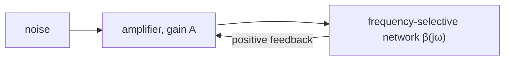
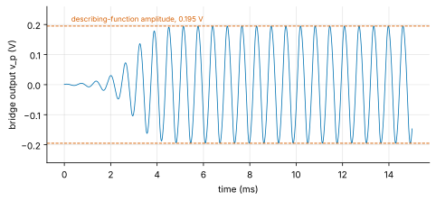

<!-- status: reviewed -->
# 12-09 · Oscillators

| | |
|---|---|
| **Course** | [12 · Electronics II](../README.md) |
| **University equivalent** | The oscillator chapter of a second electronics course: the Barkhausen criterion, RC oscillators (Wien bridge and phase shift), LC oscillators (Colpitts and the cross-coupled pair), crystal oscillators, ring oscillators and amplitude stabilization (Sedra & Smith, *Microelectronic Circuits*, the signal generators chapter; Razavi, *Design of Analog CMOS Integrated Circuits*, the oscillators chapter) |
| **Prerequisites** | [12-06 Stability and Frequency Compensation](12-06-stability-and-compensation.md), [12-05 Feedback: Theory and the Four Topologies](12-05-feedback-topologies.md), [07-03 Second-Order RLC Transients](../../07-circuit-analysis-2-transient-and-ac/chapters/07-03-second-order-rlc-transients.md) (resonance and Q) |
| **Estimated study hours** | 8 |
| **Last verified** | 2026-11-20 |

**Learning objectives.** After this chapter you can:

1. State the Barkhausen criterion, explain why startup needs loop gain above one, and describe how amplitude limiting brings it back to one.
2. Derive the frequency and gain condition of the Wien-bridge and RC phase-shift oscillators.
3. Analyse LC oscillators: the Colpitts oscillator's frequency and startup condition, and the cross-coupled pair's negative resistance against the tank's loss.
4. Model a quartz crystal, compute its series and parallel resonances and pulling, and explain why crystals set the frequency of nearly every electronic system.
5. Compute the frequency of a ring oscillator from its stage delay, and its required stage gain from a linear model.
6. Compute the period of a relaxation oscillator from its RC time constant and switching thresholds.

---

## 1. Big picture

Chapter 12-06 worked hard to keep feedback loops from oscillating. An **oscillator** is a loop designed to oscillate, at one frequency, with a controlled amplitude. Every synchronous digital system needs a clock; every radio needs a local oscillator to shift signals in frequency; every data converter needs a sampling clock. The physics is the same as instability: a loop whose gain is one with zero phase at some frequency has poles on the imaginary axis and sustains a sinusoid with no input. The engineering is in making that frequency precise and stable, the amplitude controlled, and the noise low.

- **Crystal oscillators** set the reference frequency of almost every system: watches, phones, computers, networks.
- **LC oscillators** (usually voltage-controlled, VCOs) generate the gigahertz carriers of radios and the clocks of high-speed links, locked to a crystal by a PLL (Courses 15 and 20).
- **Ring oscillators** are the cheapest on-chip clocks and the standard process-speed monitor.
- **RC oscillators** cover audio and low-frequency timing where precision matters less.

## 2. Intuition first

**A child on a swing.** A swing has a natural frequency. Pushing at the right moment of each cycle (in phase with its motion) adds energy; pushing too hard makes the arc grow; friction removes energy. A steady arc means the energy added per cycle exactly equals the energy lost. An oscillator's amplifier is the pusher, its resonator (an LC tank, a crystal, or an RC network) sets the timing, and the steady amplitude is where the amplifier's effective gain has fallen to exactly replace the losses.

**Why the gain must start above one and end at one.** If the loop gain were exactly one, any tiny noise would circulate forever but never grow; if it were below one, the oscillation would die. So designers start with a loop gain somewhat above one (the poles slightly in the right half-plane): noise grows exponentially. As the amplitude rises, the amplifier saturates or an automatic gain control acts, the *effective* gain falls, and the amplitude settles where it is exactly one.

**The analogy's limits.** The swing's pusher can choose when to push; an oscillator's amplifier pushes according to the loop's phase, so the frequency is wherever the loop phase is zero, not necessarily at the resonator's exact natural frequency. And a real swing's frequency hardly depends on the amplitude, while an oscillator's nonlinearity both limits the amplitude and slightly shifts the frequency (the lab shows a 0.5% shift in a Wien-bridge oscillator).

*Figure 1. An oscillator as a loop with positive feedback: noise is amplified at the frequency where $A\beta$ has zero phase, and grows until the amplifier's gain is limited to $\lvert A\beta \rvert$ = 1.*

## 3. Theory

> **Conventions.** In this chapter the loop gain of an oscillator is written $L(j\omega) = A(j\omega)\beta(j\omega)$ for a **positive**-feedback loop, so the condition for sustained oscillation is $L = +1$. (In 12-05 and 12-06's negative-feedback convention this is $T = -1$.) Resonators are characterized by their quality factor $Q$ (07-03).

### 3.1 The Barkhausen criterion

A positive-feedback loop with no input satisfies $x = L(s)x$, which has a nonzero solution only where $L(s) = 1$: those are the closed-loop poles. A sustained sinusoid at $\omega_0$ requires poles exactly on the imaginary axis, so

$$
L(j\omega_0) = 1 \quad\Longleftrightarrow\quad \lvert L(j\omega_0)\rvert = 1 \text{ and } \angle L(j\omega_0) = 0^\circ \text{ (mod } 360^\circ) .
$$

This is the **Barkhausen criterion**. The phase condition sets the frequency; the magnitude condition sets the gain. It is necessary for a steady oscillation, but on its own not sufficient: a practical oscillator starts with $\lvert L \rvert$ somewhat above one at $\omega_0$ (typically 1.2 to 3), so that its poles are in the right half-plane and noise grows as $e^{\sigma t}$, and relies on a nonlinearity to reduce the effective gain as the amplitude grows (§3.6).

### 3.2 RC oscillators

**The Wien bridge.** An amplifier of gain $K$ (non-inverting) feeds back through a series RC arm into a parallel RC arm. The feedback fraction is

$$
\beta(j\omega) = \frac{Z_p}{Z_s + Z_p}, \qquad Z_s = R + \frac{1}{j\omega C},\quad Z_p = \frac{R}{1 + j\omega RC} .
$$

Simplifying, with $x = \omega RC$,

$$
\beta = \frac{1}{3 + j\left(x - 1/x\right)} .
$$

The phase is zero where $x = 1$, that is $\omega_0 = 1/(RC)$, and there $\beta = 1/3$. So the amplifier needs $K \ge 3$: a non-inverting op-amp with $1 + R_2/R_1 = 3$ exactly, plus a little excess for startup and a limiting mechanism. Wien-bridge oscillators are the classic low-distortion audio test source; the original commercial design famously stabilized its amplitude with an incandescent lamp, whose resistance rises with the signal's heating.

**The phase-shift oscillator.** An inverting amplifier contributes 180°; three RC sections contribute the other 180°. For an unbuffered ladder of series resistors and shunt capacitors (each section loading the previous one), the transfer function from input to the third capacitor is

$$
\beta(s) = \frac{1}{(sRC)^3 + 5(sRC)^2 + 6\,sRC + 1} .
$$

At $s = j\omega$ with $x = \omega RC$, the denominator is $(1 - 5x^2) + j(6x - x^3)$. It is real at $x = \sqrt6$, where it equals $1 - 30 = -29$: so $\omega_0 = \sqrt6/(RC)$ and $\beta = -1/29$. The amplifier must invert with a gain of at least 29.

> **Math refresher — where the cubic comes from.** Work backward from the last node, with $y = sRC$ and node voltages $V_1, V_2, V_3$ after the first, second and third resistors. At node 3 the current arriving through the last resistor all flows into its capacitor: $(V_2 - V_3)/R = sCV_3$, so $V_2 = V_3(1 + y)$. At node 2 the current arriving through the second resistor feeds the capacitor and continues to node 3: $(V_1 - V_2)/R = sCV_2 + (V_2 - V_3)/R$, so $V_1 = V_2(2 + y) - V_3 = V_3(1 + 3y + y^2)$. At node 1, likewise, $V_{in} = V_1(2 + y) - V_2 = V_3\big[(1 + 3y + y^2)(2 + y) - (1 + y)\big] = V_3(1 + 6y + 5y^2 + y^3)$. Each section adds one power of $y$, and the loading of each section by the next produces the middle coefficients 6 and 5 (an unloaded cascade would give $(1 + y)^3 = 1 + 3y + 3y^2 + y^3$). The verify script solves the ladder's nodal equations numerically rather than trusting this algebra.

### 3.3 LC oscillators

LC tanks have much higher $Q$ than RC networks, so their phase changes rapidly near resonance and the frequency is pinned firmly to $1/\sqrt{LC}$: small changes in the amplifier's phase move the frequency very little. They dominate above a few megahertz.

**The Colpitts oscillator.** A transistor (transconductance $g_m$, load resistance $R$ at its drain) drives a tank formed by $C_1$ from drain to ground, an inductor $L$ from drain to gate, and $C_2$ from gate to ground. The capacitive divider feeds a fraction of the drain voltage back to the gate. Writing the nodal equations and multiplying the determinant by $sL$ gives the characteristic polynomial

$$
s^3LC_1C_2 + s^2\frac{LC_2}{R} + s(C_1 + C_2) + \left(\frac1R + g_m\right) = 0 .
$$

For a root at $s = j\omega_0$, the imaginary part must vanish, $\omega_0^2 = (C_1 + C_2)/(LC_1C_2)$, which is the resonance of $L$ with $C_1$ and $C_2$ in series; and the real part must vanish, $g_m = \omega_0^2LC_2/R - 1/R$, which simplifies to

$$
g_mR = \frac{C_2}{C_1} .
$$

This is the exact startup boundary; a design uses two to three times that $g_m$. The ratio $C_2/C_1$ trades loop gain against how much of the tank's swing reaches the gate.

**The cross-coupled pair and negative resistance.** In integrated VCOs, two transistors with each drain driving the other's gate form a cross-coupled pair. A differential test voltage $v$ across the drains produces $v_{gs} = \mp v/2$ on the two gates, so each transistor's current changes by $\mp g_mv/2$ in the direction that *reinforces* $v$: the pair draws current $-g_mv/2$, an impedance of

$$
R_{neg} = -\frac{2}{g_m} .
$$

Placed across an LC tank whose losses appear as a parallel resistance $R_p = Q\omega_0L$, the total parallel conductance is $1/R_p - g_m/2$. The oscillation starts if it is negative:

$$
g_m > \frac{2}{R_p} .
$$

The frequency is the tank's $1/(2\pi\sqrt{LC})$, and it is tuned with a voltage-variable capacitor (a varactor), making a **VCO**.

**Amplitude.** If the pair is fed from a tail current $I_{tail}$ and the swing is large enough to switch it fully, the tail current is steered alternately to one side and the other. Write the drain currents as $I_{tail}/2 \pm \delta$: the differential part $\delta$ is a square wave of amplitude $I_{tail}/2$, which flows through the tank's differential resistance $R_p$. Only its fundamental, $(4/\pi)(I_{tail}/2)$, sees $R_p$ (the tank shorts the harmonics), so the differential amplitude is

$$
V_{diff} = \frac{2}{\pi}\,I_{tail}R_p .
$$

This **current-limited** regime holds until the swing approaches the supply; beyond that the amplitude is voltage-limited and extra current is wasted.

### 3.4 Crystal oscillators

A quartz crystal is a piezoelectric resonator: mechanical vibration produces charge and vice versa. Its electrical model is a series **motional** branch $L_m$, $C_m$, $R_m$ (the mechanical resonance) in parallel with the electrode capacitance $C_0$:

- **Series resonance** $f_s = 1/(2\pi\sqrt{L_mC_m})$, where the motional branch is purely resistive ($R_m$).
- **Parallel resonance** $f_p = f_s\sqrt{1 + C_m/C_0}$, where $C_0$ resonates with the motional branch's net inductance; since $C_m \ll C_0$, $f_p$ is only slightly above $f_s$.
- **Quality factor** $Q = 2\pi f_sL_m/R_m$, typically $10^4$ to $10^6$, a thousand to a hundred thousand times an on-chip LC tank's (whose $Q$ is about 10).

Between $f_s$ and $f_p$ the crystal looks inductive, and most oscillators (the **Pierce** circuit, an inverter with the crystal from output to input and a capacitor from each end to ground) operate there, with the crystal resonating against a specified **load capacitance** $C_L$. The motional branch then resonates with $C_0 + C_L$ in series, so the frequency is $f_s\sqrt{1 + C_m/(C_0 + C_L)} \approx f_s(1 + C_m/[2(C_0 + C_L)])$, and changing $C_L$ "pulls" the frequency by parts per million, which is how crystal oscillators are trimmed and how voltage-controlled crystal oscillators work.

**The Pierce oscillator's negative resistance.** Remove the crystal and look into the two terminals it connects: the inverter's input (with $C_1$ to ground) and its output (with $C_2$ to ground), the inverter drawing $g_mv_{in}$ from its output node. A test current $I$ into the input node and out of the output node gives $V_{in} = I/(sC_1)$ and $V_{out} = -(I + g_mV_{in})/(sC_2)$, so the impedance between the terminals is

$$
Z = \frac{1}{sC_1} + \frac{1}{sC_2} + \frac{g_m}{s^2C_1C_2} \;\xrightarrow{\;s = j\omega\;}\; -\frac{j}{\omega C_1} - \frac{j}{\omega C_2} - \frac{g_m}{\omega^2C_1C_2} .
$$

The circuit presents the series combination of $C_1$ and $C_2$, which (with the board's stray capacitance) is the crystal's load capacitance $C_L = C_1C_2/(C_1 + C_2) + C_{stray}$, and a **negative resistance** $-g_m/(\omega^2C_1C_2)$. Oscillation starts if this exceeds the crystal's motional resistance $R_m$ (its ESR); designers ask for several times more, a ratio called the gain margin, to cover ageing, temperature and process (Problem 12-09.13).

Why crystals win: quartz's elastic properties are stable with temperature (for the right crystal cut), age slowly, and give a $Q$ that makes the frequency almost insensitive to the amplifier. Frequency accuracy of tens of parts per million is cheap; parts per billion is possible with temperature control.

### 3.5 Ring oscillators

An odd number $N$ of inverters in a loop has no stable state, so it oscillates. A transition travels around the ring twice per period (once rising, once falling at each stage), so

$$
f = \frac{1}{2Nt_{pd}} ,
$$

where $t_{pd}$ is the delay of one stage. Because $t_{pd}$ tracks the process's transistor speed, a ring oscillator's frequency is the standard on-chip speed monitor; and with a control voltage on the inverters' supply or current, it becomes a compact VCO for clocks where low noise matters less.

**A linear model.** Treat each stage as an inverting amplifier with gain $A$ and one pole at $1/\tau$. The loop of $N$ stages has $N \times 180°$ of inversion, which is 180° for odd $N$, so the poles must supply the other 180°: each stage contributes $180°/N$,

$$
\arctan(\omega_0\tau) = \frac{\pi}{N} \;\Rightarrow\; \omega_0 = \frac{\tan(\pi/N)}{\tau}, \qquad A \ge \frac{1}{\lvert 1/(1 + j\tan(\pi/N))\rvert} = \frac{1}{\cos(\pi/N)} .
$$

For three stages, $\omega_0 = \sqrt3/\tau$ and each stage needs a gain of at least 2.

### 3.6 Amplitude stabilization

With loop gain above one, the amplitude grows until something nonlinear limits it. The **describing function** makes this quantitative: for a sinusoidal input of amplitude $a$ to a memoryless nonlinearity, keep only the fundamental of the output and define the effective gain $N(a)$ as its amplitude divided by $a$. The oscillation settles at the amplitude where $N(a)A_{linear}\beta = 1$; for a saturating amplifier, $N(a)$ falls with $a$, so the equilibrium is stable (an amplitude above it shrinks, below it grows).

*Figure 2. Example 12-09.1's Wien bridge with a $\tanh(3.3\,v)$ amplifier, started from 1 mV. With 10% excess gain the envelope grows as $e^{\sigma t}$, with $\sigma = (K - 3)/(2RC)$ for a linear gain $K$, until saturation lowers the effective gain to 3 at the describing-function amplitude (dashed).*

**A describing function in closed form.** Let the amplifier be $y = g_1v - g_3v^3$. With $v = a\sin\theta$, the identity $\sin^3\theta = (3\sin\theta - \sin3\theta)/4$ splits the cubic into a fundamental $\tfrac34g_3a^3\sin\theta$ and a third harmonic, so

$$
N(a) = g_1 - \frac34g_3a^2 .
$$

In a Wien bridge ($\beta$ = 1/3) the amplitude settles where $N(a) = 3$: $a = \sqrt{4(g_1 - 3)/(3g_3)}$. With 10% excess gain, $g_1$ = 3.3, and $g_3$ = 1 V⁻², that is **0.6325** V; more excess gain means a larger amplitude and more distortion.

Three common limiting mechanisms:

- **Soft saturation of the amplifier** (simplest, most distortion).
- **A nonlinear element in the gain network**: diodes across part of the feedback resistor, or a thermistor or lamp whose resistance changes with power (low distortion, slow).
- **Automatic gain control (AGC)**: a detector measures the amplitude and a slow loop adjusts a variable gain (lowest distortion; used in precision oscillators).

### 3.7 Relaxation oscillators

Not every oscillator has a resonator. A **relaxation oscillator** charges a capacitor until a threshold, switches, and discharges it to another threshold. Its frequency is set by an RC time constant and two thresholds, so it is cheap, starts instantly and tunes easily, but its edges jitter because nothing filters the noise at the switching instants.

**An op-amp astable.** A comparator with positive feedback (a Schmitt trigger) has outputs $\pm V_{sat}$ and thresholds $\pm\beta V_{sat}$, with $\beta = R_2/(R_1 + R_2)$ from its divider. Its output charges $C$ through $R$; the capacitor voltage moves exponentially from $-\beta V_{sat}$ toward $+V_{sat}$, and the output flips when it reaches $+\beta V_{sat}$. The time for that half-cycle follows from $v(t) = V_{sat} - (V_{sat} + \beta V_{sat})e^{-t/RC}$:

$$
t_{half} = RC\ln\frac{1 + \beta}{1 - \beta}, \qquad T = 2RC\ln\frac{1 + \beta}{1 - \beta} .
$$

With $\beta$ = 1/2, $R$ = 10 kΩ and $C$ = 10 nF, $T$ = **0.2197** ms ($f$ = **4.551** kHz).

**The 555 timer.** The classic 555 timer's comparators switch at one-third and two-thirds of the supply (set by three equal internal resistors). In the astable connection the capacitor charges through $R_A + R_B$ from $V_{CC}/3$ toward $V_{CC}$ and discharges through $R_B$ from $2V_{CC}/3$ toward ground, so both half-cycles span a factor of 2 in the exponential:

$$
t_{high} = (R_A + R_B)C\ln2, \qquad t_{low} = R_BC\ln2 .
$$

With $R_A$ = 1 kΩ, $R_B$ = 10 kΩ and $C$ = 10 nF: $t_{high}$ = **76.25** µs, $t_{low}$ = **69.31** µs, $f$ = **6.870** kHz and a duty cycle of **52.38**%. Note that the supply voltage cancels: the thresholds scale with it.

Relaxation oscillators run low-cost timers, LED flashers, and the trimmed on-chip RC oscillators many microcontrollers boot from before a crystal starts; where the frequency must be accurate to parts per million, a resonator takes over.

> **Going deeper — phase noise.** A real oscillator's zero crossings jitter, because noise perturbs its phase and nothing restores the phase (unlike the amplitude). The resulting spectrum spreads around the carrier as *phase noise*, and Leeson's model shows it falls with the square of the resonator's $Q$ and rises with the device noise. This is why crystal references are locked to by noisier on-chip VCOs in a PLL: the PLL takes the crystal's phase noise at low offsets and the VCO's at high offsets. Courses 20 and 21 develop it.

## 4. Worked examples

### Example 12-09.1 · A Wien-bridge oscillator (tier A)

**Setup.** A Wien bridge uses $R$ = 10 kΩ and $C$ = 10 nF in both arms, with a non-inverting op-amp whose gain is set by $R_1$ = 10 kΩ to ground and $R_2$ from the output. Find the oscillation frequency, the gain needed and the $R_2$ that just sustains it.

**Solution.** $f_0 = 1/(2\pi \times 10\ \text{k}\Omega \times 10\ \text{nF})$ = **1592** Hz. The bridge returns 1/3, so the gain must be **3**: $R_2 = 2R_1$ = **20** kΩ. In practice $R_2$ is set slightly larger (for startup) with an amplitude-limiting element.

**Sanity check.** At $f_0$ the series arm's impedance is $10\ \text{k}\Omega(1 - j)$ and the parallel arm's $10\ \text{k}\Omega/(1 + j) = 5\ \text{k}\Omega(1 - j)$: the same phase, so the divider is real and equal to $5/(10 + 5) = 1/3$.

### Example 12-09.2 · A phase-shift oscillator (tier A)

**Setup.** A three-section RC ladder uses $R$ = 10 kΩ and $C$ = 1 nF. Find the oscillation frequency and the inverting gain required.

**Solution.** $f_0 = \sqrt6/(2\pi RC)$ = **38.98** kHz, and the gain must be at least **29** (inverting).

**Sanity check.** Three *isolated* RC sections would each give 60° at $\omega RC = \sqrt3$ with an attenuation of 1/2 each, needing a gain of only 8; the loading between sections raises it to 29 and the frequency to $\sqrt6/(RC)$.

### Example 12-09.3 · A cross-coupled LC VCO (tier B)

**Setup.** A cross-coupled VCO has a tank with $L$ = 2 nH (differential), $C$ = 2 pF total and $Q$ = 10. Find the oscillation frequency, the tank's parallel loss resistance, the minimum transconductance per device, and the tuning range if a varactor varies the total capacitance from 1.6 to 2.4 pF.

**Solution.** $f_0 = 1/(2\pi\sqrt{2\ \text{nH} \times 2\ \text{pF}})$ = **2.516** GHz. $R_p = Q\omega_0L$ = **316.2** Ω. Startup needs $g_m > 2/R_p$ = **6.325** mA/V; designers use about twice that. The tuning range is **2.297** to **2.813** GHz. With a 2 mA tail current, once the pair switches fully the differential amplitude is $(2/\pi) \times 2\ \text{mA} \times 316.2\ \Omega$ = **0.4026** V.

**Sanity check.** A 20% swing in capacitance tunes about ±10% in frequency, since $f \propto C^{-1/2}$.

### Example 12-09.4 · A Colpitts oscillator (tier B)

**Setup.** A Colpitts oscillator has $L$ = 1 µH and $C_1 = C_2$ = 1 nF, with a 1 kΩ load at the drain. Find the oscillation frequency and the minimum $g_m$.

**Solution.** $C_1$ and $C_2$ in series give 0.5 nF, so $f_0 = 1/(2\pi\sqrt{1\ \mu\text{H} \times 0.5\ \text{nF}})$ = **7.118** MHz. The startup boundary $g_mR = C_2/C_1 = 1$ gives $g_m$ ≥ **1** mA/V.

**Sanity check.** At $\omega_0$ the tank's $L$–$C_2$ branch looks like an inductor that exactly resonates with $C_1$, so the drain sees only $R$, and the divider returns $-C_1/C_2$ of the drain voltage to the gate; the inverting transistor makes the loop phase zero.

### Example 12-09.5 · A quartz crystal (tier B)

**Setup.** A 10 MHz crystal has $C_m$ = 25 fF, $R_m$ = 20 Ω and $C_0$ = 5 pF (illustrative values of the right order). Find $L_m$, $Q$, the spacing between series and parallel resonance, and the frequency shift (in hertz and ppm) when it operates with a 10 pF load capacitance.

**Solution.** $L_m = 1/[(2\pi f_s)^2C_m]$ = **10.13** mH. $Q = 2\pi f_sL_m/R_m$ = **3.183 × 10⁴**. $f_p - f_s = f_s(\sqrt{1 + C_m/C_0} - 1)$ = **24.97** kHz. With $C_L$ = 10 pF the crystal operates $f_s(\sqrt{1 + C_m/(C_0 + C_L)} - 1)$ = **8330** Hz, or **833.0** ppm, above $f_s$ (the first-order formula gives 8333 Hz).

**Sanity check.** The whole inductive region is only 0.25% wide, and the load capacitance pulls within it: changing $C_L$ by 1 pF moves the frequency by tens of ppm, which is why crystal data sheets specify $C_L$.

### Example 12-09.6 · Ring oscillators (tier C)

**Setup.** (a) A five-stage ring has a stage delay of 20 ps. Find its frequency, and its switching power if each stage switches 2 fF at 0.8 V. (b) In the linear model, what stage gain and frequency does a three-stage ring of single-pole stages with τ = 10 ps need?

**Solution.** (a) $f = 1/(2 \times 5 \times 20\ \text{ps})$ = **5** GHz. Each stage charges and discharges its capacitance once per cycle: $P = NCV^2f$ = **32** µW. (b) $\omega_0 = \sqrt3/\tau$, so $f_0$ = **27.57** GHz, and each stage needs a gain of at least $1/\cos 60^\circ$ = **2**.

**Sanity check.** The ring's frequency halves if the delay doubles, which is exactly why a ring oscillator measures process speed: slow silicon means a slower ring.

### Answer key

<!-- answer-key -->
| ID | Quantity | Value | Unit |
|---|---|---|---|
| T 12-09.a | Wien feedback fraction at f_0 | 0.3333 | — |
| T 12-09.b | phase-shift ladder denominator at x² = 6 | −29 | — |
| T 12-09.c | describing-function amplitude, cubic | 0.6325 | V |
| T 12-09.d | astable period | 0.2197 | ms |
| T 12-09.e | astable frequency | 4.551 | kHz |
| T 12-09.f | 555 high time | 76.25 | µs |
| T 12-09.g | 555 low time | 69.31 | µs |
| T 12-09.h | 555 frequency | 6.870 | kHz |
| T 12-09.i | 555 duty cycle | 52.38 | % |
| Ex 12-09.1a | oscillation frequency | 1592 | Hz |
| Ex 12-09.1b | required gain | 3 | — |
| Ex 12-09.1c | R_2 | 20 | kΩ |
| Ex 12-09.2a | oscillation frequency | 38.98 | kHz |
| Ex 12-09.2b | required gain magnitude | 29 | — |
| Ex 12-09.2c | isolated-section gain | 8 | — |
| Ex 12-09.3a | oscillation frequency | 2.516 | GHz |
| Ex 12-09.3b | tank parallel resistance | 316.2 | Ω |
| Ex 12-09.3c | minimum g_m | 6.325 | mA/V |
| Ex 12-09.3d | tuning range, low | 2.297 | GHz |
| Ex 12-09.3e | tuning range, high | 2.813 | GHz |
| Ex 12-09.3f | differential amplitude with a 2 mA tail | 0.4026 | V |
| Ex 12-09.4a | oscillation frequency | 7.118 | MHz |
| Ex 12-09.4b | minimum g_m | 1 | mA/V |
| Ex 12-09.5a | motional inductance | 10.13 | mH |
| Ex 12-09.5b | quality factor | 3.183 × 10⁴ | — |
| Ex 12-09.5c | f_p − f_s | 24.97 | kHz |
| Ex 12-09.5d | shift with 10 pF load | 8330 | Hz |
| Ex 12-09.5e | shift with 10 pF load | 833.0 | ppm |
| Ex 12-09.5f | first-order shift | 8333 | Hz |
| Ex 12-09.6a | ring frequency | 5 | GHz |
| Ex 12-09.6b | switching power | 32 | µW |
| Ex 12-09.6c | three-stage frequency | 27.57 | GHz |
| Ex 12-09.6d | three-stage gain | 2 | — |
| Prac 12-09.a | watch-crystal parabola at 0 °C | 22.5 | ppm |
| Prac 12-09.b | that error per day | 1.944 | s |
| Sim 12-09.a | simulated Wien frequency | 1584 | Hz |
| Sim 12-09.b | frequency shift | −0.5 | % |
| Sim 12-09.c | describing-function amplitude at p | 0.195 | V |

*Every value is recomputed by [verify_12_09.py](../verify/verify_12_09.py): oscillation frequencies and gain conditions from the roots of each circuit's characteristic polynomial (built by nodal analysis, not from the closed forms), the critical $g_m$ by root finding on the real part of the rightmost pole, the crystal's resonances from its impedance, and the Wien oscillator's amplitude both by describing function and by integrating its nonlinear differential equations. The Wien oscillator is also simulated in ngspice.*

## 5. Simulate it

The lab, [labs/12-09-lab](../labs/12-09-lab/README.md), has a notebook and an ngspice netlist:

1. Plots the Wien bridge's β(jω) and the phase-shift ladder's, and marks where the phase crosses zero.
2. Integrates a Wien-bridge oscillator with a soft-limiting amplifier from a millivolt start: exponential growth, then settling.
3. Sweeps the Colpitts transconductance and plots the rightmost closed-loop pole crossing the imaginary axis at $g_mR = C_2/C_1$.
4. Plots a crystal's reactance near resonance and the pulling curve against load capacitance.

The netlist [wien.cir](../labs/12-09-lab/wien.cir) simulates the Wien-bridge oscillator with a behavioural tanh amplifier and measures its frequency and amplitude.

**Guided exercise (predict, then run).** **Before running Part 2**, predict: the Wien oscillator of Example 12-09.1 uses an amplifier $\tanh(3.3\,v)$ (10% excess gain, saturating at ±1 V). Will it oscillate at exactly 1592 Hz? Then run it. (No: the simulation settles at about **1584** Hz, **−0.5**% from $1/(2\pi RC)$, because the limiting adds harmonics that the bridge passes with phase shift; the amplitude at the bridge output, **0.195** V, matches the describing-function prediction.)

## 6. Engineering tradeoffs

| Knob | Improves | Costs | Typical decision owner |
|---|---|---|---|
| Resonator $Q$ (RC → LC → crystal) | Frequency stability, phase noise | Size, cost, tuning range | System architect |
| Excess loop gain | Reliable startup over corners | Distortion, more limiting | Analog designer |
| Amplitude control (AGC vs saturation) | Distortion, amplitude accuracy | Complexity, settling time | Analog designer |
| VCO tuning range | Covers process and band | Phase noise (lower $Q$ varactors), gain variation | RF designer |
| Ring vs LC | Area, wide tuning | Phase noise, power at high frequency | Architect |
| Crystal load capacitance | Pull range | Startup margin, sensitivity | Board and system designer |

## 7. Numbers to know

| Quantity | Value | Note |
|---|---|---|
| Barkhausen | $L(j\omega_0) = 1$ | Start with 1.2–3× gain |
| Wien bridge | $\omega_0 = 1/(RC)$, gain 3 | Low distortion with AGC |
| RC phase shift (3 sections) | $\omega_0 = \sqrt6/(RC)$, gain 29 | Inverting |
| Colpitts | $\omega_0^2 = (C_1 + C_2)/(LC_1C_2)$, $g_mR \ge C_2/C_1$ | Exact boundary |
| Cross-coupled pair | $-2/g_m$; start if $g_m > 2/R_p$ | $R_p = Q\omega_0L$ |
| Crystal | $Q$ ≈ $10^4$–$10^6$; $f_p = f_s\sqrt{1 + C_m/C_0}$ | Pulls by ppm with $C_L$ |
| Ring oscillator | $f = 1/(2Nt_{pd})$ | Three stages need gain 2 |
| Watch crystal | 32.768 kHz = 2¹⁵ Hz | Divides to 1 Hz in 15 flip-flops |

## 8. Common mistakes

- **Designing for loop gain of exactly one.** It will not start reliably; design for excess gain and a limiting mechanism.
- **Ignoring the phase condition.** The frequency is where the loop phase is zero, which shifts with amplifier phase and loading.
- **Treating an LC tank's loss as series resistance when parallel is needed.** Convert with $R_p = Q^2R_s$ (at high $Q$) before comparing with $-2/g_m$.
- **Ignoring crystal load capacitance.** Operating with the wrong $C_L$ gives an off-frequency clock by tens to hundreds of ppm.
- **Using an even number of inverters in a ring.** It latches; it needs an odd number (or a differential ring with a crossed connection).
- **Forgetting that limiting adds harmonics.** A saturating oscillator's output is not a pure sine, and its frequency shifts slightly.

## 9. Practitioner lens

### State of the art (as of Nov 2026)

- **The 32.768 kHz watch crystal** is chosen because $32\,768 = 2^{15}$: fifteen divide-by-two stages produce exactly 1 Hz **[Established]**. A typical part, Abracon's ABS07, specifies ±20 ppm at 25 °C, a parabolic temperature coefficient of −0.036 ppm/°C² about a 25 °C turnover, 12.5 pF of load capacitance, an ESR of at most 70 kΩ and ±3 ppm of ageing in the first year [1] **[Established]** (data sheet). The parabola alone costs **22.5** ppm at 0 °C, about **1.944** seconds a day, which is why a watch gains or loses more in winter (our arithmetic).
- **MHz crystals.** An AT-cut part such as Abracon's ABM8 specifies, at 20–30 MHz, ±50 ppm tolerance and stability as standard (±10 ppm options), 18 pF of load, an ESR of at most 50 Ω, $C_0$ of at most 3 pF and ±2 ppm first-year ageing [1] **[Established]**.
- **MEMS oscillators and TCXOs compete with crystals.** SiTime's SiT8008B MEMS oscillator specifies ±20 ppm *including* initial tolerance, first-year ageing, temperature, supply and load, at 3.5 mA, with 1.3 ps RMS phase jitter (12 kHz–20 MHz) [1] **[Established]**. Temperature-compensated oscillators reach ±0.5 ppm (Epson TG2016SMN, 1.5 mA max) or ±0.1 ppm (SiTime SiT5356, 44 mA typical) over −40 to +85 °C [1] **[Established]**: each tenfold gain in stability costs current.
- **Crystal references and PLLs.** High-frequency clocks on chips are produced by an on-chip VCO (LC for low noise, ring for low area) locked by a PLL to a crystal reference in the tens of megahertz **[Established]** (Razavi; Course 20). The crystal provides long-term accuracy; the VCO provides the frequency.
- **Ring oscillators as process monitors** are standard on production chips; their frequency is measured at test to bin parts by speed **[Established]**.
- **Startup margin is vendor guidance, not physics.** ST's crystal-oscillator guide asks for a negative resistance at least 5 times the crystal's ESR for MHz oscillators and 3 times for 32 kHz ones (Rev 10, 2015; the current revision was not read), and Microchip grades 5 or more as excellent and below 3 as not recommended, noting that vendors differ [2] **[Contested]** in the exact threshold, not in the principle.

### Why it matters commercially

- **Every connected product needs a frequency reference** whose accuracy is set by standards (radios and networks specify allowed frequency error in ppm), so crystals and their alternatives are a large component market.
- **Phase noise limits radios and links.** A VCO's phase noise sets adjacent-channel performance in radios and jitter in SerDes; the resonator's $Q$ and the power spent are the levers.
- **Clock power is significant.** In low-power MCUs and wearables, the always-on 32 kHz oscillator and its startup time are specified carefully.

### Marketing vs Reality

- **"±10 ppm frequency accuracy."** *Reality:* at 25 °C, with the specified load capacitance; temperature and aging add more. *Sanity check:* ask for stability over temperature and aging per year, and the load capacitance assumed.
- **"Low-jitter clock."** *Reality:* jitter depends on the integration bandwidth. *Sanity check:* ask for phase noise against offset and the integration range of the jitter figure.
- **"Crystal-less" or "replaces the crystal."** *Reality:* usually an on-chip oscillator calibrated against something, or a MEMS resonator; accuracy, temperature drift or current are typically worse than the crystal solution it replaces **[Industry estimate]**; compare the inclusive ±20 ppm of a MEMS part with a crystal's ±20 ppm at 25 °C plus temperature and ageing [1]. *Sanity check:* ask for accuracy over temperature without recalibration.

### Questions for engineering leaders

1. **"What is your oscillator's startup margin across process, voltage and temperature?"**
   *Strong:* the excess loop gain (or negative resistance against the crystal's maximum ESR) at the worst corner. *Evasive:* "it always starts in the lab."
2. **"Where does your clock's phase noise come from at each offset?"**
   *Strong:* reference, PLL and VCO contributions with the loop bandwidth chosen to balance them. *Evasive:* a single jitter number.
3. **"How is the frequency held over temperature and life?"**
   *Strong:* crystal cut, compensation or calibration, with aging budgets. *Evasive:* room-temperature accuracy only.

## 10. Concept check

**Q1.** State the Barkhausen criterion and why it is not enough for a practical oscillator.

Answer

Loop gain exactly 1 at zero phase at $\omega_0$. A practical oscillator also needs loop gain above one at startup, so that noise grows, and a nonlinearity that reduces the effective gain to one as the amplitude rises.

**Q2.** Why does the Wien bridge need an amplifier gain of exactly 3?

Answer

At $\omega_0 = 1/(RC)$ its series and parallel arms have equal phase, and the divider returns exactly 1/3 with zero phase.

**Q3.** Why does a cross-coupled pair look like a negative resistance?

Answer

Each transistor's gate is driven by the other's drain, so a voltage across the drains changes the currents in the direction that increases that voltage; the pair draws current $-g_mv/2$, an impedance of $-2/g_m$.

**Q4.** Why are crystals so much better frequency references than LC tanks?

Answer

Their $Q$ is $10^4$–$10^6$, so the frequency hardly depends on the amplifier, and quartz's mechanical properties are stable with temperature and time.

**Q5.** Why must a single-ended ring oscillator have an odd number of stages?

Answer

With an even number the loop is non-inverting at DC and latches into a stable state; an odd number makes the DC loop inverting, so no stable state exists.

**Q6.** What sets an oscillator's amplitude?

Answer

The nonlinearity: the amplitude settles where the effective (describing-function) loop gain falls to exactly one.

[Problem set for this chapter](../problems/12-09-problems.md)

## 11. Key terms

[Barkhausen criterion](../../../reference/glossary.md#barkhausen-criterion) · [Relaxation oscillator](../../../reference/glossary.md#relaxation-oscillator) · [Pierce oscillator](../../../reference/glossary.md#pierce-oscillator) · [Wien-bridge oscillator](../../../reference/glossary.md#wien-bridge-oscillator) · [Colpitts oscillator](../../../reference/glossary.md#colpitts-oscillator) · [Negative resistance](../../../reference/glossary.md#negative-resistance) · [Crystal oscillator](../../../reference/glossary.md#crystal-oscillator) · [Ring oscillator](../../../reference/glossary.md#ring-oscillator) · [Describing function](../../../reference/glossary.md#describing-function) · [Voltage-controlled oscillator](../../../reference/glossary.md#voltage-controlled-oscillator)

## 12. Connections

- **Builds on:** loop gain and stability from [12-05](12-05-feedback-topologies.md) and [12-06](12-06-stability-and-compensation.md); resonance and $Q$ from [07-03](../../07-circuit-analysis-2-transient-and-ac/chapters/07-03-second-order-rlc-transients.md).
- **Next:** [12-10 Noise in Circuits](12-10-noise-in-circuits.md), the physics behind phase noise and the input-referred noise of amplifiers.
- **Used later:** PLLs in [Course 15](../../15-control-systems/README.md) and [Course 20](../../20-analog-and-mixed-signal-ic-design/README.md); RF oscillators and phase noise in [Course 21](../../21-rf-and-microwave-engineering/README.md); clocking of digital systems in [Course 19](../../19-digital-vlsi-design/README.md).

## 13. Further study

- A. S. Sedra and K. C. Smith, *Microelectronic Circuits*, the signal generators and waveform-shaping chapter.
- B. Razavi, *Design of Analog CMOS Integrated Circuits*, the oscillators chapter (ring and LC oscillators, VCOs).
- E. A. Vittoz, "Low-power crystal and MEMS oscillators" (Springer, 2010), for crystal oscillator design in depth.

## 14. Sources

1. Data sheets: Abracon ABS07 and ABM8 crystals, SiTime SiT8008B and SiT1630 MEMS oscillators, SiTime SiT5356 and Epson TG2016SMN temperature-compensated oscillators. [R-192](../../../reference/research-log.md#r-192--crystal-mems-and-tcxo-data-sheets-crystal-oscillator-application-notes).
2. ST AN2867, *Oscillator design guide for STM8AF/AL/S, STM32 MCUs and MPUs*, Rev 10 (2015), and Microchip AN2648 (2018): startup safety factors and load capacitance. [R-192](../../../reference/research-log.md#r-192--crystal-mems-and-tcxo-data-sheets-crystal-oscillator-application-notes).
3. B. Razavi, *RF Microelectronics*, 2nd ed., Prentice Hall, 2011: oscillators, phase noise and PLL-based synthesis.

The worked examples' crystal values are illustrative orders of magnitude; the 2¹⁵ relation of the watch crystal is arithmetic.
