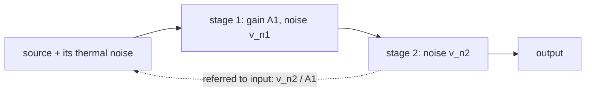

<!-- status: verified -->
# 12-10 · Noise in Circuits

| | |
|---|---|
| **Course** | [12 · Electronics II](../README.md) |
| **University equivalent** | The noise chapter of an analog electronics or analog IC course: thermal, shot and flicker noise, noise spectral density and integrated noise, transistor noise models, input-referred noise of amplifiers, kT/C noise in sampled circuits, and an introduction to noise figure (Gray, Hurst, Lewis & Meyer, ch. 11; Razavi, *Design of Analog CMOS Integrated Circuits*, the noise chapter) |
| **Prerequisites** | [03-06 Random Processes Preview: Noise](../../03-probability-statistics-and-random-variables/chapters/03-06-random-processes-preview.md) (PSD, white noise), [12-08 Op-Amp Internals](12-08-op-amp-internals.md), [10-04 Small-Signal Models](../../10-electronics-1/chapters/10-04-small-signal-models.md) |
| **Estimated study hours** | 10 |
| **Last verified** | 2026-11-20 |

**Learning objectives.** After this chapter you can:

1. Compute thermal, shot and flicker noise densities, and integrate a noise spectrum over a bandwidth to an RMS value.
2. Derive kT/C noise and use it to size a sampling capacitor for a given resolution.
3. Find the input-referred noise of transistor stages and of amplifier chains, and explain why the first stage dominates.
4. Combine an amplifier's voltage and current noise with a source's thermal noise, and compute noise figure and the optimum source resistance.
5. Read noise specifications on data sheets and convert them into equivalent noise resistances and integrated noise.

---

## 1. Big picture

Every resistor, transistor and junction generates noise: random fluctuations of voltage and current that come from the discreteness of charge and the thermal motion of carriers. Noise sets the floor under every measurement and every radio: the smallest signal a sensor can resolve, the dynamic range of an ADC, the sensitivity of a receiver. Unlike offset or distortion, it cannot be calibrated away, and unlike interference it cannot be shielded out, because it is generated inside the circuit. Design against noise is a budget: spend power (larger $g_m$), area (larger devices, capacitors) or bandwidth, and decide which stage gets each share.

- **Sensor front ends** (ECG, MEMS microphones, image sensors) are noise-limited; their first amplifier is designed around it.
- **ADCs** are specified by their signal-to-noise ratio; switched-capacitor sampling has kT/C noise built in.
- **Receivers** are specified by noise figure; the low-noise amplifier at the antenna dominates it.
- **Phase noise** of oscillators (12-09) is the same device noise, converted into timing jitter.

## 2. Intuition first

**Thermal noise as Brownian motion of charge.** Electrons in a resistor are in constant random thermal motion. At any instant slightly more move one way than the other, producing a fluctuating voltage across the resistor even with nothing connected. The fluctuation is larger in a larger resistor (the same random currents develop more voltage) and at higher temperature (more vigorous motion). It contains all frequencies equally up to the terahertz range: it is **white**.

**Shot noise as raindrops.** A current made of discrete electrons crossing a barrier (a diode junction, a transistor's base–emitter junction) arrives like raindrops on a roof: the average rate is steady, but the count in any short interval fluctuates. The fluctuation grows with the square root of the average.

**Flicker noise as slow drift.** Defects at interfaces trap and release carriers on time scales from microseconds to hours, adding a fluctuation whose power rises toward low frequency (1/f). MOSFETs, whose channel runs along the silicon–oxide interface, have much more of it than bipolar transistors.

**An analogy from finance, and where it breaks.** Noise power behaves like the variance of independent returns: uncorrelated sources add in variance, not in standard deviation, so the largest contributor dominates and halving a small contributor achieves almost nothing. The analogy breaks for flicker noise, which has long memory: its variance over an interval grows with the logarithm of the observation time instead of settling, so "averaging longer" helps much less than it does for white noise.

*Figure 1. Noise referred to the input: each later stage's noise is divided by the gain ahead of it, so the first stage dominates.*

## 3. Theory

> **Conventions.** Noise is described by its one-sided power spectral density (PSD), written $\overline{v_n^2}$ in V²/Hz or $\overline{i_n^2}$ in A²/Hz, and its square root, the **spectral density** in V/√Hz or A/√Hz. $k$ = 1.380649 × 10⁻²³ J/K; $q$ = 1.602176634 × 10⁻¹⁹ C; $T$ = 300 K unless stated, so $4kT$ = 1.657 × 10⁻²⁰ J. RMS values come from integrating the PSD over frequency.

### 3.1 Spectral density and integrated noise

A noise voltage is a random process (03-06). Its PSD $S(f)$ tells how its variance is distributed over frequency, and the total mean-square value in a band is the integral:

$$
v_{rms}^2 = \int_{f_1}^{f_2} S(f)\,df .
$$

For white noise of density $e_n$ (V/√Hz) over a bandwidth $B$, $v_{rms} = e_n\sqrt B$. Passing noise through a linear system with transfer function $H(f)$ multiplies the PSD by $\lvert H(f)\rvert^2$. **Uncorrelated sources add in power**: $v^2 = v_1^2 + v_2^2$. A source 3 times smaller than another adds only 5% to the total.

### 3.2 Thermal noise

A resistor $R$ at temperature $T$ behaves as a noiseless resistor in series with a noise voltage of PSD

$$
\overline{v_n^2} = 4kTR \quad\text{(V}^2\text{/Hz)}, \qquad\text{or in parallel with } \overline{i_n^2} = \frac{4kT}{R} .
$$

A 1 kΩ resistor at 300 K produces **4.070** nV/√Hz (Example 12-10.1). The formula follows from the equipartition theorem: the next section shows it is exactly what makes an RC circuit's capacitor hold the $\tfrac12kT$ of energy that thermodynamics requires. Reactive elements (ideal capacitors and inductors) are noiseless; only dissipation generates thermal noise.

### 3.3 kT/C noise

Filter a resistor's thermal noise with a capacitor. The transfer function from the noise source to the capacitor voltage is $1/(1 + j2\pi fRC)$, so

$$
\overline{v_C^2} = \int_0^\infty \frac{4kTR}{1 + (2\pi fRC)^2}\,df = 4kTR \cdot \frac{1}{4RC} = \frac{kT}{C} ,
$$

using $\int_0^\infty dx/(1 + x^2) = \pi/2$ with $x = 2\pi fRC$. **The resistance cancels.** A larger resistor makes more noise density but a narrower bandwidth; the two effects cancel exactly. Equivalently, the capacitor's average energy $\tfrac12C\overline{v^2} = \tfrac12kT$, as equipartition demands.

kT/C noise is fundamental to switched-capacitor circuits and ADCs: when a switch opens, the capacitor freezes a sample of this noise. At 1 pF it is **64.36** µV RMS; quieter sampling needs larger capacitors, which need more current to charge quickly. That is a direct link between resolution and power (Example 12-10.5).

### 3.4 Shot noise

A DC current $I$ made of independent charges crossing a barrier carries noise of PSD

$$
\overline{i_n^2} = 2qI .
$$

At 1 mA it is **17.90** pA/√Hz. Shot noise appears in diodes, bipolar transistors (collector and base currents) and photodiodes; it does not appear in the current through a resistor in thermal equilibrium, whose noise is thermal.

### 3.5 Flicker (1/f) noise

Flicker noise has a PSD proportional to $1/f$. A convenient description combines it with a white floor $S_w$ through the **corner frequency** $f_c$, where the two are equal:

$$
S(f) = S_w\left(1 + \frac{f_c}{f}\right), \qquad \int_{f_1}^{f_2} S_w\frac{f_c}{f}\,df = S_wf_c\ln\frac{f_2}{f_1} .
$$

*Figure 2. Example 12-10.3's amplifier. Left: the density $\sqrt{S_w(1 + f_c/f)}$ with its white and 1/f parts; they are equal at the corner. Right: RMS noise integrated from 1 Hz up to each frequency. The 1/f part climbs by the same amount every decade; the white part matters only in the last decade or two.*

Every decade contributes the same flicker noise power, so "starting the integral at 1 Hz instead of 10 Hz" adds as much as any other decade. For MOSFETs a common model is $\overline{v_n^2} = K/(C_{ox}WLf)$ at the gate: larger devices (more area to average over) have less. Corners are typically kilohertz to megahertz for MOSFETs and tens to hundreds of hertz for bipolar transistors. **Chopping** and **auto-zeroing** (the zero-drift op-amps of 10-09) move the signal away from the 1/f region instead of fighting it.

### 3.6 Transistor noise models

**MOSFET.** In saturation the channel's thermal noise is a drain current noise

$$
\overline{i_d^2} = 4kT\gamma g_m ,
$$

with γ = 2/3 for long-channel devices (larger in short channels). Referred to the gate (divided by $g_m^2$):

$$
\overline{v_{n,in}^2} = \frac{4kT\gamma}{g_m} ,
$$

plus the flicker term. The **equivalent noise resistance** $\gamma/g_m$ is the resistor whose thermal noise equals the input-referred noise: to halve the noise *power*, double $g_m$, which (at fixed overdrive) doubles the current.

**Bipolar transistor.** The collector current's shot noise $2qI_C$, referred to the base through $g_m = I_C/V_T$, gives

$$
\overline{v_{n,in}^2} = \frac{2qI_C}{g_m^2} = \frac{2kT}{g_m} = 4kT\cdot\frac{1}{2g_m} ,
$$

an equivalent noise resistance of $1/(2g_m)$, about 12.93 Ω at 1 mA. The base current's shot noise $2qI_B$ appears as an input *current* noise, which matters with high source resistances.

### 3.7 Input-referred noise of amplifiers

**A single stage.** For a common-source stage with a resistor load $R_D$, the output noise has two parts: the transistor's drain noise $4kT\gamma g_m$ and the load's $4kT/R_D$, both in the drain current. Dividing by the gain squared, $(g_mR_D)^2$, after converting to voltage:

$$
\overline{v_{n,in}^2} = 4kT\left(\frac{\gamma}{g_m} + \frac{1}{g_m^2R_D}\right) .
$$

The load's contribution is smaller than the transistor's by $\gamma g_mR_D$, the stage's gain times γ.

**A chain of stages.** Referring each stage's noise to the input through the gains ahead of it,

$$
\overline{v_{n,in}^2} = \overline{v_1^2} + \frac{\overline{v_2^2}}{A_1^2} + \frac{\overline{v_3^2}}{A_1^2A_2^2} + \cdots
$$

With a first-stage gain of 10 or more, later stages hardly matter: low-noise design is first-stage design.

**Voltage and current noise together.** An amplifier is described at its input by a noise voltage $e_n$ in series and a noise current $i_n$ in parallel. Driven from a source resistance $R_s$, the total input noise is

$$
\overline{v_{tot}^2} = 4kTR_s + e_n^2 + i_n^2R_s^2 ,
$$

assuming $e_n$ and $i_n$ uncorrelated. At low $R_s$ the voltage noise dominates; at high $R_s$ the current noise does. This is why bipolar-input op-amps (low $e_n$, higher $i_n$) suit low-impedance sources and CMOS or JFET inputs (tiny $i_n$) suit high-impedance sources.

### 3.8 Noise figure (preview)

The **noise factor** $F$ compares an amplifier's total input noise with the source's own thermal noise, and the **noise figure** is it in decibels:

$$
F = \frac{4kTR_s + e_n^2 + i_n^2R_s^2}{4kTR_s}, \qquad \text{NF} = 10\log_{10}F .
$$

$F$ is minimized at the **optimum source resistance** $R_{opt} = e_n/i_n$, where $F_{min} = 1 + e_ni_n/(2kT)$. A transformer or matching network can present $R_{opt}$ to the amplifier from a different source resistance; this is noise matching, the core of low-noise amplifier design in Course 21. For a chain of stages, Friis's formula $F = F_1 + (F_2 - 1)/G_1 + \cdots$ restates §3.7 in these units.

> **Going deeper — why the γ factor and where noise comes from microscopically.** In a long-channel MOSFET the channel's thermal noise integrates the local conductance along the channel; in saturation the result is 2/3 of what a resistor of conductance $g_m$ would produce. In short channels, hot carriers and velocity saturation raise γ to 1 or more. Noise in nonlinear and time-varying circuits (mixers, oscillators, sampled systems) needs cyclostationary analysis, which Courses 20 and 21 introduce.

## 4. Worked examples

### Example 12-10.1 · Thermal noise of resistors (tier A)

**Setup.** Find the noise density of 1 kΩ and 50 Ω resistors at 300 K, and the RMS noise of the 1 kΩ resistor over the 20 kHz audio band.

**Solution.** $\sqrt{4kT \times 1\ \text{k}\Omega}$ = **4.070** nV/√Hz; $\sqrt{4kT \times 50\ \Omega}$ = **0.9102** nV/√Hz. Over 20 kHz: $4.070\ \text{nV} \times \sqrt{20\,000}$ = **575.6** nV RMS.

**Sanity check.** A useful memory aid: 1 kΩ ≈ 4 nV/√Hz, scaling with $\sqrt R$.

### Example 12-10.2 · Shot noise (tier A)

**Setup.** Find the shot noise of a 1 mA diode current, and the voltage it develops across a 1 kΩ load. Compare with the load's own thermal noise.

**Solution.** $\sqrt{2q \times 1\ \text{mA}}$ = **17.90** pA/√Hz, which across 1 kΩ is **17.90** nV/√Hz, about 4.4 times the load's 4.070 nV/√Hz.

**Sanity check.** At 1 mA the shot noise is equivalent to the thermal noise of a resistor $2kT/(qI) = 2V_T/I$, about 52 Ω, in parallel: smaller than 1 kΩ, so more noise current.

### Example 12-10.3 · Flicker noise and integration limits (tier B)

**Setup.** An amplifier has a white input noise of 5 nV/√Hz and a flicker corner at 100 kHz. Find its integrated noise from 1 Hz to 1 MHz: the white part, the flicker part and the total.

**Solution.** White: $5\ \text{nV} \times \sqrt{10^6 - 1}$ = **5.000** µV. Flicker: $\sqrt{(5\ \text{nV})^2 \times 10^5 \times \ln 10^6}$ = **5.877** µV. Total: $\sqrt{5.000^2 + 5.877^2}$ = **7.716** µV.

**Sanity check.** The flicker noise contributes more power than the white noise even though the band extends a decade above the corner: six decades of 1/f noise each add as much as one decade's worth.

### Example 12-10.4 · A common-source stage (tier B)

**Setup.** A common-source stage has $g_m$ = 5 mA/V, γ = 2/3 and $R_D$ = 2 kΩ. Find the input-referred noise density and the equivalent noise resistance, and each part's share.

**Solution.** $\gamma/g_m$ = **133.3** Ω and $1/(g_m^2R_D)$ = **20** Ω, so $R_{eq}$ = **153.3** Ω and $\sqrt{4kT \times 153.3\ \Omega}$ = **1.594** nV/√Hz. The transistor contributes **87**% of the noise power.

**Sanity check.** The load's share is $1/(1 + \gamma g_mR_D)$ = 1/7.67: a gain of 10 already makes the load a minor contributor.

### Example 12-10.5 · Sizing a sampling capacitor (tier B)

**Setup.** Find the kT/C noise of 1 pF. Then find the capacitance whose kT/C noise equals the quantization noise (LSB/√12) of a 1 V full-scale ADC at 12 and at 16 bits.

**Solution.** $\sqrt{kT/1\ \text{pF}}$ = **64.36** µV. At 12 bits the LSB is **244.1** µV and the quantization noise **70.48** µV, so $C = kT/(70.48\ \mu\text{V})^2$ = **0.8339** pF. At 16 bits the LSB is **15.26** µV, the quantization noise **4.405** µV and $C$ = **213.5** pF.

**Sanity check.** Each extra bit halves the allowed noise and quadruples the capacitor: four bits cost a factor of 256 in capacitance, and with it in the current needed to charge it at a given speed.

### Example 12-10.6 · Noise figure and the optimum source (tier C)

**Setup.** An amplifier has $e_n$ = 1 nV/√Hz and $i_n$ = 1 pA/√Hz. Find its noise figure from a 50 Ω source, its optimum source resistance and its noise figure there.

**Solution.** From 50 Ω: $4kTR_s$ = **8.284 × 10⁻¹⁹** V²/Hz, $e_n^2$ = 10⁻¹⁸ and $(i_nR_s)^2$ = 2.5 × 10⁻²¹, so $F$ = **2.210** and NF = **3.444** dB. $R_{opt} = e_n/i_n$ = **1** kΩ, where $F$ = **1.121** and NF = **0.4950** dB.

**Sanity check.** At 50 Ω the amplifier's voltage noise exceeds the source's own noise; a transformer with an impedance ratio of **20** (turns ratio **4.47**) would present 1 kΩ and recover **2.95** dB.

### Answer key

<!-- answer-key -->
| ID | Quantity | Value | Unit |
|---|---|---|---|
| T 12-10.a | 4kT at 300 K | 1.657 × 10⁻²⁰ | J |
| T 12-10.b | BJT equivalent noise resistance at 1 mA | 12.93 | Ω |
| T 12-10.c | power added by a source 3 times smaller | 5 | % |
| Ex 12-10.1a | 1 kΩ noise density | 4.070 | nV/√Hz |
| Ex 12-10.1b | 50 Ω noise density | 0.9102 | nV/√Hz |
| Ex 12-10.1c | 1 kΩ over 20 kHz | 575.6 | nV |
| Ex 12-10.2a | shot noise at 1 mA | 17.90 | pA/√Hz |
| Ex 12-10.2b | across 1 kΩ | 17.90 | nV/√Hz |
| Ex 12-10.2c | ratio to the load's thermal noise | 4.4 | — |
| Ex 12-10.2d | equivalent shot-noise resistance | 52 | Ω |
| Ex 12-10.3a | white part | 5.000 | µV |
| Ex 12-10.3b | flicker part | 5.877 | µV |
| Ex 12-10.3c | total | 7.716 | µV |
| Ex 12-10.4a | transistor's noise resistance | 133.3 | Ω |
| Ex 12-10.4b | load's noise resistance | 20 | Ω |
| Ex 12-10.4c | equivalent noise resistance | 153.3 | Ω |
| Ex 12-10.4d | input-referred density | 1.594 | nV/√Hz |
| Ex 12-10.4e | transistor's share | 87 | % |
| Ex 12-10.4f | load's share denominator | 7.67 | — |
| Ex 12-10.5a | kT/C at 1 pF | 64.36 | µV |
| Ex 12-10.5b | 12-bit LSB | 244.1 | µV |
| Ex 12-10.5c | 12-bit quantization noise | 70.48 | µV |
| Ex 12-10.5d | 12-bit capacitor | 0.8339 | pF |
| Ex 12-10.5e | 16-bit LSB | 15.26 | µV |
| Ex 12-10.5f | 16-bit quantization noise | 4.405 | µV |
| Ex 12-10.5g | 16-bit capacitor | 213.5 | pF |
| Ex 12-10.6a | 4kTR_s at 50 Ω | 8.284 × 10⁻¹⁹ | V²/Hz |
| Ex 12-10.6b | noise factor at 50 Ω | 2.210 | — |
| Ex 12-10.6c | noise figure at 50 Ω | 3.444 | dB |
| Ex 12-10.6d | optimum source resistance | 1 | kΩ |
| Ex 12-10.6e | noise factor at the optimum | 1.121 | — |
| Ex 12-10.6f | noise figure at the optimum | 0.4950 | dB |
| Ex 12-10.6g | impedance ratio | 20 | — |
| Ex 12-10.6h | turns ratio | 4.47 | — |
| Ex 12-10.6i | noise figure recovered | 2.95 | dB |
| Prac 12-10.a | OPA1611 equivalent noise resistance | 73.03 | Ω |
| Prac 12-10.b | TLV9062 equivalent noise resistance | 6.036 | kΩ |
| Prac 12-10.c | TLV9062 fitted white floor | 9.092 | nV/√Hz |
| Prac 12-10.d | TLV9062 fitted flicker corner | 2.1 | kHz |

*Every value is recomputed by [verify_12_10.py](../verify/verify_12_10.py): integrated noise by numerical quadrature of the spectra, kT/C both by integrating the filtered thermal spectrum and by simulating the RC circuit's stochastic differential equation, the common-source stage's input noise from the solved circuit's noise transfer functions, and the noise figure and its optimum by optimization over source resistance. kT/C is also confirmed with ngspice's noise analysis.*

## 5. Simulate it

The lab, [labs/12-10-lab](../labs/12-10-lab/README.md), has a notebook and an ngspice netlist:

1. Generates white Gaussian noise with a resistor's PSD, estimates its spectrum with Welch's method, and checks $4kTR$.
2. Simulates an RC circuit driven by the resistor's noise (exactly, as a discretized Ornstein–Uhlenbeck process) for several resistances, and shows the capacitor's variance stays at kT/C.
3. Synthesizes 1/f noise and shows integrated noise growing with the logarithm of the bandwidth.
4. Plots an amplifier's noise figure against source resistance, with its minimum at $e_n/i_n$.

The netlist [rc_noise.cir](../labs/12-10-lab/rc_noise.cir) runs ngspice's noise analysis of an RC low-pass and integrates its output noise.

**Guided exercise (predict, then run).** **Before running Part 2**, predict: the capacitor in an RC circuit is 1 pF. If the resistor is raised from 1 kΩ to 100 kΩ, does the capacitor's RMS noise voltage rise tenfold? Then run it. (No: it stays at **64.36** µV for every resistance, because the noise density rises by √100 while the bandwidth falls by 100.)

## 6. Engineering tradeoffs

| Knob | Improves | Costs | Typical decision owner |
|---|---|---|---|
| First-stage $g_m$ | Input-referred thermal noise ∝ $1/g_m$ | Current, power | Analog designer |
| Input device area | Flicker noise ∝ $1/(WL)$ | Capacitance, bandwidth | Analog designer |
| Sampling capacitance | kT/C noise ∝ $1/C$ | Drive current, speed | ADC architect |
| Bandwidth | Integrated noise ∝ $\sqrt B$ (white) | Signal bandwidth | System architect |
| Chopping / auto-zero | Removes 1/f noise and offset | Ripple, glitches, complexity | Analog designer |
| Bipolar vs CMOS input | Low $e_n$ (BJT) vs low $i_n$ (CMOS) | Depends on source impedance | Product definition |

## 7. Numbers to know

| Quantity | Value | Note |
|---|---|---|
| Thermal noise | $4kTR$; 1 kΩ ≈ 4.07 nV/√Hz at 300 K | 50 Ω ≈ 0.91 nV/√Hz |
| Shot noise | $2qI$; 1 mA ≈ 17.9 pA/√Hz | |
| kT/C | 64.4 µV at 1 pF (300 K) | ∝ $1/\sqrt C$ |
| MOSFET input noise | $4kT\gamma/g_m$, γ ≈ 2/3 long-channel | Plus 1/f |
| BJT input noise | $2kT/g_m$ | $R_{eq} = 1/(2g_m)$ |
| Flicker integration | $S_wf_c\ln(f_2/f_1)$ | Each decade the same |
| Noise figure | $F = 1 + (e_n^2 + i_n^2R_s^2)/(4kTR_s)$ | $R_{opt} = e_n/i_n$ |

## 8. Common mistakes

- **Adding noise densities linearly.** Uncorrelated noise adds in power (squares).
- **Forgetting the bandwidth.** A density in nV/√Hz means nothing until it is integrated over the actual noise bandwidth.
- **Expecting a larger resistor to raise kT/C noise.** It does not: the bandwidth falls by as much as the density rises.
- **Ignoring 1/f noise at low frequency.** Below the corner it dominates, and each decade adds the same power.
- **Using an op-amp's $e_n$ alone with a high source impedance.** The current noise times $R_s$, and $R_s$'s own noise, may dominate.
- **Optimizing a later stage.** The first stage sets the noise; later stages are divided by its gain squared.

## 9. Practitioner lens

### State of the art (as of Nov 2026)

- **Op-amp noise on data sheets** [1] **[Established]** (data sheets):
  - OPA1611: 1.1 nV/√Hz at 1 kHz.
  - TLV9062: 16 nV/√Hz at 1 kHz and 10 nV/√Hz at 10 kHz.
  - INA333 instrumentation amplifier: 50 nV/√Hz at G = 100.
- **Read as equivalent resistances** (our arithmetic): the OPA1611's 1.1 nV/√Hz equals the thermal noise of a **73.03** Ω resistor, so any source above about 73 Ω out-noises the amplifier's voltage noise; the TLV9062's 10 nV/√Hz equals **6.036** kΩ.
- **A flicker corner inferred from two points.** Fitting the TLV9062's two data-sheet values to $S_w(1 + f_c/f)$ gives a white floor of **9.092** nV/√Hz and a corner near **2.1** kHz (our model fit to typical values, not a specification).

### Why it matters commercially

- **Noise per milliwatt is the figure of merit** of sensor front ends: since input noise power falls as $1/g_m$, halving it doubles the current, which a wearable's battery may not allow.
- **ADC resolution costs capacitance and power** through kT/C; high-resolution converters are large and power-hungry for physical, not design, reasons.
- **Process scaling does not help noise much**: thermal noise depends on $g_m$ per current, flicker noise worsens with smaller devices, so precision analog often stays on older nodes.

### Marketing vs Reality

- **"1 nV/√Hz noise."** *Reality:* usually white noise at 1 kHz or above; the 1/f region, the current noise and the bandwidth decide the real total. *Sanity check:* ask for integrated noise over your band, and $i_n$.
- **"Zero-drift, no 1/f noise."** *Reality:* chopping removes 1/f noise but adds ripple and glitches at the chopping frequency. *Sanity check:* ask for the noise spectrum around the chopping frequency.
- **"120 dB SNR."** *Reality:* often A-weighted or over a narrow band, at full scale. *Sanity check:* ask for unweighted SNR over the full bandwidth.

### Questions for engineering leaders

1. **"What sets your noise floor, and what would it cost to lower it 3 dB?"**
   *Strong:* the dominant source (first-stage $g_m$, kT/C, reference) and the power or area needed. *Evasive:* "our process is low noise."
2. **"What is your integrated noise over the application's band, including 1/f?"**
   *Strong:* a number with the integration limits. *Evasive:* a spot density.
3. **"How does noise scale with your next process node?"**
   *Strong:* thermal noise per watt roughly constant, flicker noise worse unless area is spent. *Evasive:* "better, because it's a newer node."

## 10. Concept check

**Q1.** Why does kT/C noise not depend on the resistance?

Answer

The noise density rises as $\sqrt R$ while the RC bandwidth falls as $1/R$; integrating $4kTR$ over the noise bandwidth $1/(4RC)$ gives exactly $kT/C$.

**Q2.** Why does the first stage dominate an amplifier chain's noise?

Answer

Referred to the input, each later stage's noise power is divided by the square of the gain ahead of it.

**Q3.** Why does integrated 1/f noise grow even when the bandwidth extends only to lower frequencies?

Answer

Its power per decade is constant, so each extra decade toward DC adds the same amount; the integral grows as the logarithm of the frequency ratio.

**Q4.** Why do bipolar-input op-amps suit low source impedances and CMOS ones high impedances?

Answer

Bipolar inputs have low voltage noise but base-current shot noise, which matters through $i_nR_s$ at high $R_s$; CMOS inputs have almost no current noise but higher voltage noise.

**Q5.** What is the optimum source resistance of an amplifier, and why?

Answer

$e_n/i_n$: it balances the voltage-noise term, which matters more at low $R_s$, against the current-noise term, which grows with $R_s$, relative to the source's own thermal noise.

**Q6.** How do you halve a MOSFET stage's input-referred thermal noise voltage?

Answer

Quadruple $g_m$ (the noise power is $4kT\gamma/g_m$), which at fixed overdrive means four times the current.

[Problem set for this chapter](../problems/12-10-problems.md)

## 11. Key terms

[Thermal noise](../../../reference/glossary.md#thermal-noise) · [Shot noise](../../../reference/glossary.md#shot-noise) · [Flicker noise](../../../reference/glossary.md#flicker-noise) · [kT/C noise](../../../reference/glossary.md#ktc-noise) · [Input-referred noise](../../../reference/glossary.md#input-referred-noise) · [Equivalent noise resistance](../../../reference/glossary.md#equivalent-noise-resistance) · [Noise figure](../../../reference/glossary.md#noise-figure) · [Power spectral density](../../../reference/glossary.md#power-spectral-density)

## 12. Connections

- **Builds on:** random processes and PSD from [03-06](../../03-probability-statistics-and-random-variables/chapters/03-06-random-processes-preview.md); small-signal models from [10-04](../../10-electronics-1/chapters/10-04-small-signal-models.md); op-amp structure from [12-08](12-08-op-amp-internals.md); oscillators from [12-09](12-09-oscillators.md) (phase noise).
- **Next:** the Course 12 exam; then [Course 13 · Electromagnetics](../../13-electromagnetics/README.md).
- **Used later:** ADC and switched-capacitor noise in [Course 20](../../20-analog-and-mixed-signal-ic-design/README.md); receiver noise figure and LNAs in [Course 21](../../21-rf-and-microwave-engineering/README.md); noise in communication links in [Course 17](../../17-communication-systems/README.md).

## 13. Further study

- P. R. Gray, P. J. Hurst, S. H. Lewis and R. G. Meyer, *Analysis and Design of Analog Integrated Circuits*, ch. 11 (noise in integrated circuits).
- B. Razavi, *Design of Analog CMOS Integrated Circuits*, the noise chapter.
- H. W. Ott, *Electromagnetic Compatibility Engineering* (Wiley, 2009), the intrinsic noise sources chapter, for a practical view.

## 14. Sources

1. Texas Instruments data sheets for OPA1611 (SBOS450C), TLV906xS (SBOS839N) and INA333 (SBOS445C): input voltage noise density. [R-182](../../../reference/research-log.md#r-182--op-amp-data-sheets), [R-183](../../../reference/research-log.md#r-183--instrumentation-amplifier-and-comparator-data-sheets).
