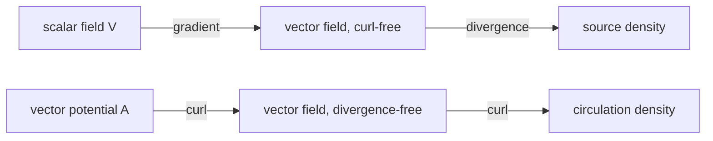
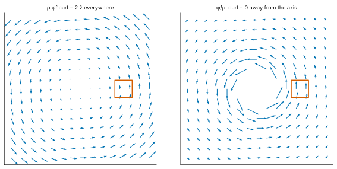

<!-- status: reviewed -->
# 13-01 · Vector Calculus Refresher

| | |
|---|---|
| **Course** | [13 · Electromagnetics](../README.md) |
| **University equivalent** | The vector-analysis chapter that opens a junior electromagnetics course: Cartesian, cylindrical and spherical coordinates, gradient, divergence, curl and Laplacian in each, the divergence and Stokes theorems, and the identities Maxwell's equations rely on (Ulaby & Ravaioli, *Fundamentals of Applied Electromagnetics*, ch. 3; Cheng, *Field and Wave Electromagnetics*, ch. 2; MIT 6.013) |
| **Prerequisites** | [01-10 Multivariable Calculus II](../../01-calculus-for-engineers/chapters/01-10-multivariable-calculus-2.md) (line and surface integrals, divergence and curl in Cartesian form), [04-03 Gauss's Law](../../04-physics-for-ee/chapters/04-03-gauss-law.md) |
| **Estimated study hours** | 10 |
| **Last verified** | 2026-11-20 |

**Learning objectives.** After this chapter you can:

1. Convert points and vector components between Cartesian, cylindrical and spherical coordinates, using unit vectors that change direction from point to point.
2. Derive the gradient, divergence, curl and Laplacian in any orthogonal coordinate system from its scale factors, and apply them in cylindrical and spherical form.
3. Use the divergence and Stokes theorems to move between local (differential) and global (integral) statements of a field law.
4. Apply the standard vector identities, including curl-of-gradient, divergence-of-curl and curl-of-curl, and state what the Helmholtz theorem says about specifying a field.
5. Choose the coordinate system that matches a problem's symmetry and recognize field forms (such as $1/r^2$ and $1/\rho$) that are source-free away from the origin or axis.

---

## 1. Big picture

Electromagnetics is written in the language of vector fields: a vector attached to every point of space. Maxwell's equations are four statements about how those fields change from place to place (their divergence and curl) and how those local changes add up over surfaces and volumes (the integral theorems). Course 01 introduced divergence, curl and the theorems in Cartesian coordinates. Real structures are rarely boxes: wires and coaxial cables are cylinders, antennas radiate into spheres, and choosing coordinates that match a problem's symmetry turns an impossible integral into one line. This chapter makes the operators work in any of the three standard coordinate systems, and collects the identities the rest of the course uses constantly.

- **Every EM law has two forms.** Gauss's law is $\nabla\cdot\vec{D} = \rho_v$ at a point and $\oint\vec{D}\cdot d\vec{S} = Q$ over a surface; the divergence theorem connects them.
- **Symmetry selects the coordinates.** A coaxial cable's fields depend only on ρ; a point charge's only on $r$.
- **Identities do real work.** $\nabla\cdot(\nabla\times\vec{A}) = 0$ is why magnetic field lines never end; $\nabla\times\nabla\times\vec{E}$ is how the wave equation appears (13-05).
- **Field solvers do this numerically.** The capacitance, inductance and S-parameters of packages and boards come from software that discretizes exactly these operators (13-02, 13-03).

## 2. Intuition first

**Divergence as net outflow, curl as circulation.** Picture a small box in a flowing fluid. If more fluid leaves the box than enters, the flow has positive **divergence** there: there is a source inside. Put a tiny paddle wheel in the flow; if it spins, the flow has **curl**, and the axis of spin gives its direction. The gradient points uphill on a scalar map, with length equal to the steepness. Electric fields diverge from charges; magnetic fields curl around currents.

**Why curvilinear coordinates need care.** In Cartesian coordinates the unit vectors $\hat{x}, \hat{y}, \hat{z}$ point the same way everywhere. In cylindrical coordinates, $\hat\rho$ points away from the axis, so it points east at one point and north at another. A field with a constant $\rho$-component is not constant: it spreads out. A step $d\phi$ in angle is a distance $\rho\,d\phi$, not $d\phi$. The **scale factors** ($1$, $\rho$, $r$, $r\sin\theta$) convert coordinate changes into distances, and they are why the operators have extra terms.

**An analogy from finance, and where it breaks.** Divergence is like the net cash flow of a business unit: inflows minus outflows per unit size. The divergence theorem is the consolidation rule: the net flow across a group's external boundary equals the sum of the units' net flows, because internal transfers cancel. The analogy breaks for curl, which has no accounting counterpart: it measures circulation (flows going around), and Stokes's theorem says the internal circulations cancel in the same way, leaving only the boundary loop.

*Figure 1. The operators as maps between fields. Gradient fields have no curl and curl fields have no divergence; the Helmholtz theorem (§3.6) says every well-behaved field is a sum of one of each.*

## 3. Theory

> **Conventions.** Vector fields carry arrows ($\vec{E}$), unit vectors carry hats ($\hat\rho$). Cylindrical coordinates are $(\rho, \phi, z)$ with $\rho \ge 0$ the distance from the $z$-axis; spherical coordinates are $(r, \theta, \phi)$ with $\theta$ the polar angle from $+z$ ($0 \le \theta \le \pi$) and $\phi$ the azimuth, shared with the cylindrical system.

### 3.1 The three coordinate systems

**Point conversions.**

$$
\begin{aligned}
x &= \rho\cos\phi, & y &= \rho\sin\phi, & z &= z;\\
x &= r\sin\theta\cos\phi, & y &= r\sin\theta\sin\phi, & z &= r\cos\theta;\\
\rho &= \sqrt{x^2 + y^2}, & r &= \sqrt{x^2 + y^2 + z^2}, & \theta &= \arccos(z/r),\ \phi = \operatorname{atan2}(y, x).
\end{aligned}
$$

**Unit vectors.** Each unit vector points in the direction a point moves when one coordinate increases:

$$
\begin{aligned}
\hat\rho &= \cos\phi\,\hat{x} + \sin\phi\,\hat{y}, & \hat\phi &= -\sin\phi\,\hat{x} + \cos\phi\,\hat{y};\\
\hat{r} &= \sin\theta\cos\phi\,\hat{x} + \sin\theta\sin\phi\,\hat{y} + \cos\theta\,\hat{z}, & \hat\theta &= \cos\theta\cos\phi\,\hat{x} + \cos\theta\sin\phi\,\hat{y} - \sin\theta\,\hat{z}.
\end{aligned}
$$

Each set is orthonormal and right-handed: $\hat\rho\times\hat\phi = \hat{z}$ and $\hat{r}\times\hat\theta = \hat\phi$. To convert a vector's components, take dot products: for example $A_\rho = \vec{A}\cdot\hat\rho = A_x\cos\phi + A_y\sin\phi$. Because $\hat\rho$ and $\hat\phi$ depend on $\phi$, a vector's cylindrical components depend on *where* it is evaluated, not only on the vector itself (Example 13-01.1).

**Scale factors and elements.** Moving by $du_i$ in coordinate $u_i$ covers a distance $h_i\,du_i$:

| System | $(u_1, u_2, u_3)$ | $(h_1, h_2, h_3)$ | Volume element $dv$ |
|---|---|---|---|
| Cartesian | $(x, y, z)$ | $(1, 1, 1)$ | $dx\,dy\,dz$ |
| Cylindrical | $(\rho, \phi, z)$ | $(1, \rho, 1)$ | $\rho\,d\rho\,d\phi\,dz$ |
| Spherical | $(r, \theta, \phi)$ | $(1, r, r\sin\theta)$ | $r^2\sin\theta\,dr\,d\theta\,d\phi$ |

A surface element normal to $\hat{u}_1$ is $h_2h_3\,du_2\,du_3$: for a sphere, $dS = r^2\sin\theta\,d\theta\,d\phi$, which integrates to $4\pi r^2$.

### 3.2 The gradient

The gradient of a scalar $V$ is the vector whose component in any direction is the rate of change of $V$ per unit *distance* in that direction. Since a step $du_i$ is a distance $h_i\,du_i$,

$$
\nabla V = \sum_i \frac{1}{h_i}\frac{\partial V}{\partial u_i}\hat{u}_i:\qquad
\nabla V = \frac{\partial V}{\partial\rho}\hat\rho + \frac{1}{\rho}\frac{\partial V}{\partial\phi}\hat\phi + \frac{\partial V}{\partial z}\hat{z} = \frac{\partial V}{\partial r}\hat{r} + \frac1r\frac{\partial V}{\partial\theta}\hat\theta + \frac{1}{r\sin\theta}\frac{\partial V}{\partial\phi}\hat\phi .
$$

The change of $V$ along a small displacement $d\vec{l}$ is $dV = \nabla V\cdot d\vec{l}$, so the gradient points in the direction of steepest increase and is perpendicular to the surfaces of constant $V$. In electrostatics $\vec{E} = -\nabla V$ (04-04).

### 3.3 The divergence

**Definition.** The divergence is the net outward flux per unit volume of a vanishing volume:

$$
\nabla\cdot\vec{A} = \lim_{\Delta v \to 0}\frac{1}{\Delta v}\oint_S\vec{A}\cdot d\vec{S} .
$$

**Derivation in orthogonal coordinates.** Take a small box with edges $h_1du_1$, $h_2du_2$, $h_3du_3$. The flux through the face at $u_1$ is $A_1h_2h_3\,du_2du_3$; through the opposite face at $u_1 + du_1$ it is that quantity evaluated a step later. Their difference is $\frac{\partial}{\partial u_1}(A_1h_2h_3)\,du_1du_2du_3$: the scale factors must stay *inside* the derivative, because the face area changes as $u_1$ changes. Adding the three pairs and dividing by the volume $h_1h_2h_3\,du_1du_2du_3$:

$$
\nabla\cdot\vec{A} = \frac{1}{h_1h_2h_3}\left[\frac{\partial}{\partial u_1}(h_2h_3A_1) + \frac{\partial}{\partial u_2}(h_3h_1A_2) + \frac{\partial}{\partial u_3}(h_1h_2A_3)\right] .
$$

Substituting the scale factors:

$$
\nabla\cdot\vec{A} = \frac1\rho\frac{\partial(\rho A_\rho)}{\partial\rho} + \frac1\rho\frac{\partial A_\phi}{\partial\phi} + \frac{\partial A_z}{\partial z}
= \frac{1}{r^2}\frac{\partial(r^2A_r)}{\partial r} + \frac{1}{r\sin\theta}\frac{\partial(\sin\theta A_\theta)}{\partial\theta} + \frac{1}{r\sin\theta}\frac{\partial A_\phi}{\partial\phi} .
$$

**What it reveals.** A radial field $A_r = kr^n$ has divergence $(n + 2)kr^{n-1}$: it is source-free only for $n = -2$, the inverse-square law. That is why Coulomb's field has no divergence except at the charge itself, and why it is the only radial law that conserves flux through every sphere. In cylindrical coordinates the source-free radial field is $1/\rho$, the field of a line charge.

### 3.4 The curl

**Definition.** The component of the curl along a unit vector $\hat{n}$ is the circulation per unit area around a vanishing loop perpendicular to $\hat{n}$:

$$
(\nabla\times\vec{A})\cdot\hat{n} = \lim_{\Delta S \to 0}\frac{1}{\Delta S}\oint_C\vec{A}\cdot d\vec{l} .
$$

**Deriving one component.** Take the $z$-component in cylindrical coordinates. The loop lies in a plane of constant $z$ and runs counter-clockwise seen from $+z$ (so its normal is $+\hat{z}$ by the right-hand rule): out along $\hat\rho$ from $(\rho, \phi)$ to $(\rho + \Delta\rho, \phi)$, round along $\hat\phi$ to $\phi + \Delta\phi$, back in along $-\hat\rho$, and back round along $-\hat\phi$. The two radial sides have length $\Delta\rho$; the arcs have lengths $(\rho + \Delta\rho)\Delta\phi$ and $\rho\Delta\phi$. Adding the four contributions $\vec{A}\cdot d\vec{l}$ in pairs:

$$
\oint\vec{A}\cdot d\vec{l} \approx \big[(\rho A_\phi)_{\rho + \Delta\rho} - (\rho A_\phi)_\rho\big]\Delta\phi - \big[(A_\rho)_{\phi + \Delta\phi} - (A_\rho)_\phi\big]\Delta\rho \approx \Big[\frac{\partial(\rho A_\phi)}{\partial\rho} - \frac{\partial A_\rho}{\partial\phi}\Big]\Delta\rho\,\Delta\phi .
$$

The loop's area is $\Delta S = \rho\,\Delta\rho\,\Delta\phi$, so dividing and letting the loop shrink gives $(\nabla\times\vec{A})_z = (1/\rho)\big[\partial(\rho A_\phi)/\partial\rho - \partial A_\rho/\partial\phi\big]$. The factor ρ inside the first derivative comes from the arcs' lengths; the $1/\rho$ outside comes from the area. Repeating this for every component in general coordinates gives a determinant form in which each component carries its scale factor:

$$
\nabla\times\vec{A} = \frac{1}{h_1h_2h_3}\begin{vmatrix} h_1\hat{u}_1 & h_2\hat{u}_2 & h_3\hat{u}_3\\ \partial/\partial u_1 & \partial/\partial u_2 & \partial/\partial u_3\\ h_1A_1 & h_2A_2 & h_3A_3\end{vmatrix} .
$$

In cylindrical coordinates:

$$
\nabla\times\vec{A} = \left(\frac1\rho\frac{\partial A_z}{\partial\phi} - \frac{\partial A_\phi}{\partial z}\right)\hat\rho + \left(\frac{\partial A_\rho}{\partial z} - \frac{\partial A_z}{\partial\rho}\right)\hat\phi + \frac1\rho\left(\frac{\partial(\rho A_\phi)}{\partial\rho} - \frac{\partial A_\rho}{\partial\phi}\right)\hat{z} .
$$

In spherical coordinates:

$$
\begin{aligned}
\nabla\times\vec{A} ={}& \frac{1}{r\sin\theta}\left(\frac{\partial(\sin\theta A_\phi)}{\partial\theta} - \frac{\partial A_\theta}{\partial\phi}\right)\hat{r} + \frac1r\left(\frac{1}{\sin\theta}\frac{\partial A_r}{\partial\phi} - \frac{\partial(rA_\phi)}{\partial r}\right)\hat\theta\\
&+ \frac1r\left(\frac{\partial(rA_\theta)}{\partial r} - \frac{\partial A_r}{\partial\theta}\right)\hat\phi .
\end{aligned}
$$

**What it reveals.** An azimuthal field $A_\phi = k\rho^n$ has curl $(n + 1)k\rho^{n-1}\hat{z}$: it is curl-free only for $n = -1$. The magnetic field outside a straight wire, $B_\phi \propto 1/\rho$, circulates around the wire yet has no curl anywhere except on it: a paddle wheel placed beside the wire does not spin, because the faster flow on its inner side is exactly balanced by the longer path on its outer side.

*Figure 2. Two fields that both circulate. Left: $\rho\hat\phi$, whose curl is $2\hat z$ everywhere; the small loop's outer side carries more circulation than its inner side subtracts. Right: $\hat\phi/\rho$, the shape of the field outside a wire, curl-free away from the axis; the loop's stronger inner field and longer outer path balance exactly.*

### 3.5 The Laplacian

The Laplacian of a scalar is the divergence of its gradient:

$$
\nabla^2V = \frac1\rho\frac{\partial}{\partial\rho}\left(\rho\frac{\partial V}{\partial\rho}\right) + \frac{1}{\rho^2}\frac{\partial^2V}{\partial\phi^2} + \frac{\partial^2V}{\partial z^2}
= \frac{1}{r^2}\frac{\partial}{\partial r}\left(r^2\frac{\partial V}{\partial r}\right) + \frac{1}{r^2\sin\theta}\frac{\partial}{\partial\theta}\left(\sin\theta\frac{\partial V}{\partial\theta}\right) + \frac{1}{r^2\sin^2\theta}\frac{\partial^2V}{\partial\phi^2} .
$$

Laplace's equation $\nabla^2V = 0$ governs potential in charge-free regions (13-02). Its radial solutions are $V = a + b/r$ (spherical) and $V = a + b\ln\rho$ (cylindrical), the potentials of a point charge and a line charge. For a vector field, the **vector Laplacian** is defined by $\nabla^2\vec{A} = \nabla(\nabla\cdot\vec{A}) - \nabla\times\nabla\times\vec{A}$; only in Cartesian coordinates is it simply the Laplacian of each component.

### 3.6 The integral theorems and the identities

**Divergence theorem.** For a closed surface $S$ enclosing volume $v$:

$$
\oint_S\vec{A}\cdot d\vec{S} = \int_v\nabla\cdot\vec{A}\,dv .
$$

*Why it holds.* Divide the volume into small cells. Each cell's outward flux is its divergence times its volume (the definition). Summing, every interior face is shared by two cells with opposite normals, so its contributions cancel, leaving only the outer surface.

**Stokes's theorem.** For an open surface $S$ bounded by the closed curve $C$ (traversed so that the right-hand rule gives $d\vec{S}$):

$$
\oint_C\vec{A}\cdot d\vec{l} = \int_S(\nabla\times\vec{A})\cdot d\vec{S} .
$$

The same cancellation argument applies to small loops tiling the surface. Any surface spanning the same curve gives the same answer (Example 13-01.6).

**The identities.** For smooth fields:

| Identity | Meaning |
|---|---|
| $\nabla\times(\nabla V) = 0$ | Gradient fields have no circulation; static $\vec{E}$ is curl-free |
| $\nabla\cdot(\nabla\times\vec{A}) = 0$ | Curl fields have no sources; $\vec{B} = \nabla\times\vec{A}$ has no monopoles |
| $\nabla\times\nabla\times\vec{A} = \nabla(\nabla\cdot\vec{A}) - \nabla^2\vec{A}$ | Turns Maxwell's curl equations into wave equations |
| $\nabla\cdot(V\vec{A}) = V\nabla\cdot\vec{A} + \vec{A}\cdot\nabla V$ | Product rule; used for energy |
| $\nabla\cdot(\vec{A}\times\vec{B}) = \vec{B}\cdot(\nabla\times\vec{A}) - \vec{A}\cdot(\nabla\times\vec{B})$ | Gives Poynting's theorem (13-04) |

*Proof of the first two.* In Cartesian coordinates, each component of $\nabla\times\nabla V$ is a difference of mixed partial derivatives such as $\partial^2V/\partial y\partial z - \partial^2V/\partial z\partial y$, which vanish when the derivatives are continuous. Likewise $\nabla\cdot(\nabla\times\vec{A})$ is a sum of three such pairs. Since the results are vectors and scalars, they hold in every coordinate system. The integral view is just as quick: by Stokes, the circulation of $\nabla V$ around any loop is $V$'s change around the loop, zero; for $\nabla\cdot(\nabla\times\vec{A})$, the divergence theorem turns its volume integral into the flux of $\nabla\times\vec{A}$ through the closed surface; cut that surface into two caps along any loop, apply Stokes's theorem to each, and the two circulations around the shared loop cancel (it is traversed in opposite directions), so the flux is zero for every volume.

> **Going deeper — the Helmholtz theorem.** A vector field that is smooth and decays fast enough at infinity is determined uniquely by its divergence and its curl. It can be written as $\vec{F} = -\nabla\Phi + \nabla\times\vec{A}$, with $\Phi$ built from the divergence (the "sources") and $\vec{A}$ from the curl (the "vortices"). This is why Maxwell's equations specify both the divergence and the curl of each field: together, with boundary conditions, they pin the fields down. The proof uses the Green's function $1/(4\pi\lvert\vec{r} - \vec{r}'\rvert)$ of the Laplacian; Griffiths gives it in an appendix.

> **Math refresher — the delta function in three dimensions.** The flux of $\hat{r}/r^2$ through any sphere centred on the origin is $4\pi$, yet its divergence is zero everywhere except $r = 0$. The divergence theorem then requires $\nabla\cdot(\hat{r}/r^2) = 4\pi\delta^3(\vec{r})$, a spike at the origin whose volume integral is $4\pi$. Equivalently $\nabla^2(1/r) = -4\pi\delta^3(\vec{r})$. This is how a point charge appears in Gauss's law in differential form.

## 4. Worked examples

### Example 13-01.1 · Converting a point and a vector (tier A)

**Setup.** At the point $(x, y, z) = (1, \sqrt3, 2)$, find the cylindrical and spherical coordinates. Then express the vector $\vec{A} = \hat{x} + \hat{y}$ (located at that point) in cylindrical and spherical components.

**Solution.** $\rho = \sqrt{1 + 3}$ = **2**, $\phi = \operatorname{atan2}(\sqrt3, 1)$ = **60**°, $z = 2$. $r = \sqrt{1 + 3 + 4}$ = **2.828**, $\theta = \arccos(2/2.828)$ = **45**°.

$A_\rho = \cos 60^\circ + \sin 60^\circ$ = **1.366**, $A_\phi = -\sin 60^\circ + \cos 60^\circ$ = **−0.3660**, $A_z = 0$. In spherical components, $A_r = \sin 45^\circ(\cos 60^\circ + \sin 60^\circ)$ = **0.9659** and $A_\theta = \cos 45^\circ(\cos 60^\circ + \sin 60^\circ)$ = **0.9659**, $A_\phi$ as before.

**Units and sanity check.** The magnitude is preserved: $1.366^2 + 0.366^2 = 2$ and $0.9659^2 \times 2 + 0.366^2 = 2$, matching $\lvert\vec{A}\rvert^2 = 2$.

### Example 13-01.2 · The field of a dipole from its potential (tier A)

**Setup.** A dipole of moment $p$ = 1 pC·m at the origin, along $z$, has potential $V = p\cos\theta/(4\pi\varepsilon_0r^2)$ far from it. Find $\vec{E} = -\nabla V$ and evaluate it at $r$ = 1 mm, θ = 60°.

**Solution.** In spherical coordinates,

$$
E_r = -\frac{\partial V}{\partial r} = \frac{2p\cos\theta}{4\pi\varepsilon_0r^3}, \qquad E_\theta = -\frac1r\frac{\partial V}{\partial\theta} = \frac{p\sin\theta}{4\pi\varepsilon_0r^3}, \qquad E_\phi = 0 .
$$

At the point: $V$ = **4494** V, $E_r$ = **8.988** MV/m, $E_\theta$ = **7.783** MV/m, $\lvert\vec{E}\rvert$ = **11.89** MV/m.

**Units and sanity check.** C·m/(F/m · m³) = V/m. Along the axis (θ = 0) the field is twice its value broadside at the same distance, the familiar 2:1 of the dipole.

### Example 13-01.3 · Which radial fields have no sources? (tier B)

**Setup.** For $\vec{A} = kr^n\hat{r}$ (spherical) and $\vec{B} = k\rho^n\hat\rho$ (cylindrical), find the divergence and the exponent that makes each source-free. Then check Gauss's law inside a uniformly charged sphere, where $\vec{D} = (\rho_0r/3)\hat{r}$.

**Solution.** $\nabla\cdot\vec{A} = \frac{1}{r^2}\frac{d}{dr}(kr^{n+2}) = (n + 2)kr^{n-1}$, zero for $n$ = **−2**. $\nabla\cdot\vec{B} = \frac1\rho\frac{d}{d\rho}(k\rho^{n+1}) = (n + 1)k\rho^{n-1}$, zero for $n$ = **−1**. Inside the sphere, $n = 1$ and $k = \rho_0/3$, so $\nabla\cdot\vec{D} = 3 \times \rho_0/3 = \rho_0$: Gauss's law in differential form.

**Sanity check.** Point charges give $1/r^2$, line charges $1/\rho$: exactly the source-free exponents outside their sources.

### Example 13-01.4 · The curl of a wire's magnetic field (tier B)

**Setup.** A long wire of radius $a$ = 1 mm carries $I$ = 10 A uniformly. Inside, $\vec{B} = \mu_0I\rho/(2\pi a^2)\hat\phi$; outside, $\vec{B} = \mu_0I/(2\pi\rho)\hat\phi$. Find $\nabla\times\vec{B}$ in both regions and compare with $\mu_0\vec{J}$. Evaluate $B$ at ρ = 0.5, 1 and 2 mm.

**Solution.** Inside, $(\nabla\times\vec{B})_z = \frac1\rho\frac{\partial}{\partial\rho}\left(\frac{\mu_0I\rho^2}{2\pi a^2}\right) = \frac{\mu_0I}{\pi a^2}$, which is $\mu_0J$ with $J = I/(\pi a^2)$ = **3.183 × 10⁶** A/m². Outside, $\rho B_\phi$ is constant, so the curl is zero. $B$ = **1** mT at 0.5 mm, **2** mT at the surface and **1** mT at 2 mm.

**Sanity check.** The field peaks at the surface and falls both inward (less current enclosed) and outward ($1/\rho$): Ampère's law in differential form holds wherever there is current and nowhere else.

### Example 13-01.5 · The divergence theorem on a sphere (tier B)

**Setup.** For $\vec{F} = r^2\hat{r}$, verify the divergence theorem on a sphere of radius $R$ = 2.

**Solution.** Surface: $F_r = R^2$ over an area $4\pi R^2$, so the flux is $4\pi R^4$ = **201.1**. Volume: $\nabla\cdot\vec{F} = \frac{1}{r^2}\frac{d}{dr}(r^4) = 4r$, and $\int_0^R 4r \cdot 4\pi r^2\,dr = 4\pi R^4$ = **201.1**.

**Sanity check.** Doubling $R$ multiplies both by 16, as the $R^4$ scaling requires.

### Example 13-01.6 · Stokes's theorem on a hemisphere (tier C)

**Setup.** For $\vec{F} = -y\hat{x} + x\hat{y}$ (that is, $\rho\hat\phi$), compute the circulation around the circle ρ = $R$ = 1.5 in the $xy$-plane, and the flux of the curl through (a) the flat disc and (b) the upper hemisphere bounded by that circle.

**Solution.** Circulation: $F_\phi = R$ over a length $2\pi R$, so $2\pi R^2$ = **14.14**. The curl is $\frac1\rho\frac{d}{d\rho}(\rho^2)\hat{z} = 2\hat{z}$. (a) Through the disc: $2 \times \pi R^2$ = **14.14**. (b) Through the hemisphere: $\int 2\hat{z}\cdot\hat{r}\,R^2\sin\theta\,d\theta\,d\phi = 2R^2 \cdot 2\pi \cdot \int_0^{\pi/2}\cos\theta\sin\theta\,d\theta = 2\pi R^2$ = **14.14**.

**Sanity check.** Any surface spanning the same loop gives the same flux of a curl, because the curl has no divergence: the flux "in through the disc" must come "out through the dome".

### Answer key

<!-- answer-key -->
| ID | Quantity | Value | Unit |
|---|---|---|---|
| Ex 13-01.1a | ρ | 2 | — |
| Ex 13-01.1b | φ | 60 | ° |
| Ex 13-01.1c | r | 2.828 | — |
| Ex 13-01.1d | θ | 45 | ° |
| Ex 13-01.1e | A_ρ | 1.366 | — |
| Ex 13-01.1f | A_φ | −0.3660 | — |
| Ex 13-01.1g | A_r | 0.9659 | — |
| Ex 13-01.1h | A_θ | 0.9659 | — |
| Ex 13-01.2a | potential | 4494 | V |
| Ex 13-01.2b | E_r | 8.988 | MV/m |
| Ex 13-01.2c | E_θ | 7.783 | MV/m |
| Ex 13-01.2d | field magnitude | 11.89 | MV/m |
| Ex 13-01.3a | source-free spherical exponent | −2 | — |
| Ex 13-01.3b | source-free cylindrical exponent | −1 | — |
| Ex 13-01.4a | current density | 3.183 × 10⁶ | A/m² |
| Ex 13-01.4b | B at 0.5 mm | 1 | mT |
| Ex 13-01.4c | B at the surface | 2 | mT |
| Ex 13-01.4d | B at 2 mm | 1 | mT |
| Ex 13-01.5a | flux through the sphere | 201.1 | — |
| Ex 13-01.5b | volume integral of the divergence | 201.1 | — |
| Ex 13-01.6a | circulation | 14.14 | — |
| Ex 13-01.6b | flux of the curl through the disc | 14.14 | — |
| Ex 13-01.6c | flux of the curl through the hemisphere | 14.14 | — |

*Every value is recomputed by [verify_13_01.py](../verify/verify_13_01.py): coordinates and components with numpy, the curvilinear operators by symbolic differentiation in Cartesian coordinates (sympy) evaluated at the same points rather than from the chapter's formulas, and both integral theorems by numerical quadrature of the surface and volume (or line and surface) integrals separately.*

## 5. Simulate it

The lab, [labs/13-01-lab](../labs/13-01-lab/README.md), is a notebook:

1. Plots $\hat\rho$ and $\hat\phi$ at points around a circle to show how the unit vectors turn.
2. Uses sympy to compute gradient, divergence, curl and Laplacian in cylindrical and spherical coordinates from scale factors, and checks each against the Cartesian computation.
3. Verifies the divergence theorem for a radial field on spheres and on a cube, and Stokes's theorem on a disc and a cone over the same circle.
4. Shows the delta function numerically: the flux of $\hat{r}/r^2$ through a sphere stays $4\pi$ while the volume integral of its divergence, computed on a grid that excludes a shrinking ball around the origin, stays zero.

**Guided exercise (predict, then run).** **Before running Part 4**, predict: the flux of $\hat{r}/r^2$ through a sphere of radius 0.01 and through one of radius 100. Then run it. (Both are $4\pi$ = **12.57**: the inverse-square field carries the same flux through every enclosing sphere, which is Gauss's law.)

## 6. Engineering tradeoffs

| Knob | Improves | Costs | Typical decision owner |
|---|---|---|---|
| Coordinates matched to symmetry | One-line integrals, separable equations | Extra scale-factor terms; singular axis or origin | Analyst |
| Differential form | Local behaviour, numerical solvers (finite differences, FEM) | Needs smooth fields; boundaries handled separately | EM simulation engineer |
| Integral form | Symmetric problems by hand, discontinuities and boundaries | Only easy with symmetry | Analyst |
| Potentials ($V$, $\vec{A}$) instead of fields | Fewer unknowns, identities enforced automatically | Gauge choices, one more derivative | Analyst, solver developer |

## 7. Numbers to know

| Quantity | Value | Note |
|---|---|---|
| Scale factors | cylindrical $(1, \rho, 1)$; spherical $(1, r, r\sin\theta)$ | Distances per coordinate step |
| Sphere | area $4\pi r^2$, volume $\tfrac43\pi r^3$ | $\int\sin\theta\,d\theta\,d\phi = 4\pi$ |
| Source-free radial fields | $1/r^2$ (spherical), $1/\rho$ (cylindrical) | Point and line charges |
| Curl-free azimuthal field | $1/\rho$ | Field outside a wire |
| Laplace radial solutions | $a + b/r$, $a + b\ln\rho$ | Point and line charge potentials |
| $\nabla^2(1/r)$ | $-4\pi\delta^3(\vec{r})$ | Point source |

## 8. Common mistakes

- **Dropping scale factors inside derivatives.** $\nabla\cdot\vec{A} = \frac{1}{r^2}\partial_r(r^2A_r) + \dots$, not $\partial_rA_r$.
- **Treating $\hat\rho$, $\hat\phi$, $\hat{r}$, $\hat\theta$ as constant.** They change with position; integrate their Cartesian forms when summing vectors over a region.
- **Using the polar angle and azimuth interchangeably.** θ is measured from $+z$; φ is the azimuth shared with cylindrical coordinates.
- **Forgetting the orientation in Stokes's theorem.** The loop direction and $d\vec{S}$ follow the right-hand rule.
- **Assuming a field that circulates has curl.** The field outside a wire circulates but is curl-free.
- **Ignoring singular points.** $1/r^2$ and $1/\rho$ fields have zero divergence or curl except where they blow up; that is where the source is.

## 9. Practitioner lens

### Where this mathematics shows up (as of Nov 2026)

- **Field solvers discretize these operators.** Finite-difference, finite-element and boundary-element tools compute capacitance and inductance matrices of interconnects and packages, and full-wave S-parameters, by solving the divergence and curl equations on meshes **[Established]** (13-02, 13-03; Course 24).
- **Symmetry is still the first design tool.** Coaxial cables, cylindrical vias and spherical-wave antenna analysis all use the coordinates that make the operators simple **[Established]**.

### Why it matters commercially

- **Signal and power integrity** in high-speed boards and packages rest on fields solved in these coordinates; at 100 Gb/s and above, the accuracy of those field solutions is part of the link's margin **[Industry estimate]**.
- **Solver output is only as good as the setup.** Engineers who understand flux and circulation catch mesh, port and boundary mistakes that produce plausible but wrong S-parameters.

### Marketing vs Reality

- **"Our 3D solver is exact."** *Reality:* discretized operators converge with mesh refinement; results depend on mesh, boundary and port choices. *Sanity check:* ask for a convergence study and a comparison against an analytic case (a coax or a microstrip).
- **"2.5D is good enough."** *Reality:* layered-media solvers are fast and accurate for planar structures but miss truly 3D features such as via transitions and connectors. *Sanity check:* ask which structures were solved in full 3D.

### Questions for engineering leaders

1. **"How do you validate your field-solver models?"**
   *Strong:* analytic benchmarks, mesh-convergence checks and correlation to measured TDR or S-parameters. *Evasive:* "the tool is industry standard."
2. **"Which parts of your channel are solved in 3D, and which are approximated?"**
   *Strong:* a clear partition with the reason for each. *Evasive:* no answer.
3. **"How sensitive is the result to the boundary and port setup?"**
   *Strong:* quantified sensitivity. *Evasive:* none known.

## 10. Concept check

**Q1.** Why does the cylindrical divergence contain $\frac1\rho\partial_\rho(\rho A_\rho)$ rather than $\partial_\rho A_\rho$?

Answer

The face areas of a small cylindrical cell grow with ρ, so the flux through a face is $A_\rho\rho\,d\phi\,dz$; its change across the cell is $\partial_\rho(\rho A_\rho)$, divided by the cell's volume $\rho\,d\rho\,d\phi\,dz$.

**Q2.** Why is the inverse-square law special?

Answer

$kr^n\hat{r}$ has divergence $(n + 2)kr^{n-1}$, so only $n = -2$ is source-free away from the origin: the flux through every enclosing sphere is the same.

**Q3.** The field outside a wire circulates around it. Why is its curl zero?

Answer

$\rho B_\phi$ is constant, so $\frac1\rho\partial_\rho(\rho B_\phi) = 0$: a small loop beside the wire has as much circulation on its inner arc (stronger field, shorter path) as it loses on its outer arc.

**Q4.** State the divergence and Stokes theorems and the idea behind both.

Answer

$\oint\vec{A}\cdot d\vec{S} = \int\nabla\cdot\vec{A}\,dv$ and $\oint\vec{A}\cdot d\vec{l} = \int(\nabla\times\vec{A})\cdot d\vec{S}$. Tile the region with small cells or loops; interior contributions cancel in pairs, leaving the boundary.

**Q5.** Why is the divergence of a curl zero, and what does it mean for magnetic fields?

Answer

Mixed partial derivatives cancel in pairs; physically a curl field has no sources. Since $\vec{B} = \nabla\times\vec{A}$, $\nabla\cdot\vec{B} = 0$: magnetic field lines have no beginning or end.

**Q6.** What does the Helmholtz theorem say?

Answer

A well-behaved field decaying at infinity is fixed by its divergence and curl, and is the sum of a gradient (from the divergence) and a curl (from the curl): which is why Maxwell's equations give both for each field.

[Problem set for this chapter](../problems/13-01-problems.md)

## 11. Key terms

[Gradient](../../../reference/glossary.md#gradient) · [Divergence](../../../reference/glossary.md#divergence) · [Curl](../../../reference/glossary.md#curl) · [Laplacian](../../../reference/glossary.md#laplacian) · [Scale factor](../../../reference/glossary.md#scale-factor) · [Divergence theorem](../../../reference/glossary.md#divergence-theorem) · [Stokes' theorem](../../../reference/glossary.md#stokes-theorem) · [Helmholtz theorem](../../../reference/glossary.md#helmholtz-theorem)

## 12. Connections

- **Builds on:** line and surface integrals and the Cartesian operators from [01-10](../../01-calculus-for-engineers/chapters/01-10-multivariable-calculus-2.md); Gauss's law from [04-03](../../04-physics-for-ee/chapters/04-03-gauss-law.md).
- **Next:** [13-02 Electrostatics: Boundary Conditions and Boundary-Value Problems](13-02-electrostatics-boundary-value-problems.md) solves Laplace's and Poisson's equations in these coordinates.
- **Used later:** curl equations in [13-04](13-04-maxwells-equations.md); the curl-of-curl identity in the wave equation of [13-05](13-05-plane-waves.md); spherical coordinates for antennas in [13-11](13-11-radiation-and-antennas.md).

## 13. Further study

- F. T. Ulaby and U. Ravaioli, *Fundamentals of Applied Electromagnetics*, ch. 3 (vector analysis).
- D. K. Cheng, *Field and Wave Electromagnetics*, ch. 2.
- D. J. Griffiths, *Introduction to Electrodynamics*, ch. 1 and appendix A (curvilinear coordinates, the Helmholtz theorem).
- MIT OpenCourseWare 6.013 *Electromagnetics and Applications*.

## 14. Sources

1. No perishable figures are used in this chapter; all results are mathematics.
