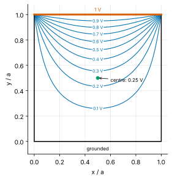

<!-- status: verified -->
# 13-02 · Electrostatics: Boundary Conditions and Boundary-Value Problems

| | |
|---|---|
| **Course** | [13 · Electromagnetics](../README.md) |
| **University equivalent** | The electrostatics chapters of a junior electromagnetics course: boundary conditions at conductors and dielectric interfaces, Poisson's and Laplace's equations, the uniqueness theorem, separation of variables, the method of images and the capacitance of practical structures (Ulaby & Ravaioli, *Fundamentals of Applied Electromagnetics*, ch. 4; Cheng, *Field and Wave Electromagnetics*, ch. 3–4; Griffiths, *Introduction to Electrodynamics*, ch. 2–3) |
| **Prerequisites** | [13-01 Vector Calculus Refresher](13-01-vector-calculus-refresher.md), [04-03 Gauss's Law](../../04-physics-for-ee/chapters/04-03-gauss-law.md), [04-04 Potential, Capacitance and Dielectrics](../../04-physics-for-ee/chapters/04-04-potential-capacitance-and-dielectrics.md), [11-05 Fourier Series](../../11-signals-and-systems/chapters/11-05-fourier-series.md) (for separation of variables) |
| **Estimated study hours** | 10 |
| **Last verified** | 2026-11-20 |

**Learning objectives.** After this chapter you can:

1. Derive and apply the boundary conditions on $\vec{E}$ and $\vec{D}$ at conductor surfaces and dielectric interfaces, including the refraction of field lines.
2. Set up Poisson's and Laplace's equations and solve them in one-dimensional planar, cylindrical and spherical geometries, and state why the solution is unique.
3. Solve a two-dimensional Laplace problem by separation of variables and evaluate the resulting Fourier series.
4. Use the method of images for charges near grounded planes, and compute induced charge and force.
5. Compute the capacitance of coaxial, two-wire, wire-over-ground and layered structures, and explain how field solvers find it numerically.

---

## 1. Big picture

04-04 found the capacitance of parallel plates and spheres from Gauss's law, which works only when symmetry hands you the field. Real structures (a trace over a ground plane, a via near a return path, a gate over a channel) have no such symmetry. The general method is to solve a differential equation for the potential, Laplace's or Poisson's, subject to what is known at the boundaries: conductors held at fixed voltages, and interfaces between materials where the field must bend in a definite way. This chapter builds that method: the boundary conditions, the equations, the theorem that guarantees one answer, and three ways to find it (direct integration, separation of variables, and images), plus the numerical method that every parasitic-extraction tool uses.

- **Interconnect capacitance sets speed and power.** Every wire's $CV^2f$ is dynamic power, and its capacitance to neighbours is crosstalk; extraction tools compute both by solving Laplace's equation.
- **Boards and cables are capacitance per length.** Coaxial cable, twisted pair and microstrip are characterized by $C'$ (and $L'$, 13-03); 13-07 and 13-08 turn them into impedance and delay.
- **Fields concentrate at edges.** Sharp corners and thin wires raise the local field, which sets breakdown in high-voltage parts and reliability limits in gate dielectrics.
- **Ground planes act as mirrors.** The method of images explains why a trace's field stays close to its return plane, and how much charge the plane carries.

## 2. Intuition first

**A stretched membrane.** In a region with no charge, the potential obeys Laplace's equation, which has a striking property: the potential at any point equals the average of the potential on any circle (or sphere) around it that lies inside the charge-free region (§3.7 uses its discrete form). A rubber sheet stretched over a wire frame does the same: with no weights on it, its height at each point is the average of the heights around it, so it has no bumps or dips inside; its shape is fixed entirely by the frame. The frame is the boundary: conductors at fixed voltages. Charge inside the region is a weight pushing the sheet (Poisson's equation).

**Mirrors.** A grounded conducting plane forces the potential on it to zero. A charge $+Q$ at height $h$ together with a fictitious charge $-Q$ at depth $h$ below the plane also gives zero potential everywhere on the plane. Since the solution is unique, the real field above the plane *is* the field of the charge and its mirror image. The plane's electrons arrange themselves to produce exactly the image's field.

**An analogy from finance, and its limits.** Laplace's averaging property resembles a market in equilibrium where each asset's price is the average of its neighbours' and only the boundary (a few fixed prices) sets the whole surface: nothing in the interior can sustain a local peak. The analogy breaks quickly. Real prices are not local averages, and Laplace's equation is exact and linear: doubling every boundary voltage doubles every potential, and solutions superpose, which is what makes images and series solutions work.

*Figure 1. The square trough of Example 13-02.4: equipotentials from the Fourier series, 0.1 V apart. The centre is at exactly 0.25 V, because the four problems with one side at 1 V superpose to a box held entirely at 1 V. The field crowds at the top corners, where the 1 V side meets a grounded one.*

## 3. Theory

> **Conventions.** $V$ is the electrostatic potential in volts, $\vec{E} = -\nabla V$, $\vec{D} = \varepsilon\vec{E}$ in a linear isotropic medium with $\varepsilon = \varepsilon_r\varepsilon_0$, $\varepsilon_0$ = 8.854 × 10⁻¹² F/m. $\rho_v$ is volume charge density (C/m³), $\rho_s$ surface charge density (C/m²), $\rho_\ell$ line charge density (C/m). The unit normal $\hat{n}$ at an interface points from medium 2 into medium 1. Capacitance per unit length is written $C'$ (F/m).

### 3.1 The electrostatic field equations

Static charges produce a field with two properties, from 04-02 and 04-03 written with 13-01's operators:

$$
\nabla\times\vec{E} = 0, \qquad \nabla\cdot\vec{D} = \rho_v .
$$

The first says $\vec{E}$ is conservative: its line integral around any closed path is zero (Stokes), so $\vec{E} = -\nabla V$ for a single-valued potential $V$ (the curl of a gradient is zero, 13-01). The second is Gauss's law in point form; by the divergence theorem, $\oint\vec{D}\cdot d\vec{S} = Q_{enc}$. The energy stored in the field is

$$
W_e = \frac12\int_v\vec{D}\cdot\vec{E}\,dv = \frac12\int_v\varepsilon\lvert\vec{E}\rvert^2\,dv ,
$$

which for a capacitor at voltage $V_0$ equals $\tfrac12CV_0^2$, giving the **energy method** for capacitance: $C = 2W_e/V_0^2$.

### 3.2 Boundary conditions

At an interface between two media the fields can jump, but only in constrained ways. Both constraints come from applying the integral laws to vanishingly small shapes straddling the interface.

**Tangential $\vec{E}$ is continuous.** Take a thin rectangular loop with sides of length $\Delta\ell$ parallel to the interface, one in each medium, and ends of height $\Delta h \to 0$. The ends contribute nothing as $\Delta h \to 0$, so $\oint\vec{E}\cdot d\vec\ell = (E_{1t} - E_{2t})\Delta\ell = 0$:

$$
E_{1t} = E_{2t} .
$$

**Normal $\vec{D}$ jumps by the surface charge.** Take a thin pillbox of face area $\Delta S$ with one face in each medium. As its height shrinks, the side flux vanishes and the enclosed charge is the surface charge $\rho_s\Delta S$, so $(D_{1n} - D_{2n})\Delta S = \rho_s\Delta S$:

$$
\hat{n}\cdot(\vec{D}_1 - \vec{D}_2) = \rho_s .
$$

**At a conductor.** Inside a conductor in electrostatic equilibrium $\vec{E} = 0$ (any field would move charge until it vanished), so the whole conductor is one equipotential. Just outside, the tangential field must therefore be zero and the normal field is set by the surface charge:

$$
E_t = 0, \qquad D_n = \varepsilon E_n = \rho_s .
$$

Field lines leave a conductor perpendicular to it, and the local surface charge density is $\varepsilon$ times the field there. Air breaks down near 3 MV/m (for centimetre gaps at sea level), so a conductor in air can hold at most about **26.56** µC/m² before it starts to discharge.

**Refraction at a charge-free dielectric interface.** With $\rho_s$ = 0, $E_t$ and $D_n$ are continuous. If the field in medium $i$ makes an angle $\theta_i$ with the normal, $\tan\theta_i = E_{it}/E_{in}$, and dividing the two conditions,

$$
\frac{\tan\theta_1}{\tan\theta_2} = \frac{E_{1t}/E_{1n}}{E_{2t}/E_{2n}} = \frac{E_{2n}}{E_{1n}} = \frac{\varepsilon_1}{\varepsilon_2} .
$$

Field lines bend *away* from the normal entering a higher-permittivity medium, and the normal component of $\vec{E}$ drops by the ratio of permittivities (Example 13-02.1). This is why a thin high-permittivity layer carries little of a perpendicular field, and why field crowds into the low-permittivity gaps of a layered stack.

### 3.3 Poisson's and Laplace's equations

Substitute $\vec{E} = -\nabla V$ into $\nabla\cdot(\varepsilon\vec{E}) = \rho_v$. In a uniform medium, $\nabla\cdot\nabla V = \nabla^2V$, so

$$
\nabla^2V = -\frac{\rho_v}{\varepsilon} \quad\text{(Poisson)}, \qquad \nabla^2V = 0 \quad\text{(Laplace, where } \rho_v = 0\text{)} .
$$

Most of electrostatics is solving one of these in a region with the potential (or its normal derivative, which is the surface charge) given on the boundary. Where the medium changes, solve in each region and join the pieces with the §3.2 conditions.

**One-dimensional solutions.** When the potential depends on one coordinate, Laplace's equation integrates directly, using 13-01's Laplacians:

- **Planar** ($V(x)$): $d^2V/dx^2 = 0$, so $V = Ax + B$: the uniform field between parallel plates.
- **Cylindrical** ($V(\rho)$): $\frac1\rho\frac{d}{d\rho}\big(\rho\frac{dV}{d\rho}\big) = 0$, so $\rho\,dV/d\rho = A$ and $V = A\ln\rho + B$.
- **Spherical** ($V(r)$): $\frac{1}{r^2}\frac{d}{dr}\big(r^2\frac{dV}{dr}\big) = 0$, so $r^2\,dV/dr = A$ and $V = -A/r + B$.

The constants come from the boundary voltages. For a coaxial line with inner conductor of radius $a$ at $V_0$ and outer conductor of radius $b$ grounded, $V = V_0\ln(b/\rho)/\ln(b/a)$, so $E_\rho = V_0/[\rho\ln(b/a)]$. The inner conductor's surface charge is $\rho_s = \varepsilon E_\rho(a)$, its charge per length $Q' = 2\pi a\rho_s = 2\pi\varepsilon V_0/\ln(b/a)$, and

$$
C' = \frac{Q'}{V_0} = \frac{2\pi\varepsilon}{\ln(b/a)} .
$$

The field is largest at the inner conductor, $E_{max} = V_0/[a\ln(b/a)]$, which is what limits a cable's voltage rating (Problem 13-02.5). The spherical case gives $C = 4\pi\varepsilon ab/(b - a)$ for concentric spheres and $4\pi\varepsilon a$ for an isolated sphere ($b \to \infty$).

**Poisson in one dimension.** With charge present, integrate twice. A slab of uniform $\rho_v$ between grounded plates at $x$ = 0 and $d$ gives $V = (\rho_v/2\varepsilon)x(d - x)$ (Example 13-02.3). The depletion region of a PN junction (09-05) is exactly this problem, with $\rho_v = \pm qN$ on each side.

### 3.4 Uniqueness

Why can we guess a solution (an image, a series, a symmetric field) and trust it? Because Poisson's equation with the potential given on the whole boundary has **only one solution**.

*Proof.* Suppose $V_1$ and $V_2$ both satisfy $\nabla^2V = -\rho_v/\varepsilon$ in a region and take the same values on its boundary. Their difference $W = V_1 - V_2$ satisfies $\nabla^2W = 0$ inside and $W = 0$ on the boundary. Apply the divergence theorem to $W\nabla W$, using $\nabla\cdot(W\nabla W) = \lvert\nabla W\rvert^2 + W\nabla^2W$:

$$
\int_v\lvert\nabla W\rvert^2\,dv = \oint_SW\,\nabla W\cdot d\vec{S} - \int_vW\nabla^2W\,dv = 0 - 0 .
$$

An integral of a non-negative quantity that equals zero forces $\nabla W = 0$ everywhere, so $W$ is constant, and since it is zero on the boundary, $W = 0$. ∎

The same argument works when some boundaries specify the normal derivative (the surface charge) instead of the potential, and for conductors whose total charge is given. Any function that satisfies the equation and the boundary conditions, however it was found, is *the* answer.

### 3.5 Separation of variables

In two dimensions with rectangular boundaries, look for solutions that are products, $V(x, y) = X(x)Y(y)$. Substituting into $\partial^2V/\partial x^2 + \partial^2V/\partial y^2 = 0$ and dividing by $XY$:

$$
\frac{X''}{X} + \frac{Y''}{Y} = 0 .
$$

The first term depends only on $x$ and the second only on $y$, so each must be a constant: $X''/X = -k^2$ and $Y''/Y = +k^2$. The $x$ solutions are sines and cosines, the $y$ solutions hyperbolic sines and cosines (or exponentials).

**The rectangular trough.** Take a rectangle $0 \le x \le a$, $0 \le y \le b$ with the top ($y = b$) at $V_0$ and the other three sides grounded. Grounded sides at $x$ = 0 and $a$ require $X = \sin(n\pi x/a)$, so $k = n\pi/a$; the grounded bottom requires $Y = \sinh(n\pi y/a)$. Each product satisfies Laplace's equation and three of the boundary conditions; superposing them,

$$
V(x, y) = \sum_{n=1}^{\infty}c_n\sin\frac{n\pi x}{a}\,\frac{\sinh(n\pi y/a)}{\sinh(n\pi b/a)} ,
$$

and the top condition $V(x, b) = V_0$ asks for the Fourier sine series of a constant on $(0, a)$. From 11-05, $c_n = (2/a)\int_0^aV_0\sin(n\pi x/a)\,dx = 2V_0(1 - \cos n\pi)/(n\pi)$, which is $4V_0/(n\pi)$ for odd $n$ and zero for even $n$:

$$
V(x, y) = \frac{4V_0}{\pi}\sum_{n\ \text{odd}}\frac1n\sin\frac{n\pi x}{a}\,\frac{\sinh(n\pi y/a)}{\sinh(n\pi b/a)} .
$$

The hyperbolic ratio decays roughly as $e^{-n\pi(b - y)/a}$ away from the top, so the series converges fast in the interior and slowly near the top edge, where the boundary jumps from $V_0$ to 0 at the corners (the Gibbs behaviour of 11-05). By uniqueness, nothing else satisfies the conditions.

> **Math refresher — why the constants must be equal.** If $f(x) + g(y) = 0$ for all $x$ and $y$, fix $y$ and vary $x$: $f$ cannot change, so it is a constant, and $g$ is the negative of it. The sign is chosen by the boundaries: sides grounded at two $x$ values need oscillating $X$, which forces $X''/X$ negative.

### 3.6 The method of images

**A point charge above a grounded plane.** Put $Q$ at height $h$ above the plane $z$ = 0. The potential of $Q$ together with $-Q$ at $z = -h$ is zero on the whole plane (every point of the plane is equidistant from the two), and it satisfies Poisson's equation above the plane, whose only charge is $Q$. By uniqueness it is the field above the plane; below, inside the conductor, the field is zero. At the plane the field is normal, and the induced surface charge is

$$
\rho_s(r) = \varepsilon_0E_z = -\frac{Qh}{2\pi(r^2 + h^2)^{3/2}} ,
$$

at a distance $r$ from the foot of the charge. Its integral over the plane is exactly $-Q$ (Problem 13-02.8 checks the analogous line-charge case), and the force on $Q$ is the attraction of its image, $Q^2/[4\pi\varepsilon_0(2h)^2]$.

**A line charge, and a wire over a ground plane.** A line charge $\rho_\ell$ at height $h$ with its image $-\rho_\ell$ at depth $h$ gives, at a point at distances $d_+$ and $d_-$ from the two lines, $V = (\rho_\ell/2\pi\varepsilon)\ln(d_-/d_+)$. The equipotentials of two opposite line charges are circles (the Apollonius circles where $d_-/d_+$ is constant), so a round wire of radius $a$ with its axis at height $h$ can be modelled exactly by line charges placed not on its axis but at the offset $\sqrt{h^2 - a^2}$ from the plane. Carrying the algebra through gives

$$
C' = \frac{2\pi\varepsilon}{\cosh^{-1}(h/a)} \approx \frac{2\pi\varepsilon}{\ln(2h/a)} \quad (h \gg a) .
$$

A two-wire line of centre spacing $D$ is the same geometry with the plane removed and the image made real: its capacitance is half the wire-over-plane value at $h = D/2$, $C' = \pi\varepsilon/\cosh^{-1}(D/2a)$, because the two wires' capacitances to the plane are in series.

> **Going deeper — where $\cosh^{-1}$ comes from.** Line charges $\pm\rho_\ell$ at $z = \pm c$ give $V = (\rho_\ell/4\pi\varepsilon)\ln[(x^2 + (z + c)^2)/(x^2 + (z - c)^2)]$. Setting the ratio inside the logarithm to a constant $m^2$ and completing the square shows the equipotential is a circle of centre $z_0 = c(m^2 + 1)/(m^2 - 1)$ and radius $a = 2mc/(m^2 - 1)$. Matching $z_0 = h$ and the radius $a$ gives $c = \sqrt{h^2 - a^2}$ and $m = h/a + \sqrt{(h/a)^2 - 1}$, so the wire's potential is $(\rho_\ell/2\pi\varepsilon)\ln m = (\rho_\ell/2\pi\varepsilon)\cosh^{-1}(h/a)$, and $C' = \rho_\ell/V$.

**More mirrors.** Two grounded planes meeting at 90° need three images (Problem 13-02.10); a charge outside a grounded sphere has a single image inside it, of reduced magnitude. Images work only when the image charges lie outside the region where the field is wanted.

### 3.7 Capacitance of real structures, and numerical solution

**The catalogue.** With the methods above:

| Structure | Capacitance | Method |
|---|---|---|
| Parallel plates, area $A$, gap $d$ | $\varepsilon A/d$ (fringing neglected) | 1D Laplace |
| Layered dielectric | $A/\sum(d_i/\varepsilon_i)$: layers in series | $D_n$ continuous |
| Coaxial line | $2\pi\varepsilon/\ln(b/a)$ per length | 1D Laplace, cylindrical |
| Concentric spheres | $4\pi\varepsilon ab/(b - a)$ | 1D Laplace, spherical |
| Wire over ground plane | $2\pi\varepsilon/\cosh^{-1}(h/a)$ per length | Images |
| Two-wire line | $\pi\varepsilon/\cosh^{-1}(D/2a)$ per length | Images |

*Table 1. Capacitances that have closed forms.*

A layered dielectric in a parallel-plate gap is the basis of the **equivalent oxide thickness** of a transistor gate stack: a layer of permittivity $\varepsilon_i$ and thickness $d_i$ counts as $d_i\varepsilon_{ox}/\varepsilon_i$ of SiO₂ (Problem 13-02.3).

**What has no closed form.** A microstrip (a strip over a ground plane with a dielectric between) has fields partly in air and partly in the substrate and fringing at the strip edges. Its capacitance comes from numerical solution, or from curve fits to numerical solutions; 13-07 introduces its effective permittivity, and Course 24 uses the design formulas.

**Finite differences: Laplace as averaging.** Expand $V$ about a grid point $(x, y)$ with spacing $h$ in a Taylor series (01-08):

$$
V(x \pm h, y) = V \pm hV_x + \frac{h^2}{2}V_{xx} \pm \frac{h^3}{6}V_{xxx} + O(h^4) ,
$$

and similarly in $y$. Adding the four neighbours, the odd terms cancel:

$$
V(x + h, y) + V(x - h, y) + V(x, y + h) + V(x, y - h) = 4V + h^2\nabla^2V + O(h^4) .
$$

Where $\nabla^2V = 0$, each potential is the average of its four neighbours to within $O(h^4)$, the discrete form of the mean-value property of §2. Fixing the boundary values and solving the linear equations (directly, or by repeatedly replacing each value by its neighbours' average) solves Laplace's equation, with an error that falls as $h^2$. The charge on a conductor then follows from the field at its surface, or the capacitance from the stored energy. A **resistor grid** solves the same equations: at every node of a grid of equal resistors, KCL makes the voltage the average of its neighbours'. The lab's ngspice netlist uses exactly that analogue computer.

## 4. Worked examples

### Example 13-02.1 · Fields at a dielectric interface (tier A)

**Setup.** The plane $z$ = 0 separates air ($z > 0$) from a dielectric with $\varepsilon_r$ = 4 ($z < 0$), with no free surface charge. Just above the interface $\vec{E}_1 = 3\hat{x} + 4\hat{z}$ kV/m. Find $\vec{E}_2$ just below, the angles each field makes with the normal, and $\lvert\vec{D}\rvert$ on each side.

**Solution.** Tangential $\vec{E}$ is continuous: $E_{2x}$ = 3 kV/m. Normal $\vec{D}$ is continuous: $\varepsilon_0 \times 4 = 4\varepsilon_0E_{2z}$, so $E_{2z}$ = 1 kV/m and $\vec{E}_2 = 3\hat{x} + \hat{z}$ kV/m, of magnitude **3.162** kV/m. The angles from the normal are $\arctan(3/4)$ = **36.87**° above and $\arctan(3/1)$ = **71.6**° below. $D_{1z} = \varepsilon_0 \times 4$ kV/m = **35.42** nC/m² and $\lvert\vec{D}_1\rvert = \varepsilon_0 \times 5$ kV/m; below, $\lvert\vec{D}_2\rvert = 4\varepsilon_0 \times 3.162$ kV/m = **112.0** nC/m².

**Units check.** F/m × V/m = C/m².

**Sanity check.** $\tan 36.87^\circ/\tan 71.6^\circ \approx 0.75/3 = 1/4 = \varepsilon_1/\varepsilon_2$: the field bends away from the normal in the denser medium, and its normal component there is four times smaller.

### Example 13-02.2 · A coaxial capacitor from Laplace's equation (tier A)

**Setup.** A coaxial line has $a$ = 0.5 mm, $b$ = 1.75 mm and a polyethylene-like dielectric of $\varepsilon_r$ = 2.25. Find its capacitance per length, the charge per length and the field at both conductors at 100 V.

**Solution.** $C' = 2\pi\varepsilon_0 \times 2.25/\ln 3.5$ = **99.92** pF/m, so $Q'$ = **9.992** nC/m at 100 V. The field $E_\rho = V_0/[\rho\ln(b/a)]$ is **159.6** kV/m at the inner conductor and **45.61** kV/m at the outer.

**Units check.** F/m from (F/m)/(dimensionless); V/(m × 1) = V/m.

**Sanity check.** The field falls as $1/\rho$, so it is $b/a$ = 3.5 times stronger at the inner conductor: insulation breaks down there first. The value is close to the 101 pF/m Belden specifies for its 8262, an RG-58-type cable (§9).

### Example 13-02.3 · Poisson's equation in a charged slab (tier B)

**Setup.** A uniform charge density $\rho_v$ = 1 mC/m³ fills the 1 mm gap between two grounded plates (vacuum). Find the potential, its maximum, the field at the plates and the charge induced on each plate per square metre.

**Solution.** $d^2V/dx^2 = -\rho_v/\varepsilon_0$ with $V(0) = V(d) = 0$ integrates to $V = (\rho_v/2\varepsilon_0)x(d - x)$. The maximum, at the centre, is $\rho_vd^2/(8\varepsilon_0)$ = **14.12** V. The field $E_x = -dV/dx = (\rho_v/\varepsilon_0)(x - d/2)$ is $\rho_vd/(2\varepsilon_0)$ = **56.47** kV/m in magnitude at each plate, pointing into the plate. Each plate carries $\rho_s = -\varepsilon_0\lvert E\rvert$ = **−0.5** µC/m².

**Units check.** (C/m³)(m²)/(F/m) = C/F = V.

**Sanity check.** The two plates together carry −1 µC/m², exactly minus the slab's $\rho_vd$ = 1 µC/m²: every field line from the slab ends on a plate, as Gauss's law requires.

### Example 13-02.4 · A square trough by separation of variables (tier B)

**Setup.** A square trough of side $a$ has its top at 1 V and the other sides grounded. Evaluate the series at the centre with one, two and three nonzero terms, and at $(a/2, 3a/4)$ and $(a/2, a/4)$. What is the exact value at the centre?

**Solution.** At the centre, $\sin(n\pi/2) = \pm1$ and the terms are $(4/n\pi)\sinh(n\pi/2)/\sinh(n\pi)$ with alternating signs. One term gives **0.2537** V; two give **0.2499** V; three give **0.2500** V. At $(a/2, 3a/4)$ the series converges to **0.5405** V, and at $(a/2, a/4)$ to **0.09541** V.

**Exact centre value.** Rotate the problem four times so that each side in turn is at 1 V. The four solutions superpose to a box with every side at 1 V, whose potential is 1 V everywhere. At the centre, all four rotations give the same value, so each is exactly **0.25** V.

**Sanity check.** Three terms already reach 0.2500: the hyperbolic factors decay fast away from the top. Near the top the series needs many terms, as Figure 1's crowded corners suggest.

### Example 13-02.5 · A point charge above a ground plane (tier B)

**Setup.** A 1 nC charge sits 1 cm above a large grounded plane. Find the force on it, the surface charge density directly below it, and the fraction of the induced charge within 1 cm of that point.

**Solution.** The image is −1 nC at 1 cm below the plane, 2 cm from the charge: $F = Q^2/[4\pi\varepsilon_0(2h)^2]$ = **22.47** µN, attractive. Directly below, $\rho_s = -Q/(2\pi h^2)$ = **−1.592** µC/m². Integrating $\rho_s$ over a disc of radius $R$ gives $-Q[1 - h/\sqrt{R^2 + h^2}]$, so within $R = h$ lies **29.29**% of the induced charge; the rest spreads far across the plane.

**Units check.** C²/(F/m × m²) = C²/(F·m) = N.

**Sanity check.** As $R \to \infty$ the bracket tends to 1: the plane carries exactly −1 nC in total.

### Example 13-02.6 · A wire over a ground plane (tier C)

**Setup.** A wire of radius 0.5 mm runs with its axis 5 mm above a ground plane in air. Find its capacitance per metre exactly and with the thin-wire approximation. Repeat for the axis at 1 mm.

**Solution.** At $h$ = 5 mm, $h/a$ = 10: $C' = 2\pi\varepsilon_0/\cosh^{-1}10$ = **18.59** pF/m exactly, and $2\pi\varepsilon_0/\ln 20$ = **18.57** pF/m approximately, **0.08**% low. At $h$ = 1 mm, $h/a$ = 2: **42.24** pF/m exactly against **40.13** pF/m, **5.0**% low.

**Sanity check.** The approximation places the line charge on the wire's axis; when the wire is close to the plane, its charge crowds toward the plane, the effective line charge moves down, and the true capacitance is higher. Field solvers matter precisely for such close, crowded geometries.

### Answer key

<!-- answer-key -->
| ID | Quantity | Value | Unit |
|---|---|---|---|
| T 13-02.a | maximum surface charge in air at 3 MV/m | 26.56 | µC/m² |
| Ex 13-02.1a | field magnitude below | 3.162 | kV/m |
| Ex 13-02.1b | angle above | 36.87 | ° |
| Ex 13-02.1c | angle below | 71.6 | ° |
| Ex 13-02.1d | normal D | 35.42 | nC/m² |
| Ex 13-02.1e | D magnitude below | 112.0 | nC/m² |
| Ex 13-02.2a | capacitance per length | 99.92 | pF/m |
| Ex 13-02.2b | charge per length at 100 V | 9.992 | nC/m |
| Ex 13-02.2c | field at the inner conductor | 159.6 | kV/m |
| Ex 13-02.2d | field at the outer conductor | 45.61 | kV/m |
| Ex 13-02.3a | maximum potential | 14.12 | V |
| Ex 13-02.3b | field at the plates | 56.47 | kV/m |
| Ex 13-02.3c | charge on each plate | −0.5 | µC/m² |
| Ex 13-02.4a | centre, one term | 0.2537 | V |
| Ex 13-02.4b | centre, two terms | 0.2499 | V |
| Ex 13-02.4c | centre, three terms | 0.2500 | V |
| Ex 13-02.4d | at (a/2, 3a/4) | 0.5405 | V |
| Ex 13-02.4e | at (a/2, a/4) | 0.09541 | V |
| Ex 13-02.4f | exact centre | 0.25 | V |
| Ex 13-02.5a | force | 22.47 | µN |
| Ex 13-02.5b | surface charge below the charge | −1.592 | µC/m² |
| Ex 13-02.5c | fraction within one height | 29.29 | % |
| Ex 13-02.6a | exact capacitance, h = 5 mm | 18.59 | pF/m |
| Ex 13-02.6b | thin-wire capacitance, h = 5 mm | 18.57 | pF/m |
| Ex 13-02.6c | thin-wire error, h = 5 mm | 0.08 | % |
| Ex 13-02.6d | exact capacitance, h = 1 mm | 42.24 | pF/m |
| Ex 13-02.6e | thin-wire capacitance, h = 1 mm | 40.13 | pF/m |
| Ex 13-02.6f | thin-wire error, h = 1 mm | 5.0 | % |
| Prac 13-02.a | relative permittivity implied by a 66% velocity factor | 2.296 | — |
| Prac 13-02.b | capacitance change from Dk 3.48 to 3.66 | 5.2 | % |
| Prac 13-02.c | stripline capacitance shortfall using 3.48 for 3.66 | 4.9 | % |
| Sim 13-02.a | resistor-grid centre voltage | 0.25 | V |

*Every value is recomputed by [verify_13_02.py](../verify/verify_13_02.py): boundary conditions by solving the interface equations, the coaxial and slab potentials by symbolic integration of Laplace's and Poisson's equations, the trough by an independent finite-difference solution as well as the series, the induced charge by numerical integration of the image field, and the wire's capacitance by a method-of-moments solution with surface charge patches. The resistor-grid analogue is confirmed in ngspice.*

## 5. Simulate it

The lab, [labs/13-02-lab](../labs/13-02-lab/README.md), has a notebook and an ngspice netlist:

1. Solves the trough by finite differences on finer and finer grids and compares with the series, showing the error fall as $h^2$.
2. Computes the capacitance per length of a strip over a ground plane by finite differences, from the stored energy, and compares it with the parallel-plate estimate to show how much fringing adds.
3. Maps the field of a charge above a ground plane with its image, and integrates the induced surface charge.
4. Plots the refraction of field lines at a dielectric interface.

The netlist [resistor_grid.cir](../labs/13-02-lab/resistor_grid.cir) builds a 5 × 5 grid of equal resistors with the top edge at 1 V and the other edges grounded: an analogue solution of the trough.

**Guided exercise (predict, then run).** **Before running the netlist**, predict the voltage at the grid's centre node. Then run it. (It is exactly **0.25** V, for the same reason as Example 13-02.4: the discrete equations superpose and rotate just like the continuous ones, so the answer does not depend on the grid's coarseness.)

## 6. Engineering tradeoffs

| Knob | Improves | Costs | Typical decision owner |
|---|---|---|---|
| Thinner dielectric under a conductor | Capacitance per area (gate control, decoupling) | Higher field, leakage, breakdown margin | Process or package engineer |
| Higher-permittivity dielectric | Capacitance without thinning | Different interfaces and reliability; slower signals on interconnect | Process engineer |
| Larger spacing to neighbours | Less coupling capacitance and crosstalk | Area, routing density | Layout or SI engineer |
| Rounded edges and larger radii | Lower peak field, higher voltage rating | Area, manufacturing steps | High-voltage or package designer |
| Closer ground plane | Tighter field confinement, less crosstalk | Higher capacitance per length | PCB stack-up designer |
| Field solver instead of formulas | Accuracy for real geometries | Run time, setup effort, validation | SI or extraction engineer |

## 7. Numbers to know

| Quantity | Value | Note |
|---|---|---|
| $\varepsilon_0$ | 8.854 pF/m | Measured (since the 2019 SI revision) to about ten significant figures |
| SiO₂ relative permittivity | 3.9 | The reference for equivalent oxide thickness |
| Air breakdown | ≈ 3 MV/m | Centimetre gaps at sea level; lower for long gaps, higher for tiny ones |
| Coaxial cable, 50 Ω class | ≈ 100 pF/m | Belden 8262 (RG-58 type) specifies 101 pF/m [2] |
| FR-4 class laminate Dk | ≈ 4 (falls with frequency) | 370HR: 4.17 at 1 GHz, 3.92 at 10 GHz [1] |
| Laplace's equation | Each point the average of its neighbours | No interior maxima or minima |

## 8. Common mistakes

- **Making the normal component of $\vec{E}$ continuous.** It is $D_n$ that is continuous across a charge-free dielectric interface; $E_n$ jumps by $\varepsilon_2/\varepsilon_1$.
- **Forgetting that a conductor is an equipotential.** Inside it $\vec{E}$ = 0, so its whole surface is at one potential and fields meet it at right angles.
- **Putting image charges in the region of interest.** An image must lie outside the region where the solution is wanted, or it changes the charge there.
- **Using the thin-wire formula close to a plane.** $\ln(2h/a)$ underestimates the capacitance by 5% at $h/a$ = 2 and more below.
- **Truncating a Fourier series near the boundary that is being expanded.** Near the top of the trough the series converges slowly and overshoots at the corners.
- **Assuming fringing is negligible.** For a strip whose width is comparable to its height above ground, fringing roughly triples the capacitance (lab, Part 2), and it still adds tens of percent at $w/h$ = 10.

## 9. Practitioner lens

### State of the art (as of Nov 2026)

- **Laminate permittivity is a specification with conditions.** Isola's 370HR, an FR-4-class laminate, specifies Dk 4.17 at 1 GHz falling to 3.92 at 10 GHz, and its value depends on glass style and resin content [1] **[Established]** (data sheet). Low-loss laminates hold Dk nearly flat with frequency: Isola's I-Tera MT40 specifies 3.45 at 2, 5 and 10 GHz [1] **[Established]**. Since capacitance per length is proportional to the effective permittivity, every one of these numbers moves a trace's capacitance, and with it its impedance and delay (13-07, 13-08).
- **Two numbers for one laminate.** Rogers specifies RO4350B with a "process" Dk of 3.48 ± 0.05 from a clamped-stripline test and a "design" Dk of 3.66 recommended for circuit design [1] **[Established]**. For a stripline, where all the field is in the laminate, using 3.48 where 3.66 applies gives a capacitance **4.9**% too low (3.66 is **5.2**% above 3.48; our arithmetic); for a microstrip the error follows the smaller change in effective permittivity.
- **Cable capacitance from velocity.** Belden specifies its RG-58 type 8262 at 50 Ω, 66% velocity of propagation and 101 pF/m [2] **[Established]**. A 66% velocity factor implies an effective $\varepsilon_r = 1/0.66^2$ = **2.296** (13-07 derives $v = c/\sqrt{\varepsilon_r}$), consistent with a solid polyethylene dielectric (our inference from the published velocity, not a vendor statement).
- **Extraction runs on Laplace solvers.** IC parasitic extraction and package and board signal-integrity tools compute capacitance matrices by solving Laplace's equation with finite-difference, finite-element or boundary-element methods, or with pattern libraries precomputed by them **[Established]** (textbook practice; Course 24 covers the tools).

### Why it matters commercially

- **Capacitance is power.** Switching power is $CV^2f$; interconnect capacitance is a large share of it in modern chips **[Industry estimate]**, which is why low-permittivity dielectrics and wire spacing are process and design levers.
- **Laminate choice is a cost lever.** Low-loss laminates cost more than FR-4 class material; a board team that knows which signals need the better Dk and Df can mix materials in one stack-up.
- **Breakdown and reliability margins are field margins.** Field crowding at edges and corners, not average fields, sets where dielectrics fail.

### Marketing vs Reality

- **"Dk = 3.48."** *Reality:* at which frequency, by which test method, and is it the process or the design value? *Sanity check:* ask for Dk against frequency by the method your simulation assumes.
- **"Sign-off-accurate extraction."** *Reality:* accuracy depends on the geometry library, process corners and the solver's mesh. *Sanity check:* ask for correlation against test structures or a field solver on representative layouts.

### Questions for engineering leaders

1. **"Which permittivity values went into your interconnect models, and from which test?"**
   *Strong:* frequency-dependent Dk from the laminate's design data, correlated to measured test coupons. *Evasive:* "the data-sheet value."
2. **"Where is your highest field, and what is its margin to breakdown?"**
   *Strong:* a field-solver map with the peak at a named corner and a stated margin. *Evasive:* an average field computed from voltage over thickness.
3. **"How do you validate your extraction?"**
   *Strong:* analytic benchmarks (coax, two-wire), solver comparison and silicon correlation. *Evasive:* "the tool is qualified by the foundry," with no own checks.

## 10. Concept check

**Q1.** Why is the tangential electric field continuous across any interface?

Answer

Because $\nabla\times\vec{E}$ = 0: the circulation around a thin loop straddling the interface is zero, and as the loop's ends shrink, only the two tangential sides remain, so their fields must match.

**Q2.** A field line passes from air into a dielectric of $\varepsilon_r$ = 10. Does it bend toward or away from the normal?

Answer

Away from it: $\tan\theta_2 = (\varepsilon_2/\varepsilon_1)\tan\theta_1$, so the angle from the normal grows in the higher-permittivity medium, where the normal component of $\vec{E}$ is ten times smaller.

**Q3.** Why can a solution found by guessing (images, symmetry) be trusted?

Answer

The uniqueness theorem: the difference between two solutions with the same boundary values satisfies Laplace's equation with zero boundary values, so its field energy is zero and it vanishes everywhere. Any function meeting the equation and boundary conditions is the solution.

**Q4.** Why does the trough's centre sit at exactly a quarter of the top voltage?

Answer

The four problems with one side at $V_0$ superpose to a box entirely at $V_0$, whose potential is $V_0$ everywhere; by symmetry each contributes equally at the centre.

**Q5.** Where does the charge induced on a ground plane by a nearby point charge concentrate, and how much is there in total?

Answer

Directly beneath the charge, falling off as $(r^2 + h^2)^{-3/2}$; the total is exactly $-Q$, though only about 29% lies within one height of the foot.

**Q6.** Why does a layered gate dielectric behave like capacitors in series?

Answer

The normal $\vec{D}$ is the same in every layer (no free charge at the interfaces), so each layer's voltage is $Dd_i/\varepsilon_i$ and the voltages add, just as series capacitors carry the same charge.

**Q7.** How does a grid of equal resistors solve Laplace's equation?

Answer

KCL at each node of equal resistors makes its voltage the average of its four neighbours, which is the finite-difference form of Laplace's equation; fixing the edge voltages fixes the boundary conditions.

Next: the [13-02 problem set](../problems/13-02-problems.md).

## 11. Key terms

[Boundary condition](../../../reference/glossary.md#boundary-condition) · [Poisson's equation](../../../reference/glossary.md#poissons-equation) · [Laplace's equation](../../../reference/glossary.md#laplaces-equation) · [Uniqueness theorem](../../../reference/glossary.md#uniqueness-theorem) · [Separation of variables](../../../reference/glossary.md#separation-of-variables) · [Method of images](../../../reference/glossary.md#method-of-images) · [Equivalent oxide thickness](../../../reference/glossary.md#equivalent-oxide-thickness-eot) · [Finite-difference method](../../../reference/glossary.md#finite-difference-method) · [Capacitance per unit length](../../../reference/glossary.md#capacitance-per-unit-length)

## 12. Connections

- **Builds on:** divergence, curl and the Laplacian in curvilinear coordinates from [13-01](13-01-vector-calculus-refresher.md); Gauss's law and capacitance from [04-03](../../04-physics-for-ee/chapters/04-03-gauss-law.md) and [04-04](../../04-physics-for-ee/chapters/04-04-potential-capacitance-and-dielectrics.md); Fourier sine series from [11-05](../../11-signals-and-systems/chapters/11-05-fourier-series.md).
- **Next:** [13-03 Magnetostatics and Inductance](13-03-magnetostatics-and-inductance.md) does the same for magnetic fields and inductance.
- **Used later:** capacitance per length in transmission lines ([13-07](13-07-transmission-lines-time-domain.md), [13-08](13-08-transmission-lines-sinusoidal-steady-state.md)); Poisson's equation is the depletion-region analysis of [09-05](../../09-semiconductor-devices/chapters/09-05-pn-junction-electrostatics.md) and the MOS capacitor of [09-08](../../09-semiconductor-devices/chapters/09-08-mos-capacitor.md); interconnect extraction in Course 24.

## 13. Further study

- F. T. Ulaby and U. Ravaioli, *Fundamentals of Applied Electromagnetics*, ch. 4 (electrostatics, boundary conditions, images, capacitance).
- D. K. Cheng, *Field and Wave Electromagnetics*, ch. 3–4 (including the solution of electrostatic boundary-value problems).
- D. J. Griffiths, *Introduction to Electrodynamics*, ch. 3 (Laplace's equation, uniqueness, images, separation of variables).
- MIT OpenCourseWare 6.013 *Electromagnetics and Applications*, the electrostatics lectures.

## 14. Sources

1. Laminate data sheets: Isola 370HR and I-Tera MT40, Rogers RO4350B. [R-193](../../../reference/research-log.md#r-193--pcb-laminate-dielectric-constants-and-loss-tangents).
2. Belden 8262 RG-58 coaxial cable data sheet. [R-194](../../../reference/research-log.md#r-194--rg-58-coaxial-cable-data-sheets).

The physics (boundary conditions, Laplace's equation, images) and the permittivity of SiO₂ and breakdown field of air are textbook material (Further study).
