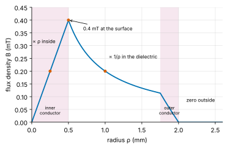

<!-- status: verified -->
# 13-03 · Magnetostatics and Inductance

| | |
|---|---|
| **Course** | [13 · Electromagnetics](../README.md) |
| **University equivalent** | The magnetostatics chapter of a junior electromagnetics course: the Biot–Savart and Ampère laws in vector form, the magnetic vector potential, magnetic materials and boundary conditions, inductance of practical structures by flux linkage and by energy, and magnetic circuits (Ulaby & Ravaioli, *Fundamentals of Applied Electromagnetics*, ch. 5; Cheng, *Field and Wave Electromagnetics*, ch. 6; Griffiths, *Introduction to Electrodynamics*, ch. 5–6) |
| **Prerequisites** | [13-01 Vector Calculus Refresher](13-01-vector-calculus-refresher.md), [13-02 Electrostatics: Boundary-Value Problems](13-02-electrostatics-boundary-value-problems.md), [04-06 Magnetic Fields and Forces](../../04-physics-for-ee/chapters/04-06-magnetic-fields-and-forces.md), [04-07 Faraday, Lenz and Inductance](../../04-physics-for-ee/chapters/04-07-faraday-lenz-and-inductance.md) |
| **Estimated study hours** | 8 |
| **Last verified** | 2026-11-20 |

**Learning objectives.** After this chapter you can:

1. Apply Ampère's law and the Biot–Savart law in vector form, and explain why the magnetic field has zero divergence.
2. Define the magnetic vector potential, derive its Poisson equation, and use it to compute flux.
3. Apply the boundary conditions on $\vec{B}$ and $\vec{H}$ at material interfaces, and explain why flux leaves iron nearly perpendicular to its surface.
4. Compute the inductance of coaxial lines, two-wire lines, wires over ground planes, solenoids, toroids and bond wires from flux linkage or stored energy.
5. Analyse a magnetic circuit with reluctances, including the effect of an air gap.

---

## 1. Big picture

Every current loop stores energy in a magnetic field, and the circuit sees that energy as inductance: the reluctance of the loop to change its current. 04-07 introduced inductance through Faraday's law and a solenoid. Real inductance lives in less tidy places: the bond wire from a die to its package, the loop formed by a signal and its return path on a board, the windings of a power inductor wrapped on a gapped ferrite core. This chapter gives the general tools. The vector potential plays the role the electric potential played in 13-02, boundary conditions explain how magnetic materials shape fields, and inductance follows from flux linkage or stored energy for any structure.

- **Package inductance limits fast current steps.** Each nanohenry in a supply or ground path turns a current step into a voltage spike, $L\,di/dt$: ground bounce and supply droop.
- **Transmission lines need $L'$ as well as $C'$.** Together they set a line's impedance and speed (13-07), and for a uniform line $L'C' = \mu\varepsilon$.
- **Power converters are magnetic circuits.** A switching regulator's inductor stores energy mostly in an air gap, whose length sets the inductance and the current at which the core saturates (Course 22).
- **On-chip inductors** for RF circuits are spirals whose inductance and loss come from these same flux calculations (Course 21).

## 2. Intuition first

**Field lines that never end.** Electric field lines start on positive charge and end on negative charge. Magnetic field lines have no such endpoints: there are no magnetic charges, so every line closes on itself, circling the currents that produce it. That is $\nabla\cdot\vec{B} = 0$, and it is why the flux through any closed surface is zero.

**Inductance as inertia.** A current in a loop has a magnetic field, and building that field takes energy. To change the current, the circuit must change the field, which it resists with a voltage $L\,di/dt$. The analogy to mass is close: current is like velocity, inductance like mass, and $\tfrac12LI^2$ like kinetic energy. A large loop, or one wrapped around iron, has a lot of field per ampere and so a lot of "magnetic mass."

**An analogy from finance, and its limits.** A loop's inductance resembles the friction on unwinding a large position: the bigger the position (flux linkage per ampere), the more it costs to change quickly, and the cost depends on the rate of change, not the level. The analogy breaks in two ways. The "cost" here is stored, not lost: the energy comes back when the current falls (the inductive kick that can destroy a switch). And inductance depends only on geometry and materials, not on how fast you trade.

*Figure 1. The flux density of a coaxial cable carrying 1 A on its inner conductor (radius 0.5 mm) and returning it on its outer conductor (1.75 to 2.0 mm), from Ampère's law. Inside the inner conductor the enclosed current grows as $\rho^2$, so $B \propto \rho$; between the conductors $B \propto 1/\rho$; across the outer conductor the enclosed current falls to zero, and outside the cable there is no field at all, which is why coaxial cable neither radiates nor picks up external fields at low frequency.*

## 3. Theory

> **Conventions.** $\vec{B}$ is the magnetic flux density (T = Wb/m²), $\vec{H}$ the magnetic field intensity (A/m), $\vec{B} = \mu\vec{H}$ in a linear isotropic medium with $\mu = \mu_r\mu_0$, $\mu_0$ = 4π × 10⁻⁷ H/m to better than a part in 10⁹ (1.2566 × 10⁻⁶ H/m; measured rather than defined since the 2019 SI revision), so $\mu_0/2\pi$ = 2 × 10⁻⁷ H/m. $\vec{J}$ is current density (A/m²), $\vec{K}$ surface current density (A/m). $\Phi$ is magnetic flux (Wb) and $\Lambda = N\Phi$ flux linkage. $L'$ is inductance per unit length (H/m).

### 3.1 The magnetostatic field equations

Steady currents produce a magnetic field with two properties:

$$
\nabla\cdot\vec{B} = 0, \qquad \nabla\times\vec{H} = \vec{J} .
$$

By the divergence theorem the first says $\oint\vec{B}\cdot d\vec{S} = 0$: no net flux leaves any closed surface. By Stokes's theorem the second becomes **Ampère's law**, $\oint\vec{H}\cdot d\vec\ell = I_{enc}$: the circulation of $\vec{H}$ around a loop equals the current through it. When symmetry makes $\lvert\vec{H}\rvert$ constant along a suitable loop, Ampère's law gives the field in one line. For a long straight wire, $H_\phi2\pi\rho = I$, so $H_\phi = I/(2\pi\rho)$. Inside a round conductor of radius $a$ carrying uniform current, the enclosed current is $I\rho^2/a^2$, so $H_\phi = I\rho/(2\pi a^2)$ (Figure 1).

Without symmetry, the **Biot–Savart law** adds up the contributions of current elements:

$$
\vec{H}(\vec{r}) = \frac{1}{4\pi}\int\frac{I\,d\vec\ell' \times (\vec{r} - \vec{r}\,')}{\lvert\vec{r} - \vec{r}\,'\rvert^3} .
$$

It plays the role Coulomb's law plays in electrostatics; the lab integrates it for a circular loop.

### 3.2 The magnetic vector potential

Since $\nabla\cdot\vec{B} = 0$ and the divergence of a curl is always zero (13-01), $\vec{B}$ can be written as the curl of a **vector potential**:

$$
\vec{B} = \nabla\times\vec{A} .
$$

$\vec{A}$ is not unique: adding any gradient leaves $\vec{B}$ unchanged, so we may choose $\nabla\cdot\vec{A} = 0$ (the Coulomb gauge). Substituting into $\nabla\times\vec{B} = \mu\vec{J}$ (uniform medium) and using $\nabla\times\nabla\times\vec{A} = \nabla(\nabla\cdot\vec{A}) - \nabla^2\vec{A}$:

$$
\nabla^2\vec{A} = -\mu\vec{J} .
$$

Each Cartesian component obeys Poisson's equation with $\mu J$ in place of $\rho_v/\varepsilon$, so 13-02's solution carries over directly:

$$
\vec{A}(\vec{r}) = \frac{\mu}{4\pi}\int\frac{\vec{J}(\vec{r}\,')}{\lvert\vec{r} - \vec{r}\,'\rvert}\,dv' .
$$

$\vec{A}$ points along the current that produces it. Its practical use is flux: by Stokes's theorem, the flux through a surface equals the circulation of $\vec{A}$ around its edge, $\Phi = \int\vec{B}\cdot d\vec{S} = \oint\vec{A}\cdot d\vec\ell$. For two-dimensional problems (long conductors along $z$), $\vec{A} = A_z\hat{z}$, and the flux per metre between two lines is simply the difference of $A_z$ there; field solvers for inductance solve $\nabla^2A_z = -\mu J_z$ exactly as 13-02's solvers solved for $V$.

### 3.3 Magnetic materials

Atomic currents (electron spins and orbits) give matter a **magnetization** $\vec{M}$, the magnetic moment per volume. Its effect is captured by defining $\vec{H} = \vec{B}/\mu_0 - \vec{M}$, which keeps $\nabla\times\vec{H} = \vec{J}$ with only the *free* current on the right. In a linear material $\vec{M} = \chi_m\vec{H}$, so $\vec{B} = \mu_0(1 + \chi_m)\vec{H} = \mu_r\mu_0\vec{H}$.

- **Diamagnetic and paramagnetic materials** (copper, aluminium, most dielectrics) have $\lvert\chi_m\rvert$ around 10⁻⁵ or less: $\mu_r \approx 1$ for all engineering purposes.
- **Ferromagnetic and ferrimagnetic materials** (iron, nickel and their alloys; ferrites) have $\mu_r$ in the hundreds to tens of thousands, but only up to **saturation**, where all the domains align and the incremental permeability falls toward $\mu_0$. Their $B$–$H$ curves also show **hysteresis**, whose area is energy lost per cycle (core loss, Course 22).

### 3.4 Boundary conditions

The same loop and pillbox arguments as 13-02 §3.2, applied to $\nabla\cdot\vec{B} = 0$ and $\nabla\times\vec{H} = \vec{J}$:

$$
B_{1n} = B_{2n}, \qquad \hat{n}\times(\vec{H}_1 - \vec{H}_2) = \vec{K} .
$$

Normal $\vec{B}$ is always continuous (no magnetic charge). Tangential $\vec{H}$ jumps by a surface current, which exists only on ideal conductors; at an ordinary interface, $H_t$ is continuous.

**Flux leaves iron perpendicularly.** With no surface current, the refraction law of 13-02 carries over with μ in place of ε: $\tan\theta_1/\tan\theta_2 = \mu_1/\mu_2$. Going from iron ($\mu_r$ = 1000) into air, a field line inside at 89° from the normal emerges at $\arctan(\tan 89^\circ/1000)$ = **3.279**° from the normal. Iron acts for magnetic flux as a good conductor acts for current: it carries the flux with little "drop" and delivers it to air almost perpendicular to its surface. This is what makes magnetic circuits (§3.6) work.

### 3.5 Inductance

**Definition.** For a circuit carrying current $I$, the **self-inductance** is the flux linkage per unit current:

$$
L = \frac{\Lambda}{I} = \frac{N\Phi}{I} .
$$

The **mutual inductance** between circuits 1 and 2 is $M_{21} = \Lambda_{21}/I_1$, the flux linking circuit 2 per ampere in circuit 1; reciprocity gives $M_{12} = M_{21}$, and the **coupling coefficient** $k = M/\sqrt{L_1L_2}$ is at most 1.

**Energy.** Building the current against the induced voltage stores $W_m = \tfrac12LI^2$, and that energy sits in the field:

$$
W_m = \frac12\int\vec{B}\cdot\vec{H}\,dv \quad\Rightarrow\quad L = \frac{2W_m}{I^2} .
$$

The energy method is often easier than flux linkage, because it handles flux that links only part of a current (inside a conductor) without special care.

**The coaxial line.** Between the conductors $B_\phi = \mu I/(2\pi\rho)$. The flux per metre crossing the region between $a$ and $b$ is $\int_a^b\mu I\,d\rho/(2\pi\rho)$, so

$$
L' = \frac{\mu}{2\pi}\ln\frac{b}{a} \quad\text{(external)} .
$$

At low frequency the current also fills the inner conductor and adds an **internal inductance** of $\mu_0/(8\pi)$ = **50.00** nH/m for a nonmagnetic wire, whatever its radius (the energy integral of Problem 13-02.13, done for the field inside the wire in Problem 13-03.9). At high frequency the skin effect pushes the current to the surfaces and the internal part vanishes (13-05). Compare 13-02: $C' = 2\pi\varepsilon/\ln(b/a)$, so

$$
L'C' = \mu\varepsilon .
$$

That product is the same for every uniform two-conductor line in a homogeneous medium, and it is $1/v^2$, the inverse square of the speed of light in the medium (13-07). Knowing either $L'$ or $C'$ gives the other.

**Other structures.** The same reasoning, or the $L'C' = \mu\varepsilon$ shortcut applied to 13-02's capacitances, gives:

| Structure | Inductance | Note |
|---|---|---|
| Coaxial line | $(\mu/2\pi)\ln(b/a)$ per length | External; add $\mu/8\pi$ internal at low frequency |
| Two-wire line, spacing $D$ | $(\mu/\pi)\cosh^{-1}(D/2a)$ per length | From $L'C' = \mu\varepsilon$ with 13-02's $C'$ |
| Wire over ground plane | $(\mu/2\pi)\cosh^{-1}(h/a)$ per length | The plane's image current returns the flux |
| Long solenoid, $N$ turns, length $\ell$, area $A$ | $\mu N^2A/\ell$ | $H = NI/\ell$ inside; overestimates short coils |
| Toroid, rectangular section $h$, radii $a$ to $b$ | $(\mu N^2h/2\pi)\ln(b/a)$ | All flux confined to the core |
| Straight wire of length $\ell \gg a$ | $(\mu_0\ell/2\pi)\,[\ln(2\ell/a) - 1]$ | Partial self-inductance; high-frequency (no internal term) |

*Table 1. Inductances of common structures.*

**Partial inductance.** An isolated straight wire is not a closed loop, so its inductance alone is defined only as a **partial inductance**: the share of a loop's inductance assigned to that segment, with the loop's total equal to the sum of the segments' partial self- and mutual inductances. Package and board extraction tools work this way. The last row of Table 1 is the partial self-inductance of a thin straight wire, and it is the basis of the bond-wire rule of thumb in §9. It grows faster than in proportion to length: the per-millimetre value rises logarithmically (Example 13-03.5).

### 3.6 Magnetic circuits

A core of high permeability guides flux much as a wire guides current. Along a core of length $\ell$, cross-section $A$ and permeability μ, Ampère's law gives $NI = H\ell = (B/\mu)\ell = \Phi\,\ell/(\mu A)$. Define the **reluctance** $\mathcal{R} = \ell/(\mu A)$ (A/Wb) and the **magnetomotive force** $\mathcal{F} = NI$ (ampere-turns):

$$
\mathcal{F} = \Phi\,\mathcal{R}, \qquad L = \frac{N\Phi}{I} = \frac{N^2}{\mathcal{R}} .
$$

This is Ohm's law for flux: reluctances add in series and combine as conductances in parallel. An **air gap** of length $g$ adds $\mathcal{R}_g = g/(\mu_0A)$ (fringing neglected), which is $\mu_r$ times the reluctance of the same length of core: a 1 mm gap in a ferrite of $\mu_r$ = 2000 has the reluctance of **2** m of core. Gaps therefore dominate, which is useful: the inductance becomes set by a mechanical dimension rather than by the core's permeability, which varies with temperature and current, and most of the energy is stored in the gap, where it does not saturate (Example 13-03.4).

> **Going deeper — why energy goes into the gap.** In the core and the gap the flux density $B$ is the same (continuous normal $B$), but the energy density $B^2/2\mu$ is $\mu_r$ times larger in the gap. A 1 mm gap in 10 cm of $\mu_r$ = 2000 core stores **20** times the core's energy. To store energy you need low permeability; the core's job is to steer the flux to the gap with little MMF.

## 4. Worked examples

### Example 13-03.1 · A wire and a coaxial cable by Ampère's law (tier A)

**Setup.** (a) Find $H$ and $B$ 1 cm from a long wire carrying 10 A in air. (b) A coaxial cable has an inner conductor of radius 0.5 mm carrying 1 A and an outer conductor from 1.75 to 2.0 mm carrying the return current. Find $B$ at 0.25 mm, at 0.5 mm, at 1 mm and outside the cable.

**Solution.** (a) $H = I/(2\pi\rho)$ = **159.2** A/m and $B = \mu_0H$ = **200.0** µT, about four times the Earth's field. (b) Inside the inner conductor $B = \mu_0I\rho/(2\pi a^2)$: **0.2000** mT at 0.25 mm and **0.4000** mT at the surface. Between the conductors $B = \mu_0I/(2\pi\rho)$ = **0.2000** mT at 1 mm. Outside, the enclosed current is zero and so is the field: **0** mT.

**Units check.** (A)/(m) for $H$; (H/m)(A/m) = Wb/m² = T for $B$.

**Sanity check.** The field at 1 mm equals the field at 0.25 mm: the inside field rises linearly to its peak at the surface, and the outside field falls from it as $1/\rho$, passing the same value at 2 × 0.5 mm.

### Example 13-03.2 · The coaxial line's inductance, and its impedance (tier A)

**Setup.** For the coaxial line of Example 13-02.2 ($a$ = 0.5 mm, $b$ = 1.75 mm, $\varepsilon_r$ = 2.25, $\mu_r$ = 1), find the external inductance per metre, check $L'C' = \mu\varepsilon$, and find $\sqrt{L'/C'}$.

**Solution.** $L' = (\mu_0/2\pi)\ln 3.5$ = **250.6** nH/m. With $C'$ = 99.92 pF/m, $L'C'$ = **2.503 × 10⁻¹⁷** s²/m², equal to $\mu_0 \times 2.25\varepsilon_0$. And $\sqrt{L'/C'}$ = **50.08** Ω: this is the line's characteristic impedance (13-07), and the dimensions were chosen to make a 50 Ω cable.

**Units check.** H/m × F/m = s²/m², the inverse square of a speed; $\sqrt{\text{H/F}}$ = Ω.

**Sanity check.** $1/\sqrt{L'C'}$ = $c/\sqrt{2.25}$ = $2c/3$: signals travel at two thirds of the speed of light, close to the 66% velocity specified for RG-58 (§9).

### Example 13-03.3 · A solenoid, long and not so long (tier B)

**Setup.** A solenoid has 200 turns on a 5 cm length and a 5 mm radius, in air. Find its inductance from the long-solenoid formula, then with the finite-length (Nagaoka) correction factor of **0.9201** for this shape, and the stored energy at 1 A.

**Solution.** $L = \mu_0N^2\pi r^2/\ell$ = **78.96** µH from the long-solenoid formula. The finite-length correction gives $0.9201 \times 78.96$ = **72.65** µH: the long formula is **8.7**% high, because near the ends the field spreads out and links fewer turns. At 1 A, $W_m = \tfrac12LI^2$ = **36.32** µJ.

**Sanity check.** The coil is 5 cm long and 1 cm across, so it is "long" only in a 5:1 sense; the correction factor approaches 1 only as the length grows to many diameters (Problem 13-03.6).

### Example 13-03.4 · A gapped ferrite core (tier B)

**Setup.** A ferrite core ($\mu_r$ = 2000) has a mean path of 10 cm and a cross-section of 1 cm², with a 1 mm air gap, and carries 100 turns. Find the core and gap reluctances, the inductance with and without the gap, the gap's share of the reluctance, and the flux density at 1 A.

**Solution.** $\mathcal{R}_c = 0.1/(2000\mu_0 \times 10^{-4})$ = **3.979 × 10⁵** A/Wb and $\mathcal{R}_g = 10^{-3}/(\mu_0 \times 10^{-4})$ = **7.958 × 10⁶** A/Wb. With the gap, $L = 100^2/(\mathcal{R}_c + \mathcal{R}_g)$ = **1.197** mH; without it, **25.13** mH. The gap carries **95.24**% of the reluctance. At 1 A, $\Phi = NI/\mathcal{R}$ and $B = \Phi/A$ = **0.1197** T.

**Sanity check.** The gap cut the inductance by a factor of **21** but made it nearly independent of the ferrite's permeability: halving $\mu_r$ would lower $L$ by only **4.5**%. And the gap lets the core carry 21 times more current before reaching a given flux density, which is why power inductors are gapped.

### Example 13-03.5 · Bond-wire inductance and ground bounce (tier B)

**Setup.** A gold bond wire of 25 µm diameter runs from a die to its package. Find its partial self-inductance (high-frequency form) for lengths of 1, 2 and 3 mm, and the inductance per millimetre. Then find the voltage across 1 nH when its current ramps by 20 mA in 200 ps.

**Solution.** With $a$ = 12.5 µm, $L = (\mu_0\ell/2\pi)\,[\ln(2\ell/a) - 1]$: **0.8150** nH at 1 mm, **1.907** nH at 2 mm and **3.104** nH at 3 mm, or **0.8150**, **0.9537** and **1.035** nH/mm. The voltage is $L\,di/dt = 1\ \text{nH} \times 20\ \text{mA}/200\ \text{ps}$ = **0.1** V.

**Units check.** H/m × m = H; H × A/s = V.

**Sanity check.** The per-millimetre value grows with length because the logarithm grows: "1 nH/mm" (§9) is a good rule for millimetre-long bonds, not a constant. And a tenth of a volt from a 20 mA edge is why fast I/O uses many supply and ground bonds in parallel.

### Example 13-03.6 · A wire over a ground plane (tier C)

**Setup.** For 13-02's wire (radius 0.5 mm, axis 5 mm above a ground plane, in air), find the inductance per metre, the impedance $\sqrt{L'/C'}$, and the inductance per metre of a two-wire line with radius 0.5 mm and centre spacing 6 mm.

**Solution.** The image current below the plane returns the flux: $L' = (\mu_0/2\pi)\cosh^{-1}10$ = **598.6** nH/m. With $C'$ = 18.59 pF/m from 13-02, $\sqrt{L'/C'}$ = **179.5** Ω. For the two-wire line, $L' = (\mu_0/\pi)\cosh^{-1}6$ = **991.2** nH/m.

**Sanity check.** $L'C' = \mu_0\varepsilon_0$ for both, since both are in air: a wire far from its return path has high inductance and low capacitance, hence high impedance. Bringing the return closer lowers the inductance, the main reason boards use solid ground planes under fast signals.

### Answer key

<!-- answer-key -->
| ID | Quantity | Value | Unit |
|---|---|---|---|
| T 13-03.a | exit angle from iron at 89° inside | 3.279 | ° |
| T 13-03.b | internal inductance of a round wire | 50.00 | nH/m |
| T 13-03.c | core length with the reluctance of a 1 mm gap | 2 | m |
| T 13-03.d | gap-to-core energy ratio | 20 | — |
| Ex 13-03.1a | H at 1 cm | 159.2 | A/m |
| Ex 13-03.1b | B at 1 cm | 200.0 | µT |
| Ex 13-03.1c | B at 0.25 mm | 0.2000 | mT |
| Ex 13-03.1d | B at the inner surface | 0.4000 | mT |
| Ex 13-03.1e | B at 1 mm | 0.2000 | mT |
| Ex 13-03.1f | B outside | 0 | mT |
| Ex 13-03.2a | external inductance | 250.6 | nH/m |
| Ex 13-03.2b | L'C' | 2.503 × 10⁻¹⁷ | s²/m² |
| Ex 13-03.2c | characteristic impedance | 50.08 | Ω |
| Ex 13-03.3a | long-solenoid inductance | 78.96 | µH |
| Ex 13-03.3b | Nagaoka factor | 0.9201 | — |
| Ex 13-03.3c | corrected inductance | 72.65 | µH |
| Ex 13-03.3d | long formula's excess | 8.7 | % |
| Ex 13-03.3e | stored energy at 1 A | 36.32 | µJ |
| Ex 13-03.4a | core reluctance | 3.979 × 10⁵ | A/Wb |
| Ex 13-03.4b | gap reluctance | 7.958 × 10⁶ | A/Wb |
| Ex 13-03.4c | inductance with the gap | 1.197 | mH |
| Ex 13-03.4d | inductance without the gap | 25.13 | mH |
| Ex 13-03.4e | gap's share of the reluctance | 95.24 | % |
| Ex 13-03.4f | flux density at 1 A | 0.1197 | T |
| Ex 13-03.4g | inductance ratio, no gap to gap | 21 | — |
| Ex 13-03.4h | fall in L if μr halves | 4.5 | % |
| Ex 13-03.5a | bond wire, 1 mm | 0.8150 | nH |
| Ex 13-03.5b | bond wire, 2 mm | 1.907 | nH |
| Ex 13-03.5c | bond wire, 3 mm | 3.104 | nH |
| Ex 13-03.5d | per mm, 2 mm wire | 0.9537 | nH/mm |
| Ex 13-03.5e | per mm, 3 mm wire | 1.035 | nH/mm |
| Ex 13-03.5f | L di/dt | 0.1 | V |
| Ex 13-03.6a | wire-over-plane inductance | 598.6 | nH/m |
| Ex 13-03.6b | wire-over-plane impedance | 179.5 | Ω |
| Ex 13-03.6c | two-wire inductance | 991.2 | nH/m |
| Prac 13-03.a | RG-58 inductance implied by Z0 and velocity | 252.7 | nH/m |
| Sim 13-03.a | simulated bounce on a 2 nH bond, 40 mA in 400 ps | 0.2 | V |

*Every value is recomputed by [verify_13_03.py](../verify/verify_13_03.py): fields by numerical Biot–Savart integration, inductances from flux and energy integrals evaluated numerically, the bond wire by a Neumann double integral over filaments, the finite solenoid by the elliptic-integral (Nagaoka) form checked against a sum of loop mutual inductances, and the magnetic circuit by solving its reluctance network. The ground-bounce circuit is also simulated in ngspice.*

## 5. Simulate it

The lab, [labs/13-03-lab](../labs/13-03-lab/README.md), has a notebook and an ngspice netlist:

1. Integrates the Biot–Savart law for a circular loop and compares the on-axis field with the closed form.
2. Computes the inductance of a solenoid of fixed turns and radius as its length varies, from loop-by-loop mutual inductances, against the long-solenoid formula.
3. Computes bond-wire inductance against length from the Neumann integral and plots nanohenries per millimetre.
4. Sweeps a gapped core's current through a saturating $B$–$H$ curve and shows how the gap extends the linear range.

The netlist [ground_bounce.cir](../labs/13-03-lab/ground_bounce.cir) drives a 40 mA, 400 ps current ramp through a 2 nH bond-wire inductance and measures the voltage across it.

**Guided exercise (predict, then run).** **Before running the netlist**, predict the voltage across the inductor during the ramp, and what happens at the end of the ramp. Then run it. (A flat **0.2** V during the ramp, since $L\,di/dt = 2\ \text{nH} \times 40\ \text{mA}/400\ \text{ps}$, then back to zero when the current stops changing: inductance responds only to change.)

## 6. Engineering tradeoffs

| Knob | Improves | Costs | Typical decision owner |
|---|---|---|---|
| Shorter, parallel bond wires (or flip-chip bumps) | Lower supply and ground inductance | Assembly cost, package choice | Package engineer |
| Return path close to the signal (ground plane) | Lower loop inductance, less radiation | Stack-up layers, cost | PCB designer |
| Larger air gap in a power inductor | Saturation current, stability of $L$ | Lower inductance per turn, more turns, fringing loss | Magnetics designer |
| Higher-permeability core | Inductance per turn | Saturation, temperature dependence, core loss | Magnetics designer |
| Thicker conductors | Lower internal inductance at DC, lower resistance | Area, cost; at high frequency the skin effect dominates | Package or PCB designer |

## 7. Numbers to know

| Quantity | Value | Note |
|---|---|---|
| $\mu_0$ | 1.2566 µH/m (≈ 4π × 10⁻⁷ H/m) | Measured since the 2019 SI revision |
| Field 1 cm from 10 A | 200 µT | About four times the Earth's field |
| Internal inductance of a round wire (DC) | 50 nH/m | $\mu_0/8\pi$, independent of radius |
| Bond wire | ≈ 1 nH/mm | Rule of thumb [1]; grows logarithmically with length |
| Coaxial and other TEM lines | $L'C' = \mu\varepsilon$ | One determines the other |
| Air gap reluctance | $\mu_r$ times the same length of core | Gaps dominate magnetic circuits |

## 8. Common mistakes

- **Calling an open wire's inductance a property of the wire alone.** Inductance belongs to a loop; a segment has only a partial inductance, which depends on where the return current flows.
- **Forgetting the internal inductance at low frequency, or keeping it at high frequency.** It is $\mu/8\pi$ per metre at DC and vanishes once the skin depth is much smaller than the wire.
- **Using the long-solenoid formula for short coils.** It overestimates the inductance by 8.7% at a length of five diameters (Example 13-03.3) and by 22% at two diameters (Problem 13-03.6).
- **Ignoring saturation.** $L = N^2/\mathcal{R}$ holds only while the core is below saturation; past it, the inductance collapses and the current spikes.
- **Treating $\vec{B}$ and $\vec{H}$ as interchangeable in materials.** Normal $B$ is continuous across interfaces; tangential $H$ is (without surface current).

## 9. Practitioner lens

### State of the art (as of Nov 2026)

- **"About 1 nH per millimetre."** Instrument-maker guidance for time-domain reflectometry gives about 1.26 nH/mm for a wire bond in free space and about 1 nH/mm for typical bonds on hybrids, with 3 nH for a 3 mm bond [1] **[Established]** (rule of thumb). Example 13-03.5's partial-inductance formula gives 3.104 nH for a 3 mm, 25 µm wire, consistent with that figure, and shows why it is only a rule: the per-millimetre value grows with length.
- **Cable impedance from geometry.** RG-58 is specified at 50 Ω with 66% velocity of propagation and 101 pF/m [2] **[Established]**. Since $Z_0 = \sqrt{L'/C'}$ and $v = 1/\sqrt{L'C'}$, the implied inductance is $Z_0/v$ = **252.7** nH/m (our arithmetic), close to Example 13-03.2's 250.6 nH/m for a geometry chosen to give 50 Ω.
- **Inductance extraction uses partial inductances.** Package and board tools compute loop inductance from partial self- and mutual inductances, or from magnetostatic field solutions, the same quantities as §3.5 **[Established]** (textbook practice; Course 24).

### Why it matters commercially

- **Power delivery is an inductance problem.** A modern processor's supply current changes by large amounts in nanoseconds; package and board inductance, not resistance, sets the droop, so packaging choices (bond wires against flip-chip bumps, number of supply pins) are inductance decisions.
- **Power magnetics are a large share of a converter's size and cost.** The gap, core material and winding set a power inductor's current rating and loss (Course 22).
- **Signal integrity budgets inductance.** Return-path discontinuities add loop inductance that shows up as crosstalk and reflections.

### Marketing vs Reality

- **"Ultra-low-inductance package."** *Reality:* inductance of which loop, between which pins, and at what frequency? *Sanity check:* ask for the loop inductance of the supply–ground path you will use, measured or extracted, not a single-pin partial inductance.
- **"Shielded inductor, no stray field."** *Reality:* shielding reduces but does not eliminate the external field, especially near the gap. *Sanity check:* ask for coupling measured at the spacing your layout uses.

### Questions for engineering leaders

1. **"What is the loop inductance of your supply path from die to decoupling capacitor?"**
   *Strong:* an extracted number with its breakdown (bumps, package planes, board vias). *Evasive:* "low inductance package."
2. **"How did you choose the gap and core for your power inductors?"**
   *Strong:* the saturation current at temperature, the energy stored and the core-loss budget. *Evasive:* "the vendor recommended it."
3. **"Where does the return current of your fastest signals flow?"**
   *Strong:* on the adjacent reference plane, with stitching vias at every layer change. *Evasive:* "the ground."

## 10. Concept check

**Q1.** Why can the magnetic flux density always be written as the curl of a vector potential?

Answer

Because $\nabla\cdot\vec{B} = 0$ everywhere, and a field with zero divergence is the curl of some other field (the divergence of a curl is identically zero; the Helmholtz theorem of 13-01 supplies the converse).

**Q2.** Why does coaxial cable have no external magnetic field at low frequency?

Answer

Any loop drawn outside the cable encloses the inner conductor's current and the outer conductor's equal and opposite return: zero net current, so by Ampère's law and the symmetry, zero field.

**Q3.** Why does magnetic flux leave a high-permeability core almost perpendicular to its surface?

Answer

Normal $B$ and tangential $H$ are continuous, so $\tan\theta_{air} = \tan\theta_{iron}/\mu_r$: a large $\mu_r$ forces the angle in air close to zero from the normal, whatever the angle inside.

**Q4.** Why is $L'C' = \mu\varepsilon$ for every uniform two-conductor line in a homogeneous medium?

Answer

For such lines, the two-dimensional problems for $V$ (electrostatic) and $A_z$ (magnetostatic) have the same geometry and the same boundary shapes, so $C'/\varepsilon$ and $\mu/L'$ are the same geometric factor; equivalently, both fields travel together as a TEM wave at speed $1/\sqrt{\mu\varepsilon}$ (13-07).

**Q5.** Why do power inductors have air gaps when the gap lowers the inductance?

Answer

The gap's reluctance dominates, so the inductance becomes set by a mechanical dimension rather than the core's variable permeability; the flux density per ampere falls, so the core reaches saturation at a much higher current; and the energy is stored in the gap, where it cannot saturate.

**Q6.** Why does a bond wire's inductance per millimetre grow with its length?

Answer

The partial self-inductance is $(\mu_0\ell/2\pi)\,[\ln(2\ell/a) - 1]$: proportional to length times a logarithm of length, so each added millimetre adds a little more than the last.

Next: the [13-03 problem set](../problems/13-03-problems.md).

## 11. Key terms

[Ampère's law](../../../reference/glossary.md#amperes-law) · [Biot–Savart law](../../../reference/glossary.md#biot-savart-law) · [Magnetic vector potential](../../../reference/glossary.md#magnetic-vector-potential) · [Magnetization](../../../reference/glossary.md#magnetization) · [Saturation flux density](../../../reference/glossary.md#saturation-flux-density) · [Inductance](../../../reference/glossary.md#inductance) · [Mutual inductance](../../../reference/glossary.md#mutual-inductance) · [Partial inductance](../../../reference/glossary.md#partial-inductance) · [Internal inductance](../../../reference/glossary.md#internal-inductance) · [Nagaoka coefficient](../../../reference/glossary.md#nagaoka-coefficient) · [Magnetic circuit](../../../reference/glossary.md#magnetic-circuit) · [Reluctance](../../../reference/glossary.md#reluctance) · [Magnetomotive force](../../../reference/glossary.md#magnetomotive-force)

## 12. Connections

- **Builds on:** Ampère's and Faraday's laws from [04-06](../../04-physics-for-ee/chapters/04-06-magnetic-fields-and-forces.md) and [04-07](../../04-physics-for-ee/chapters/04-07-faraday-lenz-and-inductance.md); the curl and the integral theorems from [13-01](13-01-vector-calculus-refresher.md); Poisson's equation, images and capacitance per length from [13-02](13-02-electrostatics-boundary-value-problems.md).
- **Next:** [13-04 Maxwell's Equations and Time-Varying Fields](13-04-maxwells-equations.md) joins the electric and magnetic fields through Faraday's law and the displacement current.
- **Used later:** $L'$ and $C'$ in transmission lines ([13-07](13-07-transmission-lines-time-domain.md)); the skin effect and internal inductance at high frequency ([13-05](13-05-plane-waves.md)); power magnetics in Course 22; on-chip inductors in Course 21.

## 13. Further study

- F. T. Ulaby and U. Ravaioli, *Fundamentals of Applied Electromagnetics*, ch. 5 (magnetostatics, inductance, magnetic materials).
- D. K. Cheng, *Field and Wave Electromagnetics*, ch. 6 (including magnetic circuits).
- D. J. Griffiths, *Introduction to Electrodynamics*, ch. 5–6 (vector potential, magnetization).
- C. R. Paul, *Inductance: Loop and Partial*, Wiley, 2010 (partial inductance in practice).

## 14. Sources

1. Hewlett-Packard / Agilent 54753A/54754A TDR User's Guide: bond-wire inductance rule of thumb. [R-195](../../../reference/research-log.md#r-195--bond-wire-inductance-rule-of-thumb).
2. Belden 8262 RG-58 coaxial cable data sheet. [R-194](../../../reference/research-log.md#r-194--rg-58-coaxial-cable-data-sheets).

The physics (Ampère, Biot–Savart, vector potential, magnetic circuits) is textbook material (Further study).
