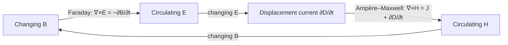

<!-- status: verified -->
# 13-04 · Maxwell's Equations and Time-Varying Fields

| | |
|---|---|
| **Course** | [13 · Electromagnetics](../README.md) |
| **University equivalent** | The time-varying-fields chapter of a junior electromagnetics course: Faraday's law in differential form, the displacement current, Maxwell's equations in integral, differential and phasor form, the continuity equation and charge relaxation, conductors against dielectrics, and the Poynting theorem (Ulaby & Ravaioli, *Fundamentals of Applied Electromagnetics*, ch. 6; Cheng, *Field and Wave Electromagnetics*, ch. 7; Griffiths, *Introduction to Electrodynamics*, ch. 7–8) |
| **Prerequisites** | [13-01 Vector Calculus Refresher](13-01-vector-calculus-refresher.md), [13-03 Magnetostatics and Inductance](13-03-magnetostatics-and-inductance.md), [04-07 Faraday, Lenz and Inductance](../../04-physics-for-ee/chapters/04-07-faraday-lenz-and-inductance.md), [04-08 Energy in Fields and a Maxwell Preview](../../04-physics-for-ee/chapters/04-08-maxwell-preview.md), [07-05 Sinusoidal Steady State and Impedance](../../07-circuit-analysis-2-transient-and-ac/chapters/07-05-sinusoidal-steady-state-and-impedance.md) |
| **Estimated study hours** | 10 |
| **Last verified** | 2026-11-20 |

**Learning objectives.** After this chapter you can:

1. State Maxwell's equations in integral and differential form, and explain the physical content of each.
2. Derive the displacement current from charge conservation, and compute it for a capacitor.
3. Classify a material as a good conductor or a good dielectric at a given frequency from $\sigma/\omega\varepsilon$, and compute its charge relaxation time.
4. Write Maxwell's equations for time-harmonic fields in phasor form, and use them to find one field from another.
5. Derive the Poynting theorem, and compute power flow, including the time-average Poynting vector of phasor fields.
6. Explain when circuit theory is a valid approximation to Maxwell's equations.

---

## 1. Big picture

Electrostatics and magnetostatics treated electric and magnetic fields as separate subjects. They are separate only when nothing changes. A changing magnetic field makes an electric field (Faraday), and a changing electric field makes a magnetic field (Maxwell's displacement current). Together these two couplings let each field regenerate the other, and the pair travels as a wave at the speed of light. Four equations then describe everything in this course: radio, transmission lines, waveguides, antennas, and the circuits themselves, which are Maxwell's equations in the limit where the circuit is much smaller than a wavelength.

- **Every interconnect is a field problem at speed.** When an on-board trace or a package lead is a significant fraction of a wavelength, circuit theory stops working and Maxwell's equations take over (13-07).
- **Power flows in the fields, not the wires.** The Poynting vector shows that the energy a cable delivers travels in its dielectric; the conductors guide it. This changes how you think about power delivery networks and shielding.
- **Probes and loops pick up changing flux.** An oscilloscope's ground lead and the loop it forms measure $d\Phi/dt$ as well as the voltage you wanted, a direct consequence of Faraday's law.
- **RF exposure rules are written in Poynting-vector units.** Phone and base-station compliance limits are power densities and absorbed power per kilogram (§9).

## 2. Intuition first

**Two couplings.** Faraday's law: wherever the magnetic field is changing, an electric field circulates around it, and a conducting loop there carries a current. Maxwell's addition: wherever the electric field is changing, a magnetic field circulates around it, exactly as if a current were flowing there. A capacitor being charged shows it best. Current flows in the wires but no charge crosses the gap, yet a compass would find the same circulating field around the gap as around the wire. Maxwell named the source in the gap the **displacement current**, $\partial\vec{D}/\partial t$.

**Why the second coupling had to exist.** Without it, Ampère's law would say the magnetic field around a loop depends on which surface you span the loop with: a surface pierced by the wire sees current, a surface ballooning through the capacitor gap sees none. Charge conservation settles the contradiction, and the fix is the displacement current (§3.2).

**An analogy from finance, and its limits.** Think of the electric and magnetic fields as two linked accounts whose balances drive each other's flows: a change in one account books a circulating flow into the other. Two such accounts can pass a disturbance back and forth indefinitely, which is the wave. The analogy captures the mutual coupling, but breaks quickly: field "flows" are vectors with direction and curl, the coupling is local at every point in space, and the energy carried is not booked in either account alone but in their cross product, the Poynting vector.

*Figure 1. The two couplings that close the loop: each changing field generates a circulating field of the other kind, which is what lets electromagnetic waves propagate without any charge or current along the way.*

## 3. Theory

> **Conventions.** Fields are as in 13-02 and 13-03: $\vec{E}$ (V/m), $\vec{D} = \varepsilon\vec{E}$ (C/m²), $\vec{H}$ (A/m), $\vec{B} = \mu\vec{H}$ (T), $\vec{J}$ (A/m²), $\rho_v$ (C/m³), conductivity σ (S/m). $\varepsilon_0$ = 8.854 × 10⁻¹² F/m and $\mu_0$ = 4π × 10⁻⁷ H/m. Phasor fields carry a tilde, $\tilde{\vec{E}}(\vec{r})$, with the peak-amplitude, cosine-reference convention of [notation](../../../reference/notation.md): $\vec{E}(\vec{r}, t) = \text{Re}\{\tilde{\vec{E}}(\vec{r})e^{j\omega t}\}$.

### 3.1 Faraday's law in differential form

04-07 stated Faraday's law for a loop: the EMF around a closed path $C$ equals minus the rate of change of the magnetic flux through any surface $S$ bounded by it,

$$
\oint_C\vec{E}\cdot d\vec\ell = -\frac{d}{dt}\int_S\vec{B}\cdot d\vec{S} .
$$

For a stationary path, the time derivative moves inside the integral. Stokes's theorem (13-01) turns the left side into $\int_S(\nabla\times\vec{E})\cdot d\vec{S}$, and since the equality holds for every surface, the integrands must match:

$$
\nabla\times\vec{E} = -\frac{\partial\vec{B}}{\partial t} .
$$

Two consequences are worth stating plainly.

- **The electric field is no longer conservative.** In electrostatics $\nabla\times\vec{E} = 0$, so $\oint\vec{E}\cdot d\vec\ell = 0$ and voltage between two points is path-independent. With changing flux, the voltage you measure depends on the path of your measurement leads. The leads of a voltmeter or the ground lead of an oscilloscope probe form a loop, and any changing flux through it adds $-d\Phi/dt$ to the reading (Example 13-04.1).
- **Kirchhoff's voltage law is an approximation.** KVL holds for loops threaded by negligible changing flux. Circuit theory keeps it true by assigning all the flux to inductors, the elements where it is meant to be.

When the path moves, the flux also changes because the path sweeps through the field. The total EMF is then the transformer term above plus a **motional EMF**, $\oint(\vec{v}\times\vec{B})\cdot d\vec\ell$, the Lorentz force on the moving charges (04-07). A generator's rotating coil (Problem 13-04.12) is the standard case.

### 3.2 Charge conservation and the displacement current

Charge is conserved: the current flowing out of any closed surface equals the rate at which the charge inside falls, $\oint\vec{J}\cdot d\vec{S} = -dQ/dt$. With the divergence theorem, this is the **continuity equation**:

$$
\nabla\cdot\vec{J} = -\frac{\partial\rho_v}{\partial t} .
$$

Now take the divergence of the magnetostatic Ampère law, $\nabla\times\vec{H} = \vec{J}$. The divergence of a curl is zero (13-01), so it demands $\nabla\cdot\vec{J} = 0$, which contradicts continuity whenever charge is building up somewhere, such as on a capacitor plate. Something must be added to the right side whose divergence is $\partial\rho_v/\partial t$. Gauss's law, $\nabla\cdot\vec{D} = \rho_v$, supplies it: $\nabla\cdot(\partial\vec{D}/\partial t) = \partial\rho_v/\partial t$. So

$$
\nabla\times\vec{H} = \vec{J} + \frac{\partial\vec{D}}{\partial t} ,
$$

and its divergence now gives $0 = \nabla\cdot\vec{J} + \partial\rho_v/\partial t$, which is exactly continuity. The term $\partial\vec{D}/\partial t$ is the **displacement current density** (A/m²).

**The capacitor.** Between parallel plates of area $A$ and gap $d$, $D = \varepsilon v/d$, so the total displacement current is $A\,\partial D/\partial t = (\varepsilon A/d)\,dv/dt = C\,dv/dt$: exactly the conduction current in the wires. Current is continuous around the circuit if you count both kinds, and the magnetic field around the gap equals the field around the wire. The capacitor's equation $i = C\,dv/dt$ *is* the displacement current.

### 3.3 Maxwell's equations

Collecting Gauss's two laws, Faraday's law and the Ampère–Maxwell law:

| Law | Differential form | Integral form | Content |
|---|---|---|---|
| Gauss (electric) | $\nabla\cdot\vec{D} = \rho_v$ | $\oint_S\vec{D}\cdot d\vec{S} = Q_{enc}$ | Charge is the source of $\vec{D}$ |
| Gauss (magnetic) | $\nabla\cdot\vec{B} = 0$ | $\oint_S\vec{B}\cdot d\vec{S} = 0$ | No magnetic charge; flux lines close |
| Faraday | $\nabla\times\vec{E} = -\partial\vec{B}/\partial t$ | $\oint_C\vec{E}\cdot d\vec\ell = -\dfrac{d}{dt}\int_S\vec{B}\cdot d\vec{S}$ | Changing $\vec{B}$ drives a circulating $\vec{E}$ |
| Ampère–Maxwell | $\nabla\times\vec{H} = \vec{J} + \partial\vec{D}/\partial t$ | $\oint_C\vec{H}\cdot d\vec\ell = I_{enc} + \dfrac{d}{dt}\int_S\vec{D}\cdot d\vec{S}$ | Current and changing $\vec{D}$ drive a circulating $\vec{H}$ |

*Table 1. Maxwell's equations. With the constitutive relations $\vec{D} = \varepsilon\vec{E}$, $\vec{B} = \mu\vec{H}$ and $\vec{J} = \sigma\vec{E}$ for linear, isotropic materials, and the Lorentz force $\vec{F} = q(\vec{E} + \vec{v}\times\vec{B})$, they describe all classical electromagnetism.*

The equations are not all independent. Taking the divergence of Faraday's law gives $\partial(\nabla\cdot\vec{B})/\partial t = 0$, so magnetic Gauss holds forever if it holds once; taking the divergence of Ampère–Maxwell gives continuity, which with conservation of charge keeps electric Gauss true. The boundary conditions of 13-02 and 13-03 carry over unchanged to time-varying fields, because they came from these same integral laws applied to vanishing loops and pillboxes (the time-derivative terms vanish with the area of a vanishing loop).

### 3.4 Conductors and dielectrics: σ against ωε

In a material with conductivity σ and permittivity ε, a sinusoidal field drives two currents: conduction, $\sigma E$, in phase with the field, and displacement, $\varepsilon\,\partial E/\partial t$, 90° ahead of it with amplitude $\omega\varepsilon E$. Their ratio sorts materials:

$$
\frac{\lvert J_c\rvert}{\lvert J_d\rvert} = \frac{\sigma}{\omega\varepsilon} \quad
\begin{cases}
\gg 1: & \text{good conductor (conduction dominates)} \\
\ll 1: & \text{good dielectric (displacement dominates)}
\end{cases}
$$

The same material can be either, depending on frequency. Copper ($\sigma$ = 5.8 × 10⁷ S/m) at 1 GHz has a ratio of about 10⁹: a conductor by any standard. Seawater ($\sigma$ ≈ 4 S/m, $\varepsilon_r$ ≈ 81) crosses over near 900 MHz; below that it behaves as a conductor, one reason radio penetrates the sea so poorly (Example 13-04.3, and 13-05 for the attenuation).

*Figure 2. Conduction against displacement current, σ/ωε, for several materials. Each line falls as 1/f and crosses 1 at $f = 1/(2\pi\tau_r)$: below it the material conducts, above it the displacement current wins. A laminate's loss tangent is roughly constant with frequency, so it appears as a flat line; its equivalent conductivity grows in proportion to frequency.*

**Charge relaxation.** Put charge inside a conductor and see how long it stays. Combine continuity, Ohm's law and Gauss's law:

$$
\frac{\partial\rho_v}{\partial t} = -\nabla\cdot(\sigma\vec{E}) = -\frac{\sigma}{\varepsilon}\nabla\cdot\vec{D} = -\frac{\sigma}{\varepsilon}\rho_v
\quad\Rightarrow\quad
\rho_v(t) = \rho_v(0)\,e^{-t/\tau_r}, \qquad \tau_r = \frac{\varepsilon}{\sigma} .
$$

The **relaxation time** $\tau_r$ is about 1.5 × 10⁻¹⁹ s for copper (using $\varepsilon \approx \varepsilon_0$): charge inside a good conductor vanishes immediately, which is why it lives only on surfaces. The number itself is an idealization: a constant σ fails above about 10¹³ Hz, and in a real metal a charge disturbance relaxes on the scale of the electrons' collision time, about 10⁻¹⁴ s (Griffiths §9.4). The conclusion, that free charge sits on the surface, is unaffected. The ratio $\sigma/\omega\varepsilon$ is simply $1/(\omega\tau_r)$: a material conducts at frequencies well below $1/(2\pi\tau_r)$ and insulates well above it.

**Lossy dielectrics.** Practical insulators are slightly lossy. Writing the total current as $(\sigma + j\omega\varepsilon)\tilde{\vec{E}} = j\omega(\varepsilon - j\sigma/\omega)\tilde{\vec{E}}$ defines a **complex permittivity**,

$$
\varepsilon_c = \varepsilon' - j\varepsilon'', \qquad \tan\delta = \frac{\varepsilon''}{\varepsilon'} ,
$$

where $\tan\delta$, the **loss tangent**, is the ratio of in-phase to quadrature current. Data sheets for circuit-board laminates quote $D_k$ (= $\varepsilon_r'$) and $D_f$ (= $\tan\delta$) at stated frequencies (13-02's §9). The loss can come from true conduction or from the lag of molecular polarization; at a single frequency they are indistinguishable, and both are lumped into $\varepsilon''$, equivalent to a conductivity $\sigma_{eff} = \omega\varepsilon'\tan\delta$.

### 3.5 Time-harmonic fields in phasor form

At a single frequency, every field component is a sinusoid, and the phasor method of 07-05 applies to each component of each vector. With $\vec{E}(\vec{r}, t) = \text{Re}\{\tilde{\vec{E}}(\vec{r})e^{j\omega t}\}$, a time derivative becomes multiplication by $j\omega$, and Maxwell's equations become

$$
\nabla\times\tilde{\vec{E}} = -j\omega\mu\tilde{\vec{H}}, \qquad
\nabla\times\tilde{\vec{H}} = (\sigma + j\omega\varepsilon)\tilde{\vec{E}}, \qquad
\nabla\cdot(\varepsilon\tilde{\vec{E}}) = \tilde\rho_v, \qquad
\nabla\cdot(\mu\tilde{\vec{H}}) = 0 .
$$

The time dependence has disappeared, leaving equations in space alone. Each curl equation gives one field from the other: knowing $\tilde{\vec{E}}$ in a region, Faraday gives $\tilde{\vec{H}} = -\nabla\times\tilde{\vec{E}}/(j\omega\mu)$ (Example 13-04.4).

**The wave equation, in one line.** In a source-free, lossless, uniform region, take the curl of Faraday's phasor law and substitute Ampère–Maxwell:

$$
\nabla\times\nabla\times\tilde{\vec{E}} = -j\omega\mu\,\nabla\times\tilde{\vec{H}} = \omega^2\mu\varepsilon\,\tilde{\vec{E}} .
$$

With $\nabla\times\nabla\times\tilde{\vec{E}} = \nabla(\nabla\cdot\tilde{\vec{E}}) - \nabla^2\tilde{\vec{E}}$ and $\nabla\cdot\tilde{\vec{E}} = 0$ (no charge):

$$
\nabla^2\tilde{\vec{E}} + k^2\tilde{\vec{E}} = 0, \qquad k = \omega\sqrt{\mu\varepsilon} .
$$

This **Helmholtz equation** has travelling-wave solutions $e^{\mp jkz}$ that move at $v = \omega/k = 1/\sqrt{\mu\varepsilon}$. In vacuum, $1/\sqrt{\mu_0\varepsilon_0}$ is the speed of light, 299,792,458 m/s. Maxwell computed this number from electrical measurements in 1865 and concluded that light is an electromagnetic wave. 13-05 develops the waves fully.

> **Going deeper — why the speed is exact.** Since the 2019 SI revision, the speed of light $c$ is a defined constant, $\mu_0$ is measured (it equals 4π × 10⁻⁷ H/m to within a part in 10⁹), and $\varepsilon_0$ is defined through $\varepsilon_0 = 1/(\mu_0c^2)$. So $1/\sqrt{\mu_0\varepsilon_0} = c$ holds by construction in the SI; what Maxwell's prediction tells us physically is that the measured electrical constants and the measured speed of light agree.

### 3.6 The Poynting theorem: where power flows

Energy conservation for fields follows from the two curl equations. The vector identity $\nabla\cdot(\vec{E}\times\vec{H}) = \vec{H}\cdot(\nabla\times\vec{E}) - \vec{E}\cdot(\nabla\times\vec{H})$ (13-01) with Maxwell's curls gives

$$
\nabla\cdot(\vec{E}\times\vec{H}) = -\vec{H}\cdot\frac{\partial\vec{B}}{\partial t} - \vec{E}\cdot\vec{J} - \vec{E}\cdot\frac{\partial\vec{D}}{\partial t} .
$$

In linear media, $\vec{H}\cdot\partial\vec{B}/\partial t = \partial(\tfrac12\mu H^2)/\partial t$ and $\vec{E}\cdot\partial\vec{D}/\partial t = \partial(\tfrac12\varepsilon E^2)/\partial t$. Integrate over a volume $V$ with surface $S$ and use the divergence theorem:

$$
-\oint_S(\vec{E}\times\vec{H})\cdot d\vec{S} = \frac{d}{dt}\int_V\Big(\frac12\varepsilon E^2 + \frac12\mu H^2\Big)dv + \int_V\vec{E}\cdot\vec{J}\,dv .
$$

Read it as a budget. The power flowing *in* through the surface (left) equals the rate of increase of stored electric and magnetic energy plus the power delivered to charges (Joule heating, or work done on a battery or an electron beam). The flux of the **Poynting vector**

$$
\vec{S} = \vec{E}\times\vec{H} \quad (\text{W/m}^2)
$$

is the power crossing a surface. Two worked cases make the picture concrete.

- **A wire carrying DC.** At the surface of a resistive wire, $\vec{E}$ points along the wire (it drives the current) and $\vec{H}$ circles it. Their cross product points radially *into* the wire, and its flux over the surface equals exactly $I^2R$ (Example 13-04.5). The energy that heats a wire enters through its surface from the surrounding fields.
- **A coaxial cable.** Between the conductors $\vec{E}$ is radial and $\vec{H}$ circles; $\vec{S}$ points along the cable, and its integral over the dielectric annulus is $VI$ (Example 13-04.6). The power travels in the dielectric. The conductors guide it and, being imperfect, take a small inward flow that becomes their loss.

**Time-harmonic fields.** Write each field as $\vec{E}(t) = \operatorname{Re}\{\tilde{\vec{E}}e^{j\omega t}\} = \tfrac12(\tilde{\vec{E}}e^{j\omega t} + \tilde{\vec{E}}^*e^{-j\omega t})$, and $\vec{H}(t)$ likewise. Their cross product has four terms: $\tfrac14\tilde{\vec{E}}\times\tilde{\vec{H}}e^{j2\omega t}$ and its conjugate, which oscillate at $2\omega$ and average to zero over a period, and $\tfrac14(\tilde{\vec{E}}\times\tilde{\vec{H}}^* + \tilde{\vec{E}}^*\times\tilde{\vec{H}})$, a constant equal to $\tfrac12\operatorname{Re}\{\tilde{\vec{E}}\times\tilde{\vec{H}}^*\}$ because the two terms are conjugates. This is the field version of 07-06's $P = \tfrac12\text{Re}\{\mathbf{V}\mathbf{I}^*\}$. So the **time-average Poynting vector** is

$$
\vec{S}_{av} = \frac12\,\text{Re}\{\tilde{\vec{E}}\times\tilde{\vec{H}}^*\} .
$$

### 3.7 When is circuit theory enough?

Circuit theory is Maxwell's equations with two simplifications: the displacement current is neglected except inside capacitors, and changing magnetic flux is neglected except inside inductors. Both are accurate when the circuit is small compared with a wavelength, $\lambda = v/f$, so that fields everywhere in it change in step. A common rule of thumb treats an interconnect as lumped when it is shorter than about a tenth of a wavelength (or, for digital edges, when its delay is short compared with the rise time, 13-07). In FR-4-like board material ($\varepsilon_r \approx 4$, so $v = c/2$), a wavelength at 1 GHz is 15 cm, so a 1.5 cm trace is the limit; at 10 GHz it is 1.5 mm (Problem 13-04.9). Inside a chip, distances are millimetres, and most on-chip wires are so resistive that they behave as distributed RC lines (quasi-static and diffusive) rather than as transmission lines: long ones are distributed, but their delay grows with the square of length, not linearly. Only the widest global and clock wires show inductive, wave-like behaviour at tens of gigahertz. On a board, almost every high-speed trace is a transmission line.

## 4. Worked examples

### Example 13-04.1 · The probe ground loop (tier A)

**Setup.** An oscilloscope probe's ground lead and tip form a loop of 2 cm × 1 cm. Nearby circuitry produces a uniform magnetic field through it of 10 µT peak, sinusoidal at 1 MHz. Find the peak EMF added to the reading, and at 100 MHz.

**Solution.** $\Phi = BA\cos\omega t$ with $A$ = 2 × 10⁻⁴ m², so the EMF amplitude is $\omega BA = 2\pi \times 10^6 \times 10^{-5} \times 2 \times 10^{-4}$ = **12.57** mV. At 100 MHz it is 100 times larger, **1.257** V.

**Units check.** (rad/s)(T)(m²) = (1/s)(V·s/m²)(m²) = V.

**Sanity check.** The pickup scales with frequency and loop area, which is why high-speed probing uses a short spring ground tip instead of the long ground lead: shrinking the loop by 10 times cuts the error by 10 times.

### Example 13-04.2 · Displacement current in a capacitor (tier A)

**Setup.** A parallel-plate capacitor has plates of 1 cm², a 0.1 mm gap filled with a dielectric of $\varepsilon_r$ = 4, and 1 V peak across it at 1 GHz. Find its capacitance, the displacement current density in the gap, and the total displacement current; compare with the conduction current $\omega CV$ in the leads.

**Solution.** $C = 4\varepsilon_0 \times 10^{-4}/10^{-4}$ = **35.42** pF. The field amplitude is $V/d$ = 10⁴ V/m, so $J_d = \omega\varepsilon E = 2\pi \times 10^9 \times 4\varepsilon_0 \times 10^4$ = **2225** A/m². Times the area, $I_d$ = **0.2225** A. The lead current is $\omega CV = 2\pi \times 10^9 \times 35.42\ \text{pF} \times 1\ \text{V}$, the same **0.2225** A.

**Units check.** (1/s)(F/m)(V/m) = A/m².

**Sanity check.** The two must agree, since $I_d = A\,\varepsilon\,\omega V/d = \omega(\varepsilon A/d)V$; the capacitor law is the displacement current.

### Example 13-04.3 · Conductor or dielectric? (tier B)

**Setup.** Find $\sigma/\omega\varepsilon$ for copper ($\sigma$ = 5.8 × 10⁷ S/m, $\varepsilon \approx \varepsilon_0$) at 1 GHz, and for seawater ($\sigma$ = 4 S/m, $\varepsilon_r$ = 81) at 1 MHz and at 10 GHz. At what frequency does seawater cross over? Find the relaxation times of both.

**Solution.** Copper at 1 GHz: $5.8 \times 10^7/(2\pi \times 10^9 \times \varepsilon_0)$ = **1.043 × 10⁹**, an excellent conductor. Seawater: **887.7** at 1 MHz (a conductor) and **0.08877** at 10 GHz (a lossy dielectric). The ratio is 1 at $f = \sigma/(2\pi\varepsilon)$ = **887.7** MHz. Relaxation times: $\varepsilon_0/\sigma$ = **1.527 × 10⁻¹⁹** s for copper and $81\varepsilon_0/4$ = **0.1793** ns for seawater.

**Sanity check.** The crossover frequency is $1/(2\pi\tau_r)$, and $1/(2\pi \times 0.1793\ \text{ns})$ = 887.7 MHz, as it must be. Signals for submerged submarines use frequencies of kilohertz and below, where seawater is a strong conductor but the attenuation per metre (13-05) is smallest.

### Example 13-04.4 · From one field to the other (tier B)

**Setup.** In free space, $\vec{E} = 10\cos(\omega t - \beta z)\,\hat{x}$ V/m at 100 MHz. Find $\beta$ and the wavelength from the wave equation, $\vec{H}$ from Faraday's law, and the time-average power density.

**Solution.** The field must satisfy the Helmholtz equation, which requires $\beta = \omega\sqrt{\mu_0\varepsilon_0} = \omega/c$ = **2.096** rad/m; the wavelength is $2\pi/\beta$ = **2.998** m. In phasor form $\tilde{\vec{E}} = 10e^{-j\beta z}\hat{x}$. Faraday's law: $\nabla\times\tilde{\vec{E}} = \hat{y}\,\partial\tilde E_x/\partial z = -j\beta\,10e^{-j\beta z}\hat{y}$, so

$$
\tilde{\vec{H}} = -\frac{\nabla\times\tilde{\vec{E}}}{j\omega\mu_0} = \frac{\beta}{\omega\mu_0}\,10e^{-j\beta z}\,\hat{y} = \frac{10}{\eta_0}\,e^{-j\beta z}\,\hat{y},
$$

where $\eta_0 = \omega\mu_0/\beta = \sqrt{\mu_0/\varepsilon_0}$ = 376.7 Ω. The amplitude is **26.54** mA/m, in phase with $\vec{E}$ and along $\hat{y}$. Then $\vec{S}_{av} = \tfrac12\text{Re}\{\tilde E_x\tilde H_y^*\}\hat{z} = 10^2/(2\eta_0)\,\hat{z}$ = **0.1327** W/m², along $+z$, the direction of travel.

**Sanity check.** $\vec{E}\times\vec{H}$ points along $\hat{x}\times\hat{y} = \hat{z}$, the direction in which $\cos(\omega t - \beta z)$ moves. The ratio $E/H$ is a resistance, the impedance of free space, which 13-05 derives in general.

### Example 13-04.5 · Power enters a wire through its surface (tier B)

**Setup.** A copper wire of radius 1 mm and length 1 m carries 10 A DC. Find its resistance and $I^2R$, then the fields at its surface, the Poynting vector there, and the power flowing in through the surface.

**Solution.** $R = \ell/(\sigma\pi a^2)$ = **5.488** mΩ, so $P = I^2R$ = **0.5488** W. Inside, $E = J/\sigma = I/(\sigma\pi a^2)$ = **54.88** mV/m along the wire, and by continuity of tangential $E$ the same just outside. $H = I/(2\pi a)$ = **1592** A/m around the wire. $\vec{S} = \vec{E}\times\vec{H}$ points radially inward with magnitude $EH$ = **87.35** W/m², and over the surface $2\pi a\ell$ the inflow is **0.5488** W, exactly $I^2R$.

**Sanity check.** Algebraically, $EH \times 2\pi a\ell = [I/(\sigma\pi a^2)][I/(2\pi a)]\,2\pi a\ell = I^2\ell/(\sigma\pi a^2) = I^2R$. The energy that heats the wire comes from the field outside it, delivered by the source through the space around the circuit.

### Example 13-04.6 · Power flow in a coaxial cable (tier C)

**Setup.** The coaxial line of 13-02 and 13-03 ($a$ = 0.5 mm, $b$ = 1.75 mm) carries 10 V and 0.2 A to a matched 50 Ω load at low frequency. Find $E$, $H$ and $S$ at the inner conductor's surface, show that the Poynting flux over the dielectric equals $VI$, and find the radius inside which half the power flows.

**Solution.** $E_\rho = V/[\rho\ln(b/a)]$ and $H_\phi = I/(2\pi\rho)$. At $\rho = a$: $E$ = **15.96** kV/m, $H$ = **63.66** A/m, and $S = EH$ = **1.016** MW/m², along the cable. Over the annulus,

$$
P = \int_a^b\frac{V}{\rho\ln(b/a)}\,\frac{I}{2\pi\rho}\,2\pi\rho\,d\rho = \frac{VI}{\ln(b/a)}\int_a^b\frac{d\rho}{\rho} = VI = \mathbf{2}\ \text{W}.
$$

The power inside radius $\rho$ is a fraction $\ln(\rho/a)/\ln(b/a)$, so half flows inside $\sqrt{ab}$ = **0.9354** mm.

**Sanity check.** The power density falls as $1/\rho^2$, so it crowds against the inner conductor, but the area grows with $\rho$; the logarithm splits the difference. None of the power flows inside the conductors themselves (except the small inward flow that becomes their loss).

### Answer key

<!-- answer-key -->
| ID | Quantity | Value | Unit |
|---|---|---|---|
| T 13-04.a | copper relaxation time | 1.5 × 10⁻¹⁹ | s |
| T 13-04.b | wavelength at 1 GHz in εr = 4 | 15 | cm |
| T 13-04.c | lumped-length limit at 1 GHz | 1.5 | cm |
| T 13-04.d | lumped-length limit at 10 GHz | 1.5 | mm |
| T 13-04.e | speed of light from μ0 and ε0 | 299792458 | m/s |
| Ex 13-04.1a | probe-loop EMF at 1 MHz | 12.57 | mV |
| Ex 13-04.1b | probe-loop EMF at 100 MHz | 1.257 | V |
| Ex 13-04.2a | capacitance | 35.42 | pF |
| Ex 13-04.2b | displacement current density | 2225 | A/m² |
| Ex 13-04.2c | displacement current | 0.2225 | A |
| Ex 13-04.2d | lead current | 0.2225 | A |
| Ex 13-04.3a | copper ratio at 1 GHz | 1.043 × 10⁹ | — |
| Ex 13-04.3b | seawater ratio at 1 MHz | 887.7 | — |
| Ex 13-04.3c | seawater ratio at 10 GHz | 0.08877 | — |
| Ex 13-04.3d | seawater crossover | 887.7 | MHz |
| Ex 13-04.3e | copper relaxation time | 1.527 × 10⁻¹⁹ | s |
| Ex 13-04.3f | seawater relaxation time | 0.1793 | ns |
| Ex 13-04.4a | phase constant | 2.096 | rad/m |
| Ex 13-04.4b | wavelength | 2.998 | m |
| Ex 13-04.4c | magnetic field amplitude | 26.54 | mA/m |
| Ex 13-04.4d | time-average power density | 0.1327 | W/m² |
| Ex 13-04.5a | wire resistance | 5.488 | mΩ |
| Ex 13-04.5b | I²R | 0.5488 | W |
| Ex 13-04.5c | E at the surface | 54.88 | mV/m |
| Ex 13-04.5d | H at the surface | 1592 | A/m |
| Ex 13-04.5e | Poynting vector at the surface | 87.35 | W/m² |
| Ex 13-04.5f | power inflow through the surface | 0.5488 | W |
| Ex 13-04.6a | E at the inner conductor | 15.96 | kV/m |
| Ex 13-04.6b | H at the inner conductor | 63.66 | A/m |
| Ex 13-04.6c | S at the inner conductor | 1.016 | MW/m² |
| Ex 13-04.6d | power from the Poynting flux | 2 | W |
| Ex 13-04.6e | radius enclosing half the power | 0.9354 | mm |
| Prac 13-04.a | plane-wave E (rms) at 10 W/m² | 61.38 | V/m |
| Prac 13-04.b | ratio of the FCC E and H limits, 30–300 MHz | 377 | Ω |
| Prac 13-04.c | distance to 10 W/m² from 1 W EIRP | 8.92 | cm |
| Sim 13-04.a | simulated capacitor current amplitude | 0.2225 | A |

*Every value is recomputed by [verify_13_04.py](../verify/verify_13_04.py): the Faraday EMFs by integrating $\vec{E}$ around the loop from a numerical curl, the displacement current from Gauss's law and a numerical time derivative, the phasor fields by symbolic curls in sympy, and the Poynting fluxes by numerical surface integration. The capacitor current is also simulated in ngspice.*

## 5. Simulate it

The lab, [labs/13-04-lab](../labs/13-04-lab/README.md), has a notebook and an ngspice netlist:

1. Solves Maxwell's two curl equations directly in one dimension with the finite-difference time-domain (FDTD) method: a pulse launched from a point source travels at the speed of light, without any wave equation being programmed in.
2. Measures the numerical phase velocity of the FDTD grid against the cells per wavelength, and compares it with the grid's dispersion relation.
3. Adds a conducting slab to the FDTD grid and watches the pulse reflect and decay.
4. Checks the Poynting theorem numerically for the resistive wire of Example 13-04.5, and plots $\sigma/\omega\varepsilon$ against frequency for several materials.

The netlist [displacement.cir](../labs/13-04-lab/displacement.cir) drives Example 13-04.2's 35.42 pF capacitor with 1 V at 1 GHz.

**Guided exercise (predict, then run).** **Before running the netlist**, predict the amplitude of the current through the capacitor and its phase relative to the voltage. Then run it. (**0.2225** A, leading the voltage by 90°: the displacement current in the gap, measured as a conduction current in the leads.)

## 6. Engineering tradeoffs

| Knob | Improves | Costs | Typical decision owner |
|---|---|---|---|
| Smaller probe or current loops | Less induced EMF and radiated emission | Fixture complexity, layout area for return paths | Test engineer, PCB designer |
| Lower-loss dielectric (smaller $\tan\delta$) | Less signal loss and heating at high frequency | Laminate cost, processing | SI engineer, PCB designer |
| Treating an interconnect as a transmission line | Accurate timing and reflection prediction | Design effort, simulation time, termination parts | SI engineer |
| Lumped (quasi-static) models | Fast, intuitive analysis | Wrong once dimensions approach λ/10 | Circuit designer |
| Shielding and absorbers | Lower exposure and interference | Weight, cost, heat, antenna efficiency | RF and compliance engineer |

## 7. Numbers to know

| Quantity | Value | Note |
|---|---|---|
| Speed of light | 299,792,458 m/s | Defined; $1/\sqrt{\mu_0\varepsilon_0}$ |
| Impedance of free space | 376.7 Ω | $\sqrt{\mu_0/\varepsilon_0}$, ≈ 120π |
| Copper conductivity | 5.8 × 10⁷ S/m | $\sigma/\omega\varepsilon_0 \approx 10^9$ at 1 GHz |
| Seawater crossover | ≈ 900 MHz | $\sigma$ ≈ 4 S/m, $\varepsilon_r$ ≈ 81 |
| Lumped-circuit limit | about λ/10 | 1.5 cm at 1 GHz on FR-4-like board |
| FCC general-population power-density limit | 1 mW/cm² (10 W/m²) above 1.5 GHz | As of Nov 2026 [1] |
| Peak spatial SAR limits | 1.6 W/kg over 1 g (FCC); 2 W/kg over 10 g (ICNIRP 2020) | As of Nov 2026 [1], [2] |

## 8. Common mistakes

- **Applying KVL to a loop with changing flux through it.** The sum of voltages around such a loop is $-d\Phi/dt$, not zero; the "voltage" measured depends on the lead path.
- **Forgetting the displacement current in a good dielectric**, or including it where $\sigma \gg \omega\varepsilon$ (inside metals at any radio frequency).
- **Mixing peak and rms phasors in the Poynting vector.** With peak phasors, $\vec{S}_{av} = \tfrac12\text{Re}\{\tilde{\vec{E}}\times\tilde{\vec{H}}^*\}$; with rms phasors the ½ disappears.
- **Thinking power travels inside the copper.** In a cable or a board's power planes the energy flows in the dielectric; the conductors guide it and dissipate a little.
- **Confusing the loss tangent with conductivity.** $\tan\delta$ is dimensionless and depends on frequency; the equivalent conductivity $\omega\varepsilon'\tan\delta$ grows with frequency even at constant $\tan\delta$.

## 9. Practitioner lens

### State of the art (as of Nov 2026)

- **Exposure limits are Poynting-vector limits.** The US Federal Communications Commission's maximum permissible exposure for the general population is a power density of 1.0 mW/cm² (10 W/m²) from 1,500 MHz to 100 GHz, averaged over 30 minutes, falling to 0.2 mW/cm² from 30 to 300 MHz, where it is also stated as 27.5 V/m and 0.073 A/m [1] **[Established]**. The ratio of those two field limits is about **377** Ω (27.5/0.073, with the current limit given to two figures), the impedance of free space: the limits assume a plane wave. A 10 W/m² plane wave has an rms electric field of $\sqrt{10\eta_0}$ = **61.38** V/m (our arithmetic).
- **Phones are certified by absorbed power, not power density.** For handsets, the FCC limit is a peak spatial-average specific absorption rate (SAR) of 1.6 W/kg averaged over any 1 g of tissue [1]; ICNIRP's 2020 guidelines, used in many other countries, set 2 W/kg averaged over 10 g for the head and torso [2] **[Established]**. SAR is $\sigma\lvert E_{rms}\rvert^2/\rho_m$ in tissue (with $\rho_m$ the tissue's mass density), so it is a Joule-heating term of the Poynting theorem measured inside a phantom head.
- **How close is close?** A source with 1 W EIRP gives $S = \text{EIRP}/(4\pi r^2)$ in its strongest direction, which falls to 10 W/m² at **8.92** cm (our arithmetic, far-field formula): beyond a hand's width, a 1 W EIRP emitter is below the high-frequency limit even in its main beam, which is why exposure from handsets is assessed as SAR in the near field instead.

### Why it matters commercially

- **Compliance gates product launches.** Every phone, wearable and Wi-Fi device must pass SAR or power-density testing in each market **[Established]**, and antenna placement is often constrained more by SAR than by efficiency.
- **Board materials are chosen by loss tangent.** High-speed boards for AI servers and networking use low-$D_f$ laminates because dielectric loss grows with frequency (13-02's §9, 13-08).
- **Power integrity is field engineering.** Power flows between a board's supply and ground planes in the dielectric (Problem 13-04.10); thin, high-permittivity plane pairs lower the impedance of that path.

### Marketing vs Reality

- **"Lowest-SAR phone."** *Reality:* the published SAR is the worst case measured at maximum transmit power in test positions; in use, the phone adapts its power to the link, and two phones' typical exposures can rank differently. *Sanity check:* ask which limit (1 g or 10 g averaging) the number refers to; they are not comparable.
- **"5G radiation is a new kind of energy."** *Reality:* all radio is the same electromagnetic field, described by the same Maxwell equations; what changes with frequency is how deeply it penetrates tissue, which is why limits above 6 GHz switch from SAR to absorbed power density [2]. *Sanity check:* look at the regulated quantity and frequency range, not the marketing label.

### Questions for engineering leaders

1. **"At what frequency do your interconnects stop being lumped?"**
   *Strong:* a length-to-wavelength or delay-to-rise-time criterion applied to the longest nets, with the transmission-line ones identified. *Evasive:* "we simulate everything" without saying which models.
2. **"Where does your RF exposure margin come from: the antenna, the power control, or the test position?"**
   *Strong:* measured SAR at each test position with margin, and how proximity sensing backs off power. *Evasive:* "we pass certification."
3. **"What laminate loss tangent does your link budget assume, and at what frequency was it measured?"**
   *Strong:* a $D_f$ at the Nyquist frequency of the link from the vendor's data at that frequency. *Evasive:* a 1 MHz value.

## 10. Concept check

**Q1.** Why did Maxwell have to add the displacement current to Ampère's law?

Answer

The divergence of a curl is zero, so the original law forced $\nabla\cdot\vec{J} = 0$, contradicting charge conservation wherever charge accumulates. Adding $\partial\vec{D}/\partial t$, whose divergence is $\partial\rho_v/\partial t$ by Gauss's law, restores continuity.

**Q2.** Why can two voltmeters connected to the same two points read different voltages?

Answer

If changing magnetic flux passes between their lead paths, $\oint\vec{E}\cdot d\vec\ell \neq 0$, so the line integral of $\vec{E}$ between the points depends on the path. Each meter measures along its own leads.

**Q3.** Is a material a conductor or an insulator?

Answer

It depends on frequency: compare $\sigma$ with $\omega\varepsilon$. Seawater is a conductor at 1 MHz and a lossy dielectric at 10 GHz.

**Q4.** In which direction does energy flow into a resistive wire carrying DC, and where does it come from?

Answer

Radially inward through the wire's surface: $\vec{E}$ is along the wire and $\vec{H}$ circles it, so $\vec{E}\times\vec{H}$ points in. The energy comes from the source through the fields in the space around the circuit.

**Q5.** Why does $\vec{S}_{av}$ have a factor of ½?

Answer

With peak-amplitude phasors, the time average of the product of two sinusoids of amplitudes $E$ and $H$ is $\tfrac12EH\cos\theta$, which is $\tfrac12\text{Re}\{\tilde E\tilde H^*\}$.

**Q6.** When can you use circuit theory instead of Maxwell's equations?

Answer

When the circuit is much smaller than a wavelength (a common rule is under λ/10), so displacement current outside capacitors and induction outside inductors can be neglected and fields everywhere change in step.

Next: the [13-04 problem set](../problems/13-04-problems.md).

## 11. Key terms

[Faraday's law](../../../reference/glossary.md#faradays-law) · [Displacement current](../../../reference/glossary.md#displacement-current) · [Continuity equation](../../../reference/glossary.md#continuity-equation) · [Maxwell's equations](../../../reference/glossary.md#maxwells-equations) · [Charge relaxation time](../../../reference/glossary.md#charge-relaxation-time) · [Loss tangent](../../../reference/glossary.md#loss-tangent) · [Complex permittivity](../../../reference/glossary.md#complex-permittivity) · [Helmholtz equation](../../../reference/glossary.md#helmholtz-equation) · [Poynting vector](../../../reference/glossary.md#poynting-vector) · [Specific absorption rate](../../../reference/glossary.md#specific-absorption-rate-sar) · [Quasi-static approximation](../../../reference/glossary.md#quasi-static-approximation)

## 12. Connections

- **Builds on:** Faraday's law and the Maxwell preview from [04-07](../../04-physics-for-ee/chapters/04-07-faraday-lenz-and-inductance.md) and [04-08](../../04-physics-for-ee/chapters/04-08-maxwell-preview.md); phasors from [07-05](../../07-circuit-analysis-2-transient-and-ac/chapters/07-05-sinusoidal-steady-state-and-impedance.md); the static laws and boundary conditions of [13-02](13-02-electrostatics-boundary-value-problems.md) and [13-03](13-03-magnetostatics-and-inductance.md).
- **Next:** [13-05 Plane Waves in Lossless and Lossy Media](13-05-plane-waves.md) solves the Helmholtz equation for uniform plane waves, including the skin effect in conductors.
- **Used later:** the Poynting vector in reflection ([13-06](13-06-reflection-and-transmission.md)), transmission-line power ([13-08](13-08-transmission-lines-sinusoidal-steady-state.md)) and antennas ([13-11](13-11-radiation-and-antennas.md)); the quasi-static limit in [13-07](13-07-transmission-lines-time-domain.md).

## 13. Further study

- F. T. Ulaby and U. Ravaioli, *Fundamentals of Applied Electromagnetics*, ch. 6 (Maxwell's equations for time-varying fields).
- D. K. Cheng, *Field and Wave Electromagnetics*, ch. 7 (time-varying fields, Poynting theorem).
- D. J. Griffiths, *Introduction to Electrodynamics*, ch. 7–8 (electrodynamics, conservation laws).
- MIT OpenCourseWare 6.013, *Electromagnetics and Applications* (lecture notes on Maxwell's equations and power).

## 14. Sources

1. US Code of Federal Regulations, 47 CFR § 1.1310 (radiofrequency exposure limits: SAR in (c), maximum permissible exposure in (e)(1) Table 1). [R-196](../../../reference/research-log.md#r-196--rf-exposure-limits-fcc-and-icnirp).
2. ICNIRP, "Guidelines for limiting exposure to electromagnetic fields (100 kHz to 300 GHz)," *Health Physics* 118(5):483–524, 2020, Table 2. [R-196](../../../reference/research-log.md#r-196--rf-exposure-limits-fcc-and-icnirp).

The physics (Maxwell's equations, Poynting theorem) is textbook material (Further study).
