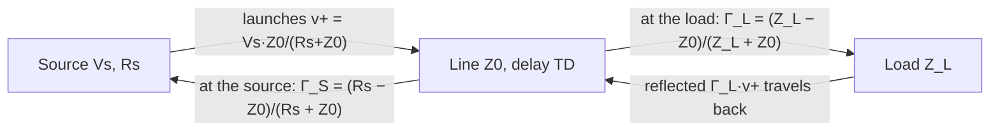

<!-- status: verified -->
# 13-07 · Transmission Lines: Time Domain

| | |
|---|---|
| **Course** | [13 · Electromagnetics](../README.md) |
| **University equivalent** | The transient transmission-line chapter of a junior electromagnetics course: the distributed model and telegrapher's equations, characteristic impedance and velocity, launching and reflecting waves, bounce (lattice) diagrams, reactive terminations, termination strategies and time-domain reflectometry (Ulaby & Ravaioli, *Fundamentals of Applied Electromagnetics*, ch. 2; Cheng, *Field and Wave Electromagnetics*, ch. 9; Johnson & Graham, *High-Speed Digital Design*, ch. 4) |
| **Prerequisites** | [13-06 Reflection and Transmission of Waves](13-06-reflection-and-transmission.md), [13-03 Magnetostatics and Inductance](13-03-magnetostatics-and-inductance.md) ($L'$), [13-02 Electrostatics: Boundary-Value Problems](13-02-electrostatics-boundary-value-problems.md) ($C'$), [07-02 First-Order RC and RL Transients](../../07-circuit-analysis-2-transient-and-ac/chapters/07-02-first-order-rc-rl-transients.md) |
| **Estimated study hours** | 10 |
| **Last verified** | 2026-11-20 |

**Learning objectives.** After this chapter you can:

1. Derive the telegrapher's equations from the distributed $L'$–$C'$ model and solve them for travelling waves, with $Z_0 = \sqrt{L'/C'}$ and $v = 1/\sqrt{L'C'}$.
2. Compute the wave launched by a source and the reflections at resistive loads and sources.
3. Draw a bounce diagram and compute the voltage at any point and time, including the final steady state.
4. Predict the response of capacitive and inductive terminations and discontinuities.
5. Choose and size series and parallel terminations, and decide when a trace must be treated as a transmission line.
6. Interpret a time-domain reflectometry (TDR) trace to locate discontinuities and estimate their impedance, capacitance or inductance.

---

## 1. Big picture

In circuit theory a wire connects two points instantly. In reality a voltage change travels down a pair of conductors at a finite speed, roughly half the speed of light on a circuit board, and on the way it sees the line's **characteristic impedance**, not the load at the far end. When the wave reaches a mismatch, part of it reflects, exactly as plane waves did in 13-06. For slow signals the reflections die out long before anyone notices. For fast edges they cause ringing, overshoot, false clocking and data errors, which is why every high-speed board, package and cable is designed as a transmission line.

- **Signal integrity.** Reflections from unterminated or mismatched nets are the first thing a high-speed board designer controls; terminations exist to absorb them.
- **Impedance-controlled interconnect.** Board traces, cables and package routes are specified by impedance (for example 85 Ω or 90 Ω differential, §9).
- **TDR** turns reflections into a measurement: it maps the impedance along a cable or trace, locating faults and parasitic capacitance or inductance.
- **Delay.** At about 6.7 ps/mm on a board, a 10 cm trace adds 0.67 ns, a large fraction of a clock period at gigahertz rates.

## 2. Intuition first

**A wave that does not know what is at the end.** Connect a battery through a switch to a long line and close the switch. The battery cannot "see" the load metres away; the first thing it meets is the line itself, a chain of tiny series inductances and shunt capacitances. Charging each bit of capacitance through the next bit of inductance takes a current proportional to the voltage, and their ratio is $Z_0 = \sqrt{L'/C'}$. So for the first round-trip time the source sees a resistor of value $Z_0$, whatever is at the end.

**The echo.** When the wavefront reaches the load, the load demands its own ratio of voltage to current. If it differs from $Z_0$, a reflected wave starts back toward the source to make up the difference. At the source the reflection may reflect again. The voltage at any point is the sum of all the waves that have passed it so far: the bounce diagram keeps the accounts.

**An analogy from finance, and its limits.** A line is like a settlement system with a fixed latency: an order placed at one end takes a known time to reach the other, and the receiving end's response returns after the same delay. Until the response arrives, the sender's view is set entirely by the channel's own properties. The analogy captures the delay and the echo, but not the arithmetic: on a line, waves add linearly and conserve energy exactly, and the echo's size is set by an impedance ratio, not by anyone's decision.

*Figure 1. The bookkeeping of a transmission line: a launched wave, a reflection at each end, and a delay $T_D$ for each trip.*

## 3. Theory

> **Conventions.** A line has per-length series inductance $L'$ (H/m), shunt capacitance $C'$ (F/m), series resistance $R'$ (Ω/m) and shunt conductance $G'$ (S/m). Position $z$ runs from the source ($z$ = 0) to the load ($z = \ell$). The one-way delay is $T_D = \ell/v$. Forward and backward waves are written $v^+$ and $v^-$. Lines are lossless in this chapter unless stated; 13-08 adds loss.

### 3.1 The telegrapher's equations

Cut the line into short pieces of length $\Delta z$, each a series inductance $L'\Delta z$ followed by a shunt capacitance $C'\Delta z$. KVL around one piece and KCL at its node give

$$
v(z, t) - v(z + \Delta z, t) = L'\Delta z\,\frac{\partial i}{\partial t}, \qquad
i(z, t) - i(z + \Delta z, t) = C'\Delta z\,\frac{\partial v}{\partial t} .
$$

Dividing by $\Delta z$ and letting it shrink:

$$
\frac{\partial v}{\partial z} = -L'\frac{\partial i}{\partial t}, \qquad \frac{\partial i}{\partial z} = -C'\frac{\partial v}{\partial t} .
$$

These are the **telegrapher's equations** (with loss, add $-R'i$ and $-G'v$ to the right sides). They are Faraday's and Ampère–Maxwell's laws for the TEM fields between the conductors, integrated across the line's cross-section: voltage is the line integral of $\vec{E}$ between the conductors and current the line integral of $\vec{H}$ around one of them. Differentiating one and substituting the other gives the wave equation,

$$
\frac{\partial^2v}{\partial z^2} = L'C'\frac{\partial^2v}{\partial t^2} ,
$$

whose general solution (d'Alembert) is any pair of shapes travelling in opposite directions at speed $v = 1/\sqrt{L'C'}$:

$$
v(z, t) = v^+\!\left(t - \frac{z}{v}\right) + v^-\!\left(t + \frac{z}{v}\right), \qquad
i(z, t) = \frac{1}{Z_0}\left[v^+\!\left(t - \frac{z}{v}\right) - v^-\!\left(t + \frac{z}{v}\right)\right],
$$

with the **characteristic impedance**

$$
Z_0 = \sqrt{\frac{L'}{C'}} .
$$

The current relation follows from substituting the forward wave into the first equation: $\partial v^+/\partial z = -(1/v)v^{+\prime}$ must equal $-L'\partial i^+/\partial t$, so $i^+ = v^+/(L'v) = v^+/Z_0$. The backward wave carries current in the $-z$ direction, hence its minus sign.

For a TEM line in a homogeneous dielectric, $L'C' = \mu\varepsilon$ (13-03), so $v = c/\sqrt{\varepsilon_r}$: 6.671 ps/mm of delay for $\varepsilon_r$ = 4. A microstrip, with field partly in air, uses an **effective permittivity** between 1 and $\varepsilon_r$ found from a field solver or design formulas (Course 24).

### 3.2 Launching a wave

A source of open-circuit voltage $V_s$ (a step at $t$ = 0) and internal resistance $R_s$ drives the line. Until a reflection returns, the line looks like a resistor $Z_0$, so the launched wave is a voltage divider:

$$
v^+ = V_s\,\frac{Z_0}{R_s + Z_0} .
$$

### 3.3 Reflections at the ends

At a resistive load $R_L$, the total voltage and current must satisfy $v = R_Li$. With $v = v^+ + v^-$ and $i = (v^+ - v^-)/Z_0$:

$$
\Gamma_L = \frac{v^-}{v^+} = \frac{R_L - Z_0}{R_L + Z_0} ,
$$

the same formula as 13-06's, with $Z_0$ in the role of $\eta_1$. An open end ($\Gamma_L$ = +1) doubles the voltage there; a short ($\Gamma_L$ = −1) cancels it; a matched load ($R_L = Z_0$) absorbs the wave with no reflection. When the reflection returns to the source, it reflects again with $\Gamma_S = (R_s - Z_0)/(R_s + Z_0)$.

### 3.4 Bounce diagrams and the final value

A **bounce (lattice) diagram** plots position across and time down. Each wave is a diagonal line; at each end it spawns a reflection of the size given by Γ. The voltage at a point and time is the sum of all the waves that have passed that point by then. At the load, for a step source:

$$
v_L = v^+(1 + \Gamma_L)\left[1 + \Gamma_S\Gamma_L + (\Gamma_S\Gamma_L)^2 + \dots\right] ,
$$

with a new term added every $2T_D$, starting at $T_D$. The geometric series sums to $v^+(1 + \Gamma_L)/(1 - \Gamma_S\Gamma_L)$, which simplifies to $V_sR_L/(R_s + R_L)$: after the reflections die away, the line disappears and the DC divider remains, as circuit theory says it must.

When $\Gamma_S\Gamma_L$ is negative, the voltage alternates above and below the final value: **ringing**, at a period of $4T_D$ for an open line driven by a low-impedance source (Example 13-07.3). When it is positive, the voltage creeps toward the final value in steps.

*Figure 2. The bounce diagram for Example 13-07.3 (10 Ω source, 50 Ω line, open end) and the receiver voltage it implies. Each source reflection multiplies the wave by −2/3, so the receiver rings at 250 MHz around its final 1 V.*

### 3.5 Reactive terminations and discontinuities

With a capacitor or inductor at the end, the reflection changes with time, and its shape identifies the element.

- **A capacitive load** $C_L$ (for example a receiver's input) starts as a short ($\Gamma$ = −1) and ends as an open ($\Gamma$ = +1). The load voltage rises as $2v^+(1 - e^{-t/\tau})$ with $\tau = Z_0C_L$: the line's impedance charges the capacitor. A large input capacitance therefore slows the edge seen by the receiver.
- **An inductive load** starts open and ends short: $v_L = 2v^+e^{-t/\tau}$ with $\tau = L/Z_0$.
- **A shunt capacitance in the middle** of a matched line (a via, a pad, a connector) sees $Z_0$ on each side in parallel, $Z_0/2$, so it charges with $\tau = Z_0C/2$ and reflects a negative dip, $-v^+e^{-t/\tau}$ for an ideal step.
- **A series inductance in the middle** (a bond wire, a narrow neck) sees $2Z_0$ and reflects a positive spike, $+v^+e^{-t/\tau}$ with $\tau = L/(2Z_0)$.

Since the area of $e^{-t/\tau}$ is τ, the area under the normalized reflection $\rho(t) = v^-(t)/v^+$ measures the element: $C = -2\int\rho\,dt/Z_0$ for a shunt capacitance and $L = 2Z_0\int\rho\,dt$ for a series inductance. The area survives a finite rise time, which only smears the shape (Example 13-07.5).

### 3.6 Terminating a line

Two standard ways to stop reflections, each matching one end:

- **Series (source) termination.** Add a resistor at the driver so that $R_s = Z_0$. The launched wave is $V_s/2$; it doubles at the open receiver to the full $V_s$ and the reflection is absorbed at the source. The receiver sees one clean edge; points along the line see a half-height step for a while, so receivers must sit at the end. It costs no DC power. Typical for point-to-point CMOS nets.
- **Parallel (end) termination.** Put $R_L = Z_0$ at the receiver. No reflection, any point on the line sees the full edge at once, but a DC current flows whenever the line is high: $V^2/Z_0$, 0.22 W for 3.3 V into 50 Ω (Problem 13-07.6). Variations (Thevenin splits, AC termination with a series capacitor, termination to a mid-supply rail) trade power against complexity. Differential links (USB, PCIe, Ethernet) terminate in their differential impedance at the receiver, usually on the chip.

**When is a trace a transmission line?** Reflections matter when they last long enough to be seen on the edge. A common guideline treats a net as a transmission line when its one-way delay exceeds about one sixth of the signal's rise time **[Industry estimate]** (rules from one quarter to one tenth are also used): at a 100 ps rise time on FR-4-like board, about 2.5 mm (Problem 13-07.9). By this rule almost every net in a modern high-speed design is a transmission line.

### 3.7 Time-domain reflectometry

A **TDR** launches a fast step into a line through a matched source and records the voltage at the input. Each impedance change along the line sends back a reflection, arriving after the round-trip time $2z/v$. Reading the trace:

- **Position:** $z = v\,t_{rt}/2$, half the round-trip time times the velocity.
- **Impedance:** a reflection coefficient ρ means a new impedance $Z = Z_0(1 + \rho)/(1 - \rho)$.
- **Lumped parasitics:** a dip is a shunt capacitance, a bump a series inductance, with values from the areas of §3.5.
- **Resolution:** two features closer than about half the rise time (in round-trip time) blur together; a faster TDR resolves finer structure.

TDR is also the basis of impedance coupons on production boards, and of cable fault locators for telecommunications and power lines.

## 4. Worked examples

### Example 13-07.1 · From L' and C' to Z₀ and delay (tier A)

**Setup.** The coaxial line of 13-02 and 13-03 has $L'$ = 250.6 nH/m and $C'$ = 99.92 pF/m. Find $Z_0$, the velocity and the delay per metre. Then find the delay per millimetre of a stripline in a dielectric with $\varepsilon_r$ = 4.

**Solution.** $Z_0 = \sqrt{L'/C'}$ = **50.08** Ω; $v = 1/\sqrt{L'C'}$ = **1.999 × 10⁸** m/s, two thirds of $c$; the delay is **5.003** ns/m. The stripline's delay is $\sqrt{\varepsilon_r}/c$ = **6.671** ps/mm.

**Units check.** $\sqrt{(\text{H/m})/(\text{F/m})} = \sqrt{\text{H/F}}$ = Ω; $1/\sqrt{(\text{H/m})(\text{F/m})}$ = m/s.

**Sanity check.** "5 ns per metre" for coax and "about 6.7 ps/mm" for boards are the delays every signal-integrity engineer carries in their head.

### Example 13-07.2 · A matched source into a mismatched load (tier A)

**Setup.** A 1 V step source with 50 Ω internal resistance drives a 50 Ω line ending in 100 Ω. Find the launched wave, $\Gamma_L$ and the load voltage after the wave arrives.

**Solution.** $v^+ = 1 \times 50/100$ = **0.5** V. $\Gamma_L = (100 - 50)/150$ = **0.3333**. The load voltage is $v^+(1 + \Gamma_L)$ = **0.6667** V. The reflection returns to the matched source and is absorbed ($\Gamma_S$ = 0), so the load stays at 0.6667 V, which is the DC divider $1 \times 100/150$.

**Sanity check.** With either end matched, the steady state arrives after one trip (load matched) or after one round trip (source matched); there is no ringing.

### Example 13-07.3 · Ringing on an unterminated line (tier B)

**Setup.** A CMOS driver (1 V step, 10 Ω output resistance) drives a 50 Ω line of 1 ns delay to a receiver whose input is effectively an open circuit. Find $v^+$, $\Gamma_S$, $\Gamma_L$ and the receiver voltage after each arrival, the overshoot and the ringing frequency.

**Solution.** $v^+ = 1 \times 50/60$ = **0.8333** V; $\Gamma_S = (10 - 50)/60$ = **−0.6667**; $\Gamma_L$ = +1. At the receiver each arrival adds $2v^+\Gamma_S^k$:

| Time (ns) | 1 | 3 | 5 | 7 |
|---|---|---|---|---|
| $v_L$ (V) | 1.667 | 0.5556 | 1.296 | 0.8025 |

The first arrival overshoots the final 1 V by **66.67**%. The pattern repeats every $4T_D$, a ringing frequency of **250** MHz, decaying by $\lvert\Gamma_S\rvert$ each half-cycle.

**Sanity check.** The series converges to $2v^+/(1 - \Gamma_S)$ = 1 V, the DC value. A 67% overshoot on a 1 V logic signal can exceed the receiver's absolute maximum rating and couple noise to neighbours, which is why such nets get series terminations.

### Example 13-07.4 · Fixing it with series termination (tier B)

**Setup.** Add a series resistor to the driver of Example 13-07.3 to match the line. Find its value, the launched wave, the receiver voltage and the voltage just after the resistor between 0 and 2 ns.

**Solution.** $R_s$ must total 50 Ω, so the resistor is **40** Ω. $v^+ = 1 \times 50/100$ = **0.5** V. At the open receiver it doubles to **1** V at 1 ns and stays there: the reflection returns to a matched source and is absorbed. At the source side of the line the voltage is a half-level **0.5** V from 0 to 2 ns, then 1 V once the reflection arrives.

**Sanity check.** Series termination trades the half-level plateau along the line (harmless if all receivers are at the end) for a clean edge at the receiver and no DC power.

### Example 13-07.5 · Reading a capacitive dip on a TDR trace (tier B)

**Setup.** A TDR step drives a matched 50 Ω line with a 2 pF via capacitance part way along. Find the time constant of the dip, its peak for an ideal step, and the area of the normalized reflection. How would you recover the capacitance from a measured trace?

**Solution.** The capacitance sees two 50 Ω lines in parallel: τ = (25 Ω)(2 pF) = **50** ps. For an ideal step the reflection starts at ρ = **−1** (the capacitor is momentarily a short) and decays as $e^{-t/\tau}$, so the area is $\int\rho\,dt = -\tau$ = **−50** ps. From a measured trace, $C = -2\int\rho\,dt/Z_0$ = 2 × 50 ps/50 Ω = **2** pF, whatever the TDR's rise time.

**Sanity check.** A real TDR edge of, say, 35 ps is not much faster than 50 ps, so the dip will be shallower than −1 and wider; the area method avoids having to model the edge.

### Example 13-07.6 · Locating an impedance step (tier C)

**Setup.** A TDR on a 50 Ω stripline ($\varepsilon_r$ = 4) shows a flat reflection of ρ = −0.05263 beginning 1.2 ns after the launch and ending 1.8 ns after it, then returning to zero. Find the impedance of that section, where it starts, and its length.

**Solution.** $Z = 50(1 - 0.05263)/(1 + 0.05263)$ = **45.00** Ω: a section 10% low, perhaps a wider trace or thinner dielectric. With $v = c/2$ = 1.499 × 10⁸ m/s, it starts at $v \times 1.2\ \text{ns}/2$ = **8.994** cm and lasts 0.6 ns of round-trip time, a length of **4.497** cm.

**Sanity check.** The reflection at the far end of the section ($45 \to 50$ Ω) is +0.05263 and cancels the first, which is why the trace returns to zero instead of stepping down for good. (Second-order effects, such as the part of the wave re-reflected inside the section, of order $\rho^2$, are too small to see.)

### Answer key

<!-- answer-key -->
| ID | Quantity | Value | Unit |
|---|---|---|---|
| T 13-07.a | parallel-termination power, 3.3 V into 50 Ω | 0.22 | W |
| T 13-07.b | critical length at 100 ps rise time | 2.5 | mm |
| Ex 13-07.1a | characteristic impedance | 50.08 | Ω |
| Ex 13-07.1b | velocity | 1.999 × 10⁸ | m/s |
| Ex 13-07.1c | delay per metre | 5.003 | ns/m |
| Ex 13-07.1d | stripline delay | 6.671 | ps/mm |
| Ex 13-07.2a | launched wave | 0.5 | V |
| Ex 13-07.2b | load reflection coefficient | 0.3333 | — |
| Ex 13-07.2c | load voltage | 0.6667 | V |
| Ex 13-07.3a | launched wave | 0.8333 | V |
| Ex 13-07.3b | source reflection coefficient | −0.6667 | — |
| Ex 13-07.3c | receiver voltage at 1 ns | 1.667 | V |
| Ex 13-07.3d | receiver voltage at 3 ns | 0.5556 | V |
| Ex 13-07.3e | receiver voltage at 5 ns | 1.296 | V |
| Ex 13-07.3f | receiver voltage at 7 ns | 0.8025 | V |
| Ex 13-07.3g | overshoot | 66.67 | % |
| Ex 13-07.3h | ringing frequency | 250 | MHz |
| Ex 13-07.4a | series resistor | 40 | Ω |
| Ex 13-07.4b | launched wave | 0.5 | V |
| Ex 13-07.4c | receiver voltage | 1 | V |
| Ex 13-07.4d | source-side plateau | 0.5 | V |
| Ex 13-07.5a | time constant | 50 | ps |
| Ex 13-07.5b | initial reflection | −1 | — |
| Ex 13-07.5c | area of the reflection | −50 | ps |
| Ex 13-07.5d | capacitance recovered | 2 | pF |
| Ex 13-07.6a | section impedance | 45.00 | Ω |
| Ex 13-07.6b | distance to the section | 8.994 | cm |
| Ex 13-07.6c | section length | 4.497 | cm |
| Prac 13-07.a | stripline delay for εr = 4.6 | 7.154 | ps/mm |
| Sim 13-07.a | simulated receiver voltage at 1.5 ns | 1.667 | V |
| Sim 13-07.b | simulated receiver voltage at 3.5 ns | 0.5556 | V |
| Sim 13-07.c | simulated receiver voltage at 5.5 ns | 1.296 | V |
| Sim 13-07.d | simulated reflection area of the 2 pF via | −50 | ps |

*Every value is recomputed by [verify_13_07.py](../verify/verify_13_07.py): line parameters from the field formulas of 13-02 and 13-03, and all waveforms by an independent finite-difference solution of the telegrapher's equations with the source and load as boundary conditions (and a lumped capacitor node for the via), compared with the bounce-diagram sums. The ringing line and the via are also simulated in ngspice.*

## 5. Simulate it

The lab, [labs/13-07-lab](../labs/13-07-lab/README.md), has a notebook and two ngspice netlists:

1. Solves the telegrapher's equations by finite differences and animates (as snapshots) a step travelling, reflecting and re-reflecting.
2. Draws the bounce diagram for any source and load and overlays the computed receiver voltage.
3. Varies a line's delay against a fixed rise time and plots the overshoot, to see where the "one sixth of the rise time" guideline comes from.
4. Simulates a TDR trace of a line with a capacitive via, an inductive neck and an impedance step, then extracts each from the trace.

The netlists [ringing.cir](../labs/13-07-lab/ringing.cir) and [tdr_via.cir](../labs/13-07-lab/tdr_via.cir) simulate Examples 13-07.3 and 13-07.5.

**Guided exercise (predict, then run).** **Before running `ringing.cir`**, predict the receiver voltage at 1.5, 3.5 and 5.5 ns. Then run it. (**1.667**, **0.5556** and **1.296** V, the bounce-diagram values.) Before running `tdr_via.cir`, predict the area of the normalized reflection. (**−50** ps.)

## 6. Engineering tradeoffs

| Knob | Improves | Costs | Typical decision owner |
|---|---|---|---|
| Series termination | Clean edge at a single end receiver, no DC power | Half-level plateau along the line; needs the driver's impedance known | SI engineer, board designer |
| Parallel termination | Clean edges everywhere, multidrop | DC power $V^2/Z_0$, a part per net | SI engineer |
| On-die termination | No board parts, tunable | Die area, power, calibration | I/O circuit designer |
| Slower edge rates | Less ringing and crosstalk, longer critical length | Timing margin, maximum data rate | I/O designer, system architect |
| Tighter impedance tolerance | Smaller reflections | Board cost, coupon testing | PCB fabricator, SI engineer |

## 7. Numbers to know

| Quantity | Value | Note |
|---|---|---|
| Coax (solid PE) delay | about 5 ns/m | $v \approx 2c/3$ |
| Board stripline delay ($\varepsilon_r$ ≈ 4) | about 6.7 ps/mm | 170 ps per inch |
| Reflection from an open / short / match | +1 / −1 / 0 | Voltage reflection coefficient |
| Critical length guideline | delay > rise time / 6 | A rule of thumb; 2.5 mm at 100 ps on FR-4-like board |
| USB 2.0 cable | 90 Ω ±15% differential | As of Nov 2026 [1] |
| PCIe Gen 3/4 board traces | 85 Ω ±5% differential | Vendor guidance, as of Nov 2026 [2] |

## 8. Common mistakes

- **Using the load impedance to compute the launched wave.** For the first $2T_D$ the source sees only $Z_0$.
- **Forgetting the source reflection.** With an unmatched source, every reflection from the load bounces back again.
- **Expecting a series-terminated line to look clean everywhere.** Only the far end sees one clean step.
- **Reading TDR time as one-way delay.** TDR shows round-trip time; distance is $v\,t/2$.
- **Judging a capacitive dip by its depth.** Depth depends on the TDR's rise time; the area gives the capacitance.

## 9. Practitioner lens

### State of the art (as of Nov 2026)

- **Interfaces specify impedance.** The USB 2.0 specification requires high-speed cables with a differential characteristic impedance of 90 Ω ±15% (76.5 to 103.5 Ω) [1] **[Established]**. For PCIe Gen 3 and Gen 4, Texas Instruments' layout guidance specifies board traces of 85 Ω ±5% differential (Gen 1 and 2: 100 Ω) and recommends 85 Ω traces at PCIe card-edge connectors [2] **[Established]** as vendor guidance; PCI-SIG's own text (members only) was not read.
- **Board delay.** A TI layout guide lists 715.3 ps per 100 mm for a stripline in $\varepsilon_r$ = 4.6 material [3] **[Established]**, against $\sqrt{\varepsilon_r}/c$ = **7.154** ps/mm (our arithmetic; TI's figure uses a rounded speed of light).
- **TDR rules of thumb.** Instrument makers teach about 1 nH/mm for wire bonds and use the reflection area to extract L and C, as in §3.5 [4] **[Established]**.

### Why it matters commercially

- **Every high-speed product pays for impedance control.** Controlled-impedance fabrication, test coupons and TDR verification add cost to every server, switch and phone board.
- **Termination is power.** On-die terminations on wide memory and SerDes interfaces burn a significant share of I/O power; termination schemes (center-tapped, pseudo-open-drain, low-swing) are chosen partly to save it (Course 24).
- **Failure analysis.** TDR locates opens, shorts and impedance faults in boards, packages and cables without cutting them.

### Marketing vs Reality

- **"Impedance-controlled to ±10%."** *Reality:* a 10% impedance error gives a reflection of about 5%, which is fine for many links but adds up across connectors, vias and packages. *Sanity check:* ask for the TDR of a production coupon and the worst reflection along the full channel, not the trace alone.
- **"No termination needed, our driver is fast and strong."** *Reality:* a stronger (lower-impedance) driver makes ringing worse, not better, on an unterminated line ($\Gamma_S \to -1$). *Sanity check:* compute the line delay against the rise time; above about one sixth, plan a termination.

### Questions for engineering leaders

1. **"Which of your nets are treated as transmission lines, and how are they terminated?"**
   *Strong:* a criterion (delay against rise time), a termination per net class, and simulation of the worst nets. *Evasive:* "the layout tool handles it."
2. **"How do you verify impedance on production boards?"**
   *Strong:* TDR on coupons per panel, with limits and trend data. *Evasive:* "the fabricator guarantees it."
3. **"What is the largest reflection in your channel, and where does it come from?"**
   *Strong:* a TDR or simulated profile identifying the connector, via or package transition. *Evasive:* a single insertion-loss number.

## 10. Concept check

**Q1.** Why does a source driving a long line see $Z_0$ instead of the load at first?

Answer

The wavefront has not reached the load yet. The current drawn depends only on charging the line's capacitance through its inductance, which sets $v/i = \sqrt{L'/C'}$; the load's effect returns only after a round trip.

**Q2.** What is the final voltage on a line after all reflections die away?

Answer

The DC divider $V_sR_L/(R_s + R_L)$: the geometric series of reflections sums to exactly that, and the line disappears from the steady state.

**Q3.** Why does a strong (low-impedance) driver ring more on an unterminated line?

Answer

$\Gamma_S = (R_s - Z_0)/(R_s + Z_0)$ approaches −1 as $R_s \to 0$, so the reflection from the open end is sent back almost undiminished and inverted, alternating the receiver voltage above and below the final value.

**Q4.** What does a dip on a TDR trace mean, and how do you size it?

Answer

A local drop in impedance: a shunt capacitance (via, pad) if it is a short dip, or a low-impedance section if it is flat. For a capacitance, $C = -2\int\rho\,dt/Z_0$.

**Q5.** Why does series termination work only for receivers at the end of the line?

Answer

The launched wave is half the final voltage; it reaches full height only after doubling at the open end. Points along the line see half the voltage until the reflection passes them on its way back.

**Q6.** How are the telegrapher's equations related to Maxwell's equations?

Answer

For a TEM line they are Faraday's law and the Ampère–Maxwell law integrated across the cross-section: $L'$ and $C'$ are the magnetic and electric field energies per unit length per unit current and voltage squared, and $L'C' = \mu\varepsilon$.

Next: the [13-07 problem set](../problems/13-07-problems.md).

## 11. Key terms

[Transmission line](../../../reference/glossary.md#transmission-line) · [Telegrapher's equations](../../../reference/glossary.md#telegraphers-equations) · [Characteristic impedance](../../../reference/glossary.md#characteristic-impedance) · [Propagation delay](../../../reference/glossary.md#propagation-delay) · [Reflection coefficient](../../../reference/glossary.md#reflection-coefficient) · [Bounce diagram](../../../reference/glossary.md#bounce-diagram) · [Ringing](../../../reference/glossary.md#ringing) · [Series termination](../../../reference/glossary.md#series-termination) · [Parallel termination](../../../reference/glossary.md#parallel-termination) · [Critical length](../../../reference/glossary.md#critical-length) · [Time-domain reflectometry](../../../reference/glossary.md#time-domain-reflectometry) · [Rise time](../../../reference/glossary.md#rise-time)

## 12. Connections

- **Builds on:** $L'$ and $C'$ from [13-03](13-03-magnetostatics-and-inductance.md) and [13-02](13-02-electrostatics-boundary-value-problems.md); reflection coefficients from [13-06](13-06-reflection-and-transmission.md); RC charging from [07-02](../../07-circuit-analysis-2-transient-and-ac/chapters/07-02-first-order-rc-rl-transients.md).
- **Next:** [13-08 Transmission Lines: Sinusoidal Steady State](13-08-transmission-lines-sinusoidal-steady-state.md) analyses lines at a single frequency, with loss.
- **Used later:** matching ([13-09](13-09-smith-chart-and-matching.md)); high-speed links, crosstalk and equalization in Course 24; package and board design in Course 25.

## 13. Further study

- F. T. Ulaby and U. Ravaioli, *Fundamentals of Applied Electromagnetics*, ch. 2 (transmission lines, including transients).
- H. Johnson and M. Graham, *High-Speed Digital Design: A Handbook of Black Magic*, ch. 4 (transmission lines and terminations).
- E. Bogatin, *Signal and Power Integrity — Simplified*, chapters on reflections and TDR.
- D. K. Cheng, *Field and Wave Electromagnetics*, ch. 9.

## 14. Sources

1. USB 2.0 Specification (27 Apr 2000), cable electrical requirements. [R-198](../../../reference/research-log.md#r-198--interface-impedances-usb-20-cable-and-pcie-board-traces).
2. Texas Instruments SLAAE45 (2021) and DS320PR810 data sheet (2022). [R-198](../../../reference/research-log.md#r-198--interface-impedances-usb-20-cable-and-pcie-board-traces).
3. Texas Instruments SCAA082A, *High-Speed Layout Guidelines*. [R-083](../../../reference/research-log.md#r-083--board-dielectrics-propagation-5g-bands-and-rf-exposure).
4. HP/Agilent 54753A/54754A TDR User's Guide. [R-195](../../../reference/research-log.md#r-195--bond-wire-inductance-rule-of-thumb).

The physics (telegrapher's equations, reflections, TDR) is textbook material (Further study).
