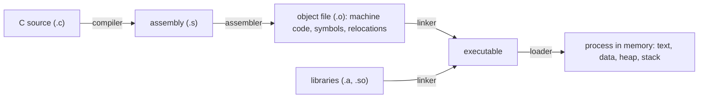
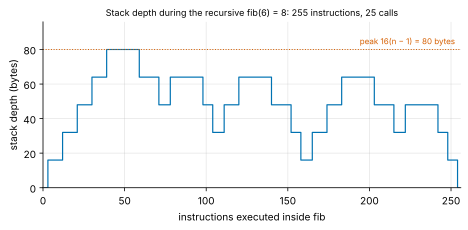

<!-- status: verified -->
# 14-03 · Assembly and the Compilation Stack

| | |
|---|---|
| **Course** | [14 · Computer Organization and Architecture](../README.md) |
| **University equivalent** | The procedures, compiling, linking and loading sections of a computer organization course (Patterson & Hennessy, *Computer Organization and Design*, RISC-V Edition, §§2.7–2.13; Harris & Harris, *Digital Design and Computer Architecture*, RISC-V Edition, §§6.3–6.6); linking as in Bryant & O'Hallaron, *Computer Systems: A Programmer's Perspective*, ch. 7 |
| **Prerequisites** | [14-02 Instruction Set Architecture](14-02-isa-risc-v-arm-x86.md), [05-05 C Fundamentals](../../05-programming-for-engineers/chapters/05-05-c-fundamentals.md), [05-06 C Pointers and Memory](../../05-programming-for-engineers/chapters/05-06-c-pointers-and-memory.md) |
| **Estimated study hours** | 8 |
| **Last verified** | 2026-11-20 |

**Learning objectives.** After this chapter you can:

1. Translate C expressions, conditionals, loops, arrays and pointers into RV32I assembly, and read compiler output back into C.
2. Apply the RISC-V calling convention: argument and return registers, caller- and callee-saved registers, stack frames and recursion.
3. Trace a program through compiler, assembler, linker and loader, and explain object files, symbols, relocations and linker relaxation.
4. Explain what an ABI fixes (calling convention, data sizes, alignment and layout), compute structure layouts, and predict what breaks binary compatibility.
5. Count the instructions a code sequence executes and use the counts to compare translations, optimization levels and calling conventions through the iron law.

---

## 1. Big picture

Nobody writes a phone's operating system in machine code. Programs are written in languages such as C, C++, Rust or Python, and a **toolchain** turns them into the instructions of 14-02: a compiler translates source into assembly, an assembler turns assembly into machine code in an **object file**, a linker joins object files and libraries into an executable, and a loader places it in memory and starts it. Between separately compiled pieces sits a contract, the **application binary interface (ABI)**: which registers carry arguments, who saves what, how big an `int` is, how structures are laid out. Every library on a system, and every program that calls it, must agree on it to the bit.

- **The compiler sets the instruction count.** In the iron law (14-01), IC belongs to the compiler as much as to the ISA. Compiled by clang 18, the increment loop of Example 14-03.2 executes more than three times as many instructions at `-O0` as at `-O2` (lab, Part 1).
- **The ABI is why old binaries still run.** A program built years ago calls today's libraries only because both obey the same ABI. Breaking it forces every customer to rebuild.
- **Toolchains are an ecosystem moat.** A new ISA or accelerator is only as usable as its compiler, debugger and libraries. Much of the cost of "porting to RISC-V" or "supporting our NPU" is toolchain work.
- **Security lives here too.** Return addresses sit on the stack, which is why stack-smashing attacks exist and why ISAs now add control-flow-integrity features [1].

## 2. Intuition first

**A compiler is a translator with a tiny vocabulary and a small desk.** The vocabulary is the ISA: 40 base instructions, no "for loop", no "array". Every C construct must be rephrased in it: a loop becomes a test and a backward branch, an array access becomes an address computation and a load. The small desk is the register file: 31 usable registers, against a filing cabinet of memory that is perhaps a hundred times slower to reach (14-09). Good compilers keep the values in current use on the desk and go to the cabinet as rarely as possible; *register allocation* is the art of choosing which values get a desk slot.

**A calling convention is a set of house rules for a shared desk.** When one function calls another, both use the same 31 registers. Without rules, the callee would scribble over values the caller still needs. The RISC-V rules divide the registers into two kinds. *Caller-saved* registers (temporaries and arguments) are scratch space: the callee may overwrite them freely, so a caller that needs a value afterwards must keep it elsewhere. *Callee-saved* registers are guaranteed to survive a call: a callee that wants to use one must save its old value first and restore it before returning.

**The analogy, and where it breaks.** Think of a shared hotel room. The housekeeping rules say which drawers the next guest may empty (caller-saved) and which must be left exactly as found (callee-saved). The analogy breaks on scale and speed: the "guests" change millions of times a second, and every save and restore is a memory instruction that costs time and energy. Choosing which values go in which kind of register is therefore an optimization problem the compiler solves for every function (Problem 14-03.12).

**The toolchain as a supply chain.** Each stage hands a standard intermediate product to the next:



Many compilers, clang among them, produce the object file directly, but the stages, and the formats between them, are the same.

## 3. Theory

### 3.1 Registers and their ABI names

The ISA names the registers x0–x31 and gives only x0 a special meaning. The ABI gives every register a role and a mnemonic name, which assemblers accept and disassemblers print [2]:

| Register | ABI name | Role | Preserved across calls? |
|---|---|---|---|
| x0 | zero | always zero | (immutable) |
| x1 | ra | return address | no |
| x2 | sp | stack pointer | yes |
| x3 | gp | global pointer | (not allocated) |
| x4 | tp | thread pointer | (not allocated) |
| x5–x7 | t0–t2 | temporaries | no |
| x8–x9 | s0–s1 | saved registers (s0 may be the frame pointer) | yes |
| x10–x17 | a0–a7 | arguments; a0–a1 also return values | no |
| x18–x27 | s2–s11 | saved registers | yes |
| x28–x31 | t3–t6 | temporaries | no |

"Preserved across calls" is the callee-saved column: a function may use s0–s11 only if it saves their old values and restores them before returning, and it must return with sp exactly as it found it. Everything marked "no" is caller-saved.

**Pseudo-instructions.** Assemblers accept convenient names that expand into base instructions: `li rd, imm` (load immediate: ADDI, or LUI + ADDI for large constants, 14-02 §3.4), `mv rd, rs` (`addi rd, rs, 0`), `not` (`xori rd, rs, -1`), `neg` (`sub rd, zero, rs`), `j label` (`jal zero, label`), `ret` (`jalr zero, 0(ra)`), `beqz`, `bnez`, `bgt` (BLT with its operands swapped), and `call label` (AUIPC + JALR through ra). Disassemblers print the pseudo-instruction names back, which is why compiler output looks friendlier than the encodings.

### 3.2 Translating C: expressions, memory and control flow

**Expressions.** Each C operator maps to one or a few instructions on registers. With `g, h, i, j` in a0–a3, `f = (g + h) - (i + j)` is

```text
add  t0, a0, a1      # t0 = g + h
add  t1, a2, a3      # t1 = i + j
sub  a0, t0, t1      # f  = t0 - t1
```

**Arrays and pointers.** An `int` occupies 4 bytes (§3.5), so element `a[i]` lives at address $a + 4i$. The multiplication by 4 is a left shift by 2 (05-07). Reading `a[i]` takes three instructions: `slli`, `add`, `lw`. A constant index folds into the load's offset: `a[3]` is `lw t0, 12(a0)`. Pointer arithmetic in C is the same thing written differently: `p + 1` for an `int *p` adds 4 bytes.

**Conditionals.** `if (cond) A else B` becomes a branch on the *opposite* condition around A, and a jump over B:

```text
    bge  a0, a1, else    # if !(a < b) go to else
    ...A...
    j    endif
else:
    ...B...
endif:
```

RISC-V has BLT and BGE but no BGT or BLE; the assembler provides those as pseudo-instructions by swapping the operands.

**Loops.** A `for` or `while` loop becomes a test and a backward branch. The direct translation tests at the top and jumps back from the bottom: two branch instructions per iteration. Compilers *rotate* the loop (14-02 Problem 9): one test before entry, then a single conditional branch at the bottom. They also apply **strength reduction**: instead of recomputing $a + 4i$ every iteration (a shift and an add), they keep a pointer and add 4 to it. Example 14-03.2 shows the combined effect: 8 instructions per element become 5.

**Branchless code.** Some decisions can be computed instead of branched on. The absolute value of a 32-bit number is `srai t0, a0, 31` (all ones if negative, else zero), `xor a0, a0, t0`, `sub a0, a0, t0` (Problem 14-03.5). Compilers prefer such sequences when a branch would be hard to predict (14-07).

### 3.3 Procedures and the stack

**Call and return.** `call f` executes JAL (or AUIPC + JALR for distant targets), which jumps to `f` and writes the return address, the address of the next instruction, into ra. `ret` is `jalr zero, 0(ra)`: jump to the address in ra.

**The stack.** A function that calls another must save ra, because the inner call overwrites it. It must also save any callee-saved register it uses, and it may need memory for local arrays or for values that do not fit in registers. All of this goes in its **stack frame**, a block of memory reserved by moving the stack pointer down. The ABI fixes three rules [2]:

1. The stack grows downward, toward lower addresses.
2. sp must be aligned to 16 bytes (128 bits) on entry to every procedure.
3. A function must not rely on data below sp.

Frame sizes are therefore rounded up to a multiple of 16 bytes.

**Prologue and epilogue.** A non-leaf function brackets its body with

```text
f:  addi sp, sp, -16     # prologue: allocate the frame
    sw   ra, 12(sp)      #           save the return address
    sw   s0, 8(sp)       #           save a callee-saved register before using it
    ...body...
    lw   ra, 12(sp)      # epilogue: restore
    lw   s0, 8(sp)
    addi sp, sp, 16      #           release the frame
    ret
```

A **leaf** function (one that calls nothing) whose values fit in temporaries needs no frame at all, which is why small leaf functions are so cheap, and why compilers inline small functions into their callers.

**Recursion** needs nothing new: each activation gets its own frame, so each has its own saved ra and saved registers. The stack depth grows with the recursion depth, and runs out if the recursion is too deep (Problem 14-03.8). Example 14-03.4 counts the instructions, calls and stack of a recursive Fibonacci function exactly.



*Figure 1. The stack during the recursive `fib(6)` of Example 14-03.4, traced on the course's RV32I simulator. Each step up is a call allocating a 16-byte frame; each step down is a return. The depth never exceeds $16(n-1)$ = 80 bytes, although the call tree has 25 nodes: frames are reused as the recursion unwinds.*

> **Math refresher — counting with recurrences.** If a function does a fixed amount of work $c$ and then calls itself on smaller inputs, its total work $I(n)$ satisfies a recurrence: $I(n) = c + I(n-1)$ gives $I(n) = cn + I(0)$, a straight line; $I(n) = c + I(n-1) + I(n-2)$ gives growth like the Fibonacci numbers $F(n)$ ($F(0) = 0$, $F(1) = 1$, $F(n) = F(n-1) + F(n-2)$), about $1.618^n$. You solve such recurrences by counting the nodes of the call tree, as in Example 14-03.4.

### 3.4 From object file to running program

**Assembling.** The assembler translates each instruction (14-02) and produces an **object file**. On Linux and most embedded systems it is in ELF format, with:

- **sections** for code (`.text`), initialized data (`.data`), read-only data (`.rodata`) and zero-initialized data (`.bss`, which takes no space in the file);
- a **symbol table** listing the names this file defines (such as `fib`) and those it uses but does not define (such as `printf`);
- **relocations**: notes saying "this instruction's immediate depends on the final address of symbol S; fix it up at link time".

The assembler cannot finish an instruction like `call printf`, because it does not know where `printf` will be. It emits `auipc ra, 0` and `jalr ra, 0(ra)` with a relocation of type `R_RISCV_CALL_PLT` against `printf` [3].

**Linking.** The linker:

1. places every section at its final address;
2. *resolves* each undefined symbol to a definition in another object file or library (failing with "undefined reference" if there is none);
3. *applies* each relocation by computing the now-known offset and patching the immediate, splitting it into AUIPC and JALR parts exactly as in 14-02 §3.4.

**Linker relaxation (RISC-V).** The assembler must emit the two-instruction call because it cannot know the distance. If the linker finds that the target is within JAL's ±1 MiB, it may replace the pair with a single JAL. The assembler marks each call it allows to shrink with an extra `R_RISCV_RELAX` relocation [3]. Shrinking one call moves every later instruction 4 bytes earlier, so the linker must recompute every offset that crosses it (Problem 14-03.11). For the same reason, when relaxation is enabled the assembler leaves even branches to labels in the same file as relocations (`R_RISCV_BRANCH`) for the linker to finish. Relaxation makes programs smaller and faster (Example 14-03.5) at the cost of a more complex linker. Fixed-length ISAs without it pay for distant calls on every call.

**Static and dynamic linking.** A statically linked executable contains copies of every library function it uses. A dynamically linked one leaves calls to shared libraries (`.so` files on Linux, DLLs on Windows) unresolved until load time or first use, through small stubs (the procedure linkage table, PLT) and a table of addresses (the global offset table, GOT). Shared libraries save memory and let a library be updated without relinking its users, but only if the update keeps the ABI (§3.5).

**Loading.** The operating system's loader reads the executable's headers and maps its code and data into the process's address space: code (read-only, executable) and data at low addresses, a **heap** growing upward for dynamic allocation, and the **stack** growing downward from high addresses (05-06). It then sets sp and jumps to the entry point. On a microcontroller without an operating system, the "loader" is the flash programmer plus a few lines of start-up code that set sp, copy `.data` from flash to RAM, zero `.bss` and call `main`. The lab's start-up stub does the minimum of this: it sets sp, loads the arguments and calls the function.

### 3.5 The ABI: a contract between binaries

An **API** (application programming interface) is a source-level contract: function names, argument types, semantics. An **ABI** is the binary-level contract that lets separately compiled code interoperate. It covers:

- **The calling convention** (§3.1, §3.3): argument registers, return registers, saved registers, stack alignment. RISC-V passes the first eight integer arguments in a0–a7; further arguments go on the stack [2].
- **Data sizes and alignment.** RISC-V's 32-bit ABIs (named ILP32, ILP32F, ILP32D after their *I*nt, *L*ong and *P*ointer sizes of 32 bits and their floating-point convention) make `char` 1 byte, `short` 2, `int`, `long` and pointers 4, and `long long` and `double` 8, each aligned to its size [2]. The 64-bit LP64 ABIs make `long` and pointers 8 bytes.
- **Structure layout.** Each member is placed at the next offset that is a multiple of its alignment, and the structure's size is rounded up to a multiple of its largest member's alignment. The gaps are **padding**. Member order changes the size (Example 14-03.6).
- **Object-file conventions**: ELF format, relocation types, symbol naming, and how the system-call interface is invoked.

An **ABI break** happens when a change makes old binaries and new ones disagree. Examples: adding a field to the middle of a structure that crosses a library boundary, changing a type's size, or reassigning a register's role. Old callers keep using the old offsets and silently read the wrong bytes (Problem 14-03.14). That is why platform owners treat ABIs as nearly frozen. Shared libraries carry version numbers in their file names, and long-lived interfaces pass pointers to opaque structures rather than exposing their layouts. It is also why a new ISA's ABI must be settled early: every binary ever built depends on it.

### 3.6 The compiler and the iron law

The compiler controls instruction count, and through scheduling and register allocation it influences CPI. The optimizations that matter most for IC are:

- **Register allocation.** Keeping variables in registers instead of stack slots removes loads and stores. Unoptimized code (`-O0`) keeps every variable in memory so that a debugger can find it; that alone roughly triples the instruction count of the increment loop (Problem 14-03.13). Clang 18 at `-O2` produces exactly the pointer version of Example 14-03.2, 504 instructions for 100 elements, against 1718 at `-O0` (lab, Part 1).
- **Strength reduction and induction variables.** Replace `a + 4*i` by a pointer bumped by 4.
- **Loop rotation and unrolling.** Fewer branches per element. Unrolling by $k$ spreads the loop overhead over $k$ elements at the cost of code size.
- **Inlining.** Copy a small callee into its caller, removing the call, return, prologue and epilogue and exposing the combined code to further optimization.
- **Tail calls and recursion elimination.** A call that is the last thing a function does can become a jump. Clang 18 at `-O2` turns one of the two recursive calls in Fibonacci into a loop, halving the number of calls (lab, Part 3).

Optimizations are not free: unrolling and inlining grow code (the instruction cache, 14-09), aggressive optimization makes debugging harder, and some reorderings rely on the C rules about undefined behaviour in ways that surprise programmers.

## 4. Worked examples

Every assembly listing in these examples is assembled with LLVM, linked with LLD and executed on an RV32I simulator by the verify script. Counts include every instruction from the function's first instruction through its final `ret`, and assume the linker has relaxed each call to a single JAL.

### Example 14-03.1 · An array element (tier A)

**Setup.** Translate `a[i] = a[i-1] + k;` with the address of `a` in a0, `i` in a1 and `k` in a2. For `a` at address 0x00020000 and `i` = 5, give the byte offset of `a[i]`, its address, and the number of instructions executed (including `ret`).

**Solution.** The address of `a[i]` is $a + 4i$; `a[i-1]` is 4 bytes below it, which the load's offset can absorb:

```asm
update:                   # void update(int *a, int i, int k)
    slli t0, a1, 2        # t0 = 4*i
    add  t0, a0, t0       # t0 = &a[i]
    lw   t1, -4(t0)       # t1 = a[i-1]
    add  t1, t1, a2       # t1 = a[i-1] + k
    sw   t1, 0(t0)        # a[i] = t1
    ret
```

For $i$ = 5 the offset is $4 \times 5$ = **20** bytes, so `a[5]` is at 0x00020000 + 0x14 = **0x00020014**. The function executes **6** instructions.

**Units check.** Offsets are bytes: index × 4 bytes per `int`.

**Sanity check.** Folding the −4 into the load saved an instruction: no separate computation of $4(i-1)$ is needed.

### Example 14-03.2 · Two translations of one loop (tier B)

**Setup.** Translate `for (i = 0; i < n; i++) a[i] += k;` (a in a0, n in a1, k in a2) twice: directly, with an index and a top test, and as an optimizing compiler would, with a pointer and a bottom test. Count the instructions each executes for $n$ = 100 and compare.

**Solution.** The direct translation recomputes the address from `i` each time:

```asm
inc_idx:                  # void inc(int *a, int n, int k), index version
    li   t0, 0            # i = 0
loop1:
    bge  t0, a1, done1    # leave when i >= n
    slli t1, t0, 2
    add  t1, a0, t1       # t1 = &a[i]
    lw   t2, 0(t1)
    add  t2, t2, a2
    sw   t2, 0(t1)        # a[i] += k
    addi t0, t0, 1        # i++
    j    loop1
done1:
    ret
```

It executes 1 instruction before the loop, 8 per element, then the final test and `ret`: $8n + 3$ = **803**. The optimized translation keeps a pointer, computes the end address once, and tests at the bottom:

```asm
inc_ptr:                  # the same function, pointer version
    slli t0, a1, 2
    add  t0, a0, t0       # t0 = a + n, one past the end
    beq  a0, t0, done2    # nothing to do if n == 0
loop2:
    lw   t1, 0(a0)
    add  t1, t1, a2
    sw   t1, 0(a0)        # *p += k
    addi a0, a0, 4        # p++
    bne  a0, t0, loop2
done2:
    ret
```

It executes 3 + 5n + 1 = $5n + 4$ = **504**. At equal CPI and clock, the pointer version is 803/504 = **1.593** times faster.

**Units check.** Both counts are instructions; the ratio is dimensionless.

**Sanity check.** The saving per element (3 instructions) is exactly the shift, the add and the extra jump the optimized version avoids.

### Example 14-03.3 · A non-leaf function and its frame (tier B)

**Setup.** `int max(int a, int b)` returns the larger argument. Write `int max3(int a, int b, int c) { return max(max(a, b), c); }` following the calling convention. Give its frame size, the registers it saves, and the instructions executed (including those inside `max`) for `max3(3, 9, 4)`.

**Solution.** `c` arrives in a2, which `max` may overwrite, so `max3` must keep it in a callee-saved register, s0, and must therefore save s0 itself. It also calls, so it must save ra. Two 4-byte saves need 8 bytes, rounded up to the 16-byte alignment: a **16**-byte frame holding **2** saved registers.

```asm
max:                      # int max(int a, int b): a leaf, no frame
    bge  a0, a1, 1f
    mv   a0, a1
1:  ret

max3:                     # int max3(int a, int b, int c)
    addi sp, sp, -16
    sw   ra, 12(sp)
    sw   s0, 8(sp)
    mv   s0, a2           # keep c across the calls
    call max              # a0 = max(a, b); a0, a1 are already the arguments
    mv   a1, s0
    call max              # a0 = max(max(a, b), c)
    lw   ra, 12(sp)
    lw   s0, 8(sp)
    addi sp, sp, 16
    ret
```

`max3` itself executes 11 instructions. `max(3, 9)` takes 3 (the branch falls through to the `mv`) and `max(9, 4)` takes 2, so the total is **16**, and the result is **9**.

**Units check.** Frame size in bytes: 2 registers × 4 bytes = 8, rounded up to 16.

**Sanity check.** Of 16 instructions, only 3 compare or move values; the rest are call overhead. This is why compilers inline small functions like `max`, which would reduce `max3` to a handful of instructions with no frame.

### Example 14-03.4 · Recursion, counted exactly (tier C)

**Setup.** Recursive Fibonacci, `int fib(int n) { return n < 2 ? n : fib(n-1) + fib(n-2); }`, translated by hand:

```asm
fib:
    li   t0, 2
    blt  a0, t0, base     # n < 2: return n
    addi sp, sp, -16
    sw   ra, 12(sp)
    sw   s0, 8(sp)
    sw   s1, 4(sp)
    mv   s0, a0           # keep n
    addi a0, a0, -1
    call fib              # fib(n-1)
    mv   s1, a0           # keep fib(n-1)
    addi a0, s0, -2
    call fib              # fib(n-2)
    add  a0, s1, a0
    lw   ra, 12(sp)
    lw   s0, 8(sp)
    lw   s1, 4(sp)
    addi sp, sp, 16
base:
    ret
```

For `fib(10)`, find the result, the number of calls, the number of instructions executed and the maximum stack depth. Derive general formulas.

**Solution.** *Instructions per activation.* A base case ($n < 2$) runs `li`, `blt` and `ret`: 3 instructions. Any other activation runs all 18 listed instructions once, plus whatever its two calls execute. So $I(n) = 3$ for $n < 2$ and $I(n) = 18 + I(n-1) + I(n-2)$.

*Counting the call tree.* Every activation is a node of a binary tree whose leaves are the base cases. The number of leaves $L(n)$ obeys $L(0) = L(1) = 1$ and $L(n) = L(n-1) + L(n-2)$, so $L(n) = F(n+1)$. Every internal node has exactly two children, so there is one fewer internal node than leaves: $F(n+1) - 1$. Hence

$$
\text{calls}(n) = 2F(n+1) - 1, \qquad I(n) = 3F(n+1) + 18\big(F(n+1) - 1\big) = 21F(n+1) - 18 .
$$

For $n$ = 10, $F(11)$ = 89: the result is $F(10)$ = **55**, there are $2 \times 89 - 1$ = **177** calls, and $21 \times 89 - 18$ = **1851** instructions.

*Stack.* The deepest chain of activations is fib(10) → fib(9) → … → fib(2) → fib(1). Nine of these (n = 10 down to 2) have 16-byte frames; the base case has none. The maximum depth is $9 \times 16$ = **144** bytes, or $16(n-1)$ in general.

**Units check.** $I$ counts instructions, the depth bytes.

**Sanity check.** The count grows like $F(n) \approx 1.618^n$: each step up in $n$ multiplies the work by about 1.6 while the stack grows only linearly. A loop computes the same value in $5n + 5$ instructions (Problem 14-03.9): a reminder that the algorithm matters more than any compiler.

### Example 14-03.5 · Linking and relaxation (tier B)

**Setup.** A program has two files, `main.s` (`_start: li a0, 10; call fib; ebreak`) and the `fib.s` of Example 14-03.4, linked with `.text` starting at 0x10000. (a) How many call relocations does each object file contain? (b) Without relaxation, find the AUIPC and JALR immediates of the call in `main`, and the program's code size. (c) With relaxation, find the JAL offset, the code size and the bytes saved. (d) How many more instructions does `fib(10)` execute without relaxation?

**Solution.** (a) Each `call` produces one `R_RISCV_CALL_PLT` relocation (plus `R_RISCV_RELAX`): **1** in `main.o` and **2** in `fib.o`.

(b) Without relaxation `main` is 4 instructions (`li`, `auipc`, `jalr`, `ebreak`), 16 bytes, so `fib` starts at 0x10010. The AUIPC is at 0x10004, so the offset is 0x10010 − 0x10004 = 12. It splits into AUIPC immediate **0** and JALR immediate **12**. The code is 16 + 80 = **96** bytes (`fib` is 20 instructions as assembled, with two 2-instruction calls).

(c) With relaxation each call becomes one JAL. `main` shrinks to 12 bytes, so `fib` starts at 0x1000C, and the JAL at 0x10004 has offset **8**. The code is 12 + 72 = **84** bytes, a saving of **12** bytes (3 calls × 4 bytes).

(d) Every call executed inside `fib(10)` costs one more instruction without relaxation. The recursion makes 177 − 1 = 176 calls from within `fib`, so it executes 1851 + 176 = **2027** instructions.

**Units check.** Offsets and sizes in bytes; counts in instructions.

**Sanity check.** The relaxed offset (8) is smaller than the unrelaxed one (12) by exactly the 4 bytes the relaxation removed: shrinking a call moves its target.

### Example 14-03.6 · Structure layout and the ABI (tier B)

**Setup.** On RISC-V's ILP32 ABI, find the member offsets and size of `struct A { char c; int i; short s; double d; };`. Reorder the members to minimize the size. Then compare `struct P { char c; long l; };` under ILP32 and LP64.

**Solution.** Place each member at the next multiple of its alignment.

- **struct A:** `c` at 0 (1 byte). `i` needs a multiple of 4, so it goes at 4 (3 bytes of padding). `s` goes at 8 and ends at 10. `d` needs a multiple of 8, so it goes at **16** (6 bytes of padding) and ends at 24. The size, a multiple of the largest alignment (8), is **24** bytes.
- **Reordered as `{ double d; int i; short s; char c; }`:** offsets 0, 8, 12, 14, ending at 15; rounded up to a multiple of 8, the size is **16** bytes.
- **struct P:** under ILP32, `long` is 4 bytes, so P is **8** bytes. Under LP64, `long` is 8 bytes and 8-aligned, so P is **16** bytes.

**Units check.** All offsets and sizes are bytes.

**Sanity check.** Sorting members from largest to smallest alignment minimizes padding. Here it saves 8 of 24 bytes, a third of the memory (and cache, 14-09) of an array of such records. Compiling the structures with clang for 32- and 64-bit RISC-V gives the same numbers.

### Answer key

<!-- answer-key -->
| ID | Quantity | Value | Unit |
|---|---|---|---|
| Ex 14-03.1a | byte offset of a[5] | 20 | bytes |
| Ex 14-03.1b | address of a[5] | 0x00020014 | — |
| Ex 14-03.1c | instructions executed | 6 | — |
| Ex 14-03.2a | index version, n = 100 | 803 | instructions |
| Ex 14-03.2b | pointer version, n = 100 | 504 | instructions |
| Ex 14-03.2c | speedup at equal CPI | 1.593 | — |
| Ex 14-03.3a | frame size of max3 | 16 | bytes |
| Ex 14-03.3b | registers saved | 2 | — |
| Ex 14-03.3c | instructions for max3(3, 9, 4) | 16 | — |
| Ex 14-03.3d | result | 9 | — |
| Ex 14-03.4a | fib(10) | 55 | — |
| Ex 14-03.4b | calls | 177 | — |
| Ex 14-03.4c | instructions | 1851 | — |
| Ex 14-03.4d | maximum stack depth | 144 | bytes |
| Ex 14-03.5a | call relocations in main.o | 1 | — |
| Ex 14-03.5b | call relocations in fib.o | 2 | — |
| Ex 14-03.5c | AUIPC immediate | 0 | — |
| Ex 14-03.5d | JALR immediate | 12 | bytes |
| Ex 14-03.5e | code size without relaxation | 96 | bytes |
| Ex 14-03.5f | JAL offset with relaxation | 8 | bytes |
| Ex 14-03.5g | code size with relaxation | 84 | bytes |
| Ex 14-03.5h | bytes saved | 12 | bytes |
| Ex 14-03.5i | fib(10) instructions without relaxation | 2027 | — |
| Ex 14-03.6a | offset of d in struct A | 16 | bytes |
| Ex 14-03.6b | size of struct A | 24 | bytes |
| Ex 14-03.6c | size reordered | 16 | bytes |
| Ex 14-03.6d | struct P under ILP32 | 8 | bytes |
| Ex 14-03.6e | struct P under LP64 | 16 | bytes |

## 5. Simulate it

The lab, [labs/14-03-lab](../labs/14-03-lab/README.md), drives the real toolchain (clang, LLVM's assembler, the LLD linker) and runs the results on this course's RV32I simulator:

1. **Compiler output.** Compile `fib` and the increment loop at `-O0` and `-O2` and read the assembly.
2. **Object files.** List the symbols and relocations of `main.o` and `fib.o`, link with and without relaxation, and disassemble the result.
3. **Running it.** Execute the hand-written and compiled versions of `fib` and count instructions, calls and stack depth.
4. **Layouts.** Measure `sizeof` and member offsets for 32- and 64-bit RISC-V and for x86-64.

**Guided exercise (predict, then run).** **Before Part 3,** predict how many instructions the hand-written `fib(15)` executes, from $21F(n+1) - 18$, and how deep its stack goes. Then run it, and compare with clang at `-O0` and `-O2`. (20709 instructions and 224 bytes. Clang's `-O0` code executes about twice as many, because it keeps every variable on the stack. Its `-O2` code makes half as many calls but still executes about 8% more instructions than the hand-written version, because it allocates a frame even for the base case: fewer calls is not the same as less work.)

## 6. Engineering tradeoffs

| Knob | Improves | Costs | Typical decision owner |
|---|---|---|---|
| More argument registers | Fewer stack accesses for calls with many arguments | Fewer registers for other uses; ABI fixed forever | ABI designers |
| Split of caller- and callee-saved registers | Cheap calls from leaf functions (caller-saved) and cheap values that live across calls (callee-saved) | Neither extreme fits all code | ABI designers |
| Optimization level (`-O0` to `-O3`) | Instruction count, speed | Compile time, debuggability, sometimes code size | Product software team |
| Inlining and unrolling | Fewer instructions, branches and calls | Code size, instruction-cache misses | Compiler, with programmer hints |
| Linker relaxation | Smaller, faster code | Linker complexity; addresses known only at link time | Toolchain team |
| Static against dynamic linking | Self-contained binaries, faster calls (static) | Memory and update flexibility (dynamic) | Platform architect |
| Structure member order | Memory footprint, cache use | Readability; changing it breaks the ABI | Library designers |

## 7. Numbers to know

| Quantity | Value | Note |
|---|---|---|
| Argument registers (RISC-V) | 8 (a0–a7); a0–a1 also return values | psABI [2] |
| Callee-saved integer registers | 12 (s0–s11), plus sp | psABI [2] |
| Stack alignment at a call | 16 bytes | psABI [2] |
| ILP32 sizes | `char` 1, `short` 2, `int`/`long`/pointer 4, `long long`/`double` 8 | LP64: `long` and pointers 8 |
| Call before and after relaxation | AUIPC + JALR (8 bytes) → JAL (4 bytes), within ±1 MiB | [3] |
| Recursive `fib(n)`, hand-written | $21F(n+1) - 18$ instructions | Example 14-03.4 |

## 8. Common mistakes

- **Keeping a value in a temporary across a call.** t0–t6 and a0–a7 may be overwritten by any callee; use an s register, saved in the prologue (Problem 14-03.7).
- **Forgetting to save ra in a non-leaf function.** The inner call overwrites it, and the outer `ret` jumps back into the function itself.
- **Misaligning the stack.** A frame of 12 bytes breaks the 16-byte rule; round up.
- **Indexing in elements instead of bytes.** `a[i]` is at $a + 4i$ for `int`; forgetting the shift reads the wrong element.
- **Assuming `long` has one size.** It is 4 bytes on ILP32 and 8 on LP64, which breaks file formats and network messages written as raw structures.
- **Changing a public structure in place.** Inserting a field moves every later offset and breaks every binary compiled against the old layout.
- **Judging code by its length.** A shorter listing can execute more instructions (a top-tested loop) and a longer one fewer (an unrolled loop); count what executes.

## 9. Practitioner lens

### State of the art (as of Nov 2026)

- **The RISC-V psABI** (the ELF processor-specific ABI, maintained by RISC-V International's psABI task group) defines the register roles, the 16-byte stack alignment, the ILP32/LP64 families and the relocation types used in this chapter, including the AUIPC + JALR call that the linker may relax to JAL [2, 3, R-209] **[Established]**.
- **Toolchains.** GCC and LLVM both support RISC-V, and the lab's clang 18, LLVM assembler and LLD linker handle every listing in this chapter. RVA23 is the baseline for the Android RISC-V ABI (14-02, [R-202](../../../reference/research-log.md#r-202--risc-v-rva23-profile)), so compilers targeting RISC-V phones and servers can assume vector and hypervisor support **[Established]**.
- **Control-flow integrity.** The current RISC-V manuals define two control-flow-integrity extensions: Zicfilp requires indirect jumps and calls to land on a landing-pad (LPAD) instruction, and Zicfiss keeps a shadow copy of return addresses on a separate shadow stack, defending against attacks that overwrite the return address in a stack frame [1, R-201] **[Established]**.

### Why it matters commercially

- **Software readiness decides adoption.** A processor or accelerator with excellent silicon but an immature compiler, debugger and library stack will not win designs. Toolchain and ABI work is a large, continuing cost of any new architecture **[Established]**.
- **ABI stability is a customer promise.** Platform owners keep old binaries working for decades. An ABI break forces every customer to rebuild and re-qualify, which they resent.
- **Compiler quality is part of benchmark results.** The same chip can score very differently with different compilers and flags, which is why serious benchmark rules fix and disclose them (14-15).

### Marketing vs Reality

- **"2× faster with our new compiler."** *Reality:* such gains are usually on chosen kernels, sometimes from optimizations that only apply to the benchmark. *Sanity check:* ask for whole-application results, the flags used for both compilers, and whether the outputs were checked for correctness.
- **"Fully compatible: just recompile."** *Reality:* source compatibility (API) is not binary compatibility (ABI). Code that assumes `long` is 4 bytes, packs structures, uses inline assembly or relies on undefined behaviour breaks on a new target. *Sanity check:* ask how much of the customer's code base has actually been ported and tested.
- **"Our accelerator supports PyTorch."** *Reality:* "supports" may mean a subset of operators, with the rest falling back to the CPU. *Sanity check:* ask what fraction of the target models' operators run on the accelerator, measured end to end.

### Questions for engineering leaders

1. **"Which compilers do you support, and is your backend upstream?"**
   *Strong:* named GCC and LLVM versions, patches merged upstream, and continuous testing against the upstream trunk. *Evasive:* "we have our own optimized compiler".
2. **"What is your ABI, and when did it last change?"**
   *Strong:* the standard psABI or a documented variant, with a versioning policy. *Evasive:* "it's standard" without specifics.
3. **"What fraction of your customers' code compiled and ran unchanged?"**
   *Strong:* a measured fraction across real code bases, with the categories of failures. *Evasive:* "everything we tried".
4. **"How do you benchmark compiler changes?"**
   *Strong:* a fixed suite of whole applications, with correctness checks and performance-regression tracking. *Evasive:* "we test on key kernels".
5. **"Who maintains your debugger, profiler and libraries?"**
   *Strong:* named teams or upstream projects, with release cadence. *Evasive:* "the community".

## 10. Concept check

**Q1.** Why must a non-leaf function save ra, and why may a leaf function skip it?

<details><summary>Answer</summary>

A call overwrites ra with its own return address, so a function that calls another loses its own return address unless it saved it. A leaf function makes no calls, so ra is untouched until its `ret`.

</details>

**Q2.** A function keeps a loop counter in t0 and calls `g` inside the loop. What can go wrong, and what are the two fixes?

<details><summary>Answer</summary>

`g` may overwrite t0, since temporaries are caller-saved. Either move the counter to an s register (saved once in the prologue, restored once in the epilogue), or save t0 to the stack before each call and reload it after.

</details>

**Q3.** Why does the assembler emit two instructions for `call f` even when `f` turns out to be near?

<details><summary>Answer</summary>

It does not know `f`'s final address, which only the linker fixes, so it must emit a sequence that reaches anywhere (AUIPC + JALR). It marks the pair as relaxable so that the linker can shrink it to one JAL if the target is within ±1 MiB.

</details>

**Q4.** What is the difference between an API and an ABI?

<details><summary>Answer</summary>

An API is a source-level contract (names, types and semantics) that lets code be recompiled against a library. An ABI is the binary-level contract (calling convention, data sizes, alignment, layout, object format) that lets already compiled binaries work together.

</details>

**Q5.** Why does `struct { char c; double d; }` occupy 16 bytes on RV32 rather than 9?

<details><summary>Answer</summary>

`double` must be 8-byte aligned, so it starts at offset 8 after 7 bytes of padding. The total of 16 is already a multiple of 8.

</details>

**Q6.** How can a compiler reduce a loop's instruction count without changing what it computes?

<details><summary>Answer</summary>

Any of the following:

- keep variables in registers;
- replace index arithmetic with a pointer increment (strength reduction);
- rotate the loop so that it has one branch per iteration;
- unroll it to spread the loop overhead over several elements;
- inline the functions it calls.

</details>

**Q7.** What does the loader do on a system with an operating system, and what replaces it on a bare microcontroller?

<details><summary>Answer</summary>

It maps the executable's code and data into the process's address space, sets up the stack, and jumps to the entry point. On a bare microcontroller, the program is already in flash, and start-up code sets sp, copies initialized data to RAM, zeroes `.bss` and calls `main`.

</details>

Now work the [problem set](../problems/14-03-problems.md).

## 11. Key terms

[Compiler](../../../reference/glossary.md#compiler) · [Assembler](../../../reference/glossary.md#assembler) · [Linker](../../../reference/glossary.md#linker) · [Loader](../../../reference/glossary.md#loader) · [Object file](../../../reference/glossary.md#object-file) · [Relocation](../../../reference/glossary.md#relocation) · [Linker relaxation](../../../reference/glossary.md#linker-relaxation) · [Calling convention](../../../reference/glossary.md#calling-convention) · [Caller-saved register](../../../reference/glossary.md#caller-saved-register) · [Callee-saved register](../../../reference/glossary.md#callee-saved-register) · [Stack frame](../../../reference/glossary.md#stack-frame) · [Application binary interface (ABI)](../../../reference/glossary.md#application-binary-interface-abi) · [Pseudo-instruction](../../../reference/glossary.md#pseudo-instruction) · [Structure padding](../../../reference/glossary.md#structure-padding)

## 12. Connections

- **Builds on:** the instruction formats and constants of [14-02](14-02-isa-risc-v-arm-x86.md); C, pointers and memory layout ([05-05](../../05-programming-for-engineers/chapters/05-05-c-fundamentals.md), [05-06](../../05-programming-for-engineers/chapters/05-06-c-pointers-and-memory.md)); the iron law ([14-01](14-01-performance-power-iron-law.md)).
- **Next:** [14-04 Computer Arithmetic and Number Formats](14-04-computer-arithmetic-and-number-formats.md), the data these instructions compute on.
- **Used later:** the datapath that executes these instructions ([14-05](14-05-single-cycle-datapath.md)); branches and their prediction ([14-07](14-07-branch-prediction-and-speculation.md)); the stack in memory and caches ([14-09](14-09-memory-hierarchy-and-caches.md)); the loader, address spaces and system calls ([14-10](14-10-virtual-memory.md)); compilers and benchmarks ([14-15](14-15-roofline-and-benchmarks.md)).

## 13. Further study

- D. A. Patterson and J. L. Hennessy, *Computer Organization and Design*, RISC-V Edition, §§2.7–2.13 (decisions, procedures, compiling, linking and loading).
- S. L. Harris and D. M. Harris, *Digital Design and Computer Architecture*, RISC-V Edition, §§6.3–6.6.
- R. E. Bryant and D. R. O'Hallaron, *Computer Systems: A Programmer's Perspective*, ch. 3 (machine-level programs, x86-64) and ch. 7 (linking).
- MIT OpenCourseWare 6.004, *Computation Structures*: the lectures on procedures and the stack.
- The RISC-V ELF psABI specification ([2], [3]), and LLVM's documentation for clang, llvm-mc and LLD.

## 14. Sources

1. RISC-V International, *The RISC-V Instruction Set Manual, Volume I: Unprivileged Architecture*, version 20260120: chapter "Control-flow Integrity (CFI)" (Zicfilp landing pads, Zicfiss shadow stack); the RV32I chapter on the standard calling-convention registers. [R-201](../../../reference/research-log.md#r-201--risc-v-unprivileged-isa-manual-version-20260120)
2. RISC-V International, *RISC-V ELF psABI*, "RISC-V Calling Conventions" (riscv-cc.adoc, read Nov 2026): integer register convention, integer calling convention, stack alignment, ILP32 and LP64 type sizes. [R-209](../../../reference/research-log.md#r-209--risc-v-elf-psabi-calling-convention-relocations-and-relaxation)
3. RISC-V International, *RISC-V ELF psABI*, "ELF Object Files" (riscv-elf.adoc, read Nov 2026): procedure-call relocations and function-call relaxation. [R-209](../../../reference/research-log.md#r-209--risc-v-elf-psabi-calling-convention-relocations-and-relaxation)

Every listing, count, offset, size and layout in this chapter is reproduced by the verify script, which assembles with LLVM 18, links with LLD, compiles with clang and executes on an RV32I simulator.
