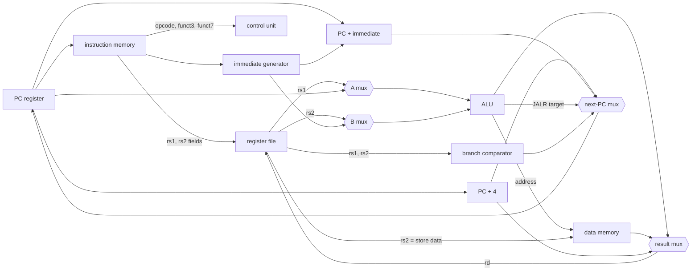

<!-- status: verified -->
# 14-05 · Single-Cycle Datapath and Control

| | |
|---|---|
| **Course** | [14 · Computer Organization and Architecture](../README.md) |
| **University equivalent** | The processor chapter of a computer organization course, through the single-cycle implementation: datapath elements, building the datapath, the control unit, and the cost of a single long cycle (Patterson & Hennessy, *Computer Organization and Design*, RISC-V Edition, §§4.1–4.4; Harris & Harris, *Digital Design and Computer Architecture*, RISC-V Edition, §§7.1–7.3) |
| **Prerequisites** | [14-02 Instruction Set Architecture](14-02-isa-risc-v-arm-x86.md), [08-04 Combinational Building Blocks](../../08-digital-logic-design/chapters/08-04-combinational-building-blocks.md), [08-07 Registers, Counters and Shift Registers](../../08-digital-logic-design/chapters/08-07-registers-counters-shift-registers.md), [08-10 Timing, Metastability and CDC](../../08-digital-logic-design/chapters/08-10-timing-metastability-cdc.md) |
| **Estimated study hours** | 8 |
| **Last verified** | 2026-11-20 |

**Learning objectives.** After this chapter you can:

1. Name the state and combinational elements of a RISC-V datapath and explain what each contributes to executing an instruction.
2. Trace any RV32I instruction through the single-cycle datapath and give the control signals it needs.
3. Design the main decoder and the ALU decoder as truth tables, and explain how the immediate generator follows from the instruction formats.
4. Find each instruction class's critical path from component delays, and so the clock period, and evaluate the single-cycle machine through the iron law.
5. Read, run and extend a working single-cycle RV32I core in Verilog.

---

## 1. Big picture

Chapters 14-02 to 14-04 described *what* instructions do. This chapter builds the hardware that does it. A processor splits into two parts:

- The **datapath** holds and transforms data: the program counter, the instruction and data memories, the register file, the ALU, adders and multiplexers.
- The **control unit** decodes each instruction and sets the datapath's multiplexers and write enables so that the right data flows to the right place.

The simplest organization executes every instruction completely within **one clock cycle**. It is too slow for real products, but it is the reference design from which every faster one, pipelined, superscalar or out-of-order, is derived.

- **Every processor contains this datapath.** Fetch, decode, register read, execute, memory access and write-back are the same steps in a microcontroller and a server core; faster designs overlap and replicate them (14-06, 14-08).
- **CPI = 1, but at a price.** One cycle per instruction sounds ideal, but the cycle must be long enough for the slowest instruction. Every faster instruction wastes the difference (Example 14-05.4).
- **Small cores still look like this.** Many microcontroller and control-processor cores use two- or three-stage pipelines that are close relatives of the single-cycle design, chosen for area and energy rather than speed.
- **You can run it.** The lab is a complete single-cycle RV32I core in about 200 lines of Verilog. It runs a program compiled by LLVM, and its register writes match the course's instruction-set simulator one for one.

## 2. Intuition first

**One craftsman, one bench.** Picture a workshop where a single craftsman builds each product from start to finish before starting the next. Fetching the instruction, reading the registers, computing and writing back are all done in one go. The workshop's schedule must allow enough time per product for the most complicated one (a load, which visits memory twice: once for the instruction, once for the data). Simple products finish early, and the craftsman waits for the bell. Pipelining, in the next chapter, turns the workshop into an assembly line.

**Data flows; control steers.** The datapath is a set of roads: from the instruction memory to the register file, from the register file to the ALU, from the ALU to the data memory or back to the registers. Multiplexers are junctions with switchable points, and write enables are gates that let a value into a register or memory. The control unit reads each instruction's opcode and sets every junction and gate for that instruction's route. Executing a different instruction is just a different setting of the same switches.

**The analogy's limits.** A craftsman works sequentially, one step after another. The hardware is combinational: once the clock edge launches the program counter, *all* the logic computes at once, as signals ripple through it. The "time per product" is a propagation delay through gates, not a sequence of actions, and every unit is busy with something during every cycle. For example, the data memory computes a read for a `sub` even though the result is ignored. That waste is what the control signals select away.

## 3. Theory

### 3.1 The elements

The datapath has two kinds of element.

**State elements** hold values from one cycle to the next, and change only at the clock edge (08-06, 08-07):

- the **program counter (PC)**, a 32-bit register holding the address of the current instruction;
- the **register file**: 32 registers of 32 bits, with two read ports (rs1, rs2) that act combinationally and one write port (rd) written at the clock edge, x0 always reading as zero;
- the **data memory**, read combinationally and written at the clock edge;
- the **instruction memory**, read-only in this design.

Using separate instruction and data memories (a **Harvard organization**) lets one cycle fetch an instruction and access data at the same time. Real processors get the same effect from separate instruction and data caches in front of one memory (14-09).

**Combinational elements** compute their outputs from their current inputs (08-04, 08-09):

- the **ALU** (add, subtract, shifts, comparisons, logic);
- two **adders**: PC + 4 and PC + offset (the branch or jump target);
- the **immediate generator**, which reassembles and sign-extends each format's scrambled immediate (14-02 §3.3);
- a **branch comparator** (equal, signed less-than, unsigned less-than);
- **multiplexers** that choose between sources.

### 3.2 Building the datapath, one instruction class at a time

Every instruction begins the same way: **fetch.** The PC addresses the instruction memory, the 32-bit instruction comes out, and an adder computes PC + 4 as the default next PC. The instruction's fields then go to the register file's read addresses (bits 19–15 and 24–20) and the immediate generator, and the opcode goes to the control unit. Because the register fields never move (14-02), the registers are read *before* the instruction has been decoded, in parallel with decoding.

The remaining steps differ by class:

| Class | Execute | Memory | Write back | Next PC |
|---|---|---|---|---|
| R-type (`add`) | ALU on rs1, rs2 | — | ALU result → rd | PC + 4 |
| I-type ALU (`addi`) | ALU on rs1, immediate | — | ALU result → rd | PC + 4 |
| Load (`lw`) | ALU: rs1 + offset = address | read | memory data → rd | PC + 4 |
| Store (`sw`) | ALU: rs1 + offset = address | write rs2 | — | PC + 4 |
| Branch (`beq`) | compare rs1, rs2 | — | — | PC + offset if taken, else PC + 4 |
| JAL | — | — | PC + 4 → rd | PC + offset |
| JALR | ALU: rs1 + offset | — | PC + 4 → rd | ALU result with bit 0 cleared |
| LUI | ALU: 0 + immediate | — | ALU result → rd | PC + 4 |
| AUIPC | ALU: PC + immediate | — | ALU result → rd | PC + 4 |

Merging all the routes gives one datapath with four multiplexers:

- **ALU input A** chooses rs1, PC (for AUIPC) or 0 (for LUI).
- **ALU input B** chooses rs2 or the immediate.
- **The result multiplexer** chooses the ALU result, the memory data or PC + 4.
- **The next-PC multiplexer** chooses PC + 4, the branch or jump target, or the JALR address.

### 3.3 The control unit

The control unit is combinational logic. It splits naturally into a **main decoder**, which reads the 7-bit opcode, and an **ALU decoder**, which also reads funct3 and bit 30 (funct7's distinguishing bit). The main decoder's outputs are:

| Opcode | Class | RegWrite | ASel | BSel | ImmSel | MemWrite | ResultSrc | Branch | Jump | JALR | ALUOp |
|---|---|---|---|---|---|---|---|---|---|---|---|
| 0110011 | R-type | 1 | rs1 | rs2 | — | 0 | ALU | 0 | 0 | 0 | funct |
| 0010011 | I-type ALU | 1 | rs1 | imm | I | 0 | ALU | 0 | 0 | 0 | funct |
| 0000011 | load | 1 | rs1 | imm | I | 0 | memory | 0 | 0 | 0 | add |
| 0100011 | store | 0 | rs1 | imm | S | 1 | — | 0 | 0 | 0 | add |
| 1100011 | branch | 0 | rs1 | rs2 | B | 0 | — | 1 | 0 | 0 | subtract |
| 1101111 | JAL | 1 | — | — | J | 0 | PC + 4 | 0 | 1 | 0 | — |
| 1100111 | JALR | 1 | rs1 | imm | I | 0 | PC + 4 | 0 | 0 | 1 | add |
| 0110111 | LUI | 1 | 0 | imm | U | 0 | ALU | 0 | 0 | 0 | add |
| 0010111 | AUIPC | 1 | PC | imm | U | 0 | ALU | 0 | 0 | 0 | add |

A dash means "don't care": the value has no effect for that instruction. The ALU decoder turns ALUOp into the ALU operation. "Add" and "subtract" pass straight through. "Funct" selects the operation by funct3: SUB instead of ADD when bit 30 is set *and* the instruction is R-type, since `addi` has no subtract form and its bit 30 belongs to the immediate; and SRA instead of SRL when bit 30 is set. The branch condition comes from the comparator, selected by funct3 (`beq`, `bne`, `blt`, `bge`, `bltu`, `bgeu`). The next PC is the target if Jump is set, or if Branch is set and the condition holds.

**Why the decoder is small.** The whole control unit of RV32I is a few dozen gates, because the ISA keeps the opcode in one place and the formats regular. That is the hardware payoff of 14-02's design principles. The immediate generator shows the same payoff: because RISC-V places the same immediate bits in the same instruction bits wherever it can, each of the 32 immediate output bits chooses between few sources (Example 14-05.5).

### 3.4 Timing: the cost of one long cycle

Each instruction class takes a different path through the datapath, and the clock period must cover the longest. The delay of a path is the sum of the delays along it, from the clock edge that launches the PC to the setup time of the state element that captures the result (08-10):

$$
T_{\text{class}} = t_{\text{clk-q}} + \sum_{\text{elements on the path}} t_{\text{element}} + t_{\text{setup}} .
$$

This chapter uses the illustrative component delays below. They are round numbers of the kind textbooks use, not data for any real process; what matters is their relative sizes.

| Element | Delay |
|---|---|
| Register clock-to-Q ($t_{\text{clk-q}}$) and setup ($t_{\text{setup}}$) | 40 ps, 20 ps |
| Instruction memory read | 200 ps |
| Register file read; write setup | 100 ps; 20 ps |
| Immediate generator | 50 ps |
| Multiplexer | 25 ps |
| ALU | 120 ps |
| Adder (PC + 4, target) | 80 ps |
| Branch comparator | 80 ps |
| Data memory read; write setup | 200 ps; 20 ps |

The control decoder is not in the table. Every path below assumes it settles while the register file is being read (both start when the instruction arrives), so its delay hides under the 100 ps register read. A decoder slower than that would add to every path.

The **load** is the longest path: it goes through both memories, the register file, the ALU and the result multiplexer. With these numbers it takes 730 ps (Example 14-05.3), so the single-cycle clock can run no faster than 1/730 ps = 1.37 GHz. An R-type instruction needs only 530 ps, a branch 465 ps.

*Figure 1. Critical paths of the single-cycle datapath with §3.4's illustrative delays. Every instruction pays for the instruction memory; only the load also pays for the data memory, and its 730 ps path sets the clock for all of them.*

**Through the iron law.** CPI = 1, so the time per instruction is the clock period $T$, whatever the instruction. A machine whose cycle could stretch to fit each instruction would take the *mix-weighted average* of the class delays instead. The ratio of the two is the single-cycle machine's efficiency, typically 70–80% (Example 14-05.4). The deeper problem is that the period is set by memory: a slower memory lengthens every instruction's cycle, not just the loads'. Real memories are far slower than 200 ps (14-09), so a single-cycle design would have to run at the speed of its memory system.

**Two ways out.**

- A **multi-cycle** design splits each instruction into steps of one short cycle each and lets each instruction take only the steps it needs (a load five, a branch three). It reuses one ALU and one memory across steps, which suited the era of expensive logic.
- A **pipelined** design (14-06) also uses short cycles, but overlaps the steps of successive instructions so that one instruction finishes per cycle. It keeps CPI near 1 *and* shortens the cycle, and it is what every modern processor does.

## 4. Worked examples

### Example 14-05.1 · Tracing an instruction (tier A)

**Setup.** Trace `add x5, x6, x7` (0x007302B3) through the single-cycle datapath, with x6 = 12, x7 = 30 and PC = 0x100. Give the value on the main datapath wires and the next PC.

**Solution.**

1. The instruction memory returns 0x007302B3 at address 0x100.
2. The register file reads rs1 = 6 and rs2 = 7: **12** and **30**.
3. The control unit sees opcode 0110011, so RegWrite = 1, ASel = rs1, BSel = rs2, ResultSrc = ALU, and ALUOp = funct. funct3 = 000 with bit 30 clear gives ADD.
4. The ALU computes **42**, the result multiplexer passes it to the register file, and at the clock edge x5 becomes 42.
5. The data memory is fed address 42 and computes a read whose result is ignored. MemWrite = 0, so nothing is written.
6. The next PC is 0x100 + 4 = **0x00000104**.

**Units check.** Register values are 32-bit integers; addresses are bytes.

**Sanity check.** Every element did *something* this cycle. The control signals decided which results mattered.

### Example 14-05.2 · Control signals (tier A)

**Setup.** From the decoder table, give for `sw` the values of RegWrite and MemWrite; for `jal` the ResultSrc selection; for `lui` the ASel selection; and for `beq` the ImmSel format. Encode the selections as the lab's Verilog does: ResultSrc 0 = ALU, 1 = memory, 2 = PC + 4; ASel 0 = rs1, 1 = PC, 2 = zero; ImmSel 0 = I, 1 = S, 2 = B, 3 = U, 4 = J.

**Solution.**

- `sw` writes memory, not a register: RegWrite = **0**, MemWrite = **1**.
- `jal` writes the return address: ResultSrc = **2** (PC + 4).
- `lui` computes 0 + immediate: ASel = **2** (zero).
- `beq` uses the B-format immediate: ImmSel = **2**.

**Units check.** Control signals are bits or small selector codes.

**Sanity check.** If `sw` had RegWrite = 1, it would write its address into the register named by bits 11–7, which in a store hold immediate bits (Problem 14-05.7).

### Example 14-05.3 · Critical paths and the clock (tier B)

**Setup.** With the delays of §3.4, find the path delay of an R-type instruction, a load, a store, a branch and JAL. Then find the clock period and frequency.

**Solution.** Follow each instruction's longest route. The register read (100 ps) and the immediate generator (50 ps) work in parallel after the instruction memory, so the slower register read counts whenever both are needed.

- **R-type:** clock-to-Q, instruction memory, register read, B mux, ALU, result mux, register setup: $40 + 200 + 100 + 25 + 120 + 25 + 20$ = **530** ps.
- **Load:** the same plus the data memory: $40 + 200 + 100 + 25 + 120 + 200 + 25 + 20$ = **730** ps.
- **Store:** to the data memory's write setup: $40 + 200 + 100 + 25 + 120 + 20$ = **505** ps.
- **Branch:** comparator, next-PC mux, PC setup: $40 + 200 + 100 + 80 + 25 + 20$ = **465** ps. The target path, through the immediate generator and target adder, is shorter: $40 + 200 + 50 + 80 + 25 + 20 = 415$ ps.
- **JAL:** immediate generator, target adder, next-PC mux, PC setup: $40 + 200 + 50 + 80 + 25 + 20$ = **415** ps. Its write of PC + 4 to rd is not faster: the PC + 4 adder finishes early, but rd, RegWrite and the result-multiplexer select all come from the instruction, so that path takes at least $40 + 200 + 25 + 20$ = 285 ps.

The clock period is the maximum, $T$ = **730** ps (the load), so $f = 1/T$ = **1.370** GHz.

**Units check.** Delays in picoseconds; $1/(730 \times 10^{-12}\ \text{s}) = 1.370 \times 10^9$ Hz.

**Sanity check.** The two memory accesses alone take 400 of the load's 730 ps. Memory, not logic, sets the pace, which is why memory gets its own two chapters (14-09, 14-10).

### Example 14-05.4 · What one long cycle costs (tier B)

**Setup.** A workload's dynamic mix is 25% loads, 10% stores, 45% R- and I-type ALU instructions (530 ps), 15% branches and 5% JAL. Compare the single-cycle machine with an idealized one whose cycle stretches to each instruction's own delay.

**Solution.** The average required time is $0.25(730) + 0.10(505) + 0.45(530) + 0.15(465) + 0.05(415)$ = **562.0** ps per instruction. The single-cycle machine spends 730 ps on every instruction, so its efficiency is 562.0/730 = **77.0**%, and the idealized machine would be 730/562.0 = **1.299** times faster.

**Units check.** Mix fractions sum to 1, so the weighted average is in picoseconds.

**Sanity check.** A variable-length clock is impractical (clocks are generated at a fixed rate), but the comparison measures the waste. Pipelining recovers much more than this 30% by also overlapping instructions.

### Example 14-05.5 · Why the immediates are scrambled, in multiplexer inputs (tier C)

**Setup.** The immediate generator produces 32 output bits. For each output bit, count the distinct sources it must choose between across the five immediate formats (I, S, B, U, J). A source is an instruction bit, the constant 0, or the sign bit (instruction bit 31). Sum over the 32 bits for the RISC-V layout. Then repeat for a hypothetical "contiguous" layout in which the B immediate's bits imm[5:1] sit in instruction bits 11–7 and imm[12:6] in bits 31–25, and the J immediate's imm[20:1] fill bits 31–12 in order. What is the widest multiplexer each layout needs?

**Solution.** In the RISC-V layout, most output bits need only two sources. Bits 12–30 choose between the sign (instruction bit 31) and the U-format's own instruction bit, and bits 5–10 between 0 and instruction bits 30–25. Bit 31 is instruction bit 31 in every format, so it needs no multiplexer at all. Bits 0–4 need three sources, and bit 11 needs four (the sign, instruction bit 7, instruction bit 20, and 0). The total is **70** sources: 69 multiplexer inputs plus bit 31's direct wire. The widest multiplexer has **4** inputs. In the contiguous layout, the B and J bits land in different instruction positions from I and S, and bits 1–4 need five sources. The total is **98** sources (97 multiplexer inputs plus bit 31), with a widest multiplexer of **5** inputs. Scrambling saves 28 multiplexer inputs, about 29%, at no cost to the instruction's information. (The verify script derives each format's bit positions by assembling single-bit immediates with LLVM, so the count does not rely on a hand-copied table.)

**Units check.** Counts are numbers of multiplexer inputs.

**Sanity check.** Every format puts its sign in bit 31, so the high output bits never choose between different sign sources. That is why bits 12–30 cost only two inputs each and bit 31 a single wire.

### Example 14-05.6 · Running a program on the Verilog core (tier B)

**Setup.** The lab's program sums a 10-element array with the loop of Lab 14-02, computes `fib(10)` recursively with the function of Example 14-03.4, stores both results and halts. On the single-cycle core with a 730 ps clock, how many cycles and how long does it take? Its dynamic mix (counted by the simulator) is 729 I-type ALU, 274 loads, 266 stores, 188 JAL, 188 branches, 178 JALR, 98 R-type and 2 LUI instructions. How long would the idealized variable-cycle machine take? (Take JALR at 530 ps and LUI at 480 ps.)

**Solution.** CPI = 1, so the cycles equal the instructions: **1923** cycles, and $1923 \times 730$ ps = **1.404** µs. The core, run in Icarus Verilog, stores 115 and **55**, and its testbench counts exactly these cycles. With class delays the variable-cycle machine needs **1033.4** ns, so the single-cycle machine is 1.404/1.0334 = **1.358** times slower on this program.

**Units check.** Cycles × ps per cycle = ps; 1923 × 730 ps = 1,403,790 ps.

**Sanity check.** The gap is larger than Example 14-05.4's because the 730 ps class is rarer here. Loads are only 274/1923 = 14.2% of the instructions (25% in Example 14-05.4's mix), and loads plus stores 28.1% (35%). The more of the mix that finishes well before 730 ps, the more of each cycle the single-cycle machine wastes.

### Answer key

<!-- answer-key -->
| ID | Quantity | Value | Unit |
|---|---|---|---|
| Ex 14-05.1a | rs1 value read | 12 | — |
| Ex 14-05.1b | rs2 value read | 30 | — |
| Ex 14-05.1c | ALU result | 42 | — |
| Ex 14-05.1d | next PC | 0x00000104 | — |
| Ex 14-05.2a | RegWrite for sw | 0 | — |
| Ex 14-05.2b | MemWrite for sw | 1 | — |
| Ex 14-05.2c | ResultSrc for jal | 2 | — |
| Ex 14-05.2d | ASel for lui | 2 | — |
| Ex 14-05.2e | ImmSel for beq | 2 | — |
| Ex 14-05.3a | R-type path | 530 | ps |
| Ex 14-05.3b | load path | 730 | ps |
| Ex 14-05.3c | store path | 505 | ps |
| Ex 14-05.3d | branch path | 465 | ps |
| Ex 14-05.3e | JAL path | 415 | ps |
| Ex 14-05.3f | clock period | 730 | ps |
| Ex 14-05.3g | clock frequency | 1.370 | GHz |
| Ex 14-05.4a | mix-weighted average path | 562.0 | ps |
| Ex 14-05.4b | single-cycle efficiency | 77.0 | % |
| Ex 14-05.4c | idealized speedup | 1.299 | — |
| Ex 14-05.5a | sources, RISC-V layout | 70 | — |
| Ex 14-05.5b | widest multiplexer, RISC-V layout | 4 | inputs |
| Ex 14-05.5c | sources, contiguous layout | 98 | — |
| Ex 14-05.5d | widest multiplexer, contiguous layout | 5 | inputs |
| Ex 14-05.6a | cycles | 1923 | — |
| Ex 14-05.6b | run time | 1.404 | µs |
| Ex 14-05.6c | stored fib(10) | 55 | — |
| Ex 14-05.6d | idealized run time | 1033.4 | ns |
| Ex 14-05.6e | single-cycle slowdown on this program | 1.358 | — |
| Ex 14-05.6f | load share of the program | 14.2 | % |
| Ex 14-05.6g | load and store share | 28.1 | % |
| Ex 14-05.3h | JAL rd-write path, lower bound | 285 | ps |

## 5. Simulate it

The lab, [labs/14-05-lab](../labs/14-05-lab/README.md), contains a complete single-cycle RV32I core in Verilog (decoder, immediate generator, ALU, register file and top level, matching §3.1–3.3), a self-checking testbench, and a test program built with LLVM:

1. **Run the core** under Icarus Verilog: the testbench loads the program, runs to EBREAK and checks the stored results, the cycle count and the number of register writes.
2. **Compare traces:** run with `+trace` to log every register write, and compare it line by line with the course's Python simulator. They must match exactly.
3. **Timing explorer (notebook):** change the component delays and watch which instruction class sets the clock.
4. **Extend the core:** add an instruction (Problem 14-05.11) and a test for it.

**Guided exercise (predict, then run).** **Before running the testbench,** predict the number of cycles from 14-03's formulas: the sum loop on 10 elements runs $6n + 4 = 64$ instructions, `fib(10)` runs 1851, and the main program adds 8. (64 + 1851 + 8 = 1923, and the testbench reports exactly that: with CPI = 1, cycles are instructions.)

## 6. Engineering tradeoffs

| Knob | Improves | Costs | Typical decision owner |
|---|---|---|---|
| Single-cycle against multi-cycle or pipelined | Simplicity, CPI = 1 | Clock period set by the slowest instruction | CPU architect |
| Separate instruction and data memories (or caches) | Fetch and data access in the same cycle | Two memory ports or two caches | CPU architect |
| Separate branch comparator against reusing the ALU | Branch decision in parallel with other ALU uses | A comparator's area | CPU designer |
| More register-file ports | More operands per cycle (wider issue, 14-08) | Area and power growing steeply with ports | CPU designer, physical designer |
| Regular instruction formats | Small decoder and immediate generator | Constrained immediate sizes (14-02) | ISA architect |
| Faster memory | A shorter cycle for every instruction | Area, power, capacity | SoC architect |

## 7. Numbers to know

| Quantity | Value | Note |
|---|---|---|
| Single-cycle CPI | 1 | by construction |
| Longest path | the load: two memory accesses, register read, ALU, write-back | §3.4 |
| Example clock period | 730 ps (1.37 GHz) | illustrative delays, Example 14-05.3 |
| Typical single-cycle efficiency | 70–80% of an ideal variable cycle | Examples 14-05.4 and 14-05.6 |
| Register file ports for one instruction per cycle | 2 read, 1 write | §3.1 |
| Lab core | about 200 lines of Verilog; RV32I without byte/halfword memory access, FENCE or CSRs | lab |

## 8. Common mistakes

- **Forgetting that every unit computes every cycle.** The data memory, ALU and adders always produce outputs; control signals choose which to keep. Unused results are not "off", and they still cost energy.
- **Using a register value written in the same cycle.** In a single-cycle design the new value appears only after the clock edge; the instruction itself reads the old values.
- **Letting `addi` subtract.** Bit 30 of an I-type instruction is part of the immediate; only R-type instructions use it to select SUB (but shifts use it to select SRA).
- **Forgetting to clear bit 0 of the JALR target.** The specification requires it.
- **Taking the average path as the clock period.** The clock must cover the *worst* path of any instruction that can occur.
- **Writing x0.** The register file must ignore writes to register 0, or `addi x0, x0, 0` (NOP) would break everything.

## 9. Practitioner lens

### State of the art (as of Nov 2026)

- **No commercial core is single-cycle in the textbook sense.** Even small microcontroller cores pipeline fetch and execute into two or more stages, because instruction fetch from flash or SRAM takes a large share of a cycle **[Established]** (the reasoning of §3.4; the next chapter quantifies pipelining).
- **The single-cycle core lives on as a reference model.** Processor teams verify their pipelined designs by comparing them, instruction by instruction, against an architectural model that executes one instruction at a time, exactly as the lab compares the Verilog core with the Python simulator. For RISC-V that role can be played by a formal specification of the ISA written in the Sail language, which RISC-V International has adopted and from which executable emulators can be generated [2, R-211] **[Established]**.
- **Open-source RISC-V cores** range from tiny two-stage designs to out-of-order application processors, which makes the path from this chapter's core to a real one unusually easy to follow **[Established]**.

### Why it matters commercially

- **Verification dominates CPU cost.** Building a datapath is the easy part. Proving that it matches the ISA in every corner case (14-02's "one bit of different behaviour breaks some program") is where teams spend most of their effort. Reference-model comparison, as in the lab, is the industry's main tool **[Established]**.
- **Small cores are a volume business.** Many large chips embed several tiny controller cores (for power management, security, sensor hubs or accelerator control). Area and energy per core matter more than peak speed, which keeps short pipelines and simple datapaths commercially relevant.

### Marketing vs Reality

- **"Single-cycle execution."** *Reality:* microcontroller vendors sometimes mean that *most instructions issue at one per clock*, not that a whole instruction completes within a single cycle as in this chapter; loads, branches and multiplies often take more. *Sanity check:* ask for the cycle counts per instruction class, including taken branches and memory stalls.
- **"Our core is fully RISC-V compliant."** *Reality:* compliance is per extension and per test suite; a small core may omit byte loads, CSRs or exceptions, as this chapter's does. *Sanity check:* ask which extensions are implemented and which official architectural tests pass.

### Questions for engineering leaders

1. **"How do you verify that your core matches the ISA?"**
   *Strong:* lock-step comparison against a reference model (such as Sail or a vetted simulator), random instruction generation, and the official architectural tests, with coverage metrics. *Evasive:* "we run lots of software on it".
2. **"What sets your clock period?"**
   *Strong:* a named critical path (for example the data-cache access or the register-file read) with numbers, and what was done about it. *Evasive:* "the process node".
3. **"What is your cycle count for a taken branch, a load hit and a load miss?"**
   *Strong:* specific numbers per case. *Evasive:* "one instruction per cycle".
4. **"Which RISC-V extensions does the core implement, and which architectural tests does it pass?"**
   *Strong:* an explicit list, with test results. *Evasive:* "full RISC-V".

## 10. Concept check

**Q1.** Why can the register file be read before the instruction has been decoded?

Answer

RISC-V places rs1 and rs2 in the same bit positions in every format that has them, so their bits can address the register file directly while the control unit decodes the opcode. Instructions that do not use a register simply ignore the value read.

**Q2.** Which instruction class sets the single-cycle clock period, and why?

Answer

The load. Its path is the longest: instruction memory, register read, address calculation in the ALU, data memory read, and write-back through the result multiplexer. It is the only path with two memory accesses.

**Q3.** What does the B multiplexer select for `sw`, and what goes to the data memory's write-data input?

Answer

The immediate (the S-format offset), so that the ALU computes rs1 + offset as the address. The data memory's write data is rs2, taken straight from the register file.

**Q4.** Why must the ALU decoder look at the opcode, not just funct3 and bit 30, to choose SUB?

Answer

For I-type instructions bit 30 is part of the immediate, so `addi` with a negative immediate would wrongly subtract. Only R-type instructions (and the shift-immediates, for SRA) use bit 30 as an operation selector.

**Q5.** In a single-cycle design, what does the data memory do while an `add` executes?

Answer

It reads the address the ALU produces (the sum), and the result multiplexer ignores the data. MemWrite is 0, so nothing is written. The work is wasted, which is one reason single-cycle designs are inefficient in energy as well as time.

**Q6.** How is JALR's next PC formed, and what does it write to rd?

Answer

The ALU computes rs1 + offset, and bit 0 is cleared to form the next PC. rd receives PC + 4, the return address.

Now work the [problem set](../problems/14-05-problems.md).

## 11. Key terms

[Datapath](../../../reference/glossary.md#datapath) · [Control unit](../../../reference/glossary.md#control-unit) · [Program counter (PC)](../../../reference/glossary.md#program-counter-pc) · [Register file](../../../reference/glossary.md#register-file) · [Harvard architecture](../../../reference/glossary.md#harvard-architecture) · [Immediate generator](../../../reference/glossary.md#immediate-generator) · [Main decoder](../../../reference/glossary.md#main-decoder) · [Single-cycle processor](../../../reference/glossary.md#single-cycle-processor) · [Multi-cycle processor](../../../reference/glossary.md#multi-cycle-processor) · [Reference model](../../../reference/glossary.md#reference-model)

## 12. Connections

- **Builds on:** the instruction formats ([14-02](14-02-isa-risc-v-arm-x86.md)); multiplexers, decoders and ALUs ([08-04](../../08-digital-logic-design/chapters/08-04-combinational-building-blocks.md)); registers ([08-07](../../08-digital-logic-design/chapters/08-07-registers-counters-shift-registers.md)); setup, clock-to-Q and critical paths ([08-10](../../08-digital-logic-design/chapters/08-10-timing-metastability-cdc.md)); the iron law ([14-01](14-01-performance-power-iron-law.md)).
- **Next:** [14-06 Pipelining and Hazards](14-06-pipelining-and-hazards.md), which cuts this datapath into stages.
- **Used later:** branch handling ([14-07](14-07-branch-prediction-and-speculation.md)); multiple issue and register-file ports ([14-08](14-08-out-of-order-and-superscalar.md)); caches in place of the ideal memories ([14-09](14-09-memory-hierarchy-and-caches.md)); RTL design and verification ([Course 19](../../19-digital-vlsi-design/README.md)).

## 13. Further study

- D. A. Patterson and J. L. Hennessy, *Computer Organization and Design*, RISC-V Edition, §§4.1–4.4.
- S. L. Harris and D. M. Harris, *Digital Design and Computer Architecture*, RISC-V Edition, §§7.1–7.4 (single-cycle and multicycle processors, with HDL).
- MIT OpenCourseWare 6.004, *Computation Structures*: the lectures on the single-cycle RISC-V processor.
- The RISC-V Instruction Set Manual, Volume I, chapter on RV32I, for the exact semantics every datapath must implement.

## 14. Sources

1. RISC-V International, *The RISC-V Instruction Set Manual, Volume I*, version 20260120, chapter "RV32I Base Integer Instruction Set" (instruction semantics, JALR's cleared bit 0, x0 hard-wired to zero). [R-201](../../../reference/research-log.md#r-201--risc-v-unprivileged-isa-manual-version-20260120)
2. riscv/sail-riscv, "Formal Specification of the RISC-V ISA" (repository README, read Nov 2026). [R-211](../../../reference/research-log.md#r-211--sail-formal-specification-of-the-risc-v-isa)

The datapath, control tables and timing method are textbook material (Further study). The component delays of §3.4 are illustrative, chosen for the examples, and represent no particular process. The Verilog core and its test results are this course's own and are re-run by the verify script and by CI.
