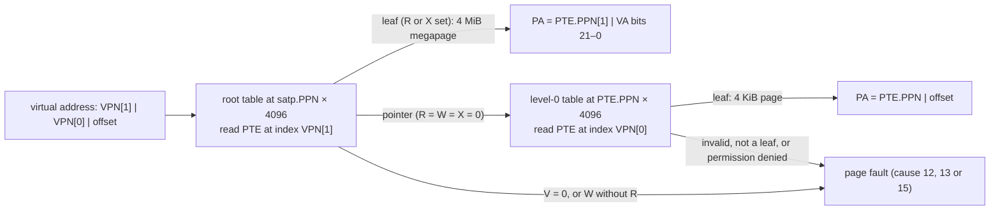

<!-- status: reviewed -->
# 14-10 · Virtual Memory, TLBs and the OS Interface

| | |
|---|---|
| **Course** | [14 · Computer Organization and Architecture](../README.md) |
| **University equivalent** | The virtual-memory and exceptions material of a computer organization course: paging, page tables, TLBs, protection, page faults and demand paging, privilege modes, exceptions and interrupts (Patterson & Hennessy, *Computer Organization and Design*, RISC-V Edition, §5.7 and §4.9; Hennessy & Patterson, *Computer Architecture: A Quantitative Approach*, App. B.4–B.5 and App. L) |
| **Prerequisites** | [14-09 Memory Hierarchy and Caches](14-09-memory-hierarchy-and-caches.md), [14-08 Out-of-Order and Superscalar Execution](14-08-out-of-order-and-superscalar.md) (precise exceptions) |
| **Estimated study hours** | 7 |
| **Last verified** | 2026-11-20 |

**Learning objectives.** After this chapter you can:

1. Explain what virtual memory provides (isolation, protection, relocation, demand paging) and how a virtual address is split and translated through a multilevel page table.
2. Walk a RISC-V Sv32 page table by hand, including megapages, permission checks and page faults.
3. Compute TLB reach and the average cost of translation, and explain how page size and huge pages trade TLB misses against memory waste.
4. Trace a trap through the hardware and the operating system: cause, saved PC, handler and return, for exceptions, system calls and interrupts.
5. Evaluate page-replacement policies on reference strings, and explain thrashing and the constraint that virtually indexed caches place on cache size.

---

## 1. Big picture

Every program on a modern computer believes it has a large, private memory starting at address zero. None of them does. The **virtual memory** system, hardware and operating system together, maps each program's **virtual addresses** to **physical addresses** in DRAM, a page at a time. This one mechanism gives:

- **isolation**: one program cannot read or corrupt another's memory, or the operating system's;
- **protection**: pages can be marked read-only, non-executable, or kernel-only;
- **relocation**: programs are linked once and run anywhere in physical memory;
- **more memory than exists**: unused pages can live on disk and be brought in on demand.

The price is a translation on every memory access. A small cache of translations, the **TLB**, makes that translation nearly free when it hits. Translation is also where the hardware hands control to the operating system: a missing page, a forbidden access, a system call or a timer tick all become **traps**. The precise exceptions of 14-08 make it possible to handle a trap and resume the program as if nothing had happened.

- **Every data-centre and phone processor has a memory-management unit (MMU)**; small microcontrollers often do not, and use simpler memory-protection units ([18-01](../../18-embedded-systems-and-microcontrollers/chapters/18-01-microcontroller-architecture.md)).
- **TLB misses are a real cost** for workloads with large, scattered data (databases, graph analytics, large AI models in host memory), which is why operating systems offer huge pages.
- **The trap interface is the hardware–software contract** on which operating systems, hypervisors and security boundaries are built.

## 2. Intuition first

**A hotel and its front desk.** Guests know their room by a name the hotel gave them ("the blue suite"), not by its physical location. The front desk keeps a ledger mapping names to physical rooms. A guest who asks for a room that is not theirs is refused. A room can be moved, or temporarily emptied and its contents stored in the basement, without the guest noticing, as long as the ledger is updated and the contents are brought back when needed. The ledger is the **page table**. The desk clerk's short list of the most recent lookups is the **TLB**. A guest asking for something the clerk cannot handle (a stored room, a forbidden one) gets the manager, which is the **trap** to the operating system.

**Where the analogy breaks.** The "ledger" is itself in memory and has to be looked up through several levels, so a missed lookup costs several memory accesses. And the hardware does the routine lookups by itself, without the operating system (the manager) being involved at all, unless something is wrong.

## 3. Theory

### 3.1 Pages and translation

Memory is divided into **pages**, fixed-size blocks of $P$ bytes ($P$ = 4 KiB is the norm). A virtual address splits into a **virtual page number (VPN)** and a **page offset** of $\log_2 P$ bits. Translation replaces the VPN by a **physical page number (PPN)**, also called a frame number, and keeps the offset:

$$
\text{PA} = \text{PPN}(\text{VPN}) \times P + \text{offset}.
$$

The mapping lives in a **page table** that the operating system maintains for each process. Each entry (**PTE**) holds the PPN and permission and status bits. If no valid mapping exists, or the access is not allowed, the hardware raises a **page fault** and the operating system decides what to do.

### 3.2 Multilevel page tables: RISC-V Sv32

A single flat table needs one PTE per virtual page, whether used or not: $2^{20}$ entries of 4 bytes, or 4 MiB, for every 32-bit process. Programs use only a few scattered regions (code, heap, stack), so real page tables are **radix trees**: the VPN is split into fields, and each field indexes one level of tables, which exist only where something is mapped.

RISC-V's **Sv32** scheme for 32-bit systems [1, R-215]:

$$
\text{VA} = \underbrace{\text{VPN}[1]}_{\text{bits }31\text{–}22} \;|\; \underbrace{\text{VPN}[0]}_{\text{bits }21\text{–}12} \;|\; \underbrace{\text{offset}}_{\text{bits }11\text{–}0}
$$

- The **satp** register holds the physical page number of the root table, an address-space identifier (ASID) and the translation MODE.
- Each table is one 4 KiB page of $2^{10}$ four-byte PTEs. A PTE holds a 22-bit PPN (bits 31–10), two bits for software (RSW), and the flags D, A, G, U, X, W, R, V (bits 7–0).
- **V** (valid). **R, W, X** (readable, writable, executable): if all three are 0, the PTE points to the next-level table; otherwise it is a **leaf**. **U**: accessible in user mode. **G**: global, the same in every address space. **A** and **D**: accessed and dirty, set when the page is used and written.
- A leaf at level 1 maps a 4 MiB **megapage**: the low 22 bits of the address pass through untranslated.

**The walk** (the specification's algorithm, simplified [1, R-215]):

1. Read the PTE at root × 4096 + VPN[1] × 4.
2. If it is invalid (V = 0, or W = 1 with R = 0), raise a page fault.
3. If R or X is set, it is a leaf: a megapage. (Its PPN must be 4 MiB-aligned, or the walk raises a page fault.) Otherwise read the PTE at PTE.PPN × 4096 + VPN[0] × 4, check it the same way, and require it to be a leaf.
4. Check U against the privilege mode, and R, W or X against the access type; on failure, raise a page fault.
5. If A (or D, for a store) is clear, update it. The specification allows two behaviours here. Under **Svadu**, the hardware sets the bits itself; under **Svade**, the access raises a page fault, and the operating system sets the bits and retries [R-215]. This chapter, its problems and the lab assume Svadu. The physical address is the leaf's PPN followed by the offset.

A 4 KiB translation costs two memory reads; a megapage translation costs one. 64-bit RISC-V uses the same idea with 8-byte PTEs and more levels: **Sv39** (three levels, 2 MiB and 1 GiB superpages), **Sv48** (four) and **Sv57** (five) [1, R-215]. A miss in a 64-bit system can therefore cost three to five memory reads.

> **Math refresher — radix trees.** Splitting a 20-bit key into two 10-bit digits and using each digit to index a table of $2^{10}$ entries is the same idea as looking up a word in a dictionary by its first letter, then its second. Unused subtrees are simply absent, so the storage grows with the number of regions actually used, not with the size of the address space.

### 3.3 The TLB

Walking the page table on every access would multiply memory traffic. The **translation lookaside buffer (TLB)** caches recent translations: VPN → PPN plus permissions. It is a small cache (tens to a few thousand entries) indexed by virtual page number, and it hits on the great majority of accesses for the same reason caches do: locality.

**TLB reach** is the memory a TLB can map at once:

$$
\text{reach} = \text{entries} \times \text{page size}.
$$

A 64-entry TLB with 4 KiB pages reaches only 256 KiB, smaller than many L2 caches. A program whose working set is spread over more pages misses in the TLB even when it hits in the caches. **Huge pages** (megapages, superpages) multiply the reach: the same 64 entries with 4 MiB pages reach 256 MiB. The RISC-V specification keeps 4 KiB as the base page and relies on operating systems' "transparent superpage support" for reach [1, R-215].

The average cost of translation per access is

$$
t_\text{translate} = m_\text{TLB} \times t_\text{walk},
$$

where $t_\text{walk}$ is the number of PTE reads times their average latency. PTEs are ordinary data to the caches, so a walk whose PTEs hit in L1 or L2 costs tens of cycles, and one that goes to DRAM costs hundreds. Real cores add second-level TLBs and caches of upper-level PTEs to cut both terms.

**Address spaces.** When the operating system switches processes, it switches satp to another page table, and old translations become wrong. Tagging TLB entries with the ASID lets several address spaces share the TLB without flushing it on every switch. When the operating system changes a mapping, it must invalidate stale TLB entries, with RISC-V's SFENCE.VMA instruction. On a multicore system it must also ask the other cores to do so (a **TLB shootdown**) [1, R-215].

### 3.4 Caches and translation: VIPT

Translation must happen before a physically addressed cache can be read, which would add the TLB's latency to every load. Most L1 caches avoid this by being **virtually indexed, physically tagged (VIPT)**:

- The set index is taken from the page-offset bits, which translation does not change.
- The cache reads the set while the TLB translates the page number in parallel.
- It then compares the physical tag.

This works only if the index and block offset fit inside the page offset:

$$
\frac{\text{cache size}}{\text{associativity}} \le \text{page size}.
$$

With 4 KiB pages, an 8-way VIPT L1 can be at most 32 KiB, and a 12-way one 48 KiB. Larger L1 caches therefore need more ways, larger pages, or extra hardware to handle **synonyms**: two virtual addresses of the same physical block that would index different sets (Example 14-10.6).

### 3.5 Page faults and demand paging

A page fault is not necessarily an error. Operating systems use it to do work lazily:

- **Demand paging:** a newly started program's pages are mapped only when first touched. The fault handler allocates a frame, loads the contents (from the executable or zeros), writes the PTE and returns. The faulting instruction then re-executes and succeeds.
- **Copy-on-write:** after a process forks, parent and child share pages marked read-only. The first write to one faults, and the handler gives the writer a private copy.
- **Swapping:** when physical memory is full, the operating system evicts a page to disk and marks its PTE invalid. Touching it later faults, and the handler reads it back.

Choosing which page to evict is a **replacement** problem, like a cache's but in software and with a disk access as the miss penalty:

- **LRU** is approximated by the **clock** algorithm, which uses the A bits: sweep the pages, clear A bits, and evict the first page whose A bit is already clear.
- **FIFO** is simpler, but it can suffer **Belady's anomaly**: more frames can cause more faults (Problem 14-10.10).
- **OPT** (evict the page used furthest in the future) is the yardstick.

If the pages a program actively uses (its **working set**) exceed the physical frames available, nearly every access faults, and the system spends its time moving pages instead of computing. This is **thrashing** (Problem 14-10.12).

### 3.6 Traps: exceptions, system calls and interrupts

A **trap** is a transfer of control from the running program to a handler in a more privileged mode. RISC-V has three privilege modes: machine (M, the firmware), supervisor (S, the operating system kernel) and user (U, applications). There are three kinds of trap:

- **Exceptions** are synchronous: caused by the instruction itself (page fault, illegal instruction, misaligned address).
- **System calls** are deliberate exceptions: the `ecall` instruction asks the operating system for a service.
- **Interrupts** are asynchronous: caused by an external event (a timer, a device, another core) and taken between instructions.

When a trap is taken into M-mode, the hardware [2, R-215]:

1. writes **mepc** with "the virtual address of the instruction that was interrupted or that encountered the exception";
2. writes **mcause** with the cause: the interrupt flag in the top bit, and the exception code, such as 8 for an `ecall` from U-mode, 12, 13 or 15 for an instruction, load or store page fault, and 7 for the machine timer interrupt;
3. writes **mtval** with extra information, such as the faulting address;
4. saves the previous privilege mode and interrupt enable, disables interrupts, and jumps to the handler address in **mtvec**. In vectored mode, interrupts go to BASE + 4 × cause.

The S-mode registers (sepc, scause, stval, stvec) do the same for traps delegated to the operating system. The handler saves the registers it needs, does its work, and executes **mret** (or **sret**), which restores the privilege mode and interrupt enable and returns to the address in mepc:

- After a fault the handler leaves mepc unchanged, so the faulting instruction re-executes.
- After an `ecall` it adds 4, so execution continues after the call.

Because exceptions are precise (14-08), every instruction before the faulting one has completed and none after it has changed any state, so the re-execution is exact. **Interrupt latency**, the time from the event to the first handler instruction, matters in real-time systems. It is bounded by the pipeline drain and by the time interrupts stay disabled ([18-03](../../18-embedded-systems-and-microcontrollers/chapters/18-03-interrupts-exceptions-timers.md)).

### 3.7 The lab's model

The lab's `vm.py` implements Sv32 in Python:

- a physical memory with a frame allocator;
- page-table construction (`map`, `map_mega`);
- a walker that follows the specification's algorithm, including A/D updates and the page-fault cause codes;
- an LRU TLB holding 4 KiB and 4 MiB entries;
- an MMU that translates access streams and can service faults by demand paging with FIFO, LRU or clock replacement.

The verify script checks the walker against an independent decoder written from the bit layouts, the TLB counts against closed-form results, and the replacement counts against a second implementation.

## 4. Worked examples

### Example 14-10.1 · Splitting an address and sizing a page table (tier A)

**Setup.** (a) Split the Sv32 virtual address 0x1234_5678. (b) How large is a flat page table for a 32-bit address space with 4 KiB pages and 4-byte PTEs? (c) A process uses 64 KiB of code at 0x0001_0000, 3 MiB of heap from 0x1000_0000, and 128 KiB of stack ending at 0x8000_0000. How much page-table memory does Sv32 need?

**Solution.**

(a) VPN[1] = 0x12345678 >> 22 = 0x48 = **72**; VPN[0] = (0x12345678 >> 12) & 0x3FF = 0x345 = **837**; the offset is 0x678 = **1656**.

(b) $2^{20}$ PTEs × 4 bytes = **4** MiB, per process.

(c) Each level-0 table covers 4 MiB, the range of one VPN[1] value. The code lies in VPN[1] = 0, the heap (0x1000_0000 to 0x102F_FFFF) in VPN[1] = 0x40, and the stack (0x7FFE_0000 to 0x7FFF_FFFF) in VPN[1] = 0x1FF. That makes 3 level-0 tables plus the root: 4 pages = **16** KiB, **256** times smaller than the flat table.

**Units check.** Pages of 4 KiB; $4 \times 4 = 16$ KiB.

**Sanity check.** The multilevel table's size grows with the number of 4 MiB regions in use, not with the size of the address space.

### Example 14-10.2 · Walking a page table (tier B)

**Setup.** satp.PPN = 0x80000. Physical memory holds:

| Physical address | Value |
|---|---|
| 0x8000_0004 | 0x2000_0401 |
| 0x8000_100C | 0x048D_1417 |

(a) Translate a user-mode load from 0x0040_3ABC. How many PTE reads does it take, and what does the second PTE become? (b) What happens on an instruction fetch from the same address, and on a load from supervisor mode with SUM = 0?

**Solution.**

(a) The address splits into VPN[1] = 0x0040_3ABC >> 22 = 1, VPN[0] = 3 and offset 0xABC.

1. The root is at 0x80000 × 4096 = 0x8000_0000, so the level-1 PTE is at 0x8000_0000 + 1 × 4 = 0x8000_0004. It holds 0x2000_0401: V = 1 with R = W = X = 0, so it is a pointer, to PPN 0x2000_0401 >> 10 = 0x80001.
2. The level-0 PTE is at 0x8000_1000 + 3 × 4 = 0x8000_100C. It holds 0x048D_1417, whose flags are 0x17 = V, R, W, U: a valid user leaf, readable and writable. Its PPN is 0x048D_1417 >> 10 = 0x12345.
3. The physical address is 0x12345 × 4096 + 0xABC = **0x1234_5ABC**, after **2** PTE reads.
4. The A bit was clear, so the walker sets it (assuming Svadu; under Svade this load would instead take a load page fault, cause 13, for the OS to set A): the PTE becomes **0x048D_1457**. A later store would also set D, giving 0x048D_14D7.

(b) A fetch needs X, which is 0, so it raises an instruction page fault (cause **12**). A supervisor-mode load from a U = 1 page with SUM = 0 also faults: a load page fault (cause **13**).

**Units check.** Addresses: PPN × 4096 + offset.

**Sanity check.** The same physical page could be mapped executable for another process. Permissions belong to the mapping, not to the memory.

### Example 14-10.3 · The cost of translation and of page faults (tier B)

**Setup.** L1 hits take 4 cycles. 0.5% of accesses miss in the TLB, and a walk makes 2 PTE reads. (a) Find the translation overhead per access if the PTEs hit in L2 (14 cycles each), and if they come from DRAM (200 cycles each). (b) A page fault that reads the disk costs 5 ms at 3 GHz. What does a fault rate of one per million accesses add? What fault rate adds at most 0.4 cycles per access?

**Solution.**

(a) The overhead is $0.005 \times 2 \times 14$ = **0.14** cycles per access with PTEs in L2, and $0.005 \times 2 \times 200$ = **2** cycles with PTEs in DRAM. The second is half of the L1 hit time again.

(b) A fault costs $5 \times 10^{-3} \times 3 \times 10^9 = 1.5 \times 10^7$ cycles. At one per million accesses, that adds **15** cycles per access, almost four times the L1 hit time. To add at most 0.4 cycles needs a fault rate of at most $0.4 / 1.5 \times 10^7 = 2.67 \times 10^{-8}$, one fault per **37.5** million accesses.

**Units check.** Faults/access × cycles/fault = cycles/access.

**Sanity check.** Disk paging is so slow that it must be extremely rare, which is why a system that starts paging feels frozen.

### Example 14-10.4 · TLB reach, rows and columns (tier B)

**Setup.** A 1024 × 1024 matrix of 4-byte integers (4 MiB) at 0x1000_0000 is traversed by rows and by columns, with a 64-entry fully associative LRU TLB. Find the TLB reach and the TLB misses and PTE reads for each traversal, with 4 KiB pages and with one 4 MiB megapage.

**Solution.** The reach is $64 \times 4$ KiB = **256** KiB, against a 4 MiB matrix. Each 4 KiB row of the matrix is exactly one page.

- **Rows, 4 KiB pages:** each page is used for 1024 consecutive accesses, so there is one miss per page: **1024** misses in 1,048,576 accesses (0.098%), and 2048 PTE reads.
- **Columns, 4 KiB pages:** consecutive accesses are in consecutive pages, so a column touches all 1024 pages. The TLB holds 64, and LRU evicts each one long before the next column returns to it. Every access misses: **1,048,576** misses and **2,097,152** PTE reads, twice the data accesses.
- **Megapage:** the whole matrix is one translation, so either order misses exactly **1** time.

**Units check.** Misses are counts; each 4 KiB walk reads 2 PTEs and each megapage walk 1.

**Sanity check.** The column traversal was already bad for the caches (14-09). For the TLB it is worse, because each access touches a new *page*, not just a new block.

### Example 14-10.5 · A trap from start to finish (tier B)

**Setup.** A user program executes `lw a0, 0(a1)` at virtual address 0x0001_0040, with a1 = 0x0040_0000, a page that is not yet mapped. Traps go to M-mode, with mtvec in direct mode. (a) What does the hardware write to mepc, mcause and mtval? Where does execution go after the handler maps the page and executes mret? (b) Repeat for an `ecall` at 0x0001_0080. (c) What is mcause for a machine timer interrupt on RV32, and where does vectored mode send it?

**Solution.**

(a) mepc = **0x0001_0040**, the faulting instruction; mcause = **13**, a load page fault; mtval = 0x0040_0000, the faulting address. The handler allocates a frame, writes the PTE and executes mret without changing mepc, so the `lw` re-executes and now succeeds.

(b) mepc = 0x0001_0080 and mcause = **8**, an environment call from U-mode. The handler performs the requested service and sets mepc to mepc + 4 = **0x0001_0084** before mret, so the program continues after the `ecall`.

(c) The interrupt flag is bit 31 and the code is 7: mcause = **0x8000_0007**. Vectored mode jumps to BASE + 4 × 7 = BASE + **0x1C**.

**Units check.** Byte addresses; each instruction is 4 bytes.

**Sanity check.** Only (a) re-executes the trapping instruction. A fault means "try again once fixed"; a system call means "done, continue".

### Example 14-10.6 · How big can a VIPT L1 be? (tier C)

**Setup.** With 4 KiB pages, which of these L1 caches can be indexed with untranslated bits only: (a) 32 KiB 8-way, (b) 64 KiB 8-way, (c) 48 KiB 12-way? For (b), how many sets can a given physical block land in?

**Solution.** The condition is size/associativity ≤ page size: each way must fit in one page.

(a) 32 KiB / 8 = **4** KiB: it fits.

(b) 64 KiB / 8 = **8** KiB: it does not. The index uses one bit above the page offset, and that bit is translated. Two virtual addresses mapping the same physical block can differ in it, so the block can sit in **2** different sets. These synonyms must be prevented, by hardware checks or by the operating system choosing physical pages whose low bits match ("page colouring").

(c) 48 KiB / 12 = **4** KiB: it fits. (AMD's Zen 5 has a 48 KB 12-way L1 data cache [3, R-212], which has exactly this shape. AMD's disclosure does not say how it is indexed.)

**Units check.** Bytes per way against bytes per page.

**Sanity check.** This is why L1 caches grow by adding ways rather than sets: more ways keep each way within a page.

### Answer key

<!-- answer-key -->
| ID | Quantity | Value | Unit |
|---|---|---|---|
| Ex 14-10.1a | VPN[1] | 72 | — |
| Ex 14-10.1b | VPN[0] | 837 | — |
| Ex 14-10.1c | page offset | 1656 | — |
| Ex 14-10.1d | flat page table | 4 | MiB |
| Ex 14-10.1e | Sv32 page tables for the process | 16 | KiB |
| Ex 14-10.1f | ratio flat to Sv32 | 256 | — |
| Ex 14-10.2a | physical address | 0x12345ABC | — |
| Ex 14-10.2b | PTE reads | 2 | — |
| Ex 14-10.2c | level-0 PTE after the walk | 0x048D1457 | — |
| Ex 14-10.2d | cause, fetch | 12 | — |
| Ex 14-10.2e | cause, supervisor load | 13 | — |
| Ex 14-10.3a | overhead, PTEs in L2 | 0.14 | cycles |
| Ex 14-10.3b | overhead, PTEs in DRAM | 2 | cycles |
| Ex 14-10.3c | page-fault cost per access at 10⁻⁶ | 15 | cycles |
| Ex 14-10.3d | accesses per fault for 0.4 cycles | 37.5 | million |
| Ex 14-10.4a | TLB reach | 256 | KiB |
| Ex 14-10.4b | TLB misses, rows | 1024 | — |
| Ex 14-10.4c | TLB misses, columns | 1048576 | — |
| Ex 14-10.4d | PTE reads, columns | 2097152 | — |
| Ex 14-10.4e | TLB misses with a megapage | 1 | — |
| Ex 14-10.5a | mepc, page fault | 0x00010040 | — |
| Ex 14-10.5b | mcause, page fault | 13 | — |
| Ex 14-10.5c | mcause, ecall | 8 | — |
| Ex 14-10.5d | return address, ecall | 0x00010084 | — |
| Ex 14-10.5e | mcause, machine timer interrupt | 0x80000007 | — |
| Ex 14-10.5f | vector offset | 0x1C | — |
| Ex 14-10.6a | way size, 32 KiB 8-way | 4 | KiB |
| Ex 14-10.6b | way size, 64 KiB 8-way | 8 | KiB |
| Ex 14-10.6c | possible sets for a block | 2 | — |
| Ex 14-10.6d | way size, 48 KiB 12-way | 4 | KiB |
| Txt 14-10.a | nested walk references, 4 + 4 levels | 24 | — |
| Txt 14-10.b | native walk references, 4 levels | 4 | — |

## 5. Simulate it

The lab, [labs/14-10-lab](../labs/14-10-lab/README.md), provides `vm.py`, the model of §3.7. In the notebook you:

1. **Build page tables** for a small process and walk them, printing each PTE read; reproduce Example 14-10.2 and its faults.
2. **Measure TLB reach** with row and column traversals, varying the TLB size and switching to megapages.
3. **Count page-table memory** for sparse and dense address spaces.
4. **Run demand paging** with FIFO, LRU, clock and OPT replacement on reference strings and on a cyclic loop, and find the thrashing cliff.

**Guided exercise (predict, then run).** **Before Part 2,** predict the TLB misses of the column traversal with a 1024-entry TLB and with a 1023-entry TLB. (1024: only the first column misses, once per page. 1023: every one of the 1,048,576 accesses, because LRU always evicts the page needed next.)

## 6. Engineering tradeoffs

| Knob | Improves | Costs | Typical decision owner |
|---|---|---|---|
| Page size | TLB reach, fewer page-table levels | Internal fragmentation, coarser protection, slower copy-on-write | ISA and OS architects |
| Huge pages | TLB misses for large working sets | Memory waste, harder allocation (needs contiguous physical memory) | OS and application developers |
| TLB size and levels | TLB miss rate | Area, power, lookup latency | CPU architect |
| Page-table levels (Sv39/48/57) | Address-space size | Walk length (3–5 reads per miss) | ISA, platform architect |
| ASIDs in the TLB | No flush on context switch | Tag bits, shootdown complexity | CPU and OS architects |
| VIPT L1 | Hides translation latency | Size ≤ page size × ways | CPU architect |
| Replacement policy (OS) | Page-fault rate | Bookkeeping (A bits, clock scans) | OS developers |

## 7. Numbers to know

| Quantity | Value | Note |
|---|---|---|
| Base page | 4 KiB (offset 12 bits) | RISC-V [1, R-215]; also the usual base page on x86 and Arm systems |
| Sv32 | 2 levels, 4-byte PTEs, 4 MiB megapages | [1, R-215] |
| Sv39 / Sv48 / Sv57 | 3 / 4 / 5 levels, 8-byte PTEs; 2 MiB, 1 GiB, 512 GiB and (Sv57) 256 TiB superpages | [1, R-215] |
| TLB reach | entries × page size | 64 × 4 KiB = 256 KiB |
| RISC-V cause codes | 8 ecall from U; 12, 13, 15 instruction, load, store page faults; interrupts 5/7 S/M timer, 9/11 S/M external | [2, R-215] |
| VIPT limit | cache size ≤ page size × ways | §3.4 |
| Disk page fault | milliseconds from a hard disk, millions of cycles (Example 14-10.3); less from a solid-state drive, but still far beyond any cache miss | Example 14-10.3 |

## 8. Common mistakes

- **Forgetting that page tables are in memory.** A TLB miss costs several memory reads, each of which can miss in the caches.
- **Confusing the TLB with a cache.** The TLB caches translations, not data; a TLB hit can still be a cache miss, and vice versa.
- **Assuming a page fault is an error.** Most faults are normal operating-system work: demand paging, copy-on-write.
- **Returning to the wrong place.** After a fault, re-execute the instruction (mepc); after an `ecall`, skip it (mepc + 4).
- **Ignoring TLB reach.** A workload can fit in the L2 cache and still miss in the TLB on every access.
- **Building a large L1 without checking the VIPT condition.** It forces more ways, larger pages or synonym handling.

## 9. Practitioner lens

### State of the art (as of Nov 2026)

- **64-bit page tables with four or five levels.** RISC-V defines Sv39, Sv48 and Sv57 with three to five levels [1, R-215], and x86-64 and 64-bit Arm use comparable multilevel schemes. Every TLB miss is therefore a short pointer chase **[Established]**.
- **Huge pages as the reach fix.** The RISC-V specification keeps the 4 KiB base page and relies on operating systems' transparent superpage support for TLB reach [1, R-215] **[Established]**. Databases and other large in-memory workloads commonly request huge pages, such as Sv39's 2 MiB and 1 GiB sizes.
- **Shootdowns at scale.** Changing a shared mapping on a many-core server requires interrupting the other cores (the RISC-V specification's "TLB shootdown" procedure [1, R-215]) **[Established]**. Every core that may hold the old translation must take the interrupt and acknowledge it, so the cost grows with the number of cores involved (our reasoning; measure it on the target system).

### Why it matters commercially

- **Virtualization multiplies the walk.** A virtual machine has its own page tables, translated through the hypervisor's. With nested paging, every guest page-table pointer is itself a guest-physical address that needs a host walk. A guest walk of $n$ levels over a host table of $m$ levels therefore makes up to $n(m + 1) + m = nm + n + m$ memory references: **24** for four levels each, against 4 natively (our derivation). This is why large TLBs, page-walk caches and huge pages matter to cloud providers.
- **Isolation is the security boundary.** Page-table permissions separate processes, and the kernel from users. Attacks such as Meltdown (14-07) were dangerous precisely because they bypassed this boundary.

### Marketing vs Reality

- **"Unlimited memory."** *Reality:* virtual memory beyond physical memory means paging to storage, millions of cycles per fault. *Sanity check:* ask what happens to performance when the working set exceeds DRAM.
- **"Huge pages give X% speedup."** *Reality:* only TLB-bound workloads gain, and huge pages can waste memory and fragment physical memory. *Sanity check:* ask for the TLB-miss share of cycles before and after.

### Questions for engineering leaders

1. **"How much time does your workload spend in TLB misses and page walks?"**
   *Strong:* a measured share from performance counters, and the page-size policy. *Evasive:* "the caches handle it".
2. **"How do you handle TLB shootdowns at your core counts?"**
   *Strong:* batching, ASIDs, and measured shootdown latency. *Evasive:* no data.
3. **"What is your worst-case interrupt latency?"**
   *Strong:* a bound with the conditions (disabled regions, pipeline drain). *Evasive:* a typical value only.
4. **"How is the kernel isolated from user code against speculative attacks?"**
   *Strong:* specific mitigations and their measured cost. *Evasive:* "we are not affected".

## 10. Concept check

**Q1.** Why are page tables multilevel?

Answer

A flat table needs an entry for every virtual page, used or not: 4 MiB per process for a 32-bit space, and impossibly large for 64-bit spaces. A radix tree allocates lower-level tables only for regions in use, so its size tracks the memory actually mapped.

**Q2.** What does the TLB cache, and what is its reach?

Answer

Recent virtual-to-physical page translations with their permissions. Its reach is entries × page size, the amount of memory it can map without missing.

**Q3.** Why does a page fault re-execute the faulting instruction, while a system call does not re-execute `ecall`?

Answer

A fault means the instruction could not complete; once the operating system fixes the cause (maps the page), it must run again. A system call is a completed request; the handler advances the return address past the `ecall` so the program continues.

**Q4.** How can a cache be indexed before translation finishes?

Answer

By taking the set index from page-offset bits, which translation does not change (VIPT). This requires each way to be no larger than a page.

**Q5.** What is thrashing?

Answer

When the working set of active pages exceeds the available physical frames, nearly every access faults and the system spends its time paging rather than computing.

**Q6.** Why tag TLB entries with an address-space ID?

Answer

So that translations of several processes can coexist in the TLB, and a context switch does not have to flush it.

Now work the [problem set](../problems/14-10-problems.md).

## 11. Key terms

[Virtual memory](../../../reference/glossary.md#virtual-memory) · [Page (memory)](../../../reference/glossary.md#page-memory) · [Page table](../../../reference/glossary.md#page-table) · [Page-table entry (PTE)](../../../reference/glossary.md#page-table-entry-pte) · [Translation lookaside buffer (TLB)](../../../reference/glossary.md#translation-lookaside-buffer-tlb) · [TLB reach](../../../reference/glossary.md#tlb-reach) · [Huge page](../../../reference/glossary.md#huge-page) · [Page fault](../../../reference/glossary.md#page-fault) · [Demand paging](../../../reference/glossary.md#demand-paging) · [Thrashing](../../../reference/glossary.md#thrashing) · [Trap (processor)](../../../reference/glossary.md#trap-processor) · [Privilege mode](../../../reference/glossary.md#privilege-mode) · [Virtually indexed, physically tagged (VIPT) cache](../../../reference/glossary.md#virtually-indexed-physically-tagged-vipt-cache) · [Precise exception](../../../reference/glossary.md#precise-exception)

## 12. Connections

- **Builds on:** caches and replacement ([14-09](14-09-memory-hierarchy-and-caches.md)); precise exceptions ([14-08](14-08-out-of-order-and-superscalar.md)); speculation and Meltdown ([14-07](14-07-branch-prediction-and-speculation.md)).
- **Next:** [14-11 I/O, Buses and Interconnect](14-11-io-buses-and-interconnect.md), where interrupts and DMA connect devices to memory.
- **Used later:** coherence and TLB shootdowns in multicores ([14-12](14-12-multicore-coherence-consistency.md)); microcontroller memory protection and interrupts ([18-01](../../18-embedded-systems-and-microcontrollers/chapters/18-01-microcontroller-architecture.md), [18-03](../../18-embedded-systems-and-microcontrollers/chapters/18-03-interrupts-exceptions-timers.md)).

## 13. Further study

- D. A. Patterson and J. L. Hennessy, *Computer Organization and Design*, RISC-V Edition, §5.7 (virtual memory) and §4.9 (exceptions).
- J. L. Hennessy and D. A. Patterson, *Computer Architecture: A Quantitative Approach*, App. B.4–B.5 (virtual memory and its protection).
- *The RISC-V Instruction Set Manual, Volume II: Privileged Architecture*, the supervisor chapter (Sv32–Sv57) and the machine chapter (traps).
- A. Silberschatz, P. B. Galvin and G. Gagne, *Operating System Concepts*, the chapters on main memory and virtual memory (paging, replacement, thrashing).
- L. A. Belady, R. A. Nelson and G. S. Shedler, "An Anomaly in Space-Time Characteristics of Certain Programs Running in a Paging Machine," *Communications of the ACM* 12(6), 1969.

## 14. Sources

1. RISC-V International, *The RISC-V Instruction Set Manual, Volume II: Privileged Architecture*, manual set 20260120, supervisor chapter. [R-215](../../../reference/research-log.md#r-215--risc-v-privileged-isa-virtual-memory-and-traps)
2. The same, machine chapter (traps and cause codes). [R-215](../../../reference/research-log.md#r-215--risc-v-privileged-isa-virtual-memory-and-traps)
3. AMD, "Next Generation 'Zen 5' Core," Hot Chips 2024. [R-212](../../../reference/research-log.md#r-212--amd-zen-5-core-hot-chips-2024)

Paging, TLBs, page replacement and traps are textbook material (Further study). Every walk, count and code in the examples is recomputed by the verify script with the lab's model and an independent decoder.
