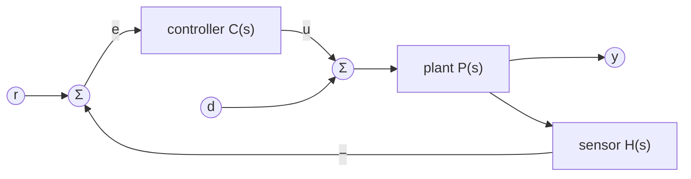
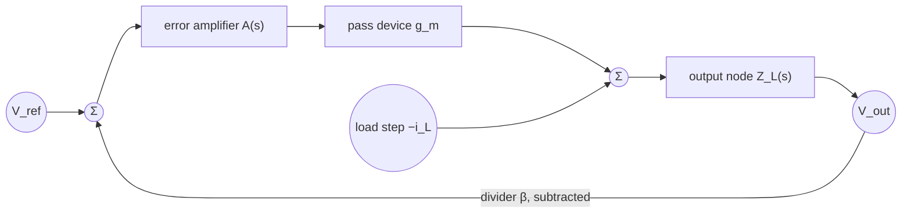
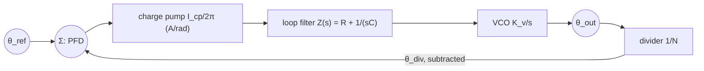
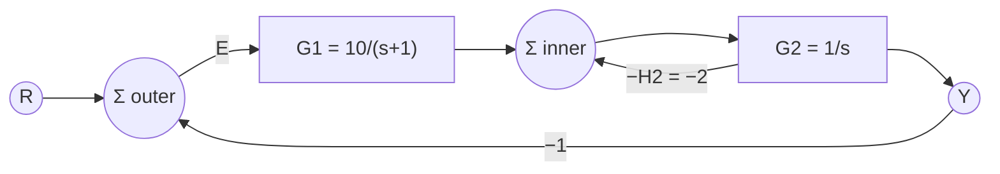
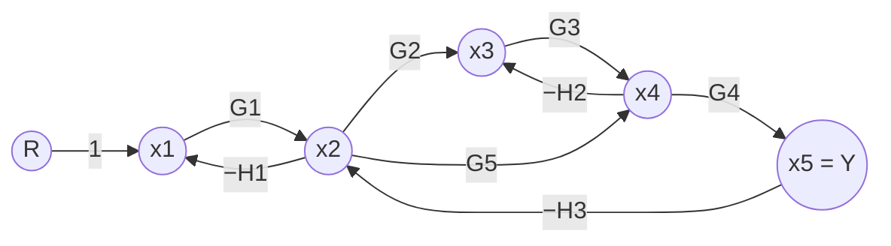

<!-- status: verified -->
# 15-02 · Transfer Functions and Block Diagrams

| | |
|---|---|
| **Course** | [15 · Control Systems](../README.md) |
| **University equivalent** | The transfer-function and block-diagram material of a first course in feedback control: transfer functions, poles and zeros, block-diagram reduction, the standard feedback loop, signal-flow graphs and Mason's gain formula (Franklin, Powell & Emami-Naeini, *Feedback Control of Dynamic Systems*, ch. 3; Ogata, *Modern Control Engineering*, ch. 2; Nise, *Control Systems Engineering*, ch. 5) |
| **Prerequisites** | [15-01 Modeling Dynamic Systems](15-01-modeling-dynamic-systems.md), [11-08 The Laplace Transform and System Functions](../../11-signals-and-systems/chapters/11-08-laplace-transform-and-system-functions.md), [02-07 Determinants, Inverses and Vector Spaces](../../02-complex-numbers-des-and-linear-algebra/chapters/02-07-determinants-inverses-and-vector-spaces.md) |
| **Estimated study hours** | 7 |
| **Last verified** | 2026-11-20 |

**Learning objectives.** After this chapter you can:

1. Derive a transfer function from a differential equation or a state-space model, and read its poles, zeros and DC gain.
2. Reduce a block diagram with the series, parallel and feedback rules and by moving summing and pickoff points.
3. Write the closed-loop, sensitivity and disturbance transfer functions of the standard feedback loop, and explain the identity $S + T = 1$.
4. Draw a signal-flow graph and apply Mason's gain formula, including non-touching loops.
5. Model a voltage regulator and a phase-locked loop as block diagrams and compute their closed-loop transfer functions.

---

## 1. Big picture

A model from 15-01 is a set of differential equations. Engineers rarely design with the equations directly. They package each subsystem as a **transfer function**, the ratio of output to input transforms, and connect the packages in a **block diagram** that shows how signals flow: from a reference through a controller, an actuator and a plant, and back through a sensor. Block-diagram algebra then turns the picture into one transfer function for the whole loop. That is the form in which stability, speed and accuracy are read (15-03 to 15-07). The method scales from a two-block loop to a chip's power-management system, because each block can be designed, measured and replaced on its own.

- **Every control loop in a chip has a block diagram.** A low-dropout regulator is an error amplifier, a pass transistor and a load, closed through a resistor divider. A phase-locked loop is a phase detector, a loop filter, a VCO and a divider (15-12).
- **The loop gain $L(s)$ is the central quantity.** It decides how well a loop tracks, how strongly it rejects disturbances and whether it is stable.
- **Transfer functions connect to measurement.** A network analyzer measures a block's or a loop's frequency response, which is its transfer function evaluated at $s = j\omega$ (11-08).
- **Mason's gain formula** handles diagrams with many interlocking loops, such as multi-loop regulators, without step-by-step reduction.

## 2. Intuition first

**A block is a filter with a label.** Each block takes a signal in and puts a filtered, scaled or delayed version out. Blocks in a row multiply. Blocks side by side, whose outputs are added, add. The interesting case is a loop: the output is fed back, compared with the reference, and the difference drives the system again.

**The loop as a thermostat.** A thermostat compares the room's temperature with the setting and turns the heater on in proportion to the error (a simple proportional controller). If the loop gain is large, a small error produces a large correction, so the room ends close to the setting even if the heater is weak or the windows leak. Feedback trades the large open-loop gain, which is cheap, for accuracy and insensitivity, which are valuable. This is the same trade that makes op-amp circuits precise (06-10, 12-05).

**Where the analogy breaks.** A thermostat switches on and off; the loops here are linear. And a real heater responds with delay. Too much gain on a slow plant makes the loop overshoot and oscillate, which is why stability is the next question after accuracy (15-05).

*The standard feedback loop: reference $r$, error $e$, controller output $u$, disturbance $d$ at the plant input, output $y$ and a sensor $H$ in the feedback path.*

## 3. Theory

### 3.1 Transfer functions, poles and zeros

For a linear, time-invariant system at rest (zero initial conditions), the **transfer function** is the ratio of the Laplace transforms of output and input (11-08):

$$
G(s) = \frac{Y(s)}{U(s)} = \frac{b_ms^m + \cdots + b_1s + b_0}{s^n + a_{n-1}s^{n-1} + \cdots + a_0} = K\,\frac{(s - z_1)\cdots(s - z_m)}{(s - p_1)\cdots(s - p_n)} .
$$

From the differential equation $y^{(n)} + a_{n-1}y^{(n-1)} + \cdots + a_0y = b_mu^{(m)} + \cdots + b_0u$, each derivative becomes a factor of $s$, so the coefficients carry straight over.

- The **poles** $p_i$ (roots of the denominator) are the system's natural modes: its free response is a sum of terms $e^{p_it}$. Poles in the left half-plane decay; a pole in the right half-plane grows (15-05).
- The **zeros** $z_i$ (roots of the numerator) are frequencies the system blocks. They shape the response but do not set its stability.
- The **DC gain** $G(0)$ is the steady-state output per unit of constant input, provided every pole is in the left half-plane (the final-value theorem, 11-08).
- The system is **proper** if $m \le n$ and **strictly proper** if $m < n$. Physical systems are strictly proper, because their gain must fall at high frequency. The difference $n - m$ is the **relative degree**: the high-frequency gain falls as $1/\omega^{n-m}$.

### 3.2 From state space to a transfer function

Taking the Laplace transform of $\dot{\mathbf{x}} = A\mathbf{x} + B\mathbf{u}$, $\mathbf{y} = C\mathbf{x} + D\mathbf{u}$ with $\mathbf{x}(0) = 0$ gives $s\mathbf{X} = A\mathbf{X} + B\mathbf{U}$, so $\mathbf{X} = (sI - A)^{-1}B\mathbf{U}$ and

$$
G(s) = C(sI - A)^{-1}B + D .
$$

Since $(sI - A)^{-1} = \operatorname{adj}(sI - A)/\det(sI - A)$ (02-07), every entry of $G(s)$ has the denominator $\det(sI - A)$, the **characteristic polynomial** of $A$. The poles of the transfer function are therefore the **eigenvalues** of $A$, unless a factor cancels between numerator and denominator. A cancellation means a mode that the input cannot excite or the output cannot see, a hidden mode that 15-10 calls uncontrollable or unobservable. A hidden unstable mode is dangerous: the transfer function looks fine while an internal state grows.

### 3.3 Block-diagram algebra

Three rules reduce any loop-free connection, and a fourth closes loops.

- **Series:** $G_1$ then $G_2$ gives $G_2G_1$ (for single-input single-output blocks the order does not matter). This assumes the blocks do not load each other: each block's transfer function must already include the source it is driven from and the load it drives. Two RC low-pass sections joined through a buffer give $1/(RCs + 1)^2$; joined directly, the second section loads the first and the pair gives $1/(R^2C^2s^2 + 3RCs + 1)$.
- **Parallel:** two blocks fed the same input, outputs added, give $G_1 + G_2$.
- **Moving a pickoff or summing point** across a block: multiply or divide the moved branch by that block so that every signal keeps its value. For example, a disturbance $D$ added *after* a block $G$ gives $Y = GE + D$; moving that summing point to *before* $G$ requires $Y = G(E + D/G)$, so the moved branch becomes $D/G$. Moving a pickoff from before $G$ to after it divides the picked-off signal by $G$, and moving it from after to before multiplies by $G$ (Problem 15-02.6).
- **Feedback:** with forward path $G$ and feedback path $H$ subtracted at the summing junction,

$$
E = R - HY, \quad Y = GE \;\Longrightarrow\; Y = G(R - HY) \;\Longrightarrow\; \frac{Y}{R} = \frac{G}{1 + GH} .
$$

The product $L = GH$, the gain around the loop, is the **loop gain** (also called the open-loop transfer function). When $\lvert L\rvert \gg 1$ the closed-loop gain approaches $1/H$: the feedback path, which is usually a precise resistor divider or sensor, sets the result, not the forward path. With positive feedback the sign in the denominator becomes $1 - GH$.

### 3.4 The standard loop: tracking, disturbances and noise

In the loop of §2 with a unity sensor ($H = 1$), write the loop gain $L(s) = C(s)P(s)$. By superposition the output is

$$
Y = \underbrace{\frac{L}{1 + L}}_{T(s)}R + \underbrace{\frac{P}{1 + L}}_{\text{disturbance}}D, \qquad
E = R - Y = \underbrace{\frac{1}{1 + L}}_{S(s)}R - \frac{P}{1 + L}D .
$$

- $T = L/(1 + L)$ is the **complementary sensitivity**, the closed-loop transfer function from reference to output.
- $S = 1/(1 + L)$ is the **sensitivity function**. It is the transfer function from reference to error, and it scales how much a plant disturbance reaches the output: without feedback a disturbance at the output appears in full, with feedback multiplied by $S$.
- They obey $S + T = 1$ at every frequency. Where the loop gain is large, $S$ is small (good tracking and disturbance rejection) and $T \approx 1$. Where the loop gain is small, $T$ is small. Sensor noise $n$ enters the output through $-T$, so a loop cannot both follow a signal and ignore sensor noise at the same frequency. This is the fundamental trade-off of feedback, developed in 15-04.

The **controller effort** $U = C\,E$ matters too: a large loop gain demands large actuator signals, and real actuators saturate.

![Two plots. Left: magnitudes of S and T against frequency from 0.01 to 1000 rad/s on log-log axes, for a plant 1/(s+1) under proportional gains K = 9 and K = 99. At low frequency |S| is flat at 0.1 for K = 9 and 0.01 for K = 99, while |T| is near 1; |S| rises toward 1 and |T| falls off above about 10 rad/s for K = 9 and 100 rad/s for K = 99. Right: unit-step responses of Example 15-02.3's loop. With the inner velocity loop the output peaks near 1.02 at about 1 s and settles at 0.833; without it the output peaks near 1.6 and rings for several seconds around 1.](../../../assets/figures/15-02/loops.svg)

*Figure 1. Left: where the loop gain is large, $\lvert S\rvert$ is small and $\lvert T\rvert \approx 1$; raising $K$ from 9 to 99 lowers $\lvert S\rvert$ tenfold at low frequency and widens the band where the loop acts (Example 15-02.4). Right: the inner velocity loop of Example 15-02.3 cuts the overshoot from 60.5% to 22.1%.*

### 3.5 Signal-flow graphs and Mason's gain formula

A **signal-flow graph** draws signals as nodes and transfer functions as directed branches. Each node's value is the sum of the incoming branches' gains times their source nodes. A **forward path** goes from input to output visiting no node twice. A **loop** starts and ends at the same node visiting no other node twice; its gain is the product of its branch gains. Two loops (or a loop and a path) **touch** if they share a node.

**Mason's gain formula.** The transfer function from the input to the output node is

$$
T = \frac{\sum_kP_k\Delta_k}{\Delta}, \qquad
\Delta = 1 - \sum_iL_i + \sum_{i,j}L_iL_j - \sum_{i,j,k}L_iL_jL_k + \cdots ,
$$

where $P_k$ is the gain of the $k$-th forward path; the sums in $\Delta$ run over all loops, all pairs of non-touching loops, all triples of mutually non-touching loops, and so on; and $\Delta_k$ is $\Delta$ computed with only the loops that do not touch path $k$. For a single loop of gain $-GH$ and one forward path $G$ touching it, $\Delta = 1 + GH$ and $\Delta_1 = 1$, which recovers $G/(1 + GH)$.

> **Going deeper — why Mason's formula works.** The node equations of a signal-flow graph are linear: $\mathbf{x} = M\mathbf{x} + \mathbf{b}r$, where $M$ holds the branch gains. So $(I - M)\mathbf{x} = \mathbf{b}r$, and by Cramer's rule the output is a ratio of two determinants. Expanding $\det(I - M)$ by permutations, each permutation decomposes into disjoint cycles, which are exactly sets of non-touching loops, and each cycle contributes its loop gain with a minus sign. That is Mason's $\Delta$. The numerator determinant expands the same way into forward paths times the $\Delta$ of the loops they leave untouched. The lab checks the formula against a direct linear solve.

### 3.6 Two chip loops as block diagrams

**A linear regulator.** An error amplifier $A(s)$ compares a reference $V_{ref}$ with a fraction $\beta$ of the output, taken from a resistor divider, and drives a pass transistor of transconductance $g_m$ into a load $Z_L(s)$, a resistance $R_L$ in parallel with a capacitance $C_L$. The forward path is $G(s) = A(s)g_mZ_L(s)$ and the feedback path is $\beta$, so

$$
\frac{V_{out}}{V_{ref}} = \frac{G}{1 + G\beta} \xrightarrow{\;\lvert G\beta\rvert \gg 1\;} \frac{1}{\beta} .
$$

A load-current step $i_L$ is a disturbance injected at the output node. The closed loop divides the open-loop output impedance $Z_L$ by $1 + L$, where $L = G\beta$. Problem 15-02.11 puts numbers on it.

**A charge-pump phase-locked loop.** In the linear model of a PLL (15-12), phases are the signals. A phase–frequency detector and charge pump produce a current $K_{pd}(\theta_{ref} - \theta_{div})$ with $K_{pd} = I_{cp}/(2\pi)$ (A/rad). A loop filter, a resistor $R$ in series with a capacitor $C$, turns that current into a control voltage, $Z(s) = R + 1/(sC)$. The VCO turns voltage into frequency, so its output phase is the integral, $K_v/s$ (rad/s per volt, divided by $s$). A divider by $N$ feeds the phase back. The loop gain is

$$
L(s) = \frac{K_{pd}Z(s)K_v}{Ns} = \frac{I_{cp}K_v}{2\pi NC}\cdot\frac{1 + sRC}{s^2} = \omega_n^2\frac{1 + sRC}{s^2}, \qquad \omega_n = \sqrt{\frac{I_{cp}K_v}{2\pi NC}} ,
$$

and the closed-loop transfer function from reference phase to divided output phase is

$$
\frac{\Theta_{div}}{\Theta_{ref}} = \frac{L}{1 + L} = \frac{\omega_n^2(1 + sRC)}{s^2 + \omega_n^2RC\,s + \omega_n^2} ,
\qquad 2\zeta\omega_n = \omega_n^2RC \;\Rightarrow\; \zeta = \frac{RC\omega_n}{2} .
$$

The VCO's own output phase is $N$ times the divided one, so the output tracks $N$ times the reference: this is how a PLL multiplies a frequency. The two integrators in the loop (the VCO and the capacitor) make it a "type 2" loop that tracks a frequency step with zero phase error (15-04).

## 4. Worked examples

### Example 15-02.1 · From an equation to a transfer function (tier A)

**Setup.** A system obeys $\ddot y + 3\dot y + 2y = \dot u + 4u$. Find its transfer function, poles, zeros and DC gain.

**Solution.** Transforming with zero initial conditions: $(s^2 + 3s + 2)Y = (s + 4)U$, so

$$
G(s) = \frac{s + 4}{s^2 + 3s + 2} = \frac{s + 4}{(s + 1)(s + 2)} .
$$

The poles are **−1** and **−2**, the zero is **−4**, and the DC gain is $G(0)$ = 4/2 = **2**. The relative degree is 1, so the gain falls as $1/\omega$ at high frequency.

**Units check.** If $u$ and $y$ are both volts, $G$ is dimensionless and every coefficient $a_i$ has units 1/sⁿ⁻ⁱ.

**Sanity check.** In steady state with a constant input $u = 1$, all derivatives vanish and $2y = 4$, so $y$ = 2, matching $G(0)$.

### Example 15-02.2 · The DC motor from state space (tier B)

**Setup.** Using the motor of Example 15-01.2 ($R$ = 2 Ω, $L$ = 1 mH, $K$ = 0.05 V·s/rad, $J$ = 2 × 10⁻⁵ kg·m², $B$ = 10⁻⁵ N·m·s/rad), compute $G(s) = \Omega(s)/V(s)$ from $C(sI - A)^{-1}B$ and check it against 15-01's formula.

**Solution.** With $\mathbf{x} = [i,\ \omega]^T$,

$$
sI - A = \begin{bmatrix} s + R/L & K/L \\ -K/J & s + B/J \end{bmatrix}, \qquad \det(sI - A) = s^2 + \left(\frac{R}{L} + \frac{B}{J}\right)s + \frac{RB + K^2}{LJ} .
$$

With $B = [1/L,\ 0]^T$ and $C = [0,\ 1]$, only the (2,1) entry of the adjugate survives: $K/J$. So

$$
G(s) = \frac{K/(LJ)}{s^2 + (R/L + B/J)s + (RB + K^2)/(LJ)} = \frac{2.5 \times 10^6}{s^2 + 2000.5\,s + 126{,}000} .
$$

Multiplying numerator and denominator by $LJ$ gives $K/[(Ls + R)(Js + B) + K^2]$, 15-01's formula. The DC gain is 2.5 × 10⁶/126,000 = **19.84** rad/s per volt (12 V gives the 238.1 rad/s of Example 15-01.2). The poles, the eigenvalues of $A$, are **−65.1** and **−1935.4** s⁻¹.

**Units check.** $K/(LJ)$ has units (N·m/A)/[(V·s/A)(kg·m²)] = (kg·m²/s²)/(V·s·kg·m²) = 1/(V·s³), that is, (rad/s)/V per s². Divided by the s² of the denominator, $G$ comes out in rad/s per volt.

**Sanity check.** The coefficient of $s$ equals minus the sum of the poles, 65.1 + 1935.4 = 2000.5, and the constant equals their product, 126,000 (to rounding).

### Example 15-02.3 · Reducing a two-loop diagram (tier B)

**Setup.** A controller $G_1 = 10/(s + 1)$ drives an integrating plant $G_2 = 1/s$, which has an inner velocity-feedback loop of gain $H_2 = 2$ around it. An outer unity loop closes around both. Find the closed-loop transfer function, its natural frequency, damping ratio and DC gain, and the overshoot of its step response.

**Solution.** Close the inner loop first:

$$
\frac{G_2}{1 + H_2G_2} = \frac{1/s}{1 + 2/s} = \frac{1}{s + 2} .
$$

The forward path is then $10/[(s + 1)(s + 2)]$, and the outer loop gives

$$
T(s) = \frac{10/[(s + 1)(s + 2)]}{1 + 10/[(s + 1)(s + 2)]} = \frac{10}{s^2 + 3s + 12} .
$$

Comparing with $\omega_n^2/(s^2 + 2\zeta\omega_ns + \omega_n^2)$ scaled by its DC gain: $\omega_n = \sqrt{12}$ = **3.464** rad/s, $\zeta = 3/(2\sqrt{12})$ = **0.433**, and the DC gain is 10/12 = **0.833**. The step response overshoots its final value by $e^{-\pi\zeta/\sqrt{1 - \zeta^2}}$ = **22.1**% (15-03), peaking at $t_p = \pi/(\omega_n\sqrt{1 - \zeta^2})$ = **1.006** s.

**Units check.** Both terms in each denominator are dimensionless ratios of polynomials in $s$ (1/s).

**Sanity check.** The inner loop moved the plant's pole from 0 to −2: velocity feedback adds damping. Without it the loop would be $10/(s^2 + s + 10)$, with $\zeta$ = **0.158** and **60.5**% overshoot. The lab builds this loop from ideal transconductors and capacitors in ngspice and measures the same overshoot.

### Example 15-02.4 · What the loop buys (tier B)

**Setup.** A plant $P = 1/(s + 1)$ is controlled by a proportional gain $K$ with unity feedback, and a disturbance $d$ enters at the plant input. For $K$ = 9 and $K$ = 99, find the DC tracking gain, the steady-state error to a unit step, the DC gain from disturbance to output, the closed-loop pole and the controller output at the instant a unit step is applied.

**Solution.** $L = K/(s + 1)$, so

$$
T = \frac{K}{s + 1 + K}, \qquad \frac{Y}{D} = \frac{P}{1 + L} = \frac{1}{s + 1 + K}, \qquad S = \frac{s + 1}{s + 1 + K} .
$$

| | $K$ = 9 | $K$ = 99 |
|---|---|---|
| DC tracking gain $T(0)$ | **0.9** | **0.99** |
| Step error $S(0)$ | **0.1** | **0.01** |
| Disturbance gain $Y/D$ at DC | **0.1** | **0.01** |
| Closed-loop pole | **−10** | **−100** |
| Initial controller output $u = Ke(0^+)$ | **9** | **99** |

Without feedback the plant's DC gain from $d$ is 1, so the loop attenuates a constant disturbance by $1 + K$, and speeds the response by the same factor (the pole moves from −1 to $-(1 + K)$). The price is controller effort: a unit step asks the actuator for $K$ units at once.

**Units check.** $K$ is dimensionless if $u$ and $y$ share units; the pole's units are 1/s.

**Sanity check.** $S(0) + T(0)$ = 0.1 + 0.9 = 1, as $S + T = 1$ requires. A steady error remains because nothing in the loop integrates; 15-04 and 15-08 remove it with integral action.

### Example 15-02.5 · Mason's formula with non-touching loops (tier C)

**Setup.** In the signal-flow graph below, $G_1$ = 2, $G_2$ = 5, $G_3$ = 4, $G_4$ = 1, a feedforward branch $G_5$ = 3 runs from $x_2$ to $x_4$, and feedback branches $-H_1$ ($x_2 \to x_1$), $-H_2$ ($x_4 \to x_3$) and $-H_3$ ($x_5 \to x_2$) have $H_1$ = 0.5, $H_2$ = 0.25 and $H_3$ = 0.1. Find $Y/R$ with $Y = x_5$.

*Signal-flow graph of Example 15-02.5: nodes are signals, and each arrow multiplies its source node by the gain on it.*

**Solution.** Forward paths: $P_1 = G_1G_2G_3G_4$ = 40 and $P_2 = G_1G_5G_4$ = 6. Loops: $L_1 = -G_1H_1$ = −1 (nodes $x_1, x_2$); $L_2 = -G_3H_2$ = −1 ($x_3, x_4$); $L_3 = -G_2G_3G_4H_3$ = −2 ($x_2$ to $x_5$); $L_4 = -G_5G_4H_3$ = −0.3 ($x_2, x_4, x_5$). Only $L_1$ and $L_2$ share no node. So

$$
\Delta = 1 - (L_1 + L_2 + L_3 + L_4) + L_1L_2 = 1 + 4.3 + 1 = 6.3 .
$$

Both forward paths touch every loop, so $\Delta_1 = \Delta_2 = 1$, and

$$
\frac{Y}{R} = \frac{P_1 + P_2}{\Delta} = \frac{46}{6.3} = \mathbf{7.302} .
$$

**Units check.** All gains here are dimensionless constants, so the result is too; with transfer functions the same steps give a ratio of polynomials.

**Sanity check.** Writing the five node equations and solving them as a linear system gives the same 7.302 (the lab does this, and also checks that forgetting the non-touching term $L_1L_2$ would give 46/5.3 = 8.68, which is wrong).

### Example 15-02.6 · A PLL's loop dynamics (tier C)

**Setup.** A charge-pump PLL has $I_{cp}$ = 100 µA, a VCO gain $K_v$ = 2π × 100 MHz/V, a divider $N$ = 100 and a loop filter $R$ = 5 kΩ in series with $C$ = 1 nF. Find $\omega_n$, the natural frequency in hertz and $\zeta$, and the closed-loop DC gain from reference phase to VCO output phase.

**Solution.** From §3.6,

$$
\omega_n = \sqrt{\frac{I_{cp}K_v}{2\pi NC}} = \sqrt{\frac{10^{-4} \times 2\pi \times 10^8}{2\pi \times 100 \times 10^{-9}}} = \sqrt{10^{11}} = \mathbf{3.162 \times 10^5}\ \text{rad/s},
$$

which is $f_n = \omega_n/2\pi$ = **50.3** kHz. $\zeta = RC\omega_n/2 = 5 \times 10^3 \times 10^{-9} \times 3.162 \times 10^5/2$ = **0.791**. At DC the divided phase equals the reference phase, so the VCO output phase is **100** times the reference phase: the output frequency is 100 times the reference frequency.

**Units check.** $I_{cp}K_v/(2\pi NC)$: A × (rad/s)/V ÷ (rad × F) = A/(V·F·s) = 1/s², since F = A·s/V. Its square root is 1/s.

**Sanity check.** Doubling $R$ doubles $\zeta$ without changing $\omega_n$: the resistor adds the zero at $1/(RC)$ that damps the loop. Without it ($R$ = 0) the loop gain $\omega_n^2/s^2$ would give poles on the imaginary axis, an undamped oscillation. Two integrators need a zero to be stable (15-07).

### Answer key

<!-- answer-key -->

| ID | Quantity | Value | Unit |
|---|---|---|---|
| Ex 15-02.1a | first pole | −1 | 1/s |
| Ex 15-02.1b | second pole | −2 | 1/s |
| Ex 15-02.1c | zero | −4 | 1/s |
| Ex 15-02.1d | DC gain | 2 | — |
| Ex 15-02.2a | DC gain | 19.84 | rad/s/V |
| Ex 15-02.2b | slow pole | −65.1 | 1/s |
| Ex 15-02.2c | fast pole | −1935.4 | 1/s |
| Ex 15-02.2d | numerator constant | 2.5e6 | — |
| Ex 15-02.2e | denominator s coefficient | 2000.5 | 1/s |
| Ex 15-02.2f | denominator constant | 126000 | 1/s² |
| Ex 15-02.3a | natural frequency | 3.464 | rad/s |
| Ex 15-02.3b | damping ratio | 0.433 | — |
| Ex 15-02.3c | DC gain | 0.833 | — |
| Ex 15-02.3d | overshoot | 22.1 | % |
| Ex 15-02.3e | time of the peak | 1.006 | s |
| Ex 15-02.3f | damping without velocity feedback | 0.158 | — |
| Ex 15-02.3g | overshoot without velocity feedback | 60.5 | % |
| Ex 15-02.4a | tracking gain, K = 9 | 0.9 | — |
| Ex 15-02.4b | tracking gain, K = 99 | 0.99 | — |
| Ex 15-02.4c | step error, K = 9 | 0.1 | — |
| Ex 15-02.4d | step error, K = 99 | 0.01 | — |
| Ex 15-02.4e | disturbance gain, K = 9 | 0.1 | — |
| Ex 15-02.4f | disturbance gain, K = 99 | 0.01 | — |
| Ex 15-02.4g | closed-loop pole, K = 9 | −10 | 1/s |
| Ex 15-02.4h | closed-loop pole, K = 99 | −100 | 1/s |
| Ex 15-02.4i | initial effort, K = 9 | 9 | — |
| Ex 15-02.4j | initial effort, K = 99 | 99 | — |
| Ex 15-02.5a | Δ | 6.3 | — |
| Ex 15-02.5b | Y/R | 7.302 | — |
| Ex 15-02.5c | result without the non-touching term | 8.68 | — |
| Ex 15-02.6a | natural frequency | 3.162e5 | rad/s |
| Ex 15-02.6b | natural frequency | 50.3 | kHz |
| Ex 15-02.6c | damping ratio | 0.791 | — |
| Ex 15-02.6d | output-phase DC gain | 100 | — |

## 5. Simulate it

The lab, [labs/15-02-lab](../labs/15-02-lab/README.md), provides `blocks.py`: polynomial transfer functions with `series`, `parallel` and `feedback`, `tf_from_ss`, and a general Mason's-formula routine that enumerates forward paths, loops and non-touching sets. You:

1. **Convert** the motor's state-space model to a transfer function and compare with Example 15-02.2.
2. **Reduce** Example 15-02.3's diagram with `feedback`, simulate its step response, and run `two_loop.cir`, the same loop in ngspice built from ideal transconductors and capacitors.
3. **Apply Mason's formula** to Example 15-02.5's graph and to random graphs, checking each against a linear solve of the node equations.
4. **Sweep** the PLL's loop-filter resistor and watch $\zeta$ and the step response change.

**Guided exercise (predict, then run).** **Before Part 2,** predict the overshoot of Example 15-02.3's loop with the inner velocity loop removed ($H_2$ = 0). (About 60.5%, from $\zeta$ = 0.158.)

## 6. Engineering tradeoffs

| Knob | Improves | Costs | Typical decision owner |
|---|---|---|---|
| Higher loop gain $\lvert L\rvert$ | Tracking accuracy, disturbance rejection, insensitivity to plant changes ($S$ small) | Actuator effort and saturation; sensor noise passes through $T$; stability margins shrink (15-07) | Control designer |
| Inner (minor) loops, such as velocity feedback | Damping and robustness of the inner dynamics; simpler outer design | An extra sensor; the inner loop must be faster than the outer one | Control architect |
| Feedback path set by precise passives ($\beta$ of a divider) | Closed-loop gain set by ratios, not by the amplifier | Divider current and noise; any error in $\beta$ appears directly | Analog designer |
| Model detail in each block | Accurate predicted closed-loop behaviour | Higher-order algebra; parameters to identify | Control and modeling engineers |
| Block-diagram reduction against Mason's formula | Reduction gives insight step by step; Mason handles many interlocking loops at once | Mason is error-prone by hand (missed non-touching sets); reduction is slow for complex graphs | Analyst (use software to check) |

## 7. Numbers to know

| Quantity | Value | Source |
|---|---|---|
| Closed-loop gain for large loop gain | $\to 1/H$ (the feedback path) | §3.3 |
| Steady-state error of a proportional loop with plant DC gain 1 | $1/(1 + K)$ | Example 15-02.4 |
| Effect of loop gain on a plant pole at $-a$ (proportional control, first-order plant) | moves to $-(a + K)$ | Example 15-02.4 |
| $S + T$ | exactly 1 at every frequency | §3.4 |
| PLL natural frequency and damping (charge pump, series RC filter) | $\omega_n = \sqrt{I_{cp}K_v/(2\pi NC)}$, $\zeta = RC\omega_n/2$ | §3.6 |

## 8. Common mistakes

- **Forgetting the sign at the summing junction.** Negative feedback gives $1 + GH$; positive feedback gives $1 - GH$. Most block diagrams mark the sign; check it.
- **Cancelling an unstable pole with a zero.** On paper the transfer function looks stable, but the internal mode still grows (§3.2). Never "cancel" a right-half-plane pole with a controller zero.
- **Cascading blocks that load each other.** Multiplying two RC sections' transfer functions is correct only through a buffer; connected directly, the second loads the first (§3.3).
- **Moving a pickoff point without compensating.** Moving a branch past a block changes the signal it carries unless the branch is multiplied or divided by that block.
- **Missing non-touching loops in Mason's formula,** or counting loops that share a node as non-touching (Example 15-02.5 shows the size of the error).
- **Reading a DC gain from an unstable system.** The final-value theorem needs all poles in the left half-plane.
- **Mixing radians and hertz in a PLL.** $K_v$ in Hz/V must be multiplied by 2π before it enters $\omega_n$.

## 9. Practitioner lens

### State of the art (as of Nov 2026)

- **Loop analysis is software-assisted.** Engineers enter block diagrams in MATLAB/Simulink or in open-source tools. The Python Control Systems Library is at release 0.10.2, published 5 July 2025 [1, R-229] **[Established]**. Its `feedback`, `series` and `parallel` functions implement this chapter's rules on transfer-function and state-space objects. Hand reduction remains essential for insight and for checking the software.
- **Loop gain is measured, not only computed.** Regulator and PLL designers inject a small signal into the closed loop through a series resistor and measure the ratio of the signals on either side. This is R. D. Middlebrook's injection method (1975), which measures the loop gain without opening the loop and disturbing the operating point [2] **[Established]**.
- **Power-management chips expose their loops.** Many switching and linear regulators let the designer choose compensation components or settings, because the load ($Z_L$ in §3.6) is the customer's and differs from board to board (22-07) **[Established]**.

### Why it matters commercially

- **Regulator and PLL performance specifications are loop specifications:** load-transient response, power-supply rejection, jitter transfer, lock time. All follow from $L(s)$, $S(s)$ and $T(s)$.
- **Block diagrams are the interface between teams.** A chip team specifies a block's transfer function; a system team closes the loop. Mismatched assumptions, such as a different load capacitance, cause most loop surprises.
- **Disturbance rejection sells.** A regulator's ability to hold its output against load steps is $S$ times the open-loop impedance; customers buy it as "transient response".

### Marketing vs Reality

- **"Ultra-fast transient response."** *Reality:* it depends on the loop gain at the frequencies of the load step and on the output capacitor the customer uses. *Sanity check:* ask for the load-step size, its edge rate and the output capacitance in the measurement.
- **"Stable with any capacitor."** *Reality:* the load changes the loop's poles. *Sanity check:* ask for the measured loop gain (with phase) over the stated range of capacitance and equivalent series resistance.
- **"PLL locks in microseconds."** *Reality:* lock time scales with $1/(\zeta\omega_n)$ and with the frequency step. *Sanity check:* ask for the loop bandwidth and the frequency step used.

### Questions for engineering leaders

1. **"What is the loop gain's crossover frequency, and how was it measured?"**
   *Strong:* a measured Bode plot with the injection point and the operating conditions. *Evasive:* a simulation only, or "it is stable".
2. **"Which block's variation dominates the closed-loop behaviour?"**
   *Strong:* a sensitivity analysis over process, temperature and load. *Evasive:* "the feedback takes care of it".
3. **"Are there any pole–zero cancellations in the design?"**
   *Strong:* only of well-damped left-half-plane poles, with tolerance analysis. *Evasive:* cancelling an unstable or poorly damped pole.
4. **"How does the closed loop respond to disturbances, not just to the reference?"**
   *Strong:* $Y/D$ and $S$ over frequency. *Evasive:* only step responses to the reference.

## 10. Concept check

**Q1.** Why are a transfer function's poles the eigenvalues of the state matrix $A$?

Answer

$G(s) = C(sI - A)^{-1}B + D$, and $(sI - A)^{-1} = \operatorname{adj}(sI - A)/\det(sI - A)$, so every entry has denominator $\det(sI - A)$, whose roots are the eigenvalues. A pole can disappear only through cancellation, which hides a mode.

**Q2.** Derive the closed-loop gain of a forward path $G$ with negative feedback $H$.

Answer

$E = R - HY$ and $Y = GE$ give $Y = GR - GHY$, so $Y/R = G/(1 + GH)$.

**Q3.** What do $S$ and $T$ measure, and why must they add to 1?

Answer

$T = L/(1 + L)$ is the transfer function from reference to output; $S = 1/(1 + L)$ from reference to error, and it sets how much disturbance gets through. Their sum is $(1 + L)/(1 + L) = 1$. A loop cannot make both small at the same frequency.

**Q4.** Why does high loop gain make a closed-loop gain insensitive to the forward-path amplifier?

Answer

For $\lvert GH\rvert \gg 1$, $G/(1 + GH) \approx 1/H$, independent of $G$. The fractional change of the closed-loop gain is the fractional change of $G$ divided by $1 + GH$ (12-05).

**Q5.** In Mason's formula, what is $\Delta_k$?

Answer

The graph determinant $\Delta$ computed using only the loops that do not touch forward path $k$. If every loop touches the path, $\Delta_k$ = 1.

**Q6.** Why does a PLL with a pure-capacitor loop filter fail to settle, and how does the resistor fix it?

Answer

With $Z = 1/(sC)$ the loop gain is $\omega_n^2/s^2$, two integrators, which puts the closed-loop poles on the imaginary axis: an undamped oscillation. The series resistor adds a zero at $-1/(RC)$, giving $\zeta = RC\omega_n/2$.

**Q7.** A disturbance enters at the plant input in a unity-feedback proportional loop. How does doubling the controller gain change its effect at DC?

Answer

The disturbance-to-output DC gain is $P(0)/(1 + KP(0))$, so it falls roughly in proportion to $1/K$ when $KP(0) \gg 1$.

Practice: [Problems 15-02](../problems/15-02-problems.md) · [Solutions](../solutions/15-02-solutions.md)

## 11. Key terms

[Transfer function](../../../reference/glossary.md#transfer-function) · [Poles and zeros](../../../reference/glossary.md#poles-and-zeros) · [DC gain](../../../reference/glossary.md#dc-gain) · [Relative degree](../../../reference/glossary.md#relative-degree) · [Characteristic polynomial](../../../reference/glossary.md#characteristic-polynomial) · [Block diagram](../../../reference/glossary.md#block-diagram) · [Loop gain](../../../reference/glossary.md#loop-gain) · [Sensitivity function](../../../reference/glossary.md#sensitivity-function) · [Complementary sensitivity](../../../reference/glossary.md#complementary-sensitivity) · [Signal-flow graph](../../../reference/glossary.md#signal-flow-graph) · [Mason's gain formula](../../../reference/glossary.md#masons-gain-formula) · [Pole–zero cancellation](../../../reference/glossary.md#pole-zero-cancellation)

## 12. Connections

- **Builds on:** plant models ([15-01](15-01-modeling-dynamic-systems.md)); Laplace transforms and system functions ([11-08](../../11-signals-and-systems/chapters/11-08-laplace-transform-and-system-functions.md)); determinants and Cramer's rule ([02-07](../../02-complex-numbers-des-and-linear-algebra/chapters/02-07-determinants-inverses-and-vector-spaces.md)); feedback in amplifiers ([12-05](../../12-electronics-2/chapters/12-05-feedback-topologies.md)).
- **Next:** [15-03 Time Response and Specifications](15-03-time-response.md), which reads speed and overshoot from the closed-loop poles.
- **Used later:** sensitivity and steady-state error ([15-04](15-04-feedback-and-steady-state-error.md)); stability ([15-05](15-05-stability-routh-hurwitz.md)); frequency-domain design ([15-07](15-07-frequency-domain-design.md)); state space ([15-10](15-10-state-space-introduction.md)); PLLs and regulators ([15-12](15-12-control-applications-pll-regulators-thermal.md)); converter control ([22-07](../../22-power-electronics-and-energy-conversion/chapters/22-07-converter-dynamics-and-control.md)).

## 13. Further study

- G. F. Franklin, J. D. Powell and A. Emami-Naeini, *Feedback Control of Dynamic Systems*, ch. 3 (transfer functions, block diagrams, the effect of pole and zero locations; Mason's rule in an appendix).
- N. S. Nise, *Control Systems Engineering*, ch. 5 (reduction of multiple subsystems, signal-flow graphs and Mason's rule).
- K. J. Åström and R. M. Murray, *Feedback Systems*, ch. 8–9 (transfer functions and the standard loop; free online).
- MIT OpenCourseWare 6.302, *Feedback Systems*: lectures on block diagrams and loop gain.

## 14. Sources

1. Python Control Systems Library, release 0.10.2 (PyPI, 5 Jul 2025). [R-229](../../../reference/research-log.md#r-229--python-control-systems-library-release)
2. R. D. Middlebrook, "Measurement of loop gain in feedback systems," *International Journal of Electronics* 38(4), 1975 (the voltage-injection method; textbook practice).

Transfer functions, block-diagram algebra and Mason's formula are textbook material (Further study). Every number in the examples is recomputed by the verify script, with sympy for the algebra, eigenvalues, a linear solve of the signal-flow graph and simulated step responses, and the two-loop example is confirmed in ngspice.
