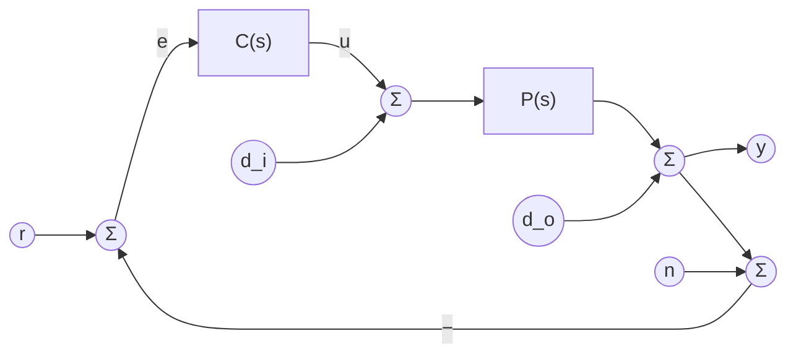

<!-- status: verified -->
# 15-04 · Feedback Properties and Steady-State Error

| | |
|---|---|
| **Course** | [15 · Control Systems](../README.md) |
| **University equivalent** | The feedback-properties and steady-state-error material of a first course in feedback control: sensitivity to parameter changes, disturbance rejection, system type, static error constants and integral control (Franklin, Powell & Emami-Naeini, *Feedback Control of Dynamic Systems*, ch. 4; Nise, *Control Systems Engineering*, ch. 7; Dorf & Bishop, *Modern Control Systems*, ch. 4–5) |
| **Prerequisites** | [15-02 Transfer Functions and Block Diagrams](15-02-transfer-functions-and-block-diagrams.md), [15-03 Time Response and Specifications](15-03-time-response.md), [12-05 Feedback Topologies](../../12-electronics-2/chapters/12-05-feedback-topologies.md) |
| **Estimated study hours** | 7 |
| **Last verified** | 2026-11-20 |

**Learning objectives.** After this chapter you can:

1. Compute the sensitivity of a closed-loop transfer function to changes in the plant and in the sensor, for small and for finite changes.
2. Find how much of a disturbance or of sensor noise reaches the output, at DC and across frequency.
3. Determine a loop's type and its static error constants, and predict the steady-state error to steps, ramps and parabolas.
4. Explain why the location of an integrator relative to a disturbance decides whether the disturbance leaves a steady error, and use integral action to remove it.
5. Apply these results to op-amp gain accuracy, a motor speed loop and a PLL tracking a frequency chirp.

---

## 1. Big picture

Why close a loop at all? An open-loop controller that inverts a perfect plant model would track any reference, but models are never perfect, and the world pushes back with loads, temperature drift and noise. Feedback measures the result and corrects it, and in doing so buys four things: insensitivity to the plant's parameters, rejection of disturbances, accurate tracking, and the ability to stabilize or speed up a plant. This chapter quantifies the first three. The answers are compact. How much of any error survives is set by the sensitivity function $S = 1/(1 + L)$. How much survives in steady state is set by how many integrators the loop contains, and where they sit.

- **Precision analog is built on $S$.** An amplifier with a loosely specified open-loop gain gives a closed-loop gain accurate to $\lvert S\rvert$, which is why op-amp circuits are precise (06-10, 12-05).
- **Regulators fight disturbances.** A voltage regulator's load regulation is the open-loop output impedance times $S$; a thermal loop's temperature error under a workload step is the open-loop rise times $S$ (15-12).
- **Integrators remove steady errors.** A PLL's two integrators let it follow a frequency step with zero phase error; a PI speed controller holds speed exactly under load.
- **Every benefit has a cost.** Large loop gain needs actuator effort, admits sensor noise and threatens stability (15-05, 15-07).

## 2. Intuition first

**The loop as an auditor.** A process that runs open loop is like a business that never checks its books: any error in the plan, or any surprise, goes straight to the bottom line. A loop compares the result with the target and acts on the difference, so errors are found and corrected continuously. The loop gain $L$ says how aggressively: a loop gain of 100 means a 1% residual error is enough to drive the full correction, so 99% of a disturbance is cancelled. That is the meaning of $S = 1/(1 + L)$.

**Integrators keep score.** A proportional controller acts on today's error only. To hold a constant correction, it needs a constant error to act on, so a small error always remains. An integrator accumulates the error over time, like a running balance. Its output can hold any value with zero input, so the loop can settle with zero error. The cost is memory: an integrator responds slowly and can overshoot (15-08).

**Where the analogy breaks down.** An auditor can pause to think; a loop acts instantly on whatever it measures. If the measurement is noisy or delayed, a loop with high gain acts on noise and on stale data, and an overly aggressive loop oscillates. The loop gain is therefore large only at the frequencies where the plant and the sensor can be trusted.

*The unity-feedback loop with an input disturbance $d_i$, an output disturbance $d_o$ and sensor noise $n$.*

## 3. Theory

### 3.1 Sensitivity to parameter changes

The **sensitivity** of a quantity $T$ to a parameter $G$ is the ratio of fractional changes (the elasticity of 01-03):

$$
S_G^T = \frac{dT/T}{dG/G} = \frac{G}{T}\frac{dT}{dG} .
$$

For $T = G/(1 + GH)$, differentiate with respect to $G$: $dT/dG = 1/(1 + GH)^2$. Multiplying by $G/T = 1 + GH$:

$$
S_G^T = \frac{1}{1 + GH} = S .
$$

A 10% change in the forward path changes the closed loop by only $10\%/\lvert 1 + L\rvert$. With respect to the feedback path, $dT/dH = -G^2/(1 + GH)^2$, so

$$
S_H^T = \frac{H}{T}\frac{dT}{dH} = -\frac{GH}{1 + GH} \approx -1 .
$$

Feedback does not protect against errors in the sensor: a 1% error in $H$ is a 1% error in the result. That is why the feedback path of a precision loop is a pair of matched resistors or a calibrated sensor, while the forward gain can be cheap and loose.

For a finite change from $G_1$ to $G_2$, the exact result (Problem 15-02.4) is

$$
\frac{T_2 - T_1}{T_1} = \frac{(G_2 - G_1)/G_1}{1 + G_2H} ,
$$

which uses the new loop gain in the denominator.

### 3.2 Disturbances and noise

In the loop of §2, with $L = CP$, superposition gives the output

$$
Y = \frac{L}{1 + L}R + \frac{P}{1 + L}D_i + \frac{1}{1 + L}D_o - \frac{L}{1 + L}N = TR + PS\,D_i + S\,D_o - T\,N .
$$

- An **output disturbance** (a load step at a regulator's output, ambient temperature at a sensor) is multiplied by $S$.
- An **input disturbance** (a load torque on a motor, a supply ripple at an actuator) is filtered by the plant and then multiplied by $S$.
- **Sensor noise** passes through $T$ with a minus sign: in the band where the loop tracks the reference ($T \approx 1$), it also faithfully reproduces the sensor's noise. A loop cannot distinguish a real error from a measurement error.

All of these depend on frequency. $\lvert S(j\omega)\rvert$ is small only where $\lvert L(j\omega)\rvert$ is large, which in practice means below the loop's crossover frequency (15-07). Above it, disturbances pass essentially untouched.

### 3.3 Steady-state error and system type

The **error** $e = r - y$ of a unity-feedback loop has transform $E = R/(1 + L) = SR$. If the closed loop is stable, the final-value theorem (02-05) gives

$$
e_{ss} = \lim_{t\to\infty}e(t) = \lim_{s\to 0}sE(s) = \lim_{s\to 0}\frac{sR(s)}{1 + L(s)} .
$$

Write the loop gain in Bode form, $L(s) = \dfrac{K_0(1 + s/\omega_{z1})\cdots}{s^N(1 + s/\omega_{p1})\cdots}$, with no other poles or zeros at the origin, so that $K_0$ is the loop gain with its integrators removed, at DC. The integer $N$, the number of integrators in the loop, is the **system type**. Define the **static error constants**

$$
K_p = \lim_{s\to 0}L(s), \qquad K_v = \lim_{s\to 0}sL(s), \qquad K_a = \lim_{s\to 0}s^2L(s) .
$$

For the three standard test inputs:

- **Unit step** $R = 1/s$: $e_{ss} = 1/(1 + K_p)$.
- **Unit ramp** $R = 1/s^2$: $e_{ss} = \lim 1/(s + sL) = 1/K_v$.
- **Unit parabola** $r = t^2/2$, $R = 1/s^3$: $e_{ss} = 1/K_a$.

Each extra integrator makes one more constant infinite:

| Type $N$ | $K_p$ | $K_v$ | $K_a$ | Step error | Ramp error | Parabola error |
|---|---|---|---|---|---|---|
| 0 | $K_0$ | 0 | 0 | $1/(1 + K_p)$ | ∞ | ∞ |
| 1 | ∞ | $K_0$ | 0 | 0 | $1/K_v$ | ∞ |
| 2 | ∞ | ∞ | $K_0$ | 0 | 0 | $1/K_a$ |

The final-value theorem is valid only if the closed loop is stable: always check stability first (15-05).

**Units.** $K_p$ is dimensionless; $K_v$ has units of 1/s, so a ramp of slope $A$ (units per second) leaves an error $A/K_v$ in the units of $r$; $K_a$ has units of 1/s².

### 3.4 Disturbances and where the integrator sits

For an input disturbance, the output error is $PS\,D_i = \dfrac{P}{1 + CP}D_i$. For a step disturbance of size $d$:

$$
y_{ss} = \lim_{s\to 0}\frac{P(s)}{1 + C(s)P(s)}\,d .
$$

Suppose the plant contains an integrator, $P \to \infty$ at DC, but the controller does not. Then $P/(1 + CP) \to 1/C(0)$: the error is $d/C(0)$, not zero, even though the loop is type 1. Suppose instead that the controller contains the integrator, $C \to \infty$. Then $P/(1 + CP) \to 0$. **To reject a constant disturbance, an integrator must sit between the error and the point where the disturbance enters.** A plant integrator downstream of the disturbance simply integrates it. A motor position loop with proportional control therefore holds its target exactly when unloaded, but sags under a constant load torque by $d/K$ (Example 15-04.4).

> **Going deeper — the internal model principle.** Why does an integrator remove errors to a constant? Because $1/s$ is the transform of a constant: a loop with $1/s$ in it can generate a constant output from zero error. Generalizing, a loop rejects or tracks a class of signals with zero steady error if and only if the loop contains a model of their generator (Francis and Wonham, 1976): $1/s^2$ for ramps, $1/(s^2 + \omega_0^2)$ for sinusoids of frequency $\omega_0$. Power converters that must cancel a 50 or 60 Hz ripple use resonant controllers built on this principle, and a PLL's two integrators are the model of a phase ramp, that is, a constant frequency.

### 3.5 Non-unity feedback

If the sensor is $H(s)$ with DC gain $H(0) \ne 1$, the output tracks $r/H(0)$, not $r$. Define the error as the desired output minus the actual output, $e = r/H(0) - y$, and either reduce the loop to an equivalent unity loop or apply the final-value theorem to $E$ directly. Problem 15-04.9 works an example.

### 3.6 The costs of high loop gain

Every benefit above improves as $\lvert L\rvert$ grows. The costs grow too:

- **Effort.** The controller output $U = CS\,R$ is large where $C$ is large: actuators saturate (15-08 on windup).
- **Noise.** $T \approx 1$ over a wider band passes more sensor noise to the output.
- **Stability.** Every real loop has more poles than the model; high gain at high frequency drives the loop toward oscillation (15-05, 15-07). Bode's sensitivity integral (15-07) shows that pushing $\lvert S\rvert$ down in one band pushes it up in another.

The design art is to make $\lvert L\rvert$ large where the disturbances and references live, typically at low frequency, and small where noise and model errors live.

## 4. Worked examples

### Example 15-04.1 · Desensitizing an amplifier (tier A)

**Setup.** An amplifier with $G = 10^4$ has resistive feedback $H$ = 0.01. Find the closed-loop gain, the sensitivity, the exact change in closed-loop gain for $G$ up and down 20%, and the effect of a 1% increase in $H$.

**Solution.** $L = GH$ = 100, so $T = 10^4/101$ = **99.01** and $S = 1/101$ = **0.00990**. The derivative estimate for a 20% change is $20\%/101$ = **0.198**%. Exactly:

- $G = 1.2 \times 10^4$: $T = 12{,}000/121 = 99.17$, a change of **+0.165**%;
- $G = 0.8 \times 10^4$: $T = 8000/81 = 98.77$, a change of **−0.247**%.

The two are asymmetric because the exact formula divides by the new $1 + L$ (121 or 81). For $H$: $S_H^T = -100/101$ = **−0.990**, and the exact change for $H$ up 1% is $T = 10^4/102$, **−0.980**%.

**Units check.** All quantities are ratios of like quantities, so dimensionless.

**Sanity check.** The ideal gain is $1/H$ = 100; the loop gets within 1% with a loop gain of only 100, and it is no more accurate than the resistors that set $H$.

### Example 15-04.2 · Type and error constants (tier B)

**Setup.** A unity-feedback loop has $L(s) = \dfrac{20(s + 2)}{s(s + 4)(s + 5)}$. Confirm the closed loop is stable, then find its type, error constants and steady-state errors to a unit step, ramp and parabola.

**Solution.** The characteristic polynomial is $s(s + 4)(s + 5) + 20(s + 2) = s^3 + 9s^2 + 40s + 40$. Its roots are **−1.35** and **−3.83 ± j3.88**, all in the left half-plane, so the final-value theorem applies. (15-05 shows how to check this without finding roots.)

One pole at the origin makes the loop **type 1**: $K_p = \infty$, $K_v = \lim sL = 20 \times 2/(4 \times 5)$ = **2** s⁻¹, $K_a$ = 0. The steady-state errors are **0** for a step, $1/K_v$ = **0.5** for a unit ramp and ∞ for a parabola.

**Units check.** $K_v$ in 1/s; the unit ramp has slope 1 (unit)/s; error = slope/$K_v$ in the unit of $r$.

**Sanity check.** Simulating the ramp response (the lab does this) gives an error that settles at 0.5000: the output follows the ramp at the same slope, lagging by a constant.

### Example 15-04.3 · Holding a motor's speed under load (tier B)

**Setup.** The motor of Problem 15-02.8 ($K$ = 0.02 V·s/rad, $R$ = 1 Ω, $\tau_m$ = 25 ms) obeys $\Omega = \dfrac{V - (R/K)T_L}{K(\tau_ms + 1)}$, so a load torque $T_L$ acts as an input disturbance of $-(R/K)T_L$ = −50 V per N·m. A PI controller sets $V = K_pE + K_i\int E\,dt$ with $K_p$ = 0.2 V·s/rad and $K_i$ = 2 V/rad. Find the closed-loop poles, the response to a 0.01 N·m load step, and the error when the speed reference ramps at 100 rad/s².

**Solution.** $C = (K_ps + K_i)/s$ and $P = 50/(0.025s + 1)$, so the characteristic equation $s(0.025s + 1) + 50(K_ps + K_i) = 0$ is $0.025s^2 + 11s + 100 = 0$, with roots **−9.29** and **−430.7** s⁻¹.

The load enters as an input disturbance $d_i = -50T_L$ volts, so the speed change is $PS\,d_i$, and at DC $P/(1 + CP) \to 0$ because $C \to \infty$. Simulating: the speed dips by at most **2.13** rad/s, at **9.10** ms, then returns to the reference with the slow pole's time constant, $1/9.29$ s = **108** ms. The steady droop is **0**, against 2.27 rad/s with proportional control alone (Problem 15-02.8).

The loop is type 1 with $K_v = \lim sCP = 50K_i$ = **100** s⁻¹, so a reference ramp of 100 rad/s² leaves a speed lag of 100/100 = **1** rad/s.

**Units check.** $K_i$ in V/rad times 50 (rad/s)/V gives $K_v$ in 1/s; (rad/s²)/(1/s) = rad/s.

**Sanity check.** The integral action does nothing in the first few milliseconds, so the peak dip (2.13 rad/s) is close to the proportional loop's steady droop. Integral action does not prevent the initial dip; it removes the lasting error.

### Example 15-04.4 · A plant integrator does not reject a load (tier B)

**Setup.** A position loop has plant $P = 1/[s(0.1s + 1)]$ (radians per volt, the integrator turning speed into angle) and proportional control $C$ = 10 V/rad. A constant disturbance of 0.5 V enters at the plant input. Find the steady-state angle offset, the error to a unit ramp of reference, and the steady offset when the controller becomes PI, $C = 10 + 20/s$.

**Solution.** The loop is type 1 (the plant's integrator), so a step reference gives zero error, and $K_v = \lim sCP$ = **10** s⁻¹ gives a ramp error of **0.1** rad for a 1 rad/s ramp. But for the disturbance,

$$
y_{ss} = \lim_{s\to 0}\frac{P}{1 + CP}\,0.5 = \lim_{s\to 0}\frac{0.5}{s(0.1s + 1) + 10} = \frac{0.5}{10} = \mathbf{0.05}\ \text{rad} .
$$

The plant's integrator sits after the disturbance, so it cannot help. With the PI controller, $C \to \infty$ at DC and $y_{ss}$ = **0**; the closed loop $0.1s^3 + s^2 + 10s + 20$ is stable (roots **−2.45** and −3.77 ± j8.20). The lab builds both loops in ngspice and measures 0.0500 and essentially 0.

**Units check.** (V)/(V/rad) = rad.

**Sanity check.** Physically, a constant load torque needs a constant motor current, so a constant drive voltage. A proportional controller produces a constant voltage only from a constant error, $0.5/10$ rad. The PI controller's integrator can hold that voltage with zero error.

### Example 15-04.5 · A PLL following a chirp (tier C)

**Setup.** Example 15-02.6's PLL has loop gain $L(s) = \omega_n^2(1 + sRC)/s^2$ with $\omega_n^2 = 10^{11}$ s⁻² and $RC$ = 5 µs. Find its type and $K_a$, its steady phase error after a reference frequency step, and its steady phase error while the reference frequency sweeps linearly at 10 MHz per millisecond.

**Solution.** Two integrators (the VCO and the loop-filter capacitor) make the loop **type 2**: $K_p = K_v = \infty$ and $K_a = \lim s^2L = \omega_n^2$ = **10¹¹** s⁻².

A frequency step is a phase ramp, so the steady phase error is **0**: the PLL locks to the new frequency with no residual phase offset.

A linear frequency sweep is a phase parabola: $\theta_r = \alpha t^2/2$ with $\alpha = 2\pi \times 10^{10}$ rad/s². The steady phase error is

$$
\theta_e = \frac{\alpha}{K_a} = \frac{2\pi \times 10^{10}}{10^{11}} = \mathbf{0.628}\ \text{rad} = \mathbf{36.0}° .
$$

**Units check.** (rad/s²)/(1/s²) = rad.

**Sanity check.** Simulating the error transfer function $s^2/(s^2 + \omega_n^2RCs + \omega_n^2)$ with a parabolic input settles at 0.628 rad. A 36° phase error is a large fraction of a phase detector's linear range, so a radar synthesizer making fast chirps needs a much wider loop: $\theta_e$ falls as $1/\omega_n^2$.

### Example 15-04.6 · Where the gain error really goes (tier C)

**Setup.** An op-amp with $A(s) = A_0/(1 + s/\omega_a)$, $A_0 = 10^5$ and $f_a$ = 10 Hz (a 1 MHz gain-bandwidth product), has feedback $\beta$ = 0.1. At 1 kHz and at 10 kHz, find $\lvert L\rvert$, $\lvert S\rvert$, and the magnitude and phase errors of the closed-loop gain relative to the ideal $1/\beta$.

**Solution.** $L(j\omega) = A_0\beta/(1 + j\omega/\omega_a)$ and $T\beta = L/(1 + L) = 1 - S$.

- At 1 kHz: $L = 10^4/(1 + j100)$, so $\lvert L\rvert$ = **100.0** and $\lvert S\rvert$ = **0.0100**. But the magnitude of $T\beta$ is off by only **−0.0150**%, while its phase is **−0.573**°.
- At 10 kHz: $\lvert L\rvert$ = **10.00**, $\lvert S\rvert$ = **0.0995**, magnitude error **−0.506**%, phase **−5.71**°.

The loop gain is almost purely imaginary here ($L \approx -j100$), so $1 + L$ has nearly the magnitude of $L$ itself, and the 1% "error" $\lvert S\rvert$ appears mainly as phase shift.

**Units check.** All ratios; the phase in degrees.

**Sanity check.** $\lvert S\rvert$ grows tenfold per decade, as $\lvert L\rvert$ falls. A data sheet's "gain error" at frequency must say whether it means magnitude or the full complex error: they differ by a factor of about 67 at 1 kHz.

### Answer key

<!-- answer-key -->

| ID | Quantity | Value | Unit |
|---|---|---|---|
| Ex 15-04.1a | closed-loop gain | 99.01 | — |
| Ex 15-04.1b | sensitivity | 0.00990 | — |
| Ex 15-04.1c | estimated change for 20% | 0.198 | % |
| Ex 15-04.1d | exact change, G up 20% | 0.165 | % |
| Ex 15-04.1e | exact change, G down 20% | −0.247 | % |
| Ex 15-04.1f | sensitivity to H | −0.990 | — |
| Ex 15-04.1g | exact change, H up 1% | −0.980 | % |
| Ex 15-04.2a | real closed-loop pole | −1.35 | 1/s |
| Ex 15-04.2f | complex closed-loop pole | −3.83 + j3.88 | 1/s |
| Ex 15-04.2b | system type | 1 | — |
| Ex 15-04.2c | Kv | 2 | 1/s |
| Ex 15-04.2d | step error | 0 | — |
| Ex 15-04.2e | ramp error | 0.5 | — |
| Ex 15-04.3a | slow closed-loop pole | −9.29 | 1/s |
| Ex 15-04.3b | fast closed-loop pole | −430.7 | 1/s |
| Ex 15-04.3c | peak speed dip | 2.13 | rad/s |
| Ex 15-04.3d | time of the dip | 9.10 | ms |
| Ex 15-04.3e | steady droop | 0 | rad/s |
| Ex 15-04.3f | Kv | 100 | 1/s |
| Ex 15-04.3g | ramp lag | 1 | rad/s |
| Ex 15-04.3h | recovery time constant | 108 | ms |
| Ex 15-04.4a | steady offset, proportional | 0.05 | rad |
| Ex 15-04.4b | Kv | 10 | 1/s |
| Ex 15-04.4c | ramp error | 0.1 | rad |
| Ex 15-04.4d | steady offset, PI | 0 | rad |
| Ex 15-04.4e | real closed-loop pole, PI | −2.45 | 1/s |
| Ex 15-04.5a | Ka | 1e11 | 1/s² |
| Ex 15-04.5b | error after a frequency step | 0 | rad |
| Ex 15-04.5c | chirp phase error | 0.628 | rad |
| Ex 15-04.5d | chirp phase error | 36.0 | ° |
| Ex 15-04.6a | loop gain at 1 kHz | 100.0 | — |
| Ex 15-04.6b | abs S at 1 kHz | 0.0100 | — |
| Ex 15-04.6c | magnitude error at 1 kHz | −0.0150 | % |
| Ex 15-04.6d | phase at 1 kHz | −0.573 | ° |
| Ex 15-04.6e | loop gain at 10 kHz | 10.00 | — |
| Ex 15-04.6f | abs S at 10 kHz | 0.0995 | — |
| Ex 15-04.6g | magnitude error at 10 kHz | −0.506 | % |
| Ex 15-04.6h | phase at 10 kHz | −5.71 | ° |

## 5. Simulate it

The lab, [labs/15-04-lab](../labs/15-04-lab/README.md), provides `steady.py`: `system_type`, `error_constants`, `ss_errors` and `simulate_error`, which simulates the closed-loop error so that every prediction can be checked. You:

1. **Tabulate** type, error constants and predicted errors for a set of loops, and confirm each by simulation.
2. **Move an integrator** from the plant to the controller and watch the disturbance offset of Example 15-04.4 disappear, in Python and in `disturbance.cir` (ngspice).
3. **Add integral action** to the motor speed loop of Example 15-04.3 and compare load-step responses with and without it.
4. **Follow a chirp** with the PLL of Example 15-04.5 and with a type-3 variant, and test the internal model principle with a sinusoidal disturbance.

**Guided exercise (predict, then run).** **Before Part 2,** predict the steady angle offset of Example 15-04.4's proportional loop if the controller gain doubles to 20 V/rad. (0.025 rad: the offset is $d/K$.)

## 6. Engineering tradeoffs

| Knob | Improves | Costs | Typical decision owner |
|---|---|---|---|
| Higher loop gain at low frequency | Tracking error, disturbance rejection, parameter insensitivity | Effort, noise bandwidth, stability margin | Control designer |
| Integral action (raising the type) | Zero steady error to steps (or ramps for type 2) | Slower recovery from saturation (windup), extra phase lag, overshoot | Control designer |
| Precision of the feedback sensor ($H$) | Absolute accuracy (feedback cannot correct it) | Cost of calibrated sensors and matched resistors | System architect |
| Loop bandwidth (crossover) | Rejection of faster disturbances; smaller tracking lag | More sensor noise reaches the output; more actuator activity | Control and analog designers |
| Resonant or repetitive control (internal models) | Zero error to periodic disturbances such as mains ripple | Complexity and sensitivity to the disturbance's exact frequency | Power-electronics designer |

## 7. Numbers to know

| Quantity | Value | Source |
|---|---|---|
| Sensitivity to the forward path | $S = 1/(1 + L)$; a loop gain of 100 gives about 1% | §3.1 |
| Sensitivity to the feedback path | $\approx -1$ | §3.1 |
| Step error, type 0 | $1/(1 + K_p)$ | §3.3 |
| Ramp error, type 1 | $1/K_v$ | §3.3 |
| Parabola error, type 2 | $1/K_a$ | §3.3 |
| Input-disturbance offset with proportional control and a plant integrator | $d/C(0)$ | §3.4 |
| PLL phase error during a frequency sweep $\alpha$ (type 2) | $\alpha/\omega_n^2$ | Example 15-04.5 |
| Op-amp closed-loop error at loop gain $\lvert L\rvert$ with $L$ near −90° | about $1/\lvert L\rvert$ as a complex error, mostly phase; the magnitude error is of order $1/\lvert L\rvert^2$ | Example 15-04.6 |

## 8. Common mistakes

- **Applying the final-value theorem to an unstable loop.** It returns a finite number for a loop whose error grows. Check stability first.
- **Counting plant integrators for disturbance rejection.** Only integrators between the error and the disturbance's entry point remove a steady disturbance offset.
- **Confusing the type with the order.** The type counts poles at the origin of $L$, not the total number of poles, and not the closed loop's poles.
- **Forgetting the sensor.** Feedback cannot correct a wrong sensor: $S_H^T \approx -1$.
- **Assuming $\lvert S\rvert$ is small at all frequencies.** It is small only where $\lvert L\rvert$ is large; above crossover a loop does not reject disturbances, and near crossover it can amplify them.
- **Reading ramp and parabola errors in the wrong units.** The error is (input slope)/$K_v$ or (input acceleration)/$K_a$, in the units of the controlled variable.

## 9. Practitioner lens

### State of the art (as of Nov 2026)

These are established engineering practice; the dated part is how they show up in today's products.

- **Precision analog uses loop gain to buy accuracy.** Data-converter drivers and instrumentation amplifiers specify gain error and its drift, which follow from $S$ and from the feedback network's matching. Matched on-chip resistor ratios are what make the result accurate, because $S_H^T \approx -1$ **[Established]**.
- **Power and thermal management are disturbance-rejection loops.** Regulators specify load and line regulation (the DC values of $S$ times the open-loop sensitivities); thermal managers hold die temperature against workload changes (15-12, 22-07) **[Established]**.
- **Integral action is everywhere a constant error is unacceptable**: PI current loops in motor drives, the second integrator of type-2 PLLs, and integrating error amplifiers in switching regulators **[Established]**.

### Why it matters commercially

- **Accuracy is sold in specifications that are really $S$:** gain error, load regulation, line regulation, offset under load. Two parts with the same open-loop specs can differ widely in closed-loop accuracy if their loop gains differ at the relevant frequencies.
- **Steady-state tracking sets limits in products:** a radar synthesizer's chirp linearity, a disk drive's track following and a motor's speed regulation are all steady-state errors to ramps or parabolas.
- **The feedback sensor is the accuracy budget.** A system can be no more accurate than its sensor and feedback network; diligence on accuracy claims should start there.

### Marketing vs Reality

- **"0.01% gain accuracy."** *Reality:* at DC, perhaps; at signal frequencies, the error grows as the loop gain falls. *Sanity check:* ask for the gain error at the highest signal frequency, and whether it is magnitude-only or complex.
- **"Zero steady-state error."** *Reality:* true only for the input class that matches the loop's integrators, and only while nothing saturates. *Sanity check:* ask what the error is to a ramp (or a chirp) and during and after saturation.
- **"Rejects all disturbances."** *Reality:* only below the loop's crossover. *Sanity check:* ask for $\lvert S(j\omega)\rvert$ or a measured disturbance-rejection curve.

### Questions for engineering leaders

1. **"What sets the absolute accuracy: the loop gain or the sensor?"**
   *Strong:* a budget showing $S$-limited and sensor-limited terms, with the sensor dominant at DC. *Evasive:* "the loop takes care of it".
2. **"What disturbance spectrum does the loop face, and what is $\lvert S\rvert$ there?"**
   *Strong:* a measured disturbance spectrum overlaid on $\lvert S(j\omega)\rvert$. *Evasive:* DC regulation numbers only.
3. **"Where are the integrators, and what happens when the actuator saturates?"**
   *Strong:* integrators upstream of the disturbances, with anti-windup (15-08). *Evasive:* no answer on saturation.
4. **"How does the error grow when the reference moves, not just when it steps?"**
   *Strong:* ramp and chirp errors from $K_v$ or $K_a$, verified by test. *Evasive:* step responses only.

## 10. Concept check

**Q1.** Derive the sensitivity of $T = G/(1 + GH)$ to $G$.

Answer

$dT/dG = [(1 + GH) - GH]/(1 + GH)^2 = 1/(1 + GH)^2$. Multiplying by $G/T = 1 + GH$ gives $S_G^T = 1/(1 + GH)$.

**Q2.** Why can feedback not correct an error in the sensor?

Answer

The loop drives the measured output to the reference. If the sensor reads 1% high, the loop holds the true output 1% low, and $S_H^T = -L/(1 + L) \approx -1$ confirms it.

**Q3.** What is a loop's type, and how does it set the steady-state error to a ramp?

Answer

The number of poles of $L(s)$ at the origin. Type 0 has infinite ramp error, type 1 has error $1/K_v$, type 2 and higher have zero.

**Q4.** Why does a position loop with a proportional controller sag under a constant load, even though its plant contains an integrator?

Answer

A constant load needs a constant drive. The plant's integrator sits after the disturbance and integrates it; the controller produces a constant drive only from a constant error, $d/K$. An integrator in the controller removes the error.

**Q5.** What does the internal model principle predict for rejecting a 60 Hz disturbance?

Answer

The loop needs a model of the disturbance's generator, poles at $\pm j2\pi \cdot 60$ (a resonant controller), to reject it with zero steady error.

**Q6.** Why is the closed-loop gain error of an op-amp circuit mostly phase at frequencies where the loop gain is near −90°?

Answer

$T\beta = 1 - S$ with $S \approx 1/L \approx j/\lvert L\rvert$, a small term in quadrature with 1. It rotates $T\beta$ by about $1/\lvert L\rvert$ radians but changes its magnitude only by a second-order amount, of order $1/\lvert L\rvert^2$ (0.015% against $\lvert S\rvert$ = 1% in Example 15-04.6).

**Q7.** When does the final-value theorem give a wrong answer?

Answer

When $sE(s)$ has poles in the right half-plane or on the imaginary axis (other than a simple one at the origin), that is, when the closed loop is unstable or oscillating. The theorem then returns a number for an error that never settles.

Practice: [Problems 15-04](../problems/15-04-problems.md) · [Solutions](../solutions/15-04-solutions.md)

## 11. Key terms

[Sensitivity function](../../../reference/glossary.md#sensitivity-function) · [Desensitivity factor](../../../reference/glossary.md#desensitivity-factor) · [Disturbance rejection](../../../reference/glossary.md#disturbance-rejection) · [System type](../../../reference/glossary.md#system-type) · [Static error constants](../../../reference/glossary.md#static-error-constants) · [Steady-state error](../../../reference/glossary.md#steady-state-error) · [Integral action](../../../reference/glossary.md#integral-action) · [Internal model principle](../../../reference/glossary.md#internal-model-principle) · [Final-value theorem](../../../reference/glossary.md#final-value-theorem)

## 12. Connections

- **Builds on:** loops, $S$ and $T$ ([15-02](15-02-transfer-functions-and-block-diagrams.md)); time-domain specifications ([15-03](15-03-time-response.md)); the final-value theorem ([02-05](../../02-complex-numbers-des-and-linear-algebra/chapters/02-05-laplace-transform-for-odes.md)); feedback in amplifiers ([12-05](../../12-electronics-2/chapters/12-05-feedback-topologies.md)).
- **Next:** [15-05 Stability and the Routh–Hurwitz Criterion](15-05-stability-routh-hurwitz.md), which checks the stability this chapter assumed.
- **Used later:** PI and PID control and windup ([15-08](15-08-pid-control.md)); lag compensation to raise $K_v$ ([15-09](15-09-lead-lag-compensation.md)); PLL tracking and regulator load regulation ([15-12](15-12-control-applications-pll-regulators-thermal.md)).

## 13. Further study

- G. F. Franklin, J. D. Powell and A. Emami-Naeini, *Feedback Control of Dynamic Systems*, ch. 4 (the basic equations of control, sensitivity, steady-state tracking and system type).
- N. S. Nise, *Control Systems Engineering*, ch. 7 (steady-state errors, error constants, disturbances).
- K. J. Åström and R. M. Murray, *Feedback Systems*, ch. 11–12 (sensitivity functions and robustness; free online).
- B. A. Francis and W. M. Wonham, "The internal model principle of control theory," *Automatica* 12(5), 1976 (for the curious; beyond BSEE).

## 14. Sources

1. Franklin, Powell and Emami-Naeini; Nise; Åström and Murray (Further study): sensitivity, system type and error constants (textbook material).
2. B. A. Francis and W. M. Wonham, *Automatica* 12(5), 1976: the internal model principle.

This chapter has no perishable industry figures; its practitioner statements are tagged [Established] engineering practice. Every number in the examples is recomputed by the verify script, by sympy limits and by simulating the closed loops (solve_ivp and lsim), and Example 15-04.4 is confirmed in ngspice.
