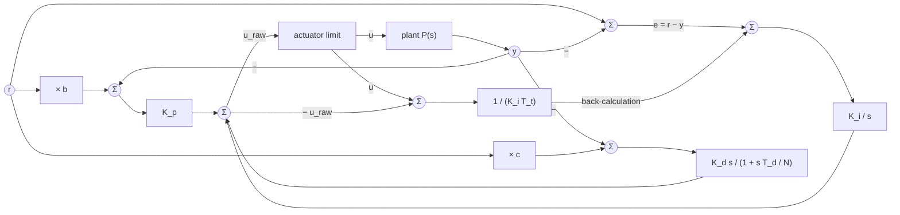

<!-- status: reviewed -->
# 15-08 · PID Control

| | |
|---|---|
| **Course** | [15 · Control Systems](../README.md) |
| **University equivalent** | The PID material of a first course in feedback control: proportional, integral and derivative actions, design by pole placement and loop shaping, Ziegler–Nichols and model-based tuning rules, integrator windup and anti-windup, derivative filtering and setpoint weighting (Franklin, Powell & Emami-Naeini, *Feedback Control of Dynamic Systems*, ch. 4; Åström & Murray, *Feedback Systems*, ch. 11; Åström & Hägglund, *Advanced PID Control*) |
| **Prerequisites** | [15-04 Feedback Properties and Steady-State Error](15-04-feedback-and-steady-state-error.md), [15-06 Root Locus](15-06-root-locus.md), [15-07 Frequency-Domain Design](15-07-frequency-domain-design.md) |
| **Estimated study hours** | 6 |
| **Last verified** | 2026-11-20 |

**Learning objectives.** After this chapter you can:

1. Explain what the proportional, integral and derivative actions each do, in time and in frequency, and convert between the parallel and standard forms.
2. Design a PI or PID controller by pole placement or by loop shaping for a phase margin, and predict the effect of the controller's zeros.
3. Apply the Ziegler–Nichols, Tyreus–Luyben and SIMC tuning rules and judge the trade between robustness and disturbance rejection.
4. Explain integrator windup and implement clamping or back-calculation anti-windup.
5. Filter the derivative and use setpoint weighting to avoid derivative kick without changing disturbance rejection.

---

## 1. Big picture

Most feedback loops in industry, and many inside chips, use the same controller: a weighted sum of the error, its integral and its derivative. Proportional–integral–derivative (PID) control is simple enough to implement in a few lines of firmware or with one op-amp, and general enough to control temperatures, speeds, voltages and positions. The three actions map onto ideas from earlier chapters. Proportional gain sets the loop gain (15-04). The integral raises the system type to remove steady error (15-04). The derivative adds a zero, pulling the root locus left and adding phase lead (15-06, 15-07). This chapter puts them together and covers the details that separate a textbook PID from one that works on real hardware: actuator saturation, noise on the derivative, and setpoint changes.

- **Thermal management.** Die-temperature limiting and fan control in processors are often PI loops acting on power or fan speed (15-12).
- **Motor and power control.** Current and speed loops in motor drives, and digital controllers in switching regulators, are PI or PID loops implemented in firmware or logic (22-07).
- **Instrumentation.** Laser temperature control, positioning stages and many lab instruments use PID.
- **The details matter.** Saturation and noise turn a stable linear design into a slow or noisy one unless anti-windup and filtering are designed in.

## 2. Intuition first

**Three ways to react to an error.** Imagine steering a car back to the lane center. A proportional driver steers in proportion to how far off center the car is: fast, but a steady crosswind leaves a steady offset. An integral driver remembers how long the car has been off center and keeps adding correction until the offset is gone, slowly at first. A derivative driver watches how fast the car is drifting and counter-steers early, which damps the weaving. A good driver blends all three.

**A finance analogy.** A portfolio rebalancer that trades in proportion to today's deviation from target allocation is proportional control. One that also accumulates past deviations to remove a persistent drift (from a steady inflow, say) is integral control. One that reacts to the rate of change of the deviation, trading ahead of a trend, is derivative control. The analogy breaks down at the derivative: market rates of change are noisy, and acting on noise generates churn. A real derivative term must be filtered for the same reason.

**What each term does to the loop.** In frequency terms, $C(s) = K_p + K_i/s + K_ds$. The integral adds a pole at the origin: infinite gain at DC (zero steady error) and 90° of phase lag at low frequency. The derivative adds gain rising with frequency and up to 90° of phase lead, which improves the phase margin near crossover but amplifies high-frequency noise.

## 3. Theory

### 3.1 Forms of the PID law

The **parallel form** is

$$
u(t) = K_pe(t) + K_i\int_0^te(\tau)\,d\tau + K_d\frac{de}{dt}, \qquad C(s) = K_p + \frac{K_i}{s} + K_ds = \frac{K_ds^2 + K_ps + K_i}{s} .
$$

The **standard (ISA) form** uses time constants:

$$
C(s) = K_p\left(1 + \frac{1}{T_is} + T_ds\right), \qquad K_i = \frac{K_p}{T_i}, \quad K_d = K_pT_d ,
$$

with integral time $T_i$ and derivative time $T_d$. A PID has a pole at the origin and two zeros, the roots of $T_iT_ds^2 + T_is + 1$; they are real when $T_i \ge 4T_d$. A PI has one zero at $-1/T_i$; a PD has one zero at $-1/T_d$. Units: if $e$ is in kelvin and $u$ in watts, $K_p$ is in W/K, $K_i$ in W/(K·s), $K_d$ in W·s/K, and $T_i$, $T_d$ in seconds.

### 3.2 What each action buys and costs

| Action | Benefit | Cost |
|---|---|---|
| P | Speed and disturbance rejection (higher loop gain) | Steady error with a type-0 plant; too much gain reduces damping and margin |
| I | Zero steady error to steps of reference and of upstream disturbances (15-04) | Phase lag (−90° at low frequency), slower recovery, overshoot, windup |
| D | Phase lead and damping near crossover; earlier reaction | Amplifies sensor noise; kicks the actuator on setpoint steps |

### 3.3 Design by pole placement: PI on a first-order plant

For $P(s) = K/(\tau s + 1)$ and $C = K_p + K_i/s$, the closed-loop characteristic polynomial is

$$
s(\tau s + 1) + K(K_ps + K_i) = \tau s^2 + (1 + KK_p)s + KK_i .
$$

Matching it to $\tau(s^2 + 2\zeta\omega_ns + \omega_n^2)$:

$$
K_p = \frac{2\zeta\omega_n\tau - 1}{K}, \qquad K_i = \frac{\omega_n^2\tau}{K} .
$$

Any $\omega_n$ and $\zeta$ can be placed, but the closed loop from reference to output, $T = K(K_ps + K_i)/(\ldots)$, also has the PI zero at $-K_i/K_p$, which raises the overshoot above the value $\zeta$ alone predicts (15-03 §3.6). Example 15-08.1 measures the effect.

### 3.4 Design by cancellation (and its catch)

For a plant with two real poles, $P = K/[(\tau_1s + 1)(\tau_2s + 1)]$, the **series form** $C = K_c(\tau_1s + 1)(\tau_2s + 1)/s$ (a PID with $T_i = \tau_1 + \tau_2$, $T_d = \tau_1\tau_2/(\tau_1 + \tau_2)$ and $K_p = K_c(\tau_1 + \tau_2)$) cancels both plant poles. The loop gain becomes $KK_c/s$ and the closed loop a clean first-order lag with time constant $1/(KK_c)$.

The catch is the one 15-02 warned about. The cancelled poles are still in the plant, and a disturbance that enters at the plant input sees them: it decays with the plant's slow time constant, not the loop's (Example 15-08.2). Cancellation is acceptable when the cancelled poles are stable and well damped and a slow disturbance tail is tolerable. It is never acceptable for unstable poles: their mode would still grow inside the loop, unseen by the controller.

### 3.5 Design by loop shaping

Choose the crossover frequency $\omega_c$ for speed and the phase margin for damping (15-07). A PI zero placed a factor of 3 to 10 below $\omega_c$ costs only 6° to 18° of phase at crossover while giving zero steady error; a derivative zero near crossover adds phase. When the plant is a first-order lag with a delay, a convenient choice puts the PI zero on the plant pole, so that $L = (K_pK/\tau)e^{-sT}/s$, and then

$$
\text{PM} = 90° - \omega_cT\ (\text{in degrees}), \qquad \omega_c = \frac{K_pK}{\tau} .
$$

Example 15-08.6 designs a thermal limiter this way.

### 3.6 Tuning rules

When no model is available, a quick experiment can set the gains.

- **Ziegler–Nichols (ultimate gain, 1942).** Raise a proportional gain until the loop oscillates steadily, and record the **ultimate gain** $K_u$ and **period** $P_u$ (Routh's boundary gain and $2\pi/\omega_{osc}$, 15-05). Then $K_p = 0.6K_u$, $T_i = P_u/2$, $T_d = P_u/8$. The rule targets fast disturbance rejection, and typically gives a phase margin of about 25° to 30° and 40% to 60% overshoot to setpoint steps: aggressive (Problem 15-08.6 gives 24.3° and 61.7%).
- **Tyreus–Luyben.** $K_p = K_u/2.2$, $T_i = 2.2P_u$, $T_d = P_u/6.3$: more conservative, with more margin and slower disturbance recovery.
- **SIMC (Skogestad, 2003).** For a first-order-plus-delay model $Ke^{-\theta s}/(\tau s + 1)$ and a chosen closed-loop time constant $\tau_c$ (the default is $\tau_c = \theta$): $K_p = \dfrac{\tau}{K(\tau_c + \theta)}$, $T_i = \min[\tau, 4(\tau_c + \theta)]$. One tuning knob, $\tau_c$, trades speed against robustness.

- **Relay auto-tuning (Åström–Hägglund).** Driving the loop to the edge of instability is risky, so commercial auto-tuners replace the controller briefly by a relay that switches the actuator between $+d$ and $-d$ as the error changes sign. The loop settles into a limit cycle at (nearly) the phase-crossover frequency. The **describing function** explains why: the relay's output is a square wave of amplitude $d$, whose fundamental (Fourier series, 11-05) has amplitude $4d/\pi$. If the plant filters the harmonics so that the output is nearly sinusoidal with amplitude $a$, the relay acts like a gain $N(a) = 4d/(\pi a)$, and a steady oscillation needs $N(a)P(j\omega) = -1$: the frequency where the plant's phase is −180°, at which the relay's equivalent gain equals the ultimate gain. So $K_u \approx 4d/(\pi a)$ and $P_u \approx$ the measured period. The approximation errs by a few percent because the output is not a pure sinusoid (Problem 15-08.12).

Tuning rules are starting points; the margins (15-07) and a simulated or measured step should confirm them.

### 3.7 Integrator windup and anti-windup

Every actuator saturates: a heater has a maximum power, a motor drive a maximum voltage. When the controller asks for more than the actuator can give, the loop is effectively open: the error stays large, and the integral keeps growing ("winds up"). When the output finally reaches the setpoint, the oversized integral keeps the actuator saturated long after it should have backed off, producing a large overshoot and a slow recovery.

Two standard fixes:

- **Clamping (conditional integration).** Stop integrating while the actuator is saturated *and* the error has the sign that would drive it deeper into saturation.
- **Back-calculation.** Feed the difference between the saturated and unsaturated controller output back into the integrator, $\dot z = e + (u - u_{raw})/(K_iT_t)$, so that the integrator tracks the actuator's limit with time constant $T_t$. A common choice is $T_t$ between $T_d$ and $T_i$ ($T_t = T_i$ for a PI).

Why it works, for a PI with $u_{raw} = K_pe + K_iz$: differentiate and substitute the integrator law,

$$
\dot u_{raw} = K_p\dot e + K_i\dot z = K_p\dot e + K_ie + \frac{u - u_{raw}}{T_t}
$$

While the actuator sits at its limit, $u = u_{lim}$. If the error changes slowly compared with $T_t$ ($\dot e \approx 0$), this is a first-order lag,

$$
T_t\,\dot u_{raw} + u_{raw} = u_{lim} + K_iT_t\,e
$$

so within a few $T_t$ the raw output settles just past the limit, by $K_iT_te$, instead of growing without bound. With $T_t = T_i = K_p/K_i$, $K_iT_te = K_pe$, so the integral term itself, $K_iz = u_{raw} - K_pe$, settles at $u_{lim}$. The controller then leaves saturation as soon as the error changes sign, with an integral that is at most the gap between $u_{lim}$ and the steady-state demand away from where it belongs. In Example 15-08.4 the integral term is **9.97** W when the actuator leaves saturation at **16.1** s (the steady state needs 8 W); without anti-windup it has wound up to **119.5** W. A $T_t$ much shorter than $T_d$ would let noise reset the integrator; one much longer than $T_i$ lets it wind up again.

Both leave the linear behaviour unchanged when nothing saturates.

### 3.8 Derivative filtering and setpoint weighting

An ideal derivative has gain growing without bound with frequency, so sensor noise is amplified without limit. Practical PIDs filter it:

$$
D(s) = \frac{K_ds}{1 + sT_d/N} ,
$$

which caps the high-frequency gain of the whole PID at $K_p(1 + N)$, with $N$ typically 5 to 20.

A setpoint step makes $de/dt$ an impulse: a **derivative kick** that slams the actuator. **Setpoint weighting** applies the proportional and derivative actions to $br - y$ and $cr - y$ instead of $r - y$:

$$
u = K_p(br - y) + K_i\int(r - y)\,dt + D\ \text{acting on}\ (cr - y) .
$$

*A practical PID: setpoint weights $b$ and $c$ on the proportional and derivative paths, the integral on the true error, a filtered derivative, the actuator limit, and back-calculation anti-windup (§3.7), which feeds $(u - u_{raw})/(K_iT_t)$ into the integrator's input. Clamping would instead switch the integrator's input off while the actuator is saturated and the error would drive it deeper.*

With $c = 0$ (derivative on the measurement only) there is no kick; with $b < 1$ the proportional response to setpoint steps is softened, which reduces overshoot. The integral still acts on the true error, so steady-state accuracy is unchanged, and because the feedback path ($-y$) is untouched, the response to disturbances is identical. This is a simple **two-degree-of-freedom** controller: one set of gains for disturbances, adjustable weights for setpoints.

> **Going deeper — why setpoint weights do not change stability.** The loop's characteristic polynomial depends only on how the controller responds to $y$, which $b$ and $c$ do not change. They change only the zeros of the reference-to-output transfer function, $T_r(s) = \dfrac{P(s)\,\{K_pb + K_i/s + cD(s)\}}{1 + P(s)C(s)}$, and zeros affect overshoot (15-03), not stability.

## 4. Worked examples

### Example 15-08.1 · PI by pole placement on a thermal plant (tier A)

**Setup.** An illustrative thermal path has $P(s) = 0.5/(10s + 1)$ K/W, from actuator power to temperature. Design a PI controller for closed-loop poles with $\omega_n$ = 0.5 rad/s and $\zeta$ = 0.8. Find the gains, the closed-loop zero, the overshoot, the phase margin, and the peak temperature error after a 20 W disturbance step at the plant input.

**Solution.** From §3.3 with $K$ = 0.5 K/W and $\tau$ = 10 s: $K_p = (2 \times 0.8 \times 0.5 \times 10 - 1)/0.5$ = **14** W/K and $K_i = 0.25 \times 10/0.5$ = **5** W/(K·s). The PI zero is at $-K_i/K_p$ = **−0.357** s⁻¹, inside the radius of the closed-loop poles. Simulating, the step response overshoots by **12.6**%, far above the **1.52**% that $\zeta$ = 0.8 alone predicts: the zero dominates. The phase margin is **72.4**°. A 20 W disturbance raises the temperature by at most **0.848** K, at **2.15** s, and the integrator then removes the error completely.

**Units check.** $K_p$ (W/K) × $K$ (K/W) is dimensionless, as a loop gain must be; $K_i/K_p$ has units of 1/s, so the zero is a frequency.

**Sanity check.** Without control the 20 W would raise the temperature by 10 K; the loop holds the peak below 1 K.

### Example 15-08.2 · Cancelling the plant's poles (tier B)

**Setup.** $P(s) = 1/[(s + 1)(0.2s + 1)]$. A series PID $C = K_c(s + 1)(0.2s + 1)/s$ with $K_c$ = 5 cancels both poles. Find the reference response and the response to a unit step disturbance at the plant input.

**Solution.** $L = K_c/s$ and $T = 5/(s + 5)$: a first-order response with time constant **0.2** s, no overshoot, zero steady error. But the input disturbance sees $P/(1 + L) = Ps/(s + 5)$, which keeps the plant's slow pole at −1. Simulating a unit disturbance step, the output rises to **0.120** at **0.665** s and then decays with the plant's 1 s time constant: at 3 s it is still **0.0156**, while the reference response has long settled.

**Units check.** Times in seconds.

**Sanity check.** The disturbance must pass through the plant to be seen, and the cancelled pole is part of the plant. Only a design that does not cancel the slow pole removes the tail: feedback must move it, so that every closed-loop pole, including the one the disturbance sees, is faster than −1 (Problem 15-08.9 places all three at −5).

### Example 15-08.3 · Ziegler–Nichols against Tyreus–Luyben (tier B)

**Setup.** For $P = 1/(s + 1)^3$, 15-05 found $K_u$ = 8 and $\omega_{osc} = \sqrt3$, so $P_u = 2\pi/\sqrt3$ = **3.628** s. Compute both rules' PID settings and compare their margins, setpoint responses and disturbance responses, with a derivative filter $N$ = 10.

**Solution.**

| | Ziegler–Nichols | Tyreus–Luyben |
|---|---|---|
| $K_p$ | **4.8** | **3.64** |
| $T_i$ | **1.814** s | **7.98** s |
| $T_d$ | **0.453** s | **0.576** s |
| Phase margin | **29.4**° | **53.5**° |
| Setpoint overshoot | **42.7**% | **5.12**% |
| 2% settling (setpoint) | **9.19** s | **20.5** s |
| Peak after a unit input disturbance | **0.189** | **0.235** |
| Integrated absolute error after the disturbance | **0.458** | **2.19** |

Ziegler–Nichols rejects disturbances almost five times better (by integrated error) but with a 29° margin and 43% overshoot. Tyreus–Luyben has comfortable margins and little overshoot but recovers slowly from disturbances, because its integral time is four times longer.

**Units check.** $K_p$ dimensionless here; times in seconds.

**Sanity check.** Both rules start from the same experiment; they encode different priorities, which is why no single tuning rule is "best".

### Example 15-08.4 · Windup and two cures (tier C)

**Setup.** Example 15-08.1's loop ($K_p$ = 14, $K_i$ = 5) has an actuator limited to ±10 W. The setpoint steps by 4 K (which needs 8 W in steady state, within the limit). Compare the response without anti-windup, with back-calculation ($T_t = T_i$ = 2.8 s) and with clamping.

**Solution.** Simulating:

| | No anti-windup | Back-calculation | Clamping | No saturation |
|---|---|---|---|---|
| Peak temperature | **4.94** K | **4.08** K | **4.01** K | **4.51** K |
| Overshoot | **23.6**% | **2.09**% | **0.25**% | **12.6**% |
| Time of peak | **44.8** s | **18.2** s | **20.7** s | **4.76** s |
| 2% settling time | **51.0** s | **18.9** s | **15.9** s | **10.1** s |

Without anti-windup the actuator stays at +10 W for 44.8 s: the wound-up integral holds it there long after the temperature passes 4 K, driving it toward the 5 K that 10 W can sustain. Both cures remove most of the overshoot and settle three times faster. They even beat the unsaturated linear loop's overshoot, because they stop the integral from accumulating during the long rise. The lab confirms the first two cases in ngspice (`windup.cir`).

![Two panels for Example 15-08.4, 0 to 60 s. Left: temperature rise against time. With no actuator limit (dotted) the temperature overshoots to about 4.5 K at 5 s and settles at 4 K by about 10 s. With the 10 W limit, all three saturated cases rise together along the same slow curve to 4 K at about 15 s; without anti-windup the temperature keeps rising to 4.94 K at 45 s before falling back to 4 K; back-calculation peaks just above 4 K at 18 s; clamping barely overshoots. Right: actuator power and the integral term. Without anti-windup the power stays at 10 W until 45 s, dips to about 5 W and recovers to the 8 W steady state, while its integral term (dashed) climbs off the top of the plot past 40 W and only returns at about 50 s. With back-calculation the integral term (dashed) rises smoothly to just under 10 W and the power leaves 10 W at 16 s; with clamping it leaves the limit a little earlier. Both settle at the 8 W the 4 K step needs.](../../../assets/figures/15-08/windup.svg)

**Units check.** Temperatures in K; power in W; $K_iT_t$ in W/K.

**Sanity check.** The unsaturated loop's 12.6% matches Example 15-08.1, as it must.

### Example 15-08.5 · Derivative kick and setpoint weighting (tier B)

**Setup.** Use Example 15-08.3's Ziegler–Nichols PID ($N$ = 10). Compare the controller's initial output and the overshoot for a unit setpoint step with (a) all actions on the error ($b = c = 1$), (b) the derivative on the measurement ($b = 1$, $c = 0$) and (c) also $b$ = 0.5. Compare the disturbance responses.

**Solution.**

- (a) At $t = 0^+$ the filtered derivative jumps to $K_dN/T_d = K_pN$, so $u(0^+) = K_p(1 + N)$ = **52.8**: a kick ten times the proportional action. Overshoot **42.7**%.
- (b) With $c = 0$, $u(0^+) = K_p$ = **4.8**, and the largest $u$ is **5.23**. But the overshoot rises to **52.2**%: removing the derivative of the setpoint also removed the extra damping of the reference response.
- (c) With $b$ = 0.5 as well, $u(0^+)$ = **2.4** and the overshoot falls to **16.6**%.

In every case the peak response to a unit input disturbance is **0.189**, because the weights do not touch the feedback path.

**Units check.** Here $u$ is in the plant's input units per unit of setpoint.

**Sanity check.** The kick $K_p(1 + N)$ is also the controller's high-frequency gain, which is why $N$ must be limited.

### Example 15-08.6 · A thermal limiter with a firmware delay (tier C)

**Setup.** An illustrative mobile processor's die temperature responds to power as $P(s) = 0.5e^{-0.1s}/(2s + 1)$ K/W, where the 0.1 s delay lumps the sensor and firmware loop period. Design a PI controller for a 60° phase margin by placing its zero on the plant pole. Find $\omega_c$, $K_p$, $K_i$, the gain margin and the delay margin.

**Solution.** With $T_i = \tau$ = 2 s, the loop gain is $L = (K_pK/\tau)e^{-0.1s}/s$. From §3.5, 60° = 90° − $\omega_c \times 0.1$ rad, so $\omega_c = (\pi/6)/0.1$ = **5.24** rad/s. Then $K_p = \omega_c\tau/K$ = **20.9** W/K and $K_i = K_p/\tau$ = **10.5** W/(K·s). The phase reaches −180° at $\omega = (\pi/2)/0.1$ = **15.7** rad/s, three times $\omega_c$, so GM = **3** (**9.54** dB). The delay margin is $(\pi/3)/5.24$ = **0.2** s: the firmware could tolerate another 0.2 s of latency.

**Units check.** $K_pK/\tau$: (W/K)(K/W)/s = 1/s, as an integrator gain must be.

**Sanity check.** The design is the integrator-plus-delay loop of 15-07 Example 15-07.4, scaled: delay, not the plant pole, limits the speed.

### Answer key

<!-- answer-key -->

| ID | Quantity | Value | Unit |
|---|---|---|---|
| Ex 15-08.1a | Kp | 14 | W/K |
| Ex 15-08.1b | Ki | 5 | W/(K·s) |
| Ex 15-08.1c | closed-loop zero | −0.357 | 1/s |
| Ex 15-08.1d | overshoot | 12.6 | % |
| Ex 15-08.1e | overshoot predicted from ζ alone | 1.52 | % |
| Ex 15-08.1f | phase margin | 72.4 | ° |
| Ex 15-08.1g | peak rise for 20 W | 0.848 | K |
| Ex 15-08.1h | time of the peak | 2.15 | s |
| Ex 15-08.2a | closed-loop time constant | 0.2 | s |
| Ex 15-08.2b | disturbance peak | 0.120 | — |
| Ex 15-08.2c | time of the peak | 0.665 | s |
| Ex 15-08.2d | output at 3 s | 0.0156 | — |
| Ex 15-08.3a | ultimate period | 3.628 | s |
| Ex 15-08.3b | ZN Kp | 4.8 | — |
| Ex 15-08.3c | ZN Ti | 1.814 | s |
| Ex 15-08.3d | ZN Td | 0.453 | s |
| Ex 15-08.3e | TL Kp | 3.64 | — |
| Ex 15-08.3f | TL Ti | 7.98 | s |
| Ex 15-08.3g | TL Td | 0.576 | s |
| Ex 15-08.3h | ZN phase margin | 29.4 | ° |
| Ex 15-08.3i | TL phase margin | 53.5 | ° |
| Ex 15-08.3j | ZN overshoot | 42.7 | % |
| Ex 15-08.3k | TL overshoot | 5.12 | % |
| Ex 15-08.3l | ZN settling | 9.19 | s |
| Ex 15-08.3m | TL settling | 20.5 | s |
| Ex 15-08.3n | ZN disturbance peak | 0.189 | — |
| Ex 15-08.3o | TL disturbance peak | 0.235 | — |
| Ex 15-08.3p | ZN integrated absolute error | 0.458 | s |
| Ex 15-08.3q | TL integrated absolute error | 2.19 | s |
| Ex 15-08.4a | peak, no anti-windup | 4.94 | K |
| Ex 15-08.4b | overshoot, no anti-windup | 23.6 | % |
| Ex 15-08.4c | time of peak, no anti-windup | 44.8 | s |
| Ex 15-08.4d | settling, no anti-windup | 51.0 | s |
| Ex 15-08.4e | peak, back-calculation | 4.08 | K |
| Ex 15-08.4f | overshoot, back-calculation | 2.09 | % |
| Ex 15-08.4g | settling, back-calculation | 18.9 | s |
| Ex 15-08.4h | overshoot, clamping | 0.25 | % |
| Ex 15-08.4i | settling, clamping | 15.9 | s |
| Ex 15-08.4j | overshoot, no saturation | 12.6 | % |
| Ex 15-08.4k | time of peak, back-calculation | 18.2 | s |
| Ex 15-08.4l | peak, clamping | 4.01 | K |
| Ex 15-08.4m | time of peak, clamping | 20.7 | s |
| Ex 15-08.4n | peak, no saturation | 4.51 | K |
| Ex 15-08.4o | time of peak, no saturation | 4.76 | s |
| Ex 15-08.4p | settling, no saturation | 10.1 | s |
| Ex 15-08.4q | integral term when leaving saturation, back-calculation | 9.97 | W |
| Ex 15-08.4r | time of leaving saturation, back-calculation | 16.1 | s |
| Ex 15-08.4s | largest integral term, no anti-windup | 119.5 | W |
| Ex 15-08.5a | kick, b = c = 1 | 52.8 | — |
| Ex 15-08.5b | overshoot, b = c = 1 | 42.7 | % |
| Ex 15-08.5c | initial output, c = 0 | 4.8 | — |
| Ex 15-08.5d | overshoot, c = 0 | 52.2 | % |
| Ex 15-08.5e | initial output, b = 0.5, c = 0 | 2.4 | — |
| Ex 15-08.5f | overshoot, b = 0.5, c = 0 | 16.6 | % |
| Ex 15-08.5g | disturbance peak (all cases) | 0.189 | — |
| Ex 15-08.5h | largest output, c = 0 | 5.23 | — |
| Ex 15-08.6a | crossover | 5.24 | rad/s |
| Ex 15-08.6b | Kp | 20.9 | W/K |
| Ex 15-08.6c | Ki | 10.5 | W/(K·s) |
| Ex 15-08.6d | gain margin | 3 | — |
| Ex 15-08.6e | gain margin | 9.54 | dB |
| Ex 15-08.6f | delay margin | 0.2 | s |
| Ex 15-08.6g | phase crossover | 15.7 | rad/s |

## 5. Simulate it

The lab, [labs/15-08-lab](../labs/15-08-lab/README.md), provides `pid.py`: a PID simulator with actuator limits, clamping and back-calculation anti-windup, a filtered derivative, setpoint weights and an input disturbance, plus the Ziegler–Nichols, Tyreus–Luyben and SIMC rules. You:

1. **Place poles** for Example 15-08.1, then move the PI zero and watch the overshoot change while the poles stay put.
2. **Compare tuning rules** (Example 15-08.3) on setpoint and disturbance responses.
3. **Wind up the integrator** (Example 15-08.4), then cure it, in Python and in `windup.cir` (ngspice).
4. **Kick and weight** (Example 15-08.5): plot the controller output with and without setpoint weighting, and add measurement noise to see why $N$ matters.

**Guided exercise (predict, then run).** **Before Part 3,** predict roughly how long the actuator stays saturated without anti-windup. (Much longer than the 4.8 s peak time of the unsaturated loop: 44.8 s, because the integral must unwind.)

## 6. Engineering tradeoffs

| Knob | Improves | Costs | Typical decision owner |
|---|---|---|---|
| $K_p$ (proportional gain) | Speed, disturbance rejection | Damping and margin; actuator effort and noise | Control engineer |
| $T_i$ (shorter integral time) | Faster removal of steady errors and disturbances | Phase lag, overshoot, windup risk | Control engineer |
| $T_d$ (derivative time) | Damping, phase lead, allows higher $K_p$ | Noise amplification, actuator wear | Control engineer |
| Derivative filter $N$ | Lower noise gain ($K_p(1 + N)$ at high frequency) | Less phase lead near crossover | Control / firmware engineer |
| Anti-windup (clamp or $T_t$) | Recovery from saturation | Implementation effort; poorly chosen $T_t$ can slow the loop | Firmware engineer |
| Setpoint weights $b$, $c$ | Smaller kicks and overshoot to setpoint changes | Slower setpoint response; no effect on disturbance rejection | Control engineer |

## 7. Numbers to know

| Quantity | Value | Source |
|---|---|---|
| PID transfer function | $K_p(1 + 1/(T_is) + T_ds)$; zeros real when $T_i \ge 4T_d$ | §3.1 |
| Ziegler–Nichols PID | $0.6K_u$, $P_u/2$, $P_u/8$: about 30° phase margin, 40–50% overshoot | §3.6, Example 15-08.3 |
| Tyreus–Luyben PID | $K_u/2.2$, $2.2P_u$, $P_u/6.3$ | §3.6 |
| SIMC PI | $K_p = \tau/[K(\tau_c + \theta)]$, $T_i = \min[\tau, 4(\tau_c + \theta)]$, default $\tau_c = \theta$ | §3.6 |
| Derivative filter | $N$ = 5 to 20; high-frequency gain $K_p(1 + N)$ | §3.8 |
| PI zero below crossover | a factor of 3 to 10 costs about 18° to 6° of phase | §3.5 |

## 8. Common mistakes

- **Mixing the parallel and standard forms.** $K_i = K_p/T_i$ and $K_d = K_pT_d$; changing $K_p$ in the standard form changes all three actions.
- **Predicting overshoot from the poles alone.** PI and PID add closed-loop zeros that raise overshoot (Example 15-08.1).
- **Cancelling slow plant poles and forgetting disturbances.** The reference response looks perfect; the load response keeps the slow pole (Example 15-08.2).
- **Leaving out anti-windup.** Any loop whose actuator can saturate needs it.
- **Using an unfiltered derivative.** It amplifies noise without bound; always add $N$.
- **Taking derivative of a setpoint step.** Use derivative on the measurement and setpoint weighting.

## 9. Practitioner lens

### State of the art (as of Nov 2026)

These are established practice; no perishable figures are quoted.

- **PID dominates practical control.** Surveys of process-control practice have long reported that the great majority of industrial loops are PI or PID, and that many are poorly tuned or run in manual (Åström and Hägglund, *Advanced PID Control*) **[Established]**.
- **Chip and system firmware use PI loops** for power and thermal limits, fan control and voltage regulation, usually with explicit anti-windup and rate limits; digital power controllers expose PID coefficients as registers (22-07) **[Established]**.
- **Auto-tuning is common**: relay feedback experiments (which find $K_u$ and $P_u$ without driving the loop to the edge of instability) followed by a tuning rule, refined by model-based methods **[Established]**.

### Why it matters commercially

- **Tuning is product performance.** A thermally limited processor's sustained performance depends on how tightly its PI loop holds the temperature limit without overshooting it.
- **Saturation is the normal operating state for many loops.** Power limits, current limits and fan maxima are hit routinely; anti-windup decides how gracefully the product recovers.
- **Simplicity sells.** A PID with three understandable knobs can be tuned in the field; more advanced controllers need models customers may not have.

### Marketing vs Reality

- **"Self-tuning PID."** *Reality:* usually a relay or step experiment plus a rule; good starting points, not guarantees. *Sanity check:* ask what experiment it runs, what rule it applies, and what margin results.
- **"Zero steady-state error."** *Reality:* only while the actuator is not saturated and for step-like inputs (15-04). *Sanity check:* ask about behaviour at the actuator limit.
- **"Fast response with no overshoot."** *Reality:* often achieved with setpoint weighting, which does nothing for disturbances. *Sanity check:* ask for the disturbance response, not just the setpoint step.

### Questions for engineering leaders

1. **"How were the gains chosen, and what margins do they give?"**
   *Strong:* a model or experiment, a tuning method, and measured margins. *Evasive:* "tuned on the bench until it looked right".
2. **"What happens when the actuator saturates?"**
   *Strong:* describes the anti-windup scheme and shows a saturated step response. *Evasive:* "it doesn't saturate".
3. **"How noisy is the controller output, and how is the derivative filtered?"**
   *Strong:* states $N$ (or the filter) and the output noise. *Evasive:* no derivative filter.
4. **"Is the response to disturbances as good as the response to setpoint changes?"**
   *Strong:* shows both, and explains any setpoint weighting. *Evasive:* only setpoint plots.

## 10. Concept check

**Q1.** What does each PID action do to the loop's frequency response?

Answer

P scales the loop gain. I adds a pole at the origin: infinite DC gain (zero steady error) and 90° of lag at low frequency. D adds gain rising with frequency and up to 90° of lead.

**Q2.** Why did Example 15-08.1 overshoot 12.6% when its poles had $\zeta$ = 0.8?

Answer

The PI controller adds a closed-loop zero at $-K_i/K_p$ = −0.357, slower than the poles; a zero near the origin adds a large derivative component to the response (15-03).

**Q3.** Why does cancelling plant poles with the controller leave a slow disturbance response?

Answer

A disturbance at the plant input passes through the plant's own dynamics, including the cancelled poles, before the loop can act; $P/(1 + L)$ still contains them.

**Q4.** What is integrator windup, and how does back-calculation prevent it?

Answer

While the actuator saturates, the error stays large and the integral grows far beyond what the steady state needs; it then holds the actuator saturated past the setpoint. Back-calculation feeds $(u - u_{raw})$ into the integrator so that it tracks the actuator limit.

**Q5.** What is the high-frequency gain of a PID with derivative filter $N$, and why does it matter?

Answer

$K_p(1 + N)$. It sets how much sensor noise reaches the actuator and the size of the kick on a setpoint step.

**Q6.** Why do setpoint weights not change disturbance rejection?

Answer

They act only on the reference; the controller's response to the measurement, and hence the loop gain and $S$, are unchanged.

**Q7.** How do Ziegler–Nichols and Tyreus–Luyben settings differ in intent?

Answer

Ziegler–Nichols targets fast disturbance rejection and accepts low margins and large overshoot; Tyreus–Luyben gives more margin and less overshoot at the cost of slower disturbance recovery.

Practice: [Problems 15-08](../problems/15-08-problems.md) · [Solutions](../solutions/15-08-solutions.md)

## 11. Key terms

[PID controller](../../../reference/glossary.md#pid-controller) · [Integral action](../../../reference/glossary.md#integral-action) · [Integrator windup](../../../reference/glossary.md#integrator-windup) · [Anti-windup](../../../reference/glossary.md#anti-windup) · [Derivative kick](../../../reference/glossary.md#derivative-kick) · [Setpoint weighting](../../../reference/glossary.md#setpoint-weighting) · [Ziegler–Nichols tuning](../../../reference/glossary.md#ziegler-nichols-tuning) · [Ultimate gain](../../../reference/glossary.md#ultimate-gain)

## 12. Connections

- **Builds on:** integral action and system type ([15-04](15-04-feedback-and-steady-state-error.md)); ultimate gain from Routh ([15-05](15-05-stability-routh-hurwitz.md)); zeros and the root locus ([15-06](15-06-root-locus.md)); margins and delay ([15-07](15-07-frequency-domain-design.md)).
- **Next:** [15-09 Lead and Lag Compensation](15-09-lead-lag-compensation.md), the filtered relatives of PD and PI.
- **Used later:** digital PID implementation ([15-11](15-11-digital-control.md)); thermal and regulator loops ([15-12](15-12-control-applications-pll-regulators-thermal.md)); converter control ([22-07](../../22-power-electronics-and-energy-conversion/chapters/22-07-converter-dynamics-and-control.md)).

## 13. Further study

- K. J. Åström and T. Hägglund, *Advanced PID Control* (ISA, 2006): tuning, windup, filtering and setpoint weighting in depth.
- K. J. Åström and R. M. Murray, *Feedback Systems*, ch. 11 (PID control; free online).
- J. G. Ziegler and N. B. Nichols, "Optimum settings for automatic controllers," *Transactions of the ASME* 64, 1942.
- S. Skogestad, "Simple analytic rules for model reduction and PID controller tuning," *Journal of Process Control* 13(4), 2003 (the SIMC rules).

## 14. Sources

1. Åström and Hägglund; Åström and Murray (Further study): PID structure, windup, filtering and setpoint weighting (textbook material).
2. Ziegler and Nichols (1942); Skogestad (2003): the tuning rules. The Tyreus–Luyben rule is as tabulated in process-control textbooks (e.g. Luyben, *Process Modeling, Simulation and Control for Chemical Engineers*).

This chapter has no perishable industry figures; its practitioner statements are tagged [Established]. Every number in the examples is recomputed by the verify script, which simulates every loop (with step-halving convergence checks for the saturating ones) and computes the margins by root finding; Example 15-08.4 is confirmed in ngspice.
