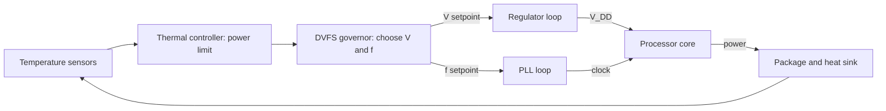

<!-- status: reviewed -->
# 15-12 · Applications: PLLs, Voltage Regulators and Thermal Management

| | |
|---|---|
| **Course** | [15 · Control Systems](../README.md) |
| **University equivalent** | The applications that close a first controls course and open the mixed-signal and power electives: the charge-pump PLL as a feedback loop (Gardner, *Phaselock Techniques*; Razavi, *Design of CMOS Phase-Locked Loops*), regulator loop compensation and output impedance (Erickson & Maksimović, *Fundamentals of Power Electronics*, ch. 9; Rincón-Mora, *Analog IC Design with Low-Dropout Regulators*), and processor power and thermal management loops |
| **Prerequisites** | [15-07 Frequency-Domain Design](15-07-frequency-domain-design.md), [15-08 PID Control](15-08-pid-control.md), [15-11 Digital Control](15-11-digital-control.md), [15-02 Transfer Functions and Block Diagrams](15-02-transfer-functions-and-block-diagrams.md) (the PLL block diagram), [15-01 Modeling Dynamic Systems](15-01-modeling-dynamic-systems.md) (the thermal model), [14-01 Performance, Power and the Iron Law](../../14-computer-organization-and-architecture/chapters/14-01-performance-power-iron-law.md) (dynamic power) |
| **Estimated study hours** | 6 |
| **Last verified** | 2026-11-20 |

**Learning objectives.** After this chapter you can:

1. Model a charge-pump PLL as a type-2 loop in the phase domain and design its loop filter for a chosen crossover and phase margin.
2. Predict a PLL's closed-loop behaviour (poles, jitter-transfer peaking, frequency-hop settling) and choose its bandwidth to minimize integrated jitter.
3. Analyze an LDO's loop gain across output-capacitor ESR and explain output-pole and internal compensation.
4. Relate a regulator's load-step droop to its loop bandwidth and output capacitance, with and without a load line.
5. Sequence a DVFS transition, and design and analyze a thermal throttling loop, including why sustained performance is set by thermal time constants.

---

## 1. Big picture

Every modern chip runs at least three feedback loops on itself. A **phase-locked loop (PLL)** makes the clock: it multiplies a quartz reference up to gigahertz and holds the phase steady. **Voltage regulators** make the supply rails: they hold a voltage while the load current jumps by amperes in nanoseconds. **Power and thermal management** keeps the die below its temperature limit by trimming voltage and frequency, a loop whose plant is the package and heat sink. Each is an ordinary feedback loop of this course, with its own plant, sensor and actuator, and each fails in the ways the earlier chapters predict: too little phase margin, too little bandwidth, windup, sampling delay. This chapter applies the course's tools to all three and shows how they interact.

- **Clocks.** Every SoC, SerDes lane and data converter has PLLs; their loop bandwidth sets lock time and how much oscillator noise reaches the clock (Examples 15-12.2, 15-12.3, 15-12.5; 20-10).
- **Power delivery.** LDOs and switching regulators are compensated loops; their bandwidth and output capacitance set how far a rail droops when a core wakes up (Examples 15-12.4, 15-12.6; 20-04, 22-07).
- **DVFS.** Changing a core's voltage and frequency is a coordinated move of two loops, regulator first on the way up (Example 15-12.1; 19-06).
- **Thermal limits.** Phones, laptops and accelerators all throttle; the throttling controller turns a temperature limit into a power envelope that falls from "turbo" to "sustained" with the heat sink's time constant (Example 15-12.7).

## 2. Intuition first

**Three loops, three signals, three speeds.** In a PLL the signal is phase, and the loop settles in microseconds. In a regulator the signal is voltage, and it settles in microseconds or faster. In a thermal loop the signal is temperature, and the plant's time constants run from milliseconds (the die) to minutes (the heat sink and chassis). The loops are nested: the thermal controller sets a power budget, the DVFS governor turns it into a voltage and frequency, and the regulator and PLL carry those out.

**An analogy: a company's controls at three time scales.** Treasury manages cash daily, finance sets quarterly budgets, and the board sets multi-year capital plans. Each layer assumes the faster layer below it simply delivers what it is told, and that the slower layer above it holds still. That is **bandwidth separation**: an outer loop is designed as if the inner loop were perfect, which works when the inner loop is several times faster. The analogy breaks down where physics couples the layers: raising the clock raises the regulator's load current, and heating the die raises its leakage, which raises the power the thermal loop must remove. Good designs keep these couplings weak or model them explicitly.

**A PLL is a filter for noise.** Inside its bandwidth the clock follows the reference (a clean crystal, multiplied up); outside, it follows its own oscillator. Choosing the bandwidth decides whose noise you get at each frequency, and the best choice is roughly where the two noise sources cross.

## 3. Theory

### 3.1 The PLL as a phase-domain loop

A charge-pump PLL (15-02 §3.6) has four blocks. In the linear model the signals are **excess phases** (radians), the deviations from ideal phase ramps.

- **Voltage-controlled oscillator (VCO).** Its frequency is $\omega_{out} = \omega_{fr} + K_vv_c$, with $K_v$ in rad/s per volt. Phase is the integral of frequency, so the excess phase is $\Theta_{out}(s) = K_vV_c(s)/s$: **a VCO is an integrator of phase**.
- **Divider.** $\Theta_{div} = \Theta_{out}/N$.
- **Phase–frequency detector (PFD) and charge pump (CP).** Once per reference period $T_{ref}$, the PFD turns the time difference between reference and divided edges, $\Delta t = T_{ref}\Delta\theta/(2\pi)$, into a current pulse of amplitude $I_{cp}$ and width $\Delta t$. Averaged over the period the current is $I_{cp}\Delta t/T_{ref} = I_{cp}\Delta\theta/(2\pi)$, so $K_{pd} = I_{cp}/(2\pi)$ A/rad, linear for $\lvert\Delta\theta\rvert < 2\pi$.
- **Loop filter.** A resistor $R$ in series with $C$, with a small ripple capacitor $C_2$ across both. Its impedance is

$$
Z(s) = \frac{(R + 1/sC)(1/sC_2)}{R + 1/sC + 1/sC_2} = \frac{1 + sRC}{s(C + C_2)(1 + s\tau_p)}, \qquad \tau_p = \frac{RCC_2}{C + C_2} .
$$

Multiplying around the loop:

$$
L(s) = \frac{I_{cp}}{2\pi}\,Z(s)\,\frac{K_v}{s}\,\frac{1}{N} = \frac{K(1 + s\tau_z)}{s^2(1 + s\tau_p)}, \qquad K = \frac{I_{cp}K_v}{2\pi N(C + C_2)},\quad \tau_z = RC .
$$

**Units check.** $I_{cp}K_v/(2\pi N C)$: A × (rad/s)/V ÷ (rad × F) = 1/s², as a gain over $s^2$ must be.

Two integrators (the VCO and the capacitor $C$) make the loop **type 2** (15-04): a reference frequency step leaves zero steady phase error, and a frequency ramp leaves a constant one. Two integrators also put the uncompensated phase at −180°, so the zero at $1/\tau_z$, from $R$, is what makes the loop stable; $C_2$ adds the pole at $1/\tau_p$ that filters the charge pump's current pulses (they would otherwise appear as **reference spurs**, sidebands at multiples of $f_{ref}$ on the output spectrum) at a cost in phase margin.

**What the loop passes.** Write $T = L/(1 + L)$ and $S = 1/(1 + L)$ (15-04). Reference phase reaches the output as $\Theta_{out} = NT\,\Theta_{ref}$: low-pass, with the noise multiplied by $N$ ($20\log_{10}N$ dB in power). Noise injected at the VCO's output reaches the output as $S$: since $\Theta_{out} = \Theta_n - L\Theta_{out}$, $\Theta_{out} = \Theta_n/(1 + L)$, a high-pass. The PLL suppresses its VCO's noise inside its bandwidth and passes the reference's.

### 3.2 Designing the loop filter for phase margin

The phase of $L(j\omega)$ is $-180° + \arctan\omega\tau_z - \arctan\omega\tau_p$. 15-07 (§3.8, Problem 15-07.11) showed it peaks at $\omega = 1/\sqrt{\tau_z\tau_p}$ with value $\arctan[(b - 1)/(2\sqrt b)]$, $b = \tau_z/\tau_p$. Designing means running that result backwards: put the crossover $\omega_c$ at the peak and choose $b$ for the margin.

**Step 1: the ratio $b$ from the phase margin.** Let $x = \sqrt b$. Then $\tan\text{PM} = (x^2 - 1)/(2x)$, a quadratic $x^2 - 2x\tan\text{PM} - 1 = 0$ with positive root

$$
\sqrt b = x = \tan\text{PM} + \sqrt{\tan^2\text{PM} + 1} = \tan\text{PM} + \sec\text{PM} .
$$

For PM = 60°: $x = \sqrt3 + 2$ = 3.732 and $b$ = 13.93.

**Step 2: the time constants.** From $\omega_c = 1/\sqrt{\tau_z\tau_p}$ and $\tau_z = b\tau_p$: $\tau_z = x/\omega_c$ and $\tau_p = 1/(x\omega_c)$.

**Step 3: the gain.** At crossover $\omega_c\tau_z = x$ and $\omega_c\tau_p = 1/x$, so

$$
\lvert L(j\omega_c)\rvert = \frac{K}{\omega_c^2}\frac{\sqrt{1 + x^2}}{\sqrt{1 + 1/x^2}} = \frac{K}{\omega_c^2}\,x = 1 \quad\Longrightarrow\quad K = \frac{\omega_c^2}{x} .
$$

**Step 4: the components.** $C + C_2 = I_{cp}K_v/(2\pi NK)$; since $\tau_p/\tau_z = C_2/(C + C_2) = 1/b$, $C_2 = (C + C_2)/b$; then $C$ follows, and $R = \tau_z/C$. The capacitor ratio $C/C_2 = b - 1$ grows quickly with the margin. The total capacitance, which sets the filter's area, grows more slowly: at fixed $f_c$, $C + C_2 = I_{cp}K_v\sqrt b/(2\pi N\omega_c^2)$ scales as $\sqrt b$, so going from 45° to 60° multiplies the area by 1.55 while the ratio grows 2.7 times.

**The closed-loop poles of this design.** The characteristic polynomial is $\tau_ps^3 + s^2 + K\tau_zs + K$. Substituting the design values ($\tau_p = 1/(x\omega_c)$, $K\tau_z = \omega_c$, $K = \omega_c^2/x$) and multiplying by $x\omega_c$:

$$
s^3 + x\omega_cs^2 + x\omega_c^2s + \omega_c^3 = (s + \omega_c)\left[s^2 + (x - 1)\omega_cs + \omega_c^2\right] .
$$

(Expand the right side: $s^3 + (x - 1 + 1)\omega_cs^2 + (1 + x - 1)\omega_c^2s + \omega_c^3$.) So a maximum-margin third-order PLL always has a closed-loop pole exactly at $-\omega_c$, and a pair with natural frequency $\omega_c$ and damping $\zeta = (x - 1)/2$. The pair is real when $x \ge 3$, that is $b \ge 9$ or PM ≥ $\arctan(8/6)$ = 53.1°. The step response still overshoots, because of the zero at $-1/\tau_z = -\omega_c/x$, slower than every pole (15-03 §3.6).

**The PFD samples.** The PFD compares phases once per reference period, so the PLL is a sampled loop (15-11). Treating the charge pump's update as a delay of about $T_{ref}/2$ costs $\omega_cT_{ref}/2 = \pi f_c/f_{ref}$ radians at crossover: 18° at $f_c = f_{ref}/10$. The usual rule keeps $f_c$ at or below about $f_{ref}/10$. (The charge pump's output is a current pulse, not a held level, so the $T/2$ estimate is approximate. Gardner's 1980 analysis gives the exact sampled stability limit for the second-order loop without $C_2$; the rule keeps well clear of it, and of the corresponding limit for this third-order loop.)

**Jitter-transfer peaking.** Near its bandwidth $\lvert T(j\omega)\rvert$ rises above 1: the loop amplifies reference jitter there. The peak shrinks as phase margin grows (15-07 §3.4 and §3.7). It matters most in chains of clock-recovery circuits, such as repeaters, where identical stages peak at the same frequency and their peaks add in decibels.

> **Math refresher — phase noise and jitter.** An oscillator's phase noise $\mathcal{L}(f)$ (dBc/Hz) is the single-sideband noise power in a 1 Hz band at offset $f$ from the carrier, relative to the carrier power. For small phase deviations the one-sided phase spectrum is $S_\phi(f) = 2 \times 10^{\mathcal{L}(f)/10}$ rad²/Hz, so the rms phase over an offset band is $\phi_{rms} = \sqrt{2\int_{f_1}^{f_2}10^{\mathcal{L}(f)/10}\,df}$, and the rms jitter is $\phi_{rms}/(2\pi f_{out})$ seconds: one radian is $1/(2\pi)$ of a period. Because the spectra span decades, the integral is best done on a logarithmic axis: $df = f\ln 10\,d(\log_{10}f)$.

**The noise-optimal bandwidth.** With reference-path noise $\mathcal{L}_{ref}$ (flat, already multiplied by $N^2$) and VCO noise $\mathcal{L}_{vco}(f)$ falling 20 dB/decade, the output spectrum is $\lvert T\rvert^2\mathcal{L}_{ref} + \lvert S\rvert^2\mathcal{L}_{vco}$. A narrow loop lets VCO noise through over a wide range of offsets; a wide loop passes reference noise over a wide range. The integrated jitter is smallest near the offset where the two unshaped spectra cross, which is the standard first choice of bandwidth (Example 15-12.5).

![Two panels. Left: phase noise against offset frequency from 10 kHz to 100 MHz for Example 15-12.5's PLL with a 316 kHz crossover. Dotted lines show the unshaped reference-path noise, flat at -110 dBc/Hz, and the free-running VCO noise, falling 20 dB per decade through -120 dBc/Hz at 1 MHz; they cross at 316 kHz. The reference noise shaped by the closed loop follows -110 dBc/Hz at low offsets, peaks slightly near the bandwidth and then falls steeply; the VCO noise shaped by the sensitivity function rises from about -129 dBc/Hz at 10 kHz to meet the free-running curve above about 1 MHz. Their sum peaks near -106 dBc/Hz around 180 kHz. Right: integrated rms jitter from 10 kHz to 100 MHz against crossover frequency from 20 kHz to 5 MHz, a U-shaped curve with its minimum of about 413 fs at 316 kHz and about 545 fs at 100 kHz and 1 MHz.](../../../assets/figures/15-12/pll_noise.svg)

*Figure 1. Left: inside the bandwidth the output follows the reference path; outside, the VCO. Right: integrated jitter is lowest with the crossover near the crossing of the two unshaped spectra (Example 15-12.5).*

**Digital and fractional-N PLLs.** An all-digital PLL replaces the PFD and charge pump with a time-to-digital converter, the loop filter with a digital PI controller (a velocity-form difference equation, 15-11 §3.3), and the VCO with a digitally controlled oscillator. A fractional-N synthesizer dithers the divider with a delta-sigma modulator so $N$ averages to a fraction; the loop's low-pass $T$ then filters the dither's shaped quantization noise. The loop mathematics of this section carries over with $z$ in place of $s$.

> **Deeper:** charge-pump circuits, VCO phase noise, fractional-N and all-digital PLLs are designed in [20-10 PLLs and Jitter](../../20-analog-and-mixed-signal-ic-design/chapters/20-10-plls-and-jitter.md); clock recovery in SerDes in [24-03](../../24-high-speed-io-signal-integrity-and-photonics/chapters/24-03-serdes-architecture.md).

### 3.3 Regulator loops: the LDO

A low-dropout regulator (LDO) is an error amplifier $A(s)$ driving a pass transistor (transconductance $g_m$) into the output node, closed through a divider $\beta$ (15-02 Problem 15-02.12). The output node is the load $R_L$ in parallel with the output capacitor $C_L$, whose equivalent series resistance $R_{ESR}$ is in series with it:

$$
Z(s) = R_L \parallel \left(R_{ESR} + \frac{1}{sC_L}\right) = R_L\frac{1 + sR_{ESR}C_L}{1 + s(R_L + R_{ESR})C_L} .
$$

With the error amplifier's pole $\omega_a$ and the pass transistor's gate pole $\omega_g$ (its gate capacitance driven by the amplifier's output resistance, 15-05 Problem 15-05.9),

$$
L(s) = \frac{A_0\beta g_mZ(s)}{(1 + s/\omega_a)(1 + s/\omega_g)} .
$$

It has three poles (the output pole near $1/(R_LC_L)$, $\omega_a$ and $\omega_g$) and one zero, the **ESR zero** at $1/(R_{ESR}C_L)$. Two compensation strategies follow.

- **Output-pole dominant (large external capacitor).** A microfarad-scale $C_L$ makes the output pole the lowest. The amplifier pole is the second, and crossing over with two poles leaves almost no phase, so the ESR zero is placed to restore it. This works only inside an **ESR window**: too little ESR (a modern ceramic capacitor with milliohms) puts the zero above crossover, where it cannot help; too much ESR lowers the zero so far that the gain stays high up to the gate pole, pushing crossover where the gate pole takes the phase away (Example 15-12.6). Datasheets of such LDOs show a stable region in the plane of ESR and load current.
- **Internally compensated (capless).** A dominant pole inside the amplifier (Miller compensation, 12-06) sets crossover low enough that the output pole, now formed by a small on-chip capacitance, lies above it. No ESR is needed, at the cost of a lower bandwidth and a larger dip on fast load steps, because the small capacitor must ride out the transient until the slow loop responds.

**The load moves the poles.** $R_L$ ranges from near-infinite (no load) to a few ohms (full load), and the pass device's $g_m$ grows with current. Both the DC loop gain $A_0\beta g_mR_L$ and the output pole move by orders of magnitude, so stability is a family of loops to check, not one: a root-locus or margin sweep over load (15-06, 15-07).

**Output impedance and supply rejection.** The closed-loop output impedance is the open-loop output impedance divided by $1 + L$ (15-04 §3.2): small at low frequency, rising as $\lvert L\rvert$ falls, and equal to the bare capacitor's impedance above crossover. Supply ripple leaks to the output through the pass device and is suppressed by the same factor, so power-supply rejection (PSRR) also degrades with frequency up to crossover.

> **Deeper:** LDO circuits, dropout, PSRR and capless designs are in [20-04 Low-Dropout Regulators](../../20-analog-and-mixed-signal-ic-design/chapters/20-04-ldo-regulators.md).

### 3.4 Load steps, bandwidth and the load line

How far does a rail droop when the load current steps by $\Delta I$? A simple and widely used model treats the regulator's power stage as a **transconductance**: a current-mode switching regulator, whose fast inner current loop makes the inductor current follow a command (22-07), behaves this way at frequencies well below its switching frequency. The output node obeys $C\,dv/dt = i_{reg} - i_{load}$ with $i_{reg} = G(s)(v_{ref} - v)$, so in the Laplace domain, with $v$ measured from its setpoint,

$$
V(s) = -\frac{I_{load}(s)}{sC + G(s)}, \qquad L(s) = \frac{G(s)}{sC} .
$$

Write $\omega_0 = g/C$: the frequency at which the controller's proportional path alone has unit loop gain.

**Proportional control.** With $G = g$, the loop gain is $L = \omega_0/s$, so the crossover is $\omega_c = \omega_0$, and the output impedance is $Z_{cl} = 1/[C(s + \omega_0)]$: a resistance $1/(\omega_0C)$ at low frequency, the capacitor's impedance above $\omega_0$. A load step gives a monotonic droop to $\Delta V = \Delta I/(\omega_0C)$, with no overshoot and no ringing when the load is released. Processor regulators often do this on purpose: the **load line** (adaptive voltage positioning) is a deliberately finite DC gain that makes the rail behave like a small resistance, so the voltage sits higher at light load and lower at heavy load, using the whole tolerance band for each transient **[Established]**. The design rule follows at once:

$$
\omega_c = \omega_0 \ge \frac{\Delta I}{C\,\Delta V} .
$$

**Proportional-integral control.** With $G = g(1 + \omega_z/s)$, $Z_{cl} = s/[C(s^2 + \omega_0s + \omega_0\omega_z)]$, which is zero at DC: no static error. Choosing $\omega_z = \omega_0/4$ makes the denominator $(s + \omega_0/2)^2$, critically damped. The response to a step $\Delta I$ is then the inverse transform of $-\Delta I/[C(s + \omega_0/2)^2]$:

$$
v(t) = -\frac{\Delta I}{C}\,t\,e^{-\omega_0t/2} ,
$$

which peaks at $t = 2/\omega_0$ (set the derivative to zero) with value $(2/e)\,\Delta I/(\omega_0C) \approx 0.736\,\Delta I/(\omega_0C)$, then recovers. The PI loop gain $L = (\omega_0/s)(1 + \omega_0/(4s))$ crosses over slightly above $\omega_0$: with $u = \omega/\omega_0$, $\lvert L\rvert = 1$ gives $u^4 - u^2 - 1/16 = 0$, so $u^2 = (1 + \sqrt{5}/2)/2$ and $\omega_c = 1.029\,\omega_0$. Either way, **the droop is set by the product of loop bandwidth and capacitance**: halving the bandwidth needs twice the capacitance for the same droop. Above the regulator's bandwidth, the capacitors (bulk, ceramic, package and on-die) supply the current, which is the target-impedance view of power delivery.

**Units check.** $\Delta I/(\omega_0C)$: A ÷ (1/s × A·s/V) = V.

> **Deeper:** power-delivery networks and target impedance for datacenter processors are in [22-10 Datacenter Power Delivery](../../22-power-electronics-and-energy-conversion/chapters/22-10-datacenter-power-delivery.md); converter compensation in [22-07](../../22-power-electronics-and-energy-conversion/chapters/22-07-converter-dynamics-and-control.md).

### 3.5 DVFS: coordinating two loops

Dynamic power is $\alpha CV^2f$ (14-01 §3.5), and the highest safe frequency rises with voltage, so a processor runs at a table of operating points, each a voltage and a frequency. A **DVFS** transition moves both, and the order is forced by timing safety: the logic must never run faster than the present voltage supports.

- **Going up:** raise the voltage first, wait for the regulator to settle, then raise the frequency.
- **Going down:** lower the frequency first, then the voltage.

The transition time is the regulator's slew and settling plus the clock change. Changing the clock means either relocking a PLL (its settling time, Example 15-12.3) or switching glitch-free to another, already locked, clock. A PLL's frequency overshoots during a hop (the zero of §3.2), so a core must not run on a relocking PLL unless the voltage has margin for the overshoot; designs park the core on another clock, ramp the divider in small steps, or stall during relock.

**Adaptive voltage scaling** adds an outer loop: an on-die critical-path monitor (for example, a ring oscillator or a delay line that mimics the slowest logic) measures timing margin, and a slow integral controller trims the regulator setpoint to keep just enough margin. It is **cascade control**: the outer loop treats the regulator as a perfect actuator, which is valid if the outer bandwidth is a factor of 5 to 10 below the regulator's.

### 3.6 Thermal loops: throttling

The plant is the thermal network of 15-01: a fast mode (the die and its nearby spreader, time constants of milliseconds to a second) and slow modes (heat sink, chassis, skin: tens of seconds to minutes). The actuator is power, adjusted through DVFS; the sensor is an on-die thermal diode or ring-oscillator sensor read by firmware every few milliseconds to a fraction of a second.

**The controller.** Practical throttling controllers are PI controllers with feedforward and saturation. The ACPI specification's passive-cooling equation updates performance by $\Delta P = TC_1(T_n - T_{n-1}) + TC_2(T_n - T_t)$ every sampling period and clamps the result between a minimum and 100% (§9): a velocity-form PI with clamping (15-08, 15-11). Linux's power-allocator governor computes a power limit $P_{max} = k_pe + k_i\sum e + k_d\Delta e + P_{sustainable}$ (§9).

**Turbo, then sustained.** Suppose a workload demands more power than the cooling can remove indefinitely. At first the controller saturates at full power and the die heats along the plant's step response. When the junction reaches its limit $T_{lim}$, the loop holds $T_J$ there and the permitted power becomes whatever keeps it there. For the two-node model with $T_J$ held constant, the junction capacitance carries no current, so $P = (\theta_J - \theta_C)/R_{JC}$ exactly, and the heat-sink node obeys

$$
C_H\dot\theta_C = \frac{\theta_J - \theta_C}{R_{JC}} - \frac{\theta_C}{R_{CA}} ,
$$

a first-order system with time constant $C_H(R_{JC} \parallel R_{CA})$. The permitted power therefore decays exponentially, with that time constant, from its value at the start of throttling to the **sustained power** $P_{sus} = (T_{lim} - T_A)/(R_{JC} + R_{CA})$. A product's "turbo" duration and its sustained performance are thermal numbers, set by heat capacities and resistances, not by the silicon's peak frequency (Example 15-12.7).

*Figure 2. Turbo, then throttle: the fast loop holds the junction at its limit, and the permitted power falls with the heat sink's time constant to the sustained level (Example 15-12.7).*

**Complications.**

- **Leakage feedback.** Leakage power rises with temperature (15-01 §3.7), raising the plant's effective DC gain from $R$ to $R/(1 - G)$, with $G = R\,dP_L/dT$. The thermal loop's gain, and its margin, change with temperature.
- **Quantized actuators.** A processor has a finite set of operating points, so the controller's output is quantized and the loop limit-cycles between neighbouring points; the integral term and dithering (time-averaging between two points) handle this.
- **Sensor placement.** Sensors are not at the hottest spot, so firmware either adds a guard band or estimates the hot spot from a model, an observer in the sense of 15-10.

## 4. Worked examples

### Example 15-12.1 · A DVFS transition (tier A)

**Setup.** A core moves from 1.2 GHz at 0.80 V to 2.0 GHz at 1.00 V (illustrative values). Its regulator slews at 10 mV/µs and then needs 5 µs to settle; its PLL relocks in 20 µs, during which the core is stalled. Give the order of operations and the time to complete the upshift, the ratios of dynamic power and of energy per cycle, and the fraction of cycles lost if the governor does this once per millisecond.

**Solution.** Voltage first: the 200 mV ramp takes 200/10 = **20** µs, and the rail is ready after **25** µs. Then the PLL relocks: the upshift completes after **45** µs. The core keeps running at 1.2 GHz during the voltage ramp, so only the 20 µs relock is lost: **2.0**% of each millisecond.

Dynamic power scales as $V^2f$: $(1.00/0.80)^2 \times 2.0/1.2$ = **2.60** times. Energy per cycle scales as $V^2$: **1.56** times. The faster clock costs 56% more energy per operation (14-01's race-to-idle tradeoff).

The downshift reverses the order: frequency first (relock, 20 µs stalled), then the voltage falls while the core runs at the lower frequency.

**Units check.** mV ÷ (mV/µs) = µs.

**Sanity check.** If the core raised its clock first, it would run at 2.0 GHz on 0.80 V for 25 µs, far below the voltage that frequency needs: timing failures, not just inefficiency.

### Example 15-12.2 · Designing a charge-pump PLL's loop filter (tier B)

**Setup.** A 1 GHz synthesizer uses a 10 MHz reference ($N$ = 100), Example 15-02.6's charge pump and VCO ($I_{cp}$ = 100 µA, $K_v$ = 2π × 100 MHz/V) and the loop filter of §3.1. Design the filter for a 200 kHz crossover with 60° of phase margin, and check the sampling rule.

**Solution.** Step 1: $x = \tan60° + \sec60° = 1.732 + 2$ = **3.732**, so $b$ = **13.93**.

Step 2: with $\omega_c = 2\pi \times 200$ kHz = 1.2566 × 10⁶ rad/s, $\tau_z = x/\omega_c$ = **2.970** µs and $\tau_p = 1/(x\omega_c)$ = **0.2132** µs.

Step 3: $K = \omega_c^2/x$ = **4.231 × 10¹¹** s⁻².

Step 4:

$$
C + C_2 = \frac{I_{cp}K_v}{2\pi NK} = \frac{10^{-4} \times 2\pi \times 10^8}{2\pi \times 100 \times 4.231 \times 10^{11}} = \mathbf{236.3}\ \text{pF},
$$

$C_2 = 236.3/13.93$ = **16.97** pF, $C$ = **219.4** pF and $R = \tau_z/C$ = **13.54** kΩ.

The PFD samples at 10 MHz, fifty times the crossover; the sampling delay costs about $\pi f_c/f_{ref} = \pi/50$ rad = **3.6**°, small enough to ignore.

**Units check.** $\tau_z/C$: s/F = s/(A·s/V) = V/A = Ω.

**Sanity check.** The capacitors are a few hundred picofarads, a size that fits on a die; Example 15-02.6's 1 nF filter would occupy several times the area. $C/C_2 = b - 1 = 12.9$, as §3.2 predicts.

### Example 15-12.3 · The PLL's closed loop: poles, peaking and a frequency hop (tier B)

**Setup.** For Example 15-12.2's PLL, find the closed-loop poles, the jitter-transfer peak and the −3 dB bandwidth of $T$. Then the divider steps from 100 to 101, a 10 MHz hop to 1.01 GHz: find the frequency overshoot, the time to settle within 1 kHz of the new frequency, and the largest phase error at the PFD.

**Solution.** By §3.2 the poles are $-\omega_c$ = **−1.257 × 10⁶** s⁻¹ and the roots of $s^2 + (x - 1)\omega_cs + \omega_c^2$, with $\zeta = (x - 1)/2 = 1.366$: $\omega_c(-1.366 \pm \sqrt{1.366^2 - 1})$, that is **−5.472 × 10⁵** and **−2.886 × 10⁶** s⁻¹. All three are real.

Evaluating $\lvert T(j\omega)\rvert$: the peak is **1.70** dB at **93.1** kHz, and the −3 dB bandwidth is **313** kHz, 1.56 times the crossover.

After the divider step, the loop has $N$ = 101 (its gain falls by 1%), and the output frequency moves to the new target along the step response of the new $T$ (the reference's phase ramp now looks, to the loop, like a frequency step). Simulating: the frequency overshoots by **18.9**% of the step (1.9 MHz above 1.01 GHz) and settles within 1 kHz (10⁻⁴ of the step) after **17.3** µs. The phase error at the PFD is the response of $S$ to an equivalent reference frequency step of $\omega_{ref}(1 - 100/101)$ = 2π × 99.0 kHz; it peaks at **0.412** rad, far inside the PFD's ±2π linear range, so the linear model holds.

**Units check.** Phase error = (rad/s) × s.

**Sanity check.** Real poles yet 19% overshoot: the overshoot comes from the zero at $\omega_c/x$ = 3.37 × 10⁵ s⁻¹, slower than all three poles, exactly as a PI controller's zero raises overshoot in 15-08. Used for DVFS, this hop would overclock the core by 1.9 MHz for a few microseconds, which is why §3.5's precautions exist.

### Example 15-12.4 · Load-step droop: load line against PI (tier B)

**Setup.** A processor rail must stay within 40 mV of its setpoint when the load steps by 20 A. Its output capacitance is 1 mF (illustrative values). Using the transconductance model of §3.4, find the load-line resistance and the crossover a proportional (load-line) design needs, then the $\omega_0 = g/C$ and the actual crossover a critically damped PI design needs for the same 40 mV peak, when that peak occurs, and when the deviation is back within 4 mV.

**Solution.** Load line: $R_{LL} = \Delta V/\Delta I$ = **2** mΩ, and $\omega_c = \omega_0 = 1/(R_{LL}C) = \Delta I/(C\Delta V)$ = **5.00 × 10⁵** rad/s, that is **79.6** kHz.

PI with $\omega_z = \omega_0/4$: the peak is $(2/e)\Delta I/(\omega_0C)$, so $\omega_0 = (2/e)\Delta I/(C\Delta V)$ = **3.68 × 10⁵** rad/s (**58.5** kHz). The peak occurs at $2/\omega_0$ = **5.44** µs. Solving $(\Delta I/C)\,t\,e^{-\omega_0t/2}$ = 4 mV for the later root gives **26.6** µs.

The PI loop $L = (\omega_0/s)(1 + \omega_z/s)$ crosses over at $1.029\,\omega_0$ = **3.79 × 10⁵** rad/s (**60.3** kHz), with a phase margin of **76.3**°: the critically damped choice is a comfortable loop.

**Units check.** $\Delta I/(C\Delta V)$: A ÷ (F × V) = A/(A·s) = 1/s.

**Sanity check.** The PI design needs 24% less actual crossover (60.3 against 79.6 kHz) for the same peak, because its integral starts pulling the voltage back before the droop reaches $\Delta I/(\omega_0C)$; but it then takes tens of microseconds to recover, while the load-line design sits at a steady −40 mV that its setpoint already allowed for.

### Example 15-12.5 · The jitter-optimal PLL bandwidth (tier C)

**Setup.** A 2 GHz synthesizer has a 50 MHz reference ($N$ = 40). Referred to the output, the reference path contributes a flat −110 dBc/Hz, and the free-running VCO −120 dBc/Hz at 1 MHz offset, falling 20 dB/decade (illustrative values). The loop is a maximum-margin 60° design (§3.2) with crossover $f_c$. Estimate the best $f_c$, and compute the rms jitter from 10 kHz to 100 MHz for $f_c$ = 100 kHz, the estimate, and 1 MHz.

**Solution.** The unshaped spectra cross where $-120 + 20\log_{10}(1\ \text{MHz}/f) = -110$: $f = 10^{-0.5}$ MHz = **316** kHz, comfortably below $f_{ref}/10$ = 5 MHz.

Integrating $\lvert T\rvert^2\mathcal{L}_{ref} + \lvert S\rvert^2\mathcal{L}_{vco}$ numerically (the lab's `jitter`), with $\phi_{rms} = \sqrt{2\int10^{\mathcal{L}/10}df}$ and jitter $= \phi_{rms}/(2\pi \times 2\ \text{GHz})$:

| $f_c$ | rms phase | rms jitter |
|---|---|---|
| 100 kHz | 6.85 mrad | **545** fs |
| 316 kHz | **5.19** mrad | **413** fs |
| 1 MHz | 6.85 mrad | **545** fs |

A numerical search over $f_c$ finds the minimum at **316** kHz, at the crossing to within 0.02%. Missing the optimum by a factor of 3 either way costs 32% more jitter: the optimum is broad.

**Units check.** rad ÷ (rad/cycle × cycles/s) = s.

**Sanity check.** The table is nearly symmetric in $\log_{10}f_c$ because the two noise shapes mirror each other about the crossing, and $\lvert T\rvert$ and $\lvert S\rvert$ of this loop are mirror images on a log axis. For this loop $\lvert T(j\omega_c^2/\omega)\rvert = \lvert S(j\omega)\rvert$ exactly, and with infinite integration limits the optimum would sit exactly at the crossing. A real VCO's noise flattens at large offsets and the reference noise rises toward low offsets, which moves the optimum; the crossing remains the starting estimate.

### Example 15-12.6 · An LDO's ESR window (tier C)

**Setup.** 15-05 Problem 15-05.9's LDO ($A_0$ = 1000, $\omega_a$ = 2π × 10 kHz, $g_m$ = 0.5 A/V, $R_L$ = 10 Ω, $\beta$ = 0.5, gate pole 2π × 1 MHz) oscillates with a 1 µF output capacitor. The designer raises $C_L$ to 10 µF, making the output pole dominant (10⁴ s⁻¹). Find the range of ESR giving at least 45° of phase margin, the best margin, and the margin with a 5 mΩ ceramic capacitor. Give the crossover and margin for a 0.3 Ω tantalum capacitor.

**Solution.** With $Z(s)$ and $L(s)$ of §3.3, the margin as a function of $R_{ESR}$ (root finding on $\lvert L\rvert = 1$ for each value):

- the margin is at least 45° for $R_{ESR}$ between **0.094** Ω and **0.568** Ω;
- the best margin is **57.1**°, at **0.196** Ω;
- with 5 mΩ the margin is **−4.3**°: the regulator oscillates;
- with 0.3 Ω, crossover is at **621** kHz with a margin of **54.3**°; the ESR zero is at $1/(2\pi \times 0.3 \times 10^{-5})$ = **53.1** kHz.

Below the window, the zero sits above crossover and the loop crosses with two poles' worth of lag plus the gate pole. Above it, the zero is so low that the gain flattens early, crossover climbs toward the 1 MHz gate pole, and its phase loss returns.

**Units check.** $R_{ESR}C_L$: Ω × F = s.

**Sanity check.** At 0.3 Ω, taking the two low-frequency poles as −90° each, the phase at crossover is about $-180° + \arctan(621/53.1) - \arctan(621/1000) = -180° + 85.1° - 31.8° = -126.7°$, a margin near 53°. The exact 54.3° is about 1° more because at 621 kHz those two poles together contribute −178.9°, not quite −180°. The lab's ngspice model measures the same loop.

### Example 15-12.7 · Turbo, then throttle (tier C)

**Setup.** Example 15-01.3's processor ($C_J$ = 5 J/K, $R_{JC}$ = 0.15 K/W, $C_H$ = 300 J/K, $R_{CA}$ = 0.35 K/W, $T_A$ = 30 °C) runs a workload demanding 200 W, with a junction limit of 95 °C. Firmware samples every 0.1 s and limits power with the velocity-form PI of §3.6, $P_k = P_{k-1} - [K_p(T_k - T_{k-1}) + K_iT_s(T_k - T_{lim})]$, clamped to 0–200 W. (a) Choose $K_p$ and $K_i$ for a 2 rad/s crossover. (b) Find the sustained power, how long full power lasts, and how the permitted power then evolves. (c) Simulate.

**Solution.** **(a)** Above the slow mode the heat sink barely moves during a loop cycle, so $\theta_J/P \approx R_{JC}/(1 + sC_JR_{JC})$ with $C_JR_{JC}$ = 0.75 s. Place the PI zero on that pole ($K_i = K_p/0.75$ s): $L \approx K_pR_{JC}/(0.75s)$, crossover $0.2K_p$, so $K_p$ = **10** W/K and $K_i$ = **13.3** W/(K·s). In ACPI terms, $TC_1$ corresponds to $K_p$ and $TC_2$ to $K_iT_s$ = **1.33** W/K per sample. With the exact two-node plant and the hold, the discrete loop crosses at **2.09** rad/s with a phase margin of **85.5**°.

**(b)** Sustained: $P_{sus} = (95 - 30)/(0.15 + 0.35)$ = **130** W. At 200 W the junction runs about $200 \times 0.15$ = 30 K above the heat sink once its fast mode has settled, so it reaches 95 °C when the heat sink reaches 35 K above ambient. With the slow mode alone (time constant $\approx R_{CA}C_H$ = 105 s and final rise 200 × 0.35 = 70 K), that takes $105\ln2$ = **72.8** s; the exact two-node response (matrix exponential) gives **75.5** s. From then on, by §3.6, the permitted power decays from about 200 W toward 130 W with time constant $C_H(R_{JC} \parallel R_{CA}) = 300 \times 0.105$ = **31.5** s; 60 s after throttling begins it is $130 + 70e^{-60/31.5}$ = **140.4** W.

**(c)** Simulating the sampled loop: power first falls below 200 W at **74.8** s (slightly early, because the proportional term reacts to the rising temperature before the limit is reached), the junction peaks at **95.15** °C, 60 s after the onset of throttling the power is **140.3** W, and it settles at 130.0 W.

**Units check.** $C_H(R_{JC} \parallel R_{CA})$: J/K × K/W = J/W = s.

**Sanity check.** The controller's gains hardly matter to the turbo window: a fast loop simply holds $T_J$ at the limit, and the slow heat sink decides how long the burst lasts and how fast power must fall. Benchmarks shorter than about a minute measure the turbo regime of this machine, not its sustained performance.

### Answer key

<!-- answer-key -->

| ID | Quantity | Value | Unit |
|---|---|---|---|
| Ex 15-12.1a | voltage ramp | 20 | µs |
| Ex 15-12.1b | rail ready | 25 | µs |
| Ex 15-12.1c | upshift complete | 45 | µs |
| Ex 15-12.1d | cycles lost per ms | 2.0 | % |
| Ex 15-12.1e | dynamic power ratio | 2.60 | — |
| Ex 15-12.1f | energy-per-cycle ratio | 1.56 | — |
| Ex 15-12.2a | x = √b | 3.732 | — |
| Ex 15-12.2b | b | 13.93 | — |
| Ex 15-12.2c | τz | 2.970 | µs |
| Ex 15-12.2d | τp | 0.2132 | µs |
| Ex 15-12.2e | K | 4.231e11 | 1/s² |
| Ex 15-12.2f | C + C2 | 236.3 | pF |
| Ex 15-12.2g | C2 | 16.97 | pF |
| Ex 15-12.2h | C | 219.4 | pF |
| Ex 15-12.2i | R | 13.54 | kΩ |
| Ex 15-12.2j | sampling phase cost | 3.6 | ° |
| Ex 15-12.3a | pole at −ωc | −1.257e6 | 1/s |
| Ex 15-12.3b | slow pole | −5.472e5 | 1/s |
| Ex 15-12.3c | fast pole | −2.886e6 | 1/s |
| Ex 15-12.3d | jitter-transfer peak | 1.70 | dB |
| Ex 15-12.3e | peak frequency | 93.1 | kHz |
| Ex 15-12.3f | −3 dB bandwidth | 313 | kHz |
| Ex 15-12.3g | hop overshoot | 18.9 | % |
| Ex 15-12.3h | settling within 1 kHz | 17.3 | µs |
| Ex 15-12.3i | peak PFD phase error | 0.412 | rad |
| Ex 15-12.4a | load-line resistance | 2 | mΩ |
| Ex 15-12.4b | load-line crossover | 5.00e5 | rad/s |
| Ex 15-12.4c | load-line crossover | 79.6 | kHz |
| Ex 15-12.4d | PI ω0 = g/C | 3.68e5 | rad/s |
| Ex 15-12.4e | PI ω0/2π | 58.5 | kHz |
| Ex 15-12.4f | time of peak | 5.44 | µs |
| Ex 15-12.4g | back within 4 mV | 26.6 | µs |
| Ex 15-12.4h | PI phase margin | 76.3 | ° |
| Ex 15-12.4i | PI crossover | 3.79e5 | rad/s |
| Ex 15-12.4j | PI crossover | 60.3 | kHz |
| Ex 15-12.5a | noise crossing | 316 | kHz |
| Ex 15-12.5b | jitter at 100 kHz | 545 | fs |
| Ex 15-12.5c | jitter at 316 kHz | 413 | fs |
| Ex 15-12.5d | jitter at 1 MHz | 545 | fs |
| Ex 15-12.5e | rms phase at 316 kHz | 5.19 | mrad |
| Ex 15-12.5f | optimal crossover | 316 | kHz |
| Ex 15-12.6a | lowest ESR for 45° | 0.094 | Ω |
| Ex 15-12.6b | highest ESR for 45° | 0.568 | Ω |
| Ex 15-12.6c | best phase margin | 57.1 | ° |
| Ex 15-12.6d | ESR for the best margin | 0.196 | Ω |
| Ex 15-12.6e | phase margin at 5 mΩ | −4.3 | ° |
| Ex 15-12.6f | crossover at 0.3 Ω | 621 | kHz |
| Ex 15-12.6g | phase margin at 0.3 Ω | 54.3 | ° |
| Ex 15-12.6h | ESR zero at 0.3 Ω | 53.1 | kHz |
| Ex 15-12.7a | Kp | 10 | W/K |
| Ex 15-12.7b | Ki | 13.3 | W/(K·s) |
| Ex 15-12.7c | Ki Ts | 1.33 | W/K |
| Ex 15-12.7d | discrete crossover | 2.09 | rad/s |
| Ex 15-12.7e | discrete phase margin | 85.5 | ° |
| Ex 15-12.7f | sustained power | 130 | W |
| Ex 15-12.7g | full power, one-pole estimate | 72.8 | s |
| Ex 15-12.7h | full power, exact | 75.5 | s |
| Ex 15-12.7i | decay time constant | 31.5 | s |
| Ex 15-12.7j | power 60 s into throttling | 140.4 | W |
| Ex 15-12.7k | simulated onset of throttling | 74.8 | s |
| Ex 15-12.7l | peak junction temperature | 95.15 | °C |
| Ex 15-12.7m | simulated power 60 s into throttling | 140.3 | W |

## 5. Simulate it

The lab, [labs/15-12-lab](../labs/15-12-lab/README.md), provides `loops.py`: PLL design, closed-loop analysis, hop settling and jitter integration; the LDO loop and its ESR window; the droop model; and the sampled thermal limiter. Two ngspice netlists confirm the PLL and LDO loops with circuit elements. You:

1. **Design the PLL** of Example 15-12.2, plot its Bode diagram, and confirm the margin and the closed-loop poles.
2. **Hop the PLL** and measure overshoot, settling and the PFD phase error; run `pll_phase.cir`, a phase-domain circuit model, to measure the jitter-transfer peak and bandwidth.
3. **Sweep the PLL bandwidth** and plot integrated jitter against $f_c$, with the two noise contributions.
4. **Sweep the LDO's ESR** and plot phase margin against it; run `ldo_esr.cir` at 0.3 Ω.
5. **Compare load-line and PI droop** for Example 15-12.4.
6. **Throttle** Example 15-12.7's processor and compare the permitted power with the exponential of §3.6.

**Guided exercise (predict, then run).** **Before Part 4,** predict the phase margin with a 5 mΩ ceramic capacitor in place of the 0.3 Ω tantalum one, using the asymptotes. (The ESR zero moves to 3.2 MHz, above everything that matters; the loop crosses on two poles' slope plus the gate pole, so expect a margin near or below zero. The computed −4.3° means it oscillates.)

## 6. Engineering tradeoffs

| Knob | Improves | Costs | Typical decision owner |
|---|---|---|---|
| PLL bandwidth | Faster lock; more VCO noise suppressed | More reference and charge-pump noise and spurs pass; closer to the sampling limit $f_{ref}/10$ | PLL designer / clock architect |
| PLL phase margin (ratio $b$) | Less jitter peaking and overshoot | Capacitor ratio $b - 1$ and total capacitance (∝ $\sqrt b$ at fixed $f_c$), so loop-filter area | PLL designer |
| Extra loop-filter poles ($C_2$, more) | Lower reference spurs | Phase margin | PLL designer |
| LDO output capacitor and its ESR | Stability window, transient response | Board area and cost; constraints on capacitor type | Board / system designer with the LDO vendor |
| Internally compensated (capless) LDO | No external capacitor, no ESR constraint | Lower bandwidth, larger droop on fast steps, PSRR | Analog designer |
| Regulator bandwidth | Less droop for the same capacitance | Higher switching frequency, losses, stability margin across load | Power architect |
| Load line (finite DC gain) | No overshoot on load release; lower power at high current | Voltage varies with load by design | Power architect with the processor vendor |
| Thermal-loop gain and sample rate | Tighter temperature tracking, less guard band | Sensitivity to sensor noise; limit cycles with quantized operating points | Firmware / power-management architect |
| Thermal solution (heat sink, spreader) | Longer turbo window, higher sustained power | Cost, size, weight, acoustics | System thermal architect |

## 7. Numbers to know

| Quantity | Value | Source |
|---|---|---|
| Maximum-margin third-order PLL | $\sqrt b = \tan\text{PM} + \sec\text{PM}$; $b$ = 13.9 for 60° | §3.2 |
| Its closed-loop poles | $-\omega_c$, and a pair with $\omega_n = \omega_c$, $\zeta = (\sqrt b - 1)/2$ | §3.2 |
| PLL bandwidth limit from PFD sampling | $f_c \lesssim f_{ref}/10$ (about 18° at the limit) | §3.2 |
| Noise-optimal PLL bandwidth | near the crossing of reference-path and VCO noise | §3.2, Example 15-12.5 |
| Jitter from phase | $\phi_{rms}/(2\pi f_{out})$ | §3.2 |
| Load-step droop, load line | $\Delta I/(\omega_0C)$ with $\omega_0 = g/C$ the crossover | §3.4 |
| Load-step droop, critically damped PI | $(2/e)\,\Delta I/(\omega_0C)$ at $t = 2/\omega_0$; crossover $1.029\,\omega_0$ | §3.4 |
| DVFS order | voltage up before frequency; frequency down before voltage | §3.5 |
| Sustained thermal power | $(T_{lim} - T_A)/R_{total}$ | §3.6 |
| Decay of permitted power (two nodes) | time constant $C_H(R_{JC} \parallel R_{CA})$ | §3.6 |
| ACPI passive-cooling sampling period | `_TSP` in tenths of seconds; `_TFP` (since ACPI 6.0) in milliseconds, overriding `_TSP` (as of Nov 2026) | [R-232] |
| Linux power-allocator defaults (as of Nov 2026) | $k_{pu} = 2P_{sus}/(T_{set} - T_{on})$, $k_{po} = P_{sus}/(T_{set} - T_{on})$, $k_d$ = 0 | [R-231] |
| Linux power-allocator typical setting (as of Nov 2026) | $k_i$ "typically" 1 or 2 (a recommendation, not a default) | [R-231] |

## 8. Common mistakes

- **Calling the crossover the PLL's bandwidth.** The −3 dB bandwidth of $T$ is larger (1.56 times $f_c$ in Example 15-12.3); say which one you mean.
- **Forgetting the divider in the loop gain.** $K \propto 1/N$, so a synthesizer tuned over a wide range of $N$ changes its own bandwidth and margin; designs scale $I_{cp}$ with $N$ to compensate.
- **Using the linear model for large hops.** Once the phase error approaches 2π, the PFD cycle-slips and the loop behaves nonlinearly; check the peak phase error (Example 15-12.3).
- **Checking an LDO only at full load.** The output pole and loop gain move by orders of magnitude with load current; sweep the load and the capacitor's ESR and tolerance.
- **Swapping a tantalum capacitor for a ceramic one** under an LDO designed for ESR compensation (Example 15-12.6).
- **Measuring droop at the regulator.** The load sees the drop across the power-delivery network as well; measure at the load.
- **Raising frequency before voltage** in a DVFS upshift.
- **Tuning a thermal loop on the fast mode alone** and being surprised by the slow decay of permitted power, or letting the power-limit integrator wind up while the workload is below the limit.

## 9. Practitioner lens

### State of the art (as of Nov 2026)

- **Thermal controllers in shipping operating systems are textbook PI(D) loops.** Linux's power-allocator governor documents its controller as $P_{max} = k_pe + k_i\sum e + k_d\Delta e + P_{sus}$, with $e$ the temperature error, an asymmetric proportional gain ($k_{pu}$ when below the target, $k_{po}$ above), defaults $k_{pu} = 2P_{sus}/(T_{set} - T_{on})$ and $k_{po} = P_{sus}/(T_{set} - T_{on})$, $k_i$ "typically 1 or 2" and $k_d$ left at 0. As reference values it gives the sustainable power of a 4-inch phone as typically 2000 mW and of a 10-inch tablet as around 4500 mW **[Established]** [R-231].
- **ACPI's passive cooling is a velocity-form PI with clamping and quantization.** The ACPI specification (version 6.5, §11.1.5.1, unchanged in version 6.6) defines $\Delta P[\%] = TC_1(T_n - T_{n-1}) + TC_2(T_n - T_t)$, evaluated every sampling period (`_TSP`, in tenths of seconds, or the finer `_TFP`, in milliseconds, which overrides it), and $P_n = P_{n-1} + HW[-\Delta P]$ clamped between a minimum and 100%, where HW rounds to an available frequency setting **[Established]** [R-232].
- **Fractional-N and all-digital PLLs are standard in SoCs** **[Established]** (Further study). Analog fractional-N synthesizers keep the charge pump and RC loop filter of §3.1; all-digital PLLs implement the loop filter as a digital PI controller.
- **Processor voltage regulators use load lines** specified by the processor vendor, so the rail is designed as a resistance, not an ideal voltage source **[Established]**.

### Why it matters commercially

- **Clock quality is a system specification.** PLL jitter sets SerDes bit-error rates and data-converter SNR; the loop bandwidth is chosen against noise, not just lock time, and the loop filter's capacitors cost die area.
- **Capacitance is the price of slow regulators.** Every halving of regulator bandwidth doubles the capacitance needed for the same droop; for high-current accelerators that is board area, cost and power-delivery design (22-10).
- **Sustained performance is a thermal product decision.** The same silicon delivers different sustained performance in a phone, a thin laptop and a desktop, because the heat capacities and resistances differ (Example 15-12.7).

### Marketing vs Reality

- **"Boosts to X GHz."** *Reality:* boost lasts as long as the thermal capacitance allows; the sustained frequency is set by the enclosure. *Sanity check:* ask for sustained power and frequency after 10 minutes in the target enclosure and ambient.
- **"Ultra-low jitter: N femtoseconds."** *Reality:* jitter depends on the integration band, the reference and spurs. *Sanity check:* ask for the band, the reference used, and whether spurs are included.
- **"Stable with any output capacitor."** *Reality:* stable over a stated range of capacitance, ESR and load. *Sanity check:* ask for the phase margin across load current, capacitance tolerance and temperature.
- **"Microsecond DVFS."** *Reality:* transitions are bounded by regulator slew and settling and by the clock change; the core may stall. *Sanity check:* ask for the end-to-end latency and whether the core runs during it.

### Questions for engineering leaders

1. **"What sets your PLL bandwidth, and what is the phase margin at the corners of $K_v$, $I_{cp}$ and $N$?"**
   *Strong:* a noise-optimal bandwidth with a margin budget over PVT and $N$. *Evasive:* "we use the reference design."
2. **"How is the regulator loop verified across load, capacitor ESR and temperature?"**
   *Strong:* margin sweeps and measured load-step responses at the load. *Evasive:* one Bode plot at full load.
3. **"What is your load-step droop budget, and how is it split between regulator bandwidth and capacitance?"**
   *Strong:* $\Delta I/(\omega_cC)$-style numbers with the PDN impedance. *Evasive:* "we add capacitors until it works."
4. **"What is the DVFS transition latency, and is the core stalled?"**
   *Strong:* a timeline of voltage slew, settling and clock switch. *Evasive:* "it is fast."
5. **"What are the burst and sustained power in the target enclosure, and the time constants between them?"**
   *Strong:* measured curves with the thermal model. *Evasive:* only peak frequency.

## 10. Concept check

**Q1.** Why is a VCO an integrator in the phase-domain model?

Answer

The control voltage sets frequency, and phase is the integral of frequency: $\Theta_{out}(s) = K_vV_c(s)/s$.

**Q2.** Why does a charge-pump PLL need the resistor in its loop filter?

Answer

The VCO and the filter capacitor are two integrators, leaving −180° of phase; the resistor creates the zero at $1/(RC)$ that lifts the phase at crossover. Without it the loop sits on the stability boundary.

**Q3.** Whose noise dominates a PLL's output inside its bandwidth, and whose outside?

Answer

Inside: the reference path (passed by $T$, multiplied by $N$). Outside: the VCO (passed by $S$, which approaches 1 above the bandwidth).

**Q4.** Why does a maximum-margin PLL design overshoot even when its closed-loop poles are real?

Answer

Its zero at $\omega_c/\sqrt b$ is slower than all the poles, and a slow zero adds a derivative-like term that raises the step response's peak (15-03).

**Q5.** Why does an output-pole-compensated LDO need its capacitor's ESR to lie in a window?

Answer

The ESR zero supplies the phase that the second low-frequency pole takes away. Too little ESR puts the zero above crossover; too much flattens the gain so crossover rises toward the gate pole, which removes the phase again.

**Q6.** For a fixed load step and allowed droop, how does required output capacitance depend on regulator bandwidth?

Answer

Inversely: droop ≈ $\Delta I/(\omega_0C)$ with $\omega_0$ close to the crossover, so $C \propto 1/\omega_c$.

**Q7.** In a DVFS upshift, why must the voltage rise before the frequency?

Answer

The logic's maximum safe frequency depends on the supply voltage; running the higher frequency at the old voltage violates timing.

**Q8.** After a thermal loop starts throttling, why does the permitted power keep falling for tens of seconds?

Answer

The loop holds the junction temperature, but the heat sink keeps warming; the power that keeps the junction at its limit is $(\theta_J - \theta_C)/R_{JC}$, which falls as $\theta_C$ rises, with the heat sink's time constant $C_H(R_{JC} \parallel R_{CA})$.

Practice: [Problems 15-12](../problems/15-12-problems.md) · [Solutions](../solutions/15-12-solutions.md)

## 11. Key terms

[Phase-locked loop (PLL)](../../../reference/glossary.md#phase-locked-loop-pll) · [Charge pump (PLL)](../../../reference/glossary.md#charge-pump-pll) · [Voltage-controlled oscillator](../../../reference/glossary.md#voltage-controlled-oscillator) · [Jitter transfer](../../../reference/glossary.md#jitter-transfer) · [Phase noise](../../../reference/glossary.md#phase-noise) · [ESR zero](../../../reference/glossary.md#esr-zero) · [Load line (voltage regulator)](../../../reference/glossary.md#load-line-voltage-regulator) · [Target impedance](../../../reference/glossary.md#target-impedance) · [Dynamic voltage and frequency scaling (DVFS)](../../../reference/glossary.md#dynamic-voltage-and-frequency-scaling-dvfs) · [Thermal throttling](../../../reference/glossary.md#thermal-throttling) · [Bandwidth separation](../../../reference/glossary.md#bandwidth-separation)

## 12. Connections

- **Builds on:** the PLL and LDO block diagrams ([15-02](15-02-transfer-functions-and-block-diagrams.md)); zeros and overshoot ([15-03](15-03-time-response.md)); type and output impedance ([15-04](15-04-feedback-and-steady-state-error.md)); the LDO's hidden pole ([15-05](15-05-stability-routh-hurwitz.md)); margins and the PLL phase peak ([15-07](15-07-frequency-domain-design.md)); PI, windup and the thermal limiter ([15-08](15-08-pid-control.md)); sampling ([15-11](15-11-digital-control.md)); the thermal model ([15-01](15-01-modeling-dynamic-systems.md)); dynamic power and DVFS ([14-01](../../14-computer-organization-and-architecture/chapters/14-01-performance-power-iron-law.md)).
- **Next:** this is the last chapter of Course 15; the course closes with its exam and review materials (see the [course page](../README.md)). Course 16 begins with [16-01 Discrete-Time Systems Review](../../16-digital-signal-processing/chapters/16-01-discrete-time-systems-review.md).
- **Used later:** low-power design and DVFS ([19-06](../../19-digital-vlsi-design/chapters/19-06-power-and-low-power-design.md)); clocking and jitter ([19-07](../../19-digital-vlsi-design/chapters/19-07-sequential-timing-and-clocking.md)); LDOs ([20-04](../../20-analog-and-mixed-signal-ic-design/chapters/20-04-ldo-regulators.md)); PLLs and jitter ([20-10](../../20-analog-and-mixed-signal-ic-design/chapters/20-10-plls-and-jitter.md)); converter control ([22-07](../../22-power-electronics-and-energy-conversion/chapters/22-07-converter-dynamics-and-control.md)); PMICs and DVFS support ([22-08](../../22-power-electronics-and-energy-conversion/chapters/22-08-pmics.md)); datacenter power delivery ([22-10](../../22-power-electronics-and-energy-conversion/chapters/22-10-datacenter-power-delivery.md)); the smartphone SoC's thermal envelope ([27-02](../../27-system-architectures/chapters/27-02-smartphone-soc.md)).

## 13. Further study

- F. M. Gardner, *Phaselock Techniques*, 3rd ed. (Wiley, 2005): loop analysis, the charge-pump PLL and its sampling limit.
- F. M. Gardner, "Charge-Pump Phase-Lock Loops," *IEEE Transactions on Communications*, 1980: the original stability analysis of the sampled charge-pump loop.
- B. Razavi, *Design of CMOS Phase-Locked Loops* (Cambridge University Press, 2020): loop dynamics, noise and digital PLLs.
- R. W. Erickson and D. Maksimović, *Fundamentals of Power Electronics*, 3rd ed., ch. 9 (controller design, output impedance).
- G. A. Rincón-Mora, *Analog IC Design with Low-Dropout Regulators* (McGraw-Hill): LDO compensation and ESR.
- Linux kernel documentation, *Power allocator governor tunables*; UEFI Forum, *ACPI Specification* 6.5 and 6.6, ch. 11 (Thermal Management) (see Sources).

## 14. Sources

1. Gardner; Razavi; Erickson and Maksimović; Rincón-Mora (Further study): PLL, regulator and compensation theory (textbook material).
2. Linux kernel documentation, `Documentation/driver-api/thermal/power_allocator.rst`, "Power allocator governor tunables" (read Nov 2026): the PID form, default gains and sustainable-power examples. [R-231]
3. UEFI Forum, *Advanced Configuration and Power Interface (ACPI) Specification*, versions 6.5 and 6.6, §11.1.5.1 (passive cooling equations), §11.4.17 (`_TFP`) and §11.4.22 (`_TSP`) (read Nov 2026). [R-232]

Every number in the examples is recomputed by the verify script (PLL design by closed form and by margins of the resulting loop; closed-loop poles by root finding and by the factorization of §3.2; hop settling and phase error by exact step and impulse responses; jitter by numerical integration; LDO margins by root finding; droop in closed form; throttling by exact sampled simulation), and the PLL and LDO loops are confirmed in ngspice.
