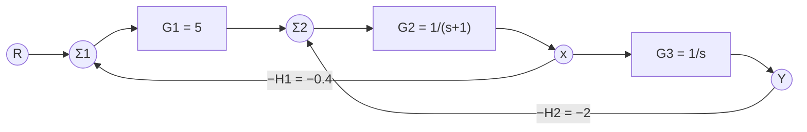

# Problems 15-02 · Transfer Functions and Block Diagrams

Chapter: [15-02](../chapters/15-02-transfer-functions-and-block-diagrams.md) · Worked solutions: [15-02 solutions](../solutions/15-02-solutions.md)

**Tiers:** **[A]** concept/recall · **[B]** standard exam level · **[C]** challenge/design.

**Conventions.** All transfer functions assume zero initial conditions. Feedback is negative unless a problem says otherwise. Component values marked illustrative are chosen for the exercise, not taken from a product.

Suggested approach: do all [A] and [B] problems before looking at any solution. Attempt each [C] problem for at least 20 minutes before reading its solution.

---

## Problems

### Problem 15-02.1 [A]

**From an equation.** A system obeys $\ddot y + 7\dot y + 10y = 5u$. Find its transfer function, its poles, its DC gain and its relative degree.

### Problem 15-02.2 [A]

**Series and parallel.** Two blocks are $G_1 = 1/(s + 1)$ and $G_2 = 2/(s + 3)$. Find the transfer function, DC gain and zeros of (a) the series connection and (b) the parallel connection. Where does the zero in (b) come from?

### Problem 15-02.3 [A]

**The sign matters.** A forward gain $G$ = 4 has a feedback gain $H$ = 0.2. Find the closed-loop gain with (a) negative and (b) positive feedback. (c) With positive feedback, what value of $H$ makes the closed-loop gain infinite, and what does that mean physically?

### Problem 15-02.4 [B]

**Insensitivity.** An amplifier with open-loop gain $G$ = 10⁵ has feedback $\beta$ = 0.01. (a) Find the closed-loop gain. (b) The open-loop gain falls 20% with temperature, to 8 × 10⁴. Find the new closed-loop gain and its exact fractional change. (c) Compare with the estimate (fractional change of $G$)/(1 + $G\beta$) using the original loop gain, and explain the small difference.

### Problem 15-02.5 [B]

**Same poles, different zeros.** A series RLC circuit ($R$ = 10 Ω, $L$ = 1 mH, $C$ = 1 µF) is driven by a source $v_s$. Using the state-space model of Problem 15-01.13 (states $i$ and $v_C$), find the transfer functions (a) $V_C/V_s$ and (b) $I/V_s$. Give the poles, $\omega_n$, $\zeta$ and the DC gain of each, and explain why the two share poles but not zeros.

### Problem 15-02.6 [B]

**Interlocking loops.** A gain $G_1$ = 5 drives $G_2 = 1/(s + 1)$ followed by $G_3 = 1/s$. The output $Y$ is fed back through $H_2$ = 2 to a summing junction between $G_1$ and $G_2$. The signal between $G_2$ and $G_3$ is fed back through $H_1$ = 0.4 to the input summing junction, which also receives $R$; both feedbacks are negative. Neither loop contains the other. (a) Reduce the diagram by moving the $H_1$ pickoff point to the output, and find $Y/R$. (b) Check with Mason's formula. (c) Give the poles and DC gain.

### Problem 15-02.7 [B]

**Sensitivity across frequency.** A unity-feedback loop has $L(s) = 8/[s(s + 2)]$. (a) Find $T(s)$, $\omega_n$ and $\zeta$. (b) Compute $\lvert S\rvert$ and $\lvert T\rvert$ at $\omega$ = 0.5 rad/s and at 10 rad/s. (c) Show that $\lvert S\rvert + \lvert T\rvert \ne 1$ at either frequency, and reconcile that with $S + T = 1$.

### Problem 15-02.8 [B]

**A speed loop with a load.** The motor of Problem 15-01.6 ($R$ = 1 Ω, $K$ = 0.02 V·s/rad, $J$ = 10⁻⁵ kg·m², no friction or inductance) has $\Omega(s) = [V(s)/K - (R/K^2)T_L(s)]/(\tau_ms + 1)$ with $\tau_m = RJ/K^2$. A proportional controller sets $V = K_p(\Omega_{ref} - \Omega)$ with $K_p$ = 0.2 V·s/rad. Find (a) the DC loop gain, (b) the DC tracking gain, (c) the speed droop under a 0.01 N·m load at DC, with and without feedback, and (d) the closed-loop time constant.

### Problem 15-02.9 [B]

**Mason with an untouched loop.** A signal-flow graph has two channels from $R$ to $Y$. Channel 1: $R \to x_1$ (gain 1), $x_1 \to x_2$ ($G_1$ = 4), $x_2 \to x_1$ ($-H_1$, $H_1$ = 0.5), $x_2 \to Y$ ($G_2$ = 1). Channel 2: $R \to x_3$ (gain 1), $x_3 \to x_4$ ($G_3$ = 10), $x_4 \to x_3$ ($-H_2$, $H_2$ = 0.1), $x_4 \to Y$ ($G_4$ = 2). Find $\Delta$, each $\Delta_k$ and $Y/R$ with Mason's formula, and check the result by treating the two channels as blocks in parallel.

### Problem 15-02.10 [B]

**A feedforward path.** The input $R$ drives a gain $G_1$ = 2 into a summing junction, then $G_2 = 1/(s + 1)$, whose output is fed back through $H$ = 3 to that junction. A feedforward gain $G_3$ = 0.5 carries $R$ directly to the output, where it is added to $G_2$'s output to form $Y$. Find $Y/R$ by Mason's formula and by block algebra. Give its pole, zero, DC gain and high-frequency gain.

### Problem 15-02.11 [C]

**A cancellation that hides an unstable mode.** The plant $P = 1/(s - 1)$ is unstable. A designer picks $C = (s - 1)/(s + 2)$ to cancel the pole and closes a unity loop. (a) Find $L$ and $T$. Does the loop look stable? (b) Find the transfer function from a disturbance $d$ at the plant input to $y$. (c) Find $y(t)$ for a unit-step disturbance and its value at $t$ = 5 s. (d) What does this say about cancelling poles?

### Problem 15-02.12 [C]

**A linear regulator's loop.** An LDO's error amplifier has $A(s) = A_0/(1 + s/\omega_a)$ with $A_0$ = 1000 and $\omega_a$ = 2π × 10 kHz. It drives a pass device of transconductance $g_m$ = 0.5 A/V into $R_L$ = 10 Ω in parallel with $C_L$ = 1 µF. The divider gives $\beta$ = 0.5 and $V_{ref}$ = 1.2 V (illustrative). (a) Find the DC loop gain, the output voltage and its fractional error from the ideal $V_{ref}/\beta$. (b) Find the closed-loop DC output resistance and the steady output change for a 100 mA load step, with and without feedback. (c) Find the closed-loop poles, $\omega_n$ (in hertz too), $\zeta$ and the step overshoot. (d) What would you tell the designer?

### Problem 15-02.13 [C]

**Designing a PLL's loop filter.** A charge-pump PLL has $I_{cp}$ = 200 µA, $K_v$ = 2π × 50 MHz/V, $N$ = 50 and $C$ = 4 nF. (a) Find $\omega_n$ and $f_n$. (b) Choose $R$ for $\zeta = 1/\sqrt{2}$. (c) Where is the zero of the closed-loop transfer function? (d) Simulate or compute the overshoot of the divided phase after a reference phase step, and compare it with the 4.3% of a second-order system with no zero.

### Problem 15-02.14 [B]

**Adding an integrator.** A plant $P = 2/(s + 4)$ is controlled by an integral controller $C = K_I/s$ with unity feedback. (a) Find $T(s)$. (b) Choose $K_I$ for $\zeta$ = 0.707 and give $\omega_n$. (c) Find the steady-state error to a unit step and compare with Example 15-02.4's proportional loop.

### Problem 15-02.15 [B]

**Op-amp transfer functions by impedances.** For an ideal op-amp in the inverting configuration, $V_o/V_i = -Z_f(s)/Z_{in}(s)$, where $Z_{in}$ is the input element and $Z_f$ the feedback element, written as Laplace impedances ($R$, $1/(sC)$, $sL$). With $Z_{in} = R_1$ = 10 kΩ: (a) $Z_f$ is $R_2$ = 100 kΩ in parallel with $C$ = 1 nF; find the transfer function, its DC gain and its pole (in rad/s and Hz). (b) $Z_f$ is $R_2$ in series with $C$; find the transfer function and show that it is a PI controller, giving its zero and its integral gain.

---

## Objective coverage

| Learning objective (chapter 15-02) | Problems |
|---|---|
| 1. Transfer functions from equations, state space and impedances; poles, zeros, DC gain | 1, 5, 11, 15 |
| 2. Block-diagram reduction | 2, 3, 6, 10 |
| 3. Closed-loop, sensitivity and disturbance transfer functions | 4, 7, 8, 11, 14 |
| 4. Signal-flow graphs and Mason's gain formula | 6, 9, 10 |
| 5. Regulators and PLLs as block diagrams | 12, 13 |
