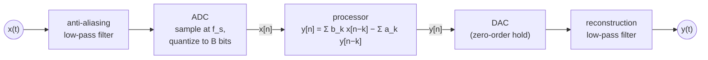

<!-- status: verified -->
# 16-01 · Discrete-Time Signals and Systems Review

| | |
|---|---|
| **Course** | [16 · Digital Signal Processing](../README.md) |
| **University equivalent** | The review chapter that opens a senior DSP course: the DSP signal chain, discrete-time signals, LTI systems, convolution, difference equations and stability, now read as computations with a cost (Oppenheim & Schafer, *Discrete-Time Signal Processing*, ch. 2; Lyons, *Understanding Digital Signal Processing*, ch. 1, 5 and 11) |
| **Prerequisites** | [11-02 System Properties](../../11-signals-and-systems/chapters/11-02-system-properties.md), [11-03 Convolution](../../11-signals-and-systems/chapters/11-03-convolution.md), [11-04 LTI Systems and Differential/Difference Equations](../../11-signals-and-systems/chapters/11-04-lti-systems-and-differential-equations.md), [11-10 Sampling, Aliasing and Reconstruction](../../11-signals-and-systems/chapters/11-10-sampling-aliasing-reconstruction.md), [05-02 NumPy and Vectorization](../../05-programming-for-engineers/chapters/05-02-numpy-and-vectorization.md) |
| **Estimated study hours** | 5 |
| **Last verified** | 2026-11-20 |

**Learning objectives.** After this chapter you can:

1. Trace a signal through the DSP chain (anti-aliasing filter, ADC, processor, DAC, reconstruction filter) and convert between analog frequency, digital frequency and the frequency at which an undersampled tone appears.
2. Decide whether a discrete-time sinusoid is periodic and find its fundamental period.
3. Compute impulse and step responses of FIR and recursive (IIR) difference equations, by recursion and in closed form, and convolve finite sequences by hand.
4. Test BIBO stability from the impulse response and from pole locations, and distinguish input–output stability from internal stability.
5. Evaluate the steady-state response of an LTI system to a sinusoid from its frequency response, using the moving average as the worked case.
6. Count the multiply-accumulates, memory and latency of a filter, and budget a real-time DSP workload in operations, time and energy.

---

## 1. Big picture

Digital signal processing (DSP) replaces resistors, capacitors and op-amps with arithmetic. An analog signal is filtered, sampled and converted to numbers; a processor runs a short formula on every new number; the results are converted back to a voltage, or stay digital and feed a decision. Course 11 built the mathematics of discrete-time signals and systems. This course turns that mathematics into engineering: which filters to build, how to design them to a specification, and what they cost in operations, memory, latency, power and silicon area. This chapter reviews the foundations in that light. Every system is a computation, and every computation has a price.

- **Audio and voice.** Every phone, earbud and smart speaker runs equalizers, echo cancellers and noise suppressors on dedicated DSP cores at 16 to 48 kHz sample rates.
- **Sensors in wearables and IoT.** Heart-rate (PPG), ECG and motion sensors are filtered digitally on low-power microcontrollers; moving averages and exponential averagers like those in this chapter are the workhorses.
- **Radar and automotive.** FMCW radar front ends sample their beat signals and hand them to FFT engines (16-04) and filters; a car's sensor fusion is DSP from end to end.
- **Wireline and optical links.** Receivers at 100 Gb/s per lane and above digitize the incoming waveform with a fast ADC and equalize it with DSP: an FIR filter running at tens of billions of samples per second.
- **AI accelerators.** A convolution layer and an FIR filter are the same multiply-accumulate (MAC) loop; the hardware that serves one serves the other (16-11, 14-14).

## 2. Intuition first

**A filter is a formula applied to a moving window.** A finance analyst already knows two digital filters. The 20-day simple moving average of a price is

$$
y[n] = \frac{1}{20}\left(x[n] + x[n-1] + \dots + x[n-19]\right) ,
$$

a **finite impulse response (FIR)** filter: the output depends only on the last 20 inputs, and a single spike leaves the average exactly 20 days later. The exponential moving average,

$$
y[n] = y[n-1] + \alpha\,(x[n] - y[n-1]) ,
$$

is an **infinite impulse response (IIR)** filter: it feeds its own output back, so a spike decays geometrically and never quite disappears. The EMA needs one stored number and a couple of operations per day; the 20-day average needs 20 stored prices. That trade between memory and arithmetic on one side, and response shape on the other, runs through all of DSP.

**Where the analogy breaks.** Prices are not samples of a band-limited signal, so the sampling theorem gives them no protection: a daily close can alias intraday swings in ways no filter can undo. Markets are also neither linear nor time-invariant. In engineering, the signal is band-limited by an analog filter *before* it is sampled, the system is linear and time-invariant by construction, and the theory below holds exactly.

**Frequency is counted per sample.** Once a signal is a list of numbers, the clock that produced it is gone. A tone at 1 kHz sampled at 48 kHz and a tone at 2 kHz sampled at 96 kHz produce the same sequence. What matters is the angle the sinusoid advances per sample, the **digital frequency** $\omega$ in radians per sample. The fastest possible oscillation alternates sign every sample, $\omega = \pi$, which corresponds to half the sample rate.

*The DSP chain. The anti-aliasing filter removes everything above $f_s/2$ before sampling, the ADC turns voltages into $B$-bit numbers, the processor runs a difference equation once per sample, and the DAC and reconstruction filter turn numbers back into a smooth voltage (11-10). Many chains end at the processor: a heart-rate number or a decoded bit needs no DAC.*

## 3. Theory

### 3.1 Digital frequency and aliasing

Sampling a continuous-time signal $x(t)$ every $T = 1/f_s$ seconds gives $x[n] = x(nT)$. A tone $\cos(2\pi f t)$ becomes

$$
x[n] = \cos(2\pi f nT) = \cos(\omega n), \qquad \omega = \frac{2\pi f}{f_s}\ \text{rad/sample} .
$$

Here $f$ is in hertz and $\omega$ in radians per sample; $f/f_s$, in cycles per sample, is the same quantity divided by $2\pi$. The Nyquist frequency $f_s/2$ maps to $\omega = \pi$.

**Frequencies are only defined modulo 2π.** Because $n$ is an integer, $e^{j2\pi kn} = 1$ for every integer $k$, so

$$
\cos\bigl((\omega + 2\pi k)n\bigr) = \cos(\omega n), \qquad \cos\bigl((2\pi - \omega)n\bigr) = \cos(-\omega n) = \cos(\omega n) .
$$

Two analog tones whose frequencies differ by a multiple of $f_s$, or that are mirror images about a multiple of $f_s$, produce identical samples. A tone at $f$ therefore **appears** at the frequency

$$
f_a = \bigl|\,f - k f_s\,\bigr| \quad\text{with the integer } k \text{ that puts } f_a \text{ in } [0, f_s/2] .
$$

This is **aliasing** (11-10). Nothing after the ADC can tell the alias from a genuine tone at $f_a$, which is why the anti-aliasing filter sits in front of the ADC, and why its design (how steep, how far below $f_s/2$ its transition starts) is a system-level tradeoff between analog filter cost and sample rate (Example 16-01.1).

### 3.2 Discrete-time signals and when sinusoids repeat

The building blocks are the **unit sample** $\delta[n]$ (1 at $n = 0$, else 0), the **unit step** $u[n]$ (1 for $n \ge 0$), the **exponential** $a^n$ and the **sinusoid** $\cos(\omega n + \phi)$. Every sequence is a weighted sum of shifted unit samples, $x[n] = \sum_k x[k]\,\delta[n - k]$ (11-01).

A continuous-time sinusoid is always periodic. A discrete-time one is periodic only if some whole number of samples $N$ advances its phase by a whole number of turns: $\omega N = 2\pi k$, that is,

$$
\frac{\omega}{2\pi} = \frac{k}{N}\quad\text{rational}.
$$

Write $\omega/2\pi$ as a fraction in lowest terms, $k/N$. Then $N$ is the **fundamental period** and $k$ is the number of analog cycles that fit in it. If $\omega/2\pi$ is irrational, as for $\cos(0.3n)$, the samples never repeat exactly, although the sequence still looks like a sinusoid on a plot. One more surprise: $\cos(\omega n)$ oscillates faster as $\omega$ rises only up to $\omega = \pi$. Beyond that it slows down again, because $\cos((2\pi - \omega)n) = \cos(\omega n)$. The highest discrete-time frequency is $(-1)^n$.

### 3.3 LTI systems compute convolutions

A system maps an input sequence to an output sequence. It is **linear** if it respects superposition and scaling, **time-invariant** if delaying the input only delays the output, **causal** if $y[n]$ depends on no future input, and **BIBO stable** if every bounded input gives a bounded output (11-02). For a linear time-invariant (LTI) system, write the input as a sum of shifted unit samples and let $h[n]$ be the response to $\delta[n]$. Linearity and time invariance give the response to $x[k]\delta[n - k]$ as $x[k]h[n - k]$, and adding them up gives the **convolution sum** (11-03):

$$
y[n] = \sum_{k=-\infty}^{\infty} x[k]\,h[n - k] = \sum_{k=-\infty}^{\infty} h[k]\,x[n - k] .
$$

The second form is the one a processor runs. For a causal **FIR** filter of order $M$, $h[k] = b_k$ for $0 \le k \le M$ and zero elsewhere, so

$$
y[n] = \sum_{k=0}^{M} b_k\,x[n - k] .
$$

Each output costs $M + 1$ **multiply-accumulates** (MACs: a product added to a running sum) and needs the last $M$ inputs in memory. Convolving an input of length $L$ with an impulse response of length $M + 1$ gives $L + M$ output samples. The coefficients *are* the impulse response, so designing an FIR filter (16-06) means choosing $h[n]$ directly.

### 3.4 Difference equations: feedback buys a long memory cheaply

A recursive (IIR) filter also feeds back past outputs. With $a_0 = 1$, the **linear constant-coefficient difference equation** is

$$
y[n] = \sum_{k=0}^{M} b_k\,x[n - k] - \sum_{k=1}^{N} a_k\,y[n - k] .
$$

From rest (all past values zero), driving it with $\delta[n]$ and iterating gives $h[0], h[1], \dots$ one sample at a time: this is always the first check of a hand calculation (11-04). A closed form comes from the characteristic roots. Take the first-order case $y[n] = a\,y[n-1] + b\,x[n]$. Iterating with $x = \delta$ gives $h[0] = b$, $h[1] = ab$, $h[2] = a^2b$, so

$$
h[n] = b\,a^n\,u[n] .
$$

Its step response is the running sum of $h$, a finite geometric series:

$$
s[n] = \sum_{k=0}^{n} b\,a^k = b\,\frac{1 - a^{n+1}}{1 - a}, \qquad n \ge 0 .
$$

> **Math refresher — geometric series.** For any $r \ne 1$, $S = 1 + r + \dots + r^{N-1}$ satisfies $S - rS = 1 - r^N$, so $S = (1 - r^N)/(1 - r)$. If $\lvert r\rvert < 1$, then $r^N \to 0$ and the infinite sum is $1/(1 - r)$. Almost every closed form in this chapter is this identity.

**The exponential moving average.** Rewriting the EMA as $y[n] = (1 - \alpha)\,y[n-1] + \alpha\,x[n]$ shows it is the first-order case with $a = 1 - \alpha$ and $b = \alpha$. So

$$
h[n] = \alpha(1 - \alpha)^n u[n], \qquad s[n] = 1 - (1 - \alpha)^{n+1}, \qquad \sum_n h[n] = \frac{\alpha}{1 - (1 - \alpha)} = 1 .
$$

The DC gain is 1, so a constant input passes unchanged. Its decay can be described by a **time constant in samples**, the $\tau_s$ for which $(1 - \alpha)^n = e^{-n/\tau_s}$:

$$
\tau_s = \frac{-1}{\ln(1 - \alpha)} \approx \frac{1}{\alpha} - \frac12 \quad (\alpha \ll 1) ,
$$

using $\ln(1 - \alpha) \approx -\alpha - \alpha^2/2$. Multiplying by $T$ converts it to seconds.

**Noise reduction.** If the input is white noise of variance $\sigma^2$ (independent samples), each output is a weighted sum of independent samples, and variances of independent terms add (03-04): $\sigma_y^2 = \sigma^2\sum_n h[n]^2$. For an $N$-point moving average, $h[n] = 1/N$ and the variance gain is $1/N$. For the EMA, another geometric series gives

$$
\sum_{n=0}^{\infty}\alpha^2(1 - \alpha)^{2n} = \frac{\alpha^2}{1 - (1 - \alpha)^2} = \frac{\alpha}{2 - \alpha} ,
$$

so an EMA reduces white noise as much as a moving average of length $N_{eq} = (2 - \alpha)/\alpha$. It does so with one stored value instead of $N_{eq}$ (Example 16-01.3).

![Two panels comparing an EMA with alpha = 1/16 and a 31-point moving average over 100 samples. Left: impulse responses; the EMA starts at 0.0625 and decays geometrically, still visible past 60 samples, while the moving average is a flat 1/31 for samples 0 to 30 and exactly zero afterwards. Right: step responses; the moving average rises in a straight line and reaches exactly 1 at n = 30, while the EMA rises faster at first, then approaches 1 slowly and enters the shaded 1 percent band only at n = 71.](../../../assets/figures/16-01/ema-vs-ma.svg)

*Figure 1. The EMA ($\alpha$ = 1/16) and the 31-point moving average reduce white noise equally (variance gain 1/31) but settle differently (Example 16-01.3).*

Higher-order recursions work the same way. Each characteristic root $p$ (a pole, 16-02) contributes a mode $p^n$; complex pairs $re^{\pm j\theta}$ give damped sinusoids $r^n\cos(\theta n + \phi)$; a repeated root contributes $n\,p^n$ as well (11-04, Examples 11-04.3 and 11-04.4).

### 3.5 Stability: input–output and internal

**BIBO stability is absolute summability.** If $\lvert x[n]\rvert \le B_x$ for all $n$, then

$$
\lvert y[n]\rvert = \Bigl\lvert\sum_k h[k]\,x[n - k]\Bigr\rvert \le B_x\sum_k \lvert h[k]\rvert ,
$$

so $\sum_k\lvert h[k]\rvert < \infty$ guarantees a bounded output, and the bound $B_x\sum\lvert h\rvert$ is the worst case a designer must size the arithmetic for. Conversely, if the sum diverges, the bounded input $x[n] = \operatorname{sign}(h[-n])$ makes $y[0] = \sum\lvert h[k]\rvert$ infinite (11-02 §3.6). Every FIR filter is stable: its sum has finitely many terms. A recursion is stable exactly when its impulse response decays fast enough.

**For a causal recursion, look at the poles.** The impulse response is a sum of modes $p^n$ and $n^m p^n$. Each is absolutely summable if $\lvert p\rvert < 1$ (a geometric series, or a series dominated by one) and grows or persists if $\lvert p\rvert \ge 1$. So a causal recursion is BIBO stable if and only if every pole lies strictly inside the unit circle, provided no pole is cancelled by a zero (16-02 makes this precise with the z-transform).

- **Pole at $z = 1$:** the accumulator $y[n] = y[n-1] + x[n]$ has $h[n] = u[n]$; a constant input makes its output a ramp. Not BIBO stable.
- **Poles on the unit circle away from 1:** a recursion with poles $e^{\pm j\theta}$ rings forever after one impulse, a digital oscillator. Useful on purpose; a disaster by accident.
- **Poles inside, but close:** stable in theory, but the time constant $-1/\ln\lvert p\rvert$ is long, and finite word length can push a pole across the circle (16-08, 16-10).

**Internal stability.** BIBO stability is a statement about $h[n]$, the input-to-output map. An implementation can hide an unstable or marginal internal mode that the input–output map never shows. The classic case is the **recursive moving sum**,

$$
s[n] = s[n-1] + x[n] - x[n - N] ,
$$

which computes $\sum_{k=0}^{N-1}x[n-k]$ with two additions per sample regardless of $N$. Its impulse response is $N$ ones, so it is FIR and BIBO stable. But it contains an accumulator with a pole at $z = 1$, cancelled by a zero. If anything disturbs the stored $s$ by $\varepsilon$ (a soft error, a roundoff), the error never decays: every later output is off by $\varepsilon$. With floating-point arithmetic a fresh roundoff enters at each step; if those errors are independent, their variances add and the accumulated error grows like the square root of the number of samples. With integer arithmetic there is no roundoff at all, and the structure is exact forever. This is why moving sums and the CIC decimators built from them (16-09) are implemented in integer arithmetic (Example 16-01.4).

**Wraparound makes the integer version safe.** Two's-complement addition with $B$ bits is arithmetic modulo $2^B$ (14-04). Modular arithmetic respects addition and subtraction, so

$$
\bigl((s + x_{new}) \bmod 2^B - x_{old}\bigr) \bmod 2^B = (s + x_{new} - x_{old}) \bmod 2^B .
$$

The final result is therefore correct whenever the true result fits in $B$ bits, even if an intermediate sum wrapped around on the way. Saturating arithmetic, which clamps at the largest value instead of wrapping, breaks this identity: it is the right choice for a filter's *output*, but the wrong one inside a running sum.

### 3.6 Sinusoids in, sinusoids out

Feed a complex exponential $x[n] = e^{j\omega n}$ into an LTI system:

$$
y[n] = \sum_k h[k]\,e^{j\omega(n - k)} = \Bigl(\sum_k h[k]\,e^{-j\omega k}\Bigr)e^{j\omega n} = H(e^{j\omega})\,e^{j\omega n} .
$$

The output is the same exponential scaled by the **frequency response** $H(e^{j\omega})$, the DTFT of $h$ (11-07). For a real system and a real input $\cos(\omega n)$, taking real parts gives the steady-state output $\lvert H(e^{j\omega})\rvert\cos(\omega n + \angle H(e^{j\omega}))$. For a stable system switched on at $n = 0$, this holds once the transient (made of the system's own modes) has died away; for an FIR filter of order $M$, it holds exactly from $n = M$ on.

**The moving average in the frequency domain.** For $h[k] = 1/N$, $0 \le k \le N - 1$, the geometric series with $r = e^{-j\omega}$ gives

$$
H(e^{j\omega}) = \frac{1}{N}\sum_{k=0}^{N-1}e^{-j\omega k} = \frac{1}{N}\,\frac{1 - e^{-j\omega N}}{1 - e^{-j\omega}} .
$$

Factor $e^{-j\omega N/2}$ from the numerator and $e^{-j\omega/2}$ from the denominator, and use $e^{jx} - e^{-jx} = 2j\sin x$:

$$
H(e^{j\omega}) = e^{-j\omega(N-1)/2}\,\frac{\sin(N\omega/2)}{N\sin(\omega/2)} .
$$

Three facts follow. The gain is 1 at DC. It is exactly zero at $\omega = 2\pi m/N$, that is at $f = m f_s/N$ for $m = 1, 2, \dots$: the moving average removes a tone and all its harmonics if $f_s/N$ equals the tone's frequency. And the phase is $-\omega(N - 1)/2$ (plus 180° wherever the real factor is negative), a pure delay of $(N - 1)/2$ samples: the filter has **linear phase**, so every frequency is delayed equally and waveshapes are preserved (16-02, 16-06). The delay is the price of the averaging, and in a control loop or a hearing aid it matters (Example 16-01.2).

*Figure 2. Moving averages at $f_s$ = 1 kHz. Twenty points null 50 Hz and its harmonics but only attenuate 60 Hz; a hundred points null both, at the cost of nulls every 10 Hz and a 49.5 ms delay (Example 16-01.2).*

### 3.7 Block diagrams and the cost of a filter

Three elements build every filter: an **adder**, a **multiplier by a constant**, and a **unit delay** $z^{-1}$ (a register clocked once per sample). The difference equation of §3.4 drawn directly, with separate delay lines for $x$ and $y$, is **direct form I**; it needs $M + N$ delays. Swapping the order of the two halves (allowed for LTI systems) lets them share one delay line, **direct form II**, with $\max(M, N)$ delays (11-04 §3.4; 16-08 covers the numerically better forms). The cost of a filter is counted in four currencies:

- **Arithmetic.** About $M + N + 1$ MACs per output sample, so a filter running at $f_s$ on $C$ channels needs $(M + N + 1)\,f_s\,C$ MACs per second. Recursive filters reach a long memory with few MACs; FIR filters need one MAC per tap.
- **Memory.** One word per delay and per coefficient. Moving the words, not multiplying them, usually dominates energy (§7).
- **Latency.** Three sources add: the filter's own delay (for a linear-phase FIR, $(N - 1)/2$ samples), **block processing** (a processor that handles $L$ samples at a time waits for a block to fill and emits it a block later, about $2L$ samples with double buffering), and the computation itself.
- **Word length.** A sum of $N$ products of $B_x$-bit samples and $B_h$-bit coefficients needs up to $B_x + B_h + \lceil\log_2 N\rceil$ bits to be exact. Narrower accumulators overflow or round; 16-10 quantifies the noise this adds.

A system is **real-time** when it finishes each sample (or block) before the next arrives, on average and in the worst case. The budget is simple: cycles available per sample are $f_{clk}/f_s$; cycles needed are the MAC count divided by the MACs per cycle, plus overhead (Example 16-01.5).

## 4. Worked examples

### Example 16-01.1 · Frequency bookkeeping (tier A)

**Setup.** (a) An audio codec samples at $f_s$ = 48 kHz. Find the digital frequency of a 1 kHz tone and the period of the resulting sequence. (b) A voice channel samples at 8 kHz with a poor anti-aliasing filter, and a 7 kHz interferer gets through. Where does it appear? (c) Are $\cos(3\pi n/8)$ and $\cos(0.3n)$ periodic?

**Solution.** (a) $\omega = 2\pi \times 1/48$ = **0.1309** rad/sample. As a fraction, $\omega/2\pi = 1/48$, so the sequence repeats every **48** samples: exactly one cycle of the tone.

(b) $\omega = 2\pi \times 7/8$ = **5.498** rad/sample. Subtracting $2\pi$ gives $-0.7854 = -\pi/4$, and $\cos(-\pi n/4) = \cos(\pi n/4)$, so the samples are identical to those of a tone at $\omega = \pi/4$, which is $f_a = 8 - 7$ = **1** kHz. The interferer lands in the middle of the voice band, where no digital filter can remove it without removing speech.

(c) $\omega/2\pi = 3/16$ in lowest terms: periodic with fundamental period **16** samples, holding 3 analog cycles. For $\cos(0.3n)$, $\omega/2\pi = 0.3/2\pi$ is irrational, so no whole number of samples spans a whole number of turns: not periodic.

**Units check.** $\omega = 2\pi f/f_s$: (cycles/s)/(samples/s) = cycles/sample, times $2\pi$ rad/cycle.

**Sanity check.** The alias formula $\lvert f - kf_s\rvert$ with $k = 1$ gives $\lvert 7 - 8\rvert = 1$ kHz, in $[0, 4]$ kHz as it must be.

### Example 16-01.2 · A moving average that removes mains hum (tier B)

**Setup.** A wearable ECG front end samples at $f_s$ = 1 kHz and picks up 50 Hz mains interference. A designer proposes an $N$ = 20 point moving average. Find (a) the frequencies it removes completely, (b) its gain at 10 Hz (where ECG energy is significant), at 25 Hz and at 60 Hz (for a product shipped to a 60 Hz country), (c) its delay, and (d) the cost per sample, computed directly and recursively. (e) What $N$ removes both 50 and 60 Hz, and what does that cost?

**Solution.** (a) The nulls are at $f = mf_s/N = 50m$ Hz: **50** Hz and every harmonic (100, 150, ... Hz), which matters because mains interference is rarely a pure sinusoid.

(b) With $\omega = 2\pi f/f_s$, $\lvert H\rvert = \lvert\sin(N\omega/2)/(N\sin(\omega/2))\rvert$:

- 10 Hz: $\sin(0.6283)/(20\sin(0.03142)) = 0.5878/0.6282$ = **0.936** (**−0.578** dB): a mild droop.
- 25 Hz: **0.637**, halfway to the first null and already **−3.91** dB.
- 60 Hz: $\lvert\sin(3.770)\rvert/(20\sin(0.1885))$ = **0.157** (**−16.1** dB): attenuated, not removed.

(c) Linear phase with a delay of $(N - 1)/2$ = **9.5** samples = **9.5** ms.

(d) Directly: 20 MACs per sample (in practice 19 additions and one multiplication by 1/20, or a shift if $N$ is a power of 2). Recursively, $s[n] = s[n-1] + x[n] - x[n-20]$ and $y = s/20$: **2** additions and one scaling per sample, whatever $N$ is, but still 20 stored samples for the $x[n - N]$ term.

(e) The nulls must fall on multiples of both 50 and 60 Hz, so $f_s/N$ must divide 10 Hz: $N$ = **100**. The delay grows to **49.5** ms, and the first null moves down to 10 Hz, so the passband shrinks: the gain at 5 Hz is only **0.637**. A notch filter (16-07) or an adaptive canceller removes one frequency with far less collateral damage.

**Units check.** $f_s/N$: (samples/s)/samples = 1/s.

**Sanity check.** At 25 Hz, $N\omega/2 = 20 \times 2\pi \times (25/1000)/2 = \pi/2$, so the numerator is 1; because $\omega$ is small, $N\sin(\omega/2) \approx N\omega/2 = \pi/2$, and $\lvert H\rvert \approx 2/\pi$ = 0.637, matching.

### Example 16-01.3 · Exponential moving average against moving average (tier B)

**Setup.** A sensor hub smooths a 1 kHz accelerometer stream with an EMA, $\alpha$ = 1/16, chosen because multiplying by 1/16 is a 4-bit shift. Find its time constant in samples and in milliseconds, how many samples its step response takes to come within 1% of the final value, and the length of moving average with the same white-noise reduction. Compare the two filters' settling and cost.

**Solution.** $\tau_s = -1/\ln(15/16)$ = **15.49** samples (the approximation $1/\alpha - 1/2$ gives 15.5), or **15.5** ms at 1 kHz.

The step response is $s[n] = 1 - (15/16)^{n+1}$, so the error is $(15/16)^{n+1}$. It falls to 1% when $n + 1 \ge \ln 0.01/\ln(15/16) = 71.36$, so the first sample within 1% is $n$ = **71**.

The noise-variance gain is $\alpha/(2 - \alpha)$ = **1/31** = 0.03226, the same as a moving average of $N_{eq} = (2 - \alpha)/\alpha$ = **31** samples.

The 31-point moving average reaches its final value *exactly* at $n$ = **30** and stays there: an FIR filter forgets completely. The EMA takes 71 samples to reach 1% and never fully forgets. In exchange it needs one stored value and, per sample, one subtraction, one shift and one addition, against 31 stored samples (and either 31 additions or the recursive sum's two additions) for the moving average.

**Units check.** $\tau = \tau_sT$ = 15.49 × 1 ms.

**Sanity check.** Three time constants leave about 5% ($e^{-3}$), five about 0.7% ($e^{-5}$); 71 samples is **4.58** time constants, between the two.

### Example 16-01.4 · The recursive moving sum, in wraparound and saturating arithmetic (tier C)

**Setup.** A 4-sample moving sum $s[n] = s[n-1] + x[n] - x[n-4]$ runs on an 8-bit signed accumulator (range −128 to 127) in a small sensor ASIC. Every hardware add first forms $s[n-1] + x[n]$, then subtracts $x[n-4]$. The input is $x = 25, 30, 32, 33, 30$ ($n$ = 0 to 4). (a) Trace the accumulator with two's-complement wraparound, and compare $s[4]$ with the true sum. (b) Repeat with saturating arithmetic (clamp at −128 and 127). (c) What happens to each implementation if a single-event upset adds 1 to the stored $s$ at $n = 2$?

**Solution.** (a) From rest: $s[0]$ = 25, $s[1]$ = 55, $s[2]$ = 87, $s[3]$ = 120 (no subtraction yet, since $x[n-4]$ = 0 for $n < 4$). At $n$ = 4, the intermediate $120 + 30 = 150$ exceeds 127 and wraps to $150 - 256$ = **−106**. Then $-106 - x[0] = -106 - 25 = -131$, which wraps to $-131 + 256$ = **125**. The true sum $x[1] + x[2] + x[3] + x[4] = 30 + 32 + 33 + 30$ = 125: correct, because the true result fits in 8 bits and modular arithmetic respects addition (§3.5).

(b) With saturation, the intermediate clamps at 127, and $127 - 25$ = **102**: wrong by **23**, and wrong forever after, since the error is now stored in the accumulator.

(c) The upset adds 1 to $s[2]$, and the recursion carries it unchanged: every later output is one too large, in either arithmetic. The input–output map is FIR, but the structure holds an undamped mode at $z = 1$. Robust designs reset or recompute the sum periodically, or use a direct (non-recursive) sum whose error leaves after $N$ samples.

**Units check.** Counts (integer codes) throughout.

**Sanity check.** Wraparound errors come in multiples of 256 and cancel in pairs here (one wrap up, one wrap down); saturation errors are arbitrary and do not cancel.

### Example 16-01.5 · A real-time budget for an audio product (tier C)

**Setup.** A stereo audio product runs, per channel at 48 kHz, a 256-tap linear-phase FIR equalizer and 10 biquad (second-order IIR) sections of 5 MACs each. Its DSP core runs at 200 MHz and completes 2 MACs per cycle. Processing is in blocks of 64 samples with double buffering. Find (a) the MAC rate and the core's load, (b) the cycles available and needed per sample per channel, (c) the latency from the filter and from the blocks, and (d) a rough energy per second at 45 nm, using Horowitz's figures (§7: 3.1 pJ for a 32-bit integer multiply plus 0.1 pJ for the add; 10 pJ per access to an 8 KB SRAM; about 70 pJ of overhead per instruction on a general-purpose core).

**Solution.** (a) MACs per sample per channel: $256 + 10 \times 5 = 306$. Rate: $2 \times 48{,}000 \times 306$ = **29.376** million MACs per second. Capacity: $200\text{ MHz} \times 2$ = 400 million per second, so the load is **7.34**%.

(b) Cycles available per sample per channel: $200 \times 10^6/(2 \times 48{,}000)$ = **2083** cycles; needed: $306/2$ = **153** cycles. The slack covers control code, the block transfers and a margin for worst-case interrupts.

(c) The linear-phase FIR delays by $(256 - 1)/2$ = 127.5 samples = **2.656** ms. Double-buffered 64-sample blocks add $2 \times 64$ = 128 samples = **2.667** ms. Total **5.32** ms, before any delay in the ADC and DAC's own filters.

(d) Arithmetic: $29.376 \times 10^6 \times 3.2$ pJ = **94.0** µW. Memory: two SRAM reads per MAC (a coefficient and a sample), $29.376 \times 10^6 \times 20$ pJ = **588** µW, more than six times the arithmetic. On a general-purpose core issuing one two-MAC instruction per cycle, the instruction overhead alone is $14.688 \times 10^6 \times 70$ pJ = **1.03** mW. This is why audio, sensor and baseband DSP runs on specialized cores and hardwired datapaths: the multiplier is the cheap part.

**Units check.** MAC/s × J/MAC = W.

**Sanity check.** 7.34% load × 2083 cycles = 153 cycles, consistent with (b).

### Answer key

<!-- answer-key -->

| ID | Quantity | Value | Unit |
|---|---|---|---|
| Ex 16-01.1a | digital frequency of 1 kHz at 48 kHz | 0.1309 | rad/sample |
| Ex 16-01.1b | period of that sequence | 48 | samples |
| Ex 16-01.1c | digital frequency of 7 kHz at 8 kHz | 5.498 | rad/sample |
| Ex 16-01.1d | apparent frequency of the 7 kHz tone | 1 | kHz |
| Ex 16-01.1e | period of cos(3πn/8) | 16 | samples |
| Ex 16-01.2a | first null of the 20-point average | 50 | Hz |
| Ex 16-01.2b | gain at 10 Hz | 0.936 | — |
| Ex 16-01.2c | gain at 10 Hz | −0.578 | dB |
| Ex 16-01.2d | gain at 25 Hz | 0.637 | — |
| Ex 16-01.2m | gain at 25 Hz | −3.91 | dB |
| Ex 16-01.2e | gain at 60 Hz | 0.157 | — |
| Ex 16-01.2f | gain at 60 Hz | −16.1 | dB |
| Ex 16-01.2g | delay | 9.5 | samples |
| Ex 16-01.2h | delay | 9.5 | ms |
| Ex 16-01.2i | additions per sample, recursive | 2 | — |
| Ex 16-01.2j | N for 50 and 60 Hz nulls | 100 | — |
| Ex 16-01.2k | delay for N = 100 | 49.5 | ms |
| Ex 16-01.2l | gain at 5 Hz for N = 100 | 0.637 | — |
| Ex 16-01.3a | EMA time constant | 15.49 | samples |
| Ex 16-01.3b | EMA time constant at 1 kHz | 15.5 | ms |
| Ex 16-01.3c | first sample within 1% | 71 | — |
| Ex 16-01.3d | noise-variance gain | 0.03226 | — |
| Ex 16-01.3e | equivalent moving-average length | 31 | samples |
| Ex 16-01.3f | settling sample of the 31-point average | 30 | — |
| Ex 16-01.3g | 71 samples in time constants | 4.58 | — |
| Ex 16-01.4a | wrapped intermediate at n = 4 | −106 | — |
| Ex 16-01.4b | wrapped result s[4] | 125 | — |
| Ex 16-01.4c | saturated result s[4] | 102 | — |
| Ex 16-01.4d | saturation error | 23 | — |
| Ex 16-01.5a | MAC rate | 29.376 | M/s |
| Ex 16-01.5b | core load | 7.34 | % |
| Ex 16-01.5c | cycles available per sample per channel | 2083 | — |
| Ex 16-01.5d | cycles needed per sample per channel | 153 | — |
| Ex 16-01.5e | FIR latency | 2.656 | ms |
| Ex 16-01.5f | block latency | 2.667 | ms |
| Ex 16-01.5g | total latency | 5.32 | ms |
| Ex 16-01.5h | arithmetic power | 94.0 | µW |
| Ex 16-01.5i | SRAM power | 588 | µW |
| Ex 16-01.5j | instruction-overhead power | 1.03 | mW |
| Txt 16-01.a | Q1 apparent frequency | 100 | Hz |
| Txt 16-01.b | Q2 period | 10 | samples |
| Txt 16-01.c | Q4 approximate time constant | 7.5 | samples |
| Txt 16-01.d | Q4 exact time constant | 7.49 | samples |
| Txt 16-01.e | Q4 equivalent length | 15 | samples |
| Txt 16-01.f | Q6 delay | 50 | samples |
| Txt 16-01.g | Q6 delay | 3.125 | ms |
| Txt 16-01.h | Q6 MAC rate | 1.616 | M/s |
| Txt 16-01.i | 30-tap FFE at 106.25 GBd, one sample per symbol | 3.19 | 10¹² MAC/s |

## 5. Simulate it

The lab, [labs/16-01-lab](../labs/16-01-lab/README.md), provides `dtsys.py`: digital frequency and aliasing helpers, a direct convolution that counts MACs, a direct-form-I recursion, impulse and step responses, pole-based stability tests, the moving-average gain, an EMA, and a recursive moving sum with optional two's-complement wraparound. You:

1. **Alias a tone** and confirm Example 16-01.1 by sampling 7 kHz at 8 kHz and comparing the samples with a 1 kHz tone.
2. **Convolve and count:** check the direct convolution against `numpy.convolve` and count its MACs.
3. **Remove mains hum** from a synthetic ECG-like signal with the 20-point and 100-point moving averages (Example 16-01.2).
4. **Compare EMA and moving average** on noisy steps: settling, residual noise and cost (Example 16-01.3).
5. **Break a running sum:** reproduce Example 16-01.4 and watch a float32 running sum drift while the integer one stays exact.
6. **Build it in hardware:** a 4-sample moving sum in Verilog (`movsum4.v`) with a self-checking testbench that compares it, in wraparound arithmetic, with a reference model.

**Guided exercise (predict, then run).** **Before Part 4,** predict which filter has the smaller residual noise after settling and which settles first, given that both have the same white-noise variance gain. (Same residual noise by construction; the moving average settles in 31 samples, the EMA in about 71 to 1%.)

## 6. Engineering tradeoffs

| Knob | Improves | Costs | Typical decision owner |
|---|---|---|---|
| Moving-average length $N$ | Noise reduction ($1/N$ variance), null spacing $f_s/N$ | Delay $(N - 1)/2$ samples; passband droop; $N$ words of memory | Algorithm or firmware engineer |
| EMA factor $\alpha$ | Smaller $\alpha$: more smoothing with one stored word | Slower response (time constant ≈ $1/\alpha$ samples); infinite memory of disturbances | Firmware engineer |
| FIR versus IIR | FIR: linear phase, always stable, exact settling | FIR: many more MACs and words for a sharp response | DSP architect |
| Recursive versus direct sum | Recursive: 2 additions per sample at any $N$ | Internal marginal mode: needs exact integer arithmetic and protection against upsets | Hardware designer |
| Sample rate $f_s$ | Higher: easier anti-aliasing filter, more bandwidth | MACs/s and power scale with $f_s$; faster ADC | System architect |
| Accumulator width | No overflow, less rounding noise | Wider adders and registers (area, power) | Hardware designer |
| Block size $L$ | Fewer interrupts and better processor efficiency | About $2L$ samples of extra latency | Firmware or system architect |

## 7. Numbers to know

| Quantity | Value | Source |
|---|---|---|
| Audio sample rates | 44.1 kHz (CD), 48 kHz (professional and video); voice 8 kHz (narrowband), 16 kHz (wideband) | Long-standing industry conventions |
| Digital frequency | $\omega = 2\pi f/f_s$ rad/sample; Nyquist at $\omega = \pi$ | §3.1 |
| $N$-point moving average | Nulls at $mf_s/N$; delay $(N - 1)/2$ samples; noise variance gain $1/N$ | §3.6, §3.4 |
| EMA with factor $\alpha$ | Time constant $\approx 1/\alpha - 1/2$ samples; noise gain $\alpha/(2 - \alpha)$ | §3.4 |
| Accumulator growth | $\lceil\log_2 N\rceil$ extra bits for a sum of $N$ terms | §3.7 |
| Energy per operation, 45 nm, 0.9 V | 32-bit integer multiply 3.1 pJ, add 0.1 pJ; 8-bit multiply 0.2 pJ; 64-bit read of an 8 KB SRAM 10 pJ; DRAM 1.3–2.6 nJ; about 70 pJ per instruction of processor overhead | Horowitz, ISSCC 2014 [1] (R-208) **[Established]** |

The 45 nm energies are a decade-old reference point; newer processes lower every entry, so use them for ratios (memory access against arithmetic, overhead against operation), not for absolute power in a current product.

## 8. Common mistakes

- **Treating $\omega$ as rad/s.** Digital frequency is per sample; convert with $f_s$ every time.
- **Assuming every discrete-time sinusoid is periodic.** $\cos(0.3n)$ never repeats.
- **Expecting a higher $\omega$ to mean a faster oscillation beyond $\pi$.** $\cos(1.9\pi n)$ looks exactly like $\cos(0.1\pi n)$.
- **Filtering after sampling to remove an alias.** Once a tone has aliased onto the band of interest, no digital filter can separate it.
- **Calling a filter stable because its coefficients are small**, or unstable because they are large. Stability is about poles (or $\sum\lvert h\rvert$), not coefficient size.
- **Trusting BIBO stability for a structure with a cancelled pole on the unit circle.** The recursive moving sum is FIR from outside and an accumulator inside.
- **Using saturation inside a running sum or CIC filter.** Wraparound is exact there; saturation is not.
- **Forgetting the latency of linear phase and of block processing** in a loop (a hearing aid, a control loop, active noise cancellation).
- **Counting only multiplies.** Memory traffic and instruction overhead usually cost more energy than the arithmetic.

## 9. Practitioner lens

### State of the art (as of Nov 2026)

- **DSP is a feature of every processor class.** Microcontroller cores add DSP instructions and short vectors. Arm's Helium extension (the M-Profile Vector Extension of Armv8.1-M, announced in February 2019) gives Cortex-M cores 128-bit vector registers; the Cortex-M55 executes them 64 bits per cycle, which Arm documents as two 32-bit, four 16-bit or eight 8-bit MACs per cycle. Helium cores so far are the Cortex-M55 (2020), M85 (2022), M52 (2023, a single-beat option at half that rate) and M42 (announced 10 Nov 2026) (R-233) **[Established]**. FPGAs embed hundreds to thousands of hardened multiply-accumulate slices; AMD's UltraScale+ DSP48E2, for example, pairs a 27 × 18 multiplier with a 48-bit accumulator, so that long sums do not overflow (R-157) **[Established]**.
- **High-speed links became DSP problems.** IEEE P802.3dj (200 Gb/s per lane Ethernet) signals PAM4 at 106.25 GBd on electrical lanes and targets channels with up to 40 dB of loss at 53.125 GHz, the Nyquist frequency of that symbol rate (R-141, R-234) **[Established]**. As of Nov 2026 it had passed IEEE SA ballot and was on the 8–9 Dec 2026 RevCom and Standards Board agendas, not yet an approved standard (R-234). Published receivers for this class digitize the line and equalize it in DSP: Intel's 224 Gb/s receiver (ISSCC 2022, 5 nm) uses a 6-bit, 64-way time-interleaved ADC and an FFE of up to 30 taps with an optional DFE, and Marvell's 212 Gb/s transceiver (ISSCC 2024) samples at 106 GS/s and follows the ADC with an FFE, a reflection canceller and optional DFE and sequence detection (R-235, from the papers' abstracts) **[Established]**. At one sample per symbol, a 30-tap FFE at 106.25 GBd is **3.19** × 10¹² MACs per second per lane, which is why these filters are hardwired, massively parallel datapaths rather than code.
- **The MAC is the unit of account.** DSP cores, AI accelerators and FPGA vendors quote throughput in MACs (or operations, two per MAC) per second; the energy per MAC, including its data movement, is the figure that decides battery life in wearables and power density in datacenter links.

### Why it matters commercially

DSP content is where analog companies and digital companies meet. A sensor-hub MCU wins a wearable socket on microwatts per filter; a SerDes vendor wins a switch socket on picojoules per bit, much of it spent in DSP equalization; an audio DSP IP licensor sells MACs per milliwatt. Moving a function from analog to DSP shifts value from analog design and trimming to digital design, verification and software, and changes who can compete: digital logic scales with process nodes, analog does not scale nearly as well. Diligence on any of these businesses comes down to the four currencies of §3.7: operations, memory, latency and power, at the target sample rate.

### Marketing vs Reality

- **"X GMACs (or TOPS) peak."** Peak assumes every multiplier is busy every cycle with data already in registers. Sustained throughput is limited by memory bandwidth, data layout and control overhead; ask for utilization on a named workload. Example 16-01.5's core runs at 7% load, and its energy is dominated by memory and instruction overhead, not by the multipliers.
- **"N× DSP performance."** Relative claims depend on the baseline (which older core, which compiler, which data width) and on the kernel (an FIR filter vectorizes perfectly; a recursive IIR filter does not, because each output depends on the previous one). Arm's launch material for the Cortex-M55 promised "a 5x uplift in DSP performance ... compared to previous Cortex-M generations" without naming, in the pages read, the core or benchmark behind it (R-233) **[Contested]**: a vendor best case until the kernel list and baseline are known. Ask for both.
- **"Zero latency."** Every linear-phase FIR delays by half its length and every block-based pipeline by about two blocks; "zero" usually means "below a threshold someone chose".
- **"Digital means no drift."** Digital coefficients do not drift, but a recursive structure with a marginal internal mode can accumulate errors (Example 16-01.4), and finite word length moves poles (16-10).

### Questions for engineering leaders

1. **"What is the sustained MAC rate on our actual kernels, and what limits it?"** *Strong:* gives utilization per kernel and names the bottleneck (memory bandwidth, recursion, data shuffles). *Evasive:* repeats the peak figure.
2. **"Where does the energy go per output sample?"** *Strong:* splits arithmetic, local memory, external memory and control, with measured or simulated numbers. *Evasive:* "the multipliers are very efficient".
3. **"What is the end-to-end latency budget, and who owns each part?"** *Strong:* lists converter filters, algorithmic delay, block buffering and compute, with a worst case. *Evasive:* quotes only the algorithmic delay.
4. **"How do you prevent overflow and error accumulation in recursive structures?"** *Strong:* explains accumulator sizing, wraparound versus saturation, periodic resets, and how they were verified. *Evasive:* "we use floating point, so it can't overflow".
5. **"What did the anti-aliasing and sample-rate choice cost elsewhere?"** *Strong:* shows the tradeoff between analog filter order, ADC rate and DSP load. *Evasive:* treats the sample rate as given.

## 10. Concept check

**Q1.** A tone at 900 Hz is sampled at 1 kHz without an anti-aliasing filter. At what frequency does it appear, and why can no later digital filter fix this?

Answer

At $\lvert 900 - 1000\rvert$ = 100 Hz. Its samples are identical to those of a genuine 100 Hz tone, so any filter treats the two the same way. The alias must be prevented before sampling.

**Q2.** Is $\cos(\pi n/5)$ periodic? What is its period?

Answer

Yes: $\omega/2\pi = 1/10$, so the period is 10 samples (one analog cycle per period).

**Q3.** Why is every FIR filter BIBO stable, and what is the worst-case output for inputs bounded by 1?

Answer

$\sum\lvert h[k]\rvert$ has finitely many finite terms, so it is finite. The worst-case output magnitude is exactly that sum, reached by the input $\operatorname{sign}(h[n_0 - k])$ aligned with the coefficients.

**Q4.** An EMA has $\alpha$ = 1/8. Roughly what is its time constant in samples, and which moving-average length gives the same white-noise reduction?

Answer

About $1/\alpha - 1/2 = 7.5$ samples (exactly $-1/\ln(7/8) = 7.49$). The equivalent length is $(2 - \alpha)/\alpha = 15$.

**Q5.** The recursive moving sum has a finite impulse response. Why is it nevertheless unsafe in floating-point arithmetic?

Answer

It contains an accumulator with a pole at $z = 1$, cancelled by a zero. Roundoff errors entering the accumulator are never removed, so they build up (like a random walk) even though the ideal input–output map is FIR. Integer arithmetic, with no roundoff and with wraparound, keeps it exact.

**Q6.** A 101-tap linear-phase FIR filter runs at 16 kHz. What is its delay, and how many MACs per second does it need on one channel?

Answer

50 samples = 3.125 ms; $101 \times 16{,}000$ = 1.616 million MACs per second.

Practice: [Problems 16-01](../problems/16-01-problems.md) · [Solutions](../solutions/16-01-solutions.md)

## 11. Key terms

[Discrete-time frequency](../../../reference/glossary.md#discrete-time-frequency) · [Aliasing](../../../reference/glossary.md#aliasing-sampling) · [Anti-aliasing filter](../../../reference/glossary.md#anti-aliasing-filter) · [Convolution sum](../../../reference/glossary.md#convolution-sum) · [FIR filter](../../../reference/glossary.md#fir-filter) · [IIR filter](../../../reference/glossary.md#iir-filter) · [Difference equation](../../../reference/glossary.md#difference-equation) · [BIBO stability](../../../reference/glossary.md#bibo-stability) · [Internal stability](../../../reference/glossary.md#internal-stability) · [Multiply-accumulate (MAC)](../../../reference/glossary.md#multiply-accumulate-mac) · [Moving-average filter](../../../reference/glossary.md#moving-average-filter) · [Exponential moving average (EMA)](../../../reference/glossary.md#exponential-moving-average-ema) · [Recursive moving sum](../../../reference/glossary.md#recursive-moving-sum) · [Linear phase](../../../reference/glossary.md#linear-phase) · [Wraparound](../../../reference/glossary.md#wraparound) · [Block processing](../../../reference/glossary.md#block-processing) · [Real-time constraint](../../../reference/glossary.md#real-time-constraint)

## 12. Connections

- **Builds on:** [11-02 System Properties](../../11-signals-and-systems/chapters/11-02-system-properties.md) (linearity, causality, BIBO stability), [11-03 Convolution](../../11-signals-and-systems/chapters/11-03-convolution.md), [11-04 LTI Systems and Differential/Difference Equations](../../11-signals-and-systems/chapters/11-04-lti-systems-and-differential-equations.md) (recursion, realizations), [11-07 Discrete-Time Fourier Transform](../../11-signals-and-systems/chapters/11-07-discrete-time-fourier-transform.md), [11-10 Sampling, Aliasing and Reconstruction](../../11-signals-and-systems/chapters/11-10-sampling-aliasing-reconstruction.md), [14-04 Computer Arithmetic and Number Formats](../../14-computer-organization-and-architecture/chapters/14-04-computer-arithmetic-and-number-formats.md) (two's complement, wraparound).
- **Next:** [16-02 DTFT and z-Transform for DSP](16-02-dtft-and-z-transform-for-dsp.md) turns poles, zeros and frequency response into design tools.
- **Used later:** FIR design in [16-06](16-06-fir-filter-design.md), recursive structures in [16-08](16-08-filter-structures.md), moving sums and CIC filters in [16-09](16-09-multirate-dsp.md), word length in [16-10](16-10-quantization-and-fixed-point.md), MAC hardware in [16-11](16-11-dsp-hardware-architectures.md); the same filters equalize links in Course 17 and digitize sensors in the data-converter chapters.

## 13. Further study

- Oppenheim & Schafer, *Discrete-Time Signal Processing*, 3rd ed., ch. 2 (discrete-time signals and systems, convolution, difference equations, stability).
- Lyons, *Understanding Digital Signal Processing*, 3rd ed., ch. 1 (discrete sequences), ch. 5 (FIR filters and the moving average) and ch. 11 (signal averaging, including exponential averagers).
- MIT OCW 6.341 *Discrete-Time Signal Processing* (Fall 2005), lectures 1–2.
- Horowitz, "Computing's energy problem" [1], for why data movement dominates energy.

## 14. Sources

1. M. Horowitz, "1.1 Computing's energy problem (and what we can do about it)", ISSCC 2014 Digest of Technical Papers, pp. 10–14, doi:10.1109/ISSCC.2014.6757323. Research log [R-208] and [R-157] (energy per operation, 45 nm).
2. AMD, UltraScale architecture DSP slice documentation (DSP48E2: 27 × 18 multiplier, 48-bit accumulator). Research log [R-157].
3. IEEE P802.3dj (200 Gb/s per lane Ethernet) objectives, 14 Mar 2024. Research log [R-141].
4. Arm, Armv8.1-M and Helium announcement (14 Feb 2019), Cortex-M55/M85/M52/M42 announcements and product pages, and the white paper "Blending DSP and ML features into a low-power general-purpose processor" (2020). Research log [R-233].
5. IEEE P802.3dj task-force key motions (May 2023), baseline proposal (Jan 2024), November 2026 task-force report and the 8 Dec 2026 RevCom agenda. Research log [R-234].
6. A. Khairi et al., "A 1.41-pJ/b 224-Gb/s PAM4 6-bit ADC-Based SerDes Receiver ...", IEEE JSSC, Jan 2023, pp. 8–18 (journal version of the ISSCC 2022 paper, doi:10.1109/ISSCC42614.2022.9731794); J.-Q. Wang et al., "A 2.69pJ/b 212Gb/s DSP-Based PAM-4 Transceiver for Optical Direct-Detect Application in 5nm FinFET", ISSCC 2024, paper 7.1. Abstracts only. Research log [R-235].
7. A. V. Oppenheim and R. W. Schafer, *Discrete-Time Signal Processing*, 3rd ed., Pearson, 2010, ch. 2.
8. R. G. Lyons, *Understanding Digital Signal Processing*, 3rd ed., Prentice Hall, 2011.
