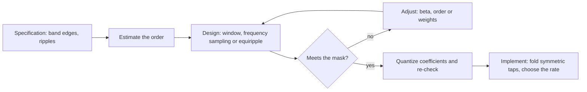
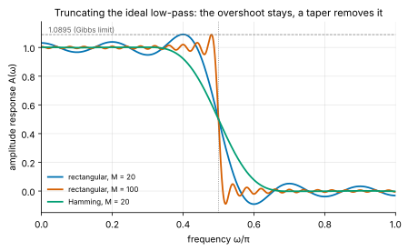
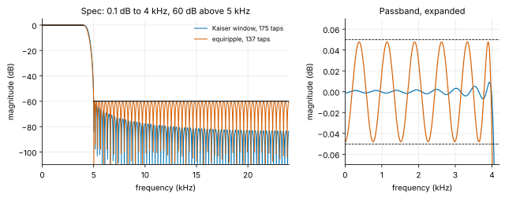

<!-- status: reviewed -->
# 16-06 · FIR Filter Design

| | |
|---|---|
| **Course** | [16 · Digital Signal Processing](../README.md) |
| **University equivalent** | The FIR-design chapter of a senior DSP course: linear phase, the window and Kaiser methods, frequency sampling, Parks–McClellan equiripple design and order estimation (Oppenheim & Schafer, *Discrete-Time Signal Processing*, ch. 7; Lyons, *Understanding Digital Signal Processing*, ch. 5; Parks and McClellan [1]) |
| **Prerequisites** | [16-02 DTFT and z-Transform for DSP](16-02-dtft-and-z-transform-for-dsp.md), [16-05 Spectral Analysis and Windowing](16-05-spectral-analysis-and-windowing.md), [11-07 Discrete-Time Fourier Transform](../../11-signals-and-systems/chapters/11-07-discrete-time-fourier-transform.md) (truncation and windows) |
| **Estimated study hours** | 9 |
| **Last verified** | 2026-11-20 |

**Learning objectives.** After this chapter you can:

1. Derive the amplitude response, group delay and forced zeros of the four types of linear-phase FIR filter, and choose a type for a given response.
2. Write a filter specification as band edges and ripples, and convert ripples between decibels and linear tolerances.
3. Design by the window method: derive the ideal impulse response, explain the Gibbs overshoot, and choose a fixed window or a Kaiser window and its length from a specification.
4. Design by frequency sampling, and use a transition sample to trade passband accuracy for stopband attenuation.
5. Explain equiripple (Parks–McClellan) design through the alternation theorem and the Remez exchange, set its weights, and confirm a design by counting alternations.
6. Estimate the order of a filter before designing it, check the result against the specification, and turn it into an implementation cost (taps, delay, multiplications per second).

---

## 1. Big picture

16-01 to 16-05 analysed filters someone else had designed. This chapter turns a requirement ("pass 0 to 4 kHz within 0.1 dB, reject everything above 5 kHz by 60 dB") into a list of coefficients. FIR filters are the default choice in most of DSP because they can have **exactly linear phase** (every frequency delayed by the same time, so waveforms keep their shape), they are always stable, and they tolerate coarse coefficient arithmetic. Their price is length: a sharp FIR filter needs many taps, and every tap is a multiplication per sample. FIR design is therefore an optimization in two currencies: how closely the response meets the specification, and how many multiplications per second it costs.

- **Data converters.** Every delta-sigma ADC ends in a decimation filter and every audio DAC starts with an interpolation filter; their passband ripple, stopband attenuation and group delay are data-sheet lines (§9).
- **Radios and wireline links.** Channel-selection, pulse-shaping and equalizer filters in basebands and SerDes receivers are FIR filters running at hundreds of megasamples per second.
- **FPGA and ASIC datapaths.** FPGA DSP blocks include a pre-adder whose most common use is to halve the multipliers of symmetric (linear-phase) FIR filters (§9).
- **Sensors and audio.** Wearables, hearing aids, microphones and vibration monitors filter with FIRs on microcontrollers and DSP cores, where the tap count sets the power.

## 2. Intuition first

**The ideal filter is impossible, so approximate it.** A brick-wall low-pass filter (gain 1 up to the cutoff, 0 above) has an impulse response that extends forever in both directions (11-07). To build it, keep a finite piece and delay it so it starts at $n = 0$. What is left is an approximation, and design is the art of choosing *which* finite filter approximates best. Three answers dominate practice:

1. **Window method.** Cut the ideal response to length and taper it smoothly. Simple, robust, and slightly wasteful.
2. **Frequency sampling.** Pin the response to the desired values at evenly spaced frequencies and let it do what it will in between.
3. **Equiripple (minimax).** Spread the error evenly so that its *worst* value is as small as possible. This gives the shortest filter for a given tolerance, which is why it dominates when taps cost silicon.

**Linear phase as a delay.** A filter whose taps are symmetric about their midpoint behaves, apart from its gain shaping, like a pure delay of half its length. Each pair of symmetric taps contributes a cosine centred on the midpoint, so the phase is exactly $-\omega$ times the half-length. Audio transients, radar pulses and data symbols come out with their shape intact, only late.

**Analogy: two ways to hedge.** A treasurer hedging a liability with a handful of instruments can minimize the *average* squared tracking error, or minimize the *worst* shortfall in any scenario. The first leaves rare large misses; the second spreads small misses evenly over all scenarios. Truncation is the least-squares choice (§3.3); Parks–McClellan is the worst-case choice (§3.7). Specifications in DSP are written as worst-case tolerances, so the worst-case design meets them with the fewest instruments (taps). **Where the analogy breaks:** a hedge faces random scenarios with probabilities attached, while a filter's error is a deterministic function of frequency, and every frequency in a band counts equally unless we weight it.

*Figure 1. The FIR design loop. Every method in this chapter fills the "Design" box; the estimate-check-adjust loop around it is the same for all of them, and coefficient quantization (16-10) forces one more check.*

## 3. Theory

Notation: a filter of **order** $M$ has $M + 1$ **taps** $h[0], \dots, h[M]$ and transfer function $H(z) = \sum_{n=0}^{M} h[n]z^{-n}$. Frequencies $\omega$ are in radians per sample; $\omega = 2\pi f/f_s$ for a frequency $f$ in hertz at sample rate $f_s$.

### 3.1 Specifying a filter

A low-pass **specification** (also called a tolerance scheme) has four numbers:

- the **passband edge** $\omega_p$ and the **stopband edge** $\omega_s$, with the **transition band** $\Delta\omega = \omega_s - \omega_p$ between them, where anything is allowed;
- the **passband ripple** $\delta_p$: in $0 \le \omega \le \omega_p$ the gain must stay within $1 \pm \delta_p$;
- the **stopband ripple** $\delta_s$: in $\omega_s \le \omega \le \pi$ the gain must stay below $\delta_s$.

Data sheets quote these in decibels. The **stopband attenuation** is $A_s = -20\log_{10}\delta_s$ dB. The passband ripple is quoted either as a peak-to-peak figure $A_p = 20\log_{10}\big((1 + \delta_p)/(1 - \delta_p)\big)$ dB or as "$\pm x$ dB", meaning $20\log_{10}(1 + \delta_p) \approx x$. Inverting the peak-to-peak form:

$$
\delta_p = \frac{10^{A_p/20} - 1}{10^{A_p/20} + 1}.
$$

The running example of this chapter is an audio filter at $f_s$ = 48 kHz: passband 0 to 4 kHz with 0.1 dB peak-to-peak ripple, stopband from 5 kHz with 60 dB attenuation. Then $\delta_p = (10^{0.005} - 1)/(10^{0.005} + 1)$ = **0.005756**, $\delta_s$ = **0.001**, and $\Delta\omega = 2\pi \times 1000/48{,}000$ = **0.1309** rad/sample. Note the asymmetry: the passband tolerance is almost six times the stopband tolerance. Methods that cannot exploit that (the window method) waste taps.

### 3.2 Linear phase and the four FIR types

**Type I: symmetric taps, $M$ even.** Suppose $h[n] = h[M - n]$ and $M$ is even, so there is a middle tap $h[M/2]$. Factor out a delay of $M/2$ samples:

$$
H(e^{j\omega}) = \sum_{n=0}^{M} h[n]e^{-j\omega n} = e^{-j\omega M/2}\sum_{n=0}^{M} h[n]e^{-j\omega(n - M/2)}.
$$

Pair tap $n$ with tap $M - n$. They have equal values and opposite offsets $\pm(M/2 - n)$ from the middle, so their two exponentials add to a cosine: $h[n]\big(e^{j\omega(M/2 - n)} + e^{-j\omega(M/2 - n)}\big) = 2h[n]\cos\big(\omega(M/2 - n)\big)$. Writing $k = M/2 - n$ for the offset:

$$
H(e^{j\omega}) = e^{-j\omega M/2}A(\omega), \qquad A(\omega) = h[M/2] + 2\sum_{k=1}^{M/2} h[M/2 - k]\cos(\omega k).
$$

$A(\omega)$ is **real**: it is the **amplitude response**, which can be negative (then the magnitude is $\lvert A\rvert$ and the phase jumps by $\pi$). The phase is $-\omega M/2$ wherever $A > 0$, so the **group delay** $\tau = -d\phi/d\omega$ is exactly **$M/2$ samples at every frequency** (16-02 §3.4). The filter is a pure delay of $M/2$ samples followed by a zero-phase gain $A(\omega)$.

**The other three types.** Repeating the pairing for the other combinations of length parity and symmetry gives the table below. For example, with odd $M$ (type II) there is no middle tap: pairing $h[n]$ with $h[M - n]$ gives terms $h[n](e^{-j\omega n} + e^{-j\omega(M - n)}) = 2h[n]e^{-j\omega M/2}\cos\big(\omega(M/2 - n)\big)$, and $M/2 - n$ runs over the half-integers $\tfrac12, \tfrac32, \dots$; with antisymmetric taps the pair gives $2jh[n]e^{-j\omega M/2}\sin\big(\omega(M/2 - n)\big)$, hence the factor $j$ and the sines:

| Type | Taps | $M$ | $H(e^{j\omega})$ | $A(\omega)$ | Forced zeros | Suitable for |
|---|---|---|---|---|---|---|
| I | symmetric | even | $e^{-j\omega M/2}A$ | $h[\tfrac M2] + 2\sum_{k=1}^{M/2} h[\tfrac M2 - k]\cos k\omega$ | none | any response |
| II | symmetric | odd | $e^{-j\omega M/2}A$ | $2\sum_{k=1}^{(M+1)/2} h[\tfrac{M+1}2 - k]\cos\big((k - \tfrac12)\omega\big)$ | $\omega = \pi$ | low-pass, band-pass |
| III | antisymmetric | even | $e^{-j\omega M/2}\,jA$ | $2\sum_{k=1}^{M/2} h[\tfrac M2 - k]\sin k\omega$ | $\omega = 0$ and $\pi$ | differentiators, Hilbert transformers |
| IV | antisymmetric | odd | $e^{-j\omega M/2}\,jA$ | $2\sum_{k=1}^{(M+1)/2} h[\tfrac{M+1}2 - k]\sin\big((k - \tfrac12)\omega\big)$ | $\omega = 0$ | high-pass, differentiators |

The forced zeros follow from the sums. In type II every cosine has a half-integer argument, and $\cos\big((k - \tfrac12)\pi\big) = 0$, so $A(\pi) = 0$: **a type II filter cannot be a high-pass filter**, whatever its taps. In types III and IV the sines vanish at $\omega = 0$ ($\sin 0 = 0$), and in type III also at $\pi$. Antisymmetry also forces the middle tap of a type III filter to zero ($h[M/2] = -h[M/2]$). The factor $j$ in types III and IV is a constant 90° phase shift on top of the delay, which is exactly what a differentiator ($H = j\omega$) and a Hilbert transformer need.

**Where the zeros sit.** For symmetric taps, $H(z) = z^{-M}H(1/z)$ (substitute $n \to M - n$ in the sum), so if $z_0$ is a zero, so is $1/z_0$; real taps add $z_0^*$ and $1/z_0^*$. Zeros of a linear-phase filter therefore come in **reciprocal quadruples**, or in pairs when they sit on the unit circle (where $1/z_0^* = z_0$) or on the real axis. This is the pole–zero picture of 16-02 §3.4: linear phase means "mixed phase" with every zero matched by its reciprocal.

### 3.3 The ideal low-pass filter and truncation

The ideal low-pass amplitude is $D(\omega) = 1$ for $\lvert\omega\rvert \le \omega_c$ and 0 otherwise. Its inverse DTFT (11-07) is

$$
h_d[n] = \frac{1}{2\pi}\int_{-\omega_c}^{\omega_c} e^{j\omega n}\,d\omega = \frac{\sin(\omega_c n)}{\pi n}, \qquad h_d[0] = \frac{\omega_c}{\pi},
$$

infinite in both directions and non-causal. Delaying it by $M/2$ and keeping $0 \le n \le M$ gives the **truncated ideal filter**

$$
h[n] = \frac{\sin\big(\omega_c(n - M/2)\big)}{\pi(n - M/2)}, \qquad 0 \le n \le M,
$$

a type I filter for even $M$. Truncation is multiplication by a rectangular window, so the amplitude response is the ideal one convolved with the window's zero-phase spectrum, the **Dirichlet kernel** $W_R(\theta) = \sin\big((M+1)\theta/2\big)/\sin(\theta/2)$ (11-07, 16-05 §3.1):

$$
A(\omega) = \frac{1}{2\pi}\int_{-\pi}^{\pi} D(\theta)\,W_R(\omega - \theta)\,d\theta = \frac{1}{2\pi}\int_{\omega - \omega_c}^{\omega + \omega_c} W_R(u)\,du .
$$

**The Gibbs overshoot, derived.** Look just below the cutoff, $\omega = \omega_c - x$ with $x$ small. Split the integral at $u = 0$. The kernel has total area $\int_{-\pi}^{\pi} W_R = 2\pi$ (only its constant term integrates to anything), concentrated near $u = 0$ and symmetric, so the piece from $0$ to $\omega + \omega_c \approx 2\omega_c$ contributes very nearly half of it, $\tfrac12$. The other piece runs from $-x$ to $0$; near $u = 0$, $\sin(u/2) \approx u/2$, so $W_R(u) \approx 2\sin\big((M + 1)u/2\big)/u$ and

$$
A(\omega_c - x) \approx \frac12 + \frac{1}{2\pi}\int_0^{x}\frac{2\sin\big((M + 1)u/2\big)}{u}\,du = \frac12 + \frac1\pi\,\text{Si}\!\left(\frac{(M + 1)x}{2}\right),
$$

where $\text{Si}(z) = \int_0^z (\sin t/t)\,dt$ (substituting $t = (M + 1)u/2$). Three conclusions follow:

1. **At the cutoff the gain is $\tfrac12$** (−6 dB): $\text{Si}(0) = 0$. The window method places $\omega_c$ midway between $\omega_p$ and $\omega_s$ for this reason.
2. **The peak is where $\text{Si}$ peaks,** at its argument $\pi$, that is at $x = 2\pi/(M + 1)$: one kernel null below the cutoff.
3. **The peak height does not depend on $M$:** $A_{\max} \approx \tfrac12 + \text{Si}(\pi)/\pi = \tfrac12 + 1.852/\pi$ = 1.0895. The overshoot of **0.0895** (8.95%) is the Gibbs overshoot of 11-05, now for a digital filter. By the same argument the stopband's first sidelobe dips to $-0.0895$, only **21.0** dB down. Adding taps narrows the ripples toward the cutoff but never lowers them.

> **Math refresher — the sine integral.** $\text{Si}(z) = \int_0^z \frac{\sin t}{t}\,dt$ is the area under the sinc shape from 0 to $z$. It rises to a maximum $\text{Si}(\pi) = 1.8519$ at $z = \pi$ (where $\sin t$ first turns negative), then oscillates with shrinking swings toward $\text{Si}(\infty) = \pi/2$. The overshoot of truncated Fourier representations is the excess of that first maximum over the final value: $(1.8519 - \pi/2)/\pi = 0.0895$ of the jump.

> **Going deeper — truncation is the least-squares optimum.** By Parseval's relation (11-07), the integrated squared error $\frac{1}{2\pi}\int_{-\pi}^{\pi}\lvert D(\omega) - A(\omega)\rvert^2 d\omega$ equals $\sum_n (h_d[n] - h[n])^2$ over *all* $n$. Taps outside $0..M$ contribute $h_d[n]^2$ whatever we do; taps inside contribute zero only if $h[n] = h_d[n]$. So plain truncation minimizes the squared error among all filters of that length, yet it has the largest peak error of any common design. Least squares and minimax are different objectives; specifications are minimax.

### 3.4 The window method

Multiply the truncated ideal response by a tapering window $w[n]$, symmetric about $M/2$:

$$
h[n] = w[n]\,\frac{\sin\big(\omega_c(n - M/2)\big)}{\pi(n - M/2)}.
$$

Symmetric $w$ keeps the filter type I or II. The convolution picture of §3.3 still holds with the window's spectrum $W(\theta)$ in place of the Dirichlet kernel, so the derivation carries over line for line: near the cutoff, $A(\omega_c - x) \approx \tfrac12 + \frac{1}{2\pi}\int_0^x W(u)\,du$. Three consequences shape the whole method:

- **The ripple is set by the window's shape, not its length.** The worst error is the largest swing of the running integral of $W$ past its final value, which is fixed by the window's sidelobe structure. Lower sidelobes (16-05 §3.2) mean smaller ripple.
- **The transition width is set by the main lobe,** which narrows as $1/M$: the running integral climbs from 0 to 1 over roughly one main-lobe width.
- **Passband and stopband ripples come out equal.** The error just below the cutoff, $1 - A(\omega_c - x)$, and just above it, $A(\omega_c + x) - 0$, are both $\tfrac12 - \frac{1}{2\pi}\int_0^x W$, the same function. The method cannot give a tight stopband and a loose passband; it designs for $\delta = \min(\delta_p, \delta_s)$ and over-delivers on the other band.

The table gives each window's peak approximation error and transition width, measured on designs with $M$ = 100 and $\omega_c = \pi/2$ (the lab reproduces them). The transition width is between the frequencies where the error first exceeds the design's own peak error $\delta$, expressed as $D = \Delta\omega\,M/(2\pi)$, so that $\Delta\omega \approx 2\pi D/M$.

| Window $w[n]$, $0 \le n \le M$ | Peak error $20\log_{10}\delta$ | Transition factor $D$ |
|---|---|---|
| Rectangular, 1 | **−21.0** dB | **0.9** |
| Hann, $0.5 - 0.5\cos(2\pi n/M)$ | **−43.9** dB | **3.1** |
| Hamming, $0.54 - 0.46\cos(2\pi n/M)$ | **−54.2** dB | **3.3** |
| Blackman, $0.42 - 0.5\cos(2\pi n/M) + 0.08\cos(4\pi n/M)$ | **−75.3** dB | **5.6** |

The errors barely change with $M$ (the property just derived) or the cutoff, except for the Hamming window, whose cancelling first sidelobe makes its figure wander by a dB or two: between −51.8 and −54.2 dB as the cutoff moves from $0.15\pi$ to $0.85\pi$, and −53.1 dB at $M$ = 50. Note that these filter ripples are much deeper than the windows' highest sidelobes in 16-05 (−13.3 dB for the rectangle): the filter's error is an *integral* of the window spectrum, and integration averages the sidelobes.

**The procedure.** (1) Set $\delta = \min(\delta_p, \delta_s)$ and $A = -20\log_{10}\delta$. (2) Pick the cheapest window whose error is below $-A$. (3) Set $M \ge 2\pi D/\Delta\omega$. (4) Set $\omega_c = (\omega_p + \omega_s)/2$. (5) Compute $h[n]$ and **check it against the specification**: the table's figures are approximate.

### 3.5 The Kaiser window

Fixed windows give fixed attenuations: a 50 dB specification forces Hamming (54 dB) and its transition factor whether or not 54 dB is needed. **Kaiser's window** has a shape parameter $\beta$ that slides continuously between them:

$$
w[n] = \frac{I_0\!\left(\beta\sqrt{1 - \left(\frac{n - M/2}{M/2}\right)^2}\right)}{I_0(\beta)}, \qquad 0 \le n \le M,
$$

where $I_0$ is the zeroth-order modified Bessel function of the first kind. At $\beta = 0$ it is the rectangular window; larger $\beta$ tapers harder, lowering the sidelobes and widening the main lobe.

> **Math refresher — the modified Bessel function $I_0$.** $I_0(x) = \sum_{k=0}^{\infty}\left[\frac{(x/2)^k}{k!}\right]^2 = 1 + \frac{x^2}{4} + \frac{x^4}{64} + \cdots$. All terms are positive, so it grows monotonically from $I_0(0) = 1$, eventually like $e^x/\sqrt{2\pi x}$. The series converges fast enough that 25 to 30 terms give double precision for the values of $\beta$ used here; the lab computes it that way.

Kaiser fitted two empirical formulas to many designs [2] (they are curve fits, not derivations). For a specification with attenuation $A = -20\log_{10}\delta$ dB and transition width $\Delta\omega$:

$$
\beta = \begin{cases} 0.1102(A - 8.7), & A > 50,\\ 0.5842(A - 21)^{0.4} + 0.07886(A - 21), & 21 \le A \le 50,\\ 0, & A < 21,\end{cases}
\qquad
M = \frac{A - 8}{2.285\,\Delta\omega}.
$$

The order formula corresponds to a transition factor $D = (A - 8)/(2.285 \times 2\pi) = (A - 8)/14.36$. At the Hamming window's 54.2 dB it gives **3.22** (against Hamming's 3.3), and at Blackman's 75.3 dB it gives **4.69** (against 5.6): the Kaiser window buys the same attenuation with a narrower transition, because it is a close approximation to the window that concentrates the most energy in its main lobe.

> **Going deeper — why the Kaiser window is nearly optimal.** Among all sequences of a given length, the one whose DTFT puts the largest fraction of its energy inside a band $\lvert\omega\rvert \le \omega_0$ is a discrete prolate spheroidal sequence (Slepian). Kaiser showed that the $I_0$ formula approximates it closely while being easy to compute. Concentrating energy in the main lobe is exactly what minimizes the sidelobe area that becomes filter ripple.

**Check, then adjust the right knob.** The formulas are estimates. When a check fails, ask *which* requirement failed. Once $M$ reaches the formula's value, the attenuation at fixed $\beta$ saturates at a level set by the window's shape (§3.4) and hardly changes with more taps, so a stopband shortfall is fixed by raising $\beta$ (design for a slightly larger $A$), not by adding taps. Below that length the transition band spills past $\omega_s$ and the attenuation falls fast (1.4 dB for one tap fewer in Example 16-06.3); a transition shortfall is fixed by raising $M$. Problem 16-06.6 shows a design where adding taps at the original $\beta$ needs 19 extra taps, against 3 when the formulas are simply re-run with 1 dB of margin.

### 3.6 Frequency sampling

Instead of shaping an impulse response, specify the amplitude response at $N = M + 1$ equally spaced frequencies $\omega_k = 2\pi k/N$ and let the inverse DFT produce the taps. For a type I filter ($N$ odd) choose real amplitudes $A_k$ for $k = 0, \dots, (N - 1)/2$, mirror them ($A_{N-k} = A_k$), and attach the linear phase of a delay $M/2$: $H[k] = A_k e^{-j\omega_k M/2}$. The inverse DFT (16-03) is

$$
h[n] = \frac1N\sum_{k=0}^{N-1} A_k e^{-j2\pi kM/(2N)}e^{j2\pi kn/N} = \frac1N\sum_{k=0}^{N-1} A_k e^{j2\pi k(n - M/2)/N}.
$$

Pair $k$ with $N - k$. The exponent for $N - k$ is $e^{j2\pi(n - M/2)}e^{-j2\pi k(n - M/2)/N}$, and $e^{j2\pi(n - M/2)} = e^{-j\pi M} = 1$ for even $M$, so each pair gives a cosine:

$$
h[n] = \frac1N\left[A_0 + 2\sum_{k=1}^{(N-1)/2} A_k\cos\!\left(\frac{2\pi k(n - M/2)}{N}\right)\right].
$$

By construction the filter's DTFT passes **exactly** through the specified samples (the DFT of a length-$N$ sequence *is* $N$ samples of its DTFT, 16-03 §3.2). Between samples the response is the samples interpolated by Dirichlet kernels, and where the samples jump from 1 to 0 the interpolation rings, Gibbs-fashion: about −20 dB stopband with a hard jump. The cure is one or two **transition samples** with intermediate values, chosen (by a one-dimensional search, Example 16-06.4) to minimize the stopband peak.

Frequency sampling is rarely the most efficient design, but it is natural when the response is specified *as* samples: filter banks built on the DFT, equalizers that correct a measured response at a set of frequencies, and arbitrary-shape filters.

### 3.7 Optimal equiripple design: Parks–McClellan

**The minimax problem.** For a type I filter, $A(\omega) = \sum_{k=0}^{L} a_k\cos(k\omega)$ with $L = M/2$ and $a_0 = h[M/2]$, $a_k = 2h[M/2 - k]$. Define the desired response $D(\omega)$ (1 in the passband, 0 in the stopband), a positive weight $W(\omega)$, and the weighted error over the bands $F = [0, \omega_p] \cup [\omega_s, \pi]$ (the transition band is excluded):

$$
E(\omega) = W(\omega)\big(A(\omega) - D(\omega)\big), \qquad \text{minimize } \delta = \max_{\omega \in F}\lvert E(\omega)\rvert \text{ over } a_0, \dots, a_L .
$$

**Weights encode the specification.** With $W = 1$ in the passband and $W = \delta_p/\delta_s$ in the stopband, a weighted error of $\delta$ means a passband error of $\delta$ and a stopband error of $\delta\,\delta_s/\delta_p$. If the optimum has $\delta \le \delta_p$, both bands meet their tolerances at once: the unequal-ripple specification the window method could not express.

**The alternation theorem** (Chebyshev's theorem, as applied to filters by Parks and McClellan [1]). $A(\omega)$ is the unique minimax solution if and only if its weighted error attains its maximum magnitude $\delta$, with alternating signs, at no fewer than $L + 2$ frequencies $\omega_1 < \omega_2 < \cdots < \omega_{L+2}$ in $F$:

$$
E(\omega_i) = -E(\omega_{i+1}), \qquad \lvert E(\omega_i)\rvert = \delta .
$$

*Why $L + 2$?* Since $\cos(k\omega)$ is a polynomial of degree $k$ in $x = \cos\omega$ (the Chebyshev polynomial $T_k$), $A$ is a polynomial of degree $L$ in $x$ with $L + 1$ free coefficients. Suppose the error reached $\pm\delta$ with alternating signs at only $L + 1$ or fewer points. Then the sign pattern changes at most $L$ times, and a polynomial of degree $L$ can be built with exactly those sign changes (place its roots between the alternating peaks). Subtracting a small multiple of it from $A$ would pull *every* peak toward zero at once, contradicting optimality. So an optimum needs at least $L + 2$ alternations, and the converse (that $L + 2$ alternations guarantee optimality and uniqueness) follows from a similar counting argument. The theorem explains the look of an optimal filter (Figure 3): ripples of equal height across each band, as many as the coefficients allow. It also gives a check: count the alternations of any claimed optimum.

**The Remez exchange algorithm** finds the alternation set iteratively:

1. Guess $L + 2$ frequencies in $F$ (for example, evenly spread).
2. Force the error to alternate exactly there: solve the $L + 2$ linear equations $W(\omega_i)\big(A(\omega_i) - D(\omega_i)\big) = (-1)^i\delta$ for the $L + 2$ unknowns $a_0, \dots, a_L, \delta$.
3. Evaluate $E(\omega)$ on a dense grid and locate its $L + 2$ largest alternating extrema.
4. If they coincide with the current set, stop; otherwise exchange the set for the new extrema and return to step 2.

Each iteration raises $\lvert\delta\rvert$ toward the true minimax value, and the extremal set settles in a handful of iterations. Parks and McClellan's algorithm and program [1], and every library implementation since (SciPy's `remez`, R-239), follows this scheme with efficient interpolation in step 2. Band edges are always extremal frequencies of a low-pass design, and filters with one alternation more than required ("extraripple" filters) exist as special cases.

**Order estimates.** The algorithm takes the order as an input, so it must be estimated first. Two empirical formulas are standard: Kaiser's [3], as given by Oppenheim and Schafer,

$$
M \approx \frac{-10\log_{10}(\delta_p\delta_s) - 13}{2.324\,\Delta\omega},
$$

and Bellanger's, for the length $N = M + 1$ [4],

$$
N \approx \frac23\log_{10}\!\left(\frac{1}{10\,\delta_p\delta_s}\right)\frac{2\pi}{\Delta\omega}.
$$

Both depend on the *product* $\delta_p\delta_s$: tightening either ripple by a factor of 10 costs the same, about $10/(2.324\Delta\omega)$ more order. Both are curve fits accurate to a few taps; Example 16-06.5 measures their error on the running example. Design at the estimate, check, and step the order up or down.

**Least squares, for contrast.** Minimizing the weighted *squared* error $\int_F W(\omega)^2 E(\omega)^2 d\omega$ instead (SciPy's `firls`) gives a filter with less total error energy but larger peaks near the band edges. It suits applications where noise power, not a worst case, is the requirement.

### 3.8 From coefficients to cost

**Delay.** A linear-phase filter of order $M$ delays every frequency by $M/2$ samples, $M/(2f_s)$ seconds. A sharper filter is longer, so sharpness costs latency; when latency matters more than phase linearity, a minimum-phase design (below) or an IIR filter (16-07) is used.

**Multiplications.** The direct form computes $y[n] = \sum_{k=0}^{M} h[k]x[n - k]$: $M + 1$ multiplications per output. Symmetry halves that: add the two samples that share a coefficient first,

$$
y[n] = \sum_{k=0}^{M/2 - 1} h[k]\big(x[n - k] + x[n - M + k]\big) + h[M/2]\,x[n - M/2] \quad (\text{type I}),
$$

so a type I filter needs $M/2 + 1$ multiplications and a type II filter $(M + 1)/2$. This pre-addition is why FPGA DSP blocks contain a **pre-adder** in front of the multiplier (§9). The multiplication rate is the folded tap count times $f_s$.

**Scaling laws.** Every estimate in this chapter has the form $M \propto (\text{attenuation in dB})/\Delta\omega$. Two consequences dominate system design:

- **Halving the transition band doubles the taps.** Every 20 dB of extra attenuation adds a fixed increment.
- **At a fixed transition width in hertz, cost grows as $f_s^2$.** $\Delta\omega = 2\pi\Delta f/f_s$, so the tap count grows with $f_s$, and the multiplications per second grow with $f_s$ again. A narrow filter should run at the lowest sample rate that carries the signal: decimate first, then filter sharply (16-09, Problem 16-06.11).

> **Going deeper — minimum-phase FIR filters.** Reflecting every zero of a linear-phase filter that lies outside the unit circle to its reciprocal position inside (16-02 §3.5) leaves the magnitude unchanged (up to a constant) and concentrates the impulse response's energy at its start: the delay drops from $M/2$ to a few samples, at the cost of a nonlinear phase. Practical methods design a linear-phase prototype with the squared magnitude response and factor it. Audio converters offer such filters as "low-latency" options (§9).

## 4. Worked examples

### Example 16-06.1 · Reading a linear-phase filter (tier A)

**Setup.** A filter has taps $h = (1, 2, 3, 2, 1)/9$. Identify its type, give its group delay, find $A(\omega)$, its gain at DC and at $\omega = \pi$, and its zeros. Then explain why $g = (1, 1)/2$ cannot be turned into a high-pass filter.

**Solution.** The taps are symmetric and $M = 4$ is even: **type I**, group delay $M/2$ = **2** samples. From §3.2 with $h[2] = 3/9$, $h[1] = 2/9$, $h[0] = 1/9$:

$$
A(\omega) = \frac{3 + 4\cos\omega + 2\cos2\omega}{9} = \frac{4\cos^2\omega + 4\cos\omega + 1}{9} = \frac{(1 + 2\cos\omega)^2}{9},
$$

using $\cos2\omega = 2\cos^2\omega - 1$. DC gain $A(0) = 9/9 = 1$; at $\omega = \pi$, $A(\pi) = (1 - 2)^2/9$ = **0.1111**, that is $20\log_{10}(1/9)$ = **−19.08** dB. Zeros: $1 + 2\cos\omega = 0$ at $\omega = 2\pi/3$ = **0.6667**π (2.094 rad/sample), squared, so the filter has double zeros at $e^{\pm j2\pi/3}$: four zeros in all, as an order-4 filter must. Indeed $h$ is the 3-tap moving average $(1, 1, 1)/3$ convolved with itself, and each factor has single zeros at $e^{\pm j2\pi/3}$ (16-01).

For $g = (1, 1)/2$ (type II, delay **0.5** sample): $A(\omega) = \cos(\omega/2)$, which is 0 at $\omega = \pi$. Every type II filter has this zero (§3.2), so no choice of symmetric even-length taps makes a high-pass filter.

**Units check.** $\omega$ in rad/sample; delay in samples; $A$ dimensionless.

**Sanity check.** $A(\omega) \ge 0$ everywhere because it is a square, so the phase is exactly $-2\omega$ with no $\pi$ jumps; the zeros on the unit circle come in a conjugate pair, each double, consistent with the reciprocal-quadruple rule (a zero on the circle is its own reciprocal conjugate).

### Example 16-06.2 · Truncating the ideal half-band filter (tier B)

**Setup.** Design a low-pass filter with cutoff $\omega_c = \pi/2$ and $M$ = 20 (21 taps) by truncating the ideal response. (a) Find the taps. (b) Find the passband overshoot and the stopband depth, and compare with $M$ = 100. (c) Repeat (a) and (b) with a Hamming window.

**Solution.** (a) With $\omega_c = \pi/2$ and offset $m = n - 10$: $h[10] = \omega_c/\pi = 0.5$ and $h[10 \pm m] = \sin(\pi m/2)/(\pi m)$. Even offsets give $\sin(\pi m/2) = 0$, so **every other tap is zero**; odd offsets alternate in sign: $h[11]$ = **0.3183** ($1/\pi$), $h[13]$ = **−0.1061** ($-1/(3\pi)$), $h[15] = 1/(5\pi) = 0.06366$, $h[17] = -0.04547$, $h[19] = 0.03537$, mirrored to $h[9], h[7], \dots$. (A filter with $\omega_c = \pi/2$ is a **half-band filter**; its zero taps halve its cost again, 16-09.)

(b) Evaluating $A(\omega)$ on a dense grid: the peak is **1.0912** at $\omega$ = **0.40**π, an overshoot of **9.12**%, and the stopband dips to $-0.0912$, only **20.8** dB down. §3.3 predicted a peak one kernel null below the cutoff, at $\pi/2 - 2\pi/21 = 0.405\pi$, and a height near 1.0895. With $M$ = 100 the overshoot is **8.96**% at $0.48\pi$: closer to the cutoff, no smaller (Figure 2). The small excess over 8.95% comes from the ringing of the band's other edge at $-\pi/2$, which fades as $M$ grows.

(c) The Hamming window at the offsets $m = \pm1, \pm3$ is $0.54 + 0.46\cos(\pi m/10)$, that is **0.9775** and **0.8104**, so $h[11] = 0.3183 \times 0.9775$ = **0.3111** and $h[13] = -0.1061 \times 0.8104$ = **−0.0860**. The worst error falls to $\delta$ = **0.0018**, **−54.9** dB, in both bands: the window traded the overshoot for a transition about $3.3/0.9$ = **3.7** times wider (§3.4).

**Units check.** Taps are dimensionless (the gain of a dimensionless filter); frequencies in rad/sample.

**Sanity check.** The sum of the taps is $A(0)$: for the rectangular design, $0.5 + \frac2\pi\left(1 - \frac13 + \frac15 - \frac17 + \frac19\right)$ = **1.0315**, a DC gain 3% above 1, which is just the passband ripple evaluated at $\omega = 0$.

*Figure 2. The ideal half-band filter truncated to $M$ = 20 and $M$ = 100 taps (rectangular window) and to $M$ = 20 with a Hamming window. More taps narrow the ripples toward the cutoff without lowering the overshoot; the taper removes it at the cost of a wider transition.*

### Example 16-06.3 · A Kaiser design for the audio specification (tier B)

**Setup.** Design the running example (§3.1: 48 kHz, passband to 4 kHz within 0.1 dB peak to peak, stopband from 5 kHz at 60 dB) with a Kaiser window. Check the result and give the delay.

**Solution.** The window method needs one tolerance: $\delta = \min(0.005756, 0.001) = 0.001$, so $A$ = **60** dB. Since $A > 50$, $\beta = 0.1102(60 - 8.7)$ = **5.653**. With $\Delta\omega$ = **0.1309** rad/sample, $M = (60 - 8)/(2.285 \times 0.1309)$ = **173.85**, rounded up to $M$ = 174 (175 taps, type I). The cutoff goes midway, at 4.5 kHz: $\omega_c = 2\pi \times 4500/48{,}000$ = **0.589** rad/sample.

Checking the design on a dense grid: passband ripple **0.0169** dB peak to peak, stopband attenuation **60.21** dB. Both specifications are met. Rounding *down* instead ($M$ = 173) gives only **58.83** dB, so the formula's estimate was tight here. (SciPy's `kaiserord`, which uses 7.95 in place of 8 in the order formula, returns **176** taps for this specification: tools differ by a tap, and the check decides.) The delay is $M/2$ = **87** samples, $87/48{,}000$ = **1.81** ms.

**Units check.** $\beta$ and $A$ are dimensionless (dB is a ratio); $M$ comes out in samples because $\Delta\omega$ is in rad/sample and the formula's constant absorbs the radians.

**Sanity check.** The passband ripple of 0.0169 dB is six times smaller than allowed: the window method designs both bands for the stopband's $\delta = 0.001$, and $20\log_{10}(1.001/0.999)$ = **0.0174** dB is what a 0.001 passband error looks like. The over-delivery in the passband is the waste that Example 16-06.5 recovers.

### Example 16-06.4 · Frequency sampling with a transition sample (tier B)

**Setup.** A 33-tap type I low-pass filter is specified by frequency samples at $\omega_k = 2\pi k/33$: $A_k = 1$ for $k = 0$ to 4 (up to **0.242**π), $A_5 = T$, and $A_k = 0$ for $k \ge 6$ (from **0.364**π). Find the stopband peak (for $\omega \ge 2\pi \times 6/33$) with $T = 0$, then choose $T$ to minimize it. Compare with an equiripple design of the same length and band edges.

**Solution.** The taps follow from §3.6, $h[n] = \frac{1}{33}\big[1 + 2\sum_{k=1}^{4}\cos(2\pi k(n - 16)/33) + 2T\cos(2\pi \cdot 5(n - 16)/33)\big]$. With $T = 0$, the hard jump from 1 to 0 rings: the stopband peak is **−20.5** dB, no better than plain truncation. Sweeping $T$ and minimizing the stopband peak gives $T$ = **0.393** and a stopband peak of **−42.5** dB: one intermediate sample bought **22.0** dB. The price is in the passband: between the pinned samples the response deviates by up to **0.051** from 1, because the transition sample's interpolating kernel leaks into the passband.

An equiripple design of the same 33 taps with the same band edges and equal weights reaches $\delta$ = **0.0115** in *both* bands (**38.8** dB of attenuation). Frequency sampling gave a deeper stopband but a passband error over four times larger; the minimax design spreads the error evenly, which is what a tolerance specification asks for.

**Units check.** Sample values and $T$ are dimensionless gains.

**Sanity check.** Evaluating the designed $A(\omega)$ at $\omega_k$ returns exactly $1, 1, 1, 1, 1, 0.393, 0, \dots$: frequency sampling interpolates its samples exactly, as the DFT–DTFT relation requires.

### Example 16-06.5 · Equiripple design and its cost (tier C)

**Setup.** Design the running example with the Parks–McClellan algorithm. Estimate the order, find the shortest filter that meets the specification, verify optimality by counting alternations, and compare its cost with the Kaiser design of Example 16-06.3.

**Solution.** *Weights:* $W = 1$ in the passband, $\delta_p/\delta_s = 5.756$ in the stopband.

*Estimates:* $\delta_p\delta_s = 5.756 \times 10^{-6}$ and $-10\log_{10}(\delta_p\delta_s)$ = **52.40**. Kaiser's formula gives $M \approx (52.40 - 13)/(2.324 \times 0.1309)$ = **129.5**, so $M$ = 130. Bellanger's gives $N \approx \frac23\log_{10}\big(1/(5.756 \times 10^{-5})\big) \times 48$ = **135.7** taps.

*Search:* designing at successive lengths and checking each against the mask, the optimal 136-tap filter lands exactly on the mask: its passband error is 0.005756, equal to $\delta_p$ to four digits, and its attenuation is **59.99** dB with SciPy's grid density of 64 but **60.00** dB at densities 128 and 256, so it passes or fails by about 0.01 dB depending on the solver's frequency grid. **137** taps ($M$ = 136) is the shortest length with any margin: passband ripple **0.0958** dB peak to peak, attenuation **60.36** dB (Figure 3). Kaiser's formula underestimated the order needed for a margin by **6.5** (5%); Bellanger's 135.7 taps is essentially the 136-tap filter on the mask.

*Optimality check:* $L = M/2 = 68$, so the theorem requires $L + 2 = 70$ alternations. The weighted error has exactly **70** extrema of equal height with alternating signs (**13** in the passband, **57** in the stopband, counting the band edges).

*Cost against the Kaiser design:*

| | Kaiser (Example 16-06.3) | Equiripple |
|---|---|---|
| Taps | 175 | 137 |
| Multipliers after folding | **88** | **69** |
| Multiplications per second at 48 kHz | **4.224** M | **3.312** M |
| Delay | 87 samples (1.81 ms) | 68 samples (**1.417** ms) |

The equiripple filter is **21.7**% shorter, because it spends its passband tolerance instead of over-delivering it.

**Units check.** Multiplications per second = multipliers per output × outputs per second: $69 \times 48{,}000 = 3.312 \times 10^6$ s⁻¹.

**Sanity check.** At 3.3 million multiplications per second, this filter is trivial for any DSP core or microcontroller with a hardware multiplier; the same specification scaled to a 100 MS/s radio (same relative band edges) would need **6.9** billion per second, which is why high-rate filters are designed with multirate structures (16-09).

*Figure 3. The Kaiser design (175 taps) and the equiripple design (137 taps) for the 48 kHz specification. Left: magnitude in dB with the mask. Right: the passband on an expanded scale. The equiripple filter uses its whole ±0.05 dB passband allowance with equal ripples; the Kaiser filter's passband is far flatter than required.*

### Answer key

<!-- answer-key -->

| ID | Quantity | Value | Unit |
|---|---|---|---|
| Txt 16-06.a | passband tolerance for 0.1 dB peak to peak | 0.005756 | — |
| Txt 16-06.b | stopband tolerance for 60 dB | 0.001 | — |
| Txt 16-06.c | transition width, 4 to 5 kHz at 48 kHz | 0.1309 | rad/sample |
| Txt 16-06.d | Si(π) | 1.852 | — |
| Txt 16-06.e | Gibbs overshoot | 0.0895 | — |
| Txt 16-06.f | first stopband sidelobe of truncation | 21.0 | dB |
| Txt 16-06.g | rectangular-window peak error | −21.0 | dB |
| Txt 16-06.h | Hann peak error | −43.9 | dB |
| Txt 16-06.i | Hamming peak error | −54.2 | dB |
| Txt 16-06.j | Blackman peak error | −75.3 | dB |
| Txt 16-06.k | rectangular transition factor | 0.9 | — |
| Txt 16-06.l | Hann transition factor | 3.1 | — |
| Txt 16-06.m | Hamming transition factor | 3.3 | — |
| Txt 16-06.n | Blackman transition factor | 5.6 | — |
| Txt 16-06.o | Hamming error, least deep over cutoffs | −51.8 | dB |
| Txt 16-06.w | Hamming error at M = 50 | −53.1 | dB |
| Txt 16-06.p | Kaiser transition factor at 54.2 dB | 3.22 | — |
| Txt 16-06.q | Kaiser transition factor at 75.3 dB | 4.69 | — |
| Ex 16-06.1a | group delay | 2 | samples |
| Ex 16-06.1b | gain at ω = π | 0.1111 | — |
| Ex 16-06.1c | gain at ω = π | −19.08 | dB |
| Ex 16-06.1d | zero frequency | 0.6667 | π rad/sample |
| Ex 16-06.1e | type II delay | 0.5 | samples |
| Ex 16-06.2a | h[11] | 0.3183 | — |
| Ex 16-06.2b | h[13] | −0.1061 | — |
| Ex 16-06.2c | peak gain, M = 20 | 1.0912 | — |
| Ex 16-06.2d | peak frequency, M = 20 | 0.40 | π rad/sample |
| Ex 16-06.2e | overshoot, M = 20 | 9.12 | % |
| Ex 16-06.2f | stopband depth, M = 20 | 20.8 | dB |
| Ex 16-06.2g | overshoot, M = 100 | 8.96 | % |
| Ex 16-06.2h | Hamming h[11] | 0.3111 | — |
| Ex 16-06.2i | Hamming peak error | −54.9 | dB |
| Ex 16-06.3a | attenuation to design for | 60 | dB |
| Ex 16-06.3b | Kaiser β | 5.653 | — |
| Ex 16-06.3c | Kaiser order estimate | 173.85 | — |
| Ex 16-06.3d | passband ripple, M = 174 | 0.0169 | dB |
| Ex 16-06.3e | attenuation, M = 174 | 60.21 | dB |
| Ex 16-06.3f | attenuation, M = 173 | 58.83 | dB |
| Ex 16-06.3g | delay | 1.81 | ms |
| Ex 16-06.4a | stopband peak, T = 0 | −20.5 | dB |
| Ex 16-06.4b | best transition sample | 0.393 | — |
| Ex 16-06.4c | stopband peak, best T | −42.5 | dB |
| Ex 16-06.4d | passband deviation, best T | 0.051 | — |
| Ex 16-06.4e | equiripple error, 33 taps | 0.0115 | — |
| Ex 16-06.5a | Kaiser order estimate for equiripple | 129.5 | — |
| Ex 16-06.5b | Bellanger length estimate | 135.7 | taps |
| Ex 16-06.5c | attenuation with 136 taps, grid density 64 | 59.99 | dB |
| Ex 16-06.5s | attenuation with 136 taps, grid density 128 | 60.00 | dB |
| Ex 16-06.5d | shortest length meeting the specification | 137 | taps |
| Ex 16-06.5e | passband ripple | 0.0958 | dB |
| Ex 16-06.5f | attenuation | 60.36 | dB |
| Ex 16-06.5g | alternations | 70 | — |
| Ex 16-06.5h | multipliers after folding | 69 | — |
| Ex 16-06.5i | multiplications per second | 3.312 | M/s |
| Ex 16-06.5j | delay | 1.417 | ms |
| Ex 16-06.5k | length saving against Kaiser | 21.7 | % |
| Txt 16-06.r | settling time over group delay, ADS127L11 wideband filter | 2 | — |
| Txt 16-06.s | ADS127L11 group delay at 400 kSPS | 85 | µs |
| Txt 16-06.t | PCM5122 normal-filter delay at 48 kHz | 417 | µs |
| Txt 16-06.u | 60 to 80 dB, Kaiser order ratio | 1.385 | — |
| Txt 16-06.v | PCM5122 asymmetric-FIR delay at 48 kHz | 25 | µs |
| Ex 16-06.2j | Hamming window at offset 1 | 0.9775 | — |
| Ex 16-06.2k | Hamming window at offset 3 | 0.8104 | — |
| Ex 16-06.2l | Hamming h[13] | −0.0860 | — |
| Ex 16-06.2m | Hamming peak error | 0.0018 | — |
| Ex 16-06.2n | transition ratio, Hamming to rectangular | 3.7 | — |
| Ex 16-06.2o | DC gain, rectangular | 1.0315 | — |
| Ex 16-06.3h | cutoff | 0.589 | rad/sample |
| Ex 16-06.3i | delay | 87 | samples |
| Ex 16-06.3j | ripple of a 0.001 error | 0.0174 | dB |
| Ex 16-06.3k | taps from SciPy's kaiserord | 176 | taps |
| Ex 16-06.4f | last passband sample | 0.242 | π rad/sample |
| Ex 16-06.4g | first stopband sample | 0.364 | π rad/sample |
| Ex 16-06.4h | improvement from the transition sample | 22.0 | dB |
| Ex 16-06.4i | equiripple attenuation, 33 taps | 38.8 | dB |
| Ex 16-06.5l | −10 log10 of the ripple product | 52.40 | dB |
| Ex 16-06.5m | order underestimate | 6.5 | — |
| Ex 16-06.5n | passband extrema | 13 | — |
| Ex 16-06.5o | stopband extrema | 57 | — |
| Ex 16-06.5p | Kaiser multipliers after folding | 88 | — |
| Ex 16-06.5q | Kaiser multiplications per second | 4.224 | M/s |
| Ex 16-06.5r | at 100 MS/s | 6.9 | G/s |

## 5. Simulate it

The lab, [labs/16-06-lab](../labs/16-06-lab/README.md), provides `firdesign.py`: the ideal low-pass, symmetric windows including Kaiser's (with $I_0$ from its series), Kaiser's formulas, the amplitude response of all four types, a mask checker, frequency-sampling design, an equiripple wrapper around SciPy's `remez`, order estimates, a minimum-length search and an alternation counter. You:

1. **Classify and look at zeros**: compute $A(\omega)$ and the zeros of filters of each type and confirm the forced zeros and reciprocal quadruples of §3.2.
2. **Watch Gibbs** (Example 16-06.2): truncate the ideal filter at $M$ = 20, 50, 100 and 400, and track the overshoot and its frequency.
3. **Rebuild the window table** of §3.4 and see how little the errors change with $M$ and the cutoff.
4. **Design with Kaiser** (Example 16-06.3), then break and repair a design: tighten the stopband to 70 dB (Problem 16-06.6) and compare raising $M$ with raising $\beta$.
5. **Frequency sampling** (Example 16-06.4): sweep the transition sample and plot the stopband peak against $T$.
6. **Equiripple** (Example 16-06.5): find the minimum length, count alternations, and filter a two-tone test signal (3 kHz and 6 kHz) to measure the attenuation and the delay directly.

**Guided exercise (predict, then run).** **Before Part 4,** predict what happens to the stopband attenuation of the 70 dB Kaiser design if you keep $\beta = 6.755$ and add taps one at a time from $M$ = 173. (Almost nothing: the attenuation is a property of $\beta$; it creeps up and only clears 70 dB at $M$ = 192, whereas redesigning for 71 dB gives $\beta = 6.865$ and meets the specification at $M$ = 176.)

## 6. Engineering tradeoffs

| Knob | Improves | Costs | Typical decision owner |
|---|---|---|---|
| Filter order $M$ | Narrower transition (∝ 1/M) | Taps, multiplications per second, delay $M/2$ samples | DSP or system architect |
| Window shape ($\beta$ or window family) | Deeper stopband, smaller ripple | Wider transition at the same $M$ | DSP designer |
| Equiripple instead of window | Fewer taps, most when the two ripples differ (21.7% here) | Iterative design; must check convergence and the result | DSP designer |
| Stopband weight $\delta_p/\delta_s$ | Puts the error where the specification allows it | None at the optimum; a wrong weight wastes taps | DSP designer |
| Linear phase (symmetric taps) | No phase distortion; folding halves multipliers | Delay of half the filter; minimum phase would be shorter in time | System architect |
| Sample rate at which the filter runs | Fewer taps and far fewer multiplications at a lower rate | Decimation/interpolation stages, aliasing control (16-09) | System architect |
| Coefficient word length | Keeps the designed attenuation after quantization | Wider multipliers and memory (16-10) | Hardware designer |

## 7. Numbers to know

| Quantity | Value | Source |
|---|---|---|
| Gibbs overshoot of truncation | 8.95% of the jump; first stopband sidelobe about −21 dB, for any length | §3.3 |
| Gain at a window design's cutoff | 0.5 (−6 dB) | §3.3 |
| Window-method errors | rectangular −21 dB, Hann −44 dB, Hamming about −53 dB, Blackman −75 dB | §3.4 |
| Window-method transition | $\Delta\omega \approx 2\pi D/M$ with $D$ ≈ 0.9, 3.1, 3.3, 5.6 | §3.4 |
| Kaiser formulas | $\beta = 0.1102(A - 8.7)$ for $A > 50$; $M = (A - 8)/(2.285\Delta\omega)$ | §3.5 [2] |
| Equiripple order estimate | $M \approx (-10\log_{10}(\delta_p\delta_s) - 13)/(2.324\Delta\omega)$ | §3.7 [3] |
| Linear-phase delay | $M/2$ samples | §3.2 |
| Multipliers with folding | $\lceil (M + 1)/2\rceil$ | §3.8 |
| 0.1 dB peak-to-peak ripple | $\delta_p$ = 0.00576; 60 dB is $\delta_s$ = 0.001 | §3.1 |

## 8. Common mistakes

- **Lengthening a rectangular-window design to cure its overshoot.** The overshoot is Gibbs's 9% at any length; change the window.
- **Using a type II (even-length symmetric) filter for a high-pass or band-stop response.** It has a forced zero at $\omega = \pi$.
- **Placing the window design's cutoff at the passband edge.** The gain at $\omega_c$ is 0.5; put $\omega_c$ midway between $\omega_p$ and $\omega_s$.
- **Designing a window filter for the passband ripple when the stopband is tighter** (or the reverse). The window method's ripples are equal: design for the smaller $\delta$.
- **Trusting an order estimate without checking.** Kaiser's and Bellanger's formulas are curve fits; check the design against the mask and adjust.
- **Fixing a stopband shortfall by adding taps at the same $\beta$.** Raise $\beta$; taps buy transition width (they help the stopband only while the transition band still spills past $\omega_s$).
- **Mixing up order and length.** Order $M$, length $M + 1$, delay $M/2$; off-by-one errors here change the filter type.
- **Forgetting that the delay of a linear-phase filter grows with its sharpness,** and discovering it in a control loop or an audio monitoring path.
- **Quoting "N taps" without the sample rate.** The cost is taps times rate, and the same specification at a higher rate needs more taps as well.

## 9. Practitioner lens

### State of the art (as of Nov 2026)

- **Delta-sigma ADC decimation filters are linear-phase FIRs specified exactly as in §3.1.** TI's ADS127L11 (24-bit delta-sigma ADC; data sheet SBAS946C, Sept 2022) specifies its wideband filter with passband ripple ±0.0004 dB to $0.4f_{DATA}$, stopband from $0.5f_{DATA}$ with 106 dB attenuation, a group delay of $34/f_{DATA}$ and a settling time of $68/f_{DATA}$, describing it as a "multistage FIR filter design featuring linear phase response" (R-238) **[Established]**. The settling time is **2** times the group delay, the signature of a linear-phase FIR (§3.8: delay $M/2$, settling $M$). At 400 kSPS the group delay is $34/400{,}000$ = **85** µs, which is why the same part also offers a low-latency sinc filter for control loops. The ADS127L21 (rev. Aug 2025) adds a user-programmable 128-tap FIR stage with 32-bit coefficients (R-238) **[Established]**.
- **Audio DACs sell the latency–phase trade as filter options.** TI's PCM5122 (SLAS763C) offers four interpolation filters at 48 kHz: "normal" (±0.02 dB to $0.45f_S$, −60 dB from $0.55f_S$, delay $20t_S$), "high attenuation" (±0.0005 dB, −100 dB typical, delay $33.7t_S$), "low latency" (an IIR filter, delay $3.5t_S$) and "asymmetric FIR" (a non-linear-phase FIR, delay $1.2t_S$) (R-238) **[Established]**. The normal filter's delay of 20 samples is **417** µs at 48 kHz. The asymmetric FIR, whose register description calls it a "ringing-less low latency FIR", cuts the delay to **25** µs: asymmetric taps mean it gives up linear phase (§3.2, §3.8), and it also accepts a wider transition (stopband from $0.72f_S$).
- **FPGA DSP blocks are built around symmetric FIR filters.** AMD's UltraScale DSP48E2 slice has a 27 × 18 multiplier and a 27-bit pre-adder whose "most common use … is to pre-add corresponding values of a symmetric FIR filter tap delay line" (UG579 v1.11, 2021); the Versal DSP58 widens the multiplier to 27 × 24 with the same pre-adder (AM004, 2022); AMD's methodology guide notes that symmetric filters use "in most cases, half the resources" (UG949). Altera's Agilex 7 variable-precision DSP block offers two 18 × 19 or one 27 × 27 multiplier, a hard pre-adder "for symmetric filters", an internal coefficient bank and systolic FIR modes (UG-20213, 2025) (R-239) **[Established]**.
- **Parks–McClellan is still the workhorse.** The 1972 algorithm [1] remains the standard optimal design; open-source tools implement it directly (SciPy 1.18's `scipy.signal.remez`: "Calculate the minimax optimal filter using the Remez exchange algorithm", R-239) **[Established]**. Window designs persist where simplicity or a guaranteed smooth response matters more than the last 20% of taps.

### Why it matters commercially

Filter specifications show up in converter data sheets, baseband IP and FPGA resource budgets, and each one maps to silicon area and power through this chapter's estimates. A diligence team comparing two audio or sensor front ends can check whether a claimed ripple, attenuation and delay are mutually consistent, and whether a "lower-power" digital filter simply has a looser specification. In radios and SerDes, where filters run at hundreds of megasamples per second, the $f_s^2$ scaling of §3.8 is why architecture choices (where to decimate, which filters are half-band, how many bits per coefficient) dominate the power budget of the digital front end.

### Marketing vs Reality

- **"Linear phase" is a delay bill.** Linear phase costs half the filter length in latency: 85 µs for the ADS127L11's wideband filter at 400 kSPS. Ask for the group delay in samples and seconds next to the phase claim.
- **Data sheets contradict themselves.** The PCM5122's electrical-characteristics table lists the high-attenuation filter's stopband as starting at $0.45f_S$, the same as its passband edge, while its detailed filter table gives $0.55f_S$; the asymmetric filter's attenuation is −52 dB in one table and −50 dB in another (R-238). Read the detailed table and its conditions.
- **Attenuation "beyond the stopband edge" has fine print.** The ADS127L11's 106 dB carries a footnote: out-of-band inputs intermodulate with the converter's chopping frequency (R-238). A digital filter cannot remove what the analog front end has already folded in band.
- **"Minimum-phase filters sound better"** **[Contested]**. Linear-phase filters ring symmetrically (before and after a transient); minimum-phase ones ring only afterward. Whether the pre-ringing of a filter near 20 kHz is audible is debated, and listening claims are rarely blind-tested; the engineering trade (latency against phase linearity) is not in dispute.
- **"A 120 dB filter"** in a fixed-point datapath requires coefficients and accumulators wide enough to hold that attenuation after quantization (16-10). Ask whether the figure is for the floating-point design or the implemented coefficients.

### Questions for engineering leaders

1. **"What is the group delay of this filter chain, and what in the system tolerates it?"** *Strong:* gives the delay in samples and microseconds and names the loop or user-facing latency it feeds. *Evasive:* "it is linear phase".
2. **"How did you choose the filter order, and how was it checked?"** *Strong:* estimated it, designed, checked against the mask with margin, and re-checked after coefficient quantization. *Evasive:* "we used the tool's default".
3. **"Why FIR here rather than IIR?"** *Strong:* cites phase linearity, robustness to quantization or a multirate structure that only FIRs give efficiently. *Evasive:* habit.
4. **"How many multiplications per second does it cost after folding and decimation?"** *Strong:* gives the number and shows that the narrow filtering happens at the lowest rate. *Evasive:* quotes taps only.
5. **"What coefficient width do you use, and what attenuation survives it?"** *Strong:* gives the width and the measured attenuation of the quantized filter. *Evasive:* gives the floating-point design.

## 10. Concept check

**Q1.** Why does a symmetric impulse response give exactly linear phase?

Answer

Pairing tap $n$ with tap $M - n$ turns their two complex exponentials into a cosine centred on $M/2$, so the whole response is $e^{-j\omega M/2}$ times a real function $A(\omega)$. The phase is $-\omega M/2$ (plus $\pi$ where $A < 0$), a pure delay of $M/2$ samples.

**Q2.** Why can no type II filter be a high-pass filter, and which types suit a differentiator?

Answer

A type II amplitude response is a sum of cosines with half-integer arguments, $\cos\big((k - \tfrac12)\omega\big)$, all zero at $\omega = \pi$. A differentiator needs a 90° phase shift and zero gain at DC: types III and IV (antisymmetric), and type IV if the gain must be nonzero at $\pi$.

**Q3.** A rectangular-window design overshoots by 9%. Will ten times more taps fix it?

Answer

No. The overshoot is $\tfrac12 + \text{Si}(\pi)/\pi - 1 = 0.0895$ for any length; more taps only push it closer to the cutoff. A tapered window (or an equiripple design) is the fix.

**Q4.** A Kaiser design misses its 70 dB stopband by 0.07 dB. Add taps or raise $\beta$?

Answer

Raise $\beta$ (re-run the formulas with a little more attenuation). Attenuation is a property of the window's shape; at the original $\beta$, adding taps barely moves it (19 extra taps were needed in Problem 16-06.6), while redesigning for 71 dB meets the specification with 3 more.

**Q5.** With Kaiser's formula, by what factor does the order grow if the attenuation specification rises from 60 to 80 dB at the same transition width?

Answer

$M \propto A - 8$, so the factor is $(80 - 8)/(60 - 8)$ = **1.385**: 38.5% more taps.

**Q6.** A colleague claims an equiripple low-pass filter of order 136 is optimal. How many alternations should its weighted error show, and what if you count fewer?

Answer

$L + 2 = 136/2 + 2 = 70$. Fewer means it is not the minimax solution for those band edges and weights (the design did not converge, or used different bands); a better filter of the same length exists.

**Q7.** Why is it expensive to apply a sharp filter at a high sample rate, and what is the standard remedy?

Answer

For a fixed transition width in hertz, $\Delta\omega = 2\pi\Delta f/f_s$ shrinks as $f_s$ grows, so the taps grow in proportion to $f_s$, and each tap is computed $f_s$ times per second: cost ∝ $f_s^2$. The remedy is to decimate first and filter sharply at the lowest rate (16-09).

Practice: [Problems 16-06](../problems/16-06-problems.md) · [Solutions](../solutions/16-06-solutions.md)

## 11. Key terms

[FIR filter](../../../reference/glossary.md#fir-filter) · [Linear phase](../../../reference/glossary.md#linear-phase) · [Amplitude response](../../../reference/glossary.md#amplitude-response) · [Passband ripple](../../../reference/glossary.md#passband-ripple) · [Stopband attenuation](../../../reference/glossary.md#stopband-attenuation) · [Transition band](../../../reference/glossary.md#transition-band) · [Gibbs phenomenon](../../../reference/glossary.md#gibbs-phenomenon) · [Window method (FIR design)](../../../reference/glossary.md#window-method-fir-design) · [Kaiser window](../../../reference/glossary.md#kaiser-window) · [Frequency-sampling design](../../../reference/glossary.md#frequency-sampling-design) · [Equiripple filter](../../../reference/glossary.md#equiripple-filter) · [Alternation theorem](../../../reference/glossary.md#alternation-theorem) · [Parks–McClellan algorithm](../../../reference/glossary.md#parks-mcclellan-algorithm) · [Pre-adder](../../../reference/glossary.md#pre-adder)

## 12. Connections

- **Builds on:** [11-07](../../11-signals-and-systems/chapters/11-07-discrete-time-fourier-transform.md) (truncation, windows, Example 11-07.4), [11-05](../../11-signals-and-systems/chapters/11-05-fourier-series.md) (Gibbs), [16-02](16-02-dtft-and-z-transform-for-dsp.md) (group delay, zero reflection, minimum phase), [16-03](16-03-the-dft.md) (DFT as DTFT samples), [16-05](16-05-spectral-analysis-and-windowing.md) (window spectra).
- **Next:** [16-07 IIR Filter Design](16-07-iir-filter-design.md) gets sharp responses from far fewer coefficients by giving up linear phase.
- **Used later:** structures and folding in [16-08](16-08-filter-structures.md); half-band, polyphase and decimation filters in [16-09](16-09-multirate-dsp.md); coefficient quantization in [16-10](16-10-quantization-and-fixed-point.md); FPGA DSP blocks and MAC budgets in [16-11](16-11-dsp-hardware-architectures.md); pulse shaping and channel filters in Course 17.

## 13. Further study

- Oppenheim & Schafer, *Discrete-Time Signal Processing*, 3rd ed., ch. 7 (window and Kaiser design, optimal equiripple design, the alternation theorem).
- Lyons, *Understanding Digital Signal Processing*, 3rd ed., ch. 5 (FIR filters: window, Remez and frequency-sampling designs, with practical advice).
- T. W. Parks and J. H. McClellan, "Chebyshev approximation for nonrecursive digital filters with linear phase" [1], the paper behind every equiripple tool.

## 14. Sources

1. T. W. Parks and J. H. McClellan, "Chebyshev approximation for nonrecursive digital filters with linear phase", *IEEE Transactions on Circuit Theory* 19(2), 189–194, March 1972; J. H. McClellan, T. W. Parks and L. R. Rabiner, "A computer program for designing optimum FIR linear phase digital filters", *IEEE Transactions on Audio and Electroacoustics* 21(6), 506–526, 1973.
2. J. F. Kaiser, "Nonrecursive digital filter design using the I0-sinh window function", *Proc. IEEE International Symposium on Circuits and Systems*, 1974, 20–23 (the $\beta$ and $M$ formulas).
3. A. V. Oppenheim and R. W. Schafer, *Discrete-Time Signal Processing*, 3rd ed., Pearson, 2010, ch. 7 (Kaiser's order formula for equiripple filters in the form used in §3.7).
4. M. Bellanger, *Digital Processing of Signals: Theory and Practice*, 3rd ed., Wiley, 2000 (order estimate for equiripple low-pass filters).
5. R. G. Lyons, *Understanding Digital Signal Processing*, 3rd ed., Prentice Hall, 2011, ch. 5.
6. Converter digital filters: TI ADS127L11 data sheet SBAS946C and ADS127L21 SBASAK4C; TI PCM5122 data sheet SLAS763C. Research log [R-238].
7. FPGA DSP blocks and design software: AMD UG579 (DSP48E2), AM004 (DSP58), UG949; Altera UG-20213 (Agilex 7 variable-precision DSP blocks); SciPy `remez` documentation. Research log [R-239].
