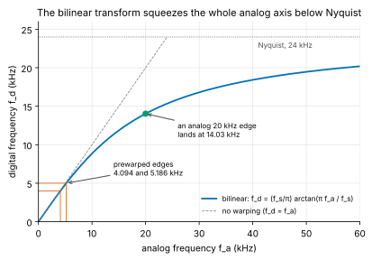
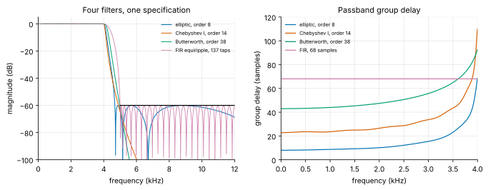

<!-- status: reviewed -->
# 16-07 · IIR Filter Design

| | |
|---|---|
| **Course** | [16 · Digital Signal Processing](../README.md) |
| **University equivalent** | The IIR-design chapter of a senior DSP course: analog prototypes (Butterworth, Chebyshev, elliptic), impulse invariance and the bilinear transform with prewarping, and the FIR-versus-IIR decision (Oppenheim & Schafer, *Discrete-Time Signal Processing*, ch. 7; Proakis & Manolakis, *Digital Signal Processing*, ch. 10) |
| **Prerequisites** | [16-06 FIR Filter Design](16-06-fir-filter-design.md), [16-02 DTFT and z-Transform for DSP](16-02-dtft-and-z-transform-for-dsp.md), [11-11 Modulation and Filtering Applications](../../11-signals-and-systems/chapters/11-11-modulation-and-filtering-applications.md) (analog filter families), [11-09 z-Transform](../../11-signals-and-systems/chapters/11-09-z-transform.md) (the bilinear map) |
| **Estimated study hours** | 8 |
| **Last verified** | 2026-11-20 |

**Learning objectives.** After this chapter you can:

1. Derive the Butterworth and Chebyshev type I magnitude responses, their order formulas and their pole locations, and use elliptic prototypes from software.
2. Derive the bilinear transform from the trapezoidal rule, show that it preserves stability, and compute its frequency warping and the prewarping that undoes it at chosen frequencies.
3. Contrast impulse invariance with the bilinear transform, including the aliasing that limits impulse invariance.
4. Carry out a complete IIR design: specification, prewarping, order, analog poles, bilinear mapping, second-order sections, and a check against the mask.
5. Compute and interpret an IIR filter's group delay, including its peak near the band edge.
6. Compare IIR and FIR solutions to one specification by order, multiplications, delay, phase linearity and numerical robustness, and choose between them.

---

## 1. Big picture

An FIR filter shapes its response with zeros alone, so a sharp transition needs many of them: 137 taps for the audio specification of 16-06. An **infinite impulse response (IIR)** filter adds poles. A pole near the unit circle produces gain that a zero can only approximate with many coefficients, so IIR filters meet the same magnitude specification with a small fraction of the arithmetic: an eighth-order elliptic filter (14 multiplications per sample) does the job of that 137-tap FIR filter. The price is everything poles bring: nonlinear phase, a group delay that peaks at the band edge, feedback that can become unstable if coefficients are quantized carelessly, and internal states that can overflow or sustain tiny oscillations. This chapter designs IIR filters the way practitioners do, by translating seventy years of analog filter theory through the bilinear transform, and ends with the engineering choice between the two families.

- **Audio and voice.** Equalizers, tone controls, crossovers and the DC blockers of every codec are cascades of second-order IIR sections ("biquads"); audio converters include banks of programmable biquads (§9).
- **Low-latency paths.** Hearing aids, active noise cancellation and control loops need small delay, which IIR filters give and linear-phase FIR filters do not.
- **Sensors and microcontrollers.** Accelerometer, ECG and power-line filters run as a few biquads on small cores where every multiplication costs energy.
- **Where FIR still wins.** Linear-phase data paths (communications pulse shaping, measurement), multirate structures (16-09) and very high-rate pipelined hardware.

## 2. Intuition first

**Feedback reuses work.** An FIR filter recomputes its output from scratch from the last $M + 1$ inputs. An IIR filter feeds its own past outputs back, so each output carries a decaying memory of the entire input history at no extra cost. 16-01's exponential moving average is the simplest case: one multiplication gives an infinitely long, exponentially weighted average that an FIR filter would need dozens of taps to imitate.

**Poles make peaks; zeros make notches.** On the pole–zero plot (16-02), a pole just inside the unit circle lifts the response at its angle, and a zero on the circle forces the response to zero there. A sharp low-pass IIR filter puts a crescent of poles just inside the circle along the passband (holding the gain up to the edge) and zeros on the circle just beyond it (pulling the gain down hard). The elliptic filter of Example 16-07.5 does exactly this with four pole pairs and four zero pairs.

**Translate, don't reinvent.** Analog filter designers solved the "flattest", "sharpest" and "most equal-ripple" approximation problems in closed form decades ago (11-11). The bilinear transform is an exact, invertible change of variable that carries a stable analog filter into a stable digital one, so digital IIR design is mostly a translation exercise. **Analogy:** converting a proven model from one currency to another at an exchange rate that varies with the amount. The bilinear transform's exchange rate between analog and digital frequency is nonlinear (it compresses the whole infinite analog axis into the finite digital band), so the specification must be converted at the right rate before designing; that is **prewarping**. **Where the analogy breaks:** a currency conversion loses nothing, whereas the bilinear transform's compression changes the shape of the response between the converted points, harmlessly for piecewise-constant specifications and not at all harmlessly for, say, a differentiator.

## 3. Theory

Notation: analog frequency $\Omega$ in rad/s, digital frequency $\omega$ in rad/sample, sample rate $f_s = 1/T$. A low-pass specification has passband edge $\Omega_p$ (or $\omega_p$) with maximum loss $A_p$ dB and stopband edge $\Omega_s$ with minimum attenuation $A_s$ dB (16-06 §3.1).

### 3.1 Analog prototypes: Butterworth

The **Butterworth** low-pass filter of order $N$ and cutoff $\Omega_c$ has the squared magnitude

$$
\lvert H(j\Omega)\rvert^2 = \frac{1}{1 + (\Omega/\Omega_c)^{2N}} .
$$

Expanding for small $\Omega$, $\lvert H\rvert^2 = 1 - (\Omega/\Omega_c)^{2N} + \cdots$: the first $2N - 1$ derivatives vanish at DC, so the response is **maximally flat**. At $\Omega_c$ the gain is $1/\sqrt2$ (−3.01 dB) for every $N$, and far above it falls at $20N$ dB per decade.

**Order.** The passband requirement $10\log_{10}\big(1 + (\Omega_p/\Omega_c)^{2N}\big) \le A_p$ and the stopband requirement $10\log_{10}\big(1 + (\Omega_s/\Omega_c)^{2N}\big) \ge A_s$ give $(\Omega_p/\Omega_c)^{2N} \le 10^{A_p/10} - 1$ and $(\Omega_s/\Omega_c)^{2N} \ge 10^{A_s/10} - 1$. Dividing the second by the first eliminates $\Omega_c$:

$$
\left(\frac{\Omega_s}{\Omega_p}\right)^{2N} \ge D, \qquad D = \frac{10^{A_s/10} - 1}{10^{A_p/10} - 1}, \qquad N \ge \frac{\log_{10}D}{2\log_{10}(\Omega_s/\Omega_p)} .
$$

$D$ is the **discrimination**: how much the filter must separate the band edges' power gains. Any $\Omega_c$ between the two bounds works; choosing $\Omega_c = \Omega_p/(10^{A_p/10} - 1)^{1/(2N)}$ meets the passband exactly and over-delivers in the stopband.

**Poles.** Write $\lvert H\rvert^2 = H(s)H(-s)$ on $s = j\Omega$: $H(s)H(-s) = 1/\big(1 + (s/j\Omega_c)^{2N}\big)$. Its poles satisfy $(s/j\Omega_c)^{2N} = -1 = e^{j\pi(2k - 1)}$, so they are $2N$ points equally spaced on the circle $\lvert s\rvert = \Omega_c$. The stable filter takes the $N$ in the left half-plane:

$$
s_k = \Omega_c\,e^{j\pi(2k + N - 1)/(2N)}, \qquad k = 1, \dots, N, \qquad H(s) = \prod_{k=1}^{N}\frac{-s_k}{s - s_k}.
$$

For $N = 2$: $s = \Omega_c e^{\pm j3\pi/4}$, the familiar $\zeta = 0.707$ pair (02-04).

### 3.2 Chebyshev and elliptic prototypes

**Chebyshev type I** trades the flat passband for an equal ripple, which buys a much steeper transition (11-11 §3.6):

$$
\lvert H(j\Omega)\rvert^2 = \frac{1}{1 + \varepsilon^2T_N^2(\Omega/\Omega_p)}, \qquad \varepsilon^2 = 10^{A_p/10} - 1,
$$

where $T_N$ is the Chebyshev polynomial: $T_N(x) = \cos(N\arccos x)$ for $\lvert x\rvert \le 1$ (oscillating between ±1, hence the ripple) and $\cosh(N\operatorname{arccosh}x)$ for $x > 1$ (growing as $(2x)^N/2$, hence the steep skirt). The stopband requirement $\varepsilon^2T_N^2(\Omega_s/\Omega_p) \ge 10^{A_s/10} - 1$ gives $T_N(\Omega_s/\Omega_p) \ge \sqrt D$ and

$$
N \ge \frac{\operatorname{arccosh}\sqrt D}{\operatorname{arccosh}(\Omega_s/\Omega_p)} .
$$

Because $\operatorname{arccosh}$ grows only logarithmically, this is far smaller than the Butterworth order for sharp transitions.

**Chebyshev poles, derived.** The poles of $H(s)H(-s)$ (with $\Omega_p = 1$) satisfy $T_N(s/j) = \pm j/\varepsilon$. Put $s/j = \cos\phi$ with complex $\phi = u + jv$. Then $T_N = \cos(N\phi) = \cos Nu\cosh Nv - j\sin Nu\sinh Nv$, and equating to $\pm j/\varepsilon$ requires $\cos Nu = 0$, so $u_k = (2k - 1)\pi/(2N)$, and $\sinh Nv = \pm 1/\varepsilon$, so $v = a \equiv \frac1N\operatorname{arcsinh}(1/\varepsilon)$. Back-substituting, $s = j\cos(u + jv) = \sin u\sinh v + j\cos u\cosh v$, and the left-half-plane choice is

$$
s_k = \Omega_p\big(-\sinh a\,\sin u_k + j\cosh a\,\cos u_k\big), \qquad k = 1, \dots, N .
$$

The poles lie on an ellipse with semi-axes $\Omega_p\sinh a$ (real) and $\Omega_p\cosh a$ (imaginary): the Butterworth circle squashed toward the $j\Omega$ axis. Poles closer to the axis are what make the response sharper and the group delay peakier. The DC gain is 1 for odd $N$ and $1/\sqrt{1 + \varepsilon^2}$ (the bottom of the ripple) for even $N$.

**Chebyshev type II** (inverse Chebyshev) puts the ripple in the stopband and keeps the passband monotonic; it has the same order formula and adds zeros on the $j\Omega$ axis. **Elliptic (Cauer)** filters ripple in both bands and place zeros on the axis just beyond the passband; they meet any magnitude specification with the lowest order of all, given by the elliptic-integral formula of 11-11 §3.6,

$$
N \ge \frac{K(k)\,K\big(\sqrt{1 - k_1^2}\big)}{K(k_1)\,K\big(\sqrt{1 - k^2}\big)}, \qquad k = \frac{\Omega_p}{\Omega_s},\quad k_1 = \frac{1}{\sqrt D},
$$

with $K$ the complete elliptic integral of the first kind. Their poles and zeros come from Jacobi elliptic functions; every practitioner computes them with software (SciPy's `ellipap`, used in the lab), which is the honest way to treat them here.

> **Going deeper — why elliptic filters are optimal.** The elliptic response is the rational-function analogue of the equiripple FIR filter of 16-06: its squared magnitude is $1/(1 + \varepsilon^2R_N^2(\Omega))$ where $R_N$ is a Chebyshev rational function that equi-oscillates in the passband and whose reciprocal equi-oscillates in the stopband. An alternation argument like 16-06 §3.7 shows that no rational function of the same degree has a smaller maximum error in both bands at once.

### 3.3 From s to z: impulse invariance

The most literal translation samples the analog impulse response: $h[n] = T\,h_a(nT)$. For a partial-fraction term $h_a(t) = A e^{s_kt}$, $t \ge 0$, this gives $h[n] = TA(e^{s_kT})^n$, so each analog pole $s_k$ becomes a digital pole $z_k = e^{s_kT}$, and a stable analog pole ($\text{Re}\,s_k < 0$) lands inside the unit circle. **The flaw is aliasing.** Sampling a time function repeats its spectrum (11-10):

$$
H(e^{j\omega}) = \sum_{m=-\infty}^{\infty} H_a\!\left(j\,\frac{\omega + 2\pi m}{T}\right),
$$

so whatever response the analog filter has above $f_s/2$ folds back into the digital band. **A second flaw hides at $t = 0$.** The sum above is the spectrum of the samples only when $h_a$ is continuous at $t = 0$. Many prototypes jump there: any filter with one more pole than zeros, such as a first-order low-pass, has $h_a(0^+) \ne 0$ but $h_a(0^-) = 0$. Poisson summation then assigns the sample at $n = 0$ the midpoint value $T h_a(0^+)/2$, so the usual $h[0] = T h_a(0^+)$ adds a constant $T h_a(0^+)/2$ to the response at every frequency. Halving the first sample removes it (Jackson's correction [6]), leaving only the aliasing. For a sharply band-limited low-pass or band-pass prototype the error is small; for a high-pass or band-stop prototype, whose response never falls, the method fails outright. Example 16-07.2 measures the damage for a gentle first-order filter. Impulse invariance survives where matching the *time-domain* shape matters (modelling an analog system's step response) and is otherwise displaced by the bilinear transform.

### 3.4 The bilinear transform

**Derivation from the trapezoidal rule.** An integrator $y(t) = \int x\,dt$ has transfer function $1/s$. Approximating the integral over one sample period by a trapezoid, $y[n] = y[n - 1] + \frac T2\big(x[n] + x[n - 1]\big)$, whose transfer function is

$$
\frac{Y(z)}{X(z)} = \frac T2\,\frac{1 + z^{-1}}{1 - z^{-1}} .
$$

Replacing every $1/s$ in an analog filter by this discrete integrator means substituting

$$
s = \frac2T\,\frac{1 - z^{-1}}{1 + z^{-1}} = \frac2T\,\frac{z - 1}{z + 1}, \qquad z = \frac{1 + sT/2}{1 - sT/2} .
$$

This is the **bilinear transform** (11-09; called Tustin's method in control, 15-11).

**Stability is preserved.** Write $s = \sigma + j\Omega$. Then $\lvert z\rvert^2 = \dfrac{(1 + \sigma T/2)^2 + (\Omega T/2)^2}{(1 - \sigma T/2)^2 + (\Omega T/2)^2}$, and the numerator minus the denominator is $2\sigma T$. So $\lvert z\rvert < 1$ exactly when $\sigma < 0$: the left half-plane maps into the unit disc, the $j\Omega$ axis onto the unit circle, and a stable analog filter always becomes a stable digital filter, for any $T$.

**Frequency warping.** On the axis, $s = j\Omega$ gives $z = (1 + j\Omega T/2)/(1 - j\Omega T/2)$, a unit-magnitude number whose angle is twice that of the numerator: $\omega = 2\arctan(\Omega T/2)$, or

$$
\Omega = \frac2T\tan\frac\omega2 = 2f_s\tan\frac{\omega}{2} .
$$

The whole analog axis $0 \le \Omega < \infty$ maps once onto $0 \le \omega < \pi$. There is no aliasing (nothing folds), but the map is nonlinear: near DC $\Omega \approx \omega/T$ (no distortion), while toward Nyquist the analog axis is compressed without limit (Figure 1). The analog response at infinity appears at $\omega = \pi$, so an all-pole analog prototype (zeros at infinity) acquires zeros at $z = -1$.

**Prewarping.** Since the map is known exactly, convert the digital band edges to the analog frequencies that the transform will carry onto them:

$$
\Omega_p = 2f_s\tan\frac{\omega_p}{2}, \qquad \Omega_s = 2f_s\tan\frac{\omega_s}{2},
$$

design the analog filter for $(\Omega_p, \Omega_s)$, and transform. The band edges land exactly where specified; between them the response is distorted, but a piecewise-constant specification does not care. ($T$ cancels from the whole procedure, so any value may be used; we keep $2f_s$ for physical units.)

*Figure 1. The bilinear transform at $f_s$ = 48 kHz maps every analog frequency onto the digital band below 24 kHz. Low frequencies are almost unchanged; high ones are squeezed. Prewarping moves the running example's 4 and 5 kHz edges to 4.094 and 5.186 kHz before the analog design (Example 16-07.1).*

**Mapping poles, zeros and gain.** For $H(s) = k\prod(s - z_i)/\prod(s - p_i)$ with $M$ zeros and $N \ge M$ poles, substitute $s = c(z - 1)/(z + 1)$ with $c = 2f_s$. Each factor becomes $s - r = \big[(c - r)z - (c + r)\big]/(z + 1) = (c - r)\big(z - \tfrac{c + r}{c - r}\big)/(z + 1)$. So:

- every analog root $r$ maps to the digital root $(c + r)/(c - r)$;
- the $N - M$ zeros at infinity map to $z = -1$ (the leftover factors $(z + 1)^{N - M}$);
- the gain becomes $k\prod(c - z_i)/\prod(c - p_i)$.

The lab implements exactly these three lines and checks them against SciPy's `butter`, `cheby1` and `ellip`.

> **Going deeper — high-pass, band-pass and band-stop designs.** Every family above is designed as a normalized low-pass prototype ($\Omega_p = 1$) and then moved by a **frequency transformation** of the analog variable, before the bilinear transform. Prewarp every band edge first. Then:
>
> - low-pass to high-pass: $s \to \Omega_p/s$, which swaps DC and infinity;
> - low-pass to band-pass: $s \to (s^2 + \Omega_0^2)/(Bs)$, with centre $\Omega_0 = \sqrt{\Omega_{p1}\Omega_{p2}}$ (geometric, not arithmetic) and bandwidth $B = \Omega_{p2} - \Omega_{p1}$;
> - low-pass to band-stop: $s \to Bs/(s^2 + \Omega_0^2)$.
>
> The band-pass map sends each prototype frequency $\Omega'$ to two frequencies whose product is $\Omega_0^2$, so a stopband edge $\Omega_s$ corresponds to the prototype frequency $\lvert\Omega_s^2 - \Omega_0^2\rvert/(B\Omega_s)$, and the stricter (smaller) of the two stopband edges sets the order. Each prototype pole becomes two, so a band-pass or band-stop filter has twice the prototype's order (Problem 16-07.13). The same idea in the $z$-domain, Constantinides' all-pass substitutions $z^{-1} \to (z^{-1} - \alpha)/(1 - \alpha z^{-1})$ and their band-pass relatives, moves a digital low-pass filter's edges without returning to $s$. SciPy's `iirdesign` and `buttord` apply these transformations internally.

### 3.5 The design procedure

1. **Specify** $\omega_p$, $\omega_s$, $A_p$, $A_s$.
2. **Prewarp** the edges to $\Omega_p$, $\Omega_s$.
3. **Choose a family and order:** compute $D$ and the order bound for each family (§3.1–§3.2), round up.
4. **Design the analog prototype:** poles (and zeros) scaled to $\Omega_p$ (or to $\Omega_c$ for Butterworth).
5. **Map** with the bilinear transform.
6. **Factor into second-order sections:** pair each complex pole pair with the nearest zero pair, one real pole per first-order section if $N$ is odd. Sections are kept separate because high-order polynomials are numerically fragile (§3.7 and 16-08).
7. **Check** the digital response against the mask, and then again after quantizing the coefficients (16-10).

### 3.6 Group delay of IIR filters

By 16-02 §3.4, a pole at $z = \rho e^{j\theta}$ contributes $-\dfrac{\rho^2 - \rho\cos(\omega - \theta)}{1 - 2\rho\cos(\omega - \theta) + \rho^2}$ samples of delay (zeros contribute the same expression with the opposite sign). At $\omega = \theta$ this is $\rho/(1 - \rho)$: a pole at radius 0.95 delays its own frequency by 19 samples, and one at 0.99 by 99. Sharp IIR filters need poles close to the circle near the band edge, so **their group delay peaks at or just beyond the band edge**, and the sharper the filter, the higher the peak. For elliptic and Chebyshev designs the delay is small at DC, where the poles are far away, and large at the edge (a high-order Butterworth filter, with many poles, has a large delay even at DC: 43 samples for the order-38 design of Example 16-07.4): different frequencies arrive at different times, which is phase distortion.

Three remedies exist. Accept it (most audio equalization, where the ear tolerates modest phase shifts); **equalize** it with an all-pass cascade (16-02 §3.6) that adds delay where the filter has little, at the cost of more sections and a total delay no smaller than the original peak (Problem 16-07.11); or, offline only, filter **forward and backward** (`filtfilt`), which squares the magnitude and cancels the phase exactly, at the price of being non-causal.

### 3.7 FIR or IIR?

| Property | FIR | IIR |
|---|---|---|
| Phase | Exactly linear if symmetric | Nonlinear; group delay peaks at the band edge |
| Order for a sharp magnitude spec | High (137 taps, Example 16-06.5) | Low (order 8, Example 16-07.5) |
| Multiplications per output | Folded taps (69) | About 2 per order in biquads (14) |
| Stability | Always stable | Stable only if all poles stay inside the circle after quantization |
| Coefficient sensitivity | Low: errors move zeros a little | High near the circle; direct forms can go unstable (Problem 16-07.12) |
| Delay | Constant $M/2$ samples | Small at DC, large at the band edge |
| Limit cycles and overflow | None (no feedback) | Possible; need scaling and care (16-10) |
| Multirate | Polyphase structures skip unneeded outputs (16-09) | A general direct-form IIR must compute every sample; special polyphase IIR structures (all-pass half-band filters) avoid this |
| Adaptive filtering | Natural (error surface is quadratic) | Awkward (can go unstable while adapting) |

The rule of thumb that follows: **IIR when magnitude is all that matters and multiplications or latency are scarce; FIR when phase, robustness, multirate structure or adaptivity matter.** Many products use both, as the audio converters in §9 do.

## 4. Worked examples

### Example 16-07.1 · Where do the frequencies go? (tier A)

**Setup.** At $f_s$ = 48 kHz, find the analog frequencies to which the digital band edges 4 kHz, 5 kHz and 20 kHz must be prewarped. Then find where an analog 20 kHz edge lands if a designer forgets to prewarp.

**Solution.** In hertz, $f_a = \frac{f_s}{\pi}\tan\frac{\pi f_d}{f_s}$ with $f_s/\pi = 15{,}279$ Hz:

- 4 kHz: $\tan(\pi/12) = 0.26795$, so $f_a$ = **4.094** kHz;
- 5 kHz: $\tan(5\pi/48) = 0.33945$, so $f_a$ = **5.186** kHz;
- 20 kHz: $\tan(5\pi/12) = 3.7321$, so $f_a$ = **57.02** kHz.

In reverse, $f_d = \frac{f_s}{\pi}\arctan\frac{\pi f_a}{f_s}$: an unwarped analog 20 kHz edge lands at $15{,}279 \times \arctan(1.3090)$ = **14.03** kHz, 30% low.

**Units check.** $\pi f/f_s$ is dimensionless (radians); $f_s/\pi$ carries hertz.

**Sanity check.** At 4 kHz, a sixth of Nyquist, warping moves the edge by only 2.3%; at 20 kHz, close to Nyquist, the analog edge must be pushed out almost threefold. Warping matters most where filters are sharpest relative to Nyquist.

### Example 16-07.2 · A first-order low-pass three ways (tier B)

**Setup.** Map the analog low-pass $H_a(s) = \Omega_c/(s + \Omega_c)$, $f_c$ = 1 kHz, to $f_s$ = 8 kHz by (a) impulse invariance, (b) the bilinear transform without prewarping, (c) the bilinear transform prewarped at 1 kHz. Compare the −3 dB frequencies (relative to each filter's DC gain) and the gain at Nyquist.

**Solution.** $\Omega_cT = 2\pi \times 1000/8000 = \pi/4$.

(a) $h_a(t) = \Omega_ce^{-\Omega_ct}$, so $h[n] = \Omega_cT\,e^{-\Omega_cTn}$ and $H(z) = \dfrac{\Omega_cT}{1 - e^{-\Omega_cT}z^{-1}}$: $b_0$ = 0.7854, pole **0.4559**. The DC gain is $0.7854/(1 - 0.4559)$ = **1.444**, not 1. Normalized to DC, the −3 dB point is at **1056** Hz and the gain at Nyquist is **0.374**, whereas the analog filter's gain at 4 kHz is $1/\sqrt{1 + 16}$ = **0.243**. Two effects of §3.3 are at work. The impulse response jumps at $t = 0$, so $h[0] = \Omega_cT$ counts the jump fully and adds the constant $\Omega_cT/2$ = **0.393** at every frequency ($\sum_nTh_a(nT)$ is a left-endpoint Riemann sum, which overestimates $\int h_a\,dt = 1$). The aliased sum alone, which is what halving $h[0]$ would leave, gives a DC gain of $(\pi/8)\coth(\pi/8)$ = **1.051** and a Nyquist gain of $(\pi/8)\tanh(\pi/8)$ = **0.147**, a ratio of 0.140, *below* the analog 0.243. So most of the excess at Nyquist is the endpoint term, not aliasing.

(b) Substituting $s = 2f_s(1 - z^{-1})/(1 + z^{-1})$ with $\Omega_c/(2f_s) = \pi/8 = 0.3927$:

$$
H(z) = \frac{0.3927(1 + z^{-1})}{1.3927 - 0.6073z^{-1}} = \frac{0.2820(1 + z^{-1})}{1 - 0.4361z^{-1}} .
$$

DC gain exactly 1; zero at $z = -1$, so the gain at Nyquist is **0**. The −3 dB point is where $\tan(\omega/2) = 0.3927$: $\omega$ = **0.7484** rad, **952.9** Hz, **4.7**% low, because the cutoff was warped.

(c) Prewarped, $K = \tan(\pi/8)$ = **0.4142** replaces $0.3927$: $H(z) = 0.2929(1 + z^{-1})/(1 - 0.4142z^{-1})$, with the −3 dB point at exactly **1000** Hz and zero gain at Nyquist.

**Units check.** $\Omega_cT$ and $K$ are dimensionless; frequencies in hertz.

**Sanity check.** The bilinear designs have a zero at Nyquist because the analog response vanishes at infinity, which the bilinear map sends to Nyquist; the impulse-invariant design cannot have one, since its response is a sum of aliased copies (plus the endpoint constant) that never vanishes.

### Example 16-07.3 · A second-order Butterworth biquad by hand (tier B)

**Setup.** Design the second-order Butterworth low-pass filter with a −3 dB frequency of 1 kHz at $f_s$ = 8 kHz. Give the biquad coefficients, the poles, and the attenuation at 2 kHz.

**Solution.** The prototype is $H_a(s) = \Omega_c^2/(s^2 + \sqrt2\,\Omega_cs + \Omega_c^2)$. Prewarp and normalize at once by writing $s/\Omega_c = \frac{1}{K}\frac{1 - z^{-1}}{1 + z^{-1}}$ with $K = \tan(\pi f_c/f_s) = \tan(\pi/8) = \sqrt2 - 1 = 0.41421$. Multiplying numerator and denominator by $K^2(1 + z^{-1})^2$:

$$
H(z) = \frac{K^2(1 + z^{-1})^2}{(1 - z^{-1})^2 + \sqrt2K(1 - z^{-1})(1 + z^{-1}) + K^2(1 + z^{-1})^2} .
$$

Collecting powers of $z^{-1}$ in the denominator: $a_0 = 1 + \sqrt2K + K^2 = 1.75736$, $z^{-1}$: $2(K^2 - 1)$, $z^{-2}$: $1 - \sqrt2K + K^2$. Dividing by $a_0$, with $K^2 = 0.17157$ and $\sqrt2K = 0.58579$:

$$
b = (0.09763,\ 0.19526,\ 0.09763), \qquad a = (1,\ -0.94281,\ 0.33333).
$$

These have closed forms here: $a_1 = -2\sqrt2/3$, $a_2 = 1/3$, $b_0 = (2 - \sqrt2)/6$. The poles solve $z^2 - 0.94281z + 0.33333 = 0$: $z = 0.47140 \pm j0.33333$, radius $\sqrt{1/3}$ = **0.5774**. The gain at 1 kHz is $1/\sqrt2$ (**−3.01** dB) by construction. At 2 kHz the prewarped ratio is $\tan(\pi/4)/\tan(\pi/8) = 2.4142$, so $\lvert H\rvert = 1/\sqrt{1 + 2.4142^4}$, **−15.44** dB, against **−12.30** dB for an analog Butterworth filter at twice its cutoff: the bilinear map compresses the upper band, steepening the digital response.

**Units check.** All coefficients are dimensionless; $K$ is a ratio of tangents of angles.

**Sanity check.** $\sum b/\sum a = 0.39052/0.39052 = 1$: unity DC gain. The same coefficients appear in the W3C Audio EQ Cookbook's low-pass with $Q = 1/\sqrt2$ (§9), whose $b_0 = (1 - \cos\omega_0)/(2(1 + \alpha))$ with $\omega_0 = \pi/4$ and $\alpha = \sin\omega_0/(2Q) = 0.5$ gives **0.09763**.

### Example 16-07.4 · Orders for the running specification (tier B)

**Setup.** For the audio specification of 16-06 ($f_s$ = 48 kHz, 0.1 dB loss to 4 kHz, 60 dB from 5 kHz), find the minimum Butterworth, Chebyshev I and elliptic orders. How would the orders change if the edges were (wrongly) not prewarped?

**Solution.** Prewarped edges (Example 16-07.1): 4.094 and 5.186 kHz, ratio **1.2669**. Discrimination $D = (10^{6} - 1)/(10^{0.01} - 1)$ = **4.293** × 10⁷.

- Butterworth: $N \ge \log_{10}D/(2\log_{10}1.2669) = 7.633/0.2055$ = **37.15**, so **38**.
- Chebyshev I: $\sqrt D = 6552$; $N \ge \operatorname{arccosh}6552/\operatorname{arccosh}1.2669 = 9.481/0.7152$ = **13.26**, so **14**.
- Elliptic: the elliptic-integral formula gives **7.26**, so **8**.

With unwarped edges (ratio 1.25) the bounds are **39.38**, **13.68** and **7.38**: the bilinear map's compression makes the digital transition effectively *wider* in the analog domain, which slightly lowers the order. (Unprewarped designs would also put the edges in the wrong place.)

**Units check.** $D$ is a ratio of power ratios; orders are pure numbers.

**Sanity check.** The ranking (elliptic ≪ Chebyshev ≪ Butterworth) and the size of the gaps match 11-11's analog Example 11-11.4: the families differ only in how they spend the allowed error, exactly as equiripple FIR filters beat window designs.

### Example 16-07.5 · An elliptic filter against the equiripple FIR (tier C)

**Setup.** Design the order-8 elliptic filter for the running specification, factor it into biquads, and compare it with the 137-tap equiripple FIR filter of Example 16-06.5 on multiplications, delay, phase and robustness.

**Solution.** *Design.* The analog elliptic prototype (0.1 dB ripple, 60 dB stopband, order 8), scaled to the prewarped 4.094 kHz edge and mapped by the bilinear transform, gives four biquads. The checked response has passband ripple **0.100** dB and stopband attenuation **60.00** dB, reached already at **4678** Hz (the integer order over-delivers on transition width). Its zeros lie on the unit circle at **4.72**, **5.16**, **6.71** and **13.54** kHz; its poles hug the circle near the band edge, the outermost at radius **0.9850**.

*Multiplications.* Written as biquads with the zeros' unit coefficients ($b_0 = b_2 = 1$ in three sections, so their $b_0$ and $b_2$ cost nothing), the cascade needs **14** multiplications per output as SciPy factors it (13 if the overall gain is pulled out so that every section has $b_0 = b_2 = 1$): **672,000** per second at 48 kHz, against 69 per output (**3.312** million per second) for the folded FIR filter: **4.9** times fewer.

*Delay and phase.* The group delay is **7.99** samples at DC (0.17 ms) and rises to **69.51** samples at the 4 kHz edge (Figure 2): a spread of **61.5** samples across the passband. The FIR filter delays everything by 68 samples. The IIR filter is faster for low frequencies and as slow at the edge, and it distorts waveforms that span the band.

*Robustness.* Multiplied out into one denominator polynomial, the coefficients range up to **37.19** in magnitude and the poles become exquisitely sensitive: rounding that polynomial to 13 fractional bits or fewer pushes a pole outside the unit circle (radius 1.032 at 13 bits, 1.030 at 12; Problem 16-07.12), and even at 14 to 17 bits the largest pole radius wanders between 0.978 and 0.994 instead of staying at 0.985, whereas the four biquads stay stable even at 8 fractional bits.

**Units check.** Multiplications per second = per output × $f_s$: $14 \times 48{,}000 = 672{,}000$ s⁻¹.

**Sanity check.** The outermost pole, at radius 0.985 and 4.068 kHz, contributes about $\rho/(1 - \rho) = 66$ samples of delay at its own frequency, just beyond the passband edge, where the total group delay peaks at about **84** samples. At the 4 kHz edge its pair contributes about 48 of the 69.5 samples: the pole nearest the band edge sets the delay there.

*Figure 2. The running specification met by an elliptic (order 8), a Chebyshev I (order 14) and a Butterworth (order 38) IIR filter and by the 137-tap equiripple FIR filter. Left: magnitudes, with the 60 dB mask. Right: passband group delay; every IIR filter's delay climbs toward the band edge, while the FIR filter's is constant.*

### Answer key

<!-- answer-key -->

| ID | Quantity | Value | Unit |
|---|---|---|---|
| Ex 16-07.1a | prewarped 4 kHz | 4.094 | kHz |
| Ex 16-07.1b | prewarped 5 kHz | 5.186 | kHz |
| Ex 16-07.1c | prewarped 20 kHz | 57.02 | kHz |
| Ex 16-07.1d | unwarped analog 20 kHz lands at | 14.03 | kHz |
| Ex 16-07.2a | impulse-invariant pole | 0.4559 | — |
| Ex 16-07.2b | impulse-invariant DC gain | 1.444 | — |
| Ex 16-07.2c | impulse-invariant −3 dB frequency | 1056 | Hz |
| Ex 16-07.2d | impulse-invariant Nyquist gain over DC | 0.374 | — |
| Ex 16-07.2e | analog gain at 4 kHz | 0.243 | — |
| Ex 16-07.2o | endpoint term | 0.393 | — |
| Ex 16-07.2p | aliased-sum DC gain | 1.051 | — |
| Ex 16-07.2q | aliased-sum Nyquist gain | 0.147 | — |
| Ex 16-07.2f | bilinear −3 dB frequency, no prewarp | 952.9 | Hz |
| Ex 16-07.2i | bilinear −3 dB angle, no prewarp | 0.7484 | rad |
| Ex 16-07.2j | cutoff error, no prewarp | 4.7 | % |
| Ex 16-07.2k | impulse-invariant b0 | 0.7854 | — |
| Ex 16-07.2l | bilinear b0, no prewarp | 0.2820 | — |
| Ex 16-07.2m | bilinear pole, no prewarp | 0.4361 | — |
| Ex 16-07.2n | prewarped b0 | 0.2929 | — |
| Ex 16-07.2g | prewarping constant K | 0.4142 | — |
| Ex 16-07.2h | prewarped −3 dB frequency | 1000 | Hz |
| Ex 16-07.3a | b0 | 0.09763 | — |
| Ex 16-07.3b | a1 | −0.94281 | — |
| Ex 16-07.3c | a2 | 0.33333 | — |
| Ex 16-07.3d | pole radius | 0.5774 | — |
| Ex 16-07.3e | gain at 1 kHz | −3.01 | dB |
| Ex 16-07.3f | gain at 2 kHz | −15.44 | dB |
| Ex 16-07.3g | analog Butterworth at twice the cutoff | −12.30 | dB |
| Ex 16-07.4a | prewarped edge ratio | 1.2669 | — |
| Ex 16-07.4b | discrimination | 4.293e7 | — |
| Ex 16-07.4c | Butterworth bound | 37.15 | — |
| Ex 16-07.4d | Chebyshev bound | 13.26 | — |
| Ex 16-07.4e | elliptic bound | 7.26 | — |
| Ex 16-07.4f | Butterworth bound, unwarped | 39.38 | — |
| Ex 16-07.4g | Chebyshev bound, unwarped | 13.68 | — |
| Ex 16-07.4h | elliptic bound, unwarped | 7.38 | — |
| Ex 16-07.5a | passband ripple | 0.100 | dB |
| Ex 16-07.5b | stopband attenuation | 60.00 | dB |
| Ex 16-07.5c | frequency where 60 dB is reached | 4678 | Hz |
| Ex 16-07.5d | lowest zero frequency | 4.72 | kHz |
| Ex 16-07.5e | second zero frequency | 5.16 | kHz |
| Ex 16-07.5f | third zero frequency | 6.71 | kHz |
| Ex 16-07.5g | fourth zero frequency | 13.54 | kHz |
| Ex 16-07.5h | largest pole radius | 0.9850 | — |
| Ex 16-07.5i | multiplications per output | 14 | — |
| Ex 16-07.5j | multiplications per second | 672000 | 1/s |
| Ex 16-07.5k | FIR to IIR multiplication ratio | 4.9 | — |
| Ex 16-07.5l | group delay at DC | 7.99 | samples |
| Ex 16-07.5m | group delay at 4 kHz | 69.51 | samples |
| Ex 16-07.5n | passband delay spread | 61.5 | samples |
| Ex 16-07.5o | largest direct-form coefficient | 37.19 | — |
| Ex 16-07.5p | delay of the outermost pole at its angle | 66 | samples |
| Ex 16-07.5q | FIR multiplication rate | 3.312 | M/s |
| Ex 16-07.5r | elliptic delay at DC | 0.17 | ms |
| Txt 16-07.a | delay of a pole at radius 0.95 | 19 | samples |
| Txt 16-07.b | delay of a pole at radius 0.99 | 99 | samples |
| Txt 16-07.c | warping error at 4 kHz | 2.3 | % |
| Txt 16-07.d | unwarped 20 kHz error | 30 | % |
| Txt 16-07.e | cookbook low-pass b0 at Q = 1/√2 | 0.09763 | — |
| Txt 16-07.f | TLV320ADC5140 linear-phase delay at 48 kHz | 356 | µs |
| Txt 16-07.g | TLV320ADC5140 low-latency delay at 48 kHz | 160 | µs |
| Txt 16-07.h | TLV320ADC5140 ultra-low-latency delay at 48 kHz | 85 | µs |
| Txt 16-07.i | K at 16 kHz | 0.1989 | — |
| Txt 16-07.j | warping of K at 16 kHz | 1.3 | % |
| Txt 16-07.k | warping of K at 8 kHz | 5.5 | % |
| Txt 16-07.l | largest pole radius, one polynomial at 13 bits | 1.032 | — |
| Ex 16-07.3h | sum of b (and of a) | 0.39052 | — |
| Ex 16-07.3i | pole real part | 0.47140 | — |
| Ex 16-07.3j | pole imaginary part | 0.33333 | — |
| Ex 16-07.4i | √D | 6552 | — |

## 5. Simulate it

The lab, [labs/16-07-lab](../labs/16-07-lab/README.md), provides `iirdesign.py`: prewarping, discrimination and order bounds for all three families (the elliptic one from SciPy's complete elliptic integrals), Butterworth and Chebyshev I analog prototypes from the pole formulas of §3.1–§3.2, a three-line bilinear transform for poles, zeros and gain, frequency response and root-by-root group delay, the first-order and biquad examples, and a multiplication counter. You:

1. **Warp and prewarp** (Example 16-07.1): plot the frequency map and design a first-order filter with and without prewarping.
2. **Alias with impulse invariance** (Example 16-07.2): compare impulse-invariant and bilinear designs as the cutoff approaches Nyquist.
3. **Build Butterworth and Chebyshev filters from their poles**, map them, and check them against SciPy's `butter` and `cheby1`.
4. **Design the running example three ways** (Examples 16-07.4–5), check each against the mask, and plot magnitude and group delay against the FIR filter of 16-06.
5. **Break a direct form** (Problem 16-07.12): quantize the elliptic filter's coefficients as one polynomial and as biquads, and watch the poles.

**Guided exercise (predict, then run).** **Before Part 5,** predict which survives coarser coefficient rounding: the order-8 elliptic filter as one polynomial or as four biquads. (The biquads. Rounded to 13 fractional bits or fewer, the single polynomial's largest pole moves outside the circle (radius 1.032 at 13 bits, 1.030 at 12): the filter is unstable. The biquads keep every pole inside even at 8 fractional bits, because each section's two poles depend only on its own two coefficients.)

## 6. Engineering tradeoffs

| Knob | Improves | Costs | Typical decision owner |
|---|---|---|---|
| Filter family (Butterworth → Chebyshev → elliptic) | Lower order for the same magnitude spec | Passband/stopband ripple; more group-delay variation; poles nearer the circle | DSP designer |
| Order $N$ | Sharper transition, deeper stopband | Multiplications, more poles near the circle, more delay at the edge | DSP designer |
| IIR instead of FIR | Several times fewer multiplications for sharp specifications (4.9 here); low delay at DC for elliptic and Chebyshev designs | Nonlinear phase; stability and quantization care; polyphase savings only with special structures | System architect |
| Prewarping | Band edges exactly where specified | None (always do it for frequency-selective designs) | DSP designer |
| Second-order sections | Robust to coefficient quantization; scalable per section | Slightly more arithmetic than one polynomial; pairing and ordering decisions (16-08) | DSP or firmware engineer |
| All-pass phase equalizer | Flatter group delay | More sections; total delay at least the original peak | System architect |

## 7. Numbers to know

| Quantity | Value | Source |
|---|---|---|
| Butterworth order | $N \ge \log_{10}D/(2\log_{10}(\Omega_s/\Omega_p))$; −3.01 dB at $\Omega_c$; $20N$ dB/decade | §3.1 |
| Chebyshev order | $N \ge \operatorname{arccosh}\sqrt D/\operatorname{arccosh}(\Omega_s/\Omega_p)$ | §3.2 |
| Bilinear warping | $\Omega = 2f_s\tan(\omega/2)$; prewarp the band edges | §3.4 |
| Pole delay at its own angle | $\rho/(1 - \rho)$ samples (19 at 0.95, 99 at 0.99) | §3.6 |
| Running example (48 kHz, 4 → 5 kHz, 0.1/60 dB) | Butterworth 38, Chebyshev 14, elliptic 8, equiripple FIR 137 taps | Examples 16-07.4–5, 16-06.5 |
| Biquad cost | 5 multiplications in general; 3 for a section with zeros on the unit circle and $b_0 = b_2 = 1$ | Example 16-07.5, 16-08 |

## 8. Common mistakes

- **Forgetting to prewarp,** so the band edges land low (30% low for a 20 kHz edge at 48 kHz).
- **Using impulse invariance for a high-pass or band-stop filter.** The analog response does not fall off, so the aliasing is total.
- **Implementing a high-order IIR filter as one polynomial** (`b, a` form). Quantization or even double-precision rounding can move the poles; use second-order sections.
- **Mixing sign conventions for the feedback coefficients.** Some libraries and data sheets write $+a_1y[n - 1]$, others $-a_1y[n - 1]$ (§9); a sign error turns a stable filter unstable.
- **Assuming the delay is small because the order is small.** The group delay of a sharp IIR filter peaks at the band edge, often as high as a comparable FIR filter's constant delay.
- **Reading the even-order Chebyshev or elliptic DC gain as an error.** It sits at the bottom of the ripple by design ($-A_p$ dB).
- **Ignoring the internal gain of sections.** Individual biquads can have large internal peaks even when the overall response is modest; scaling and section ordering are 16-08 and 16-10 topics.

## 9. Practitioner lens

### State of the art (as of Nov 2026)

- **Audio converters carry programmable biquads next to selectable decimation filters.** TI's TLV320ADC5140 quad audio ADC (data sheet SBAS892A, Oct 2019) "supports up to 12 programmable digital biquad filters" (one to three per channel depending on how many channels are active), each with transfer function $H(z) = (N_0 + 2N_1z^{-1} + N_2z^{-2})/(2^{31} - 2D_1z^{-1} - D_2z^{-2})$ and 32-bit coefficients in 1.31 format (application note SBAA378B, 2023), computed "in 32-bit fixed point arithmetic" (R-240) **[Established]**. The factors of 2 on $N_1$ and $D_1$ exist because a low-pass biquad's $b_1$ approaches 2 and any section's $a_1 = -2\rho\cos\theta$ ranges over ±2, outside a 1.31 format's [−1, 1). Its decimation filters at 48 kHz offer the latency trade of 16-06 and this chapter side by side: linear phase with a group delay of $17.1/f_S$ (**356** µs), low latency at $7.7/f_S$ (**160** µs) with group-delay deviation ±0.027 samples, and ultra-low latency at $4.1/f_S$ (**85** µs), specified over 0 to $0.325f_S$ with a group-delay deviation of ±0.525 samples and a phase deviation of −10.3° to 14.5° (R-240) **[Established]**.
- **Microcontroller DSP libraries standardize the biquad cascade.** Arm's CMSIS-DSP (version 1.18.0) provides `arm_biquad_cascade_df1_*` in Q15, Q31, F16 and F32 and `arm_biquad_cascade_df2T_*` in floating point only, noting that Direct Form I is "numerically more robust for fixed-point data types" and that fixed-point coefficients restricted to [−1, 1) are rescaled by a `postShift` (R-241) **[Established]**. Its difference equation adds the feedback terms ($+a_1y[n - 1] + a_2y[n - 2]$), so "the feedback coefficients a1 and a2 must be negated" when taken from tools that subtract them.
- **Every web browser implements bilinear-transform biquads.** The W3C Web Audio API (Recommendation, June 2021; version 1.1 a Working Draft in Sept 2026) defines a `BiquadFilterNode` with lowpass, highpass, bandpass, lowshelf, highshelf, peaking, notch and allpass types whose formulas "a conforming implementation MUST implement" and which are "inspired by formulas found in the Audio EQ Cookbook"; the cookbook itself (W3C Working Group Note, June 2021, adapted from R. Bristow-Johnson) derives every filter from an analog prototype "digitized using the Bilinear Transform (BLT)" with prewarping (R-242) **[Established]**. The cookbook's low-pass with $Q = 1/\sqrt2$ is exactly Example 16-07.3's Butterworth biquad (**0.09763**). Web Audio's lowpass node treats $Q$ in decibels ($\alpha = \sin\omega_0/(2 \cdot 10^{Q/20})$), so the same filter there needs $Q = 20\log_{10}(1/\sqrt2)$ = **−3.01** (R-242).
- **Design software defaults have caught up with numerical reality.** SciPy's documentation (v1.18) states that "the second-order sections ('sos') form is recommended because inferring the coefficients for the numerator/denominator form ('ba') suffers from numerical instabilities", while keeping 'ba' as the default for backward compatibility (R-242) **[Established]**.

### Why it matters commercially

IIR filters are why a coin-cell wearable or a hearing aid can run sharp filters at all: a handful of biquads costs a few hundred thousand multiplications per second where an FIR equivalent costs millions. In audio and voice silicon, programmable biquad banks are a selling point that lets one part serve many products through software. The flip side is risk: a filter that is stable in a designer's floating-point tool can go unstable or limit-cycle in a fixed-point product, and those failures surface late, in the field. Knowing which side of the FIR/IIR line a design sits on, and why, is a quick test of an engineering team's maturity.

### Marketing vs Reality

- **"Ultra-low latency"** usually means a nonlinear-phase (IIR-like or minimum-phase) filter: the TLV320ADC5140's ultra-low-latency mode cuts the delay to 4.1 samples, about half the low-latency mode's 7.7 and a quarter of the linear-phase filter's 17.1, at the price of up to 14.5° of phase deviation (R-240). Ask for group-delay and phase deviation, not only the latency figure.
- **"Unlimited EQ bands"** are limited by the biquad count and the coefficient format: 12 biquads shared across channels in the example above, in 32-bit fixed point. Ask how many sections per channel and at what precision.
- **Sign conventions** are not universal: the TI biquad subtracts $D_1$ and $D_2$ terms with factors of two, CMSIS-DSP adds negated coefficients, and SciPy writes $a$ with the textbook signs. A coefficient file moved between tools without conversion can turn a stable filter unstable (R-240, R-241).
- **Even the reference notes contain slips.** The TI coefficient application note mislabels the 1.31 value of 1 and gives a first-order roll-off as 10 dB per decade (it is 20) (R-240): check formulas against first principles before relying on them.

### Questions for engineering leaders

1. **"Why is this filter IIR rather than FIR (or the reverse)?"** *Strong:* names the binding constraint (multiplications, latency, phase, multirate). *Evasive:* "it is what the tool produced".
2. **"What happens to the poles when you quantize the coefficients to the implemented word length?"** *Strong:* has checked the pole radii of the quantized sections and the margin to the circle. *Evasive:* tested only in floating point.
3. **"What is the group-delay variation across the passband, and does the application care?"** *Strong:* knows the number and why it is acceptable, or shows an equalizer. *Evasive:* quotes the delay at DC.
4. **"How are the sections ordered and scaled, and how do you know no internal node overflows?"** *Strong:* describes the scaling rule and worst-case tests (16-08, 16-10). *Evasive:* "the output never clips".
5. **"Which sign and scaling convention does your coefficient format use?"** *Strong:* answers precisely and has a conversion test. *Evasive:* "the standard one".

## 10. Concept check

**Q1.** Why does the bilinear transform never alias, while impulse invariance does?

Answer

The bilinear transform is a one-to-one change of variable that maps the entire $j\Omega$ axis onto the unit circle once ($\omega = 2\arctan(\Omega T/2)$), so no two analog frequencies share a digital one. Impulse invariance samples the impulse response in time, which repeats the spectrum every $2\pi$ and folds any response above $f_s/2$ back into the band.

**Q2.** A stable analog filter is mapped by the bilinear transform with a very coarse $T$. Can the digital filter be unstable?

Answer

No. $\lvert z\rvert < 1$ exactly when $\text{Re}\,s < 0$, for any $T > 0$ (§3.4). Coarse sampling only distorts the frequency axis.

**Q3.** Why do bilinear-transformed low-pass Butterworth and Chebyshev I filters have all their zeros at $z = -1$?

Answer

The analog prototypes are all-pole: their $N$ zeros are at $s = \infty$, and the bilinear transform maps $s = \infty$ to $z = -1$ (Nyquist).

**Q4.** Why is the elliptic filter's group delay largest at the passband edge?

Answer

To make the transition sharp, its poles sit very close to the unit circle at angles near the band edge, and a pole at radius $\rho$ delays frequencies near its angle by about $\rho/(1 - \rho)$ samples (66 for the outermost pole at 0.985, which sits at 4.07 kHz, just beyond the 4 kHz edge).

**Q5.** Name three reasons to choose FIR even when an IIR filter needs far fewer multiplications.

Answer

Linear phase (waveform shape matters), guaranteed stability and low coefficient sensitivity (fixed-point hardware), and multirate efficiency (a polyphase FIR decimator computes only the outputs it keeps). Adaptivity is a fourth.

**Q6.** Why are high-order IIR filters implemented as cascades of biquads rather than one $b, a$ pair?

Answer

The roots of a high-order polynomial are extremely sensitive to its coefficients, so rounding can move poles a long way (even outside the circle). Each biquad's two poles depend only on its own two coefficients, so errors stay local and small.

**Q7.** A first-order filter prewarped at 1 kHz with $f_s$ = 8 kHz has $K = \tan(\pi/8)$. What is $K$ if $f_s$ doubles to 16 kHz, and why does warping matter less?

Answer

$K = \tan(\pi/16)$ = **0.1989**, within **1.3**% of $\pi/16 = 0.1963$, against **5.5**% at 8 kHz. The cutoff is now a smaller fraction of Nyquist, where $\tan x \approx x$ and the map is nearly linear.

Practice: [Problems 16-07](../problems/16-07-problems.md) · [Solutions](../solutions/16-07-solutions.md)

## 11. Key terms

[IIR filter](../../../reference/glossary.md#iir-filter) · [Butterworth response](../../../reference/glossary.md#butterworth-response) · [Chebyshev filter](../../../reference/glossary.md#chebyshev-filter) · [Elliptic filter](../../../reference/glossary.md#elliptic-filter) · [Discrimination (filter specification)](../../../reference/glossary.md#discrimination-filter-specification) · [Bilinear transform](../../../reference/glossary.md#bilinear-transform) · [Frequency warping](../../../reference/glossary.md#frequency-warping) · [Frequency prewarping](../../../reference/glossary.md#frequency-prewarping) · [Impulse invariance](../../../reference/glossary.md#impulse-invariance) · [Biquad](../../../reference/glossary.md#biquad) · [Second-order sections (SOS)](../../../reference/glossary.md#second-order-sections-sos) · [Group delay](../../../reference/glossary.md#group-delay)

## 12. Connections

- **Builds on:** [11-11](../../11-signals-and-systems/chapters/11-11-modulation-and-filtering-applications.md) (analog families and orders), [11-09](../../11-signals-and-systems/chapters/11-09-z-transform.md) and [15-11](../../15-control-systems/chapters/15-11-digital-control.md) (bilinear transform, Tustin, prewarping), [16-02](16-02-dtft-and-z-transform-for-dsp.md) (pole geometry, group delay, all-pass), [16-06](16-06-fir-filter-design.md) (the FIR alternative).
- **Next:** [16-08 Filter Structures and Implementation](16-08-filter-structures.md) turns these transfer functions into direct-form, transposed and cascade structures and studies their sensitivity.
- **Used later:** coefficient quantization, scaling and limit cycles in [16-10](16-10-quantization-and-fixed-point.md); biquad hardware in [16-11](16-11-dsp-hardware-architectures.md); loop filters and channel filters in Course 17.

## 13. Further study

- Oppenheim & Schafer, *Discrete-Time Signal Processing*, 3rd ed., ch. 7 (impulse invariance, the bilinear transform, Butterworth, Chebyshev and elliptic designs).
- Proakis & Manolakis, *Digital Signal Processing*, 4th ed., ch. 10 (IIR design by analog-to-digital mapping, with worked designs).
- R. Bristow-Johnson's cookbook, now the W3C *Audio EQ Cookbook* [5], for practical biquad formulas.

## 14. Sources

1. A. V. Oppenheim and R. W. Schafer, *Discrete-Time Signal Processing*, 3rd ed., Pearson, 2010, ch. 7.
2. J. G. Proakis and D. G. Manolakis, *Digital Signal Processing: Principles, Algorithms, and Applications*, 4th ed., Pearson, 2007, ch. 10.
3. TI TLV320ADC5140 data sheet SBAS892A (Oct 2019) and application note SBAA378B (Dec 2023). Research log [R-240].
4. Arm CMSIS-DSP documentation, version 1.18.0, Biquad Cascade IIR Filters (Direct Form I and Direct Form II Transposed). Research log [R-241].
5. W3C, *Audio EQ Cookbook*, Working Group Note, 8 June 2021; W3C, *Web Audio API*, Recommendation, 17 June 2021, and *Web Audio API 1.1*, Working Draft, 22 Sept 2026; SciPy v1.18 documentation for `iirdesign` and `ellip`. Research log [R-242].
6. L. B. Jackson, "A correction to impulse invariance", *IEEE Signal Processing Letters* 7(10), 273–275, Oct 2000, doi:10.1109/97.870677 (bibliographic record via Crossref).
