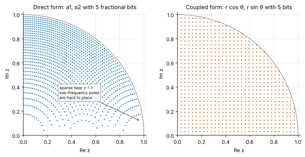
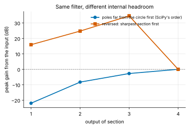

<!-- status: verified -->
# 16-08 · Filter Structures and Implementation

| | |
|---|---|
| **Course** | [16 · Digital Signal Processing](../README.md) |
| **University equivalent** | The structures chapter of a senior DSP course: signal-flow graphs, direct and transposed forms, cascade and parallel forms, lattice structures and coefficient sensitivity (Oppenheim & Schafer, *Discrete-Time Signal Processing*, ch. 6; Proakis & Manolakis, *Digital Signal Processing*, ch. 9) |
| **Prerequisites** | [16-07 IIR Filter Design](16-07-iir-filter-design.md), [16-06 FIR Filter Design](16-06-fir-filter-design.md), [08-09 Arithmetic Circuits](../../08-digital-logic-design/chapters/08-09-arithmetic-circuits.md) (adders, multipliers, critical paths) |
| **Estimated study hours** | 6 |
| **Last verified** | 2026-11-20 |

**Learning objectives.** After this chapter you can:

1. Draw and count (multipliers, adders, delays) the direct, transposed, cascade and parallel forms of FIR and IIR filters, and derive a transposed form from the transposition rule.
2. Explain why the transposed FIR form is the high-speed hardware structure, and compute critical paths and clock rates.
3. Predict the internal signal growth of each IIR structure and choose section pairing, ordering and scaling to control it.
4. Derive the sensitivity of poles to coefficient errors, and explain why high-order direct forms fail and why the coupled form places low-frequency poles more accurately.
5. Convert between polynomial and lattice (reflection-coefficient) forms and use the lattice as a stability test.
6. Specify a fixed-point biquad (coefficient format, accumulator width, rounding, saturation) and verify it bit-exactly against a model.

---

## 1. Big picture

16-06 and 16-07 produced transfer functions. A transfer function says what a filter does in exact arithmetic; a **structure** says how it is computed: in which order the multiplications and additions happen, and which intermediate values are stored. In exact arithmetic every structure gives the same output. In real hardware, with finite word lengths, they differ enormously: one structure keeps every internal signal within range while another overflows; one survives 12-bit coefficients while another goes unstable (Problem 16-07.12); one runs at 400 MHz while another, computing the same sums, runs at 30 MHz. Choosing the structure is therefore an engineering decision on a par with choosing the transfer function, and it is made by people who build things: firmware engineers, FPGA designers and DSP-core architects.

- **FPGAs.** DSP blocks are built for transposed and systolic FIR structures with symmetric pre-addition (16-06 §9).
- **Microcontrollers and DSP cores.** Libraries ship cascaded biquads in Direct Form I for fixed point and transposed Direct Form II for floating point (§9).
- **Audio and sensor ICs.** Programmable biquads with fixed coefficient formats and internal word lengths are data-sheet features.
- **Speech coding and adaptive filtering.** Lattice structures carry reflection coefficients, which double as a built-in stability check.

## 2. Intuition first

**Same sum, different order.** Adding a column of numbers top to bottom or bottom to top gives the same total with exact arithmetic, but if every partial sum must fit in a small register, one order may overflow where the other does not, and if every partial sum is rounded, the errors differ. A filter structure is a choice of order for the sums in a filter's difference equation, and the choice matters for the same reasons.

**Analogy: consolidating accounts.** A group's consolidated balance sheet is the same whichever subsidiaries are consolidated first, but intermediate subtotals can be huge or tiny depending on the order (a large liability netted early against a large asset never appears; netted late, it inflates every intermediate total). Ordering biquad sections is exactly this: the overall gain is fixed, but the peak gain at intermediate outputs depends on the order (Figure 3). **Where it breaks:** accounting subtotals cannot overflow a register, and rounding errors in accounts do not get amplified by feedback as filter round-off does.

**Feedback amplifies.** A pole near the unit circle multiplies anything entering the loop, including signal, rounding errors and coefficient errors, by roughly $1/(1 - \rho)$. Good structures keep the quantities entering feedback loops small and well conditioned.

## 3. Theory

Notation: $H(z) = B(z)/A(z)$ with $B(z) = \sum_{k=0}^{N} b_kz^{-k}$, $A(z) = 1 + \sum_{k=1}^{N} a_kz^{-k}$, so $y[n] = \sum b_kx[n - k] - \sum_{k \ge 1} a_ky[n - k]$. Structures are drawn with delays $[z^{-1}]$, multipliers $[c]$ and adders $(+)$; costs are counted as multipliers, two-input adders and delay registers.

### 3.1 FIR structures and transposition

**Direct form (tapped delay line).** The input runs down a chain of delays; each tap is multiplied and the products are summed by an adder chain:

```text
x[n]──┬───►[z⁻¹]──┬───►[z⁻¹]──┬───►[z⁻¹]──┐
      │           │           │           │
    [h0]        [h1]        [h2]        [h3]
      │           │           │           │
      └────►(+)◄──┘           │           │
             └─────────►(+)◄──┘           │
                         └─────────►(+)◄──┘
                                     └────────► y[n]
```

Cost: $M + 1$ multipliers, $M$ adders, $M$ delays. The longest path between registers (the **critical path**) is one multiplier followed by $M$ adders, which grows with the filter.

**The transposition rule.** For any single-input single-output signal-flow graph, reversing every branch, swapping the input and output, and exchanging adders with branch points gives a graph with the same transfer function. (Proof sketch: the transfer function is a sum over forward paths of the product of branch gains, which reversal does not change; feedback loops reverse into loops with the same gain.) Transposing the direct form gives:

```text
x[n] ──┬───────────┬───────────┬───────────┐
       │           │           │           │
     [h0]        [h1]        [h2]        [h3]
       │           │           │           │
       ▼           ▼           ▼           │
y[n]◄─(+)◄─[z⁻¹]◄─(+)◄─[z⁻¹]◄─(+)◄─[z⁻¹]◄──┘
```

The input is broadcast to all multipliers, and partial sums travel through the delays. Same counts, but **every register-to-register path is one multiplier and one adder**, regardless of length. This is why FPGA FIR filters are transposed or systolic (a pipelined relative), and why FPGA DSP blocks chain their adders through dedicated cascade wiring (§9). The costs: the input must fan out to every tap, and the registers hold partial sums (wider words) rather than input samples.

**Linear-phase folding** (16-06 §3.8) applies to the direct form: pre-add the two samples sharing a coefficient, halving the multipliers.

### 3.2 IIR direct forms

**Direct Form I** computes the feed-forward sum on the input, then the feedback sum on the output, keeping $N$ past inputs and $N$ past outputs:

```text
x[n]──●──►[b0]──►(+)──────────●──► y[n]
      │           ▲           │
    [z⁻¹]         │         [z⁻¹]
      │           │           │
      ●──►[b1]───►(+)◄─[−a1]──●
      │           ▲           │
    [z⁻¹]         │         [z⁻¹]
      │           │           │
      ●──►[b2]───►(+)◄─[−a2]──●
```

Cost for order $N$: $2N + 1$ multipliers, $2N$ adders, $2N$ delays.

**Direct Form II.** $H = B \cdot (1/A)$, and the order of two LTI systems in cascade can be swapped (both are multiplications of z-transforms). Doing the poles first gives an intermediate signal $w[n]$ with

$$
w[n] = x[n] - \sum_{k=1}^{N} a_kw[n - k], \qquad y[n] = \sum_{k=0}^{N} b_kw[n - k],
$$

and both sums use the same delayed values $w[n - k]$, so one delay line serves both:

```text
x[n]──►(+)────────●──►[b0]──►(+)──► y[n]
        ▲         │           ▲
        │       [z⁻¹]         │
        │         │           │
        ├─[−a1]◄──●──►[b1]───►(+)
        │         │           ▲
        │       [z⁻¹]         │
        │         │           │
        └─[−a2]◄──●──►[b2]────┘
```

Cost: $2N + 1$ multipliers, $2N$ adders, only $N$ delays: the minimum, so DF II is called **canonical**. **Transposed Direct Form II (DF2T)** is its transposition; it also has $N$ delays and its state variables are partial sums.

**The catch: internal gain.** In DF II the stored signal is $w = x/A(z)$: the input passed through the *poles alone*, before the zeros pull the response back down. For a sharp section the poles alone have enormous gain. The last section of the 16-07 elliptic filter (poles at radius 0.985) has $\max_\omega\lvert 1/A(e^{j\omega})\rvert$ = **66.10** (36.4 dB), so $w$ needs about **6.05** more bits of headroom than the input, while the section's own output peaks at only **6.25** (Example 16-08.3). In DF I the stored values are past inputs and past outputs, both bounded by the signal levels the system was designed for; only the accumulator sees large intermediate sums, and a wide accumulator (with two's-complement wrap-around in intermediate sums, which cancels if the final result fits) handles them. That is why fixed-point libraries prefer DF I and floating-point ones DF2T (§9).

### 3.3 Cascade and parallel forms

**Cascade.** Factor $H(z) = G\prod_{i} H_i(z)$ into second-order sections (16-07 §3.5): each **biquad** $H_i(z) = (b_{0i} + b_{1i}z^{-1} + b_{2i}z^{-2})/(1 + a_{1i}z^{-1} + a_{2i}z^{-2})$ holds one pole pair and one zero pair. Errors in one section's coefficients move only that section's roots. Three decisions remain:

1. **Pairing.** Pair each pole pair with the zero pair nearest to it, so that each section's zeros partly cancel its own pole peak and its gain stays moderate. Start with the poles closest to the unit circle (the hardest to tame).
2. **Ordering.** The peak gain from the input to each intermediate output depends on the order. Putting the poles farthest from the circle first and the sharpest section last keeps intermediate peaks low; the reverse order makes them large (Problem 16-08.10 and Figure 3).
3. **Scaling.** Multiply each section's numerator by a factor that keeps its output within range. For an input bounded by $\lvert x\rvert \le 1$, the output of a filter $g$ is bounded by $\sum\lvert g[n]\rvert$ (the $L_1$ norm, an absolute guarantee); for sinusoidal inputs, by $\max_\omega\lvert G(e^{j\omega})\rvert$ (the $L_\infty$ norm); for random inputs, the output variance scales with $\sum g[n]^2$ (the $L_2$ norm squared). Each is a different trade between overflow probability and wasted headroom (16-10).

**Parallel.** A partial-fraction expansion $H(z) = c_0 + \sum_i \dfrac{\beta_{0i} + \beta_{1i}z^{-1}}{1 + a_{1i}z^{-1} + a_{2i}z^{-2}}$ gives sections that run side by side and are summed. Errors do not propagate from section to section, but zeros are no longer realized directly (they emerge from the sum), so a stopband with zeros on the unit circle is less accurately placed than in the cascade form. Cascade is the default in practice.

### 3.4 Coefficient sensitivity

**How far does a root move?** Let $A(z) = \prod_{j=1}^{N}(1 - p_jz^{-1})$, so $A(z) = z^{-N}\prod_j(z - p_j)$. Differentiate $A(p_i) = 0$ with respect to a coefficient $a_k$: $\frac{\partial A}{\partial a_k}\big|_{p_i} + \frac{\partial A}{\partial z}\big|_{p_i}\frac{\partial p_i}{\partial a_k} = 0$. Since $\partial A/\partial a_k = z^{-k}$ and $\partial A/\partial z$ at a root equals $p_i^{-N}\prod_{j \ne i}(p_i - p_j)$,

$$
\frac{\partial p_i}{\partial a_k} = -\frac{p_i^{N - k}}{\prod_{j \ne i}(p_i - p_j)} .
$$

The denominator is the product of the distances from $p_i$ to every other pole. A sharp high-order filter has its poles **clustered** near the band edge, so these distances are small and their product tiny: a minute coefficient error moves the poles a long way. That is the mechanism behind Problem 16-07.12, where rounding the elliptic filter's single polynomial to 12 fractional bits pushed a pole outside the circle. In a biquad each pole has only one partner (its conjugate), at a distance $2\rho\sin\theta$, so the amplification is bounded and local.

**The biquad's own weakness: low-frequency poles.** For a pole pair $\rho e^{\pm j\theta}$, $a_1 = -2\rho\cos\theta$ and $a_2 = \rho^2$. Holding $a_2$ fixed, $\partial\theta/\partial a_1 = 1/(2\rho\sin\theta)$, which blows up as $\theta \to 0$. Equivalently, the poles realizable with quantized $a_1, a_2$ lie on a grid that thins out near $z = 1$ (Figure 2, left): a low-frequency resonator cannot be placed accurately. Example 16-08.4 moves a 100 Hz resonator at 48 kHz to 119 Hz with 12-bit coefficients.

**The coupled (Gold–Rader) form** stores $c = \rho\cos\theta$ and $s = \rho\sin\theta$ directly and iterates the state pair

$$
\begin{aligned}
u[n] &= c\,u[n - 1] - s\,v[n - 1] + x[n],\\
v[n] &= s\,u[n - 1] + c\,v[n - 1],
\end{aligned}
$$

whose state matrix $\begin{pmatrix}c & -s\\ s & c\end{pmatrix}$ has eigenvalues $c \pm js$: exactly the pole pair. Quantizing $c$ and $s$ puts the realizable poles on a uniform square grid (Figure 2, right), equally fine everywhere. The cost is four multiplications per sample for the recursion instead of two.



*Figure 2. Every pole position a biquad can realize with 5 fractional bits (first quadrant). Left: direct form, where the grid follows $\rho = \sqrt{a_2}$ and $\cos\theta = -a_1/(2\rho)$ and is sparse near $z = 1$. Right: coupled form, a uniform grid.*

### 3.5 Lattice structures

**FIR lattice.** Build $A_N(z)$ up one order at a time with **reflection coefficients** $k_m$:

$$
A_m(z) = A_{m-1}(z) + k_m z^{-m}A_{m-1}(z^{-1}), \qquad A_0(z) = 1 .
$$

The term $z^{-m}A_{m-1}(z^{-1})$ is $A_{m-1}$ with its coefficients reversed and shifted, so the last coefficient of $A_m$ is $k_m$. Each stage is a pair of cross-coupled multipliers (one $k_m$, used twice) between a "forward" and a "backward" signal path, and the structure is modular: adding a stage raises the order without changing the earlier stages. Going down (the **step-down** recursion) inverts it:

$$
k_m = a_m^{(m)}, \qquad A_{m-1}(z) = \frac{A_m(z) - k_m z^{-m}A_m(z^{-1})}{1 - k_m^2} .
$$

**The stability test.** All roots of $A_N(z)$ lie strictly inside the unit circle **if and only if** $\lvert k_m\rvert < 1$ for every $m$ (the Schur–Cohn test; the Jury test of 15-11 is an equivalent tabulation). So a lattice filter is stable by inspection, and an all-pole IIR lattice built on the same reflection coefficients stays stable under any quantization that keeps each $\lvert k_m\rvert < 1$. That property is why speech codecs transmit and interpolate reflection-type parameters rather than polynomial coefficients, and why adaptive IIR filters are often parameterized as lattices **[Established; textbook]**.

> **Going deeper — why the reflection coefficients are bounded.** In linear prediction, $k_m$ is the correlation between the forward and backward prediction errors of order $m - 1$ (normalized by their energies), so $\lvert k_m\rvert \le 1$ by the Cauchy–Schwarz inequality, with equality only for a perfectly predictable (singular) signal. The step-down recursion is the Levinson–Durbin recursion run backwards.

### 3.6 Fixed-point implementation of a biquad

A practical biquad specification has four parts, each a decision:

- **Coefficient format.** Biquad coefficients span $\lvert a_1\rvert < 2$ and $\lvert b_1\rvert \le 2$ for low-pass sections, so a format with range $[-2, 2)$ (Q2.14 in 16 bits) holds them directly; alternatively, store $a_1/2$ and $b_1/2$ in a [−1, 1) format and double them in the datapath, as TI's converters do (16-07 §9).
- **Accumulator width.** Five 16 × 16-bit products need 32 bits each, and their sum up to $32 + \lceil\log_2 5\rceil = 35$ bits; a 40-bit accumulator adds guard bits. With an exact accumulator, the only rounding is the final one.
- **Rounding.** Round to nearest by adding half an output LSB ($2^{13}$ for Q2.14) before the arithmetic right shift.
- **Overflow.** Saturate the output to the 16-bit range, and feed back the saturated value. Saturation is a deliberate nonlinearity: much better than two's-complement wrap-around, which turns an overflow into a full-scale error and can sustain large oscillations (16-10).

The lab's `biquad_df1.v` implements exactly this with the 16-07 Butterworth biquad and is checked **bit for bit** against a Python model on 15 sequences, two of which (full-scale steps of ±32,000) drive the output into positive and negative saturation through the filter's step overshoot.

## 4. Worked examples

### Example 16-08.1 · Counting structures (tier A)

**Setup.** An order-4 IIR filter has 5 numerator and 4 denominator coefficients. Count multipliers, adders and delays for DF I, DF II, DF2T and a cascade of two biquads.

**Solution.** From §3.2 with $N = 4$: DF I needs $2N + 1$ = **9** multipliers, $2N$ = **8** adders and $2N$ = **8** delays. DF II and DF2T need 9 multipliers, 8 adders and only $N$ = **4** delays. Two biquads in cascade need $2 \times 5$ = **10** multipliers (one more, because each section has its own $b_0$), $2 \times 4$ = 8 adders and $2 \times 2$ = 4 delays (DF II sections).

**Units check.** Counts per output sample.

**Sanity check.** The cascade costs one extra multiplier for a large gain in robustness; when sections have zeros on the unit circle ($b_0 = b_2$), the gain can be pulled out and $b_0 = b_2 = 1$, saving more (16-07 Example 16-07.5 needed 14 for order 8).

### Example 16-08.2 · Why FPGAs transpose (tier B)

**Setup.** A multiplier takes 2.0 ns and an adder 0.5 ns. Find the critical path and maximum clock rate of 8-tap and 64-tap FIR filters in direct form (adder chain), in direct form with an adder tree, and in transposed form.

**Solution.** Direct form, adder chain: $T = 2.0 + (M)(0.5)$ with $M$ = taps − 1 adders. For 8 taps, $2.0 + 7 \times 0.5$ = **5.5** ns, **181.8** MHz; for 64 taps, $2.0 + 63 \times 0.5$ = **33.5** ns, **29.85** MHz. With a balanced adder tree the 64 products are summed in $\log_2 64 = 6$ levels: $2.0 + 6 \times 0.5$ = **5.0** ns, **200** MHz. Transposed: one multiplier and one adder, **2.5** ns, **400** MHz at any length.

**Units check.** $f_{\max} = 1/T$: $1/(2.5 \text{ ns}) = 400$ MHz.

**Sanity check.** The transposed form achieves its speed with no extra arithmetic, by moving the registers into the adder chain; the price is wider registers (partial sums) and a broadcast input, which on an FPGA is the dedicated cascade routing between DSP blocks.

### Example 16-08.3 · Internal headroom in Direct Form II (tier B)

**Setup.** The last section of the 16-07 elliptic filter has $a = (1, -1.6973, 0.9702)$, poles at radius 0.985. In DF II, how much larger can the stored signal $w$ be than the input, and how does this compare with the section's own output?

**Solution.** $w = x/A$, so for a sinusoidal input of amplitude 1 the peak of $w$ is $\max_\omega\lvert 1/A(e^{j\omega})\rvert$ = **66.10**: 36.4 dB, or $\log_2 66.10$ = **6.05** extra bits. For an arbitrary bounded input the guaranteed bound is the $L_1$ norm of the impulse response of $1/A$, $\sum_n\lvert g[n]\rvert$ = **84.11**. The section's own output peaks at $\max\lvert B/A\rvert$ = **6.25**, because its zeros (on the unit circle just above the passband) cancel most of the pole gain. In the cascade ordered as in SciPy, the filter's output up to that section never exceeds a gain of 1. A DF I implementation of the same section stores only $x$ and $y$; the large intermediate value exists only inside the accumulator.

**Units check.** Gains are ratios of amplitudes; bits = $\log_2$ of a ratio.

**Sanity check.** A single pole pair at radius $\rho$ peaks at roughly $1/\big((1 - \rho)\cdot\lvert 1 - \rho e^{-2j\theta}\rvert\big)$; with $1 - \rho = 0.015$ that is of order $1/0.015 \approx 67$ divided by a factor near 1, consistent with 66.

### Example 16-08.4 · A low-frequency resonator on a coarse grid (tier B)

**Setup.** A resonator at $f_0$ = 100 Hz, $f_s$ = 48 kHz, pole radius 0.999, is implemented with 12 fractional bits. Compare the realized pole frequency in direct form ($a_1$, $a_2$ quantized) and in the coupled form ($\rho\cos\theta$, $\rho\sin\theta$ quantized). Repeat with 16 bits.

**Solution.** $\theta = 2\pi \times 100/48{,}000 = 0.01309$ rad. Direct form: $a_1 = -2\rho\cos\theta = -1.99783$, $a_2 = \rho^2 = 0.99800$. Coupled form: $c = 0.99891$, $s = 0.013077$. Rounding to multiples of $2^{-12}$ and solving for the poles:

| Fractional bits | Direct form | Coupled form |
|---|---|---|
| 12 | **119.19** Hz | **100.81** Hz |
| 16 | **98.73** Hz | **100.002** Hz |

At 12 bits the direct form misses by **19**%. The sensitivity $\partial\theta/\partial a_1 = 1/(2\rho\sin\theta)$ = **38.2** rad per unit of $a_1$ at this angle explains why: a coefficient step of $2^{-12}$ is worth almost 0.01 rad, **71** Hz, of pole angle. In the coupled form $\partial\theta/\partial s = \cos\theta/\rho \approx 1$, so a half-step error of $2^{-13}$ moves the pole by about $1.2 \times 10^{-4}$ rad, **0.93** Hz.

**Units check.** Frequencies from pole angles: $f = \theta f_s/(2\pi)$.

**Sanity check.** The direct form's error shrinks with more bits (**1.3**% at 16 bits) but stays far larger than the coupled form's; the coupled form pays two extra multiplications per sample for that accuracy.

### Example 16-08.5 · A lattice and its stability test (tier C)

**Setup.** Find the reflection coefficients of $A(z) = 1 - 0.9z^{-1} + 0.64z^{-2} - 0.576z^{-3}$ and decide stability. Check by factoring.

**Solution.** Step-down from $m = 3$: $k_3 = a_3$ = **−0.576**, $1 - k_3^2 = 0.668224$.

$$
a_1^{(2)} = \frac{a_1 - k_3a_2}{1 - k_3^2} = \frac{-0.9 + 0.36864}{0.668224} = -0.79518, \qquad
a_2^{(2)} = \frac{a_2 - k_3a_1}{1 - k_3^2} = \frac{0.64 - 0.5184}{0.668224} = 0.18197 .
$$

So $k_2$ = **0.1820**. Next, $a_1^{(1)} = a_1^{(2)}(1 - k_2)/(1 - k_2^2) = a_1^{(2)}/(1 + k_2) = -0.79518/1.18197$, so $k_1$ = **−0.6728**. All three satisfy $\lvert k_m\rvert < 1$: **stable**. Check: $A(z) = (1 - 0.9z^{-1})(1 + 0.64z^{-2})$, with roots $0.9$ and $\pm j0.8$, all inside the circle. Stepping back up from $(k_1, k_2, k_3)$ reproduces $(1, -0.9, 0.64, -0.576)$.

For the 16-07 Butterworth biquad, $A(z) = 1 - 0.94281z^{-1} + 0.33333z^{-2}$: $k_2$ = **0.3333** and $k_1 = -0.94281/1.33333$ = **−0.7071**, also stable.

**Units check.** Reflection coefficients are dimensionless.

**Sanity check.** For a second-order $A$, $k_2 = a_2 = \rho^2$ (the product of the roots), and $\lvert k_2\rvert < 1$ is exactly $\rho < 1$.



*Figure 3. The order-8 elliptic filter of 16-07 as four biquads. With SciPy's ordering (poles farthest from the circle first) the gain from the input to every intermediate output stays at or below 0 dB; reversed, the intermediate outputs peak at +15.9, +24.7 and +34.6 dB before the last section brings the total back to 0 dB.*

### Answer key

<!-- answer-key -->

| ID | Quantity | Value | Unit |
|---|---|---|---|
| Ex 16-08.1a | DF I multipliers | 9 | — |
| Ex 16-08.1b | DF I adders | 8 | — |
| Ex 16-08.1c | DF I delays | 8 | — |
| Ex 16-08.1d | DF II delays | 4 | — |
| Ex 16-08.1e | cascade multipliers | 10 | — |
| Ex 16-08.2a | 8-tap direct critical path | 5.5 | ns |
| Ex 16-08.2b | 8-tap direct clock | 181.8 | MHz |
| Ex 16-08.2c | 64-tap direct critical path | 33.5 | ns |
| Ex 16-08.2d | 64-tap direct clock | 29.85 | MHz |
| Ex 16-08.2e | 64-tap adder-tree path | 5.0 | ns |
| Ex 16-08.2f | adder-tree clock | 200 | MHz |
| Ex 16-08.2g | transposed path | 2.5 | ns |
| Ex 16-08.2h | transposed clock | 400 | MHz |
| Ex 16-08.3a | peak of 1/A | 66.10 | — |
| Ex 16-08.3b | extra bits | 6.05 | bits |
| Ex 16-08.3c | L1 norm of 1/A | 84.11 | — |
| Ex 16-08.3d | section peak gain | 6.25 | — |
| Ex 16-08.3e | peak of 1/A in dB | 36.4 | dB |
| Ex 16-08.4a | direct form at 12 bits | 119.19 | Hz |
| Ex 16-08.4b | coupled form at 12 bits | 100.81 | Hz |
| Ex 16-08.4c | direct form at 16 bits | 98.73 | Hz |
| Ex 16-08.4d | coupled form at 16 bits | 100.002 | Hz |
| Ex 16-08.4e | sensitivity of θ to a1 | 38.2 | rad |
| Ex 16-08.4f | pole angle | 0.01309 | rad |
| Ex 16-08.4g | direct-form a1 | −1.99783 | — |
| Ex 16-08.4h | coupled-form s | 0.013077 | — |
| Ex 16-08.4i | direct-form error at 12 bits | 19 | % |
| Ex 16-08.4j | one 12-bit step of a1 as frequency | 71 | Hz |
| Ex 16-08.4k | coupled half-step as frequency | 0.93 | Hz |
| Ex 16-08.4l | direct-form error at 16 bits | 1.3 | % |
| Ex 16-08.5a | k3 | −0.576 | — |
| Ex 16-08.5b | k2 | 0.1820 | — |
| Ex 16-08.5c | k1 | −0.6728 | — |
| Ex 16-08.5d | intermediate a1 | −0.79518 | — |
| Ex 16-08.5e | Butterworth biquad k1 | −0.7071 | — |
| Ex 16-08.5f | Butterworth biquad k2 | 0.3333 | — |
| Txt 16-08.a | reversed ordering, section 1 peak | 15.9 | dB |
| Txt 16-08.b | reversed ordering, section 2 peak | 24.7 | dB |
| Txt 16-08.c | reversed ordering, section 3 peak | 34.6 | dB |
| Txt 16-08.d | accumulator bits for five 16 × 16 products | 35 | bits |

## 5. Simulate it

The lab, [labs/16-08-lab](../labs/16-08-lab/README.md), provides `structures.py`, which implements every structure of §3 sample by sample (direct and transposed FIR, DF I, DF II, DF2T, cascades, lattice conversions, and a bit-exact fixed-point biquad model), and `biquad_df1.v` with a self-checking testbench. You:

1. **Prove equivalence**: run one random input through every structure and confirm identical outputs in floating point.
2. **Watch internal signals**: record DF II's $w[n]$ for the sharpest elliptic section and compare its peak with the input and output peaks (Example 16-08.3).
3. **Order the sections** of the elliptic filter both ways and measure intermediate peaks (Figure 3).
4. **Quantize a resonator** in direct and coupled forms (Example 16-08.4) and plot the reachable pole grid.
5. **Run the hardware**: simulate `biquad_df1.v` against `vectors.hex`, then change one rounding detail in the model (truncate instead of round) and watch the testbench catch it.

**Guided exercise (predict, then run).** **Before Part 5,** predict whether a full-scale step of 32,000 into the 1 kHz Butterworth biquad saturates a 16-bit output. (It does: the bilinear-transformed second-order Butterworth filter overshoots its step by 5.5%, to about 33,770, so two outputs clip at 32,767 before the response settles at 32,005; the testbench's step tests exist to exercise exactly this.)

## 6. Engineering tradeoffs

| Knob | Improves | Costs | Typical decision owner |
|---|---|---|---|
| Transposed (or systolic) FIR | Clock rate independent of length | Wider registers; input fan-out | FPGA or ASIC designer |
| DF I instead of DF II | No internal gain beyond input and output levels; fixed-point friendly | Twice the delay registers | Firmware or hardware engineer |
| DF2T in floating point | Fewest registers; good floating-point behaviour | Large state dynamic range in fixed point | Firmware engineer |
| Cascade of biquads | Local, bounded coefficient sensitivity | Pairing, ordering and scaling decisions; one extra multiplier per section | DSP designer |
| Coupled-form section | Uniform pole accuracy (low-frequency resonators) | Four multiplications instead of two | DSP designer |
| Lattice | Stability by inspection; modular orders | More multiplications than direct forms | Algorithm designer (speech, adaptive) |
| Wider accumulator and coefficients | Lower round-off, accurate poles | Area, power, memory | Hardware architect |

## 7. Numbers to know

| Quantity | Value | Source |
|---|---|---|
| DF I / DF II / cascade costs, order $N$ | $2N + 1$ multipliers each; $2N$ vs $N$ delays; biquad = 5 multipliers | §3.2–3.3 |
| Transposed FIR critical path | one multiplier + one adder, any length | §3.1 |
| Pole sensitivity | $\partial p_i/\partial a_k = -p_i^{N-k}/\prod_{j\ne i}(p_i - p_j)$ | §3.4 |
| Direct-form biquad angle sensitivity | $1/(2\rho\sin\theta)$: large near DC and Nyquist | §3.4 |
| Lattice stability | all $\lvert k_m\rvert < 1$ | §3.5 |
| Biquad accumulator | 35 bits for five 16 × 16 products; 40 bits common | §3.6 |

## 8. Common mistakes

- **Implementing a high-order IIR filter as one polynomial.** Use sections; the poles of a high-order polynomial are hypersensitive.
- **Using DF II in fixed point without checking the internal node.** Its state is the input through the poles alone and can be tens of times larger than the input.
- **Ordering sections arbitrarily.** The sharpest section first can make intermediate signals grow by 30 dB or more.
- **Forgetting that transposition changes what the registers hold** (partial sums, wider words), and sizing them for samples.
- **Using a direct-form biquad for a very low-frequency resonator or notch** at a high sample rate with short coefficients; use more bits or the coupled form.
- **Wrap-around instead of saturation at the output.** Two's-complement overflow turns a small excess into a full-scale error and can sustain oscillations (16-10).
- **Verifying hardware only with small random signals.** The tests must exercise the edge cases the design claims to handle: full-scale inputs, saturation in both directions, reset behaviour.

## 9. Practitioner lens

### State of the art (as of Nov 2026)

- **Microcontroller libraries encode the structure choice.** Arm's CMSIS-DSP (v1.18.0) offers biquad cascades in Direct Form I for Q15, Q31 and floating point and in transposed Direct Form II for floating point only, explaining that DF I "is numerically more robust for fixed-point data types" while DF2T "requires a wide dynamic range for the state variables" (R-241) **[Established]**: the internal-gain argument of §3.2, stated by a library vendor. Its Q31 version accumulates in 64 bits with "only a single guard bit" and requires inputs scaled into [−0.25, 0.25), and its fixed-point coefficients are limited to [−1, 1) with a `postShift` to recover larger ones (R-241) **[Established]**.
- **Converter biquads fix the format in silicon.** TI's TLV320ADC5140 stores biquad coefficients as 32-bit 1.31 numbers, halving $b_1$ and $a_1$ to fit (the factors of 2 in its transfer function) and computing in 32-bit fixed point (R-240) **[Established]**: the alternative to a Q2.x format discussed in §3.6.
- **FPGA DSP blocks are systolic FIR engines.** AMD's DSP48E2 user guide shows an 8-tap symmetric systolic FIR built from four DSP slices with pre-adders, and Altera's Agilex 7 DSP blocks offer "18-bit and 27-bit systolic finite impulse response (FIR) filters with distributed output adder" (R-239) **[Established]**: the transposed/systolic structures of §3.1 in hard silicon.
- **Lattice parameters in speech coding.** Linear-prediction speech coders represent their all-pole vocal-tract filters through reflection-type or line-spectral parameters chosen for robust quantization and guaranteed stability **[Established; textbook]**.

### Why it matters commercially

Structure choices decide how many DSP blocks an FPGA design consumes, how fast a filter can clock, and whether a coefficient file that works on a laptop fails in a product. They are invisible in a transfer-function plot and visible only in the implementation, which is why mature teams verify filters bit-exactly against a fixed-point model rather than against a floating-point design. In diligence, a team's answer to "how did you verify the fixed-point filter?" separates prototypes from products.

### Marketing vs Reality

- **"Supports N-tap filters at X MHz"** may assume a structure (transposed, pipelined) or a coefficient symmetry (pre-adder) that a given filter does not have. Ask what structure and which symmetries the figure assumes.
- **"32-bit precision"** for a biquad bank can mean 32-bit coefficients with a narrower data path, or the reverse; and a [−1, 1) coefficient format halves some coefficients (R-240). Ask for the coefficient format, accumulator width and rounding mode.
- **"Floating point, so no overflow worries"** is true for overflow but not for coefficient sensitivity: a high-order single-polynomial IIR filter can misbehave even in double precision (SciPy recommends sections for this reason, R-242).

### Questions for engineering leaders

1. **"Which structure implements this filter, and why that one?"** *Strong:* names DF I/DF2T/transposed/systolic and ties the choice to number format, speed or resources. *Evasive:* "whatever the tool generates".
2. **"How are biquad sections paired, ordered and scaled?"** *Strong:* describes the rule (nearest zeros, poles far from the circle first, $L_\infty$ or $L_2$ scaling) and the measured headroom. *Evasive:* "we use the default".
3. **"How is the fixed-point implementation verified?"** *Strong:* bit-exact comparison against a model, including full-scale and saturation cases. *Evasive:* "the spectrum looks right".
4. **"What happens to the poles when the coefficients are quantized?"** *Strong:* has checked the quantized pole positions and response against the mask. *Evasive:* tested in floating point only.
5. **"What limits the clock rate of the filter datapath?"** *Strong:* identifies the critical path (adder chain, feedback loop) and the retiming or pipelining used. *Evasive:* gives the clock without the path.

## 10. Concept check

**Q1.** Why do DF I and DF II give identical outputs in exact arithmetic?

<details><summary>Answer</summary>

Both compute $Y = B(z)\,[X/A(z)]$; DF I applies $B$ then $1/A$, DF II applies $1/A$ then $B$. LTI systems in cascade commute (their z-transforms multiply), so the order does not matter without rounding or overflow.

</details>

**Q2.** Why is DF II called canonical, and why do fixed-point libraries still prefer DF I?

<details><summary>Answer</summary>

DF II uses the minimum number of delays, $N$. But its stored signal is the input filtered by the poles alone, which can be far larger than input or output (66 times for a sharp section), so it needs extra headroom; DF I stores only inputs and outputs.

</details>

**Q3.** What does transposition change, and what does it preserve?

<details><summary>Answer</summary>

It preserves the transfer function and the counts of multipliers, adders and delays. It changes what the registers hold (partial sums instead of samples) and the critical path (one multiplier plus one adder for the transposed FIR).

</details>

**Q4.** Why does a clustered set of poles make a high-order direct form hypersensitive?

<details><summary>Answer</summary>

$\partial p_i/\partial a_k$ has the product of the distances from $p_i$ to all other poles in its denominator; clustered poles make that product tiny, so tiny coefficient errors make large root movements.

</details>

**Q5.** Which is more accurate for a 50 Hz resonator at 48 kHz with 14-bit coefficients, a direct-form or a coupled-form biquad, and why?

<details><summary>Answer</summary>

The coupled form. The direct form's angle sensitivity $1/(2\rho\sin\theta)$ is huge at small $\theta$, while the coupled form quantizes $\rho\cos\theta$ and $\rho\sin\theta$ on a uniform grid (Problem 16-08.9: 59.6 Hz against 49.9 Hz).

</details>

**Q6.** A polynomial's step-down recursion gives $k = (0.5, -0.99, 1.02)$. Is it stable?

<details><summary>Answer</summary>

No: $\lvert k_3\rvert = 1.02 > 1$, so at least one root lies outside the unit circle. (A value of $-0.99$ is legal but means a root close to the circle.)

</details>

Practice: [Problems 16-08](../problems/16-08-problems.md) · [Solutions](../solutions/16-08-solutions.md)

## 11. Key terms

[Signal-flow graph](../../../reference/glossary.md#signal-flow-graph) · [Direct form I and II](../../../reference/glossary.md#direct-form-i-and-ii) · [Transposed form](../../../reference/glossary.md#transposed-form) · [Biquad](../../../reference/glossary.md#biquad) · [Second-order sections (SOS)](../../../reference/glossary.md#second-order-sections-sos) · [Critical path](../../../reference/glossary.md#critical-path) · [Coefficient sensitivity](../../../reference/glossary.md#coefficient-sensitivity) · [Coupled-form filter](../../../reference/glossary.md#coupled-form-filter) · [Lattice filter](../../../reference/glossary.md#lattice-filter) · [Reflection coefficient (lattice filter)](../../../reference/glossary.md#reflection-coefficient-lattice-filter) · [Saturation arithmetic](../../../reference/glossary.md#saturation-arithmetic)

## 12. Connections

- **Builds on:** [16-06](16-06-fir-filter-design.md) and [16-07](16-07-iir-filter-design.md) (the transfer functions implemented here), [16-02](16-02-dtft-and-z-transform-for-dsp.md) (poles, zeros, cascades), [08-09](../../08-digital-logic-design/chapters/08-09-arithmetic-circuits.md) (adders, multipliers, critical paths), [15-11](../../15-control-systems/chapters/15-11-digital-control.md) (Jury test).
- **Next:** [16-09 Multirate DSP](16-09-multirate-dsp.md) adds polyphase structures that compute only the outputs that are kept.
- **Used later:** quantization noise, scaling and limit cycles in [16-10](16-10-quantization-and-fixed-point.md); MAC units, DSP blocks, pipelining and retiming in [16-11](16-11-dsp-hardware-architectures.md).

## 13. Further study

- Oppenheim & Schafer, *Discrete-Time Signal Processing*, 3rd ed., ch. 6 (structures, transposition, lattice, finite-precision effects).
- Proakis & Manolakis, *Digital Signal Processing*, 4th ed., ch. 9 (implementation of discrete-time systems, including lattice structures).
- K. K. Parhi, *VLSI Digital Signal Processing Systems*, Wiley, 1999 (retiming, pipelining and systolic structures, for the hardware view).

## 14. Sources

1. A. V. Oppenheim and R. W. Schafer, *Discrete-Time Signal Processing*, 3rd ed., Pearson, 2010, ch. 6.
2. J. G. Proakis and D. G. Manolakis, *Digital Signal Processing: Principles, Algorithms, and Applications*, 4th ed., Pearson, 2007, ch. 9.
3. K. K. Parhi, *VLSI Digital Signal Processing Systems: Design and Implementation*, Wiley, 1999.
4. Arm CMSIS-DSP 1.18.0 biquad documentation. Research log [R-241].
5. TI TLV320ADC5140 data sheet and SBAA378B. Research log [R-240].
6. AMD UG579 and Altera UG-20213 (systolic FIR in DSP blocks). Research log [R-239].
