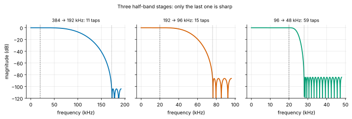
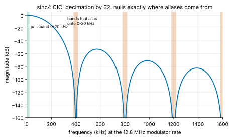

<!-- status: verified -->
# 16-09 · Multirate DSP: Decimation, Interpolation and Polyphase

| | |
|---|---|
| **Course** | [16 · Digital Signal Processing](../README.md) |
| **University equivalent** | The multirate chapter of a senior DSP course: downsampling and upsampling in the frequency domain, decimation and interpolation filters, polyphase structures and the noble identities, multistage and half-band designs, CIC filters and rational sample-rate conversion (Oppenheim & Schafer, *Discrete-Time Signal Processing*, ch. 4; Vaidyanathan, *Multirate Systems and Filter Banks*; Hogenauer [1]) |
| **Prerequisites** | [16-06 FIR Filter Design](16-06-fir-filter-design.md), [16-08 Filter Structures and Implementation](16-08-filter-structures.md), [11-10 Sampling, Aliasing and Reconstruction](../../11-signals-and-systems/chapters/11-10-sampling-aliasing-reconstruction.md) |
| **Estimated study hours** | 8 |
| **Last verified** | 2026-11-20 |

**Learning objectives.** After this chapter you can:

1. Derive the spectra of downsampled and upsampled signals, and predict where aliases and images land.
2. Specify the anti-aliasing filter of a decimator and the anti-imaging filter of an interpolator, including rational rate changes.
3. Derive the noble identities and the polyphase decomposition, and use them to build decimators and interpolators that compute only the samples that are kept.
4. Design multistage decimators with half-band filters and compare their cost and delay with a single stage.
5. Analyse a CIC filter: frequency response, alias protection, passband droop, register growth and why wrap-around arithmetic is safe.
6. Turn a sample-rate conversion requirement (such as 44.1 to 48 kHz) into factors, filters and multiplications per second.

---

## 1. Big picture

Every system in 16-06 to 16-08 ran at one sample rate. Real systems change rates constantly: a delta-sigma ADC samples at megahertz and delivers kilohertz; a radio receiver digitizes gigahertz of spectrum and keeps a 20 MHz channel; an audio device converts 44.1 kHz music to its 48 kHz pipeline; a display scaler resizes images. **Multirate DSP** is the theory of changing rates without corrupting the signal, and its central economic insight is simple: never compute a sample you are going to throw away, and do expensive filtering at the lowest rate that can carry the signal. 16-06 showed that a filter's cost grows as $f_s^2$ for a fixed transition width; this chapter shows how to escape that law.

- **Data converters.** Delta-sigma ADCs end in CIC and half-band decimation chains; audio DACs begin with interpolation filters (16-06 §9).
- **Radios.** Digital down-converters mix a channel to baseband and decimate it through CIC, half-band and channel filters; the transmit path interpolates (§9).
- **Audio and video.** Sample-rate converters bridge 44.1, 48 and 96 kHz domains; image and video scalers are 2-D interpolators.
- **Communications and compression.** Filter banks (OFDM receivers, subband audio codecs) are polyphase structures.

## 2. Intuition first

**Throwing samples away folds the spectrum.** Keeping every $M$-th sample is sampling again, at a rate $M$ times lower, so everything above the new Nyquist frequency folds back on top of what is below it (11-10). The cure is the same as for an ADC: filter first.

**Inserting zeros copies the spectrum.** Putting $L - 1$ zeros between samples raises the rate without adding information, and the spectrum of the zero-stuffed signal contains the original band plus $L - 1$ copies (**images**) at multiples of the old sampling rate. An interpolation filter removes the images and, in the time domain, fills in the zeros smoothly.

**Don't compute what you will discard.** A decimator that filters every input sample and then keeps one output in $M$ wastes $(M - 1)/M$ of its multiplications. Rearranging the filter into $M$ short **polyphase** branches, each running at the low rate, computes exactly the kept outputs with $1/M$ of the work. The same trick in reverse makes interpolators skip the multiplications by the inserted zeros.

**Analogy: from daily to monthly data.** Turning a daily price series into a monthly one by taking the price on the last trading day of each month lets any weekly or day-of-month pattern alias into a spurious slow trend; averaging over the month first (a low-pass filter) suppresses it. That is decimation with an anti-aliasing filter, and a monthly *average* is in fact a crude decimation filter: a boxcar, which is the one-stage CIC filter of §3.7. **Where the analogy breaks:** financial series are not band-limited and their "aliases" are statistical rather than exact spectral folds, so the cure is only partial.

## 3. Theory

Notation: $x[n]$ at rate $f_s$; $\downarrow M$ keeps every $M$-th sample; $\uparrow L$ inserts $L - 1$ zeros after each sample; $\omega$ is in rad/sample at whichever rate the signal lives.

### 3.1 Downsampling and aliasing

$y[m] = x[mM]$. To find its DTFT, first multiply $x$ by the comb $c[n] = \frac1M\sum_{k=0}^{M-1}e^{j2\pi kn/M}$, which equals 1 when $M$ divides $n$ and 0 otherwise (a sum of a complex exponential over a full period, 16-03). Then $x_c[n] = x[n]c[n]$ keeps the samples we want and zeroes the rest, and its transform is $X_c(e^{j\omega}) = \frac1M\sum_k X(e^{j(\omega - 2\pi k/M)})$ (each exponential shifts the spectrum). Finally $y[m] = x_c[mM]$ squeezes out the zeros, which stretches the frequency axis by $M$:

$$
Y(e^{j\omega}) = \frac1M\sum_{k=0}^{M-1}X\!\left(e^{j(\omega - 2\pi k)/M}\right).
$$

The output spectrum is the input spectrum stretched by $M$, scaled by $1/M$, plus $M - 1$ shifted copies. If $X$ is not confined to $\lvert\omega\rvert < \pi/M$, the copies overlap: **aliasing**. In hertz: a component at $f$ appears after decimation to $f_s' = f_s/M$ at its distance from the nearest multiple of $f_s'$.

**The decimator** is therefore an anti-aliasing low-pass filter followed by $\downarrow M$. Its stopband edge depends on what must be protected. To keep the whole new band $[0, f_s'/2]$ alias-free, the stopband must start at $f_s'/2$. If only a passband $[0, f_p]$ matters (the rest will be filtered later), the stopband may start at $f_s' - f_p$, because only components above that alias into $[0, f_p]$. The second choice is much cheaper and is the norm in multistage designs (§3.6).

### 3.2 Upsampling and imaging

$y[n] = x[n/L]$ when $L$ divides $n$, else 0. Then $Y(z) = \sum_n y[n]z^{-n} = \sum_m x[m]z^{-mL} = X(z^L)$, so

$$
Y(e^{j\omega}) = X(e^{j\omega L}).
$$

The spectrum is compressed by $L$: the original band now occupies $\lvert\omega\rvert < \pi/L$, and $X(e^{j\omega L})$, periodic with period $2\pi/L$, repeats it $L - 1$ more times across $[-\pi, \pi]$. **The interpolator** is $\uparrow L$ followed by a low-pass filter with cutoff $\pi/L$ and gain $L$ (the zero-stuffed signal has $1/L$ of the original's average amplitude; the gain restores it).

### 3.3 Rational rate changes

To change rate by $L/M$, upsample by $L$, filter once at the intermediate rate $Lf_s$, and downsample by $M$. One filter serves both purposes if its cutoff is the smaller of the two requirements, $\min(\pi/L, \pi/M)$, with gain $L$. For 44.1 kHz to 48 kHz, $48{,}000/44{,}100 = 160/147$ (the greatest common divisor is 300), so the intermediate rate is $44.1\text{ kHz} \times 160$ = 7.056 MHz. Computed naively this is hopeless; computed with polyphase structures (§3.5) it is cheap (Problem 16-09.5).

### 3.4 The noble identities

Two exchanges let filters move across rate changers:

1. **Decimation:** a filter $H(z^M)$ followed by $\downarrow M$ equals $\downarrow M$ followed by $H(z)$.
2. **Interpolation:** $\uparrow L$ followed by $H(z^L)$ equals $H(z)$ followed by $\uparrow L$.

*Proof of the first.* $H(z^M)$ has nonzero taps only at multiples of $M$: $g[n] = \sum_k h[k]\delta[n - kM]$. Its output is $v[n] = \sum_k h[k]x[n - kM]$, and keeping every $M$-th sample gives $v[mM] = \sum_k h[k]x[(m - k)M] = \sum_k h[k]x_d[m - k]$, where $x_d = \downarrow M(x)$: exactly $h$ applied to the decimated signal. The second follows from $Y(z) = X(z^L)$: filtering by $H(z)$ first gives $H(z^L)X(z^L)$ after upsampling, the same as upsampling first and then filtering by $H(z^L)$. The identities say that a filter in $z^M$ can always be run at the low rate.

### 3.5 Polyphase decomposition

Split any filter's taps into $M$ interleaved subsequences, the **polyphase components**:

$$
H(z) = \sum_{k=0}^{M-1} z^{-k}E_k(z^M), \qquad E_k(z) = \sum_n h[nM + k]z^{-n} .
$$

(Group the terms $h[i]z^{-i}$ by $i \bmod M$: those with $i = nM + k$ give $z^{-k}(z^M)^{-n}$.)

**Polyphase decimator.** Substituting into "$H(z)$ then $\downarrow M$" gives $M$ branches, each "$z^{-k}$ then $E_k(z^M)$ then $\downarrow M$"; by the first noble identity each becomes "$z^{-k}$, $\downarrow M$, then $E_k(z)$". Branch $k$ takes every $M$-th input sample starting at offset $k$ (a rotating switch, the **commutator**), filters it with the short filter $E_k$ at the output rate, and the branch outputs are summed. Every multiplication now contributes to a kept output: an $N$-tap decimation filter costs $N$ multiplications per *output* sample instead of per input sample, a saving of exactly $M$.

**Polyphase interpolator.** Dually, "$\uparrow L$ then $H(z)$" becomes $L$ branches $E_k(z)$ running at the *input* rate whose outputs are interleaved: output phase $k$ is $E_k$ applied to the input. The multiplications by inserted zeros disappear; an $N$-tap interpolation filter costs $N$ multiplications per input sample, $N/L$ per output.

**Rational converters** combine both: for $L/M$, only one of the $L$ phases is needed per output sample, chosen by $(mM) \bmod L$, so each output costs about $N/L$ multiplications, independent of $M$.

### 3.6 Multistage decimation and half-band filters

The order of a decimation filter grows as (attenuation)/(transition width ÷ rate) (16-06 §3.7). A single-stage decimator by a large $M$ needs a narrow transition at the *input* rate: expensive. Splitting $M = M_1M_2\cdots$ lets the early stages have very wide transitions (they need only protect the final passband from the aliases that will eventually land on it), and leaves the sharp filtering to the last stage, at a low rate.

**Half-band filters** are the natural factor-of-two stage. A filter with its band edges symmetric about $\pi/2$ ($\omega_s = \pi - \omega_p$) and equal ripples is a half-band filter: every second tap is zero except the middle one, which is 1/2, and $A(\omega) + A(\pi - \omega) = 1$ (16-06 Problem 16-06.12). For decimation by 2, its polyphase components are $E_0$, holding all the nonzero odd-offset taps, and $E_1 = \tfrac12z^{-K}$, a pure delay. An $n$-tap half-band filter ($n = 4K + 3$) has $2K + 3$ nonzero taps and, folded, only $K + 1$ general multipliers, computed at the output rate.

Example 16-09.4 decimates 384 kHz to 48 kHz with a 20 kHz passband: one stage needs 194 taps; three half-band stages need 11, 15 and 59 taps, and the cascade costs 1.68 million multiplications per second against 4.66 million. The price is delay: the last half-band stage, sharp at the low rate, dominates a total delay of 352 µs against 251 µs for the single stage.

*Figure 1. The three half-band stages of Example 16-09.4, each plotted at its own input rate, with the 20 kHz passband (dashed) and the stage's stopband edge (dotted). The first two stages have huge transition bands and need only 11 and 15 taps; only the last, at 96 kHz, is sharp.*

### 3.7 CIC filters

The **cascaded integrator–comb (CIC)** filter [1] is a multiplier-free decimator for large ratios. Its building block is the moving sum of $R$ samples, $\sum_{k=0}^{R-1}z^{-k} = (1 - z^{-R})/(1 - z^{-1})$: an integrator $1/(1 - z^{-1})$ followed by a comb $1 - z^{-R}$. $N$ of them in cascade give

$$
H(z) = \left(\frac{1 - z^{-R}}{1 - z^{-1}}\right)^{N}, \qquad
\lvert H(f)\rvert = \left\lvert\frac{\sin(\pi fR/f_s)}{\sin(\pi f/f_s)}\right\rvert^{N}, \quad \text{DC gain } R^N .
$$

**The trick.** Put all $N$ integrators first (at the input rate) and all $N$ combs last. The comb $1 - z^{-R}$ is a function of $z^R$, so by the noble identity it moves past the $\downarrow R$ and becomes $1 - z^{-1}$ at the output rate. The filter is $N$ adders at the high rate and $N$ subtractors at the low rate, with no multipliers and no coefficient storage.

**Alias protection.** The response has nulls at every multiple of the output rate $f_s/R$, exactly where the bands that alias onto DC sit. Signals near DC are protected superbly; protection falls off toward the edges of the null bands, so a CIC alone suits narrow passbands, and is usually followed by a half-band or FIR stage that also corrects its droop.

**Register growth and wrap-around.** The DC gain $R^N$ means the output needs $B_{\text{out}} = B_{\text{in}} + N\log_2R$ bits. The integrators have infinite DC gain and *will* overflow; Hogenauer showed that this is harmless if every register has $B_{\text{out}}$ bits and uses two's-complement (modular) arithmetic: the final result fits in $B_{\text{out}}$ bits, and arithmetic modulo $2^{B_{\text{out}}}$ is exact for anything that fits. Saturating the integrators, by contrast, would corrupt the output. The lab's Verilog CIC lets its integrators wrap around 187 times on a full-scale DC input and still matches the exact model bit for bit.

*Figure 2. The sinc4 CIC of Example 16-09.5. Its nulls sit at multiples of the 400 kHz output rate, the centres of the bands (shaded) that alias onto a 0–20 kHz passband, so those bands are attenuated by more than 100 dB; components near the edges of the nulls are attenuated far less.*

> **Going deeper — Farrow structures and arbitrary ratios.** Ratios such as 44.1/48.0001 (two unsynchronized clocks) have no small $L/M$. Asynchronous sample-rate converters estimate the ratio continuously and compute each output at a fractional position between input samples, using a polynomial interpolator whose coefficients are fixed filters (a Farrow structure) or a very finely phased polyphase bank. The theory is the same polyphase interpolation, with the phase chosen by a measured clock ratio.

## 4. Worked examples

### Example 16-09.1 · Where do the aliases land? (tier A)

**Setup.** A signal sampled at 48 kHz carries a wanted band at 0–3 kHz and interferers at 10 kHz and 17 kHz. It is downsampled by 4 without filtering. Where do the interferers land, and what anti-aliasing stopband edge protects the 0–3 kHz band?

**Solution.** The new rate is $f_s' = 12$ kHz, Nyquist 6 kHz. Each component folds to its distance from the nearest multiple of 12 kHz: 10 kHz lands at $12 - 10$ = **2** kHz, inside the wanted band; 17 kHz lands at $17 - 12$ = **5** kHz. To protect only 0–3 kHz, the filter must remove everything that folds onto 0–3 kHz: the bands $12 \pm 3$, $24 \pm 3$ kHz (the latter is at the input Nyquist), so the stopband must start at $12 - 3$ = **9** kHz. To keep the entire new band clean it must start at **6** kHz.

**Units check.** All in kHz; folding is distance to the nearest multiple of $f_s'$.

**Sanity check.** The 17 kHz interferer at 5 kHz lies outside the wanted 0–3 kHz band, so the cheaper 9 kHz stopband edge would let it through to 5 kHz, where a later filter at 12 kHz can remove it.

### Example 16-09.2 · Images of an upsampled tone (tier B)

**Setup.** A 5 kHz tone sampled at 16 kHz is upsampled by 3 to 48 kHz by inserting zeros. Which frequencies appear in 0–24 kHz, with what amplitudes, and what filter removes the images?

**Solution.** $Y(e^{j\omega}) = X(e^{j3\omega})$: the spectrum repeats every 16 kHz, so components appear at $5$, $16 \pm 5$ and $32 \pm 5$ kHz, folded into 0–24 kHz: **5**, **11** and **21** kHz (27 kHz mirrors to 21 kHz, 37 to 11). The zero-stuffed sequence has a third of the original's samples nonzero, so each component has a third of the tone's amplitude. The interpolation filter is a low-pass with cutoff 8 kHz (the old Nyquist) and gain **3**, which restores the tone's amplitude and removes the 11 and 21 kHz images.

**Units check.** Frequencies in kHz at the 48 kHz rate.

**Sanity check.** The images sit symmetrically around multiples of the old rate (16 and 32 kHz), as a spectrum repeated every $2\pi/L$ must.

### Example 16-09.3 · What polyphase saves (tier B)

**Setup.** A 96-tap FIR filter decimates a 48 kHz signal by 8. Count the multiplications per second computed directly (filter, then discard) and in polyphase form, and describe the branches.

**Solution.** Direct: $96 \times 48{,}000$ = **4.608** million per second, of which seven-eighths produce discarded outputs. Polyphase: 8 branches $E_0, \dots, E_7$ of **12** taps each, every branch running at the 6 kHz output rate on its own input phase; total $96 \times 6000$ = **576,000** per second, a factor of **8** less, for identical outputs.

**Units check.** Taps × rate at which they are evaluated.

**Sanity check.** Each output still uses all 96 coefficients once: polyphase changes *when* products are computed, not *which*.

### Example 16-09.4 · One stage or three? (tier C)

**Setup.** Decimate 384 kHz to 48 kHz, keeping 0–20 kHz with passband ripple $\delta_p = 10^{-3}$ and 80 dB of alias protection for the passband ($\delta_s = 10^{-4}$). Compare a single equiripple stage with three half-band stages (384 → 192 → 96 → 48 kHz), each designed with $\delta = 10^{-4}$ in both bands.

**Solution.** *Single stage.* The stopband must start at $48 - 20 = 28$ kHz; the transition is 8 kHz at 384 kHz ($\Delta f/f_s = 0.0208$). Kaiser's estimate (16-06 §3.7) gives order **187.4**; the shortest design that meets both ripples has **194** taps. In polyphase form with folding, about 97 multiplications per 48 kHz output: **4.656** million per second.

*Three half-bands.* Each stage protects only the final 20 kHz passband, so its stopband edge is its output rate minus 20 kHz, symmetric about a quarter of its input rate:

| Stage | Rate in → out | Passband / stopband | Taps | Folded multipliers | Multiplications per second |
|---|---|---|---|---|---|
| 1 | 384 → 192 kHz | 20 / 172 kHz | **11** | 3 | 576,000 |
| 2 | 192 → 96 kHz | 20 / 76 kHz | **15** | 4 | 384,000 |
| 3 | 96 → 48 kHz | 20 / 28 kHz | **59** | 15 | 720,000 |

Total **1.680** million per second, **2.77** times less than the single stage. The early stages are tiny because their transitions are enormous relative to their rates; only the last stage is sharp, and it runs at the lowest rate.

*Delay.* The single stage delays by $96.5/384{,}000$ = **251.3** µs. The cascade delays by $5/384\text{k} + 7/192\text{k} + 29/96\text{k}$ = **351.6** µs, dominated by the sharp last stage at 96 kHz.

**Units check.** Delay of a linear-phase stage = (taps − 1)/2 samples at that stage's input rate.

**Sanity check.** The passband ripples add through the cascade (at most $3 \times 10^{-4} < \delta_p$), so the three-stage design meets the same specification with margin.

### Example 16-09.5 · A delta-sigma ADC's sinc filter (tier C)

**Setup.** TI's ADS127L11 offers a low-latency "sinc4" filter: a CIC with $N = 4$, decimating its modulator output at $f_{MOD}$ = 12.8 MHz by an oversampling ratio $R$ = 32 to 400 kSPS (R-243). Predict its −3 dB frequency, passband droop at 20 kHz, alias protection for a 20 kHz band, register growth and latency, and compare with the data sheet.

**Solution.** $\lvert H(f)\rvert = \lvert\sin(32\pi f/f_{MOD})/(32\sin(\pi f/f_{MOD}))\rvert^4$ (normalized to unity DC gain).

- −3 dB where each factor is $2^{-1/8}$: solving numerically, **91.05** kHz, $0.2276$ of the 400 kHz output rate. The data sheet lists **91.0** kHz.
- Droop at 20 kHz: **−0.143** dB.
- Alias protection: the band that folds onto 0–20 kHz around 400 kHz starts at 380 kHz, where the attenuation is **102.4** dB. But a component at 309 kHz, which folds to 91 kHz, is attenuated by only **45.5** dB: protection is excellent near DC and poor near the −3 dB edge, which is why the data sheet recommends the sinc filter for fast acquisition of DC signals and its FIR filter for AC work.
- Register growth: $N\log_2R = 4 \times 5$ = **20** bits beyond the modulator's word.
- Latency: the impulse response spans $N R = 128$ modulator samples, $128/12.8\text{ MHz}$ = **10.0** µs; the data sheet's latency at OSR 32 is **10.63** µs, and every OSR row in its table exceeds $4R/f_{MOD}$ by the same 0.63 µs, a fixed overhead.

Against the device's linear-phase wideband FIR filter at the same 400 kSPS (group delay $34/f_{DATA}$ = 85 µs, R-238), the sinc filter settles **8.5** times faster.

**Units check.** $R/f_{MOD}$ = 2.5 µs per output sample; $N$ such spans for the full impulse response.

**Sanity check.** A first-order moving average of 32 samples has its −3 dB point at about $0.44f_s/R$; raising it to the fourth power narrows the passband roughly by the square root of 4, to about 0.22: consistent with 0.2276.

### Answer key

<!-- answer-key -->

| ID | Quantity | Value | Unit |
|---|---|---|---|
| Ex 16-09.1a | alias of 10 kHz | 2 | kHz |
| Ex 16-09.1b | alias of 17 kHz | 5 | kHz |
| Ex 16-09.1c | stopband edge protecting 0–3 kHz | 9 | kHz |
| Ex 16-09.1d | stopband edge for the whole band | 6 | kHz |
| Ex 16-09.2a | first image | 11 | kHz |
| Ex 16-09.2b | second image | 21 | kHz |
| Ex 16-09.2c | interpolation gain | 3 | — |
| Ex 16-09.3a | direct multiplications per second | 4.608 | M/s |
| Ex 16-09.3b | taps per branch | 12 | — |
| Ex 16-09.3c | polyphase multiplications per second | 576000 | 1/s |
| Ex 16-09.3d | saving | 8 | — |
| Ex 16-09.4a | single-stage order estimate | 187.4 | — |
| Ex 16-09.4b | single-stage taps | 194 | — |
| Ex 16-09.4c | single-stage folded multiplications per second | 4.656 | M/s |
| Ex 16-09.4d | stage 1 taps | 11 | — |
| Ex 16-09.4e | stage 2 taps | 15 | — |
| Ex 16-09.4f | stage 3 taps | 59 | — |
| Ex 16-09.4g | multistage multiplications per second | 1.680 | M/s |
| Ex 16-09.4h | saving | 2.77 | — |
| Ex 16-09.4i | single-stage delay | 251.3 | µs |
| Ex 16-09.4j | multistage delay | 351.6 | µs |
| Ex 16-09.5a | −3 dB frequency | 91.05 | kHz |
| Ex 16-09.5b | droop at 20 kHz | −0.143 | dB |
| Ex 16-09.5c | attenuation at 380 kHz | 102.4 | dB |
| Ex 16-09.5d | attenuation at 309 kHz | 45.5 | dB |
| Ex 16-09.5e | register growth | 20 | bits |
| Ex 16-09.5f | impulse-response span | 10.0 | µs |
| Ex 16-09.5g | data-sheet overhead | 0.63 | µs |
| Ex 16-09.5h | FIR delay over sinc latency | 8.5 | — |
| Ex 16-09.5i | −3 dB frequency over output rate | 0.2276 | — |
| Txt 16-09.a | 44.1 to 48 kHz intermediate rate | 7.056 | MHz |
| Txt 16-09.b | gcd of 44,100 and 48,000 | 300 | — |
| Txt 16-09.c | CIC integrator wraps in the lab's DC test | 187 | — |
| Txt 16-09.d | SRC4392 passband edge at 44.1 kHz | 20.0 | kHz |
| Txt 16-09.e | SRC4392 delay, 64-sample FIFO, 48 kHz | 2.14 | ms |
| Txt 16-09.f | SRC4392 delay, 8-sample FIFO, 48 kHz | 0.97 | ms |

## 5. Simulate it

The lab, [labs/16-09-lab](../labs/16-09-lab/README.md), provides `multirate.py` (down- and upsampling, direct and polyphase decimators and interpolators, rational resampling, half-band and CIC helpers, and a bit-true CIC model with wrap-around) and a Verilog CIC decimator, `cic_decim.v`, with a self-checking testbench. You:

1. **See aliasing and imaging**: decimate and interpolate test tones with and without filters and identify every spectral line (Examples 16-09.1–2).
2. **Prove polyphase equivalence**: show that the polyphase decimator and interpolator produce exactly the direct structures' outputs, and count multiplications (Example 16-09.3).
3. **Design the multistage decimator** of Example 16-09.4, cascade the stages, and measure the overall passband ripple, alias protection and delay.
4. **Convert 44.1 kHz to 48 kHz** with a polyphase rational converter and measure the error on a test tone.
5. **Run the CIC** in Python and Verilog: watch the integrators wrap and the outputs stay exact; then saturate the integrators instead and watch the output break.

**Guided exercise (predict, then run).** **Before Part 5,** predict what happens to the CIC's output for a full-scale DC input if the integrators *saturate* at the register limits instead of wrapping. (It is wrong: the last integrator saturates within a few samples and stays there, the combs then subtract equal saturated values, and the output collapses toward zero instead of the correct $R^N$ times the input. Wrap-around is not a bug to be guarded against here; it is what makes the CIC work.)

## 6. Engineering tradeoffs

| Knob | Improves | Costs | Typical decision owner |
|---|---|---|---|
| Polyphase structure | $M$ (or $L$) times fewer multiplications | Commutator control logic; per-branch coefficient storage | DSP or hardware designer |
| Multistage decimation | Far fewer multiplications for large $M$ (2.8× here) | More stages to design and verify; usually more delay | System architect |
| Half-band stages | Half the taps are zero; one branch is a delay | Only factor-of-two steps; equal ripple in both bands | DSP designer |
| CIC first stage | No multipliers; any large $R$ | Passband droop; weak protection near its −3 dB edge; register growth $N\log_2R$ | Converter or radio architect |
| Protecting only the final passband | Much wider transitions in early stages | Aliased junk in the transition band, to be removed later | DSP designer |
| Linear-phase versus low-latency decimation | Waveform fidelity | Delay (85 µs against 10.6 µs in Example 16-09.5) | Product architect |

## 7. Numbers to know

| Quantity | Value | Source |
|---|---|---|
| Downsampled spectrum | $\frac1M\sum_k X(e^{j(\omega - 2\pi k)/M})$ | §3.1 |
| Upsampled spectrum | $X(e^{j\omega L})$; interpolation gain $L$ | §3.2 |
| Polyphase saving | factor $M$ (decimation) or $L$ (interpolation) | §3.5 |
| 44.1 → 48 kHz | $L/M = 160/147$ | §3.3 |
| Half-band filter | middle tap 1/2, every other tap zero, $n = 4K + 3$ taps with $K + 1$ folded multipliers | §3.6 |
| CIC | $\lvert\sin(\pi fR/f_s)/\sin(\pi f/f_s)\rvert^N$; growth $N\log_2R$ bits; wrap-around arithmetic | §3.7 [1] |

## 8. Common mistakes

- **Downsampling without filtering**, or filtering with a cutoff at the old Nyquist instead of the new one.
- **Forgetting the interpolation gain $L$**, so the interpolated signal is $L$ times too small.
- **Implementing a decimator by filtering every input and discarding outputs**, wasting $(M - 1)/M$ of the arithmetic.
- **Making every stage of a multistage decimator protect the whole new band** instead of only the final passband, which makes the early stages needlessly sharp.
- **Saturating CIC integrators,** or sizing their registers below $B_{\text{in}} + N\log_2R$ bits.
- **Ignoring CIC droop** in the passband; a compensating FIR stage (inverse-sinc shape) usually follows.
- **Assuming a smaller rate-change ratio means less delay.** Delay is set by the sharpest filter in the chain, often the last and lowest-rate one.

## 9. Practitioner lens

### State of the art (as of Nov 2026)

- **Delta-sigma ADCs offer CIC and FIR decimation side by side.** TI's ADS127L11 (data sheet SBAS946C, 2022) describes its low-latency filter as "a cascaded-integrator-comb (CIC) topology", selectable as sinc4, sinc4 + sinc1, sinc3 or sinc3 + sinc1, and gives for sinc4 at OSR 32 in high-speed mode a 400 kSPS data rate, a −3 dB frequency of 91.0 kHz and a latency of 10.63 µs; its wideband filter is a multistage linear-phase FIR (R-238, R-243) **[Established]**. Example 16-09.5 reproduces the sinc figures from CIC theory.
- **RF-sampling converters decimate in half-band cascades.** AMD's RFSoC RF Data Converter (PG269 v2.6, May 2025) decimates its RF-ADC outputs by factors up to 40× (Gen 3/DFE) with "80% of Nyquist bandwidth, 89 dB stop-band attenuation" and a 48-bit NCO for the mixer; in the Gen 1/2 devices the decimation chain is three factor-of-two FIR stages of 59, 23 and 15 taps with passbands of 80%, 40% and 20% of their Nyquist bands, and the guide states "These are all half-band filters" (R-245) **[Established]**. The sharpest stage is the longest, as in Example 16-09.4. TI's ADC12DJ5200RF (SLVSEN9H, Aug 2026) offers 4×, 8×, 16× and 32× complex decimation with an alias-protected bandwidth of 0.8 times the output rate, more than 90 dB of stopband attenuation and passband ripple below ±0.001 dB, implemented "as linear phase finite impulse response (FIR) filters", with 32-bit NCOs (R-246) **[Established]**.
- **Asynchronous sample-rate converters are interpolate–resample–decimate machines.** TI's SRC4392 (SBFS029D, 2012) converts between any rates from 4 to 216 kHz at ratios from 1:16 to 16:1, with THD+N of −140 dB typical for a full-scale input and 144 dB A-weighted dynamic range; its block diagram is an interpolation filter, a re-sampler and a decimation filter steered by a rate estimator, and its interpolation filter passes 0 to $0.4535f_{SIN}$ (**20.0** kHz at 44.1 kHz) with −144 dB stopband attenuation from $0.5465f_{SIN}$ (R-247) **[Established]**. Its group delay is set by a FIFO depth the user chooses: $102.53/f_{SIN}$ with 64 pre-buffered samples down to $46.53/f_{SIN}$ with 8, that is **2.14** ms down to **0.97** ms at 48 kHz.

### Why it matters commercially

Multirate structures decide the power of every digital front end in radios, sensor hubs and audio chains: the same specification can cost several times more or less depending on stage factoring, polyphase implementation and where the sharp filter sits. In due diligence on a converter, RF or audio product, the decimation and interpolation chain is where "low power" and "low latency" claims are won or lost, and where a team's grasp of the trade (Example 16-09.4's 2.8× saving bought with 40% more delay) shows.

### Marketing vs Reality

- **"Programmable decimation from 2 to 4096"** says nothing about what protects the passband at each ratio: a CIC alone gives excellent rejection near DC and weak rejection near its −3 dB edge (45 dB at the edge's alias in Example 16-09.5). Ask for alias rejection over the whole passband at the ratios you will use.
- **"Low-latency filter"** means a different filter (often CIC or minimum-phase), not the same filter running faster: compare passband flatness, alias rejection and phase, not only latency.
- **Delay claims for multistage chains** should be totals: the last stage usually dominates.
- **Data sheets disagree with themselves here too.** The ADC12DJ5200RF's DDC section says the decimation is "programmable overall decimation of 4 or 8", while its rate table and register description list 4, 8, 16 and 32 (R-246). Trust the tables, then confirm with the vendor.

### Questions for engineering leaders

1. **"How is the decimation chain factored, and why those factors?"** *Strong:* shows the stage factors, each stage's protection band and the multiplications per second, and why the sharp stage is last. *Evasive:* "one big filter".
2. **"What is the alias rejection across the passband, not just at DC?"** *Strong:* gives the worst case across the passband. *Evasive:* quotes the CIC's null depth.
3. **"How wide are the CIC registers, and do the integrators wrap or saturate?"** *Strong:* $B_{\text{in}} + N\log_2R$ bits with wrap-around, by design. *Evasive:* "they saturate for safety".
4. **"What is the end-to-end delay of the chain, and what in the system depends on it?"** *Strong:* gives the total and its consumers (control loops, lip-sync, echo cancellation). *Evasive:* gives one stage's delay.
5. **"How do you handle two unsynchronized clock domains?"** *Strong:* asynchronous sample-rate conversion with a stated ratio-tracking method and performance. *Evasive:* "the clocks are close enough".

## 10. Concept check

**Q1.** Why must the anti-aliasing filter of a decimator by $M$ cut off at $\pi/M$ (or below), not at $\pi$?

Answer

After downsampling, the new Nyquist frequency corresponds to $\pi/M$ at the old rate; anything above it folds into the new band. The filter must remove it before the samples are discarded.

**Q2.** Why does an interpolation filter need a gain of $L$?

Answer

Inserting $L - 1$ zeros between samples spreads the signal's energy over $L$ spectral copies; the baseband copy has $1/L$ of the original amplitude. Removing the images and multiplying by $L$ restores it.

**Q3.** What does the polyphase decomposition change about a decimator, and what does it leave unchanged?

Answer

It changes when the products are computed: only those contributing to kept outputs, at the low rate, so the arithmetic falls by $M$. It does not change the outputs or the coefficients used.

**Q4.** Why can early stages of a multistage decimator have very wide transition bands?

Answer

Each stage only needs to stop the components that would eventually alias onto the final passband; everything else can be removed by later stages. At a high rate, the band between the passband edge and (stage output rate − passband edge) is wide.

**Q5.** Why do CIC integrators not need protection from overflow?

Answer

With registers of $B_{\text{in}} + N\log_2R$ bits and two's-complement arithmetic, all operations are exact modulo $2^B$, and the final output always fits in $B$ bits, so the wrapped intermediate values combine to the correct result. Saturating would destroy this.

**Q6.** A 5 kHz tone is upsampled from 16 kHz to 48 kHz without filtering. Name the image frequencies below 24 kHz.

Answer

11 kHz and 21 kHz (16 ± 5 kHz, and 32 − 5 = 27 kHz folding to 21 kHz).

Practice: [Problems 16-09](../problems/16-09-problems.md) · [Solutions](../solutions/16-09-solutions.md)

## 11. Key terms

[Decimation](../../../reference/glossary.md#decimation) · [Interpolation (upsampling)](../../../reference/glossary.md#interpolation-upsampling) · [Anti-imaging filter](../../../reference/glossary.md#anti-imaging-filter) · [Noble identities](../../../reference/glossary.md#noble-identities) · [Polyphase decomposition](../../../reference/glossary.md#polyphase-decomposition) · [Half-band filter](../../../reference/glossary.md#half-band-filter) · [CIC filter](../../../reference/glossary.md#cic-filter) · [Sample-rate conversion](../../../reference/glossary.md#sample-rate-conversion) · [Aliasing (sampling)](../../../reference/glossary.md#aliasing-sampling)

## 12. Connections

- **Builds on:** [11-10](../../11-signals-and-systems/chapters/11-10-sampling-aliasing-reconstruction.md) (sampling and aliasing), [16-03](16-03-the-dft.md) (sums of exponentials over a period), [16-06](16-06-fir-filter-design.md) (equiripple design, half-band symmetry), [16-08](16-08-filter-structures.md) (structures and wrap-around versus saturation).
- **Next:** [16-10 Quantization and Fixed-Point Effects](16-10-quantization-and-fixed-point.md) quantifies the noise added by every rounding in these chains.
- **Used later:** DSP hardware in [16-11](16-11-dsp-hardware-architectures.md); digital down-conversion, OFDM filter banks and pulse shaping in Course 17; delta-sigma converters in the data-converter chapters.

## 13. Further study

- Oppenheim & Schafer, *Discrete-Time Signal Processing*, 3rd ed., §4.6–4.7 (changing the sampling rate, multirate signal processing, polyphase).
- P. P. Vaidyanathan, *Multirate Systems and Filter Banks*, Prentice Hall, 1993, ch. 4 (the standard reference on multirate theory).
- E. B. Hogenauer [1], the paper that introduced CIC filters, including register-growth and pruning analysis.

## 14. Sources

1. E. B. Hogenauer, "An economical class of digital filters for decimation and interpolation", *IEEE Transactions on Acoustics, Speech, and Signal Processing* 29(2), 155–162, April 1981 (bibliographic details from the publisher's metadata, research log [R-244]).
2. A. V. Oppenheim and R. W. Schafer, *Discrete-Time Signal Processing*, 3rd ed., Pearson, 2010, ch. 4.
3. P. P. Vaidyanathan, *Multirate Systems and Filter Banks*, Prentice Hall, 1993.
4. TI ADS127L11 data sheet SBAS946C: wideband FIR and sinc (CIC) filter characteristics. Research log [R-238], [R-243].
5. AMD PG269 v2.6 (RFSoC RF Data Converter); TI ADC12DJ5200RF data sheet SLVSEN9H (DDC); TI SRC4392 data sheet SBFS029D. Research log [R-245], [R-246], [R-247].
