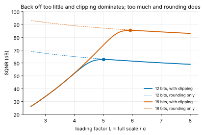
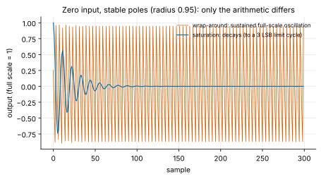

<!-- status: verified -->
# 16-10 · Quantization and Fixed-Point Effects

| | |
|---|---|
| **Course** | [16 · Digital Signal Processing](../README.md) |
| **University equivalent** | The finite-word-length chapter of a senior DSP course: number representations, the quantization-noise model and SQNR, noise propagation through filters, coefficient quantization, scaling and overflow, limit cycles and dither (Oppenheim & Schafer, *Discrete-Time Signal Processing*, §4.8 and §6.7–6.10; Proakis & Manolakis, *Digital Signal Processing*, ch. 9) |
| **Prerequisites** | [16-08 Filter Structures and Implementation](16-08-filter-structures.md), [16-05 Spectral Analysis and Windowing](16-05-spectral-analysis-and-windowing.md) (SNR and ENOB), [03-03 Expectation, Variance and Functions of Random Variables](../../03-probability-statistics-and-random-variables/chapters/03-03-expectation-and-functions-of-rvs.md) |
| **Estimated study hours** | 7 |
| **Last verified** | 2026-11-20 |

**Learning objectives.** After this chapter you can:

1. Represent numbers in signed fixed point (Q formats), and compute range, resolution, rounding and truncation errors and overflow behaviour.
2. Derive the additive quantization-noise model and $\text{SQNR} = 6.02N + 1.76$ dB, and state when the model fails.
3. Account for signal loading and clipping, and choose a loading factor for a random signal.
4. Propagate rounding noise through filters with the noise gain, and budget word lengths in a datapath.
5. Predict how coefficient quantization degrades FIR and IIR responses, and choose coefficient word lengths with margin.
6. Recognize overflow and granular limit cycles, and prevent them with saturation, scaling, rounding choices and dither.

---

## 1. Big picture

Every number in a DSP chip, codec or AI accelerator has a finite number of bits, and every bit costs area, power and memory bandwidth. A 16 × 16-bit multiplier is roughly four times the area of an 8 × 8 one, and moving 32-bit words costs twice the energy of 16-bit ones. So engineers use as few bits as the application tolerates, and the question "how many bits?" is answered by the theory in this chapter: how rounding becomes noise, how that noise grows through filters, how coarse coefficients distort responses, and how overflow and feedback can create errors that are not noise at all. The same reasoning that sets a 24-bit audio path or a 12-bit radio ADC now drives the 8- and 4-bit number formats of AI inference hardware.

- **Data converters.** ADC resolution sets the noise floor ($6.02N + 1.76$ dB, 16-05), and every digital filter after the converter must not add noise above it.
- **Fixed-point DSP.** Microcontrollers, audio codecs and FPGA datapaths use Q15/Q31 or custom word lengths (16-08 §9); word-length choices are made per node.
- **Communications.** Baseband receivers are designed bit by bit, trading SNR margin against area in every stage.
- **AI accelerators.** Inference runs in 8-bit and narrower integer and floating-point formats with shared scale factors, the same quantization theory applied to weights and activations (§9).

## 2. Intuition first

**Rounding is a small, random-looking error.** When a busy signal is rounded to the nearest step $\Delta$, the error is somewhere between $-\Delta/2$ and $+\Delta/2$, with no preference, and it changes unpredictably from sample to sample. It behaves like a little white noise added to the signal: that is the **additive noise model**, and it gives the famous 6 dB per bit.

**But it is not really random.** For a small or very regular signal, the error repeats with the signal and becomes distortion: tones at harmonics instead of a flat floor. Adding a little genuine noise (**dither**) before rounding breaks the pattern, at the price of a slightly higher floor.

**Feedback amplifies and traps errors.** In an IIR filter, every rounding error is fed back and filtered by the poles, so it can grow (noise gain), and in the extreme a rounding can hold the output stuck at a nonzero value forever (a **limit cycle**).

**Analogy: rounding money.** A business that rounds every transaction to the nearest cent accumulates small errors that average out (random walk: the total error grows only as the square root of the number of transactions). That is the noise model. If instead every transaction is truncated (rounded down), the errors all have the same sign and grow linearly: the **bias** of truncation. And if an interest calculation is rounded and fed back into the next period's balance, a small balance can be "stuck" forever because the interest on it rounds to zero: a limit cycle. **Where the analogy breaks:** accounting rounding has no frequency content; in DSP the spectrum of the error matters, and a periodic error is audible or visible as spurious tones.

## 3. Theory

### 3.1 Fixed-point formats

A signed two's-complement number with $I$ integer bits (including the sign) and $F$ fractional bits, written **Q$I$.$F$** (here; conventions vary), has step $\Delta = 2^{-F}$ and range $[-2^{I-1},\ 2^{I-1} - \Delta]$. **Q1.15** (16 bits) covers $[-1, 1 - 2^{-15}]$ with $\Delta = 3.05 \times 10^{-5}$; Q2.14 covers $[-2, 2)$, the format of the biquad coefficients in 16-08.

**Rounding modes.** To nearest: error in $[-\Delta/2, \Delta/2)$, mean zero. **Two's-complement truncation** (dropping low bits, which rounds toward $-\infty$): error in $(-\Delta, 0]$, mean $-\Delta/2$, a DC bias. **Magnitude truncation** (toward zero): error toward zero for both signs, which matters for limit cycles (§3.7).

**Overflow.** When a result exceeds the range, **wrap-around** (natural two's-complement behaviour) maps it to the opposite end, an error of nearly the full range; **saturation** clips it to the nearest extreme. Wrap-around is harmless only when intermediate overflow is guaranteed to be undone (accumulators that end in range, CIC filters, 16-09); otherwise saturate.

**Products and sums grow.** Multiplying Q$a$.$b$ by Q$c$.$d$ gives Q$(a + c)$.$(b + d)$ exactly; summing $K$ terms needs $\lceil\log_2K\rceil$ guard bits. Datapaths keep products and sums at full width and round once, at the end (16-08 §3.6).

### 3.2 The additive noise model and SQNR

Model the rounding error $e[n] = Q(x[n]) - x[n]$ as a random variable uniform on $[-\Delta/2, \Delta/2]$, independent of the signal and white (uncorrelated from sample to sample). Its mean is zero and its variance is

$$
\sigma_e^2 = \int_{-\Delta/2}^{\Delta/2} e^2\,\frac{de}{\Delta} = \frac{1}{\Delta}\left[\frac{e^3}{3}\right]_{-\Delta/2}^{\Delta/2} = \frac{\Delta^2}{12} .
$$

**SQNR of a full-scale sine, derived.** With $N$ bits covering $[-1, 1)$, $\Delta = 2/2^N = 2^{1-N}$. A sine of amplitude 1 has power $1/2$. Then

$$
\text{SQNR} = \frac{1/2}{\Delta^2/12} = \frac{6}{2^{2-2N}} = 1.5 \times 2^{2N}, \qquad
10\log_{10}\text{SQNR} = 20N\log_{10}2 + 10\log_{10}1.5 = 6.02N + 1.76 \text{ dB}.
$$

Every bit is worth **6.02** dB; 12 bits give **74.0** dB and 16 bits **98.1** dB (16-05 §3.5).

**When the model holds and when it fails.** The model is accurate when the signal spans many steps and is "busy" (it crosses many quantization levels between samples in an irregular way). It fails for small or highly regular signals: a sine of amplitude 1.5 LSB, quantized directly, has an error that repeats with the sine, so it appears as harmonics (Example 16-10.3) rather than as a flat floor, and its variance differs from $\Delta^2/12$.

**Dither.** Adding a random signal $d[n]$ before quantizing decorrelates the error from the signal. Triangular-PDF (TPDF) dither of ±1 LSB (the sum of two independent uniform variables) makes the first two moments of the total error independent of the signal, so harmonics disappear, at the cost of a total error variance $\Delta^2/12 + \Delta^2/6 = \Delta^2/4$: three times the undithered noise, 4.8 dB. Audio mastering dithers every reduction in word length for this reason.

### 3.3 Loading and clipping

A sine has a peak-to-rms ratio (**crest factor**) of $\sqrt2$. Random signals such as speech, OFDM or Gaussian noise have much higher peaks, so they must be scaled down (**backed off**) to avoid clipping, which costs SQNR. Load a zero-mean Gaussian signal so that full scale is $L$ standard deviations: $\sigma = 1/L$. The granular (rounding) noise is still $\Delta^2/12$, so

$$
\text{SQNR}_{\text{granular}} = \frac{1/L^2}{\Delta^2/12} = \frac{3 \times 2^{2N}}{L^2}, \qquad 10\log_{10}(\cdot) = 6.02N + 4.77 - 20\log_{10}L .
$$

At $L = 4$ this is $6.02N - 7.27$ dB. But clipping adds noise too: every sample beyond full scale contributes $(\lvert x\rvert - 1)^2$. For a Gaussian, the clipping noise power is $2\sigma^2\big[(1 + L^2)Q(L) - L\,\phi(L)\big]$, where $\phi$ is the standard normal density and $Q(\cdot)$ here its tail probability (03-02), not the quantizer. Granular noise *relative to the signal* falls as $L$ falls (the granular noise stays at $\Delta^2/12$ while the signal grows); clipping noise rises steeply. The total has an optimum (Example 16-10.2): about $L = 5$ at 12 bits and $L = 6$ at 16 bits, because finer quantization makes clipping relatively more costly. Loading is why OFDM transmitters, wideband ADCs and AI activations are all scaled with explicit "headroom" or calibration.

*Figure 1. SQNR of a Gaussian signal against the loading factor at 12 and 16 bits. Dashed: rounding noise only, which costs 6 dB each time $L$ doubles; solid: with clipping noise added. The optimum (dots) sits where clipping noise starts to dominate.*

### 3.4 Noise through filters

Every rounding inside a filter injects a white error of variance $\sigma_e^2$. If the error enters at a point from which the transfer function to the output is $G(z)$ with impulse response $g[n]$, its contribution to the output variance is

$$
\sigma_{\text{out}}^2 = \sigma_e^2\sum_n g[n]^2 \qquad (\text{white input, Parseval}).
$$

$\sum g^2$ is the **noise gain** of that path. Contributions from independent rounding points add. Three consequences:

- **FIR filters with full-precision accumulation and one final rounding** add exactly $\Delta^2/12$ at the output: the noise gain from the rounding point to the output is 1.
- **IIR filters** feed the rounding error of each section through its poles. In Direct Form I with one rounding at the output, the error reaches the output through $1/A(z)$; for the sharpest elliptic section of 16-07, $\sum g^2$ = **66.05** (18.2 dB), so that section's own rounding costs 18 dB of SNR (16-08 Problem 16-08.12).
- **Word-length budgets** follow: to keep the filter's noise below the input's, carry $\tfrac12\log_2(\text{noise gain})$ extra bits inside the loop (here **3.02**, so 3 bits recover all but 0.1 dB), or use error feedback (a technique that filters the rounding error before re-adding it, shaping its spectrum away from the passband).

### 3.5 Coefficient quantization

**FIR filters.** Rounding each of $N$ coefficients to step $\Delta_c$ adds an error filter $\Delta h[n]$, so the response error is $\Delta H(e^{j\omega}) = \sum_n\Delta h[n]e^{-j\omega n}$. Two estimates bracket it:

- worst case: $\lvert\Delta H\rvert \le \sum\lvert\Delta h\rvert \le N\Delta_c/2$;
- statistical: with independent uniform errors, $\Delta H$ has rms $\sqrt{N}\,\Delta_c/\sqrt{12}$ on average over frequency. For a linear-phase filter the errors come in equal symmetric pairs, so the rms is up to $\sqrt2$ (3 dB) higher near $\omega = 0$ and $\pi$ and lower in between.

The rms estimate is optimistic for the *peak* over thousands of frequencies, and any error adds to the design's own ripple. A filter designed with no margin cannot survive much quantization: the 137-tap equiripple filter of 16-06 (60.36 dB designed) needs **18** fractional bits to stay above 60 dB, while a 149-tap redesign with 6 dB of stopband margin keeps 60 dB with **14** (Example 16-10.4). Design margin is cheaper than coefficient bits. Linear phase survives quantization: rounding a symmetric filter gives a symmetric filter.

**IIR filters.** Coefficient errors move poles, by amounts governed by the sensitivity formula of 16-08 §3.4. Use second-order sections (16-07 Problem 16-07.12), check pole positions and the response after rounding, and use the coupled form for low-frequency poles.

### 3.6 Overflow and scaling

An internal node $v$ reached from the input through $g[n]$ is bounded, for $\lvert x\rvert \le 1$, by

$$
\lvert v[n]\rvert \le \sum_n\lvert g[n]\rvert \quad (L_1), \qquad
\lvert v\rvert \le \max_\omega\lvert G(e^{j\omega})\rvert \text{ for sinusoids } (L_\infty), \qquad
\sigma_v = \sigma_x\sqrt{\textstyle\sum g^2} \text{ for white noise } (L_2) .
$$

**Scaling** multiplies the input of a section (or its numerator) by the reciprocal of the chosen norm, so that the node cannot (L1), cannot for sinusoids ($L_\infty$), or rarely ($L_2$) overflow. $L_1 \ge L_\infty \ge L_2$-based levels, so L1 scaling is safest and costs the most SNR (every bit of scaling-down is 6 dB of signal lost against fixed rounding noise). Practitioners scale with $L_\infty$ or $L_2$ plus saturation, accepting rare clipping.

### 3.7 Limit cycles

**Granular (zero-input) limit cycles.** Take $y[n] = Q(ay[n - 1])$ with rounding, in units of the LSB, and no input. A value $k$ stays fixed if rounding $ak$ returns $k$, which happens when $\lvert ak - k\rvert \le 1/2$; for $a < 0$ the output instead alternates, $Q(ak) = -k$, which needs $\lvert ak + k\rvert = \lvert k\rvert(1 - \lvert a\rvert) \le 1/2$. Both cases give

$$
\lvert k\rvert \le \frac{1}{2(1 - \lvert a\rvert)} ,
$$

the **dead band**. For $a = 0.9$ the output decays from 20 LSB and then sticks at **5** LSB forever instead of decaying to zero; for $a = -0.9$ it settles into an oscillation of ±**4** LSB (the exact value depends on how ties are rounded). The filter is stable in exact arithmetic; rounding creates a tiny self-sustained signal, which can be audible as a faint tone in a silent audio channel. **Magnitude truncation** (rounding toward zero) shrinks $\lvert ak\rvert$ at every step and removes zero-input limit cycles in first-order sections (and, with care, in second-order ones), at the cost of a larger, signal-dependent error.

**Overflow limit cycles.** With wrap-around arithmetic, an overflow in a recursive section turns a large positive value into a large negative one, which the feedback can sustain: a full-scale oscillation from a stable filter with no input. In the lab's second-order section with $a_1 = -1.6$, $a_2 = 0.9$ (poles at radius 0.95), starting from $(0.9, -0.9)$ of full scale, wrap-around sustains an oscillation of **31,039** LSB (95% of full scale); saturation lets the response decay, leaving only a granular limit cycle of **3** LSB (measured after 1000 samples, once the transient has died). Saturation (or scaling that makes overflow impossible) is therefore mandatory in recursive filters.

*Figure 2. The second-order section of Example 16-10.5 with zero input. With wrap-around (orange) an overflow on the first samples starts a full-scale oscillation that never ends; with saturation (blue) the response decays as the poles dictate.*

## 4. Worked examples

### Example 16-10.1 · Rounding versus truncation in Q1.15 (tier A)

**Setup.** Quantize $x = -0.3$ to Q1.15 by rounding to nearest and by two's-complement truncation. Give the errors and the mean error of truncation over a busy signal.

**Solution.** $\Delta = 2^{-15} = 3.0518 \times 10^{-5}$; $x/\Delta = -9830.4$. Rounding: $-9830$, so $Q(x) = -0.29998779$, error **+1.2207** × 10⁻⁵. Truncation (floor): $-9831$, so $Q(x) = -0.30001831$, error **−1.8311** × 10⁻⁵: truncation moved the negative number further from zero. Over many samples, truncation's error is uniform on $(-\Delta, 0]$ with mean $-\Delta/2$ = **−1.5259** × 10⁻⁵: a DC offset, while rounding's mean is zero.

**Units check.** All values in full-scale units (Q1.15 represents ±1).

**Sanity check.** Both errors are smaller than $\Delta$ in magnitude, and the rounding error is below $\Delta/2 = 1.53 \times 10^{-5}$.

### Example 16-10.2 · SQNR of a sine and of a Gaussian signal (tier B)

**Setup.** For a 12-bit quantizer covering ±1, compute the SQNR of a full-scale sine, of a Gaussian signal loaded at $L = 4$ (granular noise only, then including clipping), and find the best loading. Check by simulation.

**Solution.** Sine: $6.02 \times 12 + 1.76$ = **74.0** dB (simulation of a coherent sine just below full scale: 74.03 dB).

Gaussian, granular only: $10\log_{10}(3 \times 2^{24}/16)$ = **64.98** dB (the rounded constants $6.02 \times 12 + 4.77 - 12.04$ give 64.97). With clipping: $\Delta = 2^{-11}$, $\sigma = 0.25$; the granular noise is $\Delta^2/12 = 1.99 \times 10^{-8}$, the clipping noise $2\sigma^2[(1 + 16)Q(4) - 4\phi(4)]$ = **3.9** × 10⁻⁷, about twenty times larger. SQNR = **51.9** dB (simulation of $10^6$ samples: 51.7 dB). Clipping, not rounding, dominates.

Optimizing $L$: the total SQNR peaks at $L$ = **5.0**, with **62.7** dB. At 16 bits the optimum moves to $L$ = 5.9 (85.4 dB).

**Units check.** SQNR is a power ratio; $\sigma$ and $\Delta$ in full-scale units.

**Sanity check.** A 12-bit converter carrying Gaussian-like signals (OFDM, multicarrier) delivers about 11 dB less SQNR than a sine test suggests, which is why converter data sheets quote sine SNR and system designers subtract a crest-factor penalty.

### Example 16-10.3 · Small signals, distortion and dither (tier B)

**Setup.** A sine of amplitude 1.5 LSB is quantized by rounding (4096-sample coherent record). Measure the harmonics and the error variance, then repeat with ±1 LSB TPDF dither added before rounding.

**Solution.** Undithered, the error repeats with the signal: the third harmonic is at **−14.6** dB relative to the fundamental, the fifth at −31.3 dB and the seventh at −19.2 dB (even harmonics vanish by symmetry), and the error variance is **0.108** LSB² instead of the model's $1/12 = 0.0833$. With TPDF dither the harmonics are gone (every harmonic bin sits in the noise floor, about −40 dBc per bin on average; the exact level of any one bin varies by a few dB with the noise realization), and the error variance is **0.254** LSB², close to the predicted $1/4$: about 4.8 dB more noise, but noise rather than distortion.

**Units check.** Error variance in LSB²; harmonic levels in dB relative to the fundamental (dBc).

**Sanity check.** A 1.5 LSB sine visits only the three levels −1, 0 and +1 (±1.5 would round to ±2 only at an exact peak, which the samples miss): the quantized waveform is a coarse staircase that repeats every period, so its error must be periodic, hence harmonic.

### Example 16-10.4 · How many coefficient bits? (tier C)

**Setup.** Quantize the 137-tap equiripple filter of Example 16-06.5 (designed for 60.36 dB) to $F$ fractional bits and find the smallest $F$ that keeps 0.1 dB passband ripple and 60 dB attenuation. Then redesign with margin (0.08 dB, 66 dB) and repeat.

**Solution.** The largest coefficient is **0.185**, so a sign bit plus $F$ fractional bits suffice. Measured attenuation after rounding:

| $F$ | 12 | 14 | 16 | 17 | 18 |
|---|---|---|---|---|---|
| Attenuation (dB) | **51.85** | **56.63** | **59.56** | **59.92** | **60.17** |

The original design first meets both specifications at $F$ = **18**. The statistical estimate of the coefficient-error spectrum at $F = 14$ is $\sqrt{137} \times 2^{-14}/\sqrt{12}$, **−73.7** dB rms, yet the attenuation falls by almost 4 dB, because the design had only 0.36 dB of margin and the error's peaks add to the equiripple peaks. Redesigned with margin, the filter needs **149** taps and meets the original specification at $F$ = **14** (60.52 dB).

**Units check.** $F$ in bits; attenuation in dB.

**Sanity check.** Twelve more taps (9%) save four bits in every coefficient and every multiplier input: in hardware, coefficient bits usually cost more than taps (multiplier area grows with the product of the input widths).

### Example 16-10.5 · Limit cycles (tier C)

**Setup.** (a) Run $y[n] = Q(0.9y[n - 1])$ from $y = 20$ LSB with rounding (ties up), and with $a = -0.9$; then with magnitude truncation. (b) Run the second-order section of §3.7 with zero input from $(0.9, -0.9)$ of full scale with wrap-around and with saturation.

**Solution.** (a) With rounding, $a = 0.9$ decays 20, 18, 16, 14, 13, 12, … and sticks at **5** LSB: $0.9 \times 5 = 4.5$ rounds back to 5. The dead-band bound is $1/(2 \times 0.1) = 5$. With $a = -0.9$ the output settles into an alternation ±**4**. With magnitude truncation both decay to **0**.

(b) With wrap-around, the section never recovers: its output keeps swinging up to **31,039** LSB of 32,768, a full-scale oscillation with no input. With saturation, the response decays into a granular limit cycle of at most **3** LSB (its steady state; over samples 150 to 199 a transient of up to 9 LSB is still visible, a reminder to measure limit cycles only after the decay).

**Units check.** LSB units throughout (Q1.15 has 32,768 LSB per unit).

**Sanity check.** The section's poles have radius $\sqrt{0.9} = 0.949$: in exact arithmetic the response decays by a factor of 0.949 per sample, so anything sustained is created by the arithmetic, not the filter.

### Answer key

<!-- answer-key -->

| ID | Quantity | Value | Unit |
|---|---|---|---|
| Ex 16-10.1a | rounding error | 1.2207e-5 | — |
| Ex 16-10.1b | truncation error | −1.8311e-5 | — |
| Ex 16-10.1c | mean truncation error | −1.5259e-5 | — |
| Ex 16-10.1d | Q1.15 step | 3.0518e-5 | — |
| Ex 16-10.2a | 12-bit sine SQNR | 74.0 | dB |
| Ex 16-10.2b | simulated sine SQNR | 74.03 | dB |
| Ex 16-10.2c | Gaussian granular SQNR, L = 4 | 64.98 | dB |
| Ex 16-10.2d | Gaussian SQNR with clipping, L = 4 | 51.9 | dB |
| Ex 16-10.2e | simulated Gaussian SQNR, L = 4 | 51.7 | dB |
| Ex 16-10.2f | best loading, 12 bits | 5.0 | — |
| Ex 16-10.2g | best SQNR, 12 bits | 62.7 | dB |
| Ex 16-10.2h | best loading, 16 bits | 5.9 | — |
| Ex 16-10.2i | best SQNR, 16 bits | 85.4 | dB |
| Ex 16-10.2j | clipping noise, L = 4 | 3.9e-7 | — |
| Ex 16-10.2k | granular noise, 12 bits | 1.99e-8 | — |
| Ex 16-10.3a | third harmonic, undithered | −14.6 | dB |
| Ex 16-10.3b | fifth harmonic | −31.3 | dB |
| Ex 16-10.3c | seventh harmonic | −19.2 | dB |
| Ex 16-10.3d | undithered error variance | 0.108 | LSB² |
| Ex 16-10.3e | dithered error variance | 0.254 | LSB² |
| Ex 16-10.4a | largest coefficient | 0.185 | — |
| Ex 16-10.4b | attenuation, 12 bits | 51.85 | dB |
| Ex 16-10.4c | attenuation, 14 bits | 56.63 | dB |
| Ex 16-10.4d | attenuation, 16 bits | 59.56 | dB |
| Ex 16-10.4e | attenuation, 17 bits | 59.92 | dB |
| Ex 16-10.4f | attenuation, 18 bits | 60.17 | dB |
| Ex 16-10.4g | bits needed, original design | 18 | bits |
| Ex 16-10.4h | statistical error estimate, 14 bits | −73.7 | dB |
| Ex 16-10.4i | taps with margin | 149 | — |
| Ex 16-10.4j | bits needed with margin | 14 | bits |
| Ex 16-10.4k | attenuation with margin, 14 bits | 60.52 | dB |
| Ex 16-10.5a | dead-band value, a = 0.9 | 5 | LSB |
| Ex 16-10.5b | oscillation, a = −0.9 | 4 | LSB |
| Ex 16-10.5c | overflow oscillation with wrap-around | 31039 | LSB |
| Ex 16-10.5d | granular limit cycle with saturation | 3 | LSB |
| Ex 16-10.5e | saturated transient still present at 200 samples | 9 | LSB |
| Txt 16-10.a | dB per bit | 6.02 | dB |
| Txt 16-10.b | 16-bit sine SQNR | 98.1 | dB |
| Txt 16-10.c | noise gain of the sharpest elliptic section | 66.05 | — |
| Txt 16-10.d | dither noise penalty | 4.8 | dB |
| Txt 16-10.e | extra bits for the elliptic section | 3.02 | bits |
| Txt 16-10.f | E4M3 maximum | 448 | — |
| Txt 16-10.g | E5M2 maximum | 57344 | — |
| Txt 16-10.h | E4M3 relative error bound | 6.25 | % |
| Txt 16-10.i | E5M2 relative error bound | 12.5 | % |
| Txt 16-10.j | bfloat16 relative error bound | 0.39 | % |
| Txt 16-10.k | binary16 relative error bound | 0.049 | % |
| Txt 16-10.l | binary16 maximum | 65504 | — |
| Txt 16-10.m | MXFP4 bits per element | 4.25 | bits |

## 5. Simulate it

The lab, [labs/16-10-lab](../labs/16-10-lab/README.md), provides `quant.py`: quantizers with three rounding modes and two overflow modes, SQNR measurement for sines and Gaussian signals, noise gain and $L_1$ norms, TPDF dither, harmonic measurement, and first- and second-order limit-cycle simulators. You:

1. **Measure 6 dB per bit**: quantize full-scale sines from 8 to 20 bits and fit the slope and intercept.
2. **Load a Gaussian signal**: sweep the loading factor at 12 and 16 bits and find the optimum (Example 16-10.2).
3. **Hear dither** (in numbers): quantize a 1.5 LSB sine with and without dither and compare spectra (Example 16-10.3).
4. **Quantize coefficients**: reproduce the table of Example 16-10.4 and plot the stopband for $F$ = 12, 14 and 18.
5. **Trap a limit cycle**: run the first- and second-order examples of Example 16-10.5 and try magnitude truncation and saturation.

**Guided exercise (predict, then run).** **Before Part 2,** predict whether a 12-bit converter carrying a Gaussian signal should be loaded at 4σ, 5σ or 6σ for the best SQNR. (About 5σ: at 4σ clipping noise is twenty times the rounding noise, and at 6σ the signal is needlessly small; the optimum shifts toward 6σ at 16 bits, where rounding noise is smaller and clipping relatively costlier.)

## 6. Engineering tradeoffs

| Knob | Improves | Costs | Typical decision owner |
|---|---|---|---|
| Data word length | 6.02 dB of SQNR per bit | Area (multiplier area ∝ product of widths), power, memory bandwidth | Hardware architect |
| Coefficient word length | Response accuracy (stopband depth, pole placement) | Multiplier width, coefficient storage | DSP designer |
| Design margin (more taps or order) | Survives coarser coefficients | More arithmetic | DSP designer |
| Loading (back-off) | Fewer clipping events | Granular SQNR (6 dB per factor of 2) | System architect |
| Saturation instead of wrap-around | No overflow oscillations; bounded errors | Comparator logic; nonlinear distortion on overload | Hardware designer |
| Dither | Converts distortion into benign noise | About 4.8 dB more noise | Audio or measurement engineer |
| Extra bits in feedback loops | Lower noise from sharp IIR sections | Wider state registers | DSP designer |

## 7. Numbers to know

| Quantity | Value | Source |
|---|---|---|
| Rounding noise | $\Delta^2/12$, white, if the signal is busy | §3.2 |
| SQNR of a full-scale sine | $6.02N + 1.76$ dB (74.0 dB at 12 bits, 98.1 dB at 16) | §3.2 |
| Gaussian loading | $6.02N + 4.77 - 20\log_{10}L$ dB before clipping; optimum $L \approx 5$ (12 bits) to 6 (16 bits) | §3.3 |
| Q1.15 | range [−1, 1), step $3.05 \times 10^{-5}$ | §3.1 |
| TPDF dither | ±1 LSB triangular; total error $\Delta^2/4$ (+4.8 dB) | §3.2 |
| Noise gain | $\sum g[n]^2$ from the rounding point to the output | §3.4 |
| First-order dead band | $\lvert k\rvert \le 1/(2(1 - \lvert a\rvert))$ LSB | §3.7 |

## 8. Common mistakes

- **Applying $6.02N + 1.76$ to non-sinusoidal signals** without the crest-factor and clipping penalty.
- **Assuming rounding noise is white for small or periodic signals.** It becomes harmonic distortion; dither.
- **Truncating instead of rounding** without accounting for the $-\Delta/2$ bias, which accumulates in integrators and filters with DC gain.
- **Ignoring noise gain in IIR sections**, so a filter adds 18 dB more noise than its input carried.
- **Quantizing a zero-margin design** and expecting it to meet the specification.
- **Using wrap-around arithmetic in recursive filters** (overflow limit cycles), or saturating where wrap-around is required (CIC integrators, 16-09).
- **Scaling every node with the $L_1$ norm** by default and throwing away several bits of SNR.
- **Forgetting zero-input limit cycles** in silent audio or idle control loops.

## 9. Practitioner lens

### State of the art (as of Nov 2026)

- **Fixed-point DSP libraries document their word lengths.** Arm's CMSIS-DSP Q31 biquads accumulate in 64 bits with "only a single guard bit" and require inputs scaled into [−0.25, 0.25), while the Q15 versions accumulate in a 34.30 format with "no risk of internal overflow" (R-241) **[Established]**: the guard-bit and scaling arithmetic of §3.1 and §3.6, made explicit.
- **Audio converters compute their filters in wide fixed point.** TI's TLV320ADC5140 biquads use 32-bit 1.31 coefficients and 32-bit fixed-point arithmetic (R-240) **[Established]**, leaving ample headroom below a 24-bit audio sample.
- **AI accelerators use floating point with three or four significand bits.** The Open Compute Project's 8-bit floating-point specification (OFP8, revision 1.0 of June 2023, revision 1.1 of January 2026; contributors AMD, Arm, Google, Intel, Meta and NVIDIA, joined by AWS in 1.1) defines E4M3 (exponent bias 7, maximum 448, no infinities, a single NaN pattern per sign) and E5M2 (bias 15, maximum 57,344, IEEE-style infinities and NaNs), with round-to-nearest-even conversion and a saturating mode (R-248) **[Established]**. The maxima follow from the bit patterns: E4M3's largest normal is $1.110_2 \times 2^8 = 1.75 \times 256$ = **448**, E5M2's is $1.11_2 \times 2^{15}$ = **57,344**. Floating point's rounding error is *relative*: for normal (non-subnormal) values, with $p$ significand bits (including the implicit one) the error is at most $2^{-p}$ of the value, **6.25**% for E4M3 ($p = 4$), **12.5**% for E5M2, **0.39**% for bfloat16 ($p = 8$; 1 sign, 8 exponent and 7 stored mantissa bits, with float32's exponent range, R-251) and **0.049**% for IEEE binary16 ($p = 11$, maximum **65,504**; IEEE 754-2019 is the active edition and a revision project was approved in 2024, R-250) **[Established]**.
- **Block scaling is §3.3's loading, applied every 32 values.** The OCP Microscaling (MX) specification (v1.0, September 2023; a v1.1 document dated October 2026, whose approval status was not confirmed, R-249) stores blocks of $k = 32$ elements that share one 8-bit power-of-two scale (E8M0, renamed UE8M0 in v1.1), with element formats MXFP8 (E5M2 or E4M3), MXFP6 (E3M2 or E2M3), MXFP4 (E2M1) and MXINT8; "the scale factor X is shared across all k elements" (R-249) **[Established]**. A block costs $w + kd$ bits, so MXFP4 averages $(8 + 32 \times 4)/32$ = **4.25** bits per element. The shared scale is block floating point (16-04): it re-loads each block to its own peak, so a block of small values is not quantized against the largest value in the tensor.
- **Deeper:** see companion repo *LLM Inference Engineering* for how these formats are calibrated and what accuracy they keep on real models.

### Why it matters commercially

Word length is one of the largest levers on silicon area and power in signal processing: multiplier area grows with the product of operand widths, and memory traffic with word size. Products win by using fewer bits than competitors at the same delivered quality, and they fail in the field when an untested corner (a full-scale input, a silent channel, a sharp filter section) exposes overflow, limit cycles or noise gain. In AI accelerators the same trade is made at scale: narrower formats multiply throughput per watt, provided quantization error is controlled with scaling.

### Marketing vs Reality

- **"24-bit audio"** usually means a 24-bit data format, not 24 bits of SNR (146 dB). Ask for the measured dynamic range.
- **"16-bit ADC"** quoted next to a modulated signal's SNR: subtract the crest-factor and clipping penalty (11 to 13 dB for Gaussian-like signals: 11.3 dB at 12 bits and 12.7 dB at 16 bits in Example 16-10.2) before comparing.
- **"Bit-exact with the floating-point model"** is impossible; ask what tolerance was verified, with which test vectors, including full-scale and silent inputs.
- **"Same accuracy at half the bits"** claims for low-precision formats depend on scaling (per tensor, per channel, per block) and on calibration data; ask how scales are chosen and what the error is on the customer's workload.

### Questions for engineering leaders

1. **"How was each node's word length chosen?"** *Strong:* a noise and overflow budget per node (noise gains, norms), verified by bit-exact simulation. *Evasive:* "16 bits everywhere".
2. **"What happens at full scale and at zero input?"** *Strong:* tested saturation, overflow handling and limit cycles explicitly. *Evasive:* tested with typical signals only.
3. **"How are coefficients quantized, and what margin did the design leave?"** *Strong:* gives the coefficient width and the post-quantization response against the mask. *Evasive:* floating-point plots.
4. **"Where do you dither, and why?"** *Strong:* every word-length reduction in an audio or measurement path, with the noise cost accepted. *Evasive:* "rounding is good enough".
5. **"What loading or scaling strategy handles peaky signals?"** *Strong:* states the back-off or scaling policy and its clipping probability. *Evasive:* "we use AGC" without numbers.

## 10. Concept check

**Q1.** Derive the variance of a rounding error uniform on $[-\Delta/2, \Delta/2]$.

Answer

$\frac1\Delta\int_{-\Delta/2}^{\Delta/2}e^2\,de = \frac1\Delta\cdot\frac{2}{3}\left(\frac\Delta2\right)^3 = \frac{\Delta^2}{12}$.

**Q2.** Why is each bit worth 6.02 dB?

Answer

One more bit halves $\Delta$, so the noise power $\Delta^2/12$ falls by a factor of 4, which is $10\log_{10}4 = 6.02$ dB.

**Q3.** Why does a Gaussian signal lose SQNR relative to a sine at the same word length?

Answer

Its peaks are large relative to its rms value, so it must be scaled down to avoid clipping; the smaller signal power against the same rounding noise costs SQNR, and whatever clipping remains adds its own noise.

**Q4.** When does the additive white-noise model fail, and what fixes it?

Answer

For small or regular signals (a few LSB, or periodic with few levels), the error repeats with the signal and becomes harmonic distortion. Adding dither before quantizing decorrelates the error, turning distortion into noise.

**Q5.** Why must recursive filters saturate rather than wrap around on overflow?

Answer

Wrap-around turns an overflow into a full-range jump that the feedback can sustain as a large oscillation even with zero input; saturation bounds the error and lets the filter's decay take over.

**Q6.** What is the dead band of $y[n] = Q(0.95y[n - 1])$ with rounding?

Answer

$\lvert k\rvert \le 1/(2 \times 0.05) = 10$ LSB: the output can stick anywhere up to 10 LSB from zero.

Practice: [Problems 16-10](../problems/16-10-problems.md) · [Solutions](../solutions/16-10-solutions.md)

## 11. Key terms

[Quantization noise](../../../reference/glossary.md#quantization-noise) · [Q format](../../../reference/glossary.md#q-format) · [SQNR](../../../reference/glossary.md#sqnr) · [Crest factor](../../../reference/glossary.md#crest-factor) · [Dither](../../../reference/glossary.md#dither) · [Noise gain (digital filter)](../../../reference/glossary.md#noise-gain-digital-filter) · [Saturation arithmetic](../../../reference/glossary.md#saturation-arithmetic) · [Limit cycle](../../../reference/glossary.md#limit-cycle) · [Overflow limit cycle](../../../reference/glossary.md#overflow-limit-cycle) · [Block floating point](../../../reference/glossary.md#block-floating-point) · [bfloat16](../../../reference/glossary.md#bfloat16) · [Coefficient sensitivity](../../../reference/glossary.md#coefficient-sensitivity)

## 12. Connections

- **Builds on:** [03-03](../../03-probability-statistics-and-random-variables/chapters/03-03-expectation-and-functions-of-rvs.md) (variance of a uniform variable), [16-05](16-05-spectral-analysis-and-windowing.md) (SNR, ENOB, the $6.02N + 1.76$ test), [16-06](16-06-fir-filter-design.md) and [16-07](16-07-iir-filter-design.md) (the filters quantized here), [16-08](16-08-filter-structures.md) (structures, sensitivity, saturation), [16-09](16-09-multirate-dsp.md) (wrap-around in CIC filters).
- **Next:** [16-11 DSP Hardware Architectures](16-11-dsp-hardware-architectures.md) turns word lengths into MAC units, DSP blocks and power.
- **Used later:** converter noise and noise shaping in the data-converter chapters; link budgets in Course 17.
- **Deeper:** see companion repo *LLM Inference Engineering* for quantization of neural-network weights and activations.

## 13. Further study

- Oppenheim & Schafer, *Discrete-Time Signal Processing*, 3rd ed., §4.8 (analysis of quantization errors) and §6.7–6.10 (finite-precision effects in filters, limit cycles).
- Proakis & Manolakis, *Digital Signal Processing*, 4th ed., ch. 9 (quantization effects in digital filters).
- R. M. Gray and D. L. Neuhoff, "Quantization", *IEEE Transactions on Information Theory* 44(6), 1998: a survey of when the additive-noise model holds.

## 14. Sources

1. A. V. Oppenheim and R. W. Schafer, *Discrete-Time Signal Processing*, 3rd ed., Pearson, 2010, §4.8, §6.7–6.10.
2. J. G. Proakis and D. G. Manolakis, *Digital Signal Processing: Principles, Algorithms, and Applications*, 4th ed., Pearson, 2007, ch. 9.
3. R. M. Gray and D. L. Neuhoff, "Quantization", *IEEE Transactions on Information Theory* 44(6), 2325–2383, 1998.
4. Arm CMSIS-DSP 1.18.0 and TI TLV320ADC5140/SBAA378B word-length documentation. Research log [R-241], [R-240].
5. Open Compute Project, *OCP 8-bit Floating Point Specification (OFP8)*, revisions 1.0 (2023) and 1.1 (2026); *OCP Microscaling Formats (MX) Specification*, v1.0 (2023) and v1.1 (2026); IEEE Std 754-2019 status and binary16 parameters; bfloat16 definitions (Google, Intel). Research log [R-248] to [R-251].
