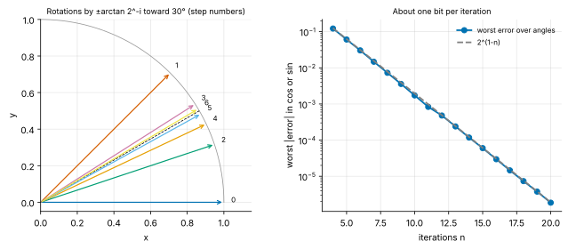

<!-- status: verified -->
# 16-11 · DSP Hardware Architectures

| | |
|---|---|
| **Course** | [16 · Digital Signal Processing](../README.md) |
| **University equivalent** | The implementation chapter of a senior DSP or VLSI-DSP course: MAC datapaths, DSP processor architecture, pipelining, retiming and the iteration bound, folding, FPGA DSP blocks, multiplierless arithmetic and CORDIC (Parhi, *VLSI Digital Signal Processing Systems*; Lyons, *Understanding Digital Signal Processing*, ch. 13; Volder [1]) |
| **Prerequisites** | [16-08 Filter Structures and Implementation](16-08-filter-structures.md), [16-10 Quantization and Fixed-Point Effects](16-10-quantization-and-fixed-point.md), [08-09 Arithmetic Circuits](../../08-digital-logic-design/chapters/08-09-arithmetic-circuits.md) |
| **Estimated study hours** | 7 |
| **Last verified** | 2026-11-20 |

**Learning objectives.** After this chapter you can:

1. Size a multiply–accumulate (MAC) datapath: product and accumulator widths, guard bits, rounding and saturation at write-back.
2. Turn a filter specification into a MAC rate and a hardware budget, using folding (time-multiplexing) and unfolding (parallelism).
3. Compute critical paths and the iteration bound of recursive datapaths, and apply pipelining, retiming and look-ahead.
4. Explain the features that make DSP processors efficient (parallel memories, circular buffers, zero-overhead loops, SIMD and VLIW) and estimate a core's load for a task.
5. Estimate energy per operation and explain why dedicated datapaths beat instruction-driven processors, and when multiplierless (shift-and-add) arithmetic pays.
6. Derive and implement CORDIC for rotation and vectoring, including its gain, convergence range and accuracy.

---

## 1. Big picture

Every algorithm in Course 16 ends as hardware: a microcontroller instruction loop, a DSP core, an FPGA fabric or a custom datapath on an ASIC. The same 64-tap filter can cost a few microwatts in a dedicated datapath or hundreds of microwatts as instructions on a processor, and it can run at a few megasamples per second or at gigasamples depending on how it is pipelined and parallelized. Architecture is where DSP meets the economics of silicon: area, power, clock rate, flexibility and time to market. This chapter gives the vocabulary and the arithmetic that chip architects use to place a signal-processing function on that spectrum, and to judge claims about "TOPS", "MACs per cycle" and "efficiency" with numbers.

- **Microcontrollers and DSP cores.** Audio, voice, sensor fusion and motor control run on cores with SIMD MAC units (Arm Helium, §9) and DSP extensions.
- **FPGAs.** Radar, test equipment, wireless prototypes and low-volume infrastructure use DSP blocks with pre-adders and cascades (16-06 §9, 16-08 §9).
- **ASICs and SoCs.** Phones, base stations, SerDes, converters and AI accelerators hard-wire their DSP: fixed datapaths, CORDIC NCOs, CIC and half-band chains (16-09).
- **The common currency** is the MAC and the joule per MAC; the hidden cost is moving data to it.

## 2. Intuition first

**The MAC is the atom.** Filters, FFTs, correlators and neural networks are mostly sums of products. A **multiply–accumulate** unit computes $acc \leftarrow acc + a \times b$ every clock cycle; architectures differ in how many MACs they have, how they feed them data, and how much control overhead surrounds each one.

**Three ways to go faster.** *Parallelism* uses more MACs at once (SIMD lanes, VLIW slots, unrolled hardware). *Pipelining* splits long paths with registers so the clock can rise, like an assembly line: each worker does a smaller step, more cars finish per hour, but each car takes as long or longer. *Folding* goes the other way: one MAC does the work of many by time-multiplexing, trading speed for area.

**Feedback limits pipelining.** An assembly line works because each car's steps are independent of the next car. A recursive filter's next output needs the previous one, so its loop cannot be cut by registers without changing the filter. The **iteration bound** is the speed limit, and only an algebraic rewrite (look-ahead) raises it.

**Moving data costs more than computing.** Fetching an operand from off-chip memory costs hundreds of times more energy than multiplying it (§3.6). Good architectures keep data close to the MACs and reuse it.

**Analogy: a trading desk.** A desk can hire more traders (parallelism), split each trade into specialized steps handled by different people (pipelining), or have one trader handle many small accounts in turn (folding). Back-office communication (data movement) can cost more than the trades themselves. **Where it breaks:** traders adapt; a hardware pipeline does exactly what it was built for, and changing it means re-spinning silicon.

## 3. Theory

### 3.1 The MAC datapath

A $b_x$-bit by $b_c$-bit two's-complement multiplier produces an exact $(b_x + b_c)$-bit product. Summing $N$ products needs $\lceil\log_2N\rceil$ guard bits on top of that to make overflow impossible (16-10 §3.1). A 16 × 16-bit MAC accumulating 256 taps therefore needs a **32**-bit product and a **40**-bit accumulator, which is why DSP accumulators are 40 bits (and FPGA DSP blocks carry 48- or 58-bit adders, 16-06 §9). The datapath keeps full precision until **write-back**, where it rounds (16-10 §3.1) and saturates (16-08 §3.6) once. In Q formats, Q1.15 × Q1.15 gives Q2.30; the redundant sign bit is dropped by a left shift at write-back ("fractional mode").

### 3.2 From specification to hardware: MAC rate, folding and unfolding

The required arithmetic rate of an FIR filter is

$$
R_{\text{MAC}} = (\text{multiplications per output}) \times f_{s,\text{out}} ,
$$

with symmetry folding and polyphase decimation already applied (16-06 §3.8, 16-09 §3.5). With multipliers that each complete one operation per clock at $f_{\text{clk}}$, the hardware needs $\lceil R_{\text{MAC}}/f_{\text{clk}}\rceil$ multipliers.

- **Folding** (time-multiplexing): when $f_{\text{clk}} > f_s$, one multiplier handles $f_{\text{clk}}/f_s$ taps per sample, with a coefficient memory and a controller cycling through them. A 16-tap FIR on one 400 MHz MAC can run at 25 MS/s.
- **Unfolding** (parallel processing): when $f_s > f_{\text{clk}}$, compute $J$ outputs per clock with $J$ copies of the datapath working on interleaved samples (a polyphase view, 16-09). A 10 GS/s SerDes equalizer clocked at 625 MHz needs $J = 16$ parallel lanes.

### 3.3 Critical paths, pipelining and retiming

The clock period must exceed the longest register-to-register combinational delay, the **critical path**. For feed-forward datapaths (FIR filters, FFT butterflies), inserting registers on a cut across all forward paths shortens the critical path without changing the function, only the latency (**pipelining**). A 64-tap adder tree with a register after the multipliers and after each of its six adder levels runs at the multiplier's speed with a latency of 7 cycles (Problem 16-11.11).

**Retiming** moves existing registers across logic: moving a register from all the inputs of a node to all its outputs (or the reverse) leaves the input–output behaviour unchanged except for latency. The transposed FIR of 16-08 is the direct form retimed: its registers moved into the adder chain, cutting the critical path to one multiplier and one adder.

### 3.4 The iteration bound and look-ahead

A recursive datapath contains loops. A loop with total computation time $T_\ell$ and $D_\ell$ registers can complete one iteration no faster than $T_\ell/D_\ell$ per sample, however it is pipelined, because adding registers inside the loop changes the recursion. The **iteration bound** is

$$
T_\infty = \max_{\text{loops } \ell}\frac{T_\ell}{D_\ell} .
$$

For the first-order IIR filter $y[n] = ay[n - 1] + x[n]$ the loop is one multiplier and one adder with one register: $T_\infty = T_m + T_a$.

**Look-ahead** rewrites the recursion so that the loop contains more registers. Substituting the recursion into itself,

$$
y[n] = a\big(ay[n - 2] + x[n - 1]\big) + x[n] = a^2y[n - 2] + ax[n - 1] + x[n] .
$$

The same filter now has a loop with *two* registers (through $y[n - 2]$), so $T_\infty$ halves; the loop can be pipelined into two stages and clocked twice as fast. The price is the feed-forward term $ax[n - 1]$ (one more multiplier and adder, outside the loop), and a hidden pole–zero pair: even here $H(z) = (1 + az^{-1})/(1 - a^2z^{-2})$, which adds a pole and a zero at $z = -a$ that cancel only if $a^2$ and $a$ are quantized consistently. In fixed point, round $a$ first and compute $a^2$ from the rounded value, or the cancellation (and the identical output) is lost. Look-ahead by $M$ gives $y[n] = a^My[n - M] + \sum_{k=0}^{M-1}a^kx[n - k]$ and an $M$-fold faster loop.

### 3.5 DSP processors: what makes them fast

A general-purpose CPU executing $y \mathrel{+}= h[k]x[n - k]$ spends most of its effort on instruction fetch, decode, address arithmetic and loop control. DSP architectures remove that overhead:

- **Multiple memory buses** (a modified Harvard architecture) fetch a coefficient and a data sample in the same cycle as the MAC.
- **Circular (modulo) addressing** implements the delay line of 16-08 without moving data: a pointer wraps around a buffer in hardware.
- **Zero-overhead loops** repeat a block a fixed number of times without branch instructions.
- **Saturating, fractional arithmetic** and **bit-reversed addressing** (for FFTs, 16-04) are single instructions.
- **SIMD** (single instruction, multiple data) splits a wide register into lanes: a 128-bit vector holds eight 16-bit samples, and one instruction performs several MACs.
- **VLIW** (very long instruction word) issues several independent operations per cycle (loads, MACs, address updates) scheduled at compile time, avoiding superscalar hardware.

The figure of merit is MACs per cycle times clock rate, derated by how well the compiler or hand-written kernel keeps the units busy.

### 3.6 Energy: why dedicated hardware wins

At 45 nm (Horowitz, ISSCC 2014, R-208), an 8-bit integer multiply costs about **0.2** pJ and a 32-bit one **3.1** pJ; a 32-bit add **0.1** pJ; a 32-bit floating-point multiply **3.7** pJ; a 64-bit read from an 8 KB cache **10** pJ; from DRAM **1.3 to 2.6** nJ. A processor instruction's overhead (fetch, decode, register file, control) is about **70** pJ, dwarfing the arithmetic it orders **[Established]**. Three consequences:

1. **Bits cost quadratically in multipliers.** Going from 32 to 8 bits cuts a multiply's energy by a factor of **15.5** (3.1 to 0.2 pJ), far more than the 4× of width alone, because array multiplier area grows with the product of the widths (08-09). This is the hardware side of 16-10's word-length design and of 8-bit AI inference.
2. **Instructions cost more than arithmetic.** A dedicated datapath that performs a MAC with no instruction overhead can be 20 times more energy-efficient than a processor doing the same arithmetic (Example 16-11.4).
3. **Data movement dominates.** A DRAM access costs as much as hundreds of 32-bit MACs, so architectures reuse each fetched value many times (systolic arrays, local buffers).

**Multiplierless constants.** A fixed coefficient need not use a general multiplier: $0.875x = x - (x \gg 3)$ is one subtraction. Writing coefficients in **canonical signed digit (CSD)** form (digits −1, 0, +1 with no two adjacent nonzero digits) minimizes the nonzero digits, and each nonzero digit beyond the first costs one adder. Fixed filters in ASICs (half-band and decimation filters, 16-09) are often built this way.

### 3.7 CORDIC

**CORDIC** (coordinate rotation digital computer, Volder 1959 [1]) computes rotations, sines, cosines, magnitudes and angles with shifts, adds and a small table. Rotating $(x, y)$ by an angle $\theta_i$ is $x' = \cos\theta_i(x - y\tan\theta_i)$, $y' = \cos\theta_i(y + x\tan\theta_i)$. Choose $\tan\theta_i = 2^{-i}$, so the multiplication by $\tan\theta_i$ is a shift, and postpone the $\cos\theta_i$ factors. Each step rotates by $\pm\arctan2^{-i}$ in the direction that drives a residual angle $z$ toward zero:

$$
\begin{aligned}
x_{i+1} &= x_i - d_i\,y_i2^{-i}, \\
y_{i+1} &= y_i + d_i\,x_i2^{-i}, \\
z_{i+1} &= z_i - d_i\arctan2^{-i}, \qquad d_i = \operatorname{sign}(z_i).
\end{aligned}
$$

The postponed factors multiply to a constant, the **CORDIC gain** $K_n = \prod_{i=0}^{n-1}\sqrt{1 + 2^{-2i}}$, which converges quickly to **1.64676**; starting from $x_0 = 1/K_n$ cancels it. The angles $\arctan2^{-i}$ sum to **99.88°**, the convergence range. Larger angles are first reduced by symmetry: the lab's design subtracts or adds π when $\lvert\theta\rvert > \pi/2$ and negates both outputs. After $n$ iterations the residual angle is at most about $\arctan2^{-(n-1)} \approx 2^{1-n}$: one bit of accuracy per iteration.

- **Rotation mode** ($d_i = \operatorname{sign}(z_i)$, start $z_0 = \theta$, $(x_0, y_0) = (1/K, 0)$) returns $(\cos\theta, \sin\theta)$: the heart of numerically controlled oscillators and digital mixers (16-09's DDCs).
- **Vectoring mode** ($d_i = -\operatorname{sign}(y_i)$, driving $y$ to zero) returns the magnitude $K\sqrt{x^2 + y^2}$ in $x$ and the angle $\arctan(y/x)$ in $z$: polar conversion, phase detectors and the magnitude of complex samples.

*Figure 1. Left: the first six CORDIC rotations toward 30°, each by $\pm\arctan2^{-i}$, overshooting and correcting with ever smaller steps. Right: the worst error in $\cos$ or $\sin$ over $[-\pi/2, \pi/2]$ halves with each iteration, tracking $2^{1-n}$.*

> **Going deeper — the unified CORDIC.** Walther (1971) generalized the iteration with a parameter selecting circular, linear or hyperbolic coordinates, so the same hardware computes multiplication and division (linear), and exponentials, logarithms and square roots (hyperbolic, with some iterations repeated for convergence). Calculators long used CORDIC for exactly this reason: one small datapath for every elementary function.

## 4. Worked examples

### Example 16-11.1 · Sizing a MAC (tier A)

**Setup.** A 256-tap FIR filter has 16-bit samples and 16-bit coefficients, both Q1.15. Size the product, the accumulator and the output path.

**Solution.** Product: $16 + 16$ = **32** bits (Q2.30). Accumulator: $32 + \lceil\log_2256\rceil$ = **40** bits (Q10.30), which cannot overflow for any input. Output: round the Q10.30 sum at bit 15 (add $2^{14}$ and shift right by 15) and saturate to Q1.15. The 8 guard bits matter only for worst-case inputs; a filter with $\sum\lvert h\rvert \le 1$ could use fewer (16-10 §3.6), but guard bits are cheap compared with an overflow.

**Units check.** Bits add for products; $\log_2$ of the term count for sums.

**Sanity check.** The worst-case sum is 256 products of magnitude at most 1, which needs $\log_2256 = 8$ integer bits beyond the product's.

### Example 16-11.2 · FPGA versus ASIC for one filter (tier B)

**Setup.** A 64-tap symmetric FIR filter runs at 50 MS/s. (a) On an FPGA whose DSP blocks run at 400 MHz, how many blocks does it need with and without symmetry folding (pre-adders)? (b) In an ASIC clocked at the sample rate, how many multipliers?

**Solution.** (a) Folded: 32 multiplications per output, $R_{\text{MAC}} = 32 \times 50 \times 10^6$ = **1.6** × 10⁹ per second; each block does $4 \times 10^8$, so **4** blocks, each time-multiplexed over 8 coefficients. Without symmetry folding: 64 multiplications, **8** blocks. (b) Clocked at 50 MHz, one multiplication per multiplier per sample: **32** multipliers (with pre-adders), fully parallel, each with a fixed coefficient that can be a CSD shift-and-add network.

**Units check.** Blocks = MAC rate / (operations per block per second).

**Sanity check.** The FPGA's 8× clock advantage over the sample rate is exactly the folding factor; the ASIC trades clock speed for parallel, cheaper, fixed-coefficient hardware.

### Example 16-11.3 · Breaking the speed limit of a recursion (tier B)

**Setup.** A first-order IIR filter $y[n] = 0.9y[n - 1] + x[n]$ uses a multiplier of 2.0 ns and an adder of 0.5 ns. Find its iteration bound and maximum sample rate; then apply look-ahead by 2 and by 4.

**Solution.** One loop, multiplier plus adder, one register: $T_\infty$ = **2.5** ns, **400** MHz at most, whatever pipelining is attempted. Look-ahead by 2: $y[n] = 0.81y[n - 2] + 0.9x[n - 1] + x[n]$; the loop now has two registers, $T_\infty = 2.5/2$ = **1.25** ns, **800** MHz once the loop is pipelined into two stages. Look-ahead by 4: $y[n] = 0.6561y[n - 4] + x[n] + 0.9x[n - 1] + 0.81x[n - 2] + 0.729x[n - 3]$, $T_\infty$ = **0.625** ns, **1.6** GHz. The cost is the growing feed-forward part (3 more multipliers and adders for $M = 4$). In floating point the lab finds the rewritten recursions agree with the original to about $10^{-12}$ (rounding, not identity); in fixed point the agreement depends on quantizing $a^2$, $a^4$ consistently with $a$ (§3.4).

**Units check.** Iteration bound in ns per sample; rate = 1/bound.

**Sanity check.** Look-ahead does not make the arithmetic faster; it gives the loop more time per iteration by spreading each recursion over $M$ samples, which pipelining can then exploit.

### Example 16-11.4 · Energy of a filter on a processor and in a datapath (tier C)

**Setup.** A 64-tap FIR filter runs at 48 kHz. Using the 45 nm figures of §3.6, estimate the energy per output and the power (a) on a processor that spends one instruction (about 70 pJ) per tap, and (b) in a dedicated 32-bit integer datapath (multiply 3.1 pJ plus add 0.1 pJ per tap), ignoring memory in both.

**Solution.** (a) $64 \times 70$ pJ = **4.48** nJ per output; at 48 kHz, **215** µW. (b) $64 \times 3.2$ pJ = **204.8** pJ per output; **9.83** µW. The datapath is about **22** times more efficient, almost all of it from removing instruction overhead. With 16-bit or 8-bit arithmetic (16-10), the datapath's energy would fall further, roughly with the square of the width.

**Units check.** pJ per output × outputs per second = pW → µW: $4.48 \times 10^{-9}\text{ J} \times 48{,}000\text{ s}^{-1} = 2.15 \times 10^{-4}$ W.

**Sanity check.** These are order-of-magnitude figures for one 2014 process node and exclude memory and leakage; the ratio, not the absolute power, is the point. SIMD processors close part of the gap by amortizing one instruction over several MACs (§9).

### Example 16-11.5 · CORDIC by hand and in fixed point (tier C)

**Setup.** Compute $\cos30°$ and $\sin30°$ with a 12-iteration floating-point CORDIC, then with the lab's 14-iteration fixed-point design (16-bit binary angle, Q2.14 outputs). Give the gain and the errors.

**Solution.** $K_{12}$ = **1.64676** (it changes by less than $10^{-5}$ after 10 iterations). Starting from $(1/K, 0)$ and $z_0 = \pi/6$, the first steps rotate by +45°, −26.57°, +14.04°, −7.13°, …, driving $z$ toward zero. After 12 iterations: $\cos$ = **0.865911**, error **−1.141** × 10⁻⁴, and $\sin$ = **0.500198**, error **+1.976** × 10⁻⁴: errors of order $2^{-12}$, one bit per iteration. In fixed point (angle code $30/180 \times 2^{15}$ = **5461**, $x_0 = \text{round}(2^{14}/K_{14})$ = **9949**), the outputs are **14191** and **8191**, that is 0.866150 and 0.499939, errors of $+1.24 \times 10^{-4}$ and $-6.1 \times 10^{-5}$. Over the lab's 64 test angles, which include the worst code of an exhaustive sweep of all 65,536 inputs (code 155), the worst error is **10.54** LSB of $2^{-14}$. Two finite-precision effects add to the residual angle: the 13 nonzero right shifts per coordinate truncate (floor), and their biased errors accumulate; and the 16-bit angle path is coarse, since its LSB $\pi/2^{15}$ is **1.57** output LSB and each $\arctan$ table entry is rounded to it. With exact $x$ and $y$ arithmetic, the angle path's decisions alone cost up to **5.60** LSB.

**Units check.** Q2.14: one LSB is $2^{-14} = 6.1 \times 10^{-5}$.

**Sanity check.** 14 iterations give a residual angle below $\arctan2^{-13} \approx 1.2 \times 10^{-4}$ rad, about 2 LSB in the output. The rest of the error comes from the truncated shifts and the angle path, so both need guard bits: Solution 16-11.12 quantifies the fixes.

### Answer key

<!-- answer-key -->

| ID | Quantity | Value | Unit |
|---|---|---|---|
| Ex 16-11.1a | product width | 32 | bits |
| Ex 16-11.1b | accumulator width | 40 | bits |
| Ex 16-11.2a | MAC rate, folded | 1.6 | G/s |
| Ex 16-11.2b | DSP blocks, folded | 4 | — |
| Ex 16-11.2c | DSP blocks, no symmetry folding | 8 | — |
| Ex 16-11.2d | ASIC multipliers | 32 | — |
| Ex 16-11.3a | iteration bound | 2.5 | ns |
| Ex 16-11.3b | maximum rate | 400 | MHz |
| Ex 16-11.3c | bound, look-ahead 2 | 1.25 | ns |
| Ex 16-11.3d | rate, look-ahead 2 | 800 | MHz |
| Ex 16-11.3e | bound, look-ahead 4 | 0.625 | ns |
| Ex 16-11.3f | rate, look-ahead 4 | 1.6 | GHz |
| Ex 16-11.4a | processor energy per output | 4.48 | nJ |
| Ex 16-11.4b | processor power | 215 | µW |
| Ex 16-11.4c | datapath energy per output | 204.8 | pJ |
| Ex 16-11.4d | datapath power | 9.83 | µW |
| Ex 16-11.4e | ratio | 22 | — |
| Ex 16-11.5a | CORDIC gain | 1.64676 | — |
| Ex 16-11.5b | 12-iteration cos | 0.865911 | — |
| Ex 16-11.5c | cos error | −1.141e-4 | — |
| Ex 16-11.5d | 12-iteration sin | 0.500198 | — |
| Ex 16-11.5e | sin error | 1.976e-4 | — |
| Ex 16-11.5f | angle code | 5461 | — |
| Ex 16-11.5g | x0 | 9949 | — |
| Ex 16-11.5h | fixed-point cos code | 14191 | — |
| Ex 16-11.5i | fixed-point sin code | 8191 | — |
| Ex 16-11.5j | worst error over the test angles (and all inputs) | 10.54 | LSB |
| Ex 16-11.5k | worst error from the angle path alone | 5.60 | LSB |
| Ex 16-11.5l | one angle LSB in output LSB | 1.57 | — |
| Ex 16-11.5m | fixed-point cos 30° | 0.866150 | — |
| Ex 16-11.5n | fixed-point sin 30° | 0.499939 | — |
| Ex 16-11.5o | fixed-point cos error | 1.24e-4 | — |
| Ex 16-11.5p | fixed-point sin error | −6.1e-5 | — |
| Txt 16-11.a | CORDIC convergence range | 99.88 | ° |
| Txt 16-11.b | folded 16-tap FIR rate on one 400 MHz MAC | 25 | MS/s |
| Txt 16-11.c | unfolding factor, 10 GS/s at 625 MHz | 16 | — |
| Txt 16-11.d | 32-bit to 8-bit multiply energy ratio | 15.5 | — |
| Txt 16-11.e | C7x vector GOPS at 1 GHz | 256 | GOPS |
| Txt 16-11.g | iterations for worst error below 1e-4 | 15 | — |
| Txt 16-11.f | MMA TOPS at 1 GHz | 8.19 | TOPS |

## 5. Simulate it

The lab, [labs/16-11-lab](../labs/16-11-lab/README.md), provides `hwarch.py` (MAC sizing, hardware budgets, iteration bounds, look-ahead recursions, CSD decomposition, floating- and fixed-point CORDIC) and a Verilog CORDIC, `cordic.v`, checked bit for bit against the fixed-point model. You:

1. **Budget hardware** for filters at several rates and clock frequencies (Example 16-11.2).
2. **Verify look-ahead**: run the original and look-ahead recursions on random inputs and confirm identical outputs (Example 16-11.3).
3. **Go multiplierless**: write the coefficients of a small half-band filter in CSD and count adders against general multipliers.
4. **Converge a CORDIC**: plot the residual angle and the cos/sin errors against the iteration count, in floating and fixed point.
5. **Run the hardware**: simulate `cordic.v` against `vectors.hex`, then change the shifts to round instead of floor in the model and see how the worst error and the bit-exact match change.

**Guided exercise (predict, then run).** **Before Part 4,** predict how many iterations a floating-point CORDIC needs for an error below $10^{-4}$ in both $\cos$ and $\sin$. (**15** for the worst angle: the residual angle after $n$ iterations is below about $2^{1-n}$, so 14 iterations leave errors up to $1.2 \times 10^{-4}$ and 15 bring them to $6.1 \times 10^{-5}$; many angles converge earlier.)

## 6. Engineering tradeoffs

| Knob | Improves | Costs | Typical decision owner |
|---|---|---|---|
| Folding (time-multiplexing) | Area: one MAC does many taps | Clock must exceed sample rate by the folding factor; control and coefficient memory | FPGA or ASIC architect |
| Unfolding (parallel lanes) | Throughput beyond the clock rate | Area × lanes; more complex data distribution | SerDes or radio architect |
| Pipelining and retiming | Clock rate | Latency; registers (area, power) | RTL designer |
| Look-ahead | Faster recursive loops | Extra feed-forward arithmetic; sensitivity of the rewritten coefficients | Algorithm/RTL designer |
| Programmable core (SIMD/VLIW) | Flexibility, time to market, software updates | 10–100× energy per operation versus fixed datapaths (instruction overhead) | SoC architect |
| Fixed datapath, CSD constants | Lowest energy and area | No flexibility; respin to change | ASIC architect |
| CORDIC instead of multipliers and tables | Small area for sin/cos/atan/magnitude | Latency (one iteration per bit), or area if unrolled | DSP hardware designer |

## 7. Numbers to know

| Quantity | Value | Source |
|---|---|---|
| MAC widths | product $b_x + b_c$; accumulator + $\lceil\log_2N\rceil$ guard bits (40-bit for 16 × 16, 256 taps) | §3.1 |
| Hardware budget | multipliers = $\lceil$(mults per output × $f_s$)/$f_{\text{clk}}\rceil$ | §3.2 |
| Iteration bound | $\max_\ell T_\ell/D_\ell$; look-ahead by $M$ divides it by $M$ | §3.4 |
| Energy at 45 nm | 8-bit mult 0.2 pJ, 32-bit mult 3.1 pJ, 32-bit add 0.1 pJ, instruction ≈ 70 pJ, DRAM 1.3–2.6 nJ | §3.6, R-208 |
| CORDIC | gain 1.64676, range ±99.88°, about one bit per iteration | §3.7 |

## 8. Common mistakes

- **Counting MACs without counting data movement**; memory traffic often dominates energy.
- **Trying to pipeline a feedback loop** by inserting registers inside it, which changes the filter; use look-ahead or accept the iteration bound.
- **Undersizing accumulators** (no guard bits) or rounding inside the accumulation instead of once at write-back.
- **Quoting peak MACs per cycle** as delivered performance; real kernels lose cycles to loads, alignment and control.
- **Forgetting the CORDIC gain** or its convergence range (inputs beyond ±99.88° must be pre-rotated).
- **Using general multipliers for fixed coefficients in ASICs** when a few shift-and-add terms would do.
- **Comparing "TOPS" across precisions** (8-bit against 16-bit operations) as if they were the same unit.

## 9. Practitioner lens

### State of the art (as of Nov 2026)

- **Microcontrollers carry SIMD DSP.** Arm's Helium (M-Profile Vector Extension) uses 128-bit vectors; the Cortex-M55's dual-beat implementation performs "two 32x32 MACs per cycle", four 16-bit or eight 8-bit, and the single-beat option of the Cortex-M52 "up to 1 x 32-bit MACs/cycle, 2 x 16-bit MACs/cycle, 4 x 8-bit MACs/cycle" (R-233) **[Established]**. A 64-tap filter at 48 kHz (3.07 million MACs per second) occupies under 1% of a 100 MHz M55's MAC capacity at 16 bits (Problem 16-11.10), before overheads; Arm's own uplift claims ("up to 5x" DSP for the M55, "up to 2.7x" for the M52) are vendor figures, not independently reproduced **[Contested]**.
- **DSP cores are VLIW machines with wide SIMD.** TI's C7x DSP is "a full-feature with 512-bit vector width CPU core" with a 64-bit scalar side and a 512-bit vector side, descended from the "C6x VLIW DSP" line; its vector side performs 128 16 × 16-bit MACs per cycle, four times the C66x, and its attached matrix-multiply accelerator performs "4096 multiplications and the equivalent of 4096 summations per clock cycle" for 8-bit operands (TI SPRUIP0, 2021, R-252) **[Established]**. In the TDA4VM processor at 1.0 GHz, TI quotes "80 GFLOPS, 256 GOPS" for the C7x and "up to 8 TOPS (8b)" for the accelerator; counting a MAC as two operations, $128 \times 2 \times 1\text{ GHz}$ = **256** GOPS and $4096 \times 2 \times 1\text{ GHz}$ = **8.19** TOPS reproduce both figures (R-252). That reconstruction is our inference, not TI's statement: the same rule gives $32 \times 2 \times 1$ GHz = 64 GFLOPS for 32 floating-point MACs per cycle, not TI's 80, so TI's counting convention is not fully known **[Industry estimate for the derivation]**. Audio cores follow the same pattern at lower power: Cadence's HiFi 5 was announced (2018) as a "five very long instruction word (VLIW)-slot architecture" supporting "eight 32x32-bit or 16 16x16-bit MACs per cycle" (R-255, read from a trade-press reprint of the press release because Cadence's sites refused automated access) **[Established, secondary copy]**.
- **AI engines are DSP cores too.** AMD's Versal AI Engine is described as "single-instruction multiple-data (SIMD) and very-long instruction word (VLIW)", issuing "up to seven operations … in parallel using one VLIW word", with 32 MACs per cycle for 16 × 16-bit real operands, 128 for 8 × 8-bit and 8 for single-precision floating point, at a 1 GHz target for its −1L speed grade (AM009 v1.4, 2026, R-254) **[Established]**. The fourfold step from 16-bit to 8-bit MACs on the same datapath is §3.6's quadratic width cost, exploited.
- **FPGA DSP blocks are the folding and pipelining of §3.2–§3.3 in silicon.** AMD's DSP48E2 (27 × 18 multiplier, 27-bit pre-adder, 48-bit accumulator path) and DSP58 (27 × 24), and Altera's Agilex 7 blocks (two 18 × 19 or one 27 × 27 multiplier with pre-adders and systolic FIR modes) are designed to be cascaded into pipelined, transposed or systolic filters (R-239) **[Established]**.
- **Energy per operation sets the architecture.** Horowitz's 45 nm table (R-208) remains the standard reference for why accelerators exist: an instruction costs about 70 pJ, a 32-bit add 0.1 pJ. Newer nodes lower every number, but the ratios (instruction overhead and data movement dominating arithmetic) persist **[Established; ratios are textbook consensus]**.

### Why it matters commercially

Architecture choices decide a product's power and cost long before software is written. A wearable that runs its sensor filters on a SIMD microcontroller core, a hearing aid with a fixed-function DSP datapath, and a base station with FPGA-based beamforming are all answers to the same question: how much flexibility is worth how much energy? For an investor or acquirer, the questions in this section separate a team that knows where its joules go from one that quotes peak TOPS.

### Marketing vs Reality

- **"X TOPS"** counts operations at the narrowest precision (often 8-bit or 4-bit) under ideal utilization; delivered performance on a real model can be a fraction. Ask for utilization on the customer's workload and the precision.
- **"MACs per cycle"** is a peak; a filter kernel also needs loads, pointer updates and stores. Ask for cycles per output of a benchmark kernel.
- **"Ultra-low power DSP"** without a process node, voltage, clock and memory configuration is not comparable; energy per operation, not power, is the useful figure.
- **"Floating point is as efficient as fixed point now"** holds for some precisions and workloads; per §3.6 a 32-bit floating-point multiply still costs more than a 32-bit integer one, and far more than an 8-bit one.

### Questions for engineering leaders

1. **"Where do the joules go in this pipeline: arithmetic, memory or control?"** *Strong:* a breakdown with measured or modelled numbers. *Evasive:* only total power.
2. **"What is the utilization of your MAC array on our workload?"** *Strong:* measured cycles per output against peak. *Evasive:* peak TOPS.
3. **"Which parts are programmable and which fixed, and why?"** *Strong:* fixed for stable, high-rate functions (decimation, NCOs); programmable for evolving algorithms. *Evasive:* "everything is programmable" or "nothing needs to be".
4. **"What limits your clock: a feed-forward path or a feedback loop?"** *Strong:* identifies the iteration bound and the look-ahead or parallelism used. *Evasive:* "the process".
5. **"How is the fixed-point datapath verified against the algorithm?"** *Strong:* bit-exact models and testbenches including edge cases (16-08, this chapter's CORDIC). *Evasive:* "we compare spectra".

## 10. Concept check

**Q1.** Why does a 16 × 16-bit MAC need a 40-bit accumulator for a 256-tap filter?

Answer

Each product is 32 bits; summing 256 of them can grow by $\log_2256 = 8$ bits, so 40 bits guarantee no overflow.

**Q2.** Why can't pipelining alone speed up a first-order IIR filter beyond its iteration bound?

Answer

Registers inserted inside the feedback loop change the recursion (they add delay to the fed-back output). The loop's multiply and add must complete within one sample period per register in the loop; only adding registers through look-ahead (an algebraic rewrite) raises the bound.

**Q3.** What does folding trade, and when is it possible?

Answer

It trades speed for area: one multiplier handles several taps in successive clock cycles. It is possible when the clock is faster than the required sample rate times the multiplications per output divided by the number of multipliers.

**Q4.** Why are DSP accumulators and FPGA DSP blocks wider than their multipliers' outputs?

Answer

To hold sums of many products without overflow (guard bits) and to round once at write-back rather than after every addition.

**Q5.** Why does a CORDIC need a gain correction, and why is it a constant?

Answer

Each shift-and-add step rotates and also scales by $\sqrt{1 + 2^{-2i}}$, because the $\cos\theta_i$ factor is omitted. The scale factor depends only on the iteration index, not on the direction $d_i$, so the product over all iterations is a constant, $K_n \approx 1.64676$, corrected once.

**Q6.** How many adders does $0.9375x$ cost as a CSD shift-and-add network?

Answer

One: $0.9375 = 1 - 2^{-4}$, so $0.9375x = x - (x \gg 4)$. In plain binary ($0.1111_2$) it would need three adders.

Practice: [Problems 16-11](../problems/16-11-problems.md) · [Solutions](../solutions/16-11-solutions.md)

## 11. Key terms

[Multiply-accumulate (MAC)](../../../reference/glossary.md#multiply-accumulate-mac) · [Critical path](../../../reference/glossary.md#critical-path) · [Pipelining](../../../reference/glossary.md#pipelining) · [Retiming](../../../reference/glossary.md#retiming) · [Iteration bound](../../../reference/glossary.md#iteration-bound) · [Look-ahead transformation](../../../reference/glossary.md#look-ahead-transformation) · [Folding (hardware)](../../../reference/glossary.md#folding-hardware) · [SIMD](../../../reference/glossary.md#simd) · [VLIW](../../../reference/glossary.md#vliw) · [Circular buffer](../../../reference/glossary.md#circular-buffer) · [Canonical signed digit (CSD)](../../../reference/glossary.md#canonical-signed-digit-csd) · [CORDIC](../../../reference/glossary.md#cordic) · [Pre-adder](../../../reference/glossary.md#pre-adder)

## 12. Connections

- **Builds on:** [08-09](../../08-digital-logic-design/chapters/08-09-arithmetic-circuits.md) (adders, multipliers, critical paths), [16-04](16-04-the-fft.md) (FFT hardware), [16-06](16-06-fir-filter-design.md) (folding symmetric filters), [16-08](16-08-filter-structures.md) (transposed and systolic structures), [16-09](16-09-multirate-dsp.md) (polyphase, CIC, DDC), [16-10](16-10-quantization-and-fixed-point.md) (word lengths).
- **Next:** Course 16 ends here; Course 17 (Communication Systems) uses these blocks in modems and receivers.
- **Used later:** processor and accelerator architecture in the computer-architecture course; NCOs and mixers in Course 17; converter decimation chains in the data-converter chapters.
- **Deeper:** see companion repo *LLM Inference Engineering* for MAC arrays, data reuse and number formats in AI accelerators.

## 13. Further study

- K. K. Parhi, *VLSI Digital Signal Processing Systems*, Wiley, 1999 (iteration bound, retiming, folding, unfolding, look-ahead, CSD).
- R. G. Lyons, *Understanding Digital Signal Processing*, 3rd ed., ch. 13 (DSP tricks, including CORDIC-style rotations and multiplierless methods).
- M. Horowitz, "Computing's energy problem (and what we can do about it)", ISSCC 2014 [3].

## 14. Sources

1. J. E. Volder, "The CORDIC trigonometric computing technique", *IRE Transactions on Electronic Computers* EC-8(3), 330–334, September 1959, DOI 10.1109/TEC.1959.5222693; J. S. Walther, "A unified algorithm for elementary functions", *Proc. AFIPS Spring Joint Computer Conference*, 1971, p. 379 ff. Research log [R-253].
2. K. K. Parhi, *VLSI Digital Signal Processing Systems: Design and Implementation*, Wiley, 1999.
3. M. Horowitz, "1.1 Computing's energy problem (and what we can do about it)", *ISSCC 2014*, DOI 10.1109/ISSCC.2014.6757323. Research log [R-208].
4. Arm Helium and Cortex-M55/M52 MAC rates. Research log [R-233].
5. AMD UG579/AM004 and Altera UG-20213 DSP blocks. Research log [R-239].
6. TI C71x DSP CPU and MMA guide SPRUIP0 and TDA4VM data sheet SPRSP36L; AMD AM009 (Versal AI Engine); Cadence HiFi 5 press release (2018, secondary copy). Research log [R-252], [R-254], [R-255].
