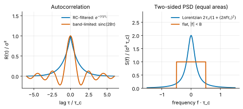
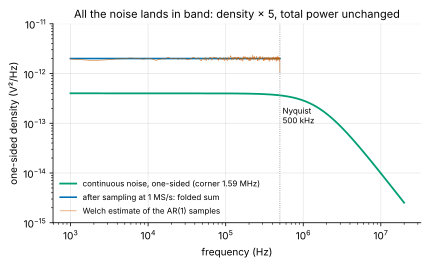
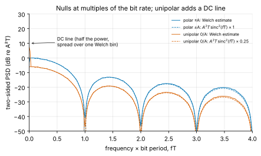

<!-- status: verified -->
# 17-01 · Random Processes and Power Spectral Density

| | |
|---|---|
| **Course** | [17 · Communication Systems](../README.md) |
| **University equivalent** | The random-processes chapter of a senior communications course: stationarity, autocorrelation, the Wiener–Khinchin theorem, random processes through LTI systems, Gaussian processes, the spectrum of digital signals and bandpass noise (Proakis & Salehi, *Communication Systems Engineering*; Lathi & Ding, *Modern Digital and Analog Communication Systems*; Gallager, *Principles of Digital Communication*, random processes and noise) |
| **Prerequisites** | [03-06](../../03-probability-statistics-and-random-variables/chapters/03-06-random-processes-preview.md) (random processes preview), [03-04](../../03-probability-statistics-and-random-variables/chapters/03-04-joint-distributions-and-clt.md) (jointly Gaussian variables), [11-06](../../11-signals-and-systems/chapters/11-06-continuous-time-fourier-transform.md) (Fourier transform), [11-10](../../11-signals-and-systems/chapters/11-10-sampling-aliasing-reconstruction.md) (sampling), [16-05](../../16-digital-signal-processing/chapters/16-05-spectral-analysis-and-windowing.md) (spectral estimation) |
| **Estimated study hours** | 9 |
| **Last verified** | 2026-11-20 |

**Learning objectives.** After this chapter you can:

1. Define strict-sense, wide-sense and cyclostationary processes, and compute the mean, autocorrelation and cross-correlation of standard processes.
2. Derive the Wiener–Khinchin theorem, test whether a function can be an autocorrelation, and compute the power in a band with one- and two-sided densities.
3. Derive the output mean, cross-spectrum, autocorrelation and PSD of an LTI system driven by a WSS process, and compute output noise power and noise bandwidth.
4. Use the properties of Gaussian processes, and predict how sampling folds out-of-band noise into the band.
5. Compute the PSD of a random PAM signal from its pulse and symbol statistics, including spectral lines.
6. Decompose bandpass noise into in-phase and quadrature components and state their spectra and correlation.

---

## 1. Big picture

A communication receiver never sees a known waveform. The data are random (otherwise there would be nothing to send), the noise is random, and the channel's interference is random. Engineering such a system needs a way to describe a random waveform by a few deterministic functions that can be computed, specified, measured and filtered. That description is the **autocorrelation** in time and the **power spectral density** (PSD) in frequency. [03-06](../../03-probability-statistics-and-random-variables/chapters/03-06-random-processes-preview.md) introduced both and the physical noise sources behind them. This chapter derives the results that the rest of Course 17 uses: why the PSD is the Fourier transform of the autocorrelation, how filters reshape it, why Gaussian noise stays Gaussian, what the spectrum of a random bit stream looks like, and how bandpass noise splits into two baseband components.

- **Specifications are PSDs.** Spectrum masks, adjacent-channel leakage limits and a converter's noise spectral density are all limits on a PSD, and every receiver's sensitivity starts from a noise density in dBm/Hz (17-02).
- **Bandwidth of data.** The bandwidth a 112 Gb/s SerDes lane or a 5G carrier occupies is the PSD of a random symbol stream shaped by its pulse (§3.8, 17-04).
- **Noise through circuits.** A filter, an amplifier chain or a sampler changes the noise spectrum in predictable ways: $S_Y = \lvert H\rvert^2S_X$, noise bandwidth and noise folding (§3.5, §3.7).
- **Detection and capacity.** Band-limited white Gaussian noise sampled at the Nyquist rate gives independent samples. This fact underlies the matched filter (17-05), bit-error rates (17-06) and Shannon's capacity formula (17-07).
- **Radio receivers.** Mixing to baseband turns bandpass noise into in-phase and quadrature components with known spectra; every I/Q receiver relies on it (§3.9, 17-06).

## 2. Intuition first

Think of an ensemble: a thousand identical radios, each recording its own noise. At any instant the thousand readings form a random variable, the process at that instant. The **autocorrelation** $R_X(\tau)$ asks: if a radio's noise is high now, is it likely to be high $\tau$ seconds later? Noise that has been low-pass filtered changes slowly, so it remembers its value for a while, and $R_X(\tau)$ decays slowly. Wideband noise forgets almost immediately. **Memory in time is narrowness in frequency**: slow memory means power concentrated at low frequencies. The Wiener–Khinchin theorem makes that statement exact. The PSD is the Fourier transform of the autocorrelation, so a process's spectrum can be computed from its correlation structure alone, without ever transforming a random waveform.

**Analogy: the variance of a portfolio over different horizons.** A quantitative analyst decomposes the variance of a return series by horizon. Daily noise that reverses the next day contributes to short-horizon variance only; a slow trend dominates long-horizon variance. The autocorrelation of returns at each lag says which. The PSD is exactly this decomposition, with frequency as one over the horizon: it tells you how much of the total variance lives at each time scale, and a filter is a strategy that keeps some horizons and discards others. **Where it breaks down:** the theory here assumes stationarity, a statistical structure that does not change over time, and finite variance. Financial series violate both (volatility clusters, regimes shift, tails are heavy). Thermal noise in a resistor obeys both to many decimal places, which is why the theory is so accurate for electronics.

## 3. Theory

### 3.1 Random processes, means and correlations

A **random process** $X(t)$ assigns a waveform to each outcome of an experiment; for each fixed $t$, $X(t)$ is a random variable. Communications needs complex-valued processes as well (the I/Q baseband signals of 17-06), so the definitions below allow them; for real processes the conjugates do nothing.

- **Mean function:** $\mu_X(t) = \mathbb{E}[X(t)]$.
- **Autocorrelation:** $R_X(t_1, t_2) = \mathbb{E}[X(t_1)X^*(t_2)]$, so $R_X(t, t) = \mathbb{E}\lvert X(t)\rvert^2$ is the average power at time $t$ (in V² for a voltage, i.e. watts into 1 Ω).
- **Autocovariance:** $C_X(t_1, t_2) = R_X(t_1, t_2) - \mu_X(t_1)\mu_X^*(t_2)$.
- **Cross-correlation** of two processes: $R_{XY}(t_1, t_2) = \mathbb{E}[X(t_1)Y^*(t_2)]$. Two processes are **uncorrelated** if $C_{XY} = 0$ for all times, and **orthogonal** if $R_{XY} = 0$.

The autocorrelation is not the whole description of a process (it says nothing about, say, its third moments), but it is exactly what is needed to compute powers and spectra, and for Gaussian processes it is the whole description (§3.6).

### 3.2 Stationarity

A process is **strict-sense stationary** (SSS) if every joint distribution of $(X(t_1), \dots, X(t_n))$ is unchanged when all the times shift by the same amount. That is hard to check and rarely needed. A process is **wide-sense stationary** (WSS) if only the first two moments are shift-invariant:

$$
\mu_X(t) = \mu_X, \qquad R_X(t + \tau, t) = R_X(\tau)\ \text{for all } t .
$$

With this convention, $R_X(\tau) = \mathbb{E}[X(t + \tau)X^*(t)]$. Two processes are **jointly WSS** if each is WSS and $R_{XY}(t + \tau, t)$ depends only on $\tau$. SSS with finite power implies WSS; the converse fails in general but holds for Gaussian processes (§3.6).

**Cyclostationary processes.** Many communication signals are not WSS. Take a PAM signal $X(t) = \sum_k a_kp(t - kT)$, with independent zero-mean symbols $a_k$ of variance $\sigma_a^2$ and a pulse $p(t)$. Its power at time $t$ is

$$
\mathbb{E}[X(t)^2] = \sigma_a^2\sum_k p(t - kT)^2 ,
$$

which repeats with period $T$ but is not constant: the signal is louder where pulses peak. A process whose mean and autocorrelation are periodic in $t$ with period $T$, $\mu_X(t + T) = \mu_X(t)$ and $R_X(t_1 + T, t_2 + T) = R_X(t_1, t_2)$, is **cyclostationary**. A receiver that does not know the symbol timing sees the signal with a random timing offset $\Theta$, uniform over one period and independent of the symbols. The process $X(t - \Theta)$ is WSS, and its autocorrelation is the time average of the cyclostationary one over a period:

$$
\bar R_X(\tau) = \frac1T\int_0^TR_X(t + \tau, t)\,dt .
$$

This is the autocorrelation a spectrum analyzer measures, and §3.8 uses it to find the spectrum of digital signals.

**Ergodicity** connects ensemble averages to the time averages that instruments compute. 03-06 §3.3 derived the test (the time-averaged covariance must vanish) and showed that a record of length $T$ is worth only about $T/(2\tau_c)$ independent samples. This chapter assumes ergodicity whenever it equates a measured spectrum with $S_X(f)$.

### 3.3 What an autocorrelation can be

For a WSS process:

1. $R_X(0) = \mathbb{E}\lvert X\rvert^2 \ge 0$, the total average power.
2. **Hermitian symmetry:** $R_X(-\tau) = \mathbb{E}[X(t - \tau)X^*(t)] = \big(\mathbb{E}[X(t)X^*(t - \tau)]\big)^* = R_X^*(\tau)$. For real processes, $R_X$ is even.
3. $\lvert R_X(\tau)\rvert \le R_X(0)$, by the Cauchy–Schwarz inequality $\lvert\mathbb{E}[UV^*]\rvert^2 \le \mathbb{E}\lvert U\rvert^2\,\mathbb{E}\lvert V\rvert^2$ (03-04) with $U = X(t + \tau)$, $V = X(t)$.
4. **Non-negative definiteness.** For any times $t_1, \dots, t_n$ and complex numbers $c_1, \dots, c_n$,

$$
0 \le \mathbb{E}\Big\lvert\sum_ic_iX(t_i)\Big\rvert^2 = \sum_i\sum_kc_ic_k^*R_X(t_i - t_k) .
$$

Property 4 is the real constraint, and the first three follow from it. It says that every linear combination of samples has non-negative power. The next section shows it is equivalent to a simple test: **the Fourier transform of $R_X$ must be non-negative everywhere**. An even function with its peak at zero can still fail. The rectangle $R(\tau) = 1$ for $\lvert\tau\rvert \le 1$ (0 otherwise) is even and peaks at 0, but its transform $2\operatorname{sinc}(2f)$ dips to −0.434: no process has that autocorrelation (Example 17-01.1).

> **Going deeper — Bochner's theorem.** A continuous function is non-negative definite if and only if it is the Fourier transform of a non-negative measure (Bochner, 1932). "Measure" allows spectral lines (delta functions) as well as densities, which is how a random-phase sinusoid fits: its autocorrelation $\tfrac{A^2}{2}\cos2\pi f_0\tau$ never decays and its spectrum is two lines. The "if" direction is constructive: given any non-negative $S(f)$, filtering white noise by $\sqrt{S(f)}$ produces a process with that spectrum (§3.5).

### 3.4 The Wiener–Khinchin theorem

**Defining the PSD by its meaning.** Observe a WSS process over a window of length $T$ and take the Fourier transform of what you saw:

$$
X_T(f) = \int_{-T/2}^{T/2}X(t)e^{-j2\pi ft}\,dt .
$$

$\lvert X_T(f)\rvert^2$ is the energy spectral density of the observed piece (V²·s/Hz for a voltage); dividing by $T$ turns energy into power. The **power spectral density** is defined as the long-window limit of its expectation:

$$
S_X(f) = \lim_{T\to\infty}\frac{\mathbb{E}\lvert X_T(f)\rvert^2}{T}\qquad\text{(V}^2\text{/Hz)} .
$$

This is exactly what an averaged periodogram estimates (16-05 §3.4), and by construction it is never negative.

**Derivation.** Write $\lvert X_T\rvert^2 = X_TX_T^*$ as a double integral and take the expectation inside:

$$
\frac{\mathbb{E}\lvert X_T(f)\rvert^2}{T} = \frac1T\int_{-T/2}^{T/2}\int_{-T/2}^{T/2}\mathbb{E}[X(t_1)X^*(t_2)]\,e^{-j2\pi f(t_1 - t_2)}\,dt_1\,dt_2 = \frac1T\int\!\!\int R_X(t_1 - t_2)\,e^{-j2\pi f(t_1 - t_2)}\,dt_1\,dt_2 .
$$

The integrand depends only on $\tau = t_1 - t_2$. In the $T \times T$ square, the pairs with a given $\tau$ lie on a diagonal line, and the set of pairs with lag between $\tau$ and $\tau + d\tau$ has area $(T - \lvert\tau\rvert)\,d\tau$ for $\lvert\tau\rvert < T$. Collecting them,

$$
\frac{\mathbb{E}\lvert X_T(f)\rvert^2}{T} = \int_{-T}^{T}\Big(1 - \frac{\lvert\tau\rvert}{T}\Big)R_X(\tau)\,e^{-j2\pi f\tau}\,d\tau .
$$

The triangle $(1 - \lvert\tau\rvert/T)$ is the price of a finite window: it is why a short record smears the spectrum (the Fejér kernel, the transform of the triangle, is the $\operatorname{sinc}^2$ leakage of 16-05). As $T \to \infty$ the triangle tends to 1 at every $\tau$. If $\int\lvert R_X(\tau)\rvert\,d\tau < \infty$, the integrand is bounded by $\lvert R_X\rvert$ and the limit can be taken inside (dominated convergence), giving the **Wiener–Khinchin theorem**:

$$
S_X(f) = \int_{-\infty}^{\infty}R_X(\tau)e^{-j2\pi f\tau}\,d\tau, \qquad R_X(\tau) = \int_{-\infty}^{\infty}S_X(f)e^{j2\pi f\tau}\,df .
$$

Since the left side was defined as a limit of non-negative quantities, $S_X(f) \ge 0$: this is the promised test of §3.3. Processes with a DC mean or sinusoidal components have $R_X$ that does not decay; the theorem still holds with delta functions (spectral lines) in $S_X$.

**Units check.** $R_X$ in V², $d\tau$ in s, so $S_X$ in V²·s = V²/Hz. ✓

**Reading the PSD.** Setting $\tau = 0$ in the inverse transform:

$$
\mathbb{E}\lvert X\rvert^2 = R_X(0) = \int_{-\infty}^{\infty}S_X(f)\,df ,
$$

so the PSD distributes the average power over frequency, and the power in a band is the area under $S_X$ over that band, counting both the positive and the negative frequencies of the band. For a real process $S_X$ is even, and the **one-sided** density $G_X(f) = 2S_X(f)$ for $f \ge 0$ gives the same power from positive frequencies alone. Circuit and data-sheet densities (nV/√Hz, $4kTR$, dBm/Hz) are one-sided; communications theory writes white noise as $S(f) = N_0/2$ two-sided, so $N_0$ is the one-sided density (notation sheet). Mixing the conventions is the most common factor-of-two error in noise calculations.

### 3.5 Random processes through LTI systems

Let a WSS process $X(t)$ drive an LTI system with impulse response $h(t)$ and frequency response $H(f)$:

$$
Y(t) = \int_{-\infty}^{\infty}h(\alpha)X(t - \alpha)\,d\alpha .
$$

Expectation is linear and passes through the integral, which gives everything in three steps.

**Mean.** $\mu_Y = \int h(\alpha)\mu_X\,d\alpha = \mu_XH(0)$: the DC component sees the DC gain.

**Cross-correlation.** Multiply $Y(t + \tau)$ by $X^*(t)$ and take expectations:

$$
R_{YX}(\tau) = \mathbb{E}[Y(t + \tau)X^*(t)] = \int h(\alpha)\,\mathbb{E}[X(t + \tau - \alpha)X^*(t)]\,d\alpha = \int h(\alpha)R_X(\tau - \alpha)\,d\alpha = (h * R_X)(\tau) .
$$

It does not depend on $t$, so $X$ and $Y$ are jointly WSS, and by the convolution theorem the **cross-spectral density** is

$$
S_{YX}(f) = H(f)S_X(f) .
$$

**Autocorrelation and PSD.** Now multiply $Y(t + \tau)$ by $Y^*(t) = \int h^*(\beta)X^*(t - \beta)\,d\beta$:

$$
R_Y(\tau) = \int h^*(\beta)\,\mathbb{E}[Y(t + \tau)X^*(t - \beta)]\,d\beta = \int h^*(\beta)R_{YX}(\tau + \beta)\,d\beta = (R_{YX} * \tilde h)(\tau),
$$

where $\tilde h(t) = h^*(-t)$, whose transform is $H^*(f)$. Transforming,

$$
S_Y(f) = H(f)H^*(f)S_X(f) = \lvert H(f)\rvert^2S_X(f), \qquad \mathbb{E}\lvert Y\rvert^2 = \int_{-\infty}^{\infty}\lvert H(f)\rvert^2S_X(f)\,df .
$$

This is the rule 03-06 stated without proof. The phase of $H$ drops out of the output spectrum, but it survives in the cross-spectrum. That is why $S_{YX}/S_X$ measures a system's full frequency response: inject noise, cross-correlate the output with the input, and noise added after the system (uncorrelated with the input) averages out of $S_{YX}$. Network analyzers that measure live systems, channel sounders and the system-identification step of an adaptive equalizer use this idea.

**The PSD is power per hertz.** Pass $X$ through a narrow real band-pass filter of unit gain over $f_0 < \lvert f\rvert < f_0 + \Delta f$. The output power is $\int\lvert H\rvert^2S_X\,df \approx 2S_X(f_0)\Delta f$ for a real process, which can only be non-negative: a second proof that $S_X \ge 0$, and the operational meaning of the PSD (it is what a spectrum analyzer's resolution filter measures, §9).

**White noise and noise bandwidth.** For white noise, $S_X = N_0/2$ and $R_X(\tau) = (N_0/2)\delta(\tau)$, so

$$
\mathbb{E}\lvert Y\rvert^2 = \frac{N_0}{2}\int_{-\infty}^{\infty}\lvert H(f)\rvert^2df = N_0B_N\lvert H(0)\rvert^2, \qquad B_N = \frac{1}{\lvert H(0)\rvert^2}\int_0^\infty\lvert H(f)\rvert^2df ,
$$

the **equivalent noise bandwidth** of a low-pass $H$ (for a band-pass filter, normalize by the peak gain instead). Only $\lvert H\rvert^2$ matters, so the noise output of any filter is fixed by a single number.

**White noise through an RC low-pass filter.** This closes the result 03-06 quoted. With $h(t) = \frac{1}{RC}e^{-t/RC}u(t)$ and white input, $R_Y = \frac{N_0}{2}(h * \tilde h)$, and for $\tau \ge 0$

$$
(h * \tilde h)(\tau) = \int_0^\infty h(\alpha + \tau)h(\alpha)\,d\alpha = \frac{1}{(RC)^2}\int_0^\infty e^{-(\alpha + \tau)/RC}e^{-\alpha/RC}\,d\alpha = \frac{1}{(RC)^2}\cdot\frac{RC}{2}e^{-\tau/RC} .
$$

By symmetry, for all $\tau$:

$$
R_Y(\tau) = \frac{N_0}{4RC}e^{-\lvert\tau\rvert/RC}, \qquad S_Y(f) = \frac{N_0/2}{1 + (2\pi fRC)^2}, \qquad B_N = \frac{1}{4RC} = \frac\pi2f_{3\text{dB}} .
$$

White noise acquires a memory of one time constant, the correlation time $\tau_c = RC$, and a power of $N_0/(4RC)$ that falls as the filter narrows (Example 17-01.2). The filter does not create power; it removes the power outside its band.

> **Math refresher — convolution with a time-reversed copy.** $(h * \tilde h)(\tau) = \int h(\alpha + \tau)h^*(\alpha)\,d\alpha$ is the **deterministic autocorrelation** of the pulse $h$: slide a copy past itself and integrate the overlap. Its transform is $\lvert H(f)\rvert^2$, the energy spectral density of $h$. The same object reappears in §3.8 for data pulses and in 17-05 as the matched filter's output.

### 3.6 Gaussian processes

A process is **Gaussian** if every finite set of its samples $(X(t_1), \dots, X(t_n))$ is jointly Gaussian (03-04). Thermal noise is Gaussian to excellent accuracy because each voltage sample is the sum of a vast number of independent electron motions (the central limit theorem, 03-04). Five properties make Gaussian processes the workhorse of communications theory:

1. **Two functions describe everything.** A jointly Gaussian vector is fixed by its mean vector and covariance matrix (03-04), so a Gaussian process is fixed by $\mu_X(t)$ and $R_X(t_1, t_2)$.
2. **WSS implies SSS.** If the mean and autocorrelation are shift-invariant, so is every joint distribution, because the distributions are built from them alone.
3. **Linear systems preserve Gaussianity.** The output integral $\int h(\alpha)X(t - \alpha)\,d\alpha$ is a limit of weighted sums of jointly Gaussian samples, and weighted sums of jointly Gaussian variables are jointly Gaussian. A filtered Gaussian process is Gaussian, with spectrum $\lvert H\rvert^2S_X$. This is why the receiver noise after any chain of filters, mixers (with a random-phase oscillator) and amplifiers is still Gaussian, and why the error probabilities of 17-05 and 17-06 are $Q$-functions.
4. **Uncorrelated samples are independent.** For jointly Gaussian variables, zero covariance means independence (03-04). This fails for non-Gaussian processes.
5. **Band-limited white Gaussian noise sampled at the Nyquist rate gives independent samples.** Let $S_X(f) = N_0/2$ for $\lvert f\rvert < B$ and 0 elsewhere. Then

$$
R_X(\tau) = \int_{-B}^{B}\frac{N_0}{2}e^{j2\pi f\tau}df = N_0B\,\operatorname{sinc}(2B\tau) ,
$$

with $\operatorname{sinc}x = \sin(\pi x)/(\pi x)$. Its zeros fall at $\tau = k/(2B)$, $k \ne 0$, so samples spaced $1/(2B)$ apart are uncorrelated and, being jointly Gaussian, independent, each with variance $N_0B$. A band-limited Gaussian waveform of duration $T_0$ is therefore equivalent to about $2BT_0$ independent Gaussian numbers. This count of degrees of freedom is the starting point of Shannon's capacity formula (17-07).

*Two processes of equal power. The narrower the spectrum, the longer the memory: the Lorentzian's slow $1/f^2$ tails come from the exponential's sharp corner at τ = 0, and the band-limited spectrum's hard edges produce the sinc's slowly decaying ripples, with zeros at multiples of $1/(2B)$.*

### 3.7 Discrete-time processes and noise folding

A WSS sequence $X[n]$ has autocorrelation $R_X[k] = \mathbb{E}[X[n + k]X^*[n]]$ and PSD

$$
S_X(e^{j\omega}) = \sum_{k=-\infty}^{\infty}R_X[k]e^{-j\omega k}, \qquad \mathbb{E}\lvert X\rvert^2 = R_X[0] = \frac{1}{2\pi}\int_{-\pi}^{\pi}S_X(e^{j\omega})\,d\omega ,
$$

per radian per sample. Everything in §3.5 carries over with sums for integrals: an LTI filter gives $S_Y(e^{j\omega}) = \lvert H(e^{j\omega})\rvert^2S_X(e^{j\omega})$, and a white sequence of variance $\sigma_w^2$ has a flat PSD of $\sigma_w^2$.

**The AR(1) process.** The first-order recursion $X[n] = aX[n - 1] + W[n]$, with $\lvert a\rvert < 1$ and white $W$ of variance $\sigma_w^2$, is white noise through $H(z) = 1/(1 - az^{-1})$:

$$
S_X(e^{j\omega}) = \frac{\sigma_w^2}{\lvert 1 - ae^{-j\omega}\rvert^2} = \frac{\sigma_w^2}{1 - 2a\cos\omega + a^2} .
$$

Its autocorrelation follows from the recursion. Squaring and taking expectations, with $W[n]$ uncorrelated with the past, gives $R_X[0] = a^2R_X[0] + \sigma_w^2$. Multiplying by $X^*[n - k]$ for $k \ge 1$ gives $R_X[k] = aR_X[k - 1]$. So

$$
R_X[k] = \frac{\sigma_w^2}{1 - a^2}a^{\lvert k\rvert} .
$$

This is the discrete twin of RC-filtered noise. With $a > 0$ the power gathers at low frequencies; with $a < 0$, at high frequencies.

**Sampling a random process.** Sample a WSS process every $T$ seconds: $X_d[n] = X(nT)$. Then $R_{X_d}[k] = R_X(kT)$, the samples of the continuous autocorrelation. The DTFT of the samples of a function is the sum of shifted copies of its transform, the same Poisson-summation algebra that gave the sampled spectrum in 11-10:

$$
S_{X_d}(e^{j\omega}) = \sum_kR_X(kT)e^{-j\omega k} = \frac1T\sum_{m=-\infty}^{\infty}S_X\!\left(\frac{\omega/2\pi - m}{T}\right) .
$$

In physical units, with $f = \omega f_s/2\pi$ and $f_s = 1/T$, the two-sided density seen in the sampled data over $\lvert f\rvert < f_s/2$ is

$$
T\,S_{X_d} = \sum_{m=-\infty}^{\infty}S_X(f - mf_s) .
$$

This is **noise folding**: every band of width $f_s$ of the continuous noise spectrum lands on top of the first Nyquist zone. The total power is unchanged, $R_{X_d}[0] = R_X(0)$, but it is all crowded into $\lvert f\rvert < f_s/2$. For a signal, aliasing can be avoided by band-limiting it. For noise the lesson is blunt: **any noise that reaches the sampler, at any frequency, ends up in band**. An anti-aliasing filter removes it, which is why a converter's input filter, not its sample rate, sets the integrated noise. If wideband noise of one-sided noise bandwidth $B_N \gg f_s/2$ is sampled unfiltered, its in-band density rises by about $2B_N/f_s$ (Example 17-01.5). The same mechanism explains why a sampled capacitor's noise is $kT/C$ whatever the switch resistance: the total is fixed, and sampling folds all of it into the Nyquist band.

**The sampled exponential is AR(1).** Sampling $R_X(\tau) = \sigma^2e^{-\lvert\tau\rvert/\tau_c}$ gives $R_{X_d}[k] = \sigma^2a^{\lvert k\rvert}$ with $a = e^{-T/\tau_c}$, the AR(1) autocorrelation with $\sigma_w^2 = \sigma^2(1 - a^2)$. Exact simulation of RC-filtered noise needs no differential-equation solver: run the AR(1) recursion (the lab's `ou_samples`). Comparing its PSD with the Lorentzian shows the folding directly.

*Example 17-01.5 ($\tau_c$ = 0.1 µs, $f_s$ = 1 MS/s, no anti-alias filter). The continuous noise (green) extends far past Nyquist. After sampling, all of it is crowded below 500 kHz, and the in-band density is five times higher: the folded sum (blue) and a Welch estimate of the exact AR(1) samples agree.*

### 3.8 The spectrum of a random digital signal

Let symbols $a_k$ form a WSS sequence with mean $\mu_a$ and autocorrelation $R_a[m] = \mathbb{E}[a_{k + m}a_k^*]$, and let the transmitted PAM waveform, seen with a random timing offset $\Theta$ uniform on $[0, T)$ (§3.2), be

$$
X(t) = \sum_ka_kp(t - kT - \Theta) .
$$

**Derivation.** With $\Theta$ independent of the symbols,

$$
R_X(\tau) = \sum_k\sum_lR_a[k - l]\,\mathbb{E}_\Theta\big[p(t + \tau - kT - \Theta)p^*(t - lT - \Theta)\big] .
$$

Put $m = k - l$ and write the expectation over $\Theta$ as $\frac1T\int_0^T\cdots\,d\theta$:

$$
R_X(\tau) = \sum_mR_a[m]\,\frac1T\sum_l\int_0^Tp(t + \tau - mT - lT - \theta)\,p^*(t - lT - \theta)\,d\theta .
$$

For each $l$, substitute $u = t - lT - \theta$. As $\theta$ runs over $[0, T)$, $u$ runs over an interval of length $T$, and as $l$ runs over all integers these intervals tile the whole line. The sum of integrals is one integral over all $u$:

$$
R_X(\tau) = \frac1T\sum_mR_a[m]\int_{-\infty}^{\infty}p(u + \tau - mT)p^*(u)\,du = \frac1T\sum_mR_a[m]\,r_p(\tau - mT) ,
$$

where $r_p$ is the pulse's deterministic autocorrelation, with transform $\lvert P(f)\rvert^2$. A shift by $mT$ multiplies a transform by $e^{-j2\pi fmT}$, so

$$
S_X(f) = \frac{\lvert P(f)\rvert^2}{T}\sum_mR_a[m]e^{-j2\pi fmT} = \frac{\lvert P(f)\rvert^2}{T}\,S_a(e^{j2\pi fT}) .
$$

The spectrum of a digital signal factors into **the pulse's energy spectrum** times **the symbol sequence's PSD** evaluated at $\omega = 2\pi fT$. The pulse sets the envelope and the occupied bandwidth; correlation between symbols (line coding) reshapes it, for example to put a null at DC (Problem 17-01.14).

**Independent symbols.** If the $a_k$ are independent, $R_a[0] = \sigma_a^2 + \lvert\mu_a\rvert^2$ and $R_a[m] = \lvert\mu_a\rvert^2$ for $m \ne 0$. Then $S_a = \sigma_a^2 + \lvert\mu_a\rvert^2\sum_me^{-j2\pi fmT}$. The sum of complex exponentials is a Dirac comb, $\sum_me^{-j2\pi fmT} = \frac1T\sum_k\delta(f - k/T)$ (Poisson summation, 11-05). So

$$
S_X(f) = \frac{\sigma_a^2}{T}\lvert P(f)\rvert^2 + \frac{\lvert\mu_a\rvert^2}{T^2}\sum_k\lvert P(k/T)\rvert^2\,\delta\!\left(f - \frac kT\right) .
$$

The symbols' variance produces a continuous spectrum. A nonzero mean produces **spectral lines** at multiples of the symbol rate, weighted by the pulse spectrum there. Lines waste transmit power (they carry no information), but a line at $1/T$ is what a timing-recovery circuit locks to, which is why clock-recovery schemes square or rectify the signal to create one.

**Polar NRZ.** Symbols $\pm A$ with equal probability ($\mu_a = 0$, $\sigma_a^2 = A^2$) and a rectangular pulse of unit height on $[0, T)$, $\lvert P(f)\rvert = T\lvert\operatorname{sinc}(fT)\rvert$, give

$$
S_X(f) = A^2T\operatorname{sinc}^2(fT) .
$$

The spectrum has nulls at multiples of the bit rate $1/T$. **90.3%** of the power lies in the main lobe $\lvert f\rvert < 1/T$, and **77.4%** below the Nyquist frequency $1/(2T)$. The slowly decaying sidelobes ($1/f^2$, from the pulse's sharp edges) are why practical links shape their pulses (17-04). **Unipolar NRZ** (0 or $A$) has $\mu_a = A/2$ and $\sigma_a^2 = A^2/4$: the same continuous shape at a quarter of the level, plus a DC line holding half the total power. The lines at $k/T$, $k \ne 0$, vanish because they fall on the sinc's zeros (Example 17-01.4).

*Random NRZ at 16 samples per bit, estimated by averaged periodograms (Welch) and compared with $A^2T\operatorname{sinc}^2(fT)$. Unipolar data have the same shape 6 dB lower plus a DC line; the estimator spreads the line over one frequency bin, so its height depends on the segment length, not on the signal.*

### 3.9 Bandpass noise and its in-phase and quadrature components

A radio receiver's noise, after its RF filter, is a **bandpass process**: its PSD is concentrated near $\pm f_c$ and occupies a band narrower than $2f_c$. Mixing it to baseband with a cosine and a sine produces two low-pass processes, and the receiver's performance depends on their spectra and correlation. Let $n(t)$ be zero-mean WSS bandpass noise and define, with an oscillator phase $\Phi$ uniform and independent of the noise (a real receiver's oscillator is not synchronized to the noise):

$$
n_I(t) = \text{LPF}\{2n(t)\cos(2\pi f_ct + \Phi)\}, \qquad n_Q(t) = \text{LPF}\{-2n(t)\sin(2\pi f_ct + \Phi)\} ,
$$

where the ideal low-pass filter passes $\lvert f\rvert < f_c$ and removes the components near $\pm2f_c$. With these definitions, $n(t) = n_I(t)\cos(2\pi f_ct + \Phi) - n_Q(t)\sin(2\pi f_ct + \Phi)$, the I/Q representation used throughout 17-06.

**Spectra of the components.** Before filtering, $u(t) = 2n(t)\cos(2\pi f_ct + \Phi)$ has autocorrelation

$$
R_u(\tau) = 4R_n(\tau)\,\mathbb{E}\big[\cos(2\pi f_c(t + \tau) + \Phi)\cos(2\pi f_ct + \Phi)\big] = 2R_n(\tau)\cos(2\pi f_c\tau) ,
$$

because the product of cosines is $\tfrac12[\cos(2\pi f_c\tau) + \cos(2\pi f_c(2t + \tau) + 2\Phi)]$ and the second term averages to zero over $\Phi$. The modulation property gives $S_u(f) = S_n(f - f_c) + S_n(f + f_c)$: the positive-frequency band moved down to baseband, the negative band moved up, and copies at $\pm2f_c$. The low-pass filter keeps the baseband part:

$$
S_{n_I}(f) = S_{n_Q}(f) = \big[S_n(f - f_c) + S_n(f + f_c)\big]\ \text{for } \lvert f\rvert < f_c\ (0 \text{ otherwise}) .
$$

The same calculation with a sine gives the same spectrum for $n_Q$.

**Power.** Integrating, $\mathbb{E}[n_I^2] = \int_{-f_c}^{f_c}[S_n(f - f_c) + S_n(f + f_c)]\,df = \int S_n\,df = \mathbb{E}[n^2]$. **Each component carries the full power of the bandpass noise.** For white noise of two-sided density $N_0/2$ in a band $B$ centred on $f_c$, the bandpass noise has power $N_0B$, and $n_I$ and $n_Q$ each have PSD $N_0$ over $\lvert f\rvert < B/2$ and power $N_0B$ (Example 17-01.6).

**Correlation between the components.** The cross-correlation of the unfiltered products is

$$
\mathbb{E}\big[2n(t + \tau)\cos(\theta_1)\cdot(-2)n(t)\sin(\theta_2)\big] = 2R_n(\tau)\sin(2\pi f_c\tau),\quad \theta_1 = 2\pi f_c(t + \tau) + \Phi,\ \theta_2 = 2\pi f_ct + \Phi ,
$$

whose transform, after the low-pass filter, is the cross-spectrum

$$
S_{n_In_Q}(f) = j\big[S_n(f + f_c) - S_n(f - f_c)\big]\quad (\lvert f\rvert < f_c) .
$$

Two consequences follow:

- **At the same instant, $n_I(t)$ and $n_Q(t)$ are always uncorrelated.** $R_{n_In_Q}(\tau)$ is an odd function of $\tau$ (the transform of $j$ times a real odd function), so it vanishes at $\tau = 0$. For Gaussian noise they are independent at any one instant. With equal variances, the envelope $\sqrt{n_I^2 + n_Q^2}$ is then Rayleigh distributed, the starting point of fading in 17-09.
- **If the noise spectrum is symmetric about $f_c$, $S_{n_In_Q} = 0$**, and the components are uncorrelated at every lag (independent processes, if Gaussian). An asymmetric spectrum, such as a filter offset from the oscillator, correlates $n_I(t + \tau)$ with $n_Q(t)$ for $\tau \ne 0$ (Problem 17-01.13).

> **Going deeper — the complex envelope.** The pair is often written as one complex process $\tilde n(t) = n_I(t) + jn_Q(t)$, with $n(t) = \operatorname{Re}\{\tilde n(t)e^{j(2\pi f_ct + \Phi)}\}$. For a spectrum symmetric about $f_c$, $\tilde n$ is **circularly symmetric**: $\mathbb{E}[\tilde n(t + \tau)\tilde n(t)] = 0$ for all $\tau$, and its autocorrelation $\mathbb{E}[\tilde n(t + \tau)\tilde n^*(t)]$ is $2R_{n_I}(\tau)$. Circularly symmetric complex Gaussian noise, written $\mathcal{CN}(0, N_0)$ per complex sample, is the noise model of every baseband simulation in 17-06 to 17-11.

## 4. Worked examples

### Example 17-01.1 · Which functions are autocorrelations? (tier A)

**Setup.** Decide which of these can be the autocorrelation of a real WSS process, and for the valid ones give the power and the PSD at $f = 0$ (τ in seconds):

- (a) $R(\tau) = 1$ for $\lvert\tau\rvert \le 1$, 0 otherwise;
- (b) the triangle $R(\tau) = 1 - \lvert\tau\rvert$ for $\lvert\tau\rvert \le 1$, 0 otherwise;
- (c) $R(\tau) = e^{-\lvert\tau\rvert} - 0.5e^{-2\lvert\tau\rvert}$;
- (d) $R(\tau) = e^{-(\lvert\tau\rvert - 1)^2}$.

**Solution.** All four are even, so the test is the transform (Bochner).

(a) $S(f) = \int_{-1}^{1}e^{-j2\pi f\tau}d\tau = 2\operatorname{sinc}(2f)$. It is negative for $0.5 < f < 1$, reaching **−0.434** at $f$ = **0.715** Hz. **Not valid**, although it is even and peaks at zero.

(b) The triangle is the deterministic autocorrelation of a unit pulse, so $S(f) = \operatorname{sinc}^2(f) \ge 0$. **Valid**: power $R(0)$ = **1**, $S(0)$ = **1** V²/Hz. (It is the autocorrelation of polar NRZ data with $A = 1$, $T = 1$ s; §3.8.)

(c) Using $\int e^{-a\lvert\tau\rvert}e^{-j2\pi f\tau}d\tau = 2a/(a^2 + (2\pi f)^2)$:

$$
S(f) = \frac{2}{1 + \omega^2} - \frac{2}{4 + \omega^2} = \frac{6}{(1 + \omega^2)(4 + \omega^2)} > 0,\qquad \omega = 2\pi f .
$$

**Valid**: power $R(0) = 1 - 0.5$ = **0.5**, $S(0) = 6/4$ = **1.5** V²/Hz. A difference of valid autocorrelations can be valid; here it is because the subtracted Lorentzian is wider and lower everywhere.

(d) $R(1) = 1 > R(0) = e^{-1}$ = **0.368**, which violates $\lvert R(\tau)\rvert \le R(0)$. **Not valid**.

**Units check.** $R$ in V² and τ in s give $S$ in V²/Hz.

**Sanity check.** (b) transforms back: $\int\operatorname{sinc}^2(f)\,df = 1 = R(0)$.

### Example 17-01.2 · Amplifier noise through a one-pole filter (tier B)

**Setup.** An amplifier's input-referred noise is white with a one-sided density of 10 nV/√Hz, and a single-pole filter with $f_{3\text{dB}}$ = 1 MHz and unit DC gain follows it. Find the output autocorrelation, its correlation time, the rms output noise, and the correlation coefficient between samples 100 ns and 1 µs apart.

**Solution.** One-sided density $(10\ \text{nV})^2/\text{Hz} = 10^{-16}$ V²/Hz $= N_0$, so the two-sided density is $N_0/2 = 5 \times 10^{-17}$ V²/Hz. The time constant is $RC = 1/(2\pi \times 10^6)$ = **159.2** ns. By §3.5,

$$
R_Y(\tau) = \frac{N_0}{4RC}e^{-\lvert\tau\rvert/RC}, \qquad \frac{N_0}{4RC} = \frac{10^{-16}}{4 \times 1.5915 \times 10^{-7}} = 1.571 \times 10^{-10}\ \text{V}^2 .
$$

The rms noise is $\sqrt{1.571 \times 10^{-10}}$ = **12.53** µV. The correlation coefficient is $\rho(\tau) = e^{-\lvert\tau\rvert/RC}$: **0.533** at 100 ns and **0.00187** at 1 µs.

**Units check.** $N_0$ in V²/Hz = V²·s, divided by $RC$ in s, gives V².

**Sanity check.** One-sided density times noise bandwidth: $10^{-16} \times (\pi/2)(10^6) = 1.571 \times 10^{-10}$ V², the same. Samples a microsecond apart (six time constants) are practically independent; samples 100 ns apart are not.

### Example 17-01.3 · Resistor noise in a resonant circuit (tier B)

**Setup.** A 5 Ω resistor at 300 K drives a series 1 µH inductor and 1 nF capacitor; the output is the capacitor voltage. Find the resonant frequency, $Q$, the one-sided noise density at resonance, the rms capacitor voltage and the noise bandwidth. Confirm the rms voltage in ngspice.

**Solution.** The resistor's one-sided noise density $4kTR$ drives $H(f) = 1/(1 - \omega^2LC + j\omega RC)$. Then:

- $f_0 = 1/(2\pi\sqrt{LC})$ = **5.033** MHz;
- $Q = \sqrt{L/C}/R = 31.62/5$ = **6.32**;
- at $f_0$, $\lvert H\rvert = Q$, so the density is $4kTRQ^2 = 4kTL/(RC)$ = $3.314 \times 10^{-18}$ V²/Hz, or **1.820** nV/√Hz. The density peaks slightly below $f_0$, at $f_0\sqrt{1 - 1/(2Q^2)}$ = **5.001** MHz, as a capacitor voltage does.

The mean-square voltage is

$$
\overline{v_C^2} = \int_0^\infty\frac{4kTR\,df}{(1 - \omega^2LC)^2 + (\omega RC)^2} = \frac{kT}{C} ,
$$

derived in the refresher below. The rms voltage is $\sqrt{kT/C}$ = **2.035** µV, independent of $R$ and $L$. The noise bandwidth, normalized to the peak at $f_0$, is $(kT/C)/(4kTRQ^2) = \pi f_0/(2Q)$ = **1.25** MHz.

> **Math refresher — the noise integral by Parseval.** $\int_{-\infty}^{\infty}\lvert H(f)\rvert^2df = \int_0^\infty h(t)^2dt$ (11-06). For $H(s) = 1/(LCs^2 + RCs + 1)$ with $\alpha = R/2L$, $\omega_0^2 = 1/LC$ and $\omega_d^2 = \omega_0^2 - \alpha^2$, the impulse response is $h(t) = \frac{1}{LC\omega_d}e^{-\alpha t}\sin\omega_dt$. Using $\sin^2x = \tfrac12(1 - \cos2x)$ and $\int_0^\infty e^{-2\alpha t}\cos(2\omega_dt)\,dt = 2\alpha/(4\alpha^2 + 4\omega_d^2)$:
>
> $$\int_0^\infty e^{-2\alpha t}\sin^2\omega_dt\,dt = \frac12\left[\frac{1}{2\alpha} - \frac{\alpha}{2\omega_0^2}\right] = \frac{\omega_d^2}{4\alpha\omega_0^2}, \qquad \int_0^\infty h^2dt = \frac{1}{(LC)^2\omega_d^2}\cdot\frac{\omega_d^2}{4\alpha\omega_0^2} = \frac{1}{4\alpha LC} = \frac{1}{2RC} .$$
>
> The one-sided integral $\int_0^\infty\lvert H\rvert^2df$ is half of that, $1/(4RC)$, and $4kTR/(4RC) = kT/C$. The same answer for the RC circuit alone ($L = 0$) is 03-06's $kT/C$.

**Units check.** $kT$ in J divided by $C$ in F gives J/F = V².

**Sanity check.** Equipartition: a capacitor in thermal equilibrium stores $\tfrac12C\overline{v^2} = \tfrac12kT$, whatever it is connected to. A lower $R$ raises $Q$: the peak grows as $Q^2$ but narrows as $1/Q$, and the area stays at $kT/C$. The lab's ngspice netlist integrates the noise analysis to 2.035 µV for both $R$ = 5 Ω and 50 Ω.

### Example 17-01.4 · The spectrum of 10 Gb/s data (tier B)

**Setup.** A 10 Gb/s link sends polar NRZ bits of ±0.4 V (into 1 Ω). Give the PSD, its first null, the one-sided density at low frequency, and the fraction of power below the first null and below 5 GHz. Repeat the power accounting for unipolar 0/0.8 V signalling.

**Solution.** $T$ = 100 ps and $\sigma_a^2 = A^2$ = **0.16** V². By §3.8, $S_X(f) = A^2T\operatorname{sinc}^2(fT)$, with the first null at $1/T$ = **10** GHz. The one-sided density near DC is $2A^2T = 2 \times 0.16 \times 10^{-10}$ = $3.2 \times 10^{-11}$ V²/Hz. The fraction of power below $\lvert f\rvert = k/T$ is $\int_{-k}^{k}\operatorname{sinc}^2x\,dx$: **0.903** for $k = 1$ (below 10 GHz) and **0.774** for $k = 1/2$ (below 5 GHz).

Unipolar 0/0.8 V has $\mu_a$ = 0.4 V and $\sigma_a^2$ = 0.16 V², total power $\mu_a^2 + \sigma_a^2$ = 0.32 V². The continuous part is $0.16 \times T\operatorname{sinc}^2(fT)$, as before. The DC line holds $\mu_a^2$ = 0.16 V², a fraction **0.5** of the power. It carries no information and is blocked by any AC coupling.

**Units check.** $A^2T$ in V²·s = V²/Hz.

**Sanity check.** The lab's Welch estimate of a simulated polar NRZ stream agrees with $A^2T\operatorname{sinc}^2(fT)$ to within a few percent across the main lobe, and shows the nulls at multiples of the bit rate.

### Example 17-01.5 · Sampling wideband noise: AR(1) and folding (tier C)

**Setup.** Gaussian noise with $R(\tau) = \sigma^2e^{-\lvert\tau\rvert/\tau_c}$, σ = 1 mV and $\tau_c$ = 0.1 µs, is sampled at $f_s$ = 1 MS/s with no anti-alias filter. (a) Show that the samples form an AR(1) sequence and give $a$. (b) Compare the one-sided density near DC in the sampled data with that of the continuous noise. (c) Repeat (b) for $\tau_c$ = 1 µs.

**Solution.** (a) $R_d[k] = R(kT) = \sigma^2a^{\lvert k\rvert}$ with $a = e^{-T/\tau_c} = e^{-10}$ = **4.54 × 10⁻⁵**. This is the AR(1) autocorrelation of §3.7 with $\sigma_w^2 = \sigma^2(1 - a^2)$. Successive samples are essentially uncorrelated: the noise's corner, $1/(2\pi\tau_c)$ = 1.59 MHz, is above the Nyquist frequency of 500 kHz.

(b) The continuous one-sided density at low frequency is $G(0) = 4\sigma^2\tau_c = 4 \times 10^{-6} \times 10^{-7}$ = $4.0 \times 10^{-13}$ V²/Hz. The sampled sequence has $S_d(e^{j0}) = \sigma_w^2/(1 - a)^2 = \sigma^2(1 + a)/(1 - a)$, so its one-sided density in physical units is $2T\sigma^2(1 + a)/(1 - a)$ = $2.000 \times 10^{-12}$ V²/Hz. That is **5.00** times (**6.99** dB) higher. The total power is unchanged, $10^{-6}$ V² (1 mV rms), but it is now spread over 500 kHz instead of the process's 2.5 MHz noise bandwidth ($B_N = 1/(4\tau_c)$): $2B_N/f_s = 2 \times 2.5/1 = 5$.

(c) With $\tau_c$ = 1 µs, $a = e^{-1}$ = **0.368**; the ratio is $(1 + a)/(1 - a)\cdot T/(2\tau_c)$ = **1.082** (**0.34** dB). Most of the noise was already below Nyquist, and little folds.

**Units check.** $T\sigma^2$ in s·V² = V²/Hz.

**Sanity check.** Summing the Lorentzian's aliases, $\sum_mS(f - mf_s)$, numerically gives the same density as the AR(1) closed form to five digits: the closed form *is* the folded sum (lab). An anti-alias filter at 500 kHz in (b) would have removed 4/5 of the noise power before it could fold.

### Example 17-01.6 · Receiver noise in I and Q (tier C)

**Setup.** A 2.4 GHz receiver's front end passes thermal noise of one-sided density $N_0 = kT_0$, $T_0$ = 290 K, in a 20 MHz band centred on the carrier (two-sided $N_0/2$ over each band). After I/Q down-conversion, give the spectra and powers of $n_I$ and $n_Q$, the bandpass noise power in dBm, and the SNR of a −90 dBm signal.

**Solution.** $N_0 = 1.380649 \times 10^{-23} \times 290$ = $4.004 \times 10^{-21}$ W/Hz (−174.0 dBm/Hz). The bandpass noise power is $N_0B$ = $8.008 \times 10^{-14}$ W = **−100.96** dBm. By §3.9, each of $n_I$, $n_Q$ has PSD $N_0/2 + N_0/2 = N_0$ over $\lvert f\rvert < 10$ MHz, and power $N_0B$, the full bandpass power. The spectrum is symmetric about $f_c$, so $n_I$ and $n_Q$ are uncorrelated at all lags and, being Gaussian, independent. The SNR of a −90 dBm signal is $-90 - (-100.96)$ = **10.96** dB.

**Units check.** W/Hz × Hz = W; $10\log_{10}(P/1\ \text{mW})$ gives dBm.

**Sanity check.** The lab's simulated bandpass noise gives $n_I$ and $n_Q$ with powers within 2% of the bandpass noise's own power, and a normalized zero-lag correlation below 0.01.

<!-- answer-key -->

| ID | Quantity | Value | Unit |
|---|---|---|---|
| Ex 17-01.1a | minimum of the rectangle's transform | −0.434 | V²/Hz |
| Ex 17-01.1b | frequency of that minimum | 0.715 | Hz |
| Ex 17-01.1c | triangle power | 1 | V² |
| Ex 17-01.1d | triangle PSD at DC | 1 | V²/Hz |
| Ex 17-01.1e | power of (c) | 0.5 | V² |
| Ex 17-01.1f | PSD of (c) at DC | 1.5 | V²/Hz |
| Ex 17-01.1g | R(0) of (d) | 0.368 | V² |
| Ex 17-01.2a | time constant | 159.2 | ns |
| Ex 17-01.2b | rms output noise | 12.53 | µV |
| Ex 17-01.2c | correlation at 100 ns | 0.533 | — |
| Ex 17-01.2d | correlation at 1 µs | 0.00187 | — |
| Ex 17-01.3a | resonant frequency | 5.033 | MHz |
| Ex 17-01.3b | Q | 6.32 | — |
| Ex 17-01.3c | density at resonance | 1.820 | nV/√Hz |
| Ex 17-01.3f | frequency of the density peak | 5.001 | MHz |
| Ex 17-01.3d | rms capacitor voltage | 2.035 | µV |
| Ex 17-01.3e | noise bandwidth | 1.25 | MHz |
| Ex 17-01.4a | symbol power | 0.16 | V² |
| Ex 17-01.4b | first null | 10 | GHz |
| Ex 17-01.4c | power fraction below 1/T | 0.903 | — |
| Ex 17-01.4d | power fraction below 1/(2T) | 0.774 | — |
| Ex 17-01.4e | DC-line fraction, unipolar | 0.5 | — |
| Ex 17-01.5a | AR(1) coefficient | 4.54e-5 | — |
| Ex 17-01.5b | density ratio | 5.00 | — |
| Ex 17-01.5c | density ratio | 6.99 | dB |
| Ex 17-01.5d | AR(1) coefficient, 1 µs | 0.368 | — |
| Ex 17-01.5e | density ratio, 1 µs | 1.082 | — |
| Ex 17-01.5f | density ratio, 1 µs | 0.34 | dB |
| Ex 17-01.6a | bandpass noise power | −100.96 | dBm |
| Ex 17-01.6b | SNR | 10.96 | dB |
| Txt 17-01.a | NRZ main-lobe power fraction | 90.3 | % |
| Txt 17-01.b | NRZ power fraction below Nyquist | 77.4 | % |
| Txt 17-01.c | Rayleigh mean-versus-rms correction | 1.05 | dB |
| Txt 17-01.d | log-averaging under-response | 2.51 | dB |
| Txt 17-01.e | noise-bandwidth correction for 1.056 | 0.24 | dB |
| Txt 17-01.f | density above a log-averaged DANL | 2.27 | dB |
| Txt 17-01.g | ADC12DJ5200RF full-scale power | 0.97 | dBm |
| Txt 17-01.h | ADC noise density above kT0 | 22.94 | dB |
| Txt 17-01.i | kT0 | −173.98 | dBm/Hz |

## 5. Simulate it

The lab, [labs/17-01-lab](../labs/17-01-lab/README.md), provides `randproc.py`, built from this chapter's definitions:

- time-average and ensemble autocorrelation estimates;
- Welch PSD estimates in V²/Hz;
- exact white-noise and AR(1) (sampled RC-noise) generators;
- the aliased-density sum;
- PAM waveforms with NRZ and half-sine pulses and the closed-form NRZ spectrum;
- bandpass noise with its I/Q decomposition;
- the RLC noise density;
- a numerical Bochner test.

An ngspice netlist, `rlc_noise.cir`, confirms Example 17-01.3 by noise analysis. In the notebook, **predict, then run**:

1. **Ensemble versus time average.** Before running, predict whether the time-average autocorrelation of one long AR(1) record and the ensemble autocorrelation across 2000 short records will agree, and how closely. Then compare both with $\sigma_w^2a^{\lvert k\rvert}/(1 - a^2)$.
2. **Noise through a filter.** Predict the output rms of Example 17-01.2 from the noise bandwidth, then filter simulated white noise and measure it.
3. **Data spectra.** Predict where the nulls and the DC line fall for polar and unipolar NRZ at 16 samples per bit, then estimate both spectra. Swap in a half-sine pulse and predict the first null before looking (it moves to $1.5/T$).
4. **Noise folding.** For Example 17-01.5, predict the density ratio for $\tau_c$ = 0.1 µs and 1 µs, then compare the AR(1) closed form, the aliased sum and a Welch estimate of the samples.
5. **I/Q noise.** Down-convert simulated bandpass noise and predict the powers of $n_I$ and $n_Q$ and their zero-lag correlation. Then offset the noise band by 5 MHz from the oscillator and predict what changes at lag zero and at other lags.

## 6. Engineering tradeoffs

| Knob | Improves | Costs | Typical decision owner |
|---|---|---|---|
| Receiver (channel) filter bandwidth | Less noise power ($N_0B_N$) | Signal distortion or ISI if narrower than the signal (17-04) | RF / systems architect |
| Anti-alias filter before a sampler | Prevents out-of-band noise folding into band | Filter area, power, group delay and droop | Mixed-signal designer |
| Oversampling (higher $f_s$) | Spreads folded noise over a wider band; relaxes the anti-alias filter | Converter power and data rate | Converter / system architect |
| Pulse shape (NRZ → shaped pulses) | Compact spectrum, less adjacent-channel leakage | Longer pulses, ISI control, more DSP | Modem / SerDes architect |
| Symbol mean and line coding | DC balance, timing lines where wanted | Rate overhead (e.g. 8b/10b's 25%) or power in lines | Link-layer / PHY architect |
| PSD estimation: record length and averaging | Lower estimate variance, finer resolution | Measurement time, memory | Test and validation engineer |
| Spectrum-analyzer RBW | Finer resolution, lower displayed noise floor | Sweep time grows as $1/\text{RBW}^2$ | Test engineer |

## 7. Numbers to know

| Quantity | Value | Source |
|---|---|---|
| Thermal noise density at 290 K | $kT_0$ = $4.00 \times 10^{-21}$ W/Hz = −174 dBm/Hz | Physics (§3.4 units, Example 17-01.6) |
| Resistor voltage noise at 300 K | $\sqrt{4kTR}$ = 4.07 nV/√Hz for 1 kΩ (scales as $\sqrt R$) | 03-06 |
| One-pole noise bandwidth | $B_N = (\pi/2)f_{3\text{dB}}$; correlation time $RC$ | §3.5 |
| Capacitor noise | $\sqrt{kT/C}$: 64 µV for 1 pF, 2.0 µV for 1 nF at 300 K, any $R$ or $L$ | Example 17-01.3 |
| Polar NRZ spectrum | $A^2T\operatorname{sinc}^2(fT)$: nulls at $k/T$; 90.3% of power below $1/T$, 77.4% below $1/(2T)$ | §3.8 |
| Band-limited white Gaussian noise | independent samples every $1/(2B)$, each of variance $N_0B$ | §3.6 |
| Wideband noise sampled unfiltered | in-band density rises by about $2B_N/f_s$ | §3.7 |
| I/Q noise components | each with the full bandpass power; uncorrelated at the same instant | §3.9 |

## 8. Common mistakes

- **Mixing one-sided and two-sided densities.** A data sheet's 10 nV/√Hz is one-sided; $N_0/2$ is two-sided. Integrate a one-sided density over positive frequencies only, a two-sided one over both.
- **Adding noise amplitudes.** Uncorrelated noise sources add in power (V²), not in volts: two 10 µV rms sources give 14.1 µV, not 20.
- **Treating a PAM signal as WSS without a random timing offset.** The synchronized signal is cyclostationary; its time-averaged autocorrelation, not any single instant's, gives the spectrum.
- **Forgetting the mean.** The autocorrelation includes the DC power; the autocovariance does not. A nonzero mean is a spectral line at $f = 0$, and nonzero-mean symbols add lines at multiples of the symbol rate.
- **Assuming "uncorrelated" means "independent".** True for jointly Gaussian variables, false in general: a random-phase sinusoid's samples are uncorrelated at some lags but completely dependent.
- **Ignoring noise folding.** Sampling does not discard out-of-band noise; it moves it into band. Integrated noise depends on the bandwidth before the sampler.
- **Reading a spectrum display as a density without the resolution bandwidth.** A displayed noise level in dBm is the power in one resolution bandwidth; dividing by the analyzer's noise bandwidth (and correcting for its detector and averaging, §9) gives dBm/Hz.
- **Taking a single periodogram as the PSD.** One record's periodogram has a standard deviation equal to its mean at every frequency (03-06, 16-05). Average.

## 9. Practitioner lens

### State of the art (as of Nov 2026)

- **A spectrum analyzer measures a PSD through its resolution filter, with known biases.** Keysight's UXA specifications give the noise bandwidth of its resolution filters as "1.056 ±2% (nominal)" times the RBW, and state that the noise marker, band power, channel power and ACP "all compute their results using the power bandwidth of the RBW" (R-257) **[Established]**. Two corrections follow from this chapter. The envelope of Gaussian bandpass noise is Rayleigh (§3.9), whose mean is $\sqrt{\pi/4}$ of its rms value, **1.05** dB low; and averaging the logarithm of an exponentially distributed power reads low by $10\log_{10}(e)\,\gamma$ = **2.51** dB, with $\gamma = 0.5772$ Euler's constant (because $\mathbb{E}[\ln P] = \ln\mathbb{E}[P] - \gamma$). Rohde & Schwarz's FSW manual applies exactly these: with the sample detector "1.05 dB is added ... This is the difference between the average value and the RMS value of white noise", plus 1.45 dB more on a logarithmic axis (1.05 + 1.45 = 2.50 dB), and the RMS detector needs no correction beyond the bandwidth (R-257) **[Established]**. Keysight specifies its displayed average noise level (DANL) "with log averaging, which reduces the measured noise level by 2.51 dB", so the true density is 2.51 − 0.24 = **2.27** dB above the DANL, the 0.24 dB being $10\log_{10}1.056$ (R-257) **[Established]**.
- **Emission limits are written as PSD ratios.** 3GPP's NR base-station specification (TS 38.104 V20.1.0, Sept 2026) defines the adjacent channel leakage ratio (ACLR) as "the ratio of the filtered mean power centred on the assigned channel frequency to the filtered mean power centred on an adjacent channel frequency" and requires **45** dB in FR1 (28 dB at 24.25–33.4 GHz and 26 dB at 37–52.6 GHz in FR2), or an absolute limit such as −13 dBm/MHz for a Category A wide-area station, "whichever is less stringent". A power-class-3 phone (TS 38.101-1 V20.1.0) needs NR ACLR of **30** dB (R-258) **[Established]**. Each is an integral of the transmitted PSD over two bands: §3.4's band power.
- **Converters publish noise as a spectral density.** TI's ADC12DJ5200RF lists a noise spectral density of **−152.0** dBFS/Hz with a 1.0 Vpp full scale and a noise figure of 23.0 dB for a 100 Ω source (R-237) **[Established]**. The two are the same fact: a 1.0 Vpp differential full scale into 100 Ω is 1.25 mW (+0.97 dBm), so the density is $-152.0 + 0.97$ = −151.0 dBm/Hz, which is **22.94** dB above $kT_0$ = −173.98 dBm/Hz (R-257), the data sheet's 23.0 dB.

### Why it matters commercially

Every receiver, transmitter and converter specification is PSD arithmetic. Sensitivity starts from $kT_0$ in dBm/Hz and a bandwidth (17-02); a transmitter's emissions compliance is a PSD integral against a mask; a converter's usefulness is its noise density against the signal's bandwidth, after folding (§3.7). Test equipment, which semiconductor companies buy in volume, is built around these measurements, and its corrections decide whether a part passes. In due diligence, PSD fluency is what lets you check whether a "noise floor" or "ACLR" figure means what the pitch implies.

### Marketing vs Reality

- **"Noise floor of −150 dBm."** A displayed level means nothing without the resolution bandwidth: the same noise is 10 dB lower in a 10× narrower RBW. Ask for dBm/Hz, and whether the figure is a log-averaged DANL (2.27 dB optimistic for a Keysight-style specification) or a true density.
- **"NSD of −154 dBFS/Hz."** dBFS/Hz depends on the chosen full scale: the same ADC12DJ5200RF reads −152.0 dBFS/Hz at 1.0 Vpp but −150.4 at 0.8 Vpp (R-237). Convert to dBm/Hz or to a noise figure before comparing parts.
- **"White noise" from a filtered or sampled source.** Noise that has passed through any filter is no longer white (§3.5), and noise that reached a sampler unfiltered has folded into the band (§3.7). Ask what bandwidth the noise had before the sampler.
- **"ACLR of 50 dB."** The ratio depends on the measurement filters and the absolute floor; a large ratio at low output power can still fail an absolute limit at full power. Ask for ACLR at rated power, with the standard's filters.

### Questions for engineering leaders

1. **"Is that noise figure a density or a power in a stated bandwidth, and which detector and averaging produced it?"** *Strong:* gives dBm/Hz with the RBW, detector (RMS or sample with corrections) and averaging, and how it relates to the data sheet's NF. *Evasive:* reads a number off a screen.
2. **"What noise reaches your ADC above Nyquist, and what removes it?"** *Strong:* names the anti-alias filter and quantifies the folded noise ($2B_N/f_s$). *Evasive:* "the ADC has enough bits".
3. **"How was the ACLR measured, at what output power, and against which limit, ratio or absolute?"** *Strong:* the standard's filters, rated power, margin to both limits. *Evasive:* one ratio at an unspecified power.
4. **"What is the spectrum of your transmitted signal, and why that pulse shape?"** *Strong:* relates the pulse (or roll-off) to occupied bandwidth and adjacent-channel leakage (§3.8, 17-04). *Evasive:* quotes only a data rate.
5. **"Are your receiver's I and Q noise equal in power and uncorrelated? How do you know?"** *Strong:* describes I/Q imbalance measurements and calibration (§3.9, 17-06). *Evasive:* "the mixer is balanced".

## 10. Concept check

**Q1.** A process has $R_X(\tau) = 4e^{-\lvert\tau\rvert/2\,\text{ms}}$ V². What is its power, its one-sided PSD at DC, and the frequency where the PSD has fallen by half?

Answer

Power $R_X(0)$ = 4 V². The two-sided PSD is $2\sigma^2\tau_c/(1 + (2\pi f\tau_c)^2)$, so the one-sided value at DC is $4\sigma^2\tau_c = 4 \times 4 \times 0.002$ = 0.032 V²/Hz. It halves at $f = 1/(2\pi\tau_c)$ = 79.6 Hz.

**Q2.** Why can the rectangle $R(\tau) = 1$ for $\lvert\tau\rvert \le 1$ not be an autocorrelation, even though it is even and largest at zero?

Answer

Its Fourier transform, $2\operatorname{sinc}(2f)$, is negative for some frequencies, and a PSD is a limit of expected periodograms, which cannot be negative. Equivalently, some linear combination of samples would have negative power.

**Q3.** White noise of two-sided density $N_0/2$ passes through a filter with $\lvert H\rvert = 1$ for $\lvert f\rvert < B$ and 0 elsewhere. What is the output power, and at what sample spacing are the output samples independent?

Answer

Power $(N_0/2)(2B) = N_0B$. The autocorrelation is $N_0B\operatorname{sinc}(2B\tau)$, zero at multiples of $1/(2B)$; the output is Gaussian if the input is, so samples every $1/(2B)$ are independent.

**Q4.** Two systems have the same $\lvert H(f)\rvert$ but different phase responses. Do they produce the same output PSD from the same input? The same input–output cross-spectrum?

Answer

Same output PSD, since $S_Y = \lvert H\rvert^2S_X$. Different cross-spectra, since $S_{YX} = HS_X$ keeps the phase. That is why cross-spectral measurement identifies a system completely.

**Q5.** An ADC samples at 100 MS/s. Amplifier noise of 3 nV/√Hz with a 1 GHz single-pole bandwidth reaches it unfiltered. Roughly how much does the in-band noise density rise compared with an ideal 50 MHz anti-alias filter?

Answer

The noise bandwidth is $(\pi/2) \times 1$ GHz = 1.57 GHz, so the density rises by about $2B_N/f_s = 3.14 \times 10^9/10^8 \approx 31$, or 15 dB.

**Q6.** Why does unipolar NRZ waste power compared with polar NRZ at the same bit-error performance?

Answer

Half its power sits in a DC spectral line (the symbol mean), which carries no information. Polar signalling has zero mean, so all its power is in the information-bearing continuous spectrum.

**Q7.** Bandpass noise of power $P$ is split into $n_I$ and $n_Q$. What is the power of each? Are $n_I(t)$ and $n_Q(t)$ correlated at the same instant?

Answer

Each has power $P$. At the same instant they are always uncorrelated (the cross-correlation is odd in τ); at other lags they are uncorrelated only if the noise PSD is symmetric about the carrier.

Practice: [17-01 problems](../problems/17-01-problems.md) · [worked solutions](../solutions/17-01-solutions.md).

## 11. Key terms

[Random process](../../../reference/glossary.md#random-process) · [Autocorrelation function](../../../reference/glossary.md#autocorrelation-function) · [Cross-correlation](../../../reference/glossary.md#cross-correlation) · [Wide-sense stationary](../../../reference/glossary.md#wide-sense-stationary) · [Strict-sense stationary](../../../reference/glossary.md#strict-sense-stationary) · [Cyclostationary process](../../../reference/glossary.md#cyclostationary-process) · [Ergodicity](../../../reference/glossary.md#ergodicity) · [Power spectral density](../../../reference/glossary.md#power-spectral-density) · [Wiener–Khinchin theorem](../../../reference/glossary.md#wiener-khinchin-theorem) · [Cross-spectral density](../../../reference/glossary.md#cross-spectral-density) · [White noise](../../../reference/glossary.md#white-noise) · [Equivalent noise bandwidth (ENBW)](../../../reference/glossary.md#equivalent-noise-bandwidth-enbw) · [Correlation time](../../../reference/glossary.md#correlation-time) · [Gaussian process](../../../reference/glossary.md#gaussian-process) · [AR(1) process](../../../reference/glossary.md#ar-1-process) · [Noise folding](../../../reference/glossary.md#noise-folding) · [Spectral line](../../../reference/glossary.md#spectral-line) · [In-phase and quadrature components](../../../reference/glossary.md#in-phase-and-quadrature-components) · [Circularly symmetric complex Gaussian](../../../reference/glossary.md#circularly-symmetric-complex-gaussian)

## 12. Connections

- **Builds on:** [03-06](../../03-probability-statistics-and-random-variables/chapters/03-06-random-processes-preview.md) (processes, ergodicity, physical noise), [03-04](../../03-probability-statistics-and-random-variables/chapters/03-04-joint-distributions-and-clt.md) (jointly Gaussian variables, Cauchy–Schwarz), [11-06](../../11-signals-and-systems/chapters/11-06-continuous-time-fourier-transform.md) (transforms and convolution), [11-10](../../11-signals-and-systems/chapters/11-10-sampling-aliasing-reconstruction.md) (the sampled spectrum), [16-05](../../16-digital-signal-processing/chapters/16-05-spectral-analysis-and-windowing.md) (periodograms and Welch), [16-10](../../16-digital-signal-processing/chapters/16-10-quantization-and-fixed-point.md) (quantization noise as a white process).
- **Next:** [17-02](17-02-noise-and-snr.md) turns these tools into receiver noise budgets: $kTB$, noise figure, SNR and $E_b/N_0$.
- **Used later:** pulse shaping and ISI ([17-04](17-04-baseband-digital-transmission.md)), the matched filter ([17-05](17-05-matched-filters-and-detection.md)), I/Q modulation and BER ([17-06](17-06-bandpass-digital-modulation.md)), Shannon capacity ([17-07](17-07-information-theory-and-shannon.md)), Rayleigh fading ([17-09](17-09-wireless-channels.md)) and OFDM ([17-10](17-10-ofdm.md)).

## 13. Further study

- Gallager, *Principles of Digital Communication* (Cambridge, 2008), the chapter on random processes and noise; the MIT OCW 6.450 lecture notes it grew from are free.
- Proakis & Salehi, *Communication Systems Engineering*, the random-processes chapter, for worked problems at this level.
- Lathi & Ding, *Modern Digital and Analog Communication Systems*, random processes and spectral analysis, including the PSD of line codes.
- Papoulis & Pillai, *Probability, Random Variables and Stochastic Processes*, for the measure-theoretic details behind §3.3–§3.4.
- MIT OCW 6.450 *Principles of Digital Communication I* (Gallager), lectures on random processes.

## 14. Sources

1. R. G. Gallager, *Principles of Digital Communication*, Cambridge University Press, 2008: random processes, Gaussian processes, noise in linear systems.
2. A. Papoulis and S. U. Pillai, *Probability, Random Variables and Stochastic Processes*, 4th ed., McGraw-Hill, 2002: stationarity, Wiener–Khinchin, Bochner's theorem.
3. J. G. Proakis and M. Salehi, *Communication Systems Engineering*, 2nd ed., Prentice Hall, 2002: PSD of PAM signals, bandpass processes.
4. B. P. Lathi and Z. Ding, *Modern Digital and Analog Communication Systems*, 4th ed., Oxford University Press, 2009: line-code spectra.
5. Keysight N9041B UXA Signal Analyzer Specifications Guide (N9041-90004, Feb 2024); Rohde & Schwarz FSW User Manual (1173.9411.02, v57, 2026); Keysight 89600 VSA help, "Noise Measurements"; ITU-R P.372-18 (09/2026). Research log [R-257].
6. 3GPP TS 38.104 V20.1.0 and TS 38.101-1 V20.1.0 (Sept 2026), adjacent channel leakage ratio. Research log [R-258].
7. TI ADC12DJ5200RF data sheet SLVSEN9H (rev. Aug 2026). Research log [R-237].
