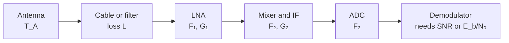
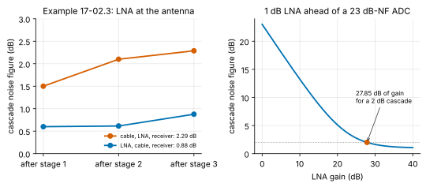
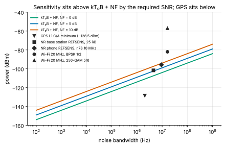

<!-- status: verified -->
# 17-02 · Noise and SNR in Communication Systems

| | |
|---|---|
| **Course** | [17 · Communication Systems](../README.md) |
| **University equivalent** | The noise chapter of a senior communications course: thermal noise and available power, noise temperature and noise figure, cascaded receivers, the AWGN channel, SNR, $E_b/N_0$ and receiver sensitivity (Proakis & Salehi, *Communication Systems Engineering*, effect of noise; Haykin & Moher, *Communication Systems*, noise in receivers; Pozar, *Microwave and RF Design of Wireless Systems*, noise in receivers) |
| **Prerequisites** | [17-01](17-01-random-processes-and-psd.md) (PSD, noise bandwidth, bandpass noise), [12-10](../../12-electronics-2/chapters/12-10-noise-in-circuits.md) (thermal noise, noise figure preview), [06-09](../../06-circuit-analysis-1-dc/chapters/06-09-maximum-power-transfer.md) (maximum power transfer) |
| **Estimated study hours** | 6 |
| **Last verified** | 2026-11-20 |

**Learning objectives.** After this chapter you can:

1. Compute the available thermal noise power $kTB$ of a source and convert between W, dBm, dBm/Hz and noise temperature.
2. Define noise factor, noise figure and equivalent noise temperature, derive $F = 1 + T_e/T_0$, and find the noise figure of a lossy passive component.
3. Derive the cascade (Friis) formula and use it to place the gain and loss in a receiver chain.
4. State the AWGN channel model and relate SNR, $E_s/N_0$, $E_b/N_0$ and $C/N_0$ through bandwidth, symbol rate and bit rate.
5. Compute a receiver's sensitivity from $kT_0$, bandwidth, noise figure, required SNR and margins, and reproduce published sensitivity figures.
6. Explain how correlation (despreading) and averaging raise SNR without changing $E_b/N_0$, and why a receiver can work with the signal below the noise.

---

## 1. Big picture

[17-01](17-01-random-processes-and-psd.md) gave the language for random signals: autocorrelation, power spectral density and noise bandwidth. This chapter applies it to the question every receiver designer, standards body and product marketer eventually asks: **how weak a signal can this system receive?** The answer is a short chain of decibel arithmetic, the **link budget**, that begins with one number from physics. A resistor at room temperature offers $kT$ watts of noise in every hertz of bandwidth, −174 dBm/Hz. Every receiver adds its own noise on top (its **noise figure**), every filter decides how many hertz of that noise get in (its **noise bandwidth**), and every modulation and code needs a certain ratio of signal to noise to work (its required **SNR** or $E_b/N_0$). Get those four numbers and you have the receiver's **sensitivity**: the 3GPP reference sensitivity of a 5G phone, the minimum input level in a Wi-Fi data sheet, and the reason a GPS receiver works with signals far below the noise all come from them.

- **Every wireless product has a sensitivity specification.** Cellular, Wi-Fi, Bluetooth and GNSS standards specify minimum input levels, and conformance testing checks them (§9).
- **LNAs and front-end modules are sold on noise figure.** A few tenths of a dB at the antenna is worth more than several dB later in the chain (§3.5).
- **Converters have noise figures too.** An RF-sampling ADC's noise density, expressed as a noise figure of 20 to 23 dB, sets how much gain must precede it (17-01 §9, Problem 17-02.13).
- **Energy efficiency is an $E_b/N_0$ problem.** For a fixed noise density, the energy a radio must transmit per bit is set by the $E_b/N_0$ its modulation and code require; this is what links noise to battery life in wearables and IoT.
- **Quantum and cryogenic electronics.** At millikelvin temperatures thermal noise vanishes and the quantum limit takes over (§3.1 "Going deeper").

## 2. Intuition first

Picture the receiver input as a pipe of width $B$ hertz. Thermal agitation in every resistive part of the universe the antenna can see pours $kT$ watts per hertz into the pipe. Widening the pipe lets in proportionally more noise. The signal does not grow with the pipe: its power is fixed by the transmitter and the path, so widening the receiver beyond the signal's bandwidth only lowers the ratio. Each amplifier after the antenna adds its own trickle, but once the first amplifier has made everything large, the later trickles matter less and less. That is the whole design philosophy of a receiver front end: **low noise first, gain early, bandwidth no wider than necessary**.

**Analogy: a fee charged per unit of bandwidth.** Think of noise as a transaction cost levied on every hertz you occupy: $kT$ per hertz, about $4 \times 10^{-21}$ W, payable whether or not you use the hertz for anything. A receiver that opens a wider window pays more fees for the same revenue (signal), so its margin (SNR) shrinks. Each stage of the chain is an intermediary that adds its own fee, but fees charged after a large gain are small relative to the amplified flow, which is why the first intermediary matters most. **Where it breaks down:** fees add linearly and predictably, but noise powers add only on average; any single measurement fluctuates (17-01, Rayleigh statistics), and the "fee" is not a cost the system pays from the signal, it is an independent random quantity that sits alongside it.

## 3. Theory

### 3.1 Thermal noise and available power

A resistor $R$ at absolute temperature $T$ has an open-circuit noise voltage with one-sided density $4kTR$ (V²/Hz), where $k = 1.380649 \times 10^{-23}$ J/K is Boltzmann's constant ([03-06](../../03-probability-statistics-and-random-variables/chapters/03-06-random-processes-preview.md), [12-10](../../12-electronics-2/chapters/12-10-noise-in-circuits.md)). Model it as a noiseless resistor in series with a noise source of mean-square voltage $\overline{v_n^2} = 4kTR\,\Delta f$ in a bandwidth $\Delta f$.

**Available power.** The **available power** of a source is the largest power it can deliver to any load, which by maximum power transfer ([06-09](../../06-circuit-analysis-1-dc/chapters/06-09-maximum-power-transfer.md)) is what it delivers to a matched load $R_L = R$. With a noiseless matched load, the voltage across it is half the source voltage, so the power delivered is

$$
P_n = \frac{\overline{v_n^2}/4}{R} = \frac{4kTR\,\Delta f}{4R} = kT\,\Delta f .
$$

The resistance cancels. **Every resistor, of any value, offers the same available noise power density $kT$ (W/Hz).** This is why noise in RF systems, which are matched to a fixed impedance, is described by a power density rather than a voltage. At the **standard reference temperature** $T_0$ = 290 K (ITU-R P.372 convention, [R-257]),

$$
kT_0 = 1.380649 \times 10^{-23} \times 290 = 4.004 \times 10^{-21}\ \text{W/Hz} = -173.98\ \text{dBm/Hz} ,
$$

almost always rounded to **−174 dBm/Hz**. In a bandwidth $B$ the available noise power is $kTB$, or in decibels $-174 + 10\log_{10}B$ dBm: −114 dBm in 1 MHz and −101.0 dBm in 20 MHz.

**Units check.** J/K × K = J = W·s = W/Hz. ✓

**One-sided and two-sided.** $kT$ is a one-sided density (all of it counted at positive frequencies). In the two-sided convention of 17-01 the available noise density is $kT/2$ at each of $\pm f$, so a white noise of available density $kT$ is written $N_0/2$ with $N_0 = kT$ (§3.6).

> **Math refresher — decibels for powers, densities and ratios.** A power ratio $x$ is $10\log_{10}x$ dB; a power relative to 1 mW is in dBm (0 dBm = 1 mW, −30 dBm = 1 µW); a density relative to 1 mW/Hz is in dBm/Hz; a ratio of a power to a density (a bandwidth-like quantity, such as $C/N_0$) is in dB-Hz. Multiplying linear quantities adds their decibels: $kTB$ in dBm is $kT$ in dBm/Hz plus $10\log_{10}(B/1\ \text{Hz})$. **Adding** two powers does not add their decibels: two equal, independent noise powers sum to twice the power, +3.01 dB above either; −100 dBm plus −110 dBm is −99.59 dBm. Convert to linear units, add, convert back.

> **Going deeper — Planck and the quantum limit.** $kT$ per hertz is the classical limit of Planck's result for the noise power a matched resistor offers: $hf/(e^{hf/kT} - 1)$ per hertz, with $h = 6.626 \times 10^{-34}$ J·s. Its ratio to $kT$ is $x/(e^x - 1)$ with $x = hf/kT$, which is 0.9995 at 6 GHz and 290 K, so the classical formula is exact for room-temperature radio. At 4 K, the temperature of the cryogenic amplifiers in quantum-computer readout chains, $x$ = 0.072 at 6 GHz and the factor is **0.964**. At 20 mK, the temperature of a dilution refrigerator's coldest stage, $x$ = 14.4 and the thermal noise falls by a factor of $8.0 \times 10^{-6}$: it is essentially gone. What remains is quantum noise. A linear amplifier that amplifies both quadratures of a signal equally must add noise at least equal to $hf/2$ per hertz referred to its input (Caves, 1982), equivalent to a noise temperature $hf/(2k)$ = **0.144** K at 6 GHz. Josephson parametric amplifiers used to read out superconducting qubits are built to approach this limit. **Deeper:** see companion repo *Quantum Computing*.

### 3.2 Noise temperature

Because available noise power is proportional to temperature, any source of white noise can be described by the temperature a resistor would need to offer the same available density. A source whose available noise density is $N$ W/Hz has **noise temperature** $T_n = N/k$. The noise temperature of a source need not be the physical temperature of anything:

- An **antenna** collects noise radiated by whatever it looks at. Its **antenna noise temperature** $T_A$ is a weighted average of the brightness temperatures of the sky and ground in its pattern: an antenna pointed at a cold, clear sky at a few gigahertz can see tens of kelvin, one pointed at the ground about 290 K, and one that sees the Sun far more.
- A noisy **amplifier** is modelled as a noiseless amplifier with an added noise source at its input. Its **equivalent noise temperature** $T_e$ is the source temperature that, applied to the input of the noiseless amplifier, would produce the extra output noise. If the amplifier has available power gain $G$ (the ratio of available output power to available source power) and the source has temperature $T_s$, the available output noise power in bandwidth $B$ is

$$
N_o = Gk(T_s + T_e)B .
$$

Noise temperatures **add** when they are referred to the same point, because independent noise powers add. The **system noise temperature** of a receiver is $T_{sys} = T_A + T_e$, referred to the antenna terminals, and the noise density there is $N_0 = kT_{sys}$.

### 3.3 Noise factor and noise figure

The **noise factor** $F$ of a two-port compares the SNR at its input with the SNR at its output, with the input noise fixed by a matched source at the reference temperature $T_0$ = 290 K. With input signal $S_i$ and input noise $N_i = kT_0B$, the output signal is $GS_i$ and the output noise is $Gk(T_0 + T_e)B$, so

$$
F = \frac{S_i/N_i}{S_o/N_o} = \frac{S_i}{kT_0B}\cdot\frac{Gk(T_0 + T_e)B}{GS_i} = 1 + \frac{T_e}{T_0}, \qquad T_e = (F - 1)T_0 .
$$

Equivalently, $F = N_o/(GkT_0B)$: the total output noise divided by the part that comes from the source. The **noise figure** is $\text{NF} = 10\log_{10}F$ dB. A noiseless two-port has $F = 1$ (0 dB). An LNA with NF = 0.6 dB has $F$ = 1.148 and $T_e$ = 43.0 K (Example 17-02.2); an amplifier with NF = 3 dB has $T_e \approx T_0$, about 289 K.

**Why the definition fixes the source temperature.** The SNR degradation an amplifier causes depends on how much noise arrives with the signal. With a source at $T_s$,

$$
\frac{S_i/N_i}{S_o/N_o} = \frac{T_s + T_e}{T_s} = 1 + \frac{T_e}{T_s} ,
$$

which equals $F$ only if $T_s = T_0$. Fixing $T_0$ makes $F$ a property of the two-port alone, comparable between laboratories. The price is that $F$ understates the damage when the source is colder than 290 K: an LNA with $T_e$ = 43 K degrades the SNR from a 100 K antenna by $10\log_{10}(1.43)$ = 1.55 dB, not 0.6 dB. Low-noise systems that look at cold sky (satellite ground stations, radio astronomy, GNSS) are therefore specified by noise temperature, and terrestrial radios by noise figure.

### 3.4 Lossy passive components

A cable, filter, switch or attenuator with power loss $L$ (available gain $G = 1/L$, $L \ge 1$) and physical temperature $T_p$ is noisy: its resistive parts generate thermal noise, and it attenuates the signal. Its noise temperature follows from thermodynamics alone. Terminate its input with a matched resistor at the same temperature $T_p$. The whole network is then in thermal equilibrium at $T_p$, and looking back into its output port you see a matched passive network at $T_p$, which offers exactly $kT_pB$ of available noise, like any matched resistor. By §3.2 the output noise is also $(1/L)k(T_p + T_e)B$. Equating,

$$
\frac{1}{L}(T_p + T_e) = T_p \quad\Longrightarrow\quad T_e = (L - 1)T_p, \qquad F = 1 + (L - 1)\frac{T_p}{T_0} .
$$

At $T_p = T_0$, **$F = L$: a lossy component at room temperature has a noise figure equal to its loss**. A 2 dB filter at the antenna is a 2 dB noise figure, before any amplifier has had a chance. Cooling helps: a 3 dB attenuator at 77 K has $T_e$ = 76.6 K and NF = 1.02 dB (Problem 17-02.3). The lab's ngspice netlist confirms $F = L$ for a matched 6 dB resistive pad by computing the output noise with and without the pad's own resistor noise.

### 3.5 Cascades: the Friis formula

Chain two stages with available gains $G_1$, $G_2$ and noise temperatures $T_{e1}$, $T_{e2}$, driven by a source at $T_s$. The first stage's output noise, $G_1k(T_s + T_{e1})B$, is amplified by $G_2$, and the second stage adds its own $kT_{e2}B$ referred to its input:

$$
N_o = G_2\big[G_1k(T_s + T_{e1})B + kT_{e2}B\big] = G_1G_2k\Big(T_s + T_{e1} + \frac{T_{e2}}{G_1}\Big)B .
$$

The cascade behaves like one stage with gain $G_1G_2$ and noise temperature $T_{e1} + T_{e2}/G_1$. Repeating the argument for more stages and dividing by $T_0$ (using $T_e = (F - 1)T_0$) gives the **Friis formula** (Friis, 1944):

$$
T_e = T_{e1} + \frac{T_{e2}}{G_1} + \frac{T_{e3}}{G_1G_2} + \cdots, \qquad F = F_1 + \frac{F_2 - 1}{G_1} + \frac{F_3 - 1}{G_1G_2} + \cdots
$$

Every stage's excess noise is divided by the total gain ahead of it. Three design rules follow:

1. **The first stage dominates.** Its full noise factor counts; later stages are suppressed by the gain before them. This is why the LNA is the first active device after the antenna.
2. **Loss before the LNA counts in full.** A lossy stage first has $F_1 = L$ and $G_1 = 1/L$, so it adds its loss in dB to the noise figure and multiplies every later stage's contribution by $L$ (Example 17-02.3).
3. **Gain must be enough, not maximal.** Once $G_1$ makes $(F_2 - 1)/G_1$ small against $F_1$, more gain buys little noise figure and costs linearity, since every later stage sees a larger signal (21-03).

The gains in the formula are **available** gains, and each $F_i$ is measured with the source impedance that stage actually sees. Mismatches between stages change both. [21-03](../../21-rf-and-microwave-engineering/chapters/21-03-noise-figure-and-linearity.md) treats noise matching, mismatched cascades and the linearity side of the trade.

*Left: Example 17-02.3, stage by stage. With the cable first, its 1.5 dB is locked in before the LNA can help; with the LNA first, the cable and the receiver are divided by its gain. Right: a 1 dB LNA ahead of an ADC with a 23 dB noise figure (Problem 17-02.13). Below about 20 dB of gain the ADC dominates; beyond about 35 dB, extra gain buys almost nothing.*

**Measuring a noise figure: the Y-factor method.** A calibrated noise source switches between a "hot" state of noise temperature $T_{hot}$ and a "cold" state at $T_0$; its **excess noise ratio** is $\text{ENR} = (T_{hot} - T_0)/T_0$. The output noise powers of the device under test are proportional to $T_{hot} + T_e$ and $T_0 + T_e$, so their ratio $Y = (T_{hot} + T_e)/(T_0 + T_e)$ gives $T_e = (T_{hot} - YT_0)/(Y - 1)$ and

$$
F = 1 + \frac{T_e}{T_0} = \frac{(Y - 1)T_0 + T_{hot} - YT_0}{T_0(Y - 1)} = \frac{\text{ENR}}{Y - 1} .
$$

A 15 dB ENR source (31.6) and a measured $Y$ of 10 dB give $F = 31.6/9 = 3.51$, an NF of **5.46** dB. No absolute power measurement is needed, only a ratio, which is why the method is the industry standard.

### 3.6 The AWGN channel

The workhorse model of communication theory is the **additive white Gaussian noise (AWGN) channel**:

$$
r(t) = s(t) + n(t) ,
$$

where $s(t)$ is the transmitted signal as it arrives at the receiver input and $n(t)$ is a zero-mean, white, Gaussian process with two-sided PSD $N_0/2$, independent of the signal. Each word is a modelling assumption with a physical justification:

- **Additive and independent.** Thermal noise is generated by the receiver's own resistive parts and the scene the antenna sees, whether or not a signal is present. Linear circuits superpose the two.
- **White.** At room temperature the thermal density is flat to within 10% up to 1 THz (Planck's factor there is 0.92, §3.1). Over any receiver's band the noise looks flat, and the receiver's own filters set its shape and bandwidth (17-01 §3.5).
- **Gaussian.** Each noise sample is the sum of a vast number of independent microscopic contributions (17-01 §3.6), so its distribution is Gaussian to high accuracy, and it stays Gaussian through linear filtering and mixing.

**What sets $N_0$.** Referred to the receiver input, $N_0 = kT_{sys} = k(T_A + T_e)$. For a terrestrial receiver whose antenna sees a 290 K environment, $N_0 = kT_0F$: the noise floor is −174 dBm/Hz plus the noise figure.

**What the model leaves out.** Interference from other transmitters (not white, not independent of other users' signals), phase noise of the local oscillator (multiplicative), quantization and nonlinear distortion (signal-dependent), and fading (a random, time-varying gain, 17-09). Each is a separate impairment, and practical budgets add an **implementation margin** for them (§3.8). The AWGN model is still the benchmark: every modulation and code is first characterized by its error rate on AWGN against $E_b/N_0$ (17-06).

### 3.7 SNR, Es/N0, Eb/N0 and C/N0

**SNR needs a bandwidth.** The signal-to-noise ratio at a point in the receiver is $\text{SNR} = S/N$ with $N = N_0B_N$, where $B_N$ is the noise bandwidth of the filtering up to that point (17-01 §3.5). For a bandpass receiver, $B_N$ is the width of the RF passband counted once, at positive frequencies; with the one-sided density $N_0$, the noise power is $N_0B_N$. The same signal in the same noise has a different SNR in a different bandwidth: quoting an SNR without its bandwidth says nothing.

**Bandwidth-free figures of merit.** Divide the signal power by the density instead:

- $C/N_0 = S/N_0$, the **carrier-to-noise-density ratio**, in Hz (dB-Hz). It depends only on the received power and the system temperature. GNSS receivers report it per satellite.
- $E_s/N_0$, the **energy per symbol** over the noise density. A symbol lasts $T_s = 1/R_s$, so $E_s = ST_s$ and $E_s/N_0 = (S/N_0)/R_s$.
- $E_b/N_0$, the **energy per bit** over the noise density. With $R_b$ bits per second, $E_b = S/R_b$, and with $M$-ary symbols $R_b = R_s\log_2M$, so $E_s/N_0 = (E_b/N_0)\log_2M$.

All are dimensionless except $C/N_0$: $E_b$ is in joules and $N_0$ in W/Hz = J. The conversions follow by substituting $S = \text{SNR}\cdot N_0B_N$:

$$
\frac{E_b}{N_0} = \frac{S}{N_0R_b} = \text{SNR}\cdot\frac{B_N}{R_b}, \qquad \left.\frac{E_b}{N_0}\right|_{\text{dB}} = \left.\frac{C}{N_0}\right|_{\text{dB-Hz}} - 10\log_{10}\frac{R_b}{1\ \text{b/s}} .
$$

With the **spectral efficiency** $\eta = R_b/B_N$ (b/s/Hz), $\text{SNR} = \eta\,E_b/N_0$. A scheme that packs 4 b/s/Hz needs four times (6.02 dB) more SNR than its $E_b/N_0$; a spread-spectrum system at 0.001 b/s/Hz works at an SNR 30 dB below its $E_b/N_0$.

**Why $E_b/N_0$ is the fair comparison.** Two systems with different data rates and bandwidths can be compared at the same SNR only by first agreeing on a bandwidth. $E_b/N_0$ asks the economically meaningful question instead: how much received energy does each bit cost, relative to the noise density nature imposes? A bit-error-rate curve plotted against $E_b/N_0$ (17-06) is a property of the modulation and code, independent of the filter, the bandwidth and the data rate. Shannon's theorem (17-07) puts a floor under it: reliable communication at any rate requires $E_b/N_0 \ge \ln 2$, **−1.59** dB.

**Matched filters and the symbol rate.** A receiver that filters with a pulse matched to the transmit pulse (17-05) has, for the Nyquist pulses of 17-04, an RF noise bandwidth equal to the symbol rate. The average signal power divided by the noise power in that bandwidth equals $E_s/N_0$, which is why the two are often used interchangeably in practice; they differ whenever the filter is not matched. The *peak sample* SNR of a matched filter on a real signal, used in 17-05, is $2E_s/N_0$: twice as large, because only the noise in one real dimension reaches the sample, half the bandpass noise.

### 3.8 Receiver sensitivity

The **sensitivity** of a receiver is the smallest input signal power at which it meets a stated performance criterion: a bit-error rate, a packet-error rate (10% for Wi-Fi) or a throughput (95% of the maximum for 3GPP). If the demodulator needs $\text{SNR}_{req}$ in noise bandwidth $B_N$, the input signal must exceed the input-referred noise $kT_0FB_N$ (for a 290 K source) by that ratio, plus an **implementation margin** IM for everything the AWGN model leaves out:

$$
P_{sens} = kT_0\cdot B_N\cdot F\cdot\text{SNR}_{req}\cdot\text{IM}, \qquad P_{sens}\,[\text{dBm}] = -174 + 10\log_{10}B_N + \text{NF} + \text{SNR}_{req} + \text{IM} .
$$

Each term is a lever. A narrower bandwidth (lower data rate) or a more robust modulation and code (lower $\text{SNR}_{req}$) buys sensitivity at the cost of throughput; a lower noise figure buys it at the cost of front-end design, power and component cost. **Receive diversity** adds another lever. With two antennas whose signals are combined coherently (maximal-ratio combining, 17-11), the signal amplitudes add, quadrupling the signal power, while the two independent noises add in power, only doubling it: a gain of 2, **3.01** dB, in an AWGN channel.

3GPP writes the same equation to set the reference sensitivity (REFSENS) of 5G NR equipment (§9, [R-260]):

$$
P_{\text{REFSENS}} = -174 + 10\log_{10}(\text{BW}) + \text{NF} + \text{SNR} + \text{IM}\ [-\ \text{diversity gain}] ,
$$

with BW the occupied transmission bandwidth, the number of resource blocks × 12 subcarriers × subcarrier spacing. Example 17-02.5 reproduces published values to 0.1 dB.

*Each line is $kT_0B$ plus a noise figure. A published sensitivity sits above the line for its receiver by the required SNR and margins: 802.11ac's most efficient mode (256-QAM 5/6) needs 25 dB more signal than its most robust one in the same bandwidth. The GPS signal sits below every line, because its receiver correlates over a millisecond before it decides anything (§3.9). Sources: §9.*

### 3.9 Signals below the noise: correlation and processing gain

A GPS signal arrives at about −128.5 dBm (§9), while the noise in its 2 MHz bandwidth is about −111 dBm: the SNR at the antenna is about −18 dB, yet receivers acquire it routinely. The explanation is that SNR in the RF bandwidth is the wrong figure; $E_b/N_0$ is what matters, and the receiver can trade bandwidth for SNR without changing it.

**Correlation gain, derived.** Suppose a known waveform of $N$ samples (chips) of amplitude $\pm a$, $c_n$, is received in independent noise samples $w_n$ of variance $\sigma^2$: $r_n = c_n + w_n$. The per-sample SNR is $a^2/\sigma^2$. The receiver correlates with the known code: $y = \sum_n c_nr_n = \sum_n c_n^2 + \sum_n c_nw_n$. The first term adds **coherently** to $Na^2$, so its power is $N^2a^4$. The second is a sum of $N$ independent terms, each of variance $a^2\sigma^2$, so its variance adds **incoherently** to $Na^2\sigma^2$. The output SNR is

$$
\text{SNR}_{out} = \frac{N^2a^4}{Na^2\sigma^2} = N\,\frac{a^2}{\sigma^2} = N\cdot\text{SNR}_{in} .
$$

In continuous time, integrating for $T_{int}$ seconds a signal of power $C$ in noise of density $N_0$ gives an output whose signal-energy-to-noise-density ratio is $CT_{int}/N_0$: the SNR measured in a bandwidth $1/T_{int}$. The **processing gain** is the ratio of the bandwidths, $B_{RF}T_{int}$; for the GPS C/A code (chip rate 1.023 MHz) integrated for 1 ms it is about 30 dB (33.1 dB against the 2.046 MHz null-to-null bandwidth). Despreading moves the operating point to a narrower bandwidth; it does not create energy. $E_b/N_0$, energy per bit over noise density, is the same before and after: the trade is entirely between bandwidth and SNR.

The same arithmetic explains averaging. Averaging $N$ independent noisy measurements of a constant raises the SNR by $N$ (03-05); the noise bandwidth of a moving average of length $T$ is $1/(2T)$ in one-sided terms (03-06). Narrowing the bandwidth is always how a receiver extracts a weak signal; it pays in time, rate or latency.

## 4. Worked examples

### Example 17-02.1 · Thermal noise in numbers (tier A)

**Setup.** (a) Find the open-circuit rms noise voltage of a 50 Ω resistor at 290 K in a 1 MHz bandwidth, and (b) its available noise power in dBm. (c) Repeat (a) for 1 kΩ. (d) Find the available power if the 50 Ω resistor is cooled to 77 K, and (e) the improvement in dB. (f) What fraction of the classical $kT$ does Planck's formula give at 6 GHz and 4 K?

**Solution.** (a) $v_{rms} = \sqrt{4kTRB} = \sqrt{4 \times 1.380649 \times 10^{-23} \times 290 \times 50 \times 10^6} = \sqrt{8.008 \times 10^{-13}}$ = **0.895** µV.

(b) $kTB = 4.004 \times 10^{-21} \times 10^6 = 4.004 \times 10^{-15}$ W. In dBm, $10\log_{10}(4.004 \times 10^{-15}/10^{-3})$ = **−113.98** dBm.

(c) $v_{rms}$ grows as $\sqrt R$: $0.895 \times \sqrt{20}$ = **4.00** µV. The available power is the same −113.98 dBm: a larger voltage behind a larger resistance.

(d) $k \times 77 \times 10^6 = 1.063 \times 10^{-15}$ W = **−119.73** dBm. (e) The improvement is $10\log_{10}(290/77)$ = **5.76** dB.

(f) $x = hf/kT = 6.626 \times 10^{-34} \times 6 \times 10^9/(1.380649 \times 10^{-23} \times 4)$ = 0.0720, and $x/(e^x - 1)$ = **0.964**: the classical formula overstates the noise by 0.16 dB.

**Units check.** $\sqrt{\text{J/K} \cdot \text{K} \cdot \Omega \cdot \text{Hz}} = \sqrt{\text{W}\cdot\Omega} = \text{V}$. ✓

**Sanity check.** −174 dBm/Hz + 60 dB (1 MHz) = −114 dBm, matching (b). The ngspice netlist in the lab integrates the noise of a 50 Ω resistor into a matched noiseless load over 1 MHz and gets the same −113.98 dBm.

### Example 17-02.2 · Noise figure and noise temperature of an LNA (tier A)

**Setup.** An LNA has NF = 0.6 dB and gain 20.2 dB (values typical of a 2 GHz cellular LNA, §9). (a) Find its noise temperature. (b) Fed from a matched 290 K source, what is its available output noise power in a 20 MHz bandwidth? (c) It is instead fed from an antenna with $T_A$ = 100 K. By how much does it degrade the SNR, and (d) what noise figure would a naive calculation have predicted?

**Solution.** (a) $F = 10^{0.06}$ = 1.148, $T_e = (F - 1)T_0 = 0.1481 \times 290$ = **43.0** K.

(b) $N_o = GFkT_0B$. In decibels: $-173.975 + 10\log_{10}(2 \times 10^7) + 0.6 + 20.2 = -173.975 + 73.010 + 20.8$ = **−80.16** dBm (−80.165 before rounding).

(c) The degradation is $(T_A + T_e)/T_A = 143.0/100 = 1.430$, which is **1.55** dB.

(d) The naive figure is the NF itself, **0.6** dB. It applies only to a 290 K source; a cold source makes the amplifier's own noise relatively larger.

**Units check.** Temperatures in K add; a ratio of temperatures is a ratio of noise powers.

**Sanity check.** At $T_A = T_0$ = 290 K, the degradation $1 + 43.0/290$ = 1.148 recovers $F$, 0.6 dB.

### Example 17-02.3 · Where the LNA goes (tier B)

**Setup.** A receiver has an antenna at the top of a mast, a cable with 1.5 dB loss at 290 K, the LNA of Example 17-02.2 (NF 0.6 dB, gain 20.2 dB) and a downconverter with NF 8 dB. Compare the system noise figure with (A) the LNA at the bottom, after the cable, and (B) the LNA at the antenna, before the cable. Give the noise temperatures too.

**Solution.** In linear units, $L = 10^{0.15}$ = 1.413, $F_{LNA}$ = 1.148, $G_{LNA}$ = 104.7, $F_{rx} = 10^{0.8}$ = 6.310.

(A) Cable, LNA, receiver. The cable is a stage with $F = L$ and $G = 1/L$:

$$
F_A = L + (F_{LNA} - 1)L + \frac{(F_{rx} - 1)L}{G_{LNA}} = 1.4125 + 0.2093 + 0.0716 = 1.6934 ,
$$

which is **2.29** dB, $T_e$ = $(1.6934 - 1) \times 290$ = **201.1** K.

(B) LNA, cable, receiver. Now the cable's excess noise and the receiver's are both divided by the LNA's gain:

$$
F_B = F_{LNA} + \frac{L - 1}{G_{LNA}} + \frac{(F_{rx} - 1)L}{G_{LNA}} = 1.1482 + 0.0039 + 0.0716 = 1.2237 ,
$$

which is **0.88** dB, $T_e$ = **64.9** K.

Moving the LNA to the antenna improves the noise figure by **1.41** dB, almost the whole cable loss. In configuration A, the cable's loss adds directly to the LNA's noise figure in dB (1.5 + 0.6 = 2.1 dB, plus the receiver's contribution); in B, the LNA's gain makes the cable nearly irrelevant.

**Units check.** Each term of the Friis sum is a dimensionless noise factor.

**Sanity check.** In both cases the downconverter's term, $(F_{rx} - 1)L/G_{LNA}$ = 0.072, is the same: it sits behind both the cable and the LNA either way. Mast-head amplifiers on cellular towers exist for exactly reason B.

### Example 17-02.4 · Comparing links by energy per bit (tier B)

**Setup.** Link 1 carries 10 Mb/s and measures an SNR of 9 dB in its receiver's 12.5 MHz noise bandwidth. Link 2 carries 40 Mb/s and measures 20 dB in a 10 MHz noise bandwidth. Which link spends more received energy per bit relative to the noise density, and what are their spectral efficiencies?

**Solution.** $E_b/N_0 = \text{SNR}\cdot B_N/R_b$. Link 1: $9 + 10\log_{10}(12.5/10)$ = $9 + 0.97$ = **9.97** dB. Link 2: $20 + 10\log_{10}(10/40)$ = $20 - 6.02$ = **13.98** dB. Spectral efficiencies: $\eta_1 = 10/12.5$ = **0.8** b/s/Hz and $\eta_2 = 40/10$ = **4** b/s/Hz.

Link 2 has 11 dB more SNR but needs only 4 dB more energy per bit: most of its extra SNR goes to packing five times as many bits into each hertz. The two links make different trades on the bandwidth-efficiency against power-efficiency curve that Shannon's theorem bounds (17-07).

**Units check.** $B_N/R_b$ is Hz/(b/s), a pure number per bit, so $E_b/N_0$ = SNR × $B_N/R_b$ is a pure ratio.

**Sanity check.** Going from link 1 to link 2, the SNR rises by 11 dB, the rate by 6.02 dB and the noise bandwidth falls by 0.97 dB: $11 - 6.02 - 0.97 = 4.01$ dB, the difference between 13.98 and 9.97 dB.

### Example 17-02.5 · Reproducing published sensitivities (tier B)

**Setup.** (a) A 5G NR phone in band n78 receives a 10 MHz carrier with 15 kHz subcarriers, of which 52 resource blocks (12 subcarriers each) are occupied. 3GPP's assumptions for this band are NF = 10 dB, SNR = −1 dB, IM = 2.5 dB and a 3 dB two-antenna diversity gain. Compute the reference sensitivity. (b) A wide-area base station's REFSENS for a 25-resource-block, 15 kHz test channel is −101.7 dBm, with NF = 5 dB and IM = 2 dB assumed. What SNR does that imply? (c) A Wi-Fi receiver's minimum sensitivity at the most robust 20 MHz rate is −82 dBm. The signal occupies 56 subcarriers (52 data and 4 pilots, the 802.11n/ac format) spaced 312.5 kHz. What is the noise floor in the occupied bandwidth, and how many dB are left for noise figure, required SNR and margin together?

**Solution.** (a) $\text{BW} = 52 \times 12 \times 15$ kHz = 9.36 MHz, $10\log_{10}(9.36 \times 10^6)$ = 69.71 dB. $P = -174 + 69.71 + 10 - 1 + 2.5 - 3$ = **−95.79** dBm. The published value is −95.8 dBm (TS 38.101-1, two receive ports, [R-260]).

(b) $\text{BW} = 25 \times 12 \times 15$ kHz = 4.5 MHz (66.53 dB). $\text{SNR} = -101.7 - (-174 + 66.53 + 5 + 2)$ = **−1.23** dB, consistent with the −1 dB used for the UE.

(c) $\text{BW} = 56 \times 312.5$ kHz = 17.5 MHz (72.43 dB), so the floor is $-174 + 72.43$ = **−101.57** dBm. The budget for NF + SNR + IM is $-82 - (-101.57)$ = **19.57** dB, generous by modern standards: with a 6 dB system noise figure, about 13.6 dB is left for the demodulator and the margin.

**Units check.** dBm + dB = dBm throughout.

**Sanity check.** The NR SNR of about −1 dB is below 0 dB because the base station's reference channel uses QPSK with a rate-1/3 code (TS 38.104 Table A.1-1): each information bit is spread over three coded bits, so $E_b/N_0 = \text{SNR}/\eta \approx$ +0.5 dB ($\eta \approx 2/3$ b/s/Hz before overheads) even though the SNR is negative (§3.7), within about 1 dB of the Shannon bound at that efficiency. The Wi-Fi budget is loose by comparison: even a receiver with a 10 dB noise figure and a 5 dB margin would keep **4.57** dB for its demodulator.

### Example 17-02.6 · A GPS receiver works below the noise (tier C)

**Setup.** The GPS L1 C/A signal arrives at the specified minimum of −128.5 dBm. The antenna sees an effective noise temperature $T_A$ = 100 K (an assumed value; it depends on the antenna pattern and surroundings), and the receiver's front-end module has NF = 1.4 dB. Find (a) the module's noise temperature, (b) the system noise temperature, (c) $N_0$ in dBm/Hz, (d) $C/N_0$, (e) the SNR in the 2.046 MHz null-to-null bandwidth of the C/A code, (f) the post-correlation $CT/N_0$ for 1 ms of coherent integration, and (g) $E_b/N_0$ for the 50 b/s navigation data. (h) Repeat (d) for an antenna that sees 290 K, and (i) say what the cold sky is worth.

**Solution.** (a) $T_e = (10^{0.14} - 1) \times 290$ = **110.3** K. (b) $T_{sys} = 100 + 110.3$ = **210.3** K. (c) $N_0 = kT_{sys} = 2.904 \times 10^{-21}$ W/Hz = **−175.37** dBm/Hz.

(d) $C/N_0 = -128.5 - (-175.37)$ = **46.87** dB-Hz.

(e) $\text{SNR} = 46.87 - 10\log_{10}(2.046 \times 10^6) = 46.87 - 63.11$ = **−16.24** dB. The signal is more than 40 times weaker than the noise in its own band.

(f) $CT/N_0 = 46.87 + 10\log_{10}(10^{-3})$ = **16.87** dB. Correlating with the known code over one 1 ms code period lifts the signal well above the noise (§3.9).

(g) $E_b/N_0 = 46.87 - 10\log_{10}50$ = **29.88** dB, ample for the data.

(h) With $T_A$ = 290 K, $N_0 = kT_0F$ and $C/N_0 = -128.5 + 173.98 - 1.4$ = **44.08** dB-Hz. (i) The cold sky is worth **2.80** dB.

**Units check.** dBm − dBm/Hz = dB-Hz; dB-Hz + dB(s) = dB.

**Sanity check.** The processing gain from (e) to (f) is $10\log_{10}(2.046 \times 10^6 \times 10^{-3})$ = 33.1 dB, the ratio of the RF bandwidth to the post-correlation bandwidth. Nothing was gained in $E_b/N_0$; the receiver only stopped looking at noise in bandwidth the signal does not need after correlation.

<!-- answer-key -->

| ID | Quantity | Value | Unit |
|---|---|---|---|
| Txt 17-02.a | kT0 | −173.98 | dBm/Hz |
| Txt 17-02.b | kT0 in 20 MHz | −101.0 | dBm |
| Txt 17-02.c | two equal noise powers, increase | 3.01 | dB |
| Txt 17-02.d | −100 dBm plus −110 dBm | −99.59 | dBm |
| Txt 17-02.e | Planck factor at 6 GHz, 290 K | 0.9995 | — |
| Txt 17-02.f | thermal noise reduction at 20 mK, 6 GHz | 8.0e-6 | — |
| Txt 17-02.g | quantum-limit noise temperature at 6 GHz | 0.144 | K |
| Txt 17-02.h | noise temperature of a 3 dB NF | 289 | K |
| Txt 17-02.i | Shannon limit on Eb/N0 | −1.59 | dB |
| Txt 17-02.j | two-antenna MRC gain | 3.01 | dB |
| Txt 17-02.k | C/A processing gain, 2.046 MHz to 1 kHz | 33.1 | dB |
| Txt 17-02.l | SNR penalty of 4 b/s/Hz | 6.02 | dB |
| Txt 17-02.m | Planck factor at 1 THz, 290 K | 0.92 | — |
| Txt 17-02.n | GPS noise in 2.046 MHz, 290 K | −111 | dBm |
| Txt 17-02.o | GPS SNR at the antenna, 290 K | −18 | dB |
| Txt 17-02.p | two −100 dBm noises | −96.99 | dBm |
| Txt 17-02.q | SNR difference, 20 MHz against 1 kHz | 43 | dB |
| Txt 17-02.r | one-pole noise-to-3 dB bandwidth | 1.96 | dB |
| Txt 17-02.s | Te of a 3 dB pad at 77 K | 76.6 | K |
| Txt 17-02.t | NF of a 3 dB pad at 77 K | 1.02 | dB |
| Txt 17-02.u | Wi-Fi 20 MHz sensitivity spread, 256-QAM 5/6 to BPSK 1/2 | 25 | dB |
| Ex 17-02.1a | rms noise, 50 Ω, 1 MHz | 0.895 | µV |
| Ex 17-02.1b | available noise power, 1 MHz | −113.98 | dBm |
| Ex 17-02.1c | rms noise, 1 kΩ, 1 MHz | 4.00 | µV |
| Ex 17-02.1d | available noise power at 77 K | −119.73 | dBm |
| Ex 17-02.1e | improvement from cooling | 5.76 | dB |
| Ex 17-02.1f | Planck factor at 6 GHz, 4 K | 0.964 | — |
| Ex 17-02.2a | LNA noise temperature | 43.0 | K |
| Ex 17-02.2b | output noise in 20 MHz | −80.16 | dBm |
| Ex 17-02.2c | SNR degradation from a 100 K antenna | 1.55 | dB |
| Ex 17-02.3a | NF, cable first | 2.29 | dB |
| Ex 17-02.3b | Te, cable first | 201.1 | K |
| Ex 17-02.3c | NF, LNA first | 0.88 | dB |
| Ex 17-02.3d | Te, LNA first | 64.9 | K |
| Ex 17-02.3e | improvement | 1.41 | dB |
| Ex 17-02.4a | Eb/N0, link 1 | 9.97 | dB |
| Ex 17-02.4b | Eb/N0, link 2 | 13.98 | dB |
| Ex 17-02.4c | spectral efficiency, link 1 | 0.8 | b/s/Hz |
| Ex 17-02.4d | spectral efficiency, link 2 | 4 | b/s/Hz |
| Ex 17-02.5a | NR UE REFSENS, n78, 10 MHz | −95.79 | dBm |
| Ex 17-02.5b | implied BS SNR | −1.23 | dB |
| Txt 17-02.yf | Y-factor example noise figure | 5.46 | dB |
| Ex 17-02.5c | Wi-Fi noise floor, 17.5 MHz | −101.57 | dBm |
| Ex 17-02.5d | Wi-Fi budget for NF + SNR + IM | 19.57 | dB |
| Ex 17-02.5e | Wi-Fi demodulator allowance at 10 dB NF, 5 dB IM | 4.57 | dB |
| Ex 17-02.6a | front-end noise temperature | 110.3 | K |
| Ex 17-02.6b | system noise temperature | 210.3 | K |
| Ex 17-02.6c | N0 | −175.37 | dBm/Hz |
| Ex 17-02.6d | C/N0 | 46.87 | dB-Hz |
| Ex 17-02.6e | SNR in 2.046 MHz | −16.24 | dB |
| Ex 17-02.6f | CT/N0, 1 ms | 16.87 | dB |
| Ex 17-02.6g | Eb/N0, 50 b/s | 29.88 | dB |
| Ex 17-02.6h | C/N0 with a 290 K antenna | 44.08 | dB-Hz |
| Ex 17-02.6i | value of the cold sky | 2.80 | dB |

*Every value is recomputed by [verify_17_02.py](../verify/verify_17_02.py): the thermal-noise values from the constants, Planck's factor and its limits, the Friis cascades both from the formula and by a stage-by-stage noise-temperature recursion, the 3GPP and Wi-Fi budgets, and the correlation gain by Monte Carlo simulation of a ±1 code in Gaussian noise. ngspice confirms Example 17-02.1(b) and the noise figure of a matched pad.*

## 5. Simulate it

The lab, [labs/17-02-lab](../labs/17-02-lab/README.md), provides `noisebudget.py`: decibel conversions, $kTB$, noise figure and temperature conversions, a Friis cascade that reports each stage's contribution, the lossy-line formula, a sensitivity calculator, and a calibrated AWGN generator that sets the noise variance per sample from $E_b/N_0$, the samples per symbol and real or complex signalling. An ngspice netlist, `pad_noise.cir`, measures a resistive pad's noise figure. In the notebook, **predict, then run**:

1. **Noise in a bandwidth.** Predict the power of white noise of density $kT_0$ after ideal filters of 1, 10 and 100 kHz, then filter simulated noise and measure it.
2. **A cascade, simulated.** Predict the noise figure of Example 17-02.3's two orderings, then pass a signal through a time-domain model in which each stage adds independent noise at its noise temperature, and measure the SNR ratio.
3. **$E_b/N_0$ does not care about sample rate.** Predict the BPSK bit-error rate at $E_b/N_0$ = 6 dB, then simulate it at 1, 4 and 16 samples per bit with the calibrated generator. Then make the classic mistake (setting the per-sample SNR to $E_b/N_0$) and predict how far off the result will be.
4. **Below the noise.** Spread a slow bit stream with a ±1 code of 1023 chips at a per-chip SNR of −20 dB. Predict the SNR after correlation, then measure it.
5. **Noise bandwidth.** Measure the SNR after a one-pole filter and compare the prediction made with its 3 dB bandwidth and with its noise bandwidth.

## 6. Engineering tradeoffs

| Knob | Improves | Costs | Typical decision owner |
|---|---|---|---|
| Lower LNA noise figure | Sensitivity, range, battery life of the far end | LNA current, die area, input-match design effort, often linearity | RF front-end designer |
| More LNA gain | Suppresses later stages' noise (Friis) | Linearity and blocking of later stages, stability, power | RF system architect |
| Filter before the LNA | Rejects blockers and out-of-band interference | Its loss adds directly to the noise figure | RF system architect with the front-end-module supplier |
| Narrower receiver bandwidth | Less noise power, better SNR | Data rate; tighter frequency accuracy | System and standards engineers |
| More robust modulation and coding | Lower required SNR and $E_b/N_0$ | Spectral efficiency, throughput, decoder complexity | PHY and standards architects |
| Receive diversity (more antennas) | +3 dB per doubling in AWGN, much more in fading | Antennas, RF chains, power, cost | Product architect |
| Cooling the front end | Lower $T_e$ and loss noise | Cryogenics, size, cost (radio astronomy, quantum computing only) | System architect |
| Implementation margin | Robustness to impairments, cheaper parts | Specified sensitivity is worse than the physics allows | Standards body, product marketing |

## 7. Numbers to know

| Quantity | Value | Note |
|---|---|---|
| $kT_0$, $T_0$ = 290 K | −173.98 dBm/Hz ≈ −174 dBm/Hz | $4.004 \times 10^{-21}$ W/Hz [R-257] |
| Noise in 1 MHz / 20 MHz | −114 / −101 dBm | add NF for a receiver's floor |
| Noise temperature for NF 0.5 / 1 / 3 dB | 35 / 75 / 289 K | $T_e = (F - 1)290$ |
| Room-temperature loss | NF = loss | 1 dB of cable = 1 dB of NF |
| GPS L1 C/A minimum received power | −128.5 dBm (−158.5 dBW) | IS-GPS-200N, 3 dBi antenna [R-259] |
| GPS $C/N_0$ at minimum power | 46.9 dB-Hz | 100 K antenna, NF 1.4 dB (Example 17-02.6) |
| 3GPP NR UE REFSENS, n78, 10 MHz, 2 Rx | −95.8 dBm | NF 10 dB assumed [R-260] |
| Wi-Fi minimum sensitivity, 20 MHz | −82 dBm (BPSK 1/2) to −57 dBm (256-QAM 5/6) | 802.11ac table, as of Nov 2026 [R-261] |
| Cellular or GNSS LNA noise figure | 0.5–1.5 dB typical | data sheets, as of Nov 2026 [R-262] |
| Shannon limit | $E_b/N_0$ = −1.59 dB | 17-07 |

## 8. Common mistakes

- **Adding decibels of noise powers.** Noise powers add in watts. Two −100 dBm noises make −96.99 dBm, not −200 dBm and not −100 dBm.
- **Mixing single- and double-sideband noise figures.** A mixer without image rejection also converts the noise in its image band to the IF. A double-sideband (DSB) noise figure, often quoted in data sheets and measured with a broadband noise source that fills both sidebands, credits that image band with signal; a receiver whose signal sits in one sideband sees about 3 dB more: its single-sideband (SSB) noise figure is about DSB + 3 dB.
- **Using NF where the source is not at 290 K.** For a cold antenna the SNR degradation is $1 + T_e/T_A$, larger than $F$ (Example 17-02.2).
- **Forgetting loss before the LNA.** Every dB of filter, switch or cable loss in front of the first amplifier is a dB of noise figure.
- **Using the 3 dB bandwidth for noise.** Noise power integrates the PSD over the noise bandwidth; for a one-pole filter it is π/2 times the 3 dB bandwidth (1.96 dB).
- **Quoting SNR without a bandwidth.** SNR in 20 MHz and SNR in 1 kHz differ by 43 dB for the same signal.
- **Confusing $E_b/N_0$, $E_s/N_0$ and SNR.** They differ by $\log_2M$ and by $B_N/R_s$; a BER curve is meaningless unless its axis is stated.
- **Mixing one- and two-sided densities.** $N_0 = kT$ is one-sided; the two-sided PSD is $N_0/2$ (17-01).
- **Scaling simulated noise to the per-sample SNR.** In a simulation with $L$ samples per symbol, the per-sample noise variance must be set from $E_b/N_0$, the samples per symbol and whether the signal is real or complex; setting the per-sample SNR equal to $E_b/N_0$ makes the noise wrong by a factor of $L$ or $L/2$ (lab Part 3, Problem 17-02.10).
- **Using gain where available gain is meant.** The Friis formula uses available gains; with mismatched stages the delivered (transducer) gain is different (21-03).

## 9. Practitioner lens

### State of the art (as of Nov 2026)

- **Cellular reference sensitivity is a noise-figure budget written into the standard.** 3GPP's NR studies give the formula of §3.8 explicitly: for base stations, "NF is BS noise figure, equal to 5 dB for Wide Area BS, 10 dB for Medium Range BS and 13 dB for Local Area BS" and IM is 2 dB; for UEs, $-174 + 10\log_{10}(\text{RX BW}) + \text{NF} + \text{SNR} + \text{IM} - \text{diversity gain}$, with SNR −1 dB, IM 2.5 dB and 3 dB diversity gain for two receive ports, and NF 10.5, 10 and 10 dB for bands n77–n79 (TR 38.817-01 and -02, [R-260]) **[Established]**. The published requirements follow: −95.8 dBm for a 10 MHz n78 carrier at 15 kHz spacing with two receive ports (TS 38.101-1 V20.1.0) and −101.7 dBm for a wide-area base station's 25-RB test channel (TS 38.104 V20.1.0). Note that n78's baseline is four receive ports, which adjusts the two-port value by a separate table.
- **Wi-Fi minimum sensitivity.** The 802.11ac table, as reproduced in Rohde & Schwarz's application note 1MA192, runs from −82 dBm (BPSK, rate 1/2) to −57 dBm (256-QAM, rate 5/6) at 20 MHz, 3 dB higher for each doubling of bandwidth, at 10% packet-error rate (R&S 1MA192, [R-261]) **[Established]**. The 25 dB spread is the difference in required SNR between 802.11ac's most robust and most efficient modes; the noise floor is the same. (802.11ax's 1024-QAM 5/6, at −52 dBm, widens it to 30 dB, [R-261].)
- **GNSS signals are specified below the noise.** IS-GPS-200N (Aug 2022, amended by later interface revision notices that do not change the power tables) specifies a minimum received L1 C/A power of −158.5 dBW (−128.5 dBm), "measured at the output of a 3 dBi linearly polarized user receiving antenna (located near ground) at worst normal orientation, when the SV is above a 5-degree elevation angle" (Table 3-Va, [R-259]) **[Established]**.
- **LNAs.** A current cellular LNA (Infineon BGA9H1MN9, Rev. 2.0, 2021) lists 20.2 dB gain and 0.6 dB typical NF (1.2 dB maximum) at 2.1 GHz in its highest-gain state, with an input third-order intercept of −6 dBm; in its lowest-gain state it has −2.7 dB gain, 2.7 dB NF and +23 dBm IIP3 ([R-262]) **[Established]**. The low-gain state behaves like a passive path: its NF equals its loss, as §3.4 predicts. A GNSS LNA (Infineon BGA524N6, now marked "not for new design") lists 19.6 dB and 0.55 dB typical (1.0 dB maximum), and a GNSS front-end module that includes a post-filter (Skyworks SKY55951-11, data sheet dated Mar 2026) lists 17 dB and 1.4 dB typical (2.2 dB maximum) at 1575 MHz ([R-262]) **[Established]**.
- **Converters.** An RF-sampling ADC's noise spectral density of −152 dBFS/Hz corresponds to a noise figure of about 23 dB (17-01 §9, [R-237]); about 28 dB of gain from a 1 dB-NF LNA ahead of it holds the cascade to 2 dB (Problem 17-02.13).

### Why it matters commercially

Sensitivity sells: every dB of link budget is range, coverage, battery life or data rate. In cellular infrastructure, a better base-station noise figure means fewer sites for the same coverage; in a phone, it means fewer dropped calls at the cell edge; in an IoT device, it means lower transmit power or longer battery life at the other end of the link. Front-end modules, LNAs, filters and antenna switches are a substantial semiconductor business **[Industry estimate]** precisely because their tenths of a dB compound across billions of units. For due diligence, the noise budget is where a startup's "10 dB better sensitivity" claim can be tested in an afternoon: the physics allows only so much.

### Marketing vs Reality

- **"0.55 dB noise figure."** Typical, at 25 °C, at the device pins, in the highest-gain state. The maximum is often twice the typical (1.0 dB for BGA524N6), any matching network or filter in front adds its loss, and lower-gain states can be much noisier. A module figure (1.4 dB for SKY55951-11) that includes the filter is the more honest comparison for a system.
- **"Sensitivity of −100 dBm."** Meaningless without the data rate (bandwidth), the modulation and coding, the error criterion (PER, BER or throughput) and the temperature. A narrowband, low-rate mode can always quote a better number: compare $C/N_0$ or $E_b/N_0$ requirements instead.
- **"Our receiver works at −20 dB SNR."** So does every GPS receiver: SNR measured before despreading or averaging. Ask what bandwidth the SNR is quoted in and what $E_b/N_0$ the receiver needs.
- **"Our LNA has 0.6 dB NF, so the system NF is under 1 dB."** 3GPP's own UE assumptions use about 10 dB (§9 first bullet). Switches, duplexers and filters between antenna and LNA, mismatch and the later stages all count. Ask for the system noise figure at the antenna connector.

### Questions for engineering leaders

1. **"What is your system noise figure at the antenna connector, over temperature and across bands?"** *Strong:* gives a measured cascade with each element's contribution (filter loss, switch loss, LNA, mixer, ADC), worst case over temperature and process. *Evasive:* quotes the LNA's typical NF.
2. **"Your sensitivity is X dBm: at what data rate, error criterion and implementation margin?"** *Strong:* gives the bandwidth, required SNR or $E_b/N_0$ and the margin, so the number can be reproduced from −174 dBm/Hz. *Evasive:* "industry-leading sensitivity".
3. **"How much gain sits ahead of the ADC, and what does it cost in linearity?"** *Strong:* shows the Friis contribution of the ADC against the blocker levels the front end must survive, and how gain steps trade them (§9 LNA bullet). *Evasive:* "the ADC's noise is negligible".
4. **"What part of your link budget comes from processing gain, and does it hold for the user's actual data rate?"** *Strong:* separates $C/N_0$, the integration time and the resulting $E_b/N_0$. *Evasive:* quotes an SNR improvement without a bandwidth.
5. **"What antenna temperature did you assume?"** *Strong (satellite, GNSS, radio astronomy):* states $T_A$ and how it was measured or modelled. *Evasive:* uses NF with a 290 K source for a sky-pointing system.

## 10. Concept check

**Q1.** Why do a 50 Ω and a 1 kΩ resistor at the same temperature offer the same noise power, although their noise voltages differ?

Answer

Available power is the power delivered to a matched load: $\overline{v_n^2}/(4R) = 4kTR\Delta f/(4R) = kT\Delta f$. The larger resistor has a larger noise voltage but also a larger source resistance, and the two cancel.

**Q2.** An amplifier has a noise temperature of 75 K. What is its noise figure, and by how much does it degrade the SNR of a signal from a 290 K source and from a 30 K source?

Answer

$F = 1 + 75/290 = 1.259$, NF = 1.0 dB, which is also the degradation from a 290 K source. From a 30 K source the degradation is $1 + 75/30 = 3.5$, or 5.4 dB.

**Q3.** A 3 dB attenuator at room temperature sits in front of a 1 dB-NF amplifier with 20 dB gain. What is the noise figure of the pair?

Answer

$F = L + (F_2 - 1)L = 2 + 0.259 \times 2 = 2.52$, or 4.0 dB: the attenuator's 3 dB adds directly to the amplifier's 1 dB.

**Q4.** A link has $C/N_0$ = 70 dB-Hz. What $E_b/N_0$ does it offer at 1 Mb/s and at 100 Mb/s?

Answer

$70 - 60 = 10$ dB at 1 Mb/s and $70 - 80 = -10$ dB at 100 Mb/s, which is below the Shannon limit of −1.59 dB: no code can carry 100 Mb/s reliably on this link.

**Q5.** Why is the reference sensitivity of a 100 MHz NR carrier about 10 dB worse than that of a 10 MHz carrier, if the receiver and modulation are the same?

Answer

The noise power in the occupied bandwidth is ten times (10 dB) larger, and the required SNR is the same, so the required signal power is ten times larger. Per hertz, nothing changed.

**Q6.** A spread-spectrum receiver correlates over 1000 chips. By how much does the SNR improve, and by how much does $E_b/N_0$?

Answer

SNR improves by 1000 (30 dB): the bandwidth shrinks by 1000. $E_b/N_0$ does not change: correlation does not add energy, it only stops counting noise outside the narrower bandwidth.

**Q7.** What three impairments does the AWGN model leave out, and how does a sensitivity budget account for them?

Answer

Any three of: interference, phase noise, quantization and nonlinear distortion, fading, timing and frequency errors. A sensitivity budget lumps them into an implementation margin (2–2.5 dB in 3GPP's assumptions); fading is handled separately with fade margins and diversity.

Practice: [17-02 problems](../problems/17-02-problems.md) · [worked solutions](../solutions/17-02-solutions.md).

## 11. Key terms

[Thermal noise](../../../reference/glossary.md#thermal-noise) · [Available noise power](../../../reference/glossary.md#available-noise-power) · [Noise temperature](../../../reference/glossary.md#noise-temperature) · [Antenna noise temperature](../../../reference/glossary.md#antenna-noise-temperature) · [System noise temperature](../../../reference/glossary.md#system-noise-temperature) · [Noise figure](../../../reference/glossary.md#noise-figure) · [Friis noise formula](../../../reference/glossary.md#friis-noise-formula) · [AWGN channel](../../../reference/glossary.md#awgn-channel) · [Signal-to-noise ratio](../../../reference/glossary.md#signal-to-noise-ratio) · [Eb/N0](../../../reference/glossary.md#eb-n0) · [Es/N0](../../../reference/glossary.md#es-n0) · [Carrier-to-noise-density ratio](../../../reference/glossary.md#carrier-to-noise-density-ratio) · [Receiver sensitivity](../../../reference/glossary.md#receiver-sensitivity) · [Implementation margin](../../../reference/glossary.md#implementation-margin) · [Reference sensitivity (REFSENS)](../../../reference/glossary.md#reference-sensitivity-refsens) · [Processing gain](../../../reference/glossary.md#processing-gain) · [Equivalent noise bandwidth (ENBW)](../../../reference/glossary.md#equivalent-noise-bandwidth-enbw) · [dBm](../../../reference/glossary.md#dbm)

## 12. Connections

- **Builds on:** [17-01](17-01-random-processes-and-psd.md) (PSD, noise bandwidth, bandpass noise), [12-10](../../12-electronics-2/chapters/12-10-noise-in-circuits.md) (thermal noise in circuits, noise figure preview), [03-06](../../03-probability-statistics-and-random-variables/chapters/03-06-random-processes-preview.md) (physical noise sources, averaging), [06-09](../../06-circuit-analysis-1-dc/chapters/06-09-maximum-power-transfer.md) (available power).
- **Next:** [17-03](17-03-analog-modulation.md) computes the output SNR of AM and FM receivers with these tools.
- **Used later:** matched filters ([17-05](17-05-matched-filters-and-detection.md)), BER against $E_b/N_0$ ([17-06](17-06-bandpass-digital-modulation.md)), the Shannon limit ([17-07](17-07-information-theory-and-shannon.md)), coding gain ([17-08](17-08-channel-coding.md)), fading margins ([17-09](17-09-wireless-channels.md)), diversity ([17-11](17-11-mimo-and-beamforming.md)), and the RF course's noise figure, linearity and link budgets ([21-03](../../21-rf-and-microwave-engineering/chapters/21-03-noise-figure-and-linearity.md), [21-11](../../21-rf-and-microwave-engineering/chapters/21-11-link-budgets.md)).

## 13. Further study

- Pozar, *Microwave and RF Design of Wireless Systems*, the chapter on noise in microwave circuits and receivers, for noise temperature, lossy lines and cascades.
- Haykin & Moher, *Communication Systems*, the chapters on noise and on noise in receivers.
- Proakis & Salehi, *Communication Systems Engineering*, the effect of noise on analog and digital systems.
- H. T. Friis, "Noise figures of radio receivers," *Proc. IRE*, 1944: the original four-page paper is still the clearest statement of the cascade formula.
- Keysight's noise-figure measurement fundamentals application note (AN 57-1), for the Y-factor method used to measure noise figure (now behind a registration form).
- MIT OCW 6.450 (Gallager), the lectures on the AWGN channel, for the signal-space view used in 17-05.

## 14. Sources

1. H. T. Friis, "Noise figures of radio receivers," *Proceedings of the IRE*, vol. 32, no. 7, pp. 419–422, July 1944.
2. D. M. Pozar, *Microwave and RF Design of Wireless Systems*, Wiley, 2001: noise temperature, lossy components, cascades.
3. C. M. Caves, "Quantum limits on noise in linear amplifiers," *Physical Review D*, vol. 26, no. 8, pp. 1817–1839, 1982.
4. J. G. Proakis and M. Salehi, *Communication Systems Engineering*, 2nd ed., Prentice Hall, 2002: the AWGN channel, $E_b/N_0$.
5. ITU-R P.372-18 (09/2026) and CODATA: $T_0$ = 290 K, $k$ exact. Research log [R-257].
6. IS-GPS-200N (1 Aug 2022), Table 3-Va and §3.3.1. Research log [R-259].
7. 3GPP TR 38.817-01 V16.4.0, TR 38.817-02 V15.12.0, TS 38.101-1 V20.1.0 and TS 38.104 V20.1.0: reference sensitivity. Research log [R-260].
8. Rohde & Schwarz, *802.11ac Technology Introduction*, application note 1MA192, 7e, March 2012, Table 11. Research log [R-261].
9. Infineon BGA9H1MN9 data sheet Rev. 2.0 (2021-05-06), BGA524N6 data sheet Rev. 3.5 (2021-08-31); Skyworks SKY55951-11 data sheet 205521I (2 Mar 2026). Research log [R-262].
10. TI ADC12DJ5200RF data sheet SLVSEN9H. Research log [R-237].
