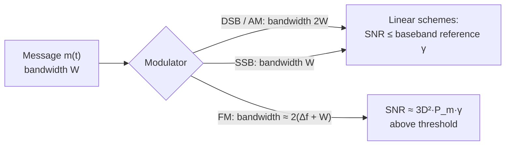
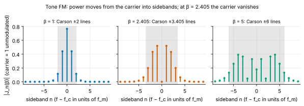
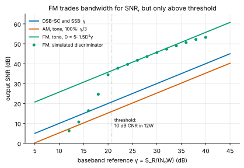

<!-- status: verified -->
# 17-03 · Analog Modulation (Brief)

| | |
|---|---|
| **Course** | [17 · Communication Systems](../README.md) |
| **University equivalent** | The analog-modulation chapters of a senior communications course, condensed: single-sideband and the Hilbert transform, phase and frequency modulation, Bessel spectra and Carson's rule, and the noise performance of AM, DSB, SSB and FM with the threshold effect and pre-emphasis (Proakis & Salehi, *Communication Systems Engineering*, analog modulation and its noise performance; Haykin & Moher, *Communication Systems*; Lathi & Ding, angle modulation) |
| **Prerequisites** | [11-11](../../11-signals-and-systems/chapters/11-11-modulation-and-filtering-applications.md) (DSB-SC, AM, envelope detection, mixers, superheterodyne), [17-01](17-01-random-processes-and-psd.md) (bandpass noise, I/Q components), [17-02](17-02-noise-and-snr.md) (SNR and the noise density $N_0$) |
| **Estimated study hours** | 5 |
| **Last verified** | 2026-11-20 |

**Learning objectives.** After this chapter you can:

1. Generate and demodulate single-sideband signals with the Hilbert transform, and predict the effect of carrier phase and frequency errors on DSB and SSB.
2. Write phase- and frequency-modulated signals in terms of instantaneous phase and frequency, and compute the modulation index and peak deviation.
3. Derive the Bessel-function spectrum of tone FM, and estimate FM bandwidth with Carson's rule and with power fractions.
4. Derive the output SNR of DSB-SC, SSB, AM and FM receivers against the baseband reference, and explain the FM threshold and pre-emphasis.
5. Choose among analog schemes on bandwidth, power and complexity, and say where each survives in today's products.

---

## 1. Big picture

[11-11](../../11-signals-and-systems/chapters/11-11-modulation-and-filtering-applications.md) showed how multiplying a message by a carrier moves it to a radio frequency: DSB-SC, conventional AM with its envelope detector, mixers and the superheterodyne receiver. This chapter completes the analog family and asks the question 11-11 could not: **how much noise reaches the listener?** With the tools of 17-01 and 17-02, the answer is short and instructive. Linear schemes (DSB, SSB, AM) can at best match sending the message at baseband; frequency modulation can beat it by trading bandwidth for SNR, but only above a threshold. That trade, bandwidth for power, is the central idea of all communication theory, and FM is its first and simplest instance. Shannon's capacity (17-07) and modern coding (17-08) are the same trade made optimally.

- **Analog radio is still on the air.** FM and AM broadcast, aviation voice and HF single-sideband remain in service, and broadcast receiver chips still sell in volume (§9).
- **FM's ideas live on in digital radios.** Constant-envelope modulation (GFSK in Bluetooth, GMSK in GSM) exists because FM's constant envelope lets the power amplifier run efficiently near saturation (17-06, 21-07).
- **Single-sideband is the I/Q modulator.** The phasing method of §3.2 is exactly the quadrature modulator in every modern transmitter, and its sideband-suppression formula is the image rejection of an I/Q receiver (Problem 17-03.13, 21-08).
- **Frequency modulation measures distance.** An automotive FMCW radar transmits a linear frequency chirp, and its range resolution is set by the chirp's bandwidth (Problem 17-03.14).
- **Due diligence.** Analog-era intuitions ("FM is cleaner than AM", "SSB is more efficient") are true for stated reasons and false outside them; the reasons are this chapter.

## 2. Intuition first

Picture a carrier as a rotating phasor. **Amplitude modulation** stretches and shrinks it; **angle modulation** speeds it up and slows it down, leaving its length alone. Noise at the receiver adds a small random phasor to the tip. For AM, the noise's component along the carrier changes the length, and it lands directly on the message. For FM, only the noise's component across the carrier matters, because it nudges the angle, and the receiver reads the *rate of change* of angle. If the transmitter swings the frequency widely (a large deviation), the message moves the angle by a lot, and the same small noise nudge becomes relatively tiny. That is FM's noise advantage, and its price is bandwidth: wide swings occupy a wide band. When the noise phasor grows as long as the carrier, it can spin the total phasor all the way around the origin; the receiver hears each turn as a click, and the advantage collapses. That is the **threshold**.

**Analogy: leverage.** FM's deviation ratio is like financial leverage. Borrowing (spending bandwidth) multiplies the return on a good position (output SNR grows as the square of the deviation), but below a margin level the position is liquidated (the threshold) and losses are far worse than an unlevered position would have suffered. **Where it breaks down:** the FM "return" is deterministic above threshold, not a gamble, and the "margin call" is a property of the received signal strength, not of a counterparty's decision; nor is there an interest cost, only an opportunity cost in spectrum that others cannot use.

## 3. Theory

### 3.1 The baseband reference

To compare schemes fairly, fix three things: the message $m(t)$, with bandwidth $W$, average power $P_m$ and peak $\lvert m\rvert \le 1$; the **received signal power** $S_R$; and the one-sided noise density $N_0$ at the receiver input (17-02). The yardstick is what plain baseband transmission would achieve: send $m(t)$ itself with power $S_R$ through a channel adding white noise of density $N_0$, and low-pass filter to $W$. The noise power is $N_0W$, so the output SNR is

$$
\gamma = \frac{S_R}{N_0W} .
$$

Every scheme's output SNR will be written as a multiple of $\gamma$. The multiple is the scheme's **figure of merit**.

### 3.2 Single sideband and the Hilbert transform

A DSB-SC signal $A_cm(t)\cos\omega_ct$ has two sidebands, mirror images about the carrier, each carrying the whole message (11-11). One is redundant. **Single-sideband (SSB)** modulation transmits only one, halving the bandwidth to $W$.

**The Hilbert transform.** Define $\hat m(t)$, the **Hilbert transform** of $m(t)$, as the output of a filter with frequency response

$$
H(f) = -j\operatorname{sgn}(f) = \begin{cases} -j, & f > 0 \\ +j, & f < 0 \end{cases}
$$

It shifts every positive-frequency component by −90° and every negative one by +90°, leaving all magnitudes alone: $\cos\omega t \mapsto \sin\omega t$, $\sin\omega t \mapsto -\cos\omega t$. Applying it twice multiplies by $(-j\operatorname{sgn}f)^2 = -1$, so $\hat{\hat m} = -m$. The combination $m + j\hat m$ has spectrum $M(f)\,[1 + \operatorname{sgn}f]$: twice $M(f)$ at positive frequencies and nothing at negative ones. It is the **analytic signal** of $m$.

**SSB from the analytic signal.** Shift the analytic signal up to the carrier and keep the real part:

$$
s_{\text{USB}}(t) = \operatorname{Re}\Big\{\frac{A_c}{2}\big[m(t) + j\hat m(t)\big]e^{j\omega_ct}\Big\} = \frac{A_c}{2}\big[m(t)\cos\omega_ct - \hat m(t)\sin\omega_ct\big] .
$$

The analytic signal has only positive frequencies, so after the shift the positive-frequency part of $s$ lies only above $f_c$: this is the **upper sideband**. A plus sign gives the lower sideband. The formula is a recipe, the **phasing method**: multiply the message by the cosine, its Hilbert transform by the sine, and subtract. It is the quadrature (I/Q) modulator of every modern transmitter, with $I = m$ and $Q = \hat m$. The older **filter method** generates DSB and removes one sideband with a sharp filter, which is practical only when the message has no energy near DC (voice, above about 300 Hz).

**Power.** $m$ and $\hat m$ have equal power, since $\lvert H\rvert = 1$, and they are uncorrelated at the same instant: $\mathbb{E}[\hat m(t)m(t)] = \int S_{\hat mm}(f)\,df$ with cross-spectrum $S_{\hat mm} = HS_m = -j\operatorname{sgn}(f)S_m(f)$ (17-01 §3.5), an odd function that integrates to zero. The cross terms average away, and $S_R = (A_c^2/4)(P_m/2 + P_m/2) = A_c^2P_m/4$.

**Demodulation and carrier errors.** Coherent detection multiplies by $2\cos(\omega_ct + \phi)$ and low-pass filters. For SSB with a tone $m = \cos\omega_mt$ (so $\hat m = \sin\omega_mt$, and $s = (A_c/2)\cos(\omega_c + \omega_m)t$), the product's low-frequency part is $(A_c/2)\cos(\omega_mt - \phi)$: a **phase error shifts the phase** of every component, which the ear barely notices, but does not reduce the amplitude. A **frequency error** $\Delta\omega$ shifts every output frequency by $\Delta\omega$ (voice sounds high or low pitched, the familiar "Donald Duck" effect of a mistuned SSB radio). For **DSB-SC** the same errors behave differently: a phase error multiplies the output by $\cos\phi$ (11-11), and a frequency error multiplies it by $\cos\Delta\omega t$, a slow fading beat. DSB therefore needs a phase-locked carrier; SSB voice tolerates tens of hertz of error.

**Vestigial sideband (VSB).** For messages with energy down to DC (video, data), SSB's filter would have to be infinitely sharp at the carrier. VSB keeps one sideband plus a small vestige of the other, shaped so that the two overlap-add to a flat response after coherent detection. It was the analog-television standard and survives in some digital broadcast systems.

### 3.3 Angle modulation

Write a carrier as $s(t) = A_c\cos\theta_i(t)$. Its **instantaneous frequency** is the rate of change of angle:

$$
f_i(t) = \frac{1}{2\pi}\frac{d\theta_i}{dt} .
$$

For an unmodulated carrier $\theta_i = 2\pi f_ct$ and $f_i = f_c$. **Angle modulation** writes $\theta_i = 2\pi f_ct + \phi(t)$ and puts the message into $\phi$:

- **Phase modulation (PM):** $\phi(t) = k_pm(t)$, with $k_p$ in rad per unit of $m$.
- **Frequency modulation (FM):** $f_i(t) = f_c + k_fm(t)$, with $k_f$ in Hz per unit of $m$, so $\phi(t) = 2\pi k_f\int_0^tm(\tau)\,d\tau$.

FM is PM of the integral of the message, and PM is FM of its derivative. The **peak frequency deviation** is $\Delta f = k_f\max\lvert m\rvert$, and for a single tone of frequency $f_m$ the **modulation index** is $\beta = \Delta f/f_m$, the peak phase swing in radians. For a general message, the **deviation ratio** $D = \Delta f/W$ plays the same role.

The envelope is constant, $A_c$, whatever the message. Two consequences matter: amplitude noise and amplitude distortion carry no information, so a limiter can remove them; and the transmitter's power amplifier can run in saturation, at its highest efficiency, because it never has to reproduce amplitude.

### 3.4 The spectrum of tone FM

For $m = \cos2\pi f_mt$, $\phi(t) = \beta\sin2\pi f_mt$ and

$$
s(t) = A_c\cos(2\pi f_ct + \beta\sin2\pi f_mt) = A_c\operatorname{Re}\big\{e^{j2\pi f_ct}e^{j\beta\sin2\pi f_mt}\big\} .
$$

The factor $e^{j\beta\sin\theta}$, with $\theta = 2\pi f_mt$, is periodic in $\theta$ with period $2\pi$, so it has a Fourier series, $\sum_nc_ne^{jn\theta}$ with

$$
c_n = \frac{1}{2\pi}\int_{-\pi}^{\pi}e^{j(\beta\sin\theta - n\theta)}\,d\theta = J_n(\beta) ,
$$

the integral that defines the **Bessel function of the first kind** of order $n$. Substituting,

$$
s(t) = A_c\sum_{n=-\infty}^{\infty}J_n(\beta)\cos\big(2\pi(f_c + nf_m)t\big) .
$$

Tone FM is a carrier of amplitude $A_cJ_0(\beta)$ and sidebands at every multiple of $f_m$, of amplitudes $A_cJ_n(\beta)$, with $J_{-n} = (-1)^nJ_n$. Three facts follow:

- **Power is conserved.** The envelope is constant, so the power is $A_c^2/2$, and therefore $\sum_nJ_n^2(\beta) = 1$: modulation moves power from the carrier into the sidebands without adding any.
- **The carrier can vanish.** $J_0(\beta) = 0$ at $\beta$ = **2.405**, **5.520**, …; at those indices all the power is in the sidebands. Technicians calibrate deviation by finding these carrier nulls on a spectrum analyzer.
- **Narrowband FM.** For $\beta \ll 1$, $J_0 \approx 1$, $J_{\pm1} \approx \pm\beta/2$ and the rest are negligible: a carrier plus one pair of sidebands, like AM, but with the lower sideband inverted. The sidebands sum in quadrature with the carrier, which is why they rotate the phasor rather than stretch it.

*Line magnitudes $\lvert J_n(\beta)\rvert$ for three indices. At β = 1 the carrier still dominates; at β = 2.405 it vanishes; at β = 5 the power is spread over about six sideband pairs, the shaded Carson band.*

### 3.5 Bandwidth: Carson's rule

Strictly, FM has infinite bandwidth. In practice $J_n(\beta)$ falls rapidly once $n$ exceeds $\beta + 1$, so almost all the power lies within $\beta + 1$ sideband pairs. **Carson's rule** states the resulting bandwidth:

$$
B_T \approx 2(\Delta f + W) = 2(D + 1)W .
$$

For large deviation, $B_T \approx 2\Delta f$: the carrier sweeps a band of width $2\Delta f$. For small deviation, $B_T \approx 2W$, the bandwidth of AM. For tone FM with $\beta = 5$, Carson's band holds the carrier and six sideband pairs, **99.36%** of the power (Example 17-03.2). FM broadcasting uses $\Delta f$ = 75 kHz and $W$ = 15 kHz, so $B_T$ = 180 kHz (§9).

### 3.6 Generating and detecting FM

- **Direct FM:** a voltage-controlled oscillator (VCO) whose control voltage is the message; frequency stability comes from a phase-locked loop around it (15-12) with a loop bandwidth below the lowest message frequency.
- **Indirect (Armstrong) FM:** generate narrowband FM by phasing (a crystal-stable carrier plus a quadrature DSB term), then multiply its frequency to raise the deviation (Problem 17-03.6).
- **Discriminator:** differentiate the FM signal, which turns frequency into amplitude ($d/dt\cos\theta_i = -\dot\theta_i\sin\theta_i$), then envelope-detect.
- **PLL demodulator:** lock a VCO to the received signal; the VCO's control voltage is proportional to the instantaneous frequency.
- **Digital (quadrature) discriminator.** Today's receivers digitize the complex baseband $z = I + jQ$ and compute the frequency directly as the angle advance per sample, $f_i[n] = (f_s/2\pi)\arg\{z[n]z^*[n - 1]\}$, which works as long as the angle advances less than π per sample, so $f_s > 2\max\lvert f_i\rvert$ (Problem 17-03.10). The lab uses exactly this.

### 3.7 Noise performance

Use the AWGN model of 17-02 and the bandpass-noise decomposition of 17-01 §3.9: $n(t) = n_I\cos\omega_ct - n_Q\sin\omega_ct$, where for white noise of one-sided density $N_0$ in a band symmetric about $f_c$, $n_I$ and $n_Q$ each have two-sided PSD $N_0$ over half the band.

**DSB-SC.** $s = A_cm\cos\omega_ct$, so $S_R = A_c^2P_m/2$. Coherent detection gives $A_cm + n_I$. Signal power $A_c^2P_m$; $n_I$ has PSD $N_0$ over $\lvert f\rvert < W$, power $2N_0W$:

$$
\text{SNR}_{\text{DSB}} = \frac{A_c^2P_m}{2N_0W} = \frac{S_R}{N_0W} = \gamma .
$$

**SSB.** $S_R = A_c^2P_m/4$ (§3.2), and detection gives $(A_c/2)m + n_I$ with signal power $A_c^2P_m/4$. The noise now occupies only one side of the carrier, so $n_I$ has PSD $N_0/2$ over $\lvert f\rvert < W$ (17-01, Problem 17-01.13), power $N_0W$:

$$
\text{SNR}_{\text{SSB}} = \frac{A_c^2P_m/4}{N_0W} = \gamma .
$$

DSB and SSB give the same SNR for the same received power. DSB's second sideband doubles both the signal (coherently) and the noise (incoherently), a wash. SSB's advantage is half the bandwidth, not better SNR.

**AM with an envelope detector.** $s = A_c[1 + k_am(t)]\cos\omega_ct$ with $\lvert k_am\rvert < 1$, so $S_R = (A_c^2/2)(1 + k_a^2P_m)$. When the noise is small against the carrier, the envelope is approximately $A_c(1 + k_am) + n_I$ (the quadrature noise changes the length only to second order). After removing the DC term, the signal power is $A_c^2k_a^2P_m$ and the noise power $2N_0W$:

$$
\text{SNR}_{\text{AM}} = \frac{A_c^2k_a^2P_m}{2N_0W} = \frac{k_a^2P_m}{1 + k_a^2P_m}\,\gamma .
$$

The factor is the **power efficiency**, the fraction of the transmitted power in the sidebands. For a tone at 100% modulation ($k_a = 1$, $P_m = 1/2$) it is 1/3: AM is **4.77** dB worse than DSB for the same received power, because two-thirds of its power is a carrier whose only job is to make the envelope detector work. Below a carrier-to-noise ratio of about 10 dB, the envelope detector suffers its own threshold: the noise dominates the envelope and the message is lost in it.

**FM.** Write the received signal as a phasor $A_c$ at angle $\phi(t)$ plus noise. When $A_c$ is much larger than the noise, only the noise component perpendicular to the signal phasor changes the angle, by approximately that component divided by $A_c$. That perpendicular component has the same statistics as $n_Q$: PSD $N_0$ over $\lvert f\rvert < B_T/2$. The discriminator outputs instantaneous frequency, $(1/2\pi)\,d\phi/dt$. Differentiation multiplies a spectrum by $(j2\pi f)$, so the frequency noise has PSD

$$
S_{f}(f) = \frac{1}{(2\pi)^2}\cdot\frac{(2\pi f)^2N_0}{A_c^2} = \frac{f^2N_0}{A_c^2}\qquad(\text{Hz}^2/\text{Hz}) ,
$$

a parabola: FM's noise is concentrated at high message frequencies. The low-pass filter keeps $\lvert f\rvert < W$:

$$
N_{out} = \int_{-W}^{W}\frac{f^2N_0}{A_c^2}\,df = \frac{2N_0W^3}{3A_c^2} .
$$

The signal at the discriminator output is $k_fm(t)$, power $k_f^2P_m$. With $S_R = A_c^2/2$ and $\Delta f = k_f\max\lvert m\rvert$:

$$
\text{SNR}_{\text{FM}} = \frac{3A_c^2k_f^2P_m}{2N_0W^3} = 3\left(\frac{\Delta f}{W}\right)^2\frac{P_m}{\max\lvert m\rvert^2}\cdot\frac{S_R}{N_0W} = 3D^2\frac{P_m}{\max\lvert m\rvert^2}\,\gamma .
$$

For a tone, $P_m/\max\lvert m\rvert^2 = 1/2$ and $\text{SNR}_{\text{FM}} = \tfrac32\beta^2\gamma$. With $\beta$ = 5 that is 37.5, **15.74** dB better than DSB, at the cost of 180 kHz of bandwidth instead of 30 kHz. The output SNR grows as the **square** of the bandwidth expansion: bandwidth buys power, and the lab's Monte Carlo simulation of the discriminator reproduces the formula to within 0.1 dB above threshold.

> **Going deeper — PM, and why FM's derivation is so clean.** For PM the receiver outputs the phase itself, whose noise PSD is $N_0/A_c^2$ (flat), so $\text{SNR}_{\text{PM}} = k_p^2P_m\gamma$ (Problem 17-03.11). PM's noise is white, FM's parabolic. The "$A_c$ much larger than the noise" step linearizes the arctangent; Rice's 1948 analysis of what happens when it fails (the clicks below) is a classic of applied probability.

### 3.8 The FM threshold and pre-emphasis

**Threshold.** The derivation assumed the noise phasor is much shorter than the carrier. When the carrier-to-noise ratio in the IF bandwidth, $S_R/(N_0B_T)$, drops to roughly 10 dB, the noise occasionally becomes longer than the carrier and swings the total phasor once around the origin. The phase jumps by $2\pi$, the discriminator outputs a spike (an audible **click**), and the clicks' energy grows so fast that the output SNR collapses within a few dB. The threshold is a property of the received power, not of the formula: since $S_R/(N_0B_T) = \gamma\,W/B_T = \gamma/(2(D + 1))$, a wider deviation raises the received power needed to stay above threshold. FM therefore improves on DSB only when there is enough received power to afford the bandwidth (Example 17-03.5, Problem 17-03.12).

*Lines are the formulas of §3.7; dots are the lab's simulated FM receiver with its IF filter at Carson's bandwidth. Above threshold the simulation follows $1.5D^2\gamma$; below about 21 dB it collapses toward and below the linear schemes. At the highest γ the dots fall short because Carson's filter clips the signal's own spectral tails, a distortion floor near 53–57 dB.*

**Pre-emphasis and de-emphasis.** The parabolic noise spectrum puts most of the output noise near $W$, where audio content is usually weakest. Broadcasters therefore boost the high audio frequencies before modulation with a **pre-emphasis** network $H_{pe}(f) = 1 + j2\pi f\tau$, and receivers undo it after the discriminator with **de-emphasis** $1/(1 + j2\pi f\tau)$. The signal comes out unchanged; the noise is filtered by $\lvert H_{de}\rvert^2 = 1/(1 + (f/f_1)^2)$, with $f_1 = 1/(2\pi\tau)$. The noise power falls from $\int_0^Wf^2df = W^3/3$ to $\int_0^Wf^2/(1 + (f/f_1)^2)\,df = f_1^3[x - \arctan x]$, with $x = W/f_1$, an improvement of

$$
I = \frac{x^3}{3(x - \arctan x)} .
$$

For τ = 75 µs and $W$ = 15 kHz, $f_1$ = 2122 Hz and $I$ = 20.9, about **13.2** dB (Example 17-03.6). The price is that loud high-frequency sounds now produce more deviation: the boost at 15 kHz is about 17 dB (Problem 17-03.9), so broadcast audio processing limits treble to keep the deviation within its allowance.

### 3.9 Comparing the schemes

| Scheme | RF bandwidth | Output SNR / γ | Receiver | Notes |
|---|---|---|---|---|
| DSB-SC | $2W$ | 1 | coherent (needs carrier phase) | sidebands redundant |
| SSB | $W$ | 1 | coherent (tolerates small frequency errors) | most spectrum-efficient |
| AM, tone, 100% | $2W$ | 1/3 (−4.77 dB) | envelope detector | cheapest receiver; threshold near 10 dB CNR |
| FM, tone, β = 5 | $2(\beta + 1)W$ = 12$W$ | 37.5 (+15.74 dB) | discriminator or PLL | threshold near 10 dB CNR; pre-emphasis adds about 13 dB for audio |

At equal **peak** envelope power, the comparison changes again: a 100%-modulated AM signal's peak is four times its carrier power, which makes SSB about **9.03** dB better than AM for a peak-limited transmitter (Problem 17-03.8), the reason HF voice moved to SSB.

## 4. Worked examples

### Example 17-03.1 · SSB and carrier errors (tier A)

**Setup.** A 1 kHz tone, $m = \cos(2\pi \cdot 1000t)$, is sent as upper-sideband SSB on a 100 kHz carrier. (a) At what frequency is the transmitted signal? (b) The receiver's oscillator runs 50 Hz high. What does the listener hear? (c) If the tone were sent as DSB-SC and the receiver had a 60° phase error, by what factor and how many dB would the output fall?

**Solution.** (a) $\hat m = \sin(2\pi \cdot 1000t)$, so $s = (A_c/2)\,[\cos\omega_mt\cos\omega_ct - \sin\omega_mt\sin\omega_ct] = (A_c/2)\cos(\omega_c + \omega_m)t$: a single line at **101** kHz.

(b) Multiplying by $2\cos(2\pi \cdot 100\,050\,t)$ gives low-frequency term $(A_c/2)\cos(2\pi(101\,000 - 100\,050)t)$: a tone at **950** Hz, 50 Hz flat, at full amplitude.

(c) DSB-SC with phase error φ gives $A_cm\cos\phi$: the factor is $\cos60°$ = **0.5**, $20\log_{10}0.5$ = **−6.02** dB. At 90° the output would vanish.

**Units check.** Frequencies in Hz add and subtract; the cosine factor is dimensionless.

**Sanity check.** SSB with a 60° phase error would give $(A_c/2)\cos(\omega_mt - 60°)$: the same tone, delayed by a sixth of a cycle, at full amplitude.

### Example 17-03.2 · The spectrum of broadcast-style FM (tier B)

**Setup.** A 15 kHz tone frequency-modulates a carrier with 75 kHz peak deviation. Find (a) the modulation index, (b) Carson's bandwidth, (c) the fraction of power inside it, (d) the carrier's share of the power and (e) the carrier amplitude relative to the unmodulated carrier.

**Solution.** (a) $\beta = 75/15$ = **5**. (b) $B_T = 2(75 + 15)$ = **180** kHz, which holds the carrier and $180/(2 \times 15) = 6$ sideband pairs. (c) $\sum_{n=-6}^{6}J_n^2(5)$ = **99.36**%. (d) $J_0^2(5)$ = 0.0315, **3.15**% of the power. (e) $J_0(5)$ = **−0.178**: the carrier is 18% of its unmodulated amplitude and inverted in phase.

**Units check.** β is kHz/kHz, dimensionless; Bessel values are dimensionless amplitudes relative to $A_c$.

**Sanity check.** Five sideband pairs would hold only 95.92%; the seventh pair adds just 0.57 percentage points. Carson's rule lands where the Bessel coefficients fall off a cliff, at $n \approx \beta + 1$.

### Example 17-03.3 · Calibrating deviation with carrier nulls (tier B)

**Setup.** (a) At which modulation indices does the carrier of tone FM first and second vanish? (b) A technician wants to set a transmitter to 5 kHz peak deviation using the first null. What test-tone frequency should be applied? (c) For narrowband FM with β = 0.2, compare the first sidebands with those of AM with modulation index μ = 0.2, and give the second sideband's amplitude.

**Solution.** (a) The zeros of $J_0$: β = **2.405** and **5.520**.

(b) Raise the tone's level until the carrier first disappears; then $\Delta f = 2.405f_m$. For $\Delta f$ = 5 kHz, $f_m = 5/2.405$ = **2.079** kHz.

(c) $J_0(0.2) = 0.990$ and $J_1(0.2) = 0.0995$, so each first sideband is $20\log_{10}(0.0995/0.990)$ = **−19.96** dB relative to the carrier. AM with μ = 0.2 has sidebands of amplitude μ/2 = 0.1 relative to the carrier, −20.0 dB: almost the same magnitudes. The difference is phase: FM's lower sideband is inverted, so the sidebands add in quadrature with the carrier. The second sideband, $J_2(0.2)$ = **0.00498**, is 46.0 dB below the carrier.

**Units check.** Indices are radians (dimensionless); frequencies in kHz.

**Sanity check.** $J_0^2 + 2J_1^2 + 2J_2^2 = 0.9801 + 0.0198 + 0.0000496 \approx 1$.

### Example 17-03.4 · Output SNR of four receivers (tier B)

**Setup.** A receiver with noise figure 6 dB (at 290 K) receives −95 dBm, and the message is audio of bandwidth $W$ = 15 kHz, a full-scale tone for the comparison. Find the baseband reference γ and the output SNR for DSB-SC, SSB, AM at 100% modulation and FM with β = 5. Check that the FM receiver is above threshold.

**Solution.** $N_0 = -174 + 6 = -168$ dBm/Hz, so $N_0W = -168 + 41.76 = -126.24$ dBm and $\gamma = -95 + 126.24$ = **31.24** dB.

- DSB-SC and SSB: γ, **31.24** dB.
- AM, tone, $k_a = 1$: $\gamma \times 1/3$, $31.24 - 4.77$ = **26.47** dB.
- FM, β = 5: $\gamma \times 37.5$, $31.24 + 15.74$ = **46.98** dB.

Carrier-to-noise in Carson's 180 kHz: $\gamma - 10\log_{10}(180/15)$ = $31.24 - 10.79$ = **20.45** dB, comfortably above the 10 dB threshold.

**Units check.** dBm − dBm = dB throughout; γ is a ratio.

**Sanity check.** The FM receiver's 15.7 dB advantage costs 180 kHz of spectrum, six times DSB's 30 kHz and twelve times SSB's 15 kHz.

### Example 17-03.5 · Where FM's advantage ends (tier C)

**Setup.** For the receiver of Example 17-03.4, find the received power at which the FM receiver reaches threshold (10 dB CNR in 180 kHz), the output SNR it delivers just above threshold, and the AM receiver's SNR at the same power.

**Solution.** Threshold: $P_{th} = N_0 + 10\log_{10}B_T + 10 = -168 + 52.55 + 10$ = **−105.45** dBm. There, $\gamma = -105.45 + 126.24$ = **20.79** dB, so the FM receiver delivers $20.79 + 15.74$ = **36.53** dB, while AM delivers $20.79 - 4.77$ = **16.02** dB. A few dB lower in power, the FM output collapses into clicks, while AM and SSB degrade gracefully, dB for dB, until their own limits.

**Units check.** dBm/Hz + dB(Hz) + dB = dBm.

**Sanity check.** The lab's simulated discriminator follows the formula down to a CNR of about 10 dB and then falls tens of dB below it within a few dB of input power.

### Example 17-03.6 · What pre-emphasis buys (tier C)

**Setup.** Compute the de-emphasis noise improvement for $W$ = 15 kHz with the 75 µs time constant used in the Americas and the 50 µs constant used in Europe.

**Solution.** τ = 75 µs: $f_1 = 1/(2\pi \times 75\ \mu\text{s})$ = **2122** Hz, $x = 15\,000/2122 = 7.069$, $\arctan x = 1.430$, and $I = 7.069^3/(3 \times (7.069 - 1.430)) = 353.2/16.92$ = **20.88**, or **13.20** dB.

τ = 50 µs: $f_1$ = **3183** Hz, $x$ = 4.712, $\arctan x = 1.362$, $I = 104.6/10.05$ = **10.41**, or **10.17** dB.

The longer time constant improves noise more, at the price of more high-frequency boost to limit at the transmitter.

**Units check.** $f_1$ in Hz since τ is in s; $x$ and $I$ are dimensionless.

**Sanity check.** As τ → 0, $x \to 0$ and $I \to 1$ (no change). For large $x$, $I \approx x^2/3$: de-emphasis then removes nearly all of the parabola's high-frequency noise.

<!-- answer-key -->

| ID | Quantity | Value | Unit |
|---|---|---|---|
| Txt 17-03.a | first carrier null of tone FM | 2.405 | — |
| Txt 17-03.b | second carrier null | 5.520 | — |
| Txt 17-03.c | power inside Carson's band, β = 5 | 99.36 | % |
| Txt 17-03.d | FM broadcast Carson bandwidth | 180 | kHz |
| Txt 17-03.e | AM tone penalty at 100% modulation | −4.77 | dB |
| Txt 17-03.f | FM gain over DSB, tone, β = 5 | 15.74 | dB |
| Txt 17-03.g | pre-emphasis improvement, 75 µs, 15 kHz | 13.2 | dB |
| Txt 17-03.h | pre-emphasis boost at 15 kHz, 75 µs | 17 | dB |
| Txt 17-03.i | SSB over AM at equal peak power | 9.03 | dB |
| Txt 17-03.j | FM noise PSD at 53 kHz relative to 5 kHz | 20.5 | dB |
| Txt 17-03.k | 2.2 µV EMF in dBµV | 6.85 | dBµV |
| Txt 17-03.l | 2.2 µV EMF available from 50 Ω | −106.16 | dBm |
| Txt 17-03.m | sideband suppression limit, 1° error | 41 | dB |
| Txt 17-03.n | AM audio bandwidth in a 9 kHz channel | 4.5 | kHz |
| Ex 17-03.1a | USB frequency | 101 | kHz |
| Ex 17-03.1b | heard tone with 50 Hz LO error | 950 | Hz |
| Ex 17-03.1c | DSB output factor at 60° | 0.5 | — |
| Ex 17-03.1d | DSB output change at 60° | −6.02 | dB |
| Ex 17-03.2a | modulation index | 5 | — |
| Ex 17-03.2b | Carson bandwidth | 180 | kHz |
| Ex 17-03.2c | power fraction inside | 99.36 | % |
| Ex 17-03.2d | carrier share of power | 3.15 | % |
| Ex 17-03.2e | carrier amplitude J0(5) | −0.178 | — |
| Ex 17-03.2f | power in five sideband pairs | 95.92 | % |
| Ex 17-03.2g | power in the seventh pair | 0.57 | % |
| Ex 17-03.3a | first null | 2.405 | — |
| Ex 17-03.3b | second null | 5.520 | — |
| Ex 17-03.3c | test-tone frequency for 5 kHz | 2.079 | kHz |
| Ex 17-03.3d | NBFM first sideband, β = 0.2 | −19.96 | dBc |
| Ex 17-03.3e | J2(0.2) | 0.00498 | — |
| Ex 17-03.3f | second sideband below carrier | 46.0 | dB |
| Ex 17-03.4a | baseband reference γ | 31.24 | dB |
| Ex 17-03.4b | AM output SNR | 26.47 | dB |
| Ex 17-03.4c | FM output SNR | 46.98 | dB |
| Ex 17-03.4d | CNR in Carson bandwidth | 20.45 | dB |
| Ex 17-03.5a | FM threshold power | −105.45 | dBm |
| Ex 17-03.5b | γ at threshold | 20.79 | dB |
| Ex 17-03.5c | FM output at threshold | 36.53 | dB |
| Ex 17-03.5d | AM output at that power | 16.02 | dB |
| Ex 17-03.6a | de-emphasis corner, 75 µs | 2122 | Hz |
| Ex 17-03.6b | improvement factor, 75 µs | 20.88 | — |
| Ex 17-03.6c | improvement, 75 µs | 13.20 | dB |
| Ex 17-03.6d | de-emphasis corner, 50 µs | 3183 | Hz |
| Ex 17-03.6e | improvement factor, 50 µs | 10.41 | — |
| Ex 17-03.6f | improvement, 50 µs | 10.17 | dB |

*Every value is recomputed by [verify_17_03.py](../verify/verify_17_03.py): Bessel coefficients both from SciPy and by numerically integrating their defining integral, Carson fractions by summation, the four output-SNR formulas both in closed form and by Monte Carlo simulation of each receiver (coherent DSB and SSB, envelope-detected AM, and a quadrature FM discriminator), and the pre-emphasis gain by numerical integration of the de-emphasized noise spectrum.*

## 5. Simulate it

The lab, [labs/17-03-lab](../labs/17-03-lab/README.md), provides `analogmod.py`: an FFT Hilbert transform, phasing-method SSB, DSB-SC and AM modulators, coherent and envelope detectors, complex-baseband FM and PM, a quadrature discriminator, pre-emphasis and de-emphasis, Bessel line spectra and Carson fractions, and Monte Carlo receivers that measure output SNR against the baseband reference. In the notebook, **predict, then run**:

1. **SSB by phasing.** Predict the spectrum of the phasing modulator's output for a two-tone message, then plot it. Introduce a 1° error in the 90° network and predict the unwanted sideband's level (Problem 17-03.13).
2. **Bessel lines.** Predict the carrier and sideband amplitudes for β = 1, 2.405 and 5, then compare an FFT of simulated FM with $J_n(\beta)$.
3. **Four receivers.** Predict the output SNR of DSB, SSB and AM at γ = 30 dB, then measure them.
4. **FM above and below threshold.** Predict the FM output SNR for γ from 12 to 40 dB, then sweep it, and find where the simulation leaves the formula. Repeat with the IF filter at exactly Carson's bandwidth and at 1.5 times it, and explain the high-SNR difference.
5. **De-emphasis.** Measure the output noise spectrum of the discriminator (a parabola) and the improvement de-emphasis gives.

## 6. Engineering tradeoffs

| Knob | Improves | Costs | Typical decision owner |
|---|---|---|---|
| SSB instead of DSB or AM | Half the bandwidth; no carrier power | Coherent receiver, accurate frequency, sharp filters or a precise 90° network | System architect, regulator (channel plan) |
| AM instead of DSB | Receiver simplicity (envelope detector, no carrier recovery) | Two-thirds or more of the power in the carrier; 4.77 dB or worse | Broadcaster (legacy installed base) |
| Larger FM deviation | Output SNR grows as $D^2$ | Bandwidth $2(D + 1)W$; higher threshold | Standards body, broadcaster |
| Pre-emphasis time constant | 10–13 dB less audio noise | High-frequency audio must be limited to avoid overdeviation | Standards body, audio processing engineer |
| Constant-envelope modulation | Saturated, efficient power amplifier; immunity to amplitude distortion | Bandwidth; no amplitude dimension for carrying data | RF and system architects |
| Digital instead of analog | Coding gain, compression, error-free regeneration | Complexity, latency, cliff-edge failure | Product and standards strategy |

## 7. Numbers to know

| Quantity | Value | Note |
|---|---|---|
| Carrier nulls of tone FM | β = 2.405, 5.520 | used to calibrate deviation |
| Carson bandwidth | $2(\Delta f + W)$ | about 99% of power for β ≳ 1 |
| AM power efficiency, tone, 100% | 1/3 (−4.77 dB) | |
| FM gain, tone | $\tfrac32\beta^2$; β = 5 → 15.7 dB | above threshold |
| FM threshold | CNR ≈ 10 dB in $B_T$ | rule of thumb |
| SSB over AM, equal peak power | 9.03 dB | |
| De-emphasis improvement, 15 kHz | 13.2 dB (75 µs), 10.2 dB (50 µs) | |
| FM broadcast | ±75 kHz = 100%; 200 kHz channels; 75 µs (US) or 50 µs (Europe) | as of Nov 2026 [R-263], [R-264] |
| FM stereo composite | pilot 19 kHz; L − R DSB-SC on 38 kHz, 23–53 kHz | [R-263] |
| AM broadcast spacing | 10 kHz (Americas), 9 kHz (GE75 plan) | [R-265] |
| European aviation voice | AM, 8.33 kHz channels, 117.975–137 MHz | [R-266] |

## 8. Common mistakes

- **Comparing SNRs at different received powers or bandwidths.** Fix $S_R$ and $N_0$ and use the baseband reference γ; otherwise every scheme can be made to "win".
- **Thinking SSB has better SNR than DSB.** For the same received power they are equal; SSB saves bandwidth, not SNR. It wins at equal *peak* power against AM.
- **Applying the FM formula below threshold.** $\tfrac32\beta^2\gamma$ assumes the carrier dominates the noise in the IF bandwidth; below about 10 dB CNR it fails abruptly.
- **Treating Carson's rule as exact.** It captures about 98–99% of the power; adjacent-channel interference specifications need the actual spectrum.
- **Forgetting that pre-emphasis changes deviation.** Boosted treble can overdeviate the transmitter; the improvement assumes the audio spectrum falls off at high frequencies.
- **Calling every angle modulation FM.** PM of a message is FM of its derivative; the output noise spectra differ (flat versus parabolic).
- **Overmodulating AM.** $\lvert k_am\rvert > 1$ makes the envelope cross zero, and the envelope detector distorts the message.

## 9. Practitioner lens

### State of the art (as of Nov 2026)

- **FM broadcasting is the textbook case, written into regulation.** In the US, "a frequency deviation of ±75kHz is defined as 100% modulation", the band from 88 to 108 MHz "is divided into 100 channels of 200 kHz each", pre-emphasis "shall not be greater than" that of a 75 µs network, and any emission 120–240 kHz from the carrier must be at least 25 dB below the unmodulated carrier (47 CFR 73.310, 73.201, 73.317, [R-263]) **[Established]**. ITU-R BS.450-4 gives the international version: ±75 kHz (±50 kHz in some countries), and "In Europe, the pre-emphasis is 50 µs. In the United States of America, it is 75 µs" ([R-264]) **[Established]**. Carson's 180 kHz for 75 kHz deviation and 15 kHz audio fits the 200 kHz channel.
- **FM stereo is DSB-SC inside FM.** The pilot-tone system, which BS.450-4 calls "the de facto worldwide standard", adds a 19 kHz pilot at 8–10% of the deviation and carries L − R on a 38 kHz subcarrier by "Double sideband, suppressed-carrier, amplitude modulation", occupying 23 to 53 kHz of the baseband (47 CFR 73.322, [R-263], [R-264]) **[Established]**. The composite baseband therefore reaches 53 kHz, where FM's parabolic noise density is about 20.5 dB higher than at 5 kHz, which is why stereo reception needs much more signal than mono.
- **AM broadcasting.** US AM carriers run from 540 to 1700 kHz "in 10 kHz steps" (47 CFR 73.14), and the GE75 plan for ITU Regions 1 and 3 uses 9 kHz spacing (CEPT ECC Report 117, [R-265]) **[Established]**. With double sidebands of width $W$ each, a 9–10 kHz channel limits broadcast AM audio to about 4.5–5 kHz.
- **Aviation voice is still AM.** VHF air–ground voice is double-sideband AM (emission designator 6K00A3E in 47 CFR 87.137). Europe narrowed its channels instead of changing modulation: Regulation (EU) No 1079/2012 requires 8.33 kHz channel spacing in the 117.975–137 MHz band, with all radios placed on the market from 17 November 2013 able to use it, while the US does not authorize 8.33 kHz spacing in its national airspace except optionally (47 CFR 87.137 note 17, [R-266]) **[Established]**.
- **HF voice is SSB.** ITU-R M.1173-1: "Coast and ship stations shall use only the upper sideband"; the FCC requires a suppressed carrier at least 40 dB below peak envelope power, and aeronautical HF assigns SSB channels 1400 Hz above the carrier, the middle of a 2.8 kHz voice band (47 CFR 80.207, 87.137, [R-267]) **[Established]**.
- **Broadcast receivers are single chips.** A widely used AM/FM receiver family (Skyworks Si4730/31/34/35-D60, Rev. 1.2, Nov 2021) specifies FM sensitivity of 2.2 µV EMF typical (3.5 µV maximum) for 26 dB (S+N)/N, measured with a 1 kHz tone at 22.5 kHz deviation, 75 µs de-emphasis, mono and A-weighting, and AM sensitivity of 25 µV EMF typical at 30% modulation ([R-268]) **[Established]**. Its digital demodulator is the quadrature discriminator of §3.6.

### Why it matters commercially

Analog modulation is a mature, declining market, but it shapes three live businesses. Broadcast receivers (FM and AM radio in cars, phones and consumer audio) are high-volume, low-cost single-chip products where sensitivity, selectivity and price per unit decide design wins. Aviation and some public-safety voice networks keep analog AM or FM for decades because of installed bases and certification, which is why spectrum efficiency gains come by narrowing channels rather than by changing modulation. And FM's ideas are inside every modern radio: constant-envelope modulation for efficient power amplifiers, I/Q phasing for single-sideband and image-rejecting architectures, PLL demodulators, and linear-FM chirps in automotive radar. For an investor, an "analog" product line is usually a cash business with a long tail; the growth lives in the digital and radar descendants.

### Marketing vs Reality

- **"2.2 µV sensitivity."** It is an open-circuit (EMF) voltage, not power; it holds at a reduced test deviation (22.5 kHz, not 75 kHz), in mono, with A-weighting, for 26 dB (S+N)/N. Converting to power needs the source impedance: for an assumed 50 Ω source, 2.2 µV EMF is **6.85** dBµV, or **−106.16** dBm available. A stereo listener needs far more signal. Compare receivers only under identical test conditions.
- **"FM is noise-free."** Only above threshold, and only in mono. Below about 10 dB CNR in the IF bandwidth it collapses faster than AM, and stereo's L − R channel sits where the parabolic noise is highest.
- **"SSB is more efficient than AM."** True by about 9 dB at equal peak power and 4.8 dB at equal average power for a full-scale tone, and SSB uses half the bandwidth; the cost is a coherent receiver and tight frequency control. "More efficient" needs a stated basis.
- **"Our modulator has excellent sideband suppression."** Ask for the gain and phase matching: 1° of quadrature error alone limits suppression to about 41 dB (Problem 17-03.13), and the figure drifts with temperature unless calibrated.

### Questions for engineering leaders

1. **"Under what deviation, audio weighting and mode is your FM sensitivity specified, and what is it in stereo?"** *Strong:* gives the test deviation, the (S+N)/N criterion, mono and stereo figures, and dBm for a stated source impedance. *Evasive:* quotes a µV number alone.
2. **"Where is your FM receiver's threshold, and what do you do below it?"** *Strong:* states the IF bandwidth and the CNR at which the output degrades, and the soft-mute, stereo-blend or narrowing strategy used near it. *Evasive:* "our sensitivity covers it".
3. **"How is quadrature gain and phase imbalance calibrated in your I/Q transmitter or receiver?"** *Strong:* names the achieved sideband or image suppression after calibration, over temperature, and how often calibration runs. *Evasive:* quotes a typical figure at room temperature.
4. **"For the FMCW radar: what chirp bandwidth and linearity do you achieve, and what range resolution and accuracy follow?"** *Strong:* ties resolution to $c/2B$ and accuracy to chirp linearity and SNR. *Evasive:* gives a resolution without the bandwidth behind it.
5. **"What does it cost to keep the analog product line, and what replaces it?"** *Strong:* shows unit volumes, the installed base and regulatory timelines (for example channel-spacing mandates) that set the decline. *Evasive:* "analog is dead" or "analog is forever".

## 10. Concept check

**Q1.** Why do DSB-SC and SSB give the same output SNR for the same received power, even though SSB uses half the bandwidth?

Answer

DSB's two sidebands carry the same information; after coherent detection they add coherently (signal amplitude doubles, power ×4) while their independent noises add in power (×2). Relative to SSB, DSB spends twice the power for twice the noise bandwidth: the ratio is the same. SSB's gain is spectrum, not SNR.

**Q2.** What is the Hilbert transform of $\cos(2\pi \cdot 300t) + \sin(2\pi \cdot 1000t)$?

Answer

$\sin(2\pi \cdot 300t) - \cos(2\pi \cdot 1000t)$: each cosine becomes a sine and each sine a negative cosine (−90° at positive frequencies).

**Q3.** A tone FM signal has $\Delta f$ = 30 kHz and $f_m$ = 3 kHz. What are β and Carson's bandwidth? What is the bandwidth if $f_m$ is halved at the same deviation?

Answer

β = 10, $B_T = 2(30 + 3) = 66$ kHz. With $f_m$ = 1.5 kHz, β = 20 and $B_T = 2(30 + 1.5) = 63$ kHz: for wideband FM the bandwidth is set mainly by the deviation, not the tone frequency.

**Q4.** Why does FM need a carrier-to-noise ratio of about 10 dB in its IF bandwidth when its output SNR formula has no such limit?

Answer

The formula linearizes the phase: it assumes the noise phasor is much shorter than the carrier. Near 10 dB CNR the noise sometimes exceeds the carrier and the total phasor encircles the origin, producing $2\pi$ phase jumps (clicks) that the formula ignores.

**Q5.** FM's output noise spectrum rises as $f^2$. How does de-emphasis exploit this, and what must the transmitter do in return?

Answer

De-emphasis attenuates the high audio frequencies where most of the noise lies, about 13 dB less noise for 75 µs. The transmitter pre-emphasizes the same frequencies so the signal is unchanged, and must limit loud treble so that the boosted signal does not overdeviate.

**Q6.** Why is AM still used for aviation voice and broadcast despite its poor power efficiency?

Answer

Its receiver is the simplest possible, and in aviation two stations transmitting at once both remain audible (with AM the signals add, whereas FM's capture effect would suppress the weaker one). Huge installed bases and certification costs also make changing modulation slow.

Practice: [17-03 problems](../problems/17-03-problems.md) · [worked solutions](../solutions/17-03-solutions.md).

## 11. Key terms

[Amplitude modulation (AM)](../../../reference/glossary.md#amplitude-modulation-am) · [DSB-SC modulation](../../../reference/glossary.md#dsb-sc-modulation) · [Envelope detector](../../../reference/glossary.md#envelope-detector) · [Single-sideband modulation](../../../reference/glossary.md#single-sideband-modulation) · [Hilbert transform](../../../reference/glossary.md#hilbert-transform) · [Analytic signal](../../../reference/glossary.md#analytic-signal) · [Vestigial sideband](../../../reference/glossary.md#vestigial-sideband) · [Instantaneous frequency](../../../reference/glossary.md#instantaneous-frequency) · [Frequency modulation](../../../reference/glossary.md#frequency-modulation) · [Phase modulation](../../../reference/glossary.md#phase-modulation) · [Modulation index](../../../reference/glossary.md#modulation-index) · [Carson's rule](../../../reference/glossary.md#carsons-rule) · [FM threshold](../../../reference/glossary.md#fm-threshold) · [Pre-emphasis](../../../reference/glossary.md#pre-emphasis) · [Figure of merit (modulation)](../../../reference/glossary.md#figure-of-merit-modulation)

## 12. Connections

- **Builds on:** [11-11](../../11-signals-and-systems/chapters/11-11-modulation-and-filtering-applications.md) (DSB-SC, AM, mixers, superheterodyne), [17-01](17-01-random-processes-and-psd.md) (bandpass noise and its I/Q components), [17-02](17-02-noise-and-snr.md) (received power, $N_0$, SNR), [15-12](../../15-control-systems/chapters/15-12-control-applications-pll-regulators-thermal.md) (PLLs).
- **Next:** [17-04](17-04-baseband-digital-transmission.md) moves to digital transmission: pulses, intersymbol interference and the Nyquist criterion.
- **Used later:** I/Q modulation and constant-envelope schemes ([17-06](17-06-bandpass-digital-modulation.md)), the bandwidth–power trade made optimal ([17-07](17-07-information-theory-and-shannon.md)), image rejection and transceiver architectures ([21-08](../../21-rf-and-microwave-engineering/chapters/21-08-transceiver-architectures.md)), and mmWave front ends such as automotive radar ([21-10](../../21-rf-and-microwave-engineering/chapters/21-10-antennas-arrays-mmwave.md)).

## 13. Further study

- Proakis & Salehi, *Communication Systems Engineering*, the chapters on analog modulation and on the effect of noise on analog systems.
- Haykin & Moher, *Communication Systems*, angle modulation and noise in CW modulation systems, including the FM threshold.
- Lathi & Ding, *Modern Digital and Analog Communication Systems*, angle modulation and Bessel spectra.
- S. O. Rice, "Statistical properties of a sine wave plus random noise," *Bell System Technical Journal*, 1948, for the theory behind FM clicks.
- MIT OCW 6.02 and 6.450 lecture notes, for the transition from analog to digital modulation.

## 14. Sources

1. J. G. Proakis and M. Salehi, *Communication Systems Engineering*, 2nd ed., Prentice Hall, 2002: analog modulation and its noise performance.
2. S. Haykin and M. Moher, *Communication Systems*, 5th ed., Wiley, 2009: SSB, angle modulation, FM threshold, pre-emphasis.
3. J. R. Carson, "Notes on the theory of modulation," *Proceedings of the IRE*, vol. 10, pp. 57–64, 1922.
4. S. O. Rice, "Statistical properties of a sine wave plus random noise," *Bell System Technical Journal*, vol. 27, pp. 109–157, 1948.
5. 47 CFR §§ 73.201, 73.310, 73.317, 73.322 (eCFR, as of 18 Nov 2026). Research log [R-263].
6. Recommendation ITU-R BS.450-4 (10/2019), transmission standards for FM sound broadcasting at VHF. Research log [R-264].
7. 47 CFR § 73.14; CEPT ECC Report 117 (2008) on the GE75 plan. Research log [R-265].
8. Commission Implementing Regulation (EU) No 1079/2012; 47 CFR § 87.137. Research log [R-266].
9. Recommendation ITU-R M.1173-1 (03/2012); 47 CFR § 80.207. Research log [R-267].
10. Skyworks Si4730/31/34/35-D60 data sheet, Rev. 1.2 (10 Nov 2021). Research log [R-268].
