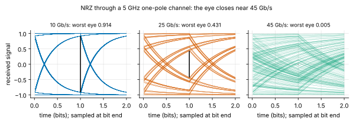
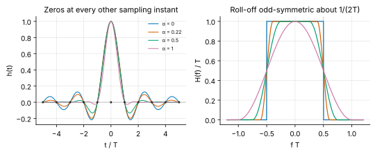

<!-- status: verified -->
# 17-04 · Baseband Digital Transmission

| | |
|---|---|
| **Course** | [17 · Communication Systems](../README.md) |
| **University equivalent** | The baseband-transmission chapter of a senior digital-communications course: pulse-amplitude modulation, line codes and their spectra, intersymbol interference, the Nyquist criterion, raised-cosine pulse shaping, eye diagrams and an introduction to equalization (Proakis & Salehi, *Communication Systems Engineering*, digital transmission through band-limited channels; Lathi & Ding, *Modern Digital and Analog Communication Systems*, principles of digital data transmission; Gallager, *Principles of Digital Communication*, the Nyquist criterion) |
| **Prerequisites** | [17-01](17-01-random-processes-and-psd.md) (PSD of PAM signals), [17-02](17-02-noise-and-snr.md) (SNR, $E_b/N_0$), [11-10](../../11-signals-and-systems/chapters/11-10-sampling-aliasing-reconstruction.md) (sampling and Poisson summation), [16-06](../../16-digital-signal-processing/chapters/16-06-fir-filter-design.md) (FIR filters) |
| **Estimated study hours** | 8 |
| **Last verified** | 2026-11-20 |

**Learning objectives.** After this chapter you can:

1. Compute the symbol rate, Nyquist frequency, level spacing and average energy of binary and M-level PAM, and compare NRZ with PAM4 at equal peak and equal average power.
2. Compute the spectra and coding overheads of common line codes (NRZ, Manchester, AMI, block codes) and explain why links need DC balance and transitions.
3. Explain intersymbol interference, compute it from a sampled pulse response, and find the worst-case eye opening (peak distortion).
4. Derive the Nyquist criterion for zero ISI in time and frequency, and design raised-cosine and root-raised-cosine pulses for a given bandwidth.
5. Read an eye diagram (height, width, timing sensitivity) and estimate the bit-error rate with ISI and Gaussian noise.
6. Design a zero-forcing FIR equalizer for a short channel and state its noise cost, and explain when PAM4 beats NRZ on a lossy channel.

---

## 1. Big picture

Every digital link, from a 112 Gb/s SerDes lane between two chips to a 5G radio's baseband, sends a stream of numbers by shaping each one into a pulse and adding up the pulses. If the channel had infinite bandwidth, each pulse would arrive intact and the receiver would just sample. Real channels are band-limited: a backplane trace, a cable or a radio's filter smears each pulse into its neighbours' time slots, and the samples the receiver takes contain pieces of earlier and later symbols. This **intersymbol interference (ISI)** is the defining problem of baseband transmission, more often the limit than noise. This chapter derives the condition for zero ISI (Nyquist's criterion, 1928), the pulse family that meets it with practical bandwidth (the raised cosine), the instrument every link engineer reads first (the eye diagram), and the first remedy when the channel cannot be changed (equalization).

- **SerDes and chip-to-chip links.** PCIe, Ethernet and die-to-die links are baseband PAM over lossy copper; their specifications are statements about pulse responses, eye openings and equalizers (§9, Course 24).
- **Memory interfaces.** DDR and LPDDR buses are short, wide baseband links whose eye margins limit the data rate per pin.
- **Radios.** Every digital radio shapes its I and Q streams with root-raised-cosine or similar pulses; the occupied bandwidth, adjacent-channel leakage and the matched filter of 17-05 all follow from this chapter.
- **The PAM4 transition.** Above about 50 Gb/s per lane, the industry moved from two-level to four-level signalling; §3.8 shows why, and when it would not pay.
- **Due diligence.** "Our SerDes runs at 224 Gb/s" is a claim about a channel's loss at a Nyquist frequency, an equalizer and a bit-error target; this chapter gives the vocabulary to ask which.

## 2. Intuition first

Imagine a line of people passing buckets of water, one bucket every second, each holding a different amount (the symbol). If each person passes the bucket cleanly, the receiver measures each bucket alone. If the buckets slosh, some water from one lands in the next, and the measurement of each bucket includes spill from its neighbours. Spill from the bucket just before is the strongest; spill from far back is small. Slow the line down and the spill has time to settle; speed it up and each measurement is contaminated. That is ISI. Nyquist's insight is that the spill does not have to be zero all the time, only **at the instants the receiver measures**: a pulse can ring through its neighbours' slots as long as it passes through zero exactly when they are sampled.

**Analogy: settlement in a payment system.** Each day's trades (symbols) should settle (be measured) on their own day. If settlement leaks across days, today's balance includes yesterday's unsettled trades: ISI. A clearing house that guarantees every trade is fully settled at each day's close, even if positions move around intraday, is the Nyquist condition: the books are clean exactly at the measurement instants. **Where it breaks down:** settlement leaks are bookkeeping errors that can be corrected after the fact with complete information, whereas ISI is combined with random noise and must be undone without knowing the neighbouring symbols for certain; a wrong guess about them (in a decision-feedback equalizer) propagates errors forward.

## 3. Theory

### 3.1 Pulse-amplitude modulation

A **PAM** transmitter maps groups of bits to levels $a_k$ and sends

$$
x(t) = \sum_ka_kp(t - kT) ,
$$

with **symbol period** $T$, **symbol rate** $R_s = 1/T$ (baud, symbols per second) and pulse $p(t)$. With $M$ equally spaced levels, each symbol carries $\log_2M$ bits, so the bit rate is $R_b = R_s\log_2M$.

**Levels and energy.** Take levels $\pm1, \pm3, \ldots, \pm(M - 1)$, spacing 2, equally likely. The average of $a^2$ is

$$
\mathbb{E}[a^2] = \frac{2}{M}\sum_{i=1}^{M/2}(2i - 1)^2 = \frac{M^2 - 1}{3} ,
$$

using $\sum_{i=1}^{n}(2i - 1)^2 = n(4n^2 - 1)/3$ with $n = M/2$. For NRZ ($M$ = 2) it is 1; for PAM4, **5**; for PAM8, 21. Adjacent levels are assigned bit patterns differing in one bit (**Gray coding**), so the most likely error, to a neighbouring level, costs one bit.

**NRZ against PAM4 at the same bit rate.** PAM4 halves the symbol rate, so it halves the frequency the channel must pass. The cost is level spacing. With the same **peak** amplitude $A$, NRZ uses $\pm A$ (spacing $2A$) and PAM4 uses $\pm A$, $\pm A/3$ (spacing $2A/3$): each of PAM4's three eyes is one third as tall, **−9.54** dB. With the same **average** power, the spacing ratio is $\sqrt{3/(M^2 - 1)}$, $1/\sqrt5$ for PAM4, **−6.99** dB (Problem 17-04.3). Peak-limited links (SerDes drivers swing between supply rails) pay the 9.54 dB figure.

**The Nyquist frequency.** For symbol rate $R_s$, the frequency $R_s/2$ is the **Nyquist frequency** $f_N$: a $\ldots{+}{-}{+}{-}\ldots$ symbol pattern is a square wave at $f_N$, the fastest the signal ever alternates. Link specifications quote channel loss at $f_N$.

### 3.2 Line codes and their spectra

17-01 §3.8 derived the PSD of a PAM signal with random symbols:

$$
S_X(f) = \frac{\lvert P(f)\rvert^2}{T}S_a(e^{j2\pi fT}) .
$$

The pulse sets the envelope; correlation among symbols reshapes it. A **line code** chooses both to give the waveform properties the channel needs:

- **DC balance.** Links coupled through capacitors or transformers cannot pass DC; a long run of ones would droop away (**baseline wander**). The code should put a spectral null at DC.
- **Transitions.** The receiver recovers its sampling clock from signal transitions (clock and data recovery, CDR, Course 24); long runs without transitions let it drift.
- **Bandwidth.** Fewer transitions per bit means less high-frequency content.

**NRZ** (one level per bit, full-width pulses) has $S = A^2T\operatorname{sinc}^2(fT)$: 90.3% of its power below $1/T$, but no DC null and no guaranteed transitions. **AMI** (17-01 Problem 14) puts a null at DC by alternating the polarity of ones. **Manchester** coding sends each bit as a mid-bit transition: $+A$ then $-A$ for a one, the reverse for a zero. Its pulse is $p(t) = +1$ on $[0, T/2)$ and $-1$ on $[T/2, T)$, whose transform has magnitude $\lvert P(f)\rvert = T\lvert\operatorname{sinc}(fT/2)\sin(\pi fT/2)\rvert$, so for equiprobable independent bits

$$
S_X(f) = A^2T\operatorname{sinc}^2(fT/2)\sin^2(\pi fT/2) .
$$

It is zero at DC, has a transition in every bit, and pays with bandwidth: its first null is at $2/T$, and only 64.5% of its power lies below $1/T$ (Example 17-04.2). Classic 10 Mb/s Ethernet used it.

**Block codes and scrambling.** High-speed links instead map blocks of data bits to slightly longer code words that bound the run length and the running disparity (the difference between ones and zeros sent). The overhead is the ratio of code to data bits: **8b/10b** sends 10 bits per 8 (25% overhead, 80% efficiency); **64b/66b** sends 66 per 64 (3.125%); **128b/130b**, 130 per 128 (1.5625%). The long codes guarantee transitions only statistically: the data are **scrambled** by a pseudo-random sequence (a linear-feedback shift register, 08-07) so that long runs are as improbable as in random data, and a short header guarantees a transition at each block boundary. Newer links fold this into forward error correction framing (§9).

### 3.3 Intersymbol interference

Let the overall pulse response, transmitter pulse through channel and receive filter, be $h(t) = p * c * g\,(t)$. The receive filter's output is $y(t) = \sum_ka_kh(t - kT) + n(t)$, and the receiver samples it at $t_0 + nT$. Writing $h_k = h(t_0 + kT)$ for the **sampled pulse response** (the **cursors**), the $n$-th sample is

$$
y_n = \underbrace{a_nh_0}_{\text{wanted}} + \underbrace{\sum_{k \ne 0}a_{n-k}h_k}_{\text{ISI}} + n_n .
$$

$h_0$ is the **main cursor**, $h_k$ for $k > 0$ are **postcursors** (left over from earlier symbols) and for $k < 0$ **precursors** (later symbols arriving early through the pulse's leading edge).

**Peak distortion.** For binary symbols $\pm1$, the worst-case ISI is $\sum_{k\ne0}\lvert h_k\rvert$, reached when every interfering symbol has the sign that hurts most. The **worst-case eye opening**, the smallest distance of any noiseless sample from the decision threshold, is

$$
h_0 - \sum_{k \ne 0}\lvert h_k\rvert .
$$

If it is negative, the eye is closed: some symbol pattern is decided wrongly even without noise.

**Example: a one-pole channel.** Pass NRZ $\pm1$ pulses through an RC low-pass filter with time constant τ and sample at the end of each bit. A pulse rises as $1 - e^{-t/\tau}$ during its bit and decays as $(1 - r)e^{-(t - T)/\tau}$ afterwards, with $r = e^{-T/\tau}$. So $h_0 = 1 - r$ and $h_k = (1 - r)r^k$ for $k \ge 1$, a geometric tail whose sum is $r$. The worst-case eye opening is

$$
(1 - r) - r = 1 - 2r .
$$

It closes at $r = 1/2$, that is at $T = \tau\ln2$, a bit rate of $1/(\tau\ln2) = 2\pi f_{3\text{dB}}/\ln2 \approx 9.1f_{3\text{dB}}$; for a 50% eye, $r = 1/4$ and the rate is $4.5f_{3\text{dB}}$ (Example 17-04.3). The worst case is a long run of one symbol followed by a single opposite one, which must cross the threshold within one bit; the lab's ngspice netlist confirms $h_0$ and $h_1$.

*Random NRZ through the one-pole channel of Example 17-04.3. The black bar at the sampling instant (the end of each bit) is the predicted worst-case opening $1 - 2r$; the innermost traces touch it. At 45 Gb/s the eye has all but closed.*

### 3.4 The Nyquist criterion for zero ISI

Zero ISI means $h_k = 0$ for every $k \ne 0$: the pulse, sampled every $T$, is a single impulse,

$$
h(kT) = \begin{cases}1, & k = 0\\0, & k \ne 0\end{cases} \qquad(t_0 = 0) .
$$

**The frequency-domain form.** Sampling $h(t)$ every $T$ gives a sequence whose DTFT is $\sum_kh(kT)e^{-j2\pi fkT}$. By the Poisson summation formula (11-10), the same DTFT equals $\frac1T\sum_mH(f - m/T)$, the spectrum folded onto itself with period $1/T$. The time-domain condition makes the left side 1, so

$$
\sum_{m=-\infty}^{\infty}H\Big(f - \frac mT\Big) = T\quad\text{for all }f .
$$

This is **Nyquist's criterion**: the pulse spectrum, shifted by every multiple of the symbol rate and summed, must be flat. Three consequences:

1. **Minimum bandwidth.** If $H(f) = 0$ for $\lvert f\rvert > B$ with $B < 1/(2T)$, the shifted copies do not overlap or touch, and gaps between them make the sum zero somewhere. Zero ISI therefore needs $B \ge 1/(2T)$: **a channel of bandwidth $B$ carries at most $2B$ symbols per second without ISI.** This is Nyquist's rate.
2. **The ideal pulse.** At exactly $B = 1/(2T)$ the only solution is the rectangle $H = T$ for $\lvert f\rvert < 1/(2T)$, whose pulse is $h(t) = \operatorname{sinc}(t/T)$. It is unrealizable (it extends forever in both directions) and fragile: its tails decay as $1/t$, and if the sampling instant is off by ε the ISI terms $\operatorname{sinc}(k + \varepsilon/T)$ behave like $\sin(\pi\varepsilon/T)/(\pi k)$, a harmonic series whose sum grows without bound as more symbols are included. Summed over ±200 symbols at ε = 0.1T, the worst-case ISI is already **1.16**, more than the main cursor: any timing error closes the sinc eye.
3. **Excess bandwidth buys robustness.** With bandwidth between $1/(2T)$ and $1/T$, many spectra satisfy the criterion: any spectrum whose roll-off is **odd-symmetric about $1/(2T)$** (so that the part beyond $1/(2T)$ fills in exactly what is missing below it). Smoother spectra give faster-decaying pulses.

### 3.5 Raised-cosine and root-raised-cosine pulses

The **raised-cosine** family, with roll-off factor $0 \le \alpha \le 1$, uses a half-cosine transition:

$$
H_{RC}(f) = \begin{cases}
T, & \lvert f\rvert \le \dfrac{1 - \alpha}{2T}\\[6pt]
\dfrac T2\Big[1 + \cos\Big(\dfrac{\pi T}{\alpha}\Big(\lvert f\rvert - \dfrac{1 - \alpha}{2T}\Big)\Big)\Big], & \dfrac{1 - \alpha}{2T} < \lvert f\rvert \le \dfrac{1 + \alpha}{2T}\\[6pt]
0, & \lvert f\rvert > \dfrac{1 + \alpha}{2T}
\end{cases}
$$

The cosine transition is odd-symmetric about $1/(2T)$, where $H = T/2$, so the folded sum is flat and the criterion holds. Its pulse is

$$
h_{RC}(t) = \operatorname{sinc}\Big(\frac tT\Big)\frac{\cos(\pi\alpha t/T)}{1 - (2\alpha t/T)^2} ,
$$

which keeps the sinc's zeros at every nonzero multiple of $T$ and multiplies its $1/t$ tail by a factor that falls as $1/t^2$: the tails decay as $1/t^3$, so the worst-case ISI under a timing error converges. At ε = 0.1T it is 0.36 for α = 0.22 and 0.20 for α = 0.5, against the sinc's divergent sum (Example 17-04.4).

*Left: every raised-cosine pulse passes through zero at the other sampling instants (dots); larger roll-off damps the ringing. Right: the spectra all pass through $T/2$ at $1/(2T)$ with odd-symmetric roll-offs, which is what makes the folded spectrum flat.*

**Bandwidth.** The baseband bandwidth is $(1 + \alpha)/(2T)$, and a passband signal (two sidebands, I and Q) occupies $(1 + \alpha)/T$ around the carrier. α is the **excess bandwidth**: 0.22 means 22% above Nyquist's minimum.

**Splitting the pulse: root-raised cosine.** The receiver needs a filter too, to remove out-of-band noise, and 17-05 shows that the best receive filter is matched to the transmit pulse. Both requirements are met by splitting the raised-cosine spectrum equally: transmit with $P(f) = \sqrt{H_{RC}(f)}$, the **root-raised cosine** (RRC), and receive with the same filter. The cascade is $H_{RC}$, which has zero ISI; neither RRC filter alone does. Radio standards specify RRC filtering for exactly this reason (§9).

### 3.6 Eye diagrams

An **eye diagram** overlays the received waveform, cut into segments one or two symbol periods long and aligned to the symbol clock. Every possible symbol history traces one curve, and the curves form "eyes" between the levels. It is the single most informative picture of a link:

- **Eye height** at the sampling instant is the worst-case opening of §3.3 (for the patterns seen), reduced further by noise; it is the margin against amplitude errors.
- **Eye width** is the time range over which the eye stays open; it is the margin against timing errors (jitter, CDR offset).
- **Slope** of the eye's sides is the sensitivity to timing: a steep side means a small timing error costs a lot of height.
- **Crossing spread** of the zero crossings shows the jitter that ISI itself creates (data-dependent jitter), which the CDR sees.

**From eye to bit-error rate.** With binary ±1 symbols, ISI and Gaussian noise of standard deviation σ at the sampler, a symbol whose noiseless sample is $v > 0$ is decided wrongly with probability $Q(v/\sigma)$ (03-02). Averaging over the equally likely interfering patterns gives the exact error rate. The worst pattern gives the upper bound $Q(\text{eye opening}/\sigma)$, and the ISI-free value $Q(h_0/\sigma)$ is the lower bound. Because $Q$ falls so steeply, the worst patterns dominate (Problem 17-04.14). This pattern-averaged calculation is what link-simulation tools call a **statistical eye**.

### 3.7 Equalization: a first look

When the channel's pulse response has ISI, the receiver can filter it out. A **feed-forward equalizer** (FFE) is an FIR filter with taps $c_j$ applied to the samples. The combined response is the convolution $q_k = \sum_jc_jh_{k-j}$. A **zero-forcing** (ZF) equalizer with $2N + 1$ taps chooses them so that $q_0 = 1$ and $q_k = 0$ for $0 < \lvert k\rvert \le N$: a linear system of $2N + 1$ equations in $2N + 1$ unknowns. ISI beyond the equalizer's span remains.

The price is **noise enhancement**: the equalizer filters the noise too, multiplying its variance by $\sum_jc_j^2$ when the noise samples are independent. Inverting a channel that loses 20 dB at the Nyquist frequency means boosting the noise there by 20 dB. A **decision-feedback equalizer** (DFE) avoids this for postcursors: once the previous symbols have been decided, their contributions $a_{n-k}h_k$ are known and subtracted, with no filtering of the noise. Its weakness is **error propagation**: a wrong decision subtracts the wrong ISI and makes the next decision worse. Practical SerDes receivers combine a continuous-time linear equalizer (CTLE, an analog high-frequency boost), an FFE and a DFE; Course 24 covers them in depth.

### 3.8 When PAM4 beats NRZ

On a channel whose loss grows with frequency, PAM4 at bit rate $R_b$ has its Nyquist frequency at $R_b/4$, half NRZ's $R_b/2$. Before equalization, PAM4 wins when the extra loss NRZ suffers between the two frequencies exceeds PAM4's eye penalty, 9.54 dB at equal peak swing:

$$
L(R_b/2) - L(R_b/4) > 9.54\ \text{dB} .
$$

The answer depends on the loss's shape. Dielectric loss grows roughly in proportion to $f$; skin-effect loss as $\sqrt f$. For 112 Gb/s with a loss of 0.8 dB/GHz, NRZ suffers 44.8 dB at 56 GHz and PAM4 22.4 dB at 28 GHz: a 22.4 dB difference, so PAM4 is 12.86 dB better. If instead the loss were 20 dB at 28 GHz growing as $\sqrt f$, NRZ would suffer only 8.28 dB more, and NRZ would win by 1.26 dB (Example 17-04.6). A one-pole channel is the extreme case: above its corner its loss grows by only 6.02 dB per octave, less than 9.54 dB, so PAM4 never beats NRZ on it (the lab shows the worst-case PAM4 eye is always $(1 + 2r)/3$ of NRZ's, with $r$ the NRZ decay factor). Long, dielectric-dominated channels at high rates are where PAM4 pays, and that is where the industry adopted it (§9). The comparison also ignores PAM4's other costs: three eyes to keep aligned, sensitivity to driver nonlinearity, and a more complex receiver, usually an ADC and DSP rather than a slicer.

## 4. Worked examples

### Example 17-04.1 · NRZ or PAM4 at 112 Gb/s (tier A)

**Setup.** A lane carries 112 Gb/s. Find the symbol rate and Nyquist frequency for NRZ and for PAM4, the PAM4 eye height relative to NRZ with the same peak swing, and the PAM4 average power relative to NRZ with the same peak swing.

**Solution.** NRZ: 112 GBd, $f_N$ = **56** GHz. PAM4: $112/2$ = **56** GBd, $f_N$ = **28** GHz. Same peak $A$: NRZ spacing $2A$, PAM4 spacing $2A/3$, so each PAM4 eye is $20\log_{10}(1/3)$ = **−9.54** dB of NRZ's. Average power: NRZ $A^2$; PAM4 levels $\pm A$, $\pm A/3$ average $(A^2 + A^2/9)/2 = 5A^2/9$, **−2.55** dB.

**Units check.** Gb/s divided by bits per symbol gives Gsymbol/s; eye ratios are voltage ratios (20 log).

**Sanity check.** The PAM4 average-power figure matches $\mathbb{E}[a^2] = 5$ for levels ±1, ±3 scaled by $(A/3)^2$: $5A^2/9$.

### Example 17-04.2 · The cost of Manchester coding (tier B)

**Setup.** Compare Manchester and NRZ coding of independent equiprobable bits at rate $1/T$: the PSD at DC, the first null, the fraction of power below $1/T$, and where Manchester's PSD peaks.

**Solution.** NRZ: $A^2T\operatorname{sinc}^2(fT)$, maximal at DC, first null at $1/T$, **90.3**% of the power below $1/T$ (17-01). Manchester: $A^2T\operatorname{sinc}^2(fT/2)\sin^2(\pi fT/2)$, **zero** at DC, first null at **2**/T, and integrating numerically only **64.5**% of the power lies below $1/T$ (**85.6**% below $2/T$). Its PSD peaks at $fT$ = **0.742**, at $0.525A^2T$.

**Units check.** $A^2T$ is V²·s = V²/Hz; $fT$ is dimensionless.

**Sanity check.** The total power, the integral of the PSD over all frequencies, is $A^2$ for both codes: Manchester's pulse has the same energy $A^2T$ as NRZ's, rearranged in frequency.

### Example 17-04.3 · ISI on a one-pole channel (tier B)

**Setup.** A chip-to-chip channel behaves like a one-pole low-pass filter with $f_{3\text{dB}}$ = 5 GHz. NRZ data at 25 Gb/s is sampled at the end of each bit. Find τ, $r = e^{-T/\tau}$, the main cursor, the first postcursor and the worst-case eye opening. At what bit rates does the eye close completely, and fall to 50%?

**Solution.** $\tau = 1/(2\pi \times 5\ \text{GHz})$ = **31.83** ps; $T$ = 40 ps; $T/\tau$ = 1.257 and $r$ = **0.2846**. Main cursor $h_0 = 1 - r$ = **0.7154**; first postcursor $h_1 = (1 - r)r$ = **0.2036**; the postcursors sum to $r$. Worst-case eye opening $1 - 2r$ = **0.431** of the ideal. The eye closes at $1/(\tau\ln2)$ = **45.3** Gb/s and is 50% open at $1/(\tau\ln4)$ = **22.7** Gb/s.

**Units check.** τ and $T$ in ps; $r$, cursors and eye fractions dimensionless.

**Sanity check.** At 25 Gb/s, slightly above the 22.7 Gb/s for a 50% eye, the eye is 43%: consistent. ngspice, driving the RC network with a single 40 ps pulse, measures 0.715 and 0.204 at the sample instants.

### Example 17-04.4 · Raised-cosine bandwidth and timing robustness (tier B)

**Setup.** (a) A radio sends 3.84 Msymbol/s with root-raised-cosine filtering of roll-off 0.22. What RF bandwidth does it occupy? (b) Compare the worst-case ISI, summed over ±200 symbols, for a sinc pulse and raised-cosine pulses with α = 0.22 and 0.5 when the sampling instant is 0.1T late.

**Solution.** (a) $(1 + \alpha)R_s = 1.22 \times 3.84$ = **4.685** MHz, which fits a 5 MHz channel; the baseband I and Q signals each occupy **2.342** MHz.

(b) Summing $\lvert h(kT + 0.1T)\rvert$ for $0 < \lvert k\rvert \le 200$: sinc **1.16**, α = 0.22 **0.356**, α = 0.5 **0.197**, against main cursors of 0.984, 0.983 and 0.981. The sinc eye is closed in the worst case; the raised-cosine eyes are open, and wider roll-off buys more timing margin.

**Units check.** Msymbol/s × (1 + α) gives MHz; ISI sums are relative to the unit pulse.

**Sanity check.** Extending the sinc's sum to ±2000 symbols increases it further (the harmonic series diverges), while the raised-cosine sums change in the fourth decimal place.

### Example 17-04.5 · A three-tap zero-forcing equalizer (tier C)

**Setup.** A channel's sampled pulse response has $h_{-1}$ = 0.1, $h_0$ = 1, $h_1$ = 0.4, $h_2$ = 0.15 (zero elsewhere). Design a three-tap ZF equalizer $c_{-1}, c_0, c_1$ that forces $q_{-1} = q_1 = 0$ and $q_0 = 1$. Find the residual ISI, the worst-case eye before and after, and the noise enhancement.

**Solution.** The conditions $q_k = \sum_jc_jh_{k-j}$ for $k$ = −1, 0, 1 give

$$
\begin{bmatrix}h_0 & h_{-1} & h_{-2}\\ h_1 & h_0 & h_{-1}\\ h_2 & h_1 & h_0\end{bmatrix}\begin{bmatrix}c_{-1}\\c_0\\c_1\end{bmatrix} = \begin{bmatrix}1 & 0.1 & 0\\0.4 & 1 & 0.1\\0.15 & 0.4 & 1\end{bmatrix}\begin{bmatrix}c_{-1}\\c_0\\c_1\end{bmatrix} = \begin{bmatrix}0\\1\\0\end{bmatrix} ,
$$

with solution $c_{-1}$ = **−0.1085**, $c_0$ = **1.0852**, $c_1$ = **−0.4178**. The full combined response, $q_k$ for $k$ = −2 to 3, is −0.0109, 0, 1, 0, −0.0043, −0.0627. The residual ISI is $0.0109 + 0.0043 + 0.0627$ = **0.0779**, from lags outside the equalizer's reach. The worst-case eye opens from $1 - 0.65$ = **0.35** to $1 - 0.0779$ = **0.922**. The noise variance is multiplied by $\sum c_j^2$ = **1.364** (1.35 dB).

**Units check.** Taps and cursors are dimensionless gains.

**Sanity check.** $c_0 \approx 1/h_0$ adjusted upward, and $c_1 \approx -h_1/h_0$: the first-order inverse of a channel with a 0.4 postcursor subtracts 0.4 of the previous sample.

### Example 17-04.6 · Does PAM4 pay on this channel? (tier C)

**Setup.** At 112 Gb/s, compare NRZ and PAM4 before equalization on (a) a channel with loss $0.8f$ dB ($f$ in GHz) and (b) a channel with 20 dB of loss at 28 GHz growing as $\sqrt f$.

**Solution.** (a) $L$(56 GHz) = **44.8** dB, $L$(28 GHz) = **22.4** dB; NRZ suffers 22.4 dB more loss, which exceeds PAM4's 9.54 dB penalty: PAM4 is **12.86** dB better. (b) $L$(56 GHz) $= 20\sqrt2$ = **28.28** dB; NRZ suffers only **8.28** dB more, less than 9.54: NRZ is **1.26** dB better.

**Units check.** Losses in dB subtract; the comparison is between dB quantities of the same kind (voltage eye ratios).

**Sanity check.** For a channel with frequency-independent loss, PAM4 would always lose by 9.54 dB; the faster the loss grows with frequency, the more PAM4's halved Nyquist frequency is worth.

<!-- answer-key -->

| ID | Quantity | Value | Unit |
|---|---|---|---|
| Txt 17-04.a | E[a²] for PAM4, levels ±1, ±3 | 5 | — |
| Txt 17-04.b | E[a²] for PAM8 | 21 | — |
| Txt 17-04.c | PAM4 eye, equal peak | −9.54 | dB |
| Txt 17-04.d | PAM4 eye, equal average power | −6.99 | dB |
| Txt 17-04.e | 8b/10b efficiency | 80 | % |
| Txt 17-04.f | 64b/66b overhead | 3.125 | % |
| Txt 17-04.g | 128b/130b overhead | 1.5625 | % |
| Txt 17-04.h | RC channel: eye closes at f3dB multiple | 9.1 | — |
| Txt 17-04.i | RC channel: 50% eye at f3dB multiple | 4.5 | — |
| Txt 17-04.j | sinc worst ISI, ε = 0.1T, ±200 symbols | 1.16 | — |
| Txt 17-04.k | RC α = 0.22 worst ISI, ε = 0.1T | 0.36 | — |
| Txt 17-04.l | RC α = 0.5 worst ISI, ε = 0.1T | 0.20 | — |
| Txt 17-04.m | one-pole loss growth per octave | 6.02 | dB |
| Ex 17-04.1a | PAM4 symbol rate | 56 | GBd |
| Ex 17-04.1b | NRZ Nyquist frequency | 56 | GHz |
| Ex 17-04.1c | PAM4 Nyquist frequency | 28 | GHz |
| Ex 17-04.1d | PAM4 eye, same peak | −9.54 | dB |
| Ex 17-04.1e | PAM4 average power, same peak | −2.55 | dB |
| Ex 17-04.2a | NRZ power below 1/T | 90.3 | % |
| Ex 17-04.2b | Manchester PSD at DC | 0 | V²/Hz |
| Ex 17-04.2c | Manchester first null | 2 | 1/T |
| Ex 17-04.2d | Manchester power below 1/T | 64.5 | % |
| Ex 17-04.2e | Manchester power below 2/T | 85.6 | % |
| Ex 17-04.2f | Manchester PSD peak frequency | 0.742 | 1/T |
| Ex 17-04.2g | Manchester PSD peak value | 0.525 | A²T |
| Ex 17-04.3a | time constant | 31.83 | ps |
| Ex 17-04.3b | r = exp(−T/τ) | 0.2846 | — |
| Ex 17-04.3c | main cursor | 0.7154 | — |
| Ex 17-04.3d | first postcursor | 0.2036 | — |
| Ex 17-04.3e | worst-case eye opening | 0.431 | — |
| Ex 17-04.3f | rate at which the eye closes | 45.3 | Gb/s |
| Ex 17-04.3g | rate for a 50% eye | 22.7 | Gb/s |
| Ex 17-04.4a | RF bandwidth | 4.685 | MHz |
| Ex 17-04.4b | baseband bandwidth | 2.342 | MHz |
| Ex 17-04.4c | sinc worst ISI | 1.16 | — |
| Ex 17-04.4d | RC α = 0.22 worst ISI | 0.356 | — |
| Ex 17-04.4e | RC α = 0.5 worst ISI | 0.197 | — |
| Ex 17-04.4f | sinc main cursor at 0.1T | 0.984 | — |
| Ex 17-04.4g | RC α = 0.22 main cursor | 0.983 | — |
| Ex 17-04.4h | RC α = 0.5 main cursor | 0.981 | — |
| Ex 17-04.5a | c₋₁ | −0.1085 | — |
| Ex 17-04.5b | c₀ | 1.0852 | — |
| Ex 17-04.5c | c₁ | −0.4178 | — |
| Ex 17-04.5d | residual ISI | 0.0779 | — |
| Ex 17-04.5e | worst-case eye before | 0.35 | — |
| Ex 17-04.5f | worst-case eye after | 0.922 | — |
| Ex 17-04.5g | noise enhancement | 1.364 | — |
| Ex 17-04.5h | noise enhancement in dB | 1.35 | dB |
| Ex 17-04.6a | loss at 56 GHz, linear model | 44.8 | dB |
| Ex 17-04.6b | loss at 28 GHz, linear model | 22.4 | dB |
| Ex 17-04.6c | PAM4 advantage, linear model | 12.86 | dB |
| Ex 17-04.6d | loss at 56 GHz, square-root model | 28.28 | dB |
| Ex 17-04.6e | NRZ extra loss, square-root model | 8.28 | dB |
| Ex 17-04.6f | NRZ advantage, square-root model | 1.26 | dB |

*Every value is recomputed by [verify_17_04.py](../verify/verify_17_04.py): level statistics by enumeration, line-code spectra both in closed form and by Welch estimates of simulated waveforms, the RC channel's cursors by simulating the filter and by the closed form, raised-cosine properties by folding the spectrum numerically and summing pulse samples, the ZF equalizer by solving the system and by least squares, and eye openings by enumerating every symbol pattern. ngspice confirms the RC channel's cursors.*

## 5. Simulate it

The lab, [labs/17-04-lab](../labs/17-04-lab/README.md), provides `baseband.py`: PAM mapping with Gray coding, rectangular, sinc, raised-cosine, root-raised-cosine and Manchester pulses, oversampled waveforms, a one-pole channel, sampled pulse responses, worst-case and pattern-averaged eye calculations, eye-diagram folding, ZF equalizer design and a DFE, and bit-error simulation. An ngspice netlist, `rc_channel.cir`, measures the RC channel's cursors. In the notebook, **predict, then run**:

1. **Nyquist's criterion.** Predict which of four candidate spectra give zero ISI, then fold each numerically and sample its pulse.
2. **Eye diagrams on an RC channel.** Predict the worst-case eye at 10, 25 and 45 Gb/s through a 5 GHz pole, then draw the eyes and measure.
3. **Timing sensitivity.** Predict how the eye height of sinc and raised-cosine pulses falls as the sampling instant moves, then sweep it.
4. **Equalization.** Predict the eye after the three-tap ZF equalizer of Example 17-04.5, then apply it and a one-tap DFE to simulated data with noise, and compare bit-error rates.
5. **PAM4 against NRZ.** Generate both at the same bit rate through a lossy channel model and compare their eyes.

## 6. Engineering tradeoffs

| Knob | Improves | Costs | Typical decision owner |
|---|---|---|---|
| Roll-off α | Timing robustness, shorter pulses, easier filters | Bandwidth $(1 + \alpha)/(2T)$, spectral efficiency | Standards body (radio), link architect |
| More PAM levels | Lower symbol rate and Nyquist frequency | Eye height (−9.54 dB for PAM4 at equal swing), linearity, receiver complexity | Standards body, SerDes architect |
| Line code with DC balance and transitions | AC coupling, clock recovery | Overhead (25% for 8b/10b), bandwidth (Manchester doubles it) | Standards body |
| Scrambling with a short block code | Overhead near 1–3% | Transitions only statistically guaranteed; error multiplication in self-synchronizing scramblers | Standards body |
| Longer FFE | Removes more ISI | Noise enhancement, power, latency | SerDes designer |
| DFE taps | Removes postcursor ISI without noise enhancement | Error propagation; tight timing for the first tap | SerDes designer |
| Lower-loss channel (materials, shorter traces) | Less equalization, lower power | Board and package cost | System and package architects |

## 7. Numbers to know

| Quantity | Value | Note |
|---|---|---|
| Nyquist rate | $2B$ symbols/s in bandwidth $B$ | minimum bandwidth $1/(2T)$ |
| Raised-cosine bandwidth | $(1 + \alpha)/(2T)$ baseband, $(1 + \alpha)/T$ passband | α typically 0.1–0.5 |
| PAM4 eye penalty | −9.54 dB (equal peak), −6.99 dB (equal power) | |
| $\mathbb{E}[a^2]$ for M-PAM, spacing 2 | $(M^2 - 1)/3$ | 1, 5, 21 for M = 2, 4, 8 |
| NRZ / Manchester power below $1/T$ | 90.3% / 64.5% | |
| Block-code overhead | 25% (8b/10b), 3.125% (64b/66b), 1.5625% (128b/130b) | |
| One-pole channel | eye closes at $\approx 9.1f_{3\text{dB}}$ | 50% eye at $\approx 4.5f_{3\text{dB}}$ |
| 3GPP UTRA RRC roll-off | 0.22 at 3.84 Msymbol/s | [R-258] |

## 8. Common mistakes

- **Confusing bit rate, symbol rate and Nyquist frequency.** PAM4 at 112 Gb/s is 56 GBd with a 28 GHz Nyquist frequency.
- **Thinking zero ISI needs a pulse that is zero outside its slot.** Only the samples must vanish; Nyquist pulses ring through neighbouring slots.
- **Using the RRC as if it had zero ISI.** Only the cascade of the transmit and receive RRC filters is a raised cosine.
- **Ignoring timing error.** A pulse with zero ISI at the ideal instant can have large ISI a few percent of a symbol away; the sinc is the extreme case.
- **Computing BER from the ISI-free eye.** The worst-case patterns dominate the error rate; use the pattern-averaged (statistical) eye.
- **Forgetting the equalizer's noise cost.** A ZF equalizer that opens the eye can still raise the error rate if it boosts noise more than it removes ISI.
- **Comparing NRZ and PAM4 without stating the swing constraint.** The penalty is 9.54 dB at equal peak, 6.99 dB at equal average power.

## 9. Practitioner lens

### State of the art (as of Nov 2026)

- **Ethernet's electrical lanes are PAM4.** IEEE Std 802.3ck-2022, approved 21 September 2022, defines 100 Gb/s per lane electrical interfaces; its objectives specify a single-lane backplane PHY "supporting an insertion loss ≤ 28 dB at 26.56 GHz" and twin-axial cables "up to at least 2 m" ([R-269]) **[Established]**. 26.56 GHz is the Nyquist frequency of a 53.125 GBd signal, PAM4 at about 106 Gb/s raw (our inference from the loss frequency, consistent with Example 17-04.1's arithmetic). The next step, P802.3dj (200 Gb/s per lane), set objectives of "die-to-die insertion loss <= 40 dB at 53.125 GHz" and a BER of 10⁻¹³ at the MAC interface; its initial Standards Association ballot closed on 26 March 2026 with 77% approval, and it was still an active project, not yet an approved standard, as of the last check ([R-270]) **[Established]**.
- **OIF electrical interfaces.** OIF-CEI-05.3 (July 2025) defines CEI-112G extra-short, very-short, medium and long-reach interfaces, all PAM4 at 36 to 58 Gsymbol/s; CEI-224G interfaces were still listed as current projects, with a long-reach objective of at least 1000 mm ([R-271]) **[Established]**.
- **PCI Express moved to PAM4 at 64 GT/s.** PCIe 6.0 runs 64 GT/s with PAM4 and fixed 256-byte flits protected by a light FEC and CRC; PAM4 "Helps channel loss (same Nyquist as 32.0 GT/s)". PCIe 7.0, released to members on 11 June 2025, doubles this to 128 GT/s, again PAM4 with flit encoding, and PCI-SIG announced in August 2025 that PCIe 8.0 will reach 256 GT/s, planned for release "by 2028" ([R-273], read from reprints and a PCI-SIG board member's slides because pcisig.com refused automated access) **[Established, secondary sources]**.
- **USB4 Version 2.0** (USB-IF, October 2022) runs "Up to 80Gbps ... based on PAM3 signal encoding", three levels carrying about 1.5 bits per symbol ([R-272]) **[Established]**.
- **Radios use RRC shaping.** 3GPP's UTRA reference for ACLR measurement is a 3.84 Mchip/s root-raised-cosine filter with roll-off 0.22 ([R-258]); Example 17-04.4 shows why it fits a 5 MHz channel **[Established]**.

### Why it matters commercially

High-speed I/O is where AI-datacenter hardware spends a growing share of its silicon area and power: every accelerator, switch and retimer is ringed with SerDes lanes, and the per-lane rate (and the energy per bit to achieve it) is a primary competitive metric. The physics of this chapter sets the shape of that competition: losses at the Nyquist frequency decide whether a link needs PAM4, how much equalization it needs, whether a retimer or an optical engine must be inserted, and therefore how much power, latency and cost the link adds. For an investor evaluating a SerDes, retimer, active-cable or co-packaged-optics company, the questions in this section separate a real advantage in loss tolerance or energy per bit from a datasheet headline.

### Marketing vs Reality

- **"224G SerDes."** A per-lane bit rate says nothing about the channel. Ask at what insertion loss at the Nyquist frequency, with what pre-FEC BER, and with what power per lane. 802.3dj's objective is 40 dB at 53.125 GHz; a demonstration over a short, low-loss channel is a different product.
- **"PAM4 doubles bandwidth."** It doubles bits per symbol, not the eye: each PAM4 eye is a third as tall at the same swing, so it pays only when the channel's extra loss at NRZ's higher Nyquist frequency exceeds about 9.5 dB.
- **"Open eye at the receiver."** After which equalizer? Eyes are usually shown after CTLE, FFE and DFE; the noise enhancement and error propagation that bought the opening are not visible in the picture. Ask for the BER, not the eye.
- **"Zero ISI by design."** Only at the ideal sampling instant and only for an ideal channel; ask for the eye width or the jitter tolerance.

### Questions for engineering leaders

1. **"What insertion loss at the Nyquist frequency does your link close, and at what pre-FEC BER and power per lane?"** *Strong:* a specific loss (for example in dB at 26.56 or 53.125 GHz), the FEC threshold, and pJ/bit across the channel range. *Evasive:* quotes only the lane rate.
2. **"How is your equalization split between CTLE, FFE and DFE, and how many DFE taps run at full rate?"** *Strong:* explains the trade between noise enhancement and error propagation, and the first-tap timing closure. *Evasive:* "adaptive equalization handles it".
3. **"What is the eye after each stage, and how does the statistical eye predict your measured BER?"** *Strong:* shows correlation between the statistical eye and measured BER down to the target. *Evasive:* shows one eye picture.
4. **"Why PAM4 here and not NRZ or PAM6?"** *Strong:* compares the loss slope of the target channels with the eye penalty and the receiver complexity. *Evasive:* "the industry uses PAM4".
5. **"What is your timing margin, and how much of it does data-dependent jitter consume?"** *Strong:* gives eye width or jitter-tolerance curves and separates ISI-induced from random jitter. *Evasive:* gives only an eye height.

## 10. Concept check

**Q1.** A lane runs PAM4 at 64 GT/s. What are its symbol rate and Nyquist frequency, and which NRZ rate has the same Nyquist frequency?

Answer

"GT/s" counts bits for PAM4 links: 64 Gb/s at 2 bits per symbol is 32 GBd, with a 16 GHz Nyquist frequency, the same as 32 Gb/s NRZ. That is why PCIe 6.0 could keep 32 GT/s-class channels.

**Q2.** Why can a pulse with zero ISI ring for many symbol periods?

Answer

Zero ISI only requires the pulse to be zero at the other symbols' sampling instants, not between them. A raised-cosine pulse rings with zeros exactly at $\pm T, \pm2T, \ldots$

**Q3.** A channel has bandwidth 10 MHz. What is the highest symbol rate without ISI, and the highest with a raised-cosine pulse of α = 0.25?

Answer

20 Msymbol/s with the ideal sinc ($B = 1/(2T)$), and $2B/(1 + \alpha)$ = 16 Msymbol/s with α = 0.25.

**Q4.** Why is the root-raised cosine used at both ends of a radio link instead of the raised cosine at the transmitter?

Answer

The receiver needs its own filter to reject noise and adjacent channels, and the best one is matched to the transmit pulse (17-05). Splitting the raised cosine into two RRC filters gives a matched pair whose cascade still has zero ISI.

**Q5.** A sampled pulse response is $h_0$ = 1, $h_1$ = 0.5, $h_2$ = 0.3. Is the eye open without equalization? What does a two-tap DFE leave?

Answer

Worst case $1 - 0.5 - 0.3 = 0.2$: open but small. A DFE with two taps subtracts both postcursors (given correct decisions), leaving the full eye of 1, with no noise enhancement.

**Q6.** Why do 64b/66b and 128b/130b codes need a scrambler when 8b/10b does not?

Answer

8b/10b's code table itself bounds run length and disparity. 64b/66b and 128b/130b only add a two-bit header guaranteeing one transition per block; the scrambler makes long runs inside the block statistically as rare as in random data.

Practice: [17-04 problems](../problems/17-04-problems.md) · [worked solutions](../solutions/17-04-solutions.md).

## 11. Key terms

[Pulse-amplitude modulation](../../../reference/glossary.md#pulse-amplitude-modulation) · [Symbol rate](../../../reference/glossary.md#symbol-rate) · [Nyquist frequency](../../../reference/glossary.md#nyquist-frequency) · [PAM4](../../../reference/glossary.md#pam4) · [Gray code](../../../reference/glossary.md#gray-code) · [Line code](../../../reference/glossary.md#line-code) · [Manchester code](../../../reference/glossary.md#manchester-code) · [Baseline wander](../../../reference/glossary.md#baseline-wander) · [Scrambler](../../../reference/glossary.md#scrambler) · [Intersymbol interference](../../../reference/glossary.md#intersymbol-interference) · [Cursor (pulse response)](../../../reference/glossary.md#cursor-pulse-response) · [Peak distortion](../../../reference/glossary.md#peak-distortion) · [Nyquist criterion for zero ISI](../../../reference/glossary.md#nyquist-criterion-for-zero-isi) · [Raised-cosine pulse](../../../reference/glossary.md#raised-cosine-pulse) · [Root-raised cosine](../../../reference/glossary.md#root-raised-cosine) · [Roll-off factor](../../../reference/glossary.md#roll-off-factor) · [Eye diagram](../../../reference/glossary.md#eye-diagram) · [Statistical eye](../../../reference/glossary.md#statistical-eye) · [Zero-forcing equalizer](../../../reference/glossary.md#zero-forcing-equalizer) · [Decision-feedback equalizer (DFE)](../../../reference/glossary.md#decision-feedback-equalizer-dfe)

## 12. Connections

- **Builds on:** [17-01](17-01-random-processes-and-psd.md) (PAM spectra and line codes), [17-02](17-02-noise-and-snr.md) (noise and SNR), [11-10](../../11-signals-and-systems/chapters/11-10-sampling-aliasing-reconstruction.md) (Poisson summation), [16-06](../../16-digital-signal-processing/chapters/16-06-fir-filter-design.md) (FIR filters), [03-02](../../03-probability-statistics-and-random-variables/chapters/03-02-random-variables-and-distributions.md) (the Q-function).
- **Next:** [17-05](17-05-matched-filters-and-detection.md) derives the matched filter and the optimal detector that the RRC pair and the eye diagram anticipate.
- **Used later:** bandpass modulation and BER ([17-06](17-06-bandpass-digital-modulation.md)), OFDM's answer to ISI ([17-10](17-10-ofdm.md)), and the signal-integrity and SerDes course ([24-01](../../24-high-speed-io-signal-integrity-and-photonics/chapters/24-01-signal-integrity-fundamentals.md), [24-02](../../24-high-speed-io-signal-integrity-and-photonics/chapters/24-02-eye-diagrams-jitter-ber.md), [24-03](../../24-high-speed-io-signal-integrity-and-photonics/chapters/24-03-serdes-architecture.md)).

## 13. Further study

- Proakis & Salehi, *Communication Systems Engineering*, the chapter on digital transmission through band-limited AWGN channels (Nyquist criterion, raised cosine, equalization).
- Gallager, *Principles of Digital Communication*, the chapter on the Nyquist criterion and degrees of freedom.
- Lathi & Ding, *Modern Digital and Analog Communication Systems*, line coding and pulse shaping.
- Dally & Poulton, *Digital Systems Engineering*, for signalling, equalization and timing in chip-to-chip links.
- H. Nyquist, "Certain topics in telegraph transmission theory," *Transactions of the AIEE*, 1928, the original statement of the criterion.

## 14. Sources

1. H. Nyquist, "Certain topics in telegraph transmission theory," *Transactions of the AIEE*, vol. 47, pp. 617–644, 1928.
2. J. G. Proakis and M. Salehi, *Communication Systems Engineering*, 2nd ed., Prentice Hall, 2002: band-limited channels, raised cosine, equalization.
3. R. G. Gallager, *Principles of Digital Communication*, Cambridge University Press, 2008: the Nyquist criterion.
4. W. J. Dally and J. W. Poulton, *Digital Systems Engineering*, Cambridge University Press, 1998: signalling and equalization in links.
5. IEEE 802.3ck task force page and objectives (2018); IEEE Std 802.3ck-2022 approval notice. Research log [R-269].
6. IEEE P802.3dj objectives (Mar 2024) and 802.3 working-group ballot notices (Feb and Mar 2026). Research log [R-270].
7. OIF-CEI-05.3 (17 Jul 2025) and the OIF current-work page (Nov 2026). Research log [R-271].
8. USB-IF, "USB-IF Announces Publication of New USB4 Specification to Enable USB 80Gbps Performance," 18 Oct 2022. Research log [R-272].
9. PCI-SIG PCIe 7.0 release (11 Jun 2025) and PCIe 8.0 announcement (5 Aug 2025), via reprints; D. Das Sharma, SNIA SDC slides on PCIe 6.0 and 7.0. Research log [R-273].
10. 3GPP TS 38.101-1 V20.1.0, UTRA ACLR measurement filter. Research log [R-258].
