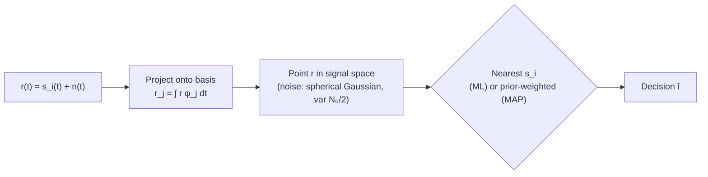
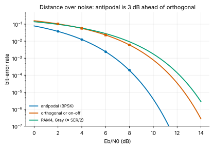
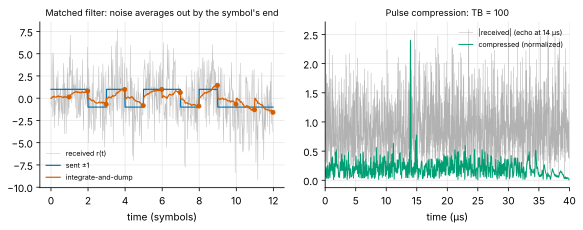

<!-- status: verified -->
# 17-05 · Matched Filters and Optimal Detection

| | |
|---|---|
| **Course** | [17 · Communication Systems](../README.md) |
| **University equivalent** | The optimum-receiver chapter of a senior digital-communications course: the matched filter and correlator, signal-space representation and Gram–Schmidt, maximum-likelihood and MAP detection in AWGN, error probabilities of binary and M-ary signalling, and the union bound (Proakis & Salehi, *Communication Systems Engineering*, optimum receivers for AWGN; Gallager, *Principles of Digital Communication*, detection; Haykin & Moher, signal-space analysis) |
| **Prerequisites** | [17-02](17-02-noise-and-snr.md) ($E_b/N_0$, AWGN), [17-04](17-04-baseband-digital-transmission.md) (PAM, pulses, eyes), [03-05](../../03-probability-statistics-and-random-variables/chapters/03-05-estimation-and-hypothesis-testing.md) (hypothesis tests), [02-06](../../02-complex-numbers-des-and-linear-algebra/chapters/02-06-vectors-matrices-and-linear-systems.md) (vectors, inner products) |
| **Estimated study hours** | 8 |
| **Last verified** | 2026-11-20 |

**Learning objectives.** After this chapter you can:

1. Derive the matched filter from the Cauchy–Schwarz inequality, show that its peak output SNR is $2E/N_0$, and implement it as a correlator or integrate-and-dump.
2. Represent a set of signals as vectors in an orthonormal basis (Gram–Schmidt), and compute their energies and distances.
3. Derive the maximum-likelihood and MAP detectors for AWGN and the decision threshold with unequal priors.
4. Compute error probabilities for antipodal, orthogonal and on-off signalling and for M-PAM, and the $E_b/N_0$ each needs for a target BER.
5. Bound the error probability of a general constellation with the union bound and the nearest-neighbour approximation.
6. Quantify the losses of practical receivers (mismatched filters, timing errors) and explain pulse compression and correlation receivers.

---

## 1. Big picture

17-04 asked how to send symbols through a band-limited channel without intersymbol interference. This chapter asks how a receiver should look at what arrives so as to make the fewest mistakes in noise. The answer has three parts, all derived here from first principles. First, the best linear filter before the sampler is **matched** to the expected pulse, and its output SNR depends only on the pulse's energy, not its shape: $2E/N_0$. Second, every signal set can be drawn as points in a small Euclidean space, and noise is a spherical Gaussian cloud around each point. Third, the best decision is the nearest point (or, with unequal priors, a shifted boundary), and the error probability is a $Q$-function of the distance between points. With these three ideas, the error rate of any modulation, BPSK to 1024-QAM (17-06), follows from geometry.

- **Every digital receiver contains a matched filter**, whether as a root-raised-cosine filter in a radio (17-04), a correlator in a GPS receiver, or a sampler and equalizer tuned to a SerDes channel.
- **Radar and sonar** use matched filtering to compress long, low-peak-power pulses into sharp, high-resolution returns (pulse compression).
- **Bit-error-rate specifications** ($10^{-12}$ for a link, 10% packet error for Wi-Fi) are $Q$-function statements about distance and noise; this chapter shows how to turn them into required $E_b/N_0$.
- **Machine-learning detectors**, now studied for 6G and used in a few products, are judged against exactly the maximum-likelihood rule derived here; the theory says how good they can possibly be.

## 2. Intuition first

Imagine listening for a known melody in static. The best strategy is not to turn up the volume, which raises the static too, but to compare what you hear, moment by moment, with the melody you expect, and add up the agreement. Where the melody is loud you trust the comparison more; where it is quiet, less. That running, weighted comparison is **correlation**, and a filter whose impulse response is the expected signal reversed in time computes it automatically. The total agreement at the end grows with the energy of the melody, while the static, which is equally likely to agree or disagree at every moment, grows only as the square root of the duration. Long, energetic signals stand out, whatever their shape.

**Analogy: a portfolio's signal-to-noise.** An analyst testing whether a strategy has positive expected return (the signal) amid daily volatility (the noise) weights each day's return by how much the strategy is expected to earn that day, then sums. The t-statistic grows as the square root of the number of days: more data, more evidence, regardless of how the expected returns are distributed across days. The matched filter is this weighted sum, and $2E/N_0$ is its squared t-statistic. **Where it breaks down:** financial returns are neither Gaussian nor white, and the "expected signal" must itself be estimated from the same data, whereas a receiver knows the transmitted pulse shape exactly and faces noise that really is white and Gaussian.

## 3. Theory

### 3.1 The detection problem

The transmitter sends one of $M$ known waveforms $s_1(t), \ldots, s_M(t)$ during $[0, T)$, with prior probabilities $P_1, \ldots, P_M$. The receiver observes

$$
r(t) = s_i(t) + n(t), \qquad 0 \le t < T ,
$$

where $n(t)$ is white Gaussian noise with two-sided PSD $N_0/2$ (17-02). It must decide which $i$ was sent, minimizing the probability of error. Two questions follow: what to compute from $r(t)$, and how to decide from it.

### 3.2 The matched filter

**The single-pulse question.** Suppose a single pulse $s(t)$ of energy $E = \int s^2\,dt$ may be present, and the receiver passes $r(t)$ through a linear filter $h(t)$ and samples the output at time $T$. The signal part of the sample is

$$
y_s = \int_{-\infty}^{\infty}s(\tau)h(T - \tau)\,d\tau ,
$$

and the noise part, by 17-01 §3.5, has variance $\sigma_y^2 = (N_0/2)\int h^2(t)\,dt$. The output SNR is

$$
\text{SNR} = \frac{y_s^2}{\sigma_y^2} = \frac{\big[\int s(\tau)h(T - \tau)\,d\tau\big]^2}{(N_0/2)\int h^2(\tau)\,d\tau} .
$$

**Derivation.** By the **Cauchy–Schwarz inequality**, $\big[\int u(\tau)v(\tau)\,d\tau\big]^2 \le \int u^2\,d\tau\int v^2\,d\tau$, with equality exactly when $v$ is proportional to $u$. Take $u = s(\tau)$ and $v = h(T - \tau)$ (whose energy equals that of $h$):

$$
\text{SNR} \le \frac{\int s^2\,d\tau\int h^2\,d\tau}{(N_0/2)\int h^2\,d\tau} = \frac{2E}{N_0} ,
$$

with equality when $h(T - \tau) = ks(\tau)$, that is

$$
h(t) = k\,s(T - t) .
$$

The **matched filter** is the expected pulse, reversed in time and delayed by $T$. Its output SNR at the sampling instant is $2E/N_0$, which depends on the pulse's **energy only**: a long, weak pulse and a short, strong one of equal energy are equally detectable.

> **Math refresher — the Cauchy–Schwarz inequality.** For functions (or vectors) $u$ and $v$, $\lvert\langle u, v\rangle\rvert \le \lVert u\rVert\lVert v\rVert$. Proof: for every real λ, $0 \le \lVert u - \lambda v\rVert^2 = \lVert u\rVert^2 - 2\lambda\langle u, v\rangle + \lambda^2\lVert v\rVert^2$; a quadratic in λ that never goes negative has a non-positive discriminant, $4\langle u, v\rangle^2 - 4\lVert u\rVert^2\lVert v\rVert^2 \le 0$. Equality needs $u = \lambda v$ for some λ. Its finance twin is that a correlation coefficient lies between −1 and +1.

**The correlator.** Substituting $h(t) = s(T - t)$, the filter output at $T$ is

$$
y(T) = \int r(\tau)s(\tau)\,d\tau ,
$$

the **correlation** of the received signal with the expected one. A **correlation receiver** multiplies by the template and integrates; for a rectangular pulse the template is a constant and the receiver simply integrates over the symbol and dumps (**integrate-and-dump**).

**In frequency.** The matched filter's response is $H(f) = kS^*(f)e^{-j2\pi fT}$: it passes each frequency in proportion to how much signal is there and aligns all their phases to peak at $T$. With **colored** noise of PSD $S_n(f)$, the same Cauchy–Schwarz argument works in frequency (see the callout): $H(f) \propto S^*(f)e^{-j2\pi fT}/S_n(f)$, with an SNR of $\int\lvert S(f)\rvert^2/S_n(f)\,df$: weight the frequencies where the noise is low (Problem 17-05.10).

> **Going deeper — the matched filter for colored noise.** The output signal at $T$ is $\int S(f)H(f)e^{j2\pi fT}df$ and the output noise power is $\int\lvert H(f)\rvert^2S_n(f)\,df$. Write the signal integrand as $\big(S(f)e^{j2\pi fT}/\sqrt{S_n(f)}\big)\big(H(f)\sqrt{S_n(f)}\big)$ and apply the Cauchy–Schwarz inequality: $\lvert\int SHe^{j2\pi fT}df\rvert^2 \le \int\lvert S\rvert^2/S_n\,df \cdot \int\lvert H\rvert^2S_n\,df$. Dividing by the noise power, $\text{SNR} \le \int\lvert S(f)\rvert^2/S_n(f)\,df$, with equality when $H\sqrt{S_n} \propto \big(Se^{j2\pi fT}/\sqrt{S_n}\big)^*$, that is $H(f) \propto S^*(f)e^{-j2\pi fT}/S_n(f)$. For white noise, $S_n = N_0/2$ and this reduces to $2E/N_0$ by Parseval. The filter is a whitening filter $1/\sqrt{S_n}$ followed by the matched filter for the whitened pulse.

**The output waveform.** The matched filter's signal output is $\int s(\tau)s(\tau - t + T)\,d\tau$, the pulse's **autocorrelation** shifted to peak at $T$. For a rectangular pulse it is a triangle of base $2T$: sampling a fraction $\delta$ of a symbol early or late reduces the signal by $(1 - \delta)$ and the SNR by $(1 - \delta)^2$ (Example 17-05.1).

**The RRC pair revisited.** 17-04's root-raised-cosine receive filter is matched to the RRC transmit pulse, so it maximizes the SNR, and their cascade is a raised cosine, so it has zero ISI. A link using this pair achieves both at once.

### 3.3 Signal space

A set of $M$ waveforms spans a space of at most $M$ dimensions. Choose an orthonormal basis $\phi_1(t), \ldots, \phi_N(t)$, with $\int\phi_j\phi_k\,dt = \delta_{jk}$, by **Gram–Schmidt**: take $\phi_1 = s_1/\sqrt{E_1}$; subtract from $s_2$ its projection on $\phi_1$ and normalize what is left; and so on, skipping any signal that lies wholly in the span already found. Then every signal is a vector,

$$
s_i(t) = \sum_{j=1}^{N}s_{ij}\phi_j(t), \qquad s_{ij} = \int s_i(t)\phi_j(t)\,dt ,
$$

and energies and distances become Euclidean: $E_i = \lVert\mathbf s_i\rVert^2$ and

$$
d_{ik}^2 = \int[s_i(t) - s_k(t)]^2\,dt = \lVert\mathbf s_i - \mathbf s_k\rVert^2 .
$$

**Noise in signal space.** Project the noise onto the basis: $n_j = \int n(t)\phi_j(t)\,dt$. Each $n_j$ is Gaussian with mean zero, and

$$
\mathbb{E}[n_jn_k] = \int\!\!\int\mathbb{E}[n(t)n(u)]\phi_j(t)\phi_k(u)\,dt\,du = \frac{N_0}{2}\int\phi_j(t)\phi_k(t)\,dt = \frac{N_0}{2}\delta_{jk} .
$$

The noise components are **independent, each with variance $N_0/2$**, in every direction: the noise cloud is spherical. The part of the noise outside the span of the basis is independent of these components and of the signal, so it carries no information about which signal was sent (the **theorem of irrelevance**). The vector $\mathbf r = \mathbf s_i + \mathbf n$ of correlator outputs is therefore a **sufficient statistic**: nothing else in $r(t)$ helps.

### 3.4 Maximum-likelihood and MAP detection

Given $\mathbf r$, the **MAP** (maximum a posteriori) rule picks the $i$ with the largest posterior probability, which minimizes the probability of error. By Bayes' rule this maximizes $P_if(\mathbf r\mid\mathbf s_i)$. The noise density in $N$ dimensions is

$$
f(\mathbf r\mid\mathbf s_i) = (\pi N_0)^{-N/2}\exp\Big(-\frac{\lVert\mathbf r - \mathbf s_i\rVert^2}{N_0}\Big) ,
$$

so taking logarithms, MAP chooses the $i$ that minimizes

$$
\lVert\mathbf r - \mathbf s_i\rVert^2 - N_0\ln P_i .
$$

With equal priors the last term is the same for all $i$, and MAP becomes **maximum likelihood (ML)**: **choose the nearest signal point**. The decision regions are the cells of a Voronoi diagram, bounded by the perpendicular bisectors between neighbouring points.

**Binary antipodal signals with unequal priors.** Let $s_{1,2} = \pm\sqrt E$ along one dimension, with priors $P_1$ and $P_2$. MAP decides $s_1$ when $(r - \sqrt E)^2 - N_0\ln P_1 < (r + \sqrt E)^2 - N_0\ln P_2$, which simplifies to

$$
r > \frac{N_0}{4\sqrt E}\ln\frac{P_2}{P_1} .
$$

The threshold moves away from the more likely signal, enlarging its decision region, and moves more when the noise is larger (Example 17-05.5).

### 3.5 Error probabilities

**Two signals at distance $d$.** With ML detection, an error occurs when the noise component along the line joining the two points exceeds $d/2$ toward the wrong one. That component is Gaussian with variance $N_0/2$, so

$$
P_e = Q\Big(\frac{d/2}{\sqrt{N_0/2}}\Big) = Q\Big(\frac{d}{\sqrt{2N_0}}\Big) ,
$$

where $Q(x)$ is the Gaussian tail probability (03-02). Error probability is a function of **distance over noise**, nothing else.

**Three binary schemes at the same average energy per bit $E_b$:**

- **Antipodal** ($\pm\sqrt{E_b}$, BPSK or polar NRZ): $d = 2\sqrt{E_b}$, and $P_b = Q\big(\sqrt{2E_b/N_0}\big)$.
- **Orthogonal** (two equal-energy signals with $\int s_1s_2 = 0$, such as two tones spaced by a multiple of $1/(2T)$, or two non-overlapping pulse positions, 2-PPM; Manchester's two waveforms, by contrast, are negatives of each other and therefore antipodal): $d = \sqrt{2E_b}$, and $P_b = Q\big(\sqrt{E_b/N_0}\big)$: **3 dB worse**.
- **On-off** (energies 0 and $2E_b$, average $E_b$): $d = \sqrt{2E_b}$, the same as orthogonal.

Antipodal signalling is the most efficient binary scheme because it puts the two points as far apart as their energy allows. BPSK needs $E_b/N_0$ = **9.59** dB for $P_b = 10^{-5}$ and **10.53** dB for $10^{-6}$; each factor of ten lower in BER costs less than the one before, because $Q$ falls faster than exponentially.

**M-PAM.** Levels $\pm A, \pm3A, \ldots$ along one dimension (spacing $d = 2A$) have average energy $E_s = A^2(M^2 - 1)/3$ (17-04). An inner point errs if the noise exceeds $A$ either way, probability $2Q(A/\sqrt{N_0/2})$; the two outer points err only one way. Averaging,

$$
P_s = \frac{2(M - 1)}{M}Q\Big(\sqrt{\frac{6E_s}{(M^2 - 1)N_0}}\Big) ,
$$

and with Gray coding $P_b \approx P_s/\log_2M$. For PAM4 at $P_b = 10^{-6}$ this costs **3.87** dB more $E_b/N_0$ than binary, close to the asymptotic $10\log_{10}(5/2)$ = 3.98 dB.

*The formulas of §3.5 with Monte Carlo points from the lab's detectors (circles antipodal, squares orthogonal). Orthogonal and on-off signalling run 3 dB to the right of antipodal at every BER; Gray-coded PAM4 buys half the bandwidth with about 4 dB more $E_b/N_0$.*

### 3.6 The union bound

For a general constellation, the exact error probability needs integrals over polygonal regions. A simple and usually tight upper bound follows from the union of events. Given $s_i$ was sent, an error is the union of the pairwise events $E_{ik}$ = {$\mathbf r$ is closer to $s_k$ than to $s_i$}. Each has probability $Q(d_{ik}/\sqrt{2N_0})$ by the two-point result, and the probability of a union is at most the sum of the probabilities. It is also at least the largest single term, so the bound is tight when the nearest neighbours dominate:

$$
P(e\mid\mathbf s_i) \le \sum_{k \ne i}Q\Big(\frac{d_{ik}}{\sqrt{2N_0}}\Big) .
$$

At high SNR the terms with the smallest distance $d_{min}$ dominate, giving the **nearest-neighbour approximation**

$$
P_s \approx \bar N_{min}\,Q\Big(\frac{d_{min}}{\sqrt{2N_0}}\Big) ,
$$

with $\bar N_{min}$ the average number of nearest neighbours. Designing a constellation is therefore a packing problem: place points with the largest minimum distance for a given average energy. 17-06 applies this to PSK and QAM.

### 3.7 Practical receivers

*Left: antipodal rectangular pulses at $2E/N_0$ = 8 (9 dB) per symbol. The raw waveform is dominated by noise sample to sample, but the integrate-and-dump output at each symbol's end (dots) lands on the correct side of zero. Right: a 10 µs, 10 MHz chirp echo at 14 µs, about 6 dB below the noise per sample, stands out after compression (TB = 100, 20 dB).*

- **Mismatched filters.** Any other filter loses SNR relative to $2E/N_0$. For a rectangular pulse and a one-pole low-pass filter with time constant τ sampled at $T$, the ratio is $2(1 - e^{-x})^2/x$ with $x = T/\tau$; its best value, **0.815** (−0.89 dB), comes at $x$ = 1.256, a 3 dB bandwidth of about $0.2/T$ (Example 17-05.2). Simple filters come within 1 dB of optimal; the matched filter's value is often more in rejecting adjacent channels than in its last decibel.
- **Timing.** The matched filter's output peaks at one instant; clock recovery (Course 24) finds it. A 10% timing error with a rectangular pulse costs 0.92 dB.
- **Pulse compression.** Because detection depends only on energy, a radar can transmit a long, low-power pulse and still detect as if it had sent a short, powerful one. If the long pulse is a linear chirp of bandwidth $B$, its autocorrelation, the matched filter's output, has a main lobe about $1/B$ wide: the range resolution of a short pulse, the energy of a long one. The **compression ratio** is the time–bandwidth product $TB$ (Problem 17-05.13).
- **Correlation receivers in GNSS.** A GPS receiver's 1 ms correlation with the C/A code is a matched filter for one code period; 17-02's post-correlation $CT/N_0$ is the energy-to-noise-density ratio $E/N_0$, and the matched filter's peak SNR is twice it (Problem 17-05.14).

## 4. Worked examples

### Example 17-05.1 · Matched filtering a rectangular pulse (tier A)

**Setup.** A rectangular pulse of amplitude 1 V and duration 1 µs arrives in white noise with $N_0/2 = 10^{-8}$ V²/Hz. Find (a) its energy, (b) the matched filter's peak output SNR, (c) the noise standard deviation at the output of the filter $h(t) = s(T - t)$, and (d) the SNR loss if the sampler is 10% of a symbol late.

**Solution.** (a) $E = A^2T = 10^{-6}$ V²·s. (b) $2E/N_0 = 2 \times 10^{-6}/(2 \times 10^{-8})$ = **100**, or **20** dB. (c) The signal output peaks at $E = 10^{-6}$; the noise variance is $(N_0/2)\int h^2 = 10^{-8} \times 10^{-6}$, so σ = **1.0 × 10⁻⁷** (and $E^2/\sigma^2 = 100$, as it must). (d) The output is a triangle; 10% late it is $0.9E$, so the SNR falls by $0.9^2$, **−0.92** dB.

**Units check.** V²·s / (V²/Hz) is dimensionless.

**Sanity check.** Doubling the pulse length at the same amplitude doubles $E$ and the SNR (+3 dB), while the noise per sample of the integrator's output grows only as $\sqrt T$.

### Example 17-05.2 · The cost of a simple filter (tier B)

**Setup.** Instead of integrate-and-dump, a receiver filters a rectangular pulse of duration $T$ with a one-pole low-pass filter (time constant τ, unit DC gain) and samples at $T$. Find the SNR relative to the matched filter as a function of $x = T/\tau$, its best value, and the loss when τ = T.

**Solution.** The signal at $T$ is $A(1 - e^{-x})$. The filter's impulse response $(1/\tau)e^{-t/\tau}$ has $\int h^2 = 1/(2\tau)$, so the noise variance is $N_0/(4\tau)$. The SNR is $4\tau A^2(1 - e^{-x})^2/N_0$; dividing by $2E/N_0 = 2A^2T/N_0$,

$$
\frac{\text{SNR}}{2E/N_0} = \frac{2(1 - e^{-x})^2}{x} .
$$

Maximizing numerically gives $x$ = **1.2564** and a ratio of **0.8145**, **−0.89** dB; the filter's 3 dB bandwidth is then $x/(2\pi T)$ = **0.200**/T. With τ = T ($x$ = 1) the ratio is **0.799**, **−0.97** dB.

**Units check.** $x$ and the ratio are dimensionless; τ in s gives $\int h^2$ in 1/s.

**Sanity check.** As τ → 0 the filter passes all the noise (ratio → 0 as $2/x$); as τ → ∞ it barely responds to the pulse (ratio → 0 as $2x$). The optimum must lie between, near τ ≈ T.

### Example 17-05.3 · Gram–Schmidt for three signals (tier B)

**Setup.** On $[0, 1)$ s: $s_1 = 1$ throughout; $s_2 = +1$ on the first half and −1 on the second; $s_3 = 1$ on the first half and 0 on the second. Find an orthonormal basis, the signal vectors, energies and all pairwise distances.

**Solution.** $E_1 = 1$, so $\phi_1 = s_1$. $\langle s_2, \phi_1\rangle = 0.5 - 0.5 = 0$, so $s_2$ is already orthogonal with energy 1, and $\phi_2 = s_2$. $\langle s_3, \phi_1\rangle$ = 0.5 and $\langle s_3, \phi_2\rangle$ = 0.5, and $s_3 - 0.5\phi_1 - 0.5\phi_2 = 0$ everywhere (on the first half $1 - 0.5 - 0.5$; on the second $0 - 0.5 + 0.5$), so the space is **2**-dimensional. Vectors: $\mathbf s_1 = (1, 0)$, $\mathbf s_2 = (0, 1)$, $\mathbf s_3 = (0.5, 0.5)$; energies 1, 1 and **0.5**. Distances: $d_{12} = \sqrt2$ = **1.414**, $d_{13} = d_{23} = \sqrt{0.5}$ = **0.707**.

**Units check.** Taking amplitudes in V and time in s, energies are V²·s and distances their square roots.

**Sanity check.** $d_{13}^2 = \int(s_1 - s_3)^2 = 0 \cdot 0.5 + 1 \cdot 0.5 = 0.5$, the same from the waveforms as from the vectors.

### Example 17-05.4 · Antipodal, orthogonal and on-off at 8 dB (tier B)

**Setup.** Compare the bit-error rates of antipodal and orthogonal signalling at $E_b/N_0$ = 8 dB, and the $E_b/N_0$ each needs for $P_b = 10^{-6}$.

**Solution.** $E_b/N_0 = 10^{0.8} = 6.31$. Antipodal: $Q(\sqrt{12.62}) = Q(3.552)$ = **1.91 × 10⁻⁴**. Orthogonal (and on-off at the same average energy): $Q(\sqrt{6.31}) = Q(2.512)$ = **6.0 × 10⁻³**, thirty times worse. For $10^{-6}$, $Q^{-1}(10^{-6}) = 4.753$: antipodal needs $4.753^2/2$, **10.53** dB, orthogonal $4.753^2$, **13.54** dB, exactly 3.01 dB more.

**Units check.** $E_b/N_0$ is dimensionless; $Q$ takes a pure number.

**Sanity check.** The orthogonal points sit at distance $\sqrt{2E_b}$, a factor $\sqrt2$ closer than antipodal's $2\sqrt{E_b}$; matching the distance needs twice the energy, 3 dB, at every BER.

### Example 17-05.5 · A MAP threshold (tier C)

**Setup.** Antipodal signals $\pm1$ (so $\sqrt E = 1$) are received in noise with $N_0 = 0.5$ (σ = 0.5). The symbol +1 is sent with probability 0.8. Find the MAP threshold and compare the MAP and ML error probabilities.

**Solution.** Threshold $t = (N_0/4)\ln(P_2/P_1) = 0.125\ln(0.25)$ = **−0.173**. MAP errors: +1 is misread when $n < t - 1$, probability $Q(1.173/0.5)$ = **0.00947**; −1 is misread when $n > t + 1$, probability $Q(0.827/0.5)$ = **0.0491**. Averaging with the priors, $P_e = 0.8 \times 0.00947 + 0.2 \times 0.0491$ = **0.0174**. ML (threshold 0): $Q(2)$ = **0.0228** for both symbols. MAP cuts the error probability by 24%.

**Units check.** All quantities are dimensionless (signals and noise in the same units).

**Sanity check.** Scanning the threshold numerically finds the minimum at −0.1733, the MAP value; and as $N_0 \to 0$ the threshold returns to 0, because with negligible noise the priors stop mattering.

### Example 17-05.6 · PAM4 against binary at the same BER (tier C)

**Setup.** Find the PAM4 symbol- and bit-error rates at $E_b/N_0$ = 10 dB (Gray coding), compare with BPSK, and find the extra $E_b/N_0$ PAM4 needs for $P_b = 10^{-6}$. Then bound the error probability of four orthogonal signals at the same $E_b/N_0$.

**Solution.** $E_s = 2E_b$, so $E_s/N_0 = 20$, and $P_s = 1.5\,Q(\sqrt{6 \times 20/15}) = 1.5\,Q(2.828)$ = **3.51 × 10⁻³**, $P_b \approx P_s/2$ = **1.75 × 10⁻³**. BPSK at 10 dB: $Q(\sqrt{20})$ = **3.87 × 10⁻⁶**. Solving $0.75\,Q(\sqrt{0.8E_b/N_0}) = 10^{-6}$ gives **14.40** dB against BPSK's 10.53 dB: **3.87** dB more. Four orthogonal signals have $E_s = 2E_b$ and all pairwise distances $\sqrt{2E_s}$, so the union bound is $3Q(\sqrt{E_s/N_0}) = 3Q(\sqrt{20})$ = **1.16 × 10⁻⁵**.

**Units check.** Pure ratios throughout.

**Sanity check.** PAM4 buys bandwidth (half the symbol rate) with power; orthogonal signalling does the opposite, using more dimensions (bandwidth) to improve power efficiency as M grows (Problem 17-05.12).

<!-- answer-key -->

| ID | Quantity | Value | Unit |
|---|---|---|---|
| Txt 17-05.a | BPSK Eb/N0 for BER 1e-5 | 9.59 | dB |
| Txt 17-05.b | BPSK Eb/N0 for BER 1e-6 | 10.53 | dB |
| Txt 17-05.c | PAM4 extra Eb/N0 at BER 1e-6 | 3.87 | dB |
| Txt 17-05.d | PAM4 asymptotic penalty | 3.98 | dB |
| Txt 17-05.e | best one-pole filter, ratio to matched | 0.815 | — |
| Txt 17-05.f | best one-pole filter loss | −0.89 | dB |
| Txt 17-05.g | 10% timing error loss | 0.92 | dB |
| Txt 17-05.h | Q⁻¹(1e-5) | 4.265 | — |
| Txt 17-05.i | Q⁻¹(1e-6) | 4.753 | — |
| Txt 17-05.j | Q⁻¹(1e-12) | 7.034 | — |
| Txt 17-05.k | Q⁻¹(1e-13) | 7.349 | — |
| Txt 17-05.l | uncoded BPSK Eb/N0 for 1e-13 | 14.31 | dB |
| Txt 17-05.m | GPS 1 ms correlation peak SNR at 46.87 dB-Hz | 19.88 | dB |
| Txt 17-05.n | mean time to one error at 1e-15, 100 Gb/s | 2.8 | h |
| Txt 17-05.o | LoRa SF12 time-bandwidth product in dB | 36.1 | dB |
| Txt 17-05.p | LoRa SF12 threshold at NF 0 | −143.0 | dBm |
| Txt 17-05.q | implied LoRa noise figure | 7.0 | dB |
| Txt 17-05.r | LoRa SF12 Eb/N0 at the SNR limit | 6.3 | dB |
| Ex 17-05.1a | matched-filter peak SNR | 100 | — |
| Ex 17-05.1b | in dB | 20 | dB |
| Ex 17-05.1c | output noise standard deviation | 1.0e-7 | V²·s |
| Ex 17-05.1d | 10% late sampling | −0.92 | dB |
| Ex 17-05.2a | optimum T/τ | 1.2564 | — |
| Ex 17-05.2b | optimum ratio | 0.8145 | — |
| Ex 17-05.2c | optimum loss | −0.89 | dB |
| Ex 17-05.2d | optimum 3 dB bandwidth × T | 0.200 | — |
| Ex 17-05.2e | ratio at τ = T | 0.799 | — |
| Ex 17-05.2f | loss at τ = T | −0.97 | dB |
| Ex 17-05.3a | dimensions | 2 | — |
| Ex 17-05.3b | energy of s3 | 0.5 | V²·s |
| Ex 17-05.3c | d12 | 1.414 | V·√s |
| Ex 17-05.3d | d13 = d23 | 0.707 | V·√s |
| Ex 17-05.4a | antipodal BER at 8 dB | 1.91e-4 | — |
| Ex 17-05.4b | orthogonal BER at 8 dB | 6.0e-3 | — |
| Ex 17-05.4c | antipodal Eb/N0 for 1e-6 | 10.53 | dB |
| Ex 17-05.4d | orthogonal Eb/N0 for 1e-6 | 13.54 | dB |
| Ex 17-05.5a | MAP threshold | −0.173 | — |
| Ex 17-05.5b | P(error given +1), MAP | 0.00947 | — |
| Ex 17-05.5c | P(error given −1), MAP | 0.0491 | — |
| Ex 17-05.5d | MAP error probability | 0.0174 | — |
| Ex 17-05.5e | ML error probability | 0.0228 | — |
| Ex 17-05.6a | PAM4 SER at 10 dB | 3.51e-3 | — |
| Ex 17-05.6b | PAM4 BER at 10 dB | 1.75e-3 | — |
| Ex 17-05.6c | BPSK BER at 10 dB | 3.87e-6 | — |
| Ex 17-05.6d | PAM4 Eb/N0 for 1e-6 | 14.40 | dB |
| Ex 17-05.6e | PAM4 extra over BPSK | 3.87 | dB |
| Ex 17-05.6f | four-orthogonal union bound | 1.16e-5 | — |

*Every value is recomputed by [verify_17_05.py](../verify/verify_17_05.py): the matched filter's SNR and its timing loss by simulating the filter on sampled noise, the one-pole optimum by numerical optimization, Gram–Schmidt numerically on sampled waveforms, error probabilities in closed form and by Monte Carlo detection in signal space, the MAP threshold by scanning, and the union bounds against simulated error rates.*

## 5. Simulate it

The lab, [labs/17-05-lab](../labs/17-05-lab/README.md), provides `detection.py`: calibrated continuous-time white noise on a sample grid, matched filtering and correlation, numerical Gram–Schmidt, ML and MAP detectors, Monte Carlo error rates for binary, M-PAM and orthogonal signal sets, union and nearest-neighbour bounds, and a linear-chirp pulse-compression demonstration. In the notebook, **predict, then run**:

1. **The matched filter's SNR.** Predict the peak output SNR for a rectangular pulse, a half-sine and a chirp of the same energy, then measure all three.
2. **Mismatch.** Predict the loss of a one-pole filter as τ varies, then sweep it and find the optimum.
3. **Signal space.** Run Gram–Schmidt on Example 17-05.3's signals and on four random waveforms; predict the dimensions first.
4. **Error rates.** Predict the BER of antipodal, orthogonal and on-off signalling from 0 to 12 dB, then simulate, and compare PAM4 with the formula and the nearest-neighbour approximation.
5. **Pulse compression.** Predict the compressed width and peak gain for a 10 µs, 10 MHz chirp, then filter a noisy echo.

## 6. Engineering tradeoffs

| Knob | Improves | Costs | Typical decision owner |
|---|---|---|---|
| Matched (instead of simple) receive filter | Up to about 1 dB of SNR; adjacent-channel rejection | Filter complexity, latency; requires knowing the pulse | Modem / PHY designer |
| Longer symbols (more energy per symbol) | $2E/N_0$ grows with duration | Data rate, latency | System architect |
| Antipodal instead of orthogonal or on-off | 3 dB at every BER | Coherent detection (phase reference) | PHY architect |
| More PAM levels | Bandwidth (bits per symbol) | Power: ≈ 4 dB for PAM4 over binary at $10^{-6}$ | Standards body |
| More orthogonal dimensions (M-FSK, spreading) | Power efficiency | Bandwidth grows with M | Standards body (low-power links) |
| MAP instead of ML | Lower error rate when priors are skewed | Needs priors and noise level; small gain when priors are near equal | Receiver designer |
| Pulse compression (chirps) | Resolution of a short pulse with the energy of a long one | Bandwidth, range sidelobes, Doppler sensitivity | Radar system architect |

## 7. Numbers to know

| Quantity | Value | Note |
|---|---|---|
| Matched-filter peak SNR | $2E/N_0$ | independent of pulse shape |
| BPSK BER | $Q(\sqrt{2E_b/N_0})$; 9.59 dB for $10^{-5}$, 10.53 dB for $10^{-6}$ | |
| Orthogonal or on-off BER | $Q(\sqrt{E_b/N_0})$ | 3 dB worse than antipodal |
| Error probability between two points | $Q(d/\sqrt{2N_0})$ | noise variance $N_0/2$ per dimension |
| $Q^{-1}$ | 4.265 ($10^{-5}$), 4.753 ($10^{-6}$), 7.034 ($10^{-12}$), 7.349 ($10^{-13}$) | |
| Best one-pole filter on a rectangular pulse | −0.89 dB at $f_{3\text{dB}} \approx 0.2/T$ | |
| PAM4 penalty at $10^{-6}$ | 3.87 dB in $E_b/N_0$ | |

## 8. Common mistakes

- **Using SNR in a bandwidth instead of $E/N_0$.** The matched filter's figure of merit is energy over noise density; a "low SNR" in a wide band can be a high $2E/N_0$.
- **Forgetting the factor 2.** The peak SNR is $2E/N_0$ with $N_0$ one-sided; the noise variance per signal-space dimension is $N_0/2$.
- **Thinking pulse shape matters for SNR.** Only energy does, for the matched filter; shape matters for bandwidth, ISI and timing sensitivity.
- **Comparing schemes at equal peak instead of equal average energy** (or the reverse) without saying so.
- **Using $P_b = P_s$ for M-ary schemes.** With Gray coding $P_b \approx P_s/\log_2M$ at high SNR.
- **Treating the union bound as exact at low SNR.** It can exceed 1; it is tight only when errors are dominated by nearest neighbours.
- **Applying ML when priors are unequal.** MAP shifts the threshold; with strongly skewed symbols (for example in some coded systems' bits) the gain is real.

## 9. Practitioner lens

### State of the art (as of Nov 2026)

- **Link specifications are $Q$-function statements.** IEEE P802.3dj's objective of a BER of $10^{-13}$ at the MAC interface ([R-270]) corresponds to $Q^{-1}(10^{-13})$ = 7.35, which for uncoded binary signalling would need $E_b/N_0$ = **14.31** dB at the slicer; real links reach it with FEC, which corrects a much higher raw error rate (17-08) **[Established]** for the objective; the conversion is ours.
- **Correlation receivers in GNSS.** A GPS receiver correlates with the 1023-chip, 1 ms C/A code ([R-259]): a matched filter one code period long. At the 46.87 dB-Hz of 17-02's example, the 1 ms correlation's peak SNR is $2E/N_0$ = **19.88** dB (Problem 17-05.14) **[Established]**.
- **LoRa is pulse compression for the Internet of Things.** Semtech's SX1276 data sheet (Rev. 5, Aug 2016) lists a LoRa demodulator SNR of −20 dB at spreading factor 12 (4096 chips per symbol), a sensitivity of −136 dBm in 125 kHz, and an effective bit rate of 293 b/s ([R-274]) **[Established]**. Each symbol is a chirp correlated against its reference, a matched filter with a time–bandwidth product of 4096 (36.1 dB). The figures are consistent with §3 and 17-02: −174 dBm/Hz + 51.0 dB (125 kHz) − 20 dB is −143.0 dBm, so −136 dBm implies a noise figure of about **7.0** dB, and the −20 dB SNR in 125 kHz at 293 b/s is an $E_b/N_0$ of **6.3** dB.
- **Radio sensitivity budgets assume near-matched filtering.** 3GPP's NR reference-sensitivity assumptions use an SNR of about −1 dB in the occupied bandwidth with QPSK and a rate-1/3 code ([R-260]); that is possible because the rate-1/3 code spreads each information bit over three coded bits ($E_b/N_0 \approx 0.8$ dB), on top of matched filtering of each symbol **[Established]**.
- **PCIe 6.0 traded raw error rate for a light FEC and retry.** PCI-SIG's design accepts a retry probability per 256-byte flit of about $5 \times 10^{-6}$ with a light-weight FEC and strong CRC ([R-059]; flit format also in [R-273], secondary): the detector's raw error rate is engineered, not minimized at any cost **[Established, secondary]**.

### Why it matters commercially

The matched filter and ML detector are the ceiling every receiver chip is measured against. The gap between a product's measured sensitivity and the theoretical $E_b/N_0$ for its modulation and code is its **implementation loss**, the sum of filter mismatch, timing and phase errors, quantization and nonlinearity: typically a few decibels, and each one is range, battery life or yield. Companies selling modems, SerDes and radar sensors compete on how close they come to these bounds at low power. For an investor, knowing that the bound is $Q(\sqrt{2E_b/N_0})$ for BPSK, or that pulse compression trades bandwidth for peak power, turns a vendor's sensitivity claim into a testable statement about implementation loss.

### Marketing vs Reality

- **"Our receiver works at negative SNR."** Any receiver whose processing gain (occupied bandwidth divided by bit rate, as with spreading or a low-rate code) exceeds its required $E_b/N_0$ does, when SNR is measured in the RF bandwidth; LoRa and GPS are examples, while an uncoded QPSK receiver at negative SNR has a bit-error rate above $10^{-1}$. Ask for the required $E_b/N_0$ at the target error rate and compare it with the theoretical value for the modulation and code; the gap is the implementation loss.
- **"Machine-learning detection beats the classical receiver."** In AWGN with a known signal set, nothing beats ML detection; gains are possible only against impairments the classical receiver ignores (nonlinearity, interference, unknown channels). Ask what the baseline was.
- **"Radar resolution of a few centimetres with low peak power."** Plausible with pulse compression, if the bandwidth is several GHz; ask for the bandwidth and the range sidelobe level, which pulse compression trades against.
- **"BER below $10^{-15}$."** Usually extrapolated, not measured: at 100 Gb/s, observing one error at $10^{-15}$ takes **2.8** hours on average, and confidence in the rate needs many errors. Ask how it was measured (03-05).

### Questions for engineering leaders

1. **"What is your implementation loss: required $E_b/N_0$ against theory, at the target BER?"** *Strong:* gives the number and its breakdown (filter, timing, phase noise, quantization, nonlinearity). *Evasive:* quotes sensitivity in dBm without the rate or modulation.
2. **"Is your receive filter matched to the transmit pulse, and what do you trade for adjacent-channel rejection?"** *Strong:* states the filter, its SNR loss and its selectivity. *Evasive:* "standard filtering".
3. **"How was the BER figure established: measured errors, extrapolation or a statistical model?"** *Strong:* reports error counts and confidence intervals, or a validated statistical eye. *Evasive:* "the eye is wide open".
4. **"For the radar: what bandwidth, chirp duration and sidelobe level, and what peak power does compression save?"** *Strong:* ties resolution to $c/2B$ and processing gain to $TB$. *Evasive:* quotes resolution alone.
5. **"Where does detection with priors or soft information enter your receiver?"** *Strong:* explains soft-decision inputs to the decoder (log-likelihood ratios, 17-08). *Evasive:* hard decisions only.

## 10. Concept check

**Q1.** Two pulses have the same energy: one is short and tall, the other long and low. Which is easier to detect with a matched filter in white noise?

Answer

Neither: the matched filter's peak SNR is $2E/N_0$, which depends only on energy. The shapes differ in bandwidth, timing sensitivity and resolution, not detectability.

**Q2.** Why is the noise in every signal-space direction independent with variance $N_0/2$?

Answer

Each component is $\int n\phi_j$, and white noise's autocorrelation $(N_0/2)\delta(\tau)$ makes $\mathbb E[n_jn_k] = (N_0/2)\int\phi_j\phi_k = (N_0/2)\delta_{jk}$. Uncorrelated jointly Gaussian variables are independent.

**Q3.** How much more $E_b/N_0$ does orthogonal signalling need than antipodal for the same BER, and why?

Answer

Antipodal needs 3 dB less than orthogonal for the same BER, because its points are $\sqrt2$ farther apart at the same energy.

**Q4.** A binary source sends "1" 90% of the time. Which way does the MAP threshold move, and what happens to it as the noise vanishes?

Answer

Toward the rarer symbol's point, enlarging the region of the likely one; its offset is $(N_0/4\sqrt E)\ln(P_2/P_1)$, which tends to zero as $N_0 \to 0$.

**Q5.** Why is a correlator with the transmitted chirp able to resolve two targets much closer than the chirp's duration?

Answer

The matched filter's output is the chirp's autocorrelation, whose main lobe is about $1/B$ wide, not $T$. Resolution follows bandwidth, detectability follows energy.

**Q6.** When is the union bound a poor estimate?

Answer

At low SNR, where many error events overlap and the sum of pairwise probabilities double-counts them; it can then exceed 1. At high SNR the nearest-neighbour terms dominate and it is tight.

Practice: [17-05 problems](../problems/17-05-problems.md) · [worked solutions](../solutions/17-05-solutions.md).

## 11. Key terms

[Matched filter](../../../reference/glossary.md#matched-filter) · [Correlation receiver](../../../reference/glossary.md#correlation-receiver) · [Integrate-and-dump](../../../reference/glossary.md#integrate-and-dump) · [Cauchy–Schwarz inequality](../../../reference/glossary.md#cauchy-schwarz-inequality) · [Signal space](../../../reference/glossary.md#signal-space) · [Gram–Schmidt procedure](../../../reference/glossary.md#gram-schmidt-procedure) · [Sufficient statistic](../../../reference/glossary.md#sufficient-statistic) · [Maximum-likelihood detection](../../../reference/glossary.md#maximum-likelihood-detection) · [MAP detection](../../../reference/glossary.md#map-detection) · [Decision region](../../../reference/glossary.md#decision-region) · [Q-function](../../../reference/glossary.md#q-function) · [Antipodal signalling](../../../reference/glossary.md#antipodal-signalling) · [Orthogonal signalling](../../../reference/glossary.md#orthogonal-signalling) · [Union bound](../../../reference/glossary.md#union-bound) · [Pulse compression](../../../reference/glossary.md#pulse-compression) · [Implementation loss](../../../reference/glossary.md#implementation-loss)

## 12. Connections

- **Builds on:** [17-02](17-02-noise-and-snr.md) ($E_b/N_0$ and the AWGN model), [17-04](17-04-baseband-digital-transmission.md) (pulses, RRC filters, eyes), [03-05](../../03-probability-statistics-and-random-variables/chapters/03-05-estimation-and-hypothesis-testing.md) (hypothesis tests and likelihood ratios), [03-02](../../03-probability-statistics-and-random-variables/chapters/03-02-random-variables-and-distributions.md) (the $Q$-function), [02-06](../../02-complex-numbers-des-and-linear-algebra/chapters/02-06-vectors-matrices-and-linear-systems.md) (inner products and orthogonality).
- **Next:** [17-06](17-06-bandpass-digital-modulation.md) applies signal space to PSK, QAM and FSK and computes their error rates.
- **Used later:** capacity and the limits of signal design ([17-07](17-07-information-theory-and-shannon.md)), soft-decision decoding ([17-08](17-08-channel-coding.md)), fading channels ([17-09](17-09-wireless-channels.md)), radar and mmWave front ends ([21-10](../../21-rf-and-microwave-engineering/chapters/21-10-antennas-arrays-mmwave.md)), and SerDes receivers ([24-03](../../24-high-speed-io-signal-integrity-and-photonics/chapters/24-03-serdes-architecture.md)).

## 13. Further study

- Proakis & Salehi, *Communication Systems Engineering*, the chapter on optimum receivers for the AWGN channel.
- Gallager, *Principles of Digital Communication*, the chapters on detection and on signal space (with the theorem of irrelevance done carefully).
- Wozencraft & Jacobs, *Principles of Communication Engineering* (1965), the classic source of the signal-space approach.
- Richards, *Fundamentals of Radar Signal Processing*, for matched filtering and pulse compression in radar.
- MIT OCW 6.450 (Gallager), lectures on detection and the AWGN channel.

## 14. Sources

1. D. O. North, "An analysis of the factors which determine signal/noise discrimination in pulsed carrier systems," RCA Laboratories report PTR-6C, 1943 (reprinted in *Proceedings of the IEEE*, vol. 51, pp. 1016–1027, 1963): the matched filter.
2. J. M. Wozencraft and I. M. Jacobs, *Principles of Communication Engineering*, Wiley, 1965: signal space and optimum detection.
3. J. G. Proakis and M. Salehi, *Communication Systems Engineering*, 2nd ed., Prentice Hall, 2002: optimum receivers, error probabilities, union bound.
4. R. G. Gallager, *Principles of Digital Communication*, Cambridge University Press, 2008: detection and the theorem of irrelevance.
5. IEEE P802.3dj objectives (Mar 2024). Research log [R-270].
6. IS-GPS-200N. Research log [R-259].
7. 3GPP TR 38.817-01 and TS 38.104 reference sensitivity. Research log [R-260].
8. D. Das Sharma, PCIe 6.0 slides (IEEE San Diego CAS/SSCS, Aug 2021; OFA Workshop 2022). Research log [R-059]; SNIA SDC slides on PCIe 6.0 and 7.0, [R-273].
9. Semtech SX1276/77/78/79 data sheet, Rev. 5 (Aug 2016). Research log [R-274].
