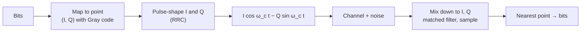
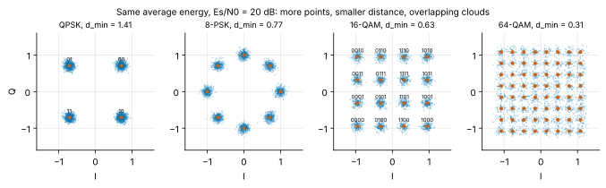
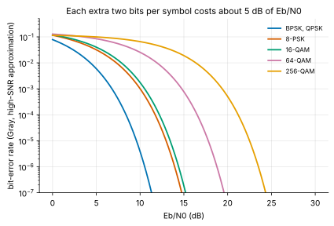

<!-- status: verified -->
# 17-06 · Bandpass Digital Modulation and BER

| | |
|---|---|
| **Course** | [17 · Communication Systems](../README.md) |
| **University equivalent** | The digital bandpass modulation chapter of a senior communications course: I/Q representation, BPSK, QPSK, M-PSK, M-QAM and FSK, their constellations, symbol- and bit-error rates in AWGN, differential and noncoherent detection, spectral efficiency, and transmitter quality (EVM) (Proakis & Salehi, *Communication Systems Engineering*, digital modulation; Haykin & Moher; Goldsmith, *Wireless Communications*, modulation for wireless) |
| **Prerequisites** | [17-05](17-05-matched-filters-and-detection.md) (signal space, ML detection, $Q(d/\sqrt{2N_0})$), [17-04](17-04-baseband-digital-transmission.md) (PAM, RRC pulses), [17-01](17-01-random-processes-and-psd.md) (bandpass noise and I/Q), [02-01](../../02-complex-numbers-des-and-linear-algebra/chapters/02-01-complex-numbers-euler-and-phasors.md) (complex numbers and phasors) |
| **Estimated study hours** | 10 |
| **Last verified** | 2026-11-20 |

**Learning objectives.** After this chapter you can:

1. Write a bandpass signal in terms of its in-phase and quadrature components and complex envelope, and identify the two-dimensional signal space of one symbol.
2. Construct BPSK, QPSK, M-PSK and square M-QAM constellations with Gray labelling, and compute their average energy, minimum distance and peak-to-average ratio.
3. Derive and compute symbol- and bit-error rates in AWGN for PSK and QAM, and the $E_b/N_0$ penalty of denser constellations.
4. Compare coherent, differential and noncoherent detection (BPSK, DPSK, coherent and noncoherent FSK) and explain constant-envelope modulation.
5. Compute spectral efficiency with pulse shaping and place real modulation-and-coding schemes against the Shannon bound.
6. Define error vector magnitude, convert between EVM and SNR, and interpret standards' EVM limits.

---

## 1. Big picture

Baseband PAM (17-04) uses one dimension per symbol. A radio has two for free: a carrier can be modulated in both cosine and sine, and the two are orthogonal, so the receiver can separate them. Every modern digital radio, from a Bluetooth earbud to a 5G base station, a Wi-Fi 7 router and a satellite modem, places its symbols as points in this **I/Q plane**, the **constellation**. How many points, and where, decides the bit rate per hertz and the signal-to-noise ratio needed: QPSK is robust and slow, 1024-QAM is fast and fragile. The geometry of 17-05 gives every error rate in this chapter; standards turn it into tables of modulation-and-coding schemes, each with a required SNR and a transmitter-quality limit (EVM).

- **Link adaptation.** Cellular and Wi-Fi radios switch among QPSK, 16-, 64-, 256- and 1024-QAM (4096-QAM in Wi-Fi 7) as the SNR changes; the thresholds are this chapter's curves plus coding gain.
- **EVM is a transmitter specification.** Standards cap the error vector magnitude per modulation: 3.5% for NR 256-QAM, for example (§9). It drives the linearity, and therefore the power consumption, of the power amplifier.
- **Constant envelope for efficiency.** FSK and its smooth variants (GFSK in Bluetooth, GMSK in GSM) keep the envelope constant so the power amplifier can run saturated: a battery-life choice paid for in spectral efficiency.
- **Satellite modems** use amplitude-and-phase constellations (APSK) designed for nonlinear amplifiers; DVB-S2's performance table shows how close modern codes come to Shannon (§9, 17-07).

## 2. Intuition first

A carrier is a rotating phasor. Freeze it at the symbol instant and you get a point: its distance from the origin is the amplitude, its angle the phase. Modulation chooses that point from a menu, the constellation; noise smears each received point into a small Gaussian cloud around where it should be; the receiver decides by picking the nearest menu item. More menu items mean more bits per symbol, but if you keep the average power fixed, the points crowd together and the clouds start to overlap. Doubling the number of points in two dimensions moves them closer by about $\sqrt2$, costing about 3 dB; four times as many points (two more bits) costs about 6 dB. That is the exchange rate between spectral efficiency and power, and the rest of the chapter makes it exact.

**Analogy: a menu of price-and-quantity combinations.** Each symbol is an order specifying two numbers (price and quantity, I and Q). A coarse menu of four orders is easy to read correctly even over a noisy phone line; a fine menu of a thousand orders conveys more per call but is misheard far more often. **Where it breaks down:** misreading an order costs only the bits that differ between the intended and the heard entry, which is why constellations are labelled so that neighbours differ in one bit (Gray coding); a menu has no such geometry.

## 3. Theory

### 3.1 Bandpass signals in I and Q

Any real bandpass signal centred on $f_c$ can be written

$$
s(t) = I(t)\cos\omega_ct - Q(t)\sin\omega_ct = \operatorname{Re}\big\{\tilde s(t)e^{j\omega_ct}\big\},\qquad \tilde s(t) = I(t) + jQ(t) ,
$$

where $I$ and $Q$ are low-pass signals and $\tilde s$ is the **complex envelope** (17-01 §3.9 did the same for noise). A quadrature modulator builds $s$ from $I$ and $Q$ (17-03 §3.2); a quadrature demodulator recovers them by mixing with $2\cos\omega_ct$ and $-2\sin\omega_ct$ and low-pass filtering.

**One symbol's signal space.** For a symbol of duration $T$ with $f_cT$ large (many carrier cycles per symbol), the two functions

$$
\phi_1(t) = \sqrt{2/T}\cos\omega_ct,\qquad \phi_2(t) = -\sqrt{2/T}\sin\omega_ct,\qquad 0 \le t < T ,
$$

are orthonormal: each has energy $\frac2T\int_0^T\cos^2\omega_ct\,dt \approx 1$, and their product integrates to approximately zero (the double-frequency terms average out). A symbol $s(t) = s_1\phi_1(t) + s_2\phi_2(t)$ is the point $(s_1, s_2)$ in a two-dimensional signal space, with energy $s_1^2 + s_2^2$. With rectangular pulses, $s_1 = I\sqrt{T/2}$ and $s_2 = Q\sqrt{T/2}$; with other pulses the same holds per symbol after matched filtering. Everything in 17-05 applies: noise has variance $N_0/2$ in each of the two directions, and ML detection picks the nearest point.

### 3.2 BPSK and QPSK

**BPSK** uses $\pm\sqrt{E_b}$ along $\phi_1$: antipodal signalling, $P_b = Q(\sqrt{2E_b/N_0})$ (17-05). The second dimension is unused.

**QPSK** uses both: the four points $(\pm a, \pm a)$ with $a = \sqrt{E_s/2}$, two bits per symbol ($E_s = 2E_b$). With Gray labelling, the first bit chooses the sign of the I coordinate and the second the sign of Q, so QPSK is **two independent BPSK channels** in quadrature, each with energy $E_b$ per bit:

$$
P_b = Q\Big(\sqrt{\frac{2E_b}{N_0}}\Big),\qquad P_s = 1 - (1 - q)^2 = 2q - q^2,\quad q = Q\Big(\sqrt{\frac{E_s}{N_0}}\Big) .
$$

QPSK carries twice BPSK's bit rate in the same bandwidth at the same $E_b/N_0$ and the same BER. This is the free lunch of the second dimension, and why BPSK is rarely used except where robustness or simplicity matters most.

### 3.3 M-PSK

**M-ary PSK** places $M$ points on a circle of radius $\sqrt{E_s}$ at angles $2\pi m/M$. Neighbours are separated by an angle $2\pi/M$, so

$$
d_{min} = 2\sqrt{E_s}\sin\frac\pi M .
$$

Each point has two nearest neighbours, and the nearest-neighbour approximation of 17-05 gives

$$
P_s \approx 2Q\Big(\sqrt{\frac{2E_s}{N_0}}\sin\frac\pi M\Big) ,
$$

accurate at high SNR (for $M \ge 4$). An exact single-integral form (Craig's formula) is $P_s = \frac1\pi\int_0^{(M-1)\pi/M}\exp\big(-\frac{E_s}{N_0}\frac{\sin^2(\pi/M)}{\sin^2\theta}\big)d\theta$, which the lab uses.

**The efficiency figure of merit.** Compare constellations by $d_{min}^2/(4E_b)$, the squared minimum distance relative to antipodal signalling at the same energy per bit. For PSK it is $\log_2M\sin^2(\pi/M)$: 1 for BPSK and QPSK, 0.439 for 8-PSK (**−3.57** dB) and 0.152 for 16-PSK (**−8.17** dB). PSK wastes the interior of the circle; beyond 8 points its penalty grows by about 6 dB per extra bit.

### 3.4 Square M-QAM

**Quadrature amplitude modulation** puts independent $\sqrt M$-level PAM on I and on Q, making a square grid of $M = 4, 16, 64, 256, 1024, \ldots$ points. With levels $\pm1, \pm3, \ldots$ in each dimension (spacing 2), the average energy per symbol is twice that of $\sqrt M$-PAM:

$$
E_s = 2\cdot\frac{M - 1}{3},\qquad d_{min} = 2 \;\Rightarrow\; \frac{d_{min}^2}{4E_b} = \frac{3\log_2M}{2(M - 1)} .
$$

Each dimension errs independently with the PAM probability $p = 2(1 - 1/\sqrt M)\,Q\big(\sqrt{3E_s/((M - 1)N_0)}\big)$, and the symbol is correct only if both are:

$$
P_s = 1 - (1 - p)^2 .
$$

With Gray labelling in each dimension, $P_b \approx P_s/\log_2M$ at high SNR. The figure of merit $d_{min}^2/(4E_b)$ is 0.4 for 16-QAM (**−3.98** dB), 0.143 for 64-QAM (**−8.45** dB), 0.047 for 256-QAM (**−13.27** dB) and 0.0147 for 1024-QAM (**−18.34** dB): **about 5 dB per extra two bits** once M is large (the energy grows with M while bits grow with log M). QAM beats PSK because it fills the plane: 16-QAM needs **4.20** dB less than 16-PSK for the same SER at high SNR.

*All four constellations normalized to the same average energy and received at $E_s/N_0$ = 20 dB. QPSK's clouds are far apart; 64-QAM's touch. The Gray labels on QPSK and 16-QAM change one bit between neighbours.*

**Peak-to-average ratio.** QAM's corner points have more energy than average: for 16-QAM the peak is $3^2 + 3^2 = 18$ against an average of 10 (**2.55** dB), and 3.68 dB for 64-QAM. A power amplifier must stay linear over that range, plus whatever the pulse shaping adds; PSK has a constant symbol envelope (before filtering), one reason satellites, whose amplifiers run near saturation, favour PSK and APSK (§9).

### 3.5 FSK, constant envelope and noncoherent detection

**Frequency-shift keying** sends one of $M$ tones. Two tones $f_1, f_2$ held for $T$ are orthogonal when their spacing is a multiple of $1/(2T)$ (with phase coherence) or of $1/T$ (with arbitrary phases). Binary FSK is binary orthogonal signalling:

$$
P_b^{\text{coh}} = Q\Big(\sqrt{\frac{E_b}{N_0}}\Big)\quad(\text{coherent}),\qquad P_b^{\text{nc}} = \tfrac12e^{-E_b/(2N_0)}\quad(\text{noncoherent}) .
$$

The noncoherent receiver measures the energy in each tone's matched filter without knowing the carrier phase; the price at practical error rates is under 1 dB beyond coherent FSK (**0.75** dB at $10^{-5}$), which is itself 3 dB behind BPSK.

**Continuous-phase FSK** avoids phase jumps at symbol boundaries; with spacing exactly $1/(2T)$ it is **MSK**, and smoothing the frequency transitions with a Gaussian filter gives **GMSK** (GSM) and **GFSK** (Bluetooth). Their envelope is constant, so the transmitter's power amplifier can be operated in saturation at high efficiency; the cost is spectral efficiency of roughly 1 b/s/Hz and the 3 dB disadvantage of orthogonal signalling.

**Differential PSK.** Coding information in the phase *change* between symbols lets the receiver use the previous symbol as its phase reference. Binary DPSK has $P_b = \tfrac12e^{-E_b/N_0}$, needing about **0.75** dB more than BPSK at $10^{-5}$, in exchange for not tracking the carrier phase.

### 3.6 Spectral efficiency

With root-raised-cosine shaping of roll-off α, a constellation with $M$ points occupies $(1 + \alpha)R_s$ of passband bandwidth for symbol rate $R_s$ (17-04), so the spectral efficiency is

$$
\eta = \frac{\log_2M}{1 + \alpha}\ \text{b/s/Hz} .
$$

QPSK with α = 0.25 gives 1.6 b/s/Hz; 64-QAM with α = 0.22 gives **4.92** b/s/Hz.

*Approximate bit-error rates with Gray labelling ($P_s/\log_2M$; Craig's exact SER for 8-PSK). The curves shift right by roughly the efficiency penalties of §3.3–§3.4: about 4 dB from QPSK to 16-QAM, then about 5 dB for each further two bits per symbol.* Forward error correction reduces η by the code rate but lowers the required SNR by much more (17-08). 17-07 shows that no scheme can exceed $\log_2(1 + \text{SNR})$ b/s/Hz, and §9 places real modulation-and-coding schemes against that bound.

### 3.7 Error vector magnitude

A transmitter is never perfect: power-amplifier compression, phase noise, I/Q imbalance and quantization move each transmitted point away from its ideal position. The **error vector** is the difference between the measured symbol and the ideal one, and the **error vector magnitude** is its rms value relative to the rms reference symbol:

$$
\text{EVM} = \sqrt{\frac{\frac1N\sum_k\lvert\tilde s_k - \tilde s_{k,\text{ideal}}\rvert^2}{\frac1N\sum_k\lvert\tilde s_{k,\text{ideal}}\rvert^2}} ,
$$

often quoted in percent or, as Wi-Fi does, in dB ($20\log_{10}\text{EVM}$, "relative constellation error"). If the impairments are noise-like, they act like additive noise at an SNR of

$$
\text{SNR}_{\text{EVM}} = \frac{1}{\text{EVM}^2} ,
$$

so 3.5% EVM corresponds to **29.12** dB and 2.5% to **32.04** dB. The transmitter's EVM and the receiver's noise add in power, so a transmitter at its EVM limit consumes part of the link's SNR budget before the channel adds any noise (Example 17-06.4).

## 4. Worked examples

### Example 17-06.1 · A QPSK link (tier A)

**Setup.** A QPSK link sends 20 Msymbol/s with RRC roll-off 0.25. Find the bit rate, occupied bandwidth and spectral efficiency, and the bit- and symbol-error rates at $E_b/N_0$ = 8 dB.

**Solution.** Bit rate $2 \times 20$ = **40** Mb/s; bandwidth $(1 + 0.25) \times 20$ = **25** MHz; η = 40/25 = **1.6** b/s/Hz. With $E_b/N_0 = 6.31$, $P_b = Q(\sqrt{12.62})$ = **1.91 × 10⁻⁴**, the same as BPSK; $P_s = 2q - q^2$ with $q = P_b$ (since $E_s/N_0 = 2E_b/N_0$), **3.82 × 10⁻⁴**.

**Units check.** Msymbol/s × bits/symbol = Mb/s; Mb/s ÷ MHz = b/s/Hz.

**Sanity check.** $P_s \approx 2P_b$: a symbol error usually flips exactly one of the two Gray-coded bits.

### Example 17-06.2 · 8-PSK against QPSK (tier B)

**Setup.** At $E_s/N_0$ = 15 dB, compare the symbol-error rates of QPSK and 8-PSK. What is 8-PSK's asymptotic $E_b/N_0$ penalty?

**Solution.** QPSK: $q = Q(\sqrt{31.62})$, $P_s = 2q - q^2$ = **1.87 × 10⁻⁸**. 8-PSK: $d_{min} = 2\sqrt{E_s}\sin(\pi/8)$ and $P_s \approx 2Q(\sqrt{63.25}\times0.3827)$ = **2.34 × 10⁻³**, which Craig's exact formula confirms to three digits. At the same $E_s$, the extra bit costs five orders of magnitude. Per bit, the penalty is $10\log_{10}(0.439)$ = **−3.57** dB.

**Units check.** All ratios are dimensionless.

**Sanity check.** The squared minimum distance falls from $2E_s$ (QPSK) to $4E_s\sin^2(\pi/8) = 0.586E_s$, a factor 3.41 (5.33 dB) at the same $E_s$; adding back the 1.76 dB for 3 bits instead of 2 per symbol gives 3.57 dB per bit.

### Example 17-06.3 · 16-QAM against 16-PSK (tier B)

**Setup.** At $E_b/N_0$ = 12 dB, find the symbol-error rates of 16-QAM and 16-PSK, and the asymptotic advantage of QAM.

**Solution.** $E_s/N_0 = 4 \times 15.85 = 63.4$. 16-QAM: $p = 1.5\,Q(\sqrt{3 \times 63.4/15})$ and $P_s = 1 - (1 - p)^2$ = **5.55 × 10⁻⁴**. 16-PSK: $P_s$ = **0.0280** (Craig). QAM is 50 times better here. Asymptotically, $0.4/(4\sin^2(\pi/16)) = 2.63$, **4.20** dB.

**Units check.** Dimensionless.

**Sanity check.** 16-QAM's points fill the square; 16-PSK's sit on a circle of the same average energy, closer together along the circumference.

### Example 17-06.4 · What an EVM limit means (tier B)

**Setup.** NR limits base-station EVM to 3.5% for 256-QAM and 2.5% for 1024-QAM (§9). (a) Convert each to an equivalent SNR. (b) If that error were the only impairment and Gaussian, what uncoded symbol-error rate would result? (c) What EVM does Wi-Fi's −35 dB limit for 1024-QAM correspond to?

**Solution.** (a) $1/0.035^2$ = 816, **29.12** dB; $1/0.025^2$ = 1600, **32.04** dB. (b) 256-QAM at $E_s/N_0$ = 29.12 dB: $P_s$ = **3.6 × 10⁻³**; 1024-QAM at 32.04 dB: **0.058**. (c) $10^{-35/20}$ = **1.78**%.

The transmitter limit alone would leave uncoded high-order QAM with error rates far above a link's needs; the standards rely on forward error correction (17-08), and in practice the top modulation orders are used only when both the transmitter and the channel are well inside these limits.

**Units check.** EVM is a ratio of rms magnitudes; its square is a power ratio.

**Sanity check.** For square QAM, $d_{min}^2/E_s = 6/(M - 1)$: 0.0235 for 256-QAM and 0.00587 for 1024-QAM, a factor of 4 (6.02 dB). The tighter EVM limit buys only **2.92** dB of that, which is why the same fractional EVM leaves 1024-QAM much worse off.

### Example 17-06.5 · DVB-S2 against Shannon (tier C)

**Setup.** DVB-S2's table lists, for quasi-error-free operation, QPSK rate 1/2 at a spectral efficiency of 0.988858 bits per symbol needing $E_s/N_0$ = 1.00 dB, and 32APSK rate 9/10 at 4.453027 bits per symbol needing 16.05 dB (§9). Convert each to $E_b/N_0$ and find its gap to the Shannon bound $E_s/N_0 \ge 2^\eta - 1$ (17-07).

**Solution.** $E_b/N_0 = E_s/N_0 - 10\log_{10}\eta$: QPSK 1/2 needs **1.05** dB, 32APSK 9/10 needs **9.56** dB. The Shannon bound: $2^{0.988858} - 1 = 0.9846$, **−0.07** dB, a gap of **1.07** dB for QPSK 1/2; $2^{4.453} - 1 = 20.9$, **13.20** dB, a gap of **2.85** dB for 32APSK 9/10.

**Units check.** η in bits per symbol; $E_s/N_0$ dimensionless.

**Sanity check.** Uncoded QPSK would need about 9.6 dB of $E_b/N_0$ for a BER of $10^{-5}$; the code buys about 8.5 dB at a cost of half the bit rate. Dense constellations sit farther from the bound because their shaping and labelling are harder to optimize.

### Example 17-06.6 · Coherent, differential and noncoherent (tier C)

**Setup.** At $E_b/N_0$ = 10 dB, compare BPSK, DPSK, coherent BFSK and noncoherent BFSK, and find the $E_b/N_0$ each of BPSK, DPSK and noncoherent BFSK needs for $10^{-5}$.

**Solution.** At 10 dB: BPSK $Q(\sqrt{20})$ = **3.87 × 10⁻⁶**; DPSK $\tfrac12e^{-10}$ = **2.27 × 10⁻⁵**; coherent BFSK $Q(\sqrt{10})$ = **7.8 × 10⁻⁴**; noncoherent BFSK $\tfrac12e^{-5}$ = **3.37 × 10⁻³**. For $10^{-5}$: BPSK **9.59** dB; DPSK $\ln(1/(2 \times 10^{-5}))$ = 10.82, **10.34** dB; noncoherent BFSK $2 \times 10.82$, **13.35** dB.

**Units check.** Dimensionless.

**Sanity check.** Noncoherent FSK needs exactly 3.01 dB more than DPSK at every BER, because its exponent is $E_b/(2N_0)$ instead of $E_b/N_0$.

<!-- answer-key -->

| ID | Quantity | Value | Unit |
|---|---|---|---|
| Txt 17-06.a | 8-PSK efficiency penalty | −3.57 | dB |
| Txt 17-06.b | 16-PSK efficiency penalty | −8.17 | dB |
| Txt 17-06.c | 16-QAM efficiency penalty | −3.98 | dB |
| Txt 17-06.d | 64-QAM efficiency penalty | −8.45 | dB |
| Txt 17-06.e | 256-QAM efficiency penalty | −13.27 | dB |
| Txt 17-06.f | 1024-QAM efficiency penalty | −18.34 | dB |
| Txt 17-06.g | 16-QAM over 16-PSK | 4.20 | dB |
| Txt 17-06.h | 16-QAM peak-to-average | 2.55 | dB |
| Txt 17-06.i | 64-QAM peak-to-average | 3.68 | dB |
| Txt 17-06.j | DPSK penalty at 1e-5 | 0.75 | dB |
| Txt 17-06.k | 64-QAM spectral efficiency, α = 0.22 | 4.92 | b/s/Hz |
| Txt 17-06.l | SNR for 3.5% EVM | 29.12 | dB |
| Txt 17-06.m | SNR for 2.5% EVM | 32.04 | dB |
| Txt 17-06.n | noncoherent over coherent BFSK at 1e-5 | 0.75 | dB |
| Txt 17-06.o | noncoherent BFSK over BPSK at 1e-5 | 3.76 | dB |
| Txt 17-06.p | 256-QAM d²/Es | 0.0235 | — |
| Txt 17-06.q | 1024-QAM d²/Es | 0.00587 | — |
| Txt 17-06.r | EVM-limit difference, 1024 vs 256-QAM | 2.92 | dB |
| Ex 17-06.1a | bit rate | 40 | Mb/s |
| Ex 17-06.1b | occupied bandwidth | 25 | MHz |
| Ex 17-06.1c | spectral efficiency | 1.6 | b/s/Hz |
| Ex 17-06.1d | QPSK BER at 8 dB | 1.91e-4 | — |
| Ex 17-06.1e | QPSK SER at 8 dB | 3.82e-4 | — |
| Ex 17-06.2a | QPSK SER at Es/N0 = 15 dB | 1.87e-8 | — |
| Ex 17-06.2b | 8-PSK SER at 15 dB | 2.34e-3 | — |
| Ex 17-06.2c | 8-PSK penalty per bit | −3.57 | dB |
| Ex 17-06.3a | 16-QAM SER at Eb/N0 = 12 dB | 5.55e-4 | — |
| Ex 17-06.3b | 16-PSK SER at 12 dB | 0.0280 | — |
| Ex 17-06.3c | asymptotic QAM advantage | 4.20 | dB |
| Ex 17-06.4a | SNR at 3.5% EVM | 29.12 | dB |
| Ex 17-06.4b | SNR at 2.5% EVM | 32.04 | dB |
| Ex 17-06.4c | 256-QAM SER at 3.5% EVM | 3.6e-3 | — |
| Ex 17-06.4d | 1024-QAM SER at 2.5% EVM | 0.058 | — |
| Ex 17-06.4e | EVM for −35 dB | 1.78 | % |
| Ex 17-06.5a | QPSK 1/2 Eb/N0 | 1.05 | dB |
| Ex 17-06.5b | 32APSK 9/10 Eb/N0 | 9.56 | dB |
| Ex 17-06.5c | Shannon Es/N0 at η = 0.989 | −0.07 | dB |
| Ex 17-06.5d | QPSK 1/2 gap | 1.07 | dB |
| Ex 17-06.5e | Shannon Es/N0 at η = 4.453 | 13.20 | dB |
| Ex 17-06.5f | 32APSK 9/10 gap | 2.85 | dB |
| Ex 17-06.6a | BPSK BER at 10 dB | 3.87e-6 | — |
| Ex 17-06.6b | DPSK BER at 10 dB | 2.27e-5 | — |
| Ex 17-06.6c | coherent BFSK BER at 10 dB | 7.8e-4 | — |
| Ex 17-06.6d | noncoherent BFSK BER at 10 dB | 3.37e-3 | — |
| Ex 17-06.6e | BPSK Eb/N0 for 1e-5 | 9.59 | dB |
| Ex 17-06.6f | DPSK Eb/N0 for 1e-5 | 10.34 | dB |
| Ex 17-06.6g | noncoherent BFSK Eb/N0 for 1e-5 | 13.35 | dB |

*Every value is recomputed by [verify_17_06.py](../verify/verify_17_06.py): constellation energies, distances and peak-to-average ratios by enumerating the points, PSK error rates by Craig's integral and by Monte Carlo, QAM error rates in closed form and by Monte Carlo, DPSK and FSK by simulating their receivers, EVM by measuring simulated distorted transmitters, and the DVB-S2 comparisons from the logged table.*

## 5. Simulate it

The lab, [labs/17-06-lab](../labs/17-06-lab/README.md), provides `modulation.py`: Gray-labelled PSK and square-QAM constellations, mapping and demapping, an AWGN channel calibrated to $E_s/N_0$, SER and BER simulation, Craig's exact PSK formula, QAM formulas, EVM measurement, transmitter impairments (phase noise, I/Q gain and phase imbalance, a soft-clipping amplifier), and DPSK and FSK receivers. In the notebook, **predict, then run**:

1. **Constellations.** Predict $E_s$, $d_{min}$ and the peak-to-average ratio of QPSK, 8-PSK, 16-QAM and 64-QAM, then compute them from the points.
2. **Error rates.** Predict the BER curves of BPSK, QPSK, 8-PSK, 16-QAM and 64-QAM, then simulate them against the formulas.
3. **Gray coding.** Predict the BER of 16-QAM with Gray and with natural binary labelling at 12 dB, then simulate both.
4. **EVM.** Predict the EVM of a 64-QAM transmitter with 2° of rms phase noise, then of a compressing amplifier at several back-offs, and convert each to an equivalent SNR.
5. **Noncoherent options.** Simulate DPSK and noncoherent FSK against BPSK and confirm the 0.75 dB and 3 dB gaps.

## 6. Engineering tradeoffs

| Knob | Improves | Costs | Typical decision owner |
|---|---|---|---|
| Higher-order QAM | Bits per symbol, throughput in good channels | About 5–6 dB SNR per extra 2 bits; tighter EVM, phase noise and linearity | Standards body; link adaptation in the modem |
| PSK/APSK instead of QAM | Lower peak-to-average; tolerance of saturated amplifiers | Worse distance for the same energy at large M | Satellite system architect |
| Constant envelope (GFSK, GMSK) | Saturated, efficient power amplifier; simple receivers | About 1 b/s/Hz; orthogonal signalling's 3 dB | Low-power standards (Bluetooth), product architect |
| Differential or noncoherent detection | No carrier-phase tracking; fast acquisition | 0.75–3 dB at $10^{-5}$ | Modem designer |
| Smaller roll-off | Spectral efficiency | Longer filters, timing sensitivity, peak-to-average | Standards body |
| Tighter EVM | Supports denser constellations, more SNR margin | Power-amplifier back-off (efficiency), better oscillators, calibration | RF front-end and PA designers |

## 7. Numbers to know

| Quantity | Value | Note |
|---|---|---|
| BPSK and QPSK BER | $Q(\sqrt{2E_b/N_0})$; 9.59 dB at $10^{-5}$ | QPSK doubles the rate at the same BER |
| Efficiency penalty per bit vs QPSK | 8-PSK 3.57 dB; 16-QAM 3.98; 64-QAM 8.45; 256-QAM 13.27; 1024-QAM 18.34 dB | asymptotic |
| 16-QAM over 16-PSK | 4.20 dB | |
| Peak-to-average | 16-QAM 2.55 dB, 64-QAM 3.68 dB | symbols only, before pulse shaping |
| DPSK / noncoherent FSK penalty at $10^{-5}$ | 0.75 dB / 3.76 dB over BPSK | |
| EVM ↔ SNR | 17.5% ↔ 15.1 dB; 3.5% ↔ 29.1 dB; 2.5% ↔ 32.0 dB | if noise-like |
| NR EVM limits (BS) | QPSK 17.5%, 16-QAM 12.5%, 64-QAM 8%, 256-QAM 3.5%, 1024-QAM 2.5% (≤ 4.2 GHz) | TS 38.104, as of Nov 2026 [R-275] |
| DVB-S2 QPSK 1/2 | $E_s/N_0$ = 1.00 dB at 0.989 b/symbol | 1.07 dB from Shannon [R-276] |

## 8. Common mistakes

- **Comparing modulations at equal $E_s/N_0$ instead of $E_b/N_0$** (or the reverse) without saying so: denser constellations look much worse per symbol than per bit.
- **Using the nearest-neighbour approximation at low SNR**, where it can exceed the true SER (and exceed 1).
- **Forgetting Gray coding** when converting SER to BER; with natural binary labels, one symbol error can flip several bits.
- **Assuming QPSK is worse than BPSK.** Per bit it is identical; it only doubles throughput.
- **Reading EVM in dB as a power ratio of signals.** EVM in dB is $20\log_{10}$ of an rms magnitude ratio, numerically equal to $-\text{SNR}_{\text{EVM}}$ in dB.
- **Ignoring peak-to-average ratio.** A QAM transmitter needs amplifier back-off, which costs efficiency the BER curve does not show.
- **Treating a standard's EVM limit as sufficient for the highest modulation.** The limit is a minimum, and the receiver's noise adds to it.

## 9. Practitioner lens

### State of the art (as of Nov 2026)

- **NR EVM limits.** 3GPP TS 38.104 V20.1.0 (Table 6.5.2.2-1) limits base-station EVM to 17.5% for QPSK, 12.5% for 16-QAM, 8% for 64-QAM, 3.5% for 256-QAM and, for 1024-QAM, 2.5% at carrier frequencies up to 4.2 GHz (2.8% above); the UE limits in TS 38.101-1 (Table 6.4.2.1-1) are 30% for π/2-BPSK, then 17.5%, 12.5%, 8% and 3.5% up to 256-QAM, with no 1024-QAM row ([R-275]) **[Established]**. In equivalent SNR these are 15.1, 18.1, 21.9, 29.1 and 32.0 dB.
- **Wi-Fi transmit constellation error.** As reproduced by Rohde & Schwarz from IEEE 802.11ax, the relative constellation error limits for MCS 0–9 run from −5 dB (BPSK 1/2) to −32 dB (256-QAM 5/6), "the same as in IEEE 802.11ac", with −35 dB for 1024-QAM; 802.11be's 4096-QAM requires −38 dB ([R-277], secondary) **[Established, secondary]**. Each step of two bits per symbol tightens the limit by about 3 dB at the top end, far less than the 6 dB the constellation geometry would suggest: the code and the receiver absorb the rest.
- **DVB-S2's performance table** (ETSI EN 302 307-1 V1.4.1, Table 13) gives the ideal $E_s/N_0$ for quasi-error-free operation (packet-error rate $10^{-7}$) of 28 modulation-and-coding combinations, from QPSK 1/4 at −2.35 dB (0.49 b/symbol) to 32APSK 9/10 at 16.05 dB (4.45 b/symbol); roll-offs of 0.35, 0.25 and 0.20 are allowed, extended in DVB-S2X to 0.15, 0.10 and 0.05 ([R-276]) **[Established]**. Example 17-06.5 places them 1–3 dB from Shannon.
- **Bluetooth LE** uses GFSK with a modulation index around 0.5; its RF test specification checks receivers at −70 dBm for the 1 Mb/s PHY and its coded PHYs at 500 kb/s (S = 2) and 125 kb/s (S = 8) for range ([R-278], secondary: the Core Specification itself could not be retrieved) **[Established, secondary]**.

### Why it matters commercially

Modulation order is where silicon quality turns into throughput. A radio that holds 1024-QAM (or 4096-QAM) at a given range sells as "faster" Wi-Fi or a higher-capacity cell, and the enablers are transmitter EVM (power-amplifier linearity, digital predistortion, oscillator phase noise) and receiver noise and quantization. Those are exactly the parameters RF front-end, PA, transceiver and data-converter vendors compete on. Conversely, constant-envelope GFSK keeps Bluetooth and many IoT radios cheap and frugal because their amplifiers can run saturated. For due diligence, "supports 4096-QAM" is a claim about EVM and SNR margins; the numbers above say how much each step costs.

### Marketing vs Reality

- **"4096-QAM gives 20% more throughput."** Twelve bits per symbol against ten is 20% more bits per symbol, but only where the SNR supports it: roughly 6 dB more than 1024-QAM, typically within a few metres of the access point. Ask for the throughput-versus-range curve, not the peak.
- **"−40 dB EVM."** Under what conditions: at what output power and back-off, with digital predistortion on, averaged over how many symbols, with which equalizer settings? EVM worsens rapidly as the amplifier approaches compression.
- **"Our modem is within 1 dB of Shannon."** For which modulation and code, at what error rate and block length? DVB-S2's best combination is about 1 dB from the bound at low spectral efficiency and nearly 3 dB at high.
- **"BPSK is more robust than QPSK."** Per bit it is not; it only uses half the bandwidth efficiency.

### Questions for engineering leaders

1. **"What EVM does your transmitter achieve at full rated power, and how much PA back-off does the highest modulation need?"** *Strong:* gives EVM against output power with and without predistortion, and the efficiency cost of back-off. *Evasive:* quotes the best-case EVM at low power.
2. **"What SNR does your receiver need for each modulation and code rate, and how far is that from theory?"** *Strong:* a table of required SNR versus MCS with the implementation loss for each. *Evasive:* "meets the standard".
3. **"How is the link-adaptation threshold set, and how fast does it track the channel?"** *Strong:* explains the SNR estimate, hysteresis and target block-error rate. *Evasive:* "the modem picks the best rate".
4. **"Where does phase noise limit you?"** *Strong:* relates oscillator integrated phase noise to its EVM contribution for each constellation. *Evasive:* "our PLL is low-noise".
5. **"Why this constellation family (QAM, APSK, GFSK) for this product?"** *Strong:* ties it to the power amplifier's operating point, spectral needs and battery budget. *Evasive:* "it's the standard".

## 10. Concept check

**Q1.** Why does QPSK achieve twice BPSK's bit rate without any BER penalty?

Answer

It uses the second (quadrature) dimension, orthogonal to the first. With Gray labelling each bit rides on one dimension as independent BPSK with energy $E_b$, so $P_b = Q(\sqrt{2E_b/N_0})$ is unchanged.

**Q2.** How much SNR does going from 64-QAM to 256-QAM cost at the same symbol rate and SER, roughly?

Answer

About 6 dB in $E_s/N_0$: $d_{min}^2/E_s = 6/(M - 1)$ falls by 63/255, 6.07 dB. Per bit, it is the difference of the efficiency figures, 13.27 − 8.45 = 4.8 dB.

**Q3.** Why do satellites favour PSK and APSK over square QAM?

Answer

Satellite amplifiers run near saturation for efficiency; PSK has a constant symbol envelope, and APSK's few amplitude rings are easier to predistort than QAM's many levels with a high peak-to-average ratio.

**Q4.** A transmitter measures 4% EVM. What equivalent SNR is that, and could it support 256-QAM under NR's limit?

Answer

$1/0.04^2 = 625$, 27.96 dB. No: NR's 256-QAM limit is 3.5% (29.1 dB).

**Q5.** Why does noncoherent FSK need about 3 dB more than DPSK?

Answer

Both are noncoherent, with error rates $\tfrac12e^{-x}$, but FSK's signals are orthogonal (distance $\sqrt{2E_b}$) while DPSK's are effectively antipodal relative to the previous symbol; the exponent halves, $E_b/(2N_0)$ against $E_b/N_0$.

**Q6.** What is the spectral efficiency of 256-QAM with α = 0.1, and what limits it in practice?

Answer

$8/1.1$ = 7.27 b/s/Hz. In practice it is limited by the SNR (and EVM) needed, about 29 dB or more, plus the code rate.

Practice: [17-06 problems](../problems/17-06-problems.md) · [worked solutions](../solutions/17-06-solutions.md).

## 11. Key terms

[Complex envelope](../../../reference/glossary.md#complex-envelope) · [In-phase and quadrature components](../../../reference/glossary.md#in-phase-and-quadrature-components) · [Constellation](../../../reference/glossary.md#constellation) · [BPSK](../../../reference/glossary.md#bpsk) · [QPSK](../../../reference/glossary.md#qpsk) · [M-PSK](../../../reference/glossary.md#m-psk) · [QAM](../../../reference/glossary.md#qam) · [APSK](../../../reference/glossary.md#apsk) · [Gray code](../../../reference/glossary.md#gray-code) · [Frequency-shift keying](../../../reference/glossary.md#frequency-shift-keying) · [MSK and GMSK](../../../reference/glossary.md#msk-and-gmsk) · [DPSK](../../../reference/glossary.md#dpsk) · [Noncoherent detection](../../../reference/glossary.md#noncoherent-detection) · [Spectral efficiency](../../../reference/glossary.md#spectral-efficiency) · [Peak-to-average power ratio (PAPR)](../../../reference/glossary.md#peak-to-average-power-ratio-papr) · [Error vector magnitude](../../../reference/glossary.md#error-vector-magnitude)

## 12. Connections

- **Builds on:** [17-05](17-05-matched-filters-and-detection.md) (signal space, ML detection, union bounds), [17-04](17-04-baseband-digital-transmission.md) (PAM, RRC shaping), [17-03](17-03-analog-modulation.md) (quadrature modulators), [17-01](17-01-random-processes-and-psd.md) (I/Q noise).
- **Next:** [17-07](17-07-information-theory-and-shannon.md) derives the capacity bound these constellations are measured against.
- **Used later:** coding gain ([17-08](17-08-channel-coding.md)), fading and diversity ([17-09](17-09-wireless-channels.md)), OFDM subcarrier modulation ([17-10](17-10-ofdm.md)), cellular and Wi-Fi link adaptation ([17-12](17-12-multiple-access-and-cellular-wifi.md)), and the RF course's power amplifiers and transceivers ([21-07](../../21-rf-and-microwave-engineering/chapters/21-07-power-amplifiers.md), [21-08](../../21-rf-and-microwave-engineering/chapters/21-08-transceiver-architectures.md)).

## 13. Further study

- Proakis & Salehi, *Communication Systems Engineering*, the chapters on digital modulation in AWGN.
- Goldsmith, *Wireless Communications*, the chapter on digital modulation and its performance, including Craig's formula.
- Sklar, *Digital Communications*, for constellation geometry and error-rate curves.
- J. W. Craig, "A new, simple and exact result for calculating the probability of error for two-dimensional signal constellations," IEEE MILCOM, 1991.
- MIT OCW 6.450 (Gallager), lectures on QAM and the complex baseband.

## 14. Sources

1. J. G. Proakis and M. Salehi, *Communication Systems Engineering*, 2nd ed., Prentice Hall, 2002: PSK, QAM, FSK, DPSK error rates.
2. A. Goldsmith, *Wireless Communications*, Cambridge University Press, 2005: modulation performance in AWGN.
3. J. W. Craig, IEEE MILCOM 1991: exact PSK error probability.
4. 3GPP TS 38.104 V20.1.0 and TS 38.101-1 V20.1.0 (Sept 2026), EVM requirements. Research log [R-275].
5. ETSI EN 302 307-1 V1.4.1 (2014-11), Table 13, and EN 302 307-2 V1.4.1 (2024-08). Research log [R-276].
6. Rohde & Schwarz, IEEE 802.11ax white paper (v01.00, 2020), Table 15, and application note 1EF114 (2024). Research log [R-277].
7. Bluetooth SIG RF-PHY test suite and vendor documentation (secondary). Research log [R-278].
